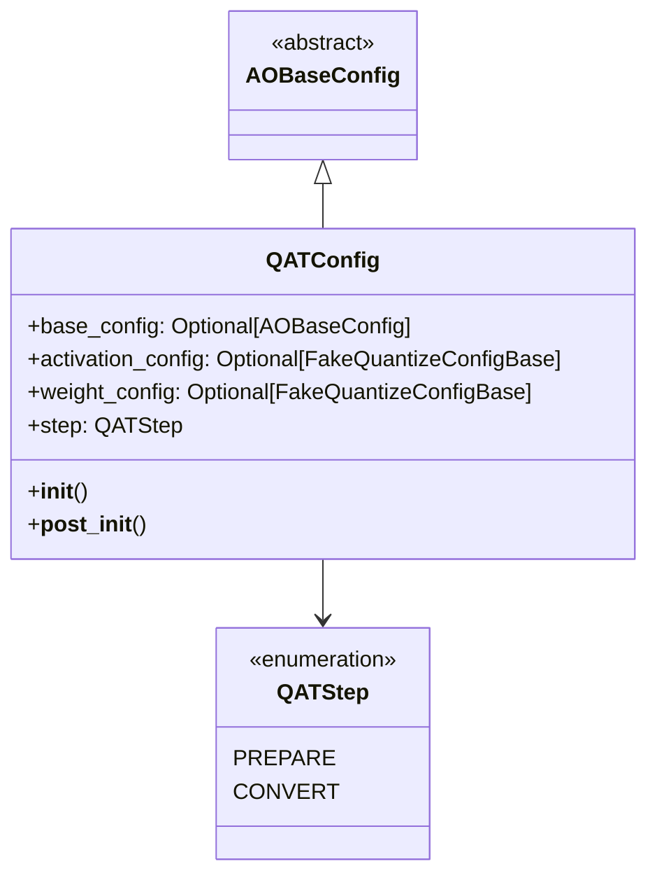
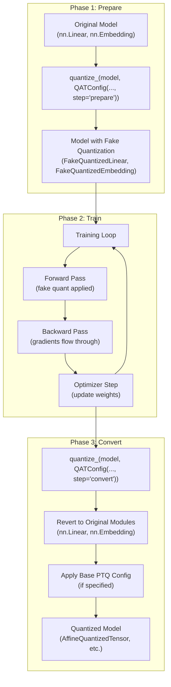
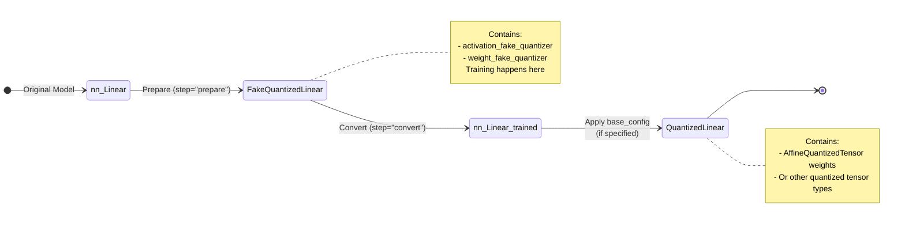
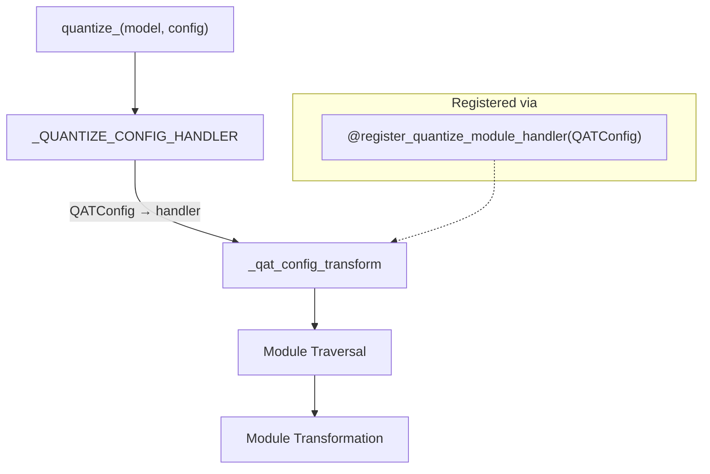

<!-- source: DeepWiki mcp.deepwiki.com · repo pytorch/ao · page 4.1 QATConfig and Workflow · fetched 2026-10-21 -->

# QATConfig and Workflow

<details>
<summary>Relevant source files</summary>

The following files were used as context for generating this wiki page:

- [test/quantization/test_qat.py](test/quantization/test_qat.py)
- [torchao/quantization/linear_quant_modules.py](torchao/quantization/linear_quant_modules.py)
- [torchao/quantization/qat/__init__.py](torchao/quantization/qat/__init__.py)
- [torchao/quantization/qat/affine_fake_quantized_tensor.py](torchao/quantization/qat/affine_fake_quantized_tensor.py)
- [torchao/quantization/qat/api.py](torchao/quantization/qat/api.py)
- [torchao/quantization/qat/embedding.py](torchao/quantization/qat/embedding.py)
- [torchao/quantization/qat/fake_quantize_config.py](torchao/quantization/qat/fake_quantize_config.py)
- [torchao/quantization/qat/fake_quantizer.py](torchao/quantization/qat/fake_quantizer.py)
- [torchao/quantization/qat/linear.py](torchao/quantization/qat/linear.py)
- [torchao/quantization/qat/two_step_quantizer.py](torchao/quantization/qat/two_step_quantizer.py)
- [torchao/quantization/qat/utils.py](torchao/quantization/qat/utils.py)

</details>


This document covers `QATConfig`, the primary configuration class for Quantization-Aware Training (QAT) in TorchAO, and its prepare-train-convert workflow. QAT is a technique for training models with simulated quantization to preserve accuracy when deploying quantized models.

For details on the fake quantization primitives and configurations used during QAT, see [Fake Quantization System](#4.2). For the specific module implementations like `FakeQuantizedLinear` and `FakeQuantizedEmbedding`, see [QAT Linear and Embedding Modules](#4.3).

## Purpose and Scope

`QATConfig` provides a unified interface for applying QAT to PyTorch models using the `quantize_` API. It orchestrates a two-phase workflow:

1. **Prepare phase**: Inserts fake quantization into the model before training.
2. **Convert phase**: Converts the trained model with fake quantization into an actual quantized model.

The config integrates seamlessly with the existing `quantize_` API and supports both automatic inference of fake quantization schemes from Post-Training Quantization (PTQ) configs and manual specification of custom fake quantization configurations.

Sources: [torchao/quantization/qat/api.py:43-127]()

## QATConfig Class

`QATConfig` is a dataclass that inherits from `AOBaseConfig` and represents the configuration for applying QAT to a model.

### Class Structure



### Configuration Fields

| Field | Type | Description |
|-------|------|-------------|
| `base_config` | `Optional[AOBaseConfig]` | Base PTQ config to infer fake quantization configs in prepare phase and apply in convert phase. |
| `activation_config` | `Optional[FakeQuantizeConfigBase]` | Custom fake quantization config for activations (mutually exclusive with `base_config`). |
| `weight_config` | `Optional[FakeQuantizeConfigBase]` | Custom fake quantization config for weights (mutually exclusive with `base_config`). |
| `step` | `QATStep` | One of "prepare" or "convert", determines the QAT phase. |

Sources: [torchao/quantization/qat/api.py:129-147]()

## The Prepare-Train-Convert Workflow



### Workflow Steps

1. **Prepare**: Module swap from standard PyTorch modules to fake quantized modules.
   - `nn.Linear` → `FakeQuantizedLinear` [torchao/quantization/qat/linear.py:134-155]()
   - `nn.Embedding` → `FakeQuantizedEmbedding` [torchao/quantization/qat/embedding.py:109-131]()
   - Fake quantizers are attached to weights and optionally activations.

2. **Train**: Standard training loop with fake quantization active.
   - Forward pass applies fake quantization (simulates low-precision numerics) via `FakeQuantizerBase` subclasses. [torchao/quantization/qat/fake_quantizer.py:48-71]()
   - Weights adapt to quantization effects during training using STE (Straight-Through Estimator).

3. **Convert**: Module swap from fake quantized modules back to standard modules, then apply quantization.
   - `FakeQuantizedLinear` → `nn.Linear` [torchao/quantization/qat/linear.py:117-131]()
   - `FakeQuantizedEmbedding` → `nn.Embedding` [torchao/quantization/qat/embedding.py:89-106]()
   - If `base_config` is provided, applies PTQ to produce actual quantized weights (e.g., `AffineQuantizedTensor`).

Sources: [torchao/quantization/qat/api.py:43-73](), [torchao/quantization/qat/api.py:187-307]()

## Two Usage Patterns

### Pattern 1: Using Base PTQ Config (Recommended)

The recommended approach uses a base PTQ config, which automatically infers the corresponding fake quantization schemes.

```python
# Example usage
from torchao.quantization import quantize_, Int4WeightOnlyConfig
from torchao.quantization.qat import QATConfig

# Define base PTQ config
base_config = Int4WeightOnlyConfig(group_size=32)

# Prepare: insert fake quantization
quantize_(model, QATConfig(base_config, step="prepare"))

# Train the model
train_loop(model)

# Convert: apply actual quantization
quantize_(model, QATConfig(base_config, step="convert"))
```

In this pattern:
- During `step="prepare"`: The `_infer_fake_quantize_configs` function derives fake quantization configs from `base_config`. [torchao/quantization/qat/fake_quantize_config.py:347-507]()
- During `step="convert"`: The same `base_config` is applied directly to quantize the model.

Sources: [torchao/quantization/qat/api.py:61-72]()

### Pattern 2: Using Custom Fake Quantization Configs

For experimentation or when no PTQ config exists, users can specify fake quantization configs directly.

```python
# Example usage
from torchao.quantization import quantize_
from torchao.quantization.qat import QATConfig, IntxFakeQuantizeConfig

# Define custom fake quantization configs
activation_config = IntxFakeQuantizeConfig(
    torch.int8, "per_token", is_symmetric=False
)
weight_config = IntxFakeQuantizeConfig(
    torch.int4, group_size=32, is_symmetric=True
)

# Prepare: insert fake quantization with custom configs
qat_config = QATConfig(
    activation_config=activation_config,
    weight_config=weight_config,
    step="prepare",
)
quantize_(model, qat_config)

# Train the model
train_loop(model)

# Convert: revert to original modules (no actual quantization)
quantize_(model, QATConfig(step="convert"))
```

Sources: [torchao/quantization/qat/api.py:84-102]()

## Supported Base Configs

The following PTQ configs can be used as `base_config` in Pattern 1:

| Base Config | Fake Quantization Behavior |
|-------------|----------------------------|
| `Int4WeightOnlyConfig` | Weight-only int4 fake quantization with per-group granularity. |
| `Float8DynamicActivationFloat8WeightConfig` | Float8 fake quantization for both activations and weights. |
| `Float8DynamicActivationInt4WeightConfig` | Float8 activation + int4 weight fake quantization. |
| `Int8DynamicActivationIntxWeightConfig` | Int8 activation + intx weight fake quantization. |
| `IntxWeightOnlyConfig` | Weight-only intx fake quantization. |

Sources: [torchao/quantization/qat/fake_quantize_config.py:347-507]()

## Module Transformation During Prepare and Convert



### Prepare Step Module Transformation Logic

The `_qat_config_transform` function handles module transformations:

**For `step="prepare"`:**
1. If `base_config` is provided, calls `_infer_fake_quantize_configs` to derive fake quantization configs. [torchao/quantization/qat/api.py:214-216]()
2. For `nn.Linear`: Creates `FakeQuantizedLinear`. [torchao/quantization/qat/api.py:221-230]()
3. For `nn.Embedding`: Creates `FakeQuantizedEmbedding`. [torchao/quantization/qat/api.py:231-237]()
4. Attaches fake quantizers based on the derived or provided configs.

**For `step="convert"`:**
1. Reverts fake quantized modules to original modules. [torchao/quantization/qat/api.py:260-268]()
2. If `base_config` is provided, applies the PTQ config's transform handler to quantize the model. [torchao/quantization/qat/api.py:270-304]()
3. Optionally passes learned scales and zero points (for range learning) to the quantization handler.

Sources: [torchao/quantization/qat/api.py:187-307]()

## Integration with quantize_

`QATConfig` integrates with the `quantize_` API through the module handler registration system.



The registration happens at [torchao/quantization/qat/api.py:187-188]():

```python
@register_quantize_module_handler(QATConfig)
def _qat_config_transform(
    module: torch.nn.Module,
    config: QATConfig,
) -> torch.nn.Module:
    ...
```

Sources: [torchao/quantization/qat/api.py:187-188]()

## QATStep Enum

`QATStep` is a string enumeration defining the two phases of QAT. [torchao/quantization/qat/api.py:33-40]()

- **PREPARE**: Inserts fake quantization into the model.
- **CONVERT**: Converts fake quantized model to actual quantized model.

Sources: [torchao/quantization/qat/api.py:33-40]()

## Fake Quantization Config Inference

The `_infer_fake_quantize_configs` function maps PTQ configs to corresponding fake quantization configs. [torchao/quantization/qat/fake_quantize_config.py:347-507]()

### Mapping Examples

| PTQ Config | Activation Fake Config | Weight Fake Config |
|------------|------------------------|-------------------|
| `Int4WeightOnlyConfig` | None | `IntxFakeQuantizeConfig` |
| `Float8DynamicActivationFloat8WeightConfig` | `Float8FakeQuantizeConfig` | `Float8FakeQuantizeConfig` |
| `Int8DynamicActivationIntxWeightConfig` | `IntxFakeQuantizeConfig` | `IntxFakeQuantizeConfig` |

Sources: [torchao/quantization/qat/fake_quantize_config.py:347-507]()

## Validation and Error Handling

`QATConfig.__post_init__` performs validation:

```python
def __post_init__(self):
    self.step = self.step.lower()
    if self.step not in [s.value for s in QATStep]:
        raise ValueError(f"`step` must be one of {all_step_values}")
    
    if self.base_config is not None and self.activation_config is not None:
        raise ValueError("Cannot specify both `base_config` and `activation_config`")
    
    if self.base_config is not None and self.weight_config is not None:
        raise ValueError("Cannot specify both `base_config` and `weight_config`")
```

Sources: [torchao/quantization/qat/api.py:150-184]()

## Range Learning (Prototype)

`QATConfig` supports an experimental feature called range learning, where scales and zero points become trainable parameters during QAT. [torchao/quantization/qat/fake_quantize_config.py:159]()

To use range learning:
1. Set `range_learning=True` in `IntxFakeQuantizeConfig`.
2. Call `initialize_fake_quantizers(model, example_inputs)` before training. [torchao/quantization/qat/api.py:462-481]()

During the convert step with range learning:
- Learned scales and zero points are recovered from the fake quantizers and passed to the final quantization logic. [torchao/quantization/qat/api.py:276-291]()

Sources: [torchao/quantization/qat/api.py:269-305](), [torchao/quantization/qat/api.py:462-481]()

---

