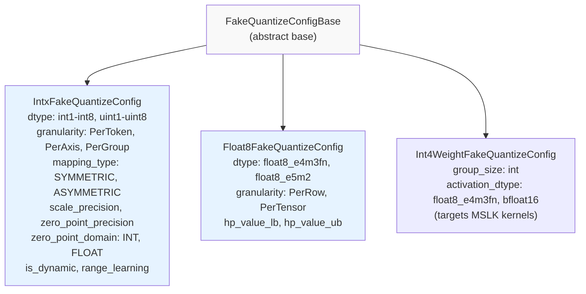
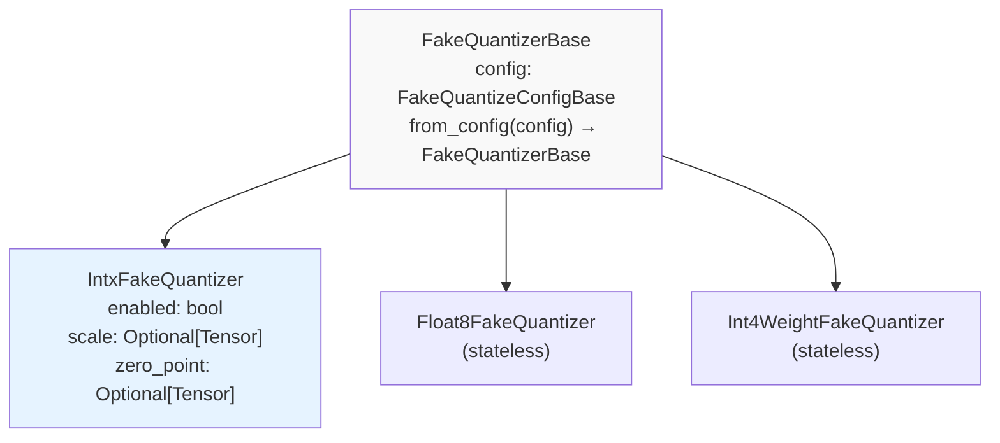
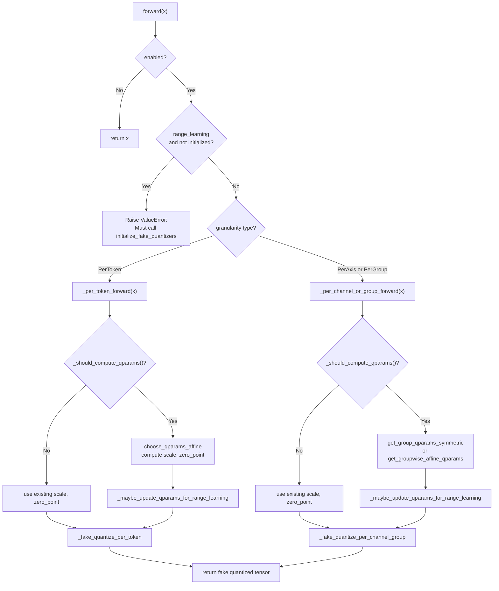

<!-- source: DeepWiki mcp.deepwiki.com · repo pytorch/ao · page 4.2 Fake Quantization System · fetched 2026-10-21 -->

# Fake Quantization System

<details>
<summary>Relevant source files</summary>

The following files were used as context for generating this wiki page:

- [test/quantization/test_qat.py](test/quantization/test_qat.py)
- [torchao/quantization/linear_quant_modules.py](torchao/quantization/linear_quant_modules.py)
- [torchao/quantization/qat/__init__.py](torchao/quantization/qat/__init__.py)
- [torchao/quantization/qat/affine_fake_quantized_tensor.py](torchao/quantization/qat/affine_fake_quantized_tensor.py)
- [torchao/quantization/qat/api.py](torchao/quantization/qat/api.py)
- [torchao/quantization/qat/embedding.py](torchao/quantization/qat/embedding.py)
- [torchao/quantization/qat/fake_quantize_config.py](torchao/quantization/qat/fake_quantize_config.py)
- [torchao/quantization/qat/fake_quantizer.py](torchao/quantization/qat/fake_quantizer.py)
- [torchao/quantization/qat/linear.py](torchao/quantization/qat/linear.py)
- [torchao/quantization/qat/two_step_quantizer.py](torchao/quantization/qat/two_step_quantizer.py)
- [torchao/quantization/qat/utils.py](torchao/quantization/qat/utils.py)

</details>


The fake quantization system simulates quantization numerics in high precision during training without actually casting tensors to lower bit-width dtypes. This enables Quantization-Aware Training (QAT) by allowing models to learn weight values that account for quantization error while maintaining full-precision gradients for stable training. For the broader QAT workflow and how fake quantization fits into the prepare and convert steps, see [4.1](). For the actual QAT modules that use fake quantization, see [4.3]().

The system consists of three main layers: **configuration classes** that specify quantization schemes, **quantizer modules** that apply fake quantization transformations, and **primitive operations** that implement the core fake quantization math.

## Fake Quantization Configuration Hierarchy

Fake quantization configurations define the target dtype, granularity, symmetry, and other properties for simulating quantization. All configs inherit from `FakeQuantizeConfigBase` [torchao/quantization/qat/fake_quantize_config.py:40-45]() and are used to construct the appropriate `FakeQuantizerBase` instance.



**Sources:** [torchao/quantization/qat/fake_quantize_config.py:40-335](), [torchao/quantization/qat/fake_quantizer.py:62-71]()

### IntxFakeQuantizeConfig

`IntxFakeQuantizeConfig` is the most flexible configuration, supporting integer dtypes from 1-bit up to 8-bit with multiple granularities and mapping types [torchao/quantization/qat/fake_quantize_config.py:105-150]().

| Property | Type | Description |
|----------|------|-------------|
| `dtype` | `torch.dtype` or `TorchAODType` | Target quantization dtype (int1-int8, uint1-uint8) |
| `granularity` | `Granularity` | Per-token, per-channel (axis=0), or per-group |
| `mapping_type` | `MappingType` | Symmetric or asymmetric quantization |
| `scale_precision` | `torch.dtype` | Dtype for scales (default: float32) |
| `zero_point_precision` | `torch.dtype` | Dtype for zero points (default: int32) |
| `zero_point_domain` | `ZeroPointDomain` | Whether zero point is integer or float domain |
| `is_dynamic` | `bool` | Compute scales/zero points dynamically (default: True) |
| `range_learning` | `bool` | Make scales/zero points trainable parameters |

The config supports multiple initialization styles, including string aliases for granularities like `"per_token"`, `"per_channel"`, and `"per_group"` [torchao/quantization/qat/fake_quantize_config.py:180-210]().

**Sources:** [torchao/quantization/qat/fake_quantize_config.py:105-335]()

### Float8FakeQuantizeConfig

`Float8FakeQuantizeConfig` targets float8 dtypes with per-row or per-tensor granularity [torchao/quantization/qat/fake_quantize_config.py:49-64]():

```python
Float8FakeQuantizeConfig(
    dtype=torch.float8_e4m3fn,
    granularity=PerRow(),
    hp_value_lb=1e-12,  # lower bound for scale calculation
    hp_value_ub=None,   # upper bound for scale calculation
)
```

This config validates that the dtype is a float8 type and the granularity is supported for FP8 inference workflows [torchao/quantization/qat/fake_quantize_config.py:65-79]().

**Sources:** [torchao/quantization/qat/fake_quantize_config.py:48-80]()

### Int4WeightFakeQuantizeConfig

`Int4WeightFakeQuantizeConfig` targets specific MSLK kernels (`torch.ops.mslk.f8i4bf16_shuffled`, `torch.ops.mslk.bf16i4bf16_shuffled`, `torch.ops.mslk.bf16i4bf16_rowwise`) with specialized numerics [torchao/quantization/qat/fake_quantize_config.py:82-96]():

```python
Int4WeightFakeQuantizeConfig(
    group_size=128,
    activation_dtype=torch.float8_e4m3fn,  # or torch.bfloat16
)
```

**Sources:** [torchao/quantization/qat/fake_quantize_config.py:82-103]()

## Fake Quantizer Implementation Hierarchy

Fake quantizers are `torch.nn.Module` instances that apply fake quantization transformations based on their configuration. They maintain quantization parameters (scales, zero points) and implement the forward pass logic [torchao/quantization/qat/fake_quantizer.py:48-60]().



**Sources:** [torchao/quantization/qat/fake_quantizer.py:48-196]()

### IntxFakeQuantizer

`IntxFakeQuantizer` is the primary quantizer for integer dtypes, supporting both dynamic and static quantization as well as range learning [torchao/quantization/qat/fake_quantizer.py:184-196]().

**Forward pass logic:**



**Sources:** [torchao/quantization/qat/fake_quantizer.py:198-303]()

For range learning, `_maybe_update_qparams_for_range_learning()` converts scales and zero points to `torch.nn.Parameter` with `requires_grad=True` [torchao/quantization/qat/fake_quantizer.py:305-333]().

### Float8FakeQuantizer

`Float8FakeQuantizer` applies float8 fake quantization using `_choose_scale_float8` and FP8-specific quant/dequant primitives [torchao/quantization/qat/fake_quantizer.py:83-95]().

### Int4WeightFakeQuantizer

`Int4WeightFakeQuantizer` implements specialized numerics matching MSLK kernels for int4 weights. For FP8 activations, it first simulates a per-row FP8 quantization of weights before the per-group Int4 quantization [torchao/quantization/qat/fake_quantizer.py:120-159](). For BF16 activations, it uses an asymmetric scheme with an offset zero point [torchao/quantization/qat/fake_quantizer.py:161-181]().

**Sources:** [torchao/quantization/qat/fake_quantizer.py:98-182]()

## Fake Quantization Primitives

### _fake_quantize_affine

The fundamental operation is `_fake_quantize_affine`, which performs the quantize-dequantize cycle using the Straight-Through Estimator (STE) [torchao/quantization/quant_primitives.py:83]().

```python
# Simulation math
q_val = clamp(round((x - zero_point) / scale), qmin, qmax)
fake_q = q_val * scale + zero_point
```

**Sources:** [torchao/quantization/qat/utils.py:12-15](), [torchao/quantization/qat/affine_fake_quantized_tensor.py:89-98]()

### _AffineFakeQuantizedTensor

This is a `TorchAOBaseTensor` subclass that wraps a float tensor and a `apply_fake_quant_fn` [torchao/quantization/qat/affine_fake_quantized_tensor.py:112-127](). It is created via `_ToAffineFakeQuantized.apply`, which ensures the quantization parameters are computed in a differentiable way [torchao/quantization/qat/affine_fake_quantized_tensor.py:26-46]().

**Sources:** [torchao/quantization/qat/affine_fake_quantized_tensor.py:112-205]()

## Integration with QAT Modules

Fake quantizers are used by `FakeQuantizedLinear` and `FakeQuantizedEmbedding` modules [torchao/quantization/qat/linear.py:42-65](), [torchao/quantization/qat/embedding.py:26-42]().

```python
# FakeQuantizedLinear Forward Pass
def forward(self, x: torch.Tensor) -> torch.Tensor:
    if self.activation_fake_quantizer is not None:
        x = self.activation_fake_quantizer(x)
    if self.weight_fake_quantizer is not None:
        w = self.weight_fake_quantizer(self.weight)
    else:
        w = self.weight
    return F.linear(x, w, self.bias)
```

**Sources:** [torchao/quantization/qat/linear.py:108-115](), [torchao/quantization/qat/embedding.py:74-87]()

## Range Learning (Prototype)

Range learning allows the optimizer to adjust quantization ranges. It requires setting `range_learning=True` in `IntxFakeQuantizeConfig` [torchao/quantization/qat/fake_quantize_config.py:159]() and calling `initialize_fake_quantizers(model, example_inputs)` before training [torchao/quantization/qat/api.py:446-466]().

During initialization, `_maybe_update_qparams_for_range_learning` is triggered, which converts `scale` and `zero_point` into `torch.nn.Parameter` [torchao/quantization/qat/fake_quantizer.py:311-333]().

**Sources:** [torchao/quantization/qat/fake_quantizer.py:305-333](), [torchao/quantization/qat/api.py:446-466]()

---

