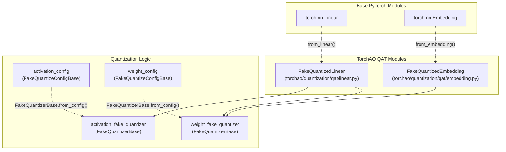
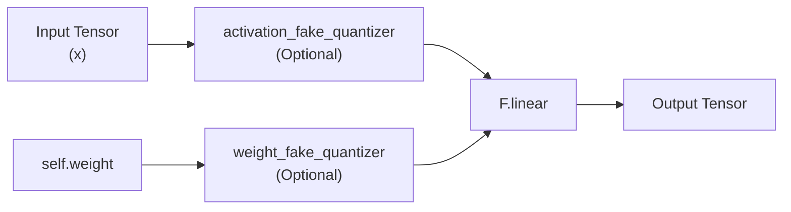
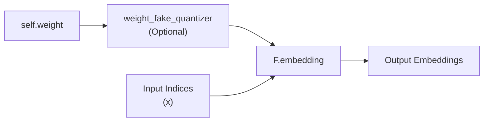
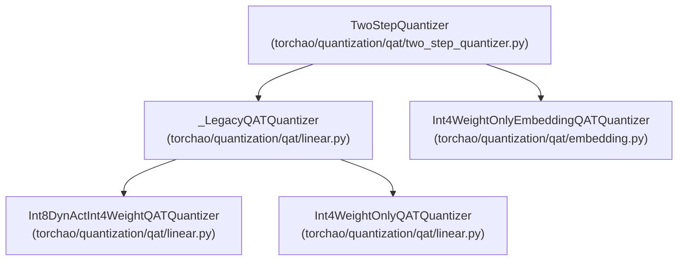

<!-- source: DeepWiki mcp.deepwiki.com · repo pytorch/ao · page 4.3 QAT Linear and Embedding Modules · fetched 2026-10-21 -->

# QAT Linear and Embedding Modules

Relevant source files

The following files were used as context for generating this wiki page:

- [test/quantization/test_qat.py](test/quantization/test_qat.py)
- [torchao/quantization/linear_quant_modules.py](torchao/quantization/linear_quant_modules.py)
- [torchao/quantization/prototype/__init__.py](torchao/quantization/prototype/__init__.py)
- [torchao/quantization/prototype/qat/README.md](torchao/quantization/prototype/qat/README.md)
- [torchao/quantization/prototype/qat/__init__.py](torchao/quantization/prototype/qat/__init__.py)
- [torchao/quantization/prototype/qat/_module_swap_api.py](torchao/quantization/prototype/qat/_module_swap_api.py)
- [torchao/quantization/prototype/qat/affine_fake_quantized_tensor.py](torchao/quantization/prototype/qat/affine_fake_quantized_tensor.py)
- [torchao/quantization/prototype/qat/api.py](torchao/quantization/prototype/qat/api.py)
- [torchao/quantization/prototype/qat/embedding.py](torchao/quantization/prototype/qat/embedding.py)
- [torchao/quantization/prototype/qat/fake_quantizer.py](torchao/quantization/prototype/qat/fake_quantizer.py)
- [torchao/quantization/prototype/qat/linear.py](torchao/quantization/prototype/qat/linear.py)
- [torchao/quantization/qat/__init__.py](torchao/quantization/qat/__init__.py)
- [torchao/quantization/qat/affine_fake_quantized_tensor.py](torchao/quantization/qat/affine_fake_quantized_tensor.py)
- [torchao/quantization/qat/api.py](torchao/quantization/qat/api.py)
- [torchao/quantization/qat/embedding.py](torchao/quantization/qat/embedding.py)
- [torchao/quantization/qat/fake_quantize_config.py](torchao/quantization/qat/fake_quantize_config.py)
- [torchao/quantization/qat/fake_quantizer.py](torchao/quantization/qat/fake_quantizer.py)
- [torchao/quantization/qat/linear.py](torchao/quantization/qat/linear.py)
- [torchao/quantization/qat/two_step_quantizer.py](torchao/quantization/qat/two_step_quantizer.py)
- [torchao/quantization/qat/utils.py](torchao/quantization/qat/utils.py)

This page documents the core module classes used in Quantization-Aware Training (QAT), specifically the linear and embedding layers that support fake quantization during training. These modules simulate quantization numerics using high-precision arithmetic while maintaining trainable weights.

**Scope**: This page covers `FakeQuantizedLinear`, `FakeQuantizedEmbedding`, specialized QAT module variants (int8 dynamic activation + int4 weight, int4 weight-only, float8 + int4), and the legacy quantizer classes that perform module swaps. For the QAT workflow and API usage, see [QAT Config and Workflow](4.1). For fake quantization configuration and implementation details, see [Fake Quantization System](4.2).

---

## Module Architecture Overview

The QAT system provides two general-purpose module classes that can be customized with different quantization schemes, plus several specialized variants optimized for specific configurations.

**General-Purpose Modules**

**Sources**: [torchao/quantization/qat/linear.py:42-156](), [torchao/quantization/qat/embedding.py:26-132](), [torchao/quantization/qat/fake_quantizer.py:62-71]()

---

## FakeQuantizedLinear

`FakeQuantizedLinear` is the general-purpose linear layer with fake quantization support. It extends `torch.nn.Linear` and applies fake quantization to weights and/or activations based on the provided configs.

### Structure and Forward Pass

| Field | Type | Description |
|-------|------|-------------|
| `in_features` | int | Input dimension |
| `out_features` | int | Output dimension |
| `bias` | bool | Whether to use bias |
| `activation_fake_quantizer` | Optional[FakeQuantizerBase] | Fake quantizer for input activations |
| `weight_fake_quantizer` | Optional[FakeQuantizerBase] | Fake quantizer for weights |

**Sources**: [torchao/quantization/qat/linear.py:42-107]()

### Forward Pass Logic

The forward pass applies fake quantization in sequence:
1. If `activation_fake_quantizer` is present, fake quantize the input: `x = self.activation_fake_quantizer(x)` [torchao/quantization/qat/linear.py:109-110]()
2. If `weight_fake_quantizer` is present, fake quantize the weight: `w = self.weight_fake_quantizer(self.weight)` [torchao/quantization/qat/linear.py:111-112]()
3. Perform linear operation: `return F.linear(x, w, self.bias)` [torchao/quantization/qat/linear.py:115-115]()

**Sources**: [torchao/quantization/qat/linear.py:108-115]()

### Module Conversion Methods

**from_linear (classmethod)**: Creates a `FakeQuantizedLinear` from an existing `torch.nn.Linear` [torchao/quantization/qat/linear.py:133-156](). This method copies dimensions, bias, and weights (unless on meta device).

**to_linear**: Converts back to a standard `torch.nn.Linear` [torchao/quantization/qat/linear.py:117-131](). This is used during the convert phase to recover a standard module before applying actual quantization.

**Sources**: [torchao/quantization/qat/linear.py:117-156]()

---

## FakeQuantizedEmbedding

`FakeQuantizedEmbedding` extends `torch.nn.Embedding` with fake quantization support for embedding weights.

### Structure and Forward Pass

The forward pass is similar to `FakeQuantizedLinear` but only quantizes weights:
1. If `weight_fake_quantizer` is present, fake quantize the embedding weight: `w = self.weight_fake_quantizer(self.weight)` [torchao/quantization/qat/embedding.py:75-76]()
2. Perform embedding lookup: `return F.embedding(x, w, self.padding_idx, ...)` [torchao/quantization/qat/embedding.py:79-87]()

**Sources**: [torchao/quantization/qat/embedding.py:26-88]()

---

## Specialized QAT Linear Modules

TorchAO provides specialized linear modules with pre-configured settings to match specific PTQ kernels.

### Int8DynActInt4WeightQATLinear

This module implements int8 dynamic per-token fake quantized activations with int4 fake quantized grouped per-channel weights. It matches the numerics of `Int8DynActInt4WeightLinear`.

**Key Parameters**:
- `groupsize`: Number of elements in each quantized group for weights (default: 256) [torchao/quantization/qat/linear.py:313-313]()
- `precision`: Weight dtype (default: torch.float32) [torchao/quantization/qat/linear.py:315-315]()
- `scales_precision`: Precision of per-group scales (default: torch.float32) [torchao/quantization/qat/linear.py:316-316]()

**Sources**: [torchao/quantization/qat/linear.py:301-347]()

### Int4WeightOnlyQATLinear

This module implements int4 fake quantized grouped per-channel weights with no activation quantization. The forward numerics match `WeightOnlyInt4Linear` which uses efficient int4 tinygemm kernels.

**Important**: Padding for QAT 4w is not supported yet. The constructor validates input dimensions with `_check_linear_int4_k` [torchao/quantization/qat/linear.py:515-515]().

**Sources**: [torchao/quantization/qat/linear.py:501-545]()

---

## Legacy QAT Quantizers and TwoStepQuantizer

Legacy quantizer classes implement the `TwoStepQuantizer` interface, providing `prepare` and `convert` methods for module swapping.

### Quantizer Class Hierarchy

### Module Swap Mechanics

1. **Prepare Phase**: The quantizer traverses the model and swaps `nn.Linear` or `nn.Embedding` with their QAT counterparts (e.g., `Int8DynActInt4WeightQATLinear`) [torchao/quantization/qat/linear.py:218-245]().
2. **Convert Phase**: After training, the quantizer swaps the QAT modules with actual quantized modules (e.g., `Int8DynActInt4WeightLinear`), performing the final quantization of the learned weights [torchao/quantization/qat/linear.py:247-299]().

**Sources**: [torchao/quantization/qat/linear.py:201-299](), [torchao/quantization/qat/linear.py:408-499](), [torchao/quantization/qat/embedding.py:139-267]()

---

## Helper Functions

### Enabling and Disabling Fake Quantization

These helper functions allow users to toggle fake quantization during training, which is useful for debugging or specific training schedules.

- `enable_linear_fake_quant(mod, enabled=True)`: Sets the `enabled` flag on both activation and weight fake quantizers within a `FakeQuantizedLinear` [torchao/quantization/qat/linear.py:158-170]().
- `disable_linear_fake_quant(mod)`: Helper to call `enable_linear_fake_quant(mod, enabled=False)` [torchao/quantization/qat/linear.py:172-177]().

**Sources**: [torchao/quantization/qat/linear.py:158-177]()

---

## Testing and Validation

The test suite in `test/quantization/test_qat.py` validates that QAT modules match PTQ numerics exactly.

| Test Case | Target Module | Validation |
|-----------|---------------|------------|
| `test_qat_8da4w_linear` | `Int8DynActInt4WeightQATLinear` | Matches `Int8DynActInt4WeightLinear` PTQ numerics [test/quantization/test_qat.py:361-361]() |
| `test_qat_4w_linear` | `Int4WeightOnlyQATLinear` | Matches `WeightOnlyInt4Linear` PTQ numerics [test/quantization/test_qat.py:539-539]() |
| `test_qat_4w_embedding` | `Int4WeightOnlyQATEmbedding` | Validates learned scales and zero points [test/quantization/test_qat.py:1016-1016]() |

**Sources**: [test/quantization/test_qat.py:361-1066]()

---

