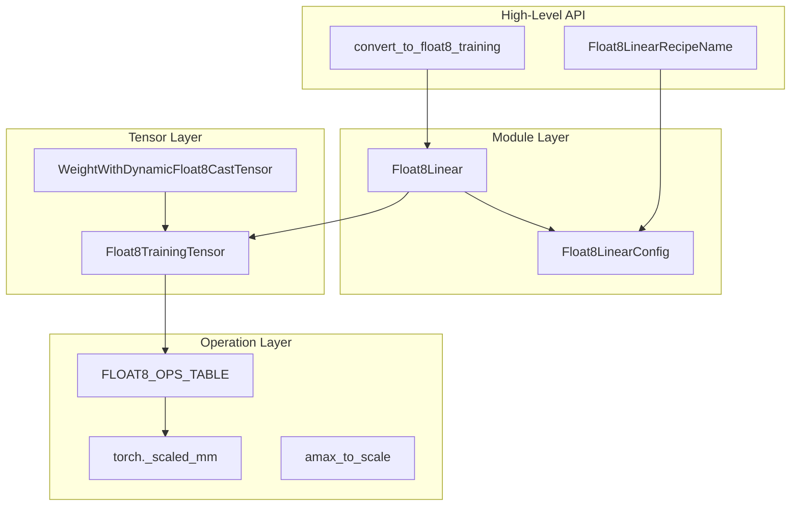
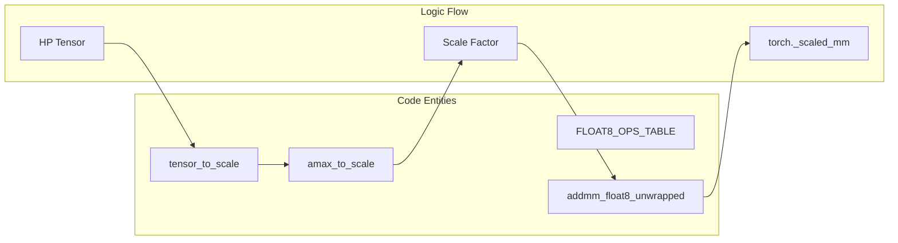

<!-- source: DeepWiki mcp.deepwiki.com · repo pytorch/ao · page 5 Float8 Training System · fetched 2026-10-21 -->

# Float8 Training System

Relevant source files

The following files were used as context for generating this wiki page:

- [test/float8/test_base.py](test/float8/test_base.py)
- [test/float8/test_compile.py](test/float8/test_compile.py)
- [test/float8/test_dtensor.py](test/float8/test_dtensor.py)
- [test/float8/test_fsdp.py](test/float8/test_fsdp.py)
- [test/float8/test_fsdp2/test_fsdp2.py](test/float8/test_fsdp2/test_fsdp2.py)
- [test/float8/test_fsdp_compile.py](test/float8/test_fsdp_compile.py)
- [test/float8/test_numerics_integration.py](test/float8/test_numerics_integration.py)
- [torchao/float8/README.md](torchao/float8/README.md)
- [torchao/float8/__init__.py](torchao/float8/__init__.py)
- [torchao/float8/config.py](torchao/float8/config.py)
- [torchao/float8/float8_linear.py](torchao/float8/float8_linear.py)
- [torchao/float8/float8_linear_utils.py](torchao/float8/float8_linear_utils.py)
- [torchao/float8/float8_ops.py](torchao/float8/float8_ops.py)
- [torchao/float8/float8_scaling_utils.py](torchao/float8/float8_scaling_utils.py)
- [torchao/float8/float8_tensor_parallel.py](torchao/float8/float8_tensor_parallel.py)
- [torchao/float8/float8_training_tensor.py](torchao/float8/float8_training_tensor.py)
- [torchao/float8/float8_utils.py](torchao/float8/float8_utils.py)
- [torchao/float8/fsdp_utils.py](torchao/float8/fsdp_utils.py)
- [torchao/float8/types.py](torchao/float8/types.py)

The Float8 training system in PyTorch AO accelerates neural network training using 8-bit floating-point data types. It provides memory-efficient training and significant speedups on modern hardware (e4m3 for weights/activations, e5m2 for gradients) while maintaining numerical accuracy comparable to bfloat16.

## Core Architecture

The system is built on a modular architecture that integrates with PyTorch's autograd and distributed systems.

Sources: [torchao/float8/float8_linear.py:25-26](), [torchao/float8/config.py:141-177](), [torchao/float8/float8_training_tensor.py:242-250]()

### Float8Linear and Configuration
The primary entry point is `convert_to_float8_training`, which swaps `nn.Linear` modules for `Float8Linear`. This module manages the three distinct GEMMs required for training: forward, grad-input, and grad-weight.

For details on module swapping and recipe-based configuration, see [Float8Linear and Configuration](#5.1).

Sources: [torchao/float8/float8_linear_utils.py:86-123](), [torchao/float8/float8_linear.py:207-215]()

### Float8TrainingTensor
`Float8TrainingTensor` is a tensor subclass that encapsulates the float8 `_data`, the `_scale` factor, and metadata like `_orig_dtype`. It uses `matmul_with_hp_or_float8_args` to handle autograd, ensuring that casts to float8 happen at the correct points in the computation graph.

For details on the subclass structure and GEMM roles, see [Float8TrainingTensor](#5.2).

Sources: [torchao/float8/float8_training_tensor.py:242-359](), [torchao/float8/float8_linear.py:29-36]()

## Scaling and Operations

The system supports both **Tensorwise** (one scale per tensor) and **Axiswise** (one scale per row/column) scaling. Scaling factors are typically computed dynamically during the forward and backward passes to maximize the dynamic range of the 8-bit format.

For details on scaling strategies, amax calculation, and the internal ops table, see [Float8 Scaling and Operations](#5.3).

Sources: [torchao/float8/float8_utils.py:86-115](), [torchao/float8/float8_ops.py:21-29]()

## Distributed Training

### FSDP2 Integration
Float8 training integrates with FSDP2 to reduce communication bandwidth. By using `WeightWithDynamicFloat8CastTensor`, the system can perform all-gather operations in float8 precision. The `precompute_float8_dynamic_scale_for_fsdp` utility allows for synchronized scale calculation across ranks after optimizer steps.

For details on FSDP2 hooks and weight casting, see [FSDP2 Integration](#5.4).

Sources: [torchao/float8/fsdp_utils.py:28-86](), [torchao/float8/fsdp_utils.py:139-160]()

### Tensor Parallelism
The system supports Tensor Parallelism (TP) by sharding float8 tensors across devices. `Float8ColwiseParallel` and `Float8RowwiseParallel` handle the specific communication patterns (like all-gather or reduce-scatter) while maintaining the tensors in float8 format to save bandwidth.

For details on DTensor integration and parallel primitives, see [Tensor Parallelism Integration](#5.5).

Sources: [torchao/float8/float8_tensor_parallel.py:42-167](), [test/float8/test_dtensor.py:88-100]()

## Hardware and Performance

Float8 training is optimized for NVIDIA Hopper (SM90) and Ada Lovelace (SM89) architectures, as well as AMD MI300/MI350 series. On unsupported hardware, the system provides an emulation mode that performs calculations in higher precision while simulating float8 range constraints.

| Feature | Support |
| :--- | :--- |
| **NVIDIA SM90+** | Native `torch._scaled_mm` |
| **AMD MI300/350** | `e4m3fnuz`/`e5m2fnuz` support |
| **Legacy/CPU** | Emulated via high-precision |

Sources: [torchao/float8/config.py:67-85](), [torchao/utils.py:48-52](), [torchao/float8/float8_ops.py:38-92]()

---

