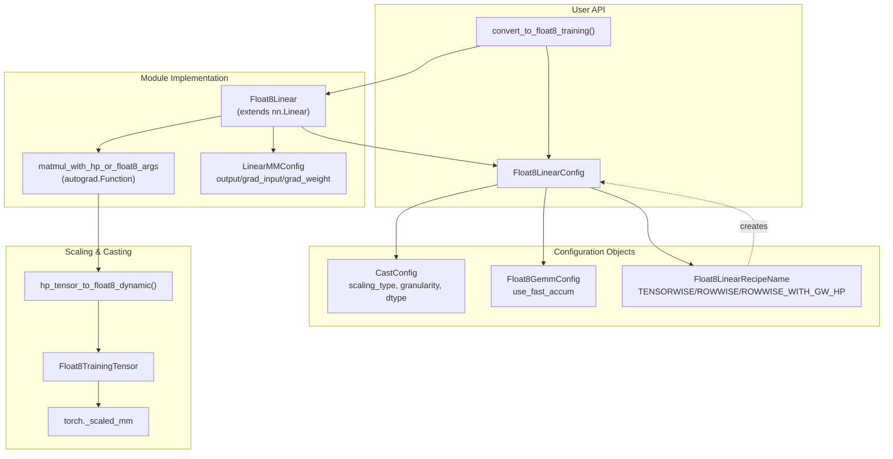
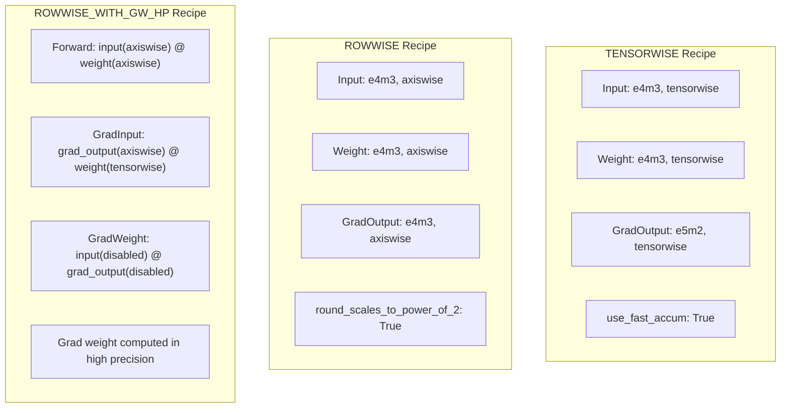
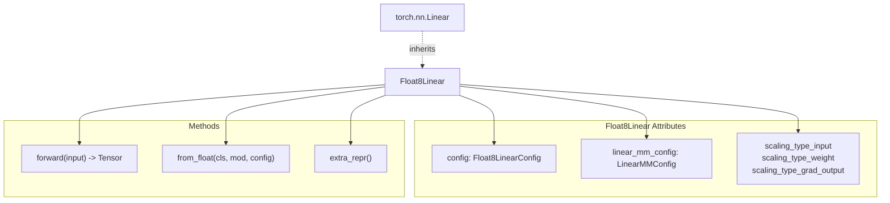
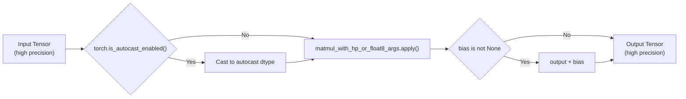
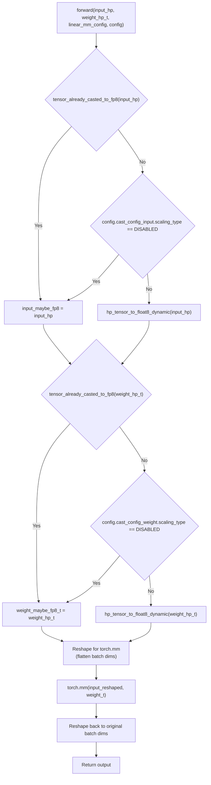

<!-- source: DeepWiki mcp.deepwiki.com · repo pytorch/ao · page 5.1 Float8Linear and Configuration · fetched 2026-10-21 -->

# Float8Linear and Configuration

<details>
<summary>Relevant source files</summary>

The following files were used as context for generating this wiki page:

- [test/float8/test_base.py](test/float8/test_base.py)
- [test/float8/test_compile.py](test/float8/test_compile.py)
- [test/float8/test_dtensor.py](test/float8/test_dtensor.py)
- [test/float8/test_fsdp.py](test/float8/test_fsdp.py)
- [test/float8/test_fsdp2/test_fsdp2.py](test/float8/test_fsdp2/test_fsdp2.py)
- [test/float8/test_fsdp_compile.py](test/float8/test_fsdp_compile.py)
- [test/float8/test_numerics_integration.py](test/float8/test_numerics_integration.py)
- [torchao/float8/README.md](torchao/float8/README.md)
- [torchao/float8/__init__.py](torchao/float8/__init__.py)
- [torchao/float8/config.py](torchao/float8/config.py)
- [torchao/float8/float8_linear.py](torchao/float8/float8_linear.py)
- [torchao/float8/float8_linear_utils.py](torchao/float8/float8_linear_utils.py)
- [torchao/float8/float8_ops.py](torchao/float8/float8_ops.py)
- [torchao/float8/float8_scaling_utils.py](torchao/float8/float8_scaling_utils.py)
- [torchao/float8/float8_tensor_parallel.py](torchao/float8/float8_tensor_parallel.py)
- [torchao/float8/float8_training_tensor.py](torchao/float8/float8_training_tensor.py)
- [torchao/float8/float8_utils.py](torchao/float8/float8_utils.py)
- [torchao/float8/fsdp_utils.py](torchao/float8/fsdp_utils.py)
- [torchao/float8/types.py](torchao/float8/types.py)

</details>


This document describes the `Float8Linear` module and its configuration system, which form the core of TorchAO's float8 training workflow. This system enables training neural networks with 8-bit floating point precision to accelerate training while maintaining accuracy.

For information about the underlying tensor subclass used by `Float8Linear`, see [Float8TrainingTensor](#5.2). For details on scaling operations and utilities, see [Float8 Scaling and Operations](#5.3). For distributed training integration, see [FSDP2 Integration](#5.4) and [Tensor Parallelism Integration](#5.5).

## Overview

Float8 training accelerates model training by performing matrix multiplications in 8-bit floating point precision (FP8) while maintaining high precision for activations and gradients. The system provides:

- **Dynamic Scaling**: Automatically computes scaling factors for float8 tensors during training.
- **Multiple Recipes**: Pre-configured settings optimized for different accuracy/performance tradeoffs.
- **Distributed Training Support**: Integration with FSDP2 and tensor parallelism.
- **Torch.compile Compatibility**: Works with PyTorch's compilation system.

Sources: [torchao/float8/README.md:1-6](), [torchao/float8/config.py:19-56]()

## Architecture Overview



**Diagram: Float8Linear System Architecture**

The system consists of three layers:
1. **User API**: `convert_to_float8_training()` accepts a `Float8LinearConfig` and converts `nn.Linear` modules.
2. **Configuration**: Multiple objects define casting behavior for inputs, weights, and gradients.
3. **Runtime**: `Float8Linear` uses custom autograd functions to cast tensors and perform scaled matrix multiplications.

Sources: [torchao/float8/float8_linear.py:29-91](), [torchao/float8/config.py:141-184](), [torchao/float8/float8_linear_utils.py:86-123]()

## Float8LinearConfig

`Float8LinearConfig` is the primary configuration object that controls all aspects of float8 training in a linear layer. It is a frozen dataclass.

### Core Structure

```mermaid
graph LR
    subgraph "Float8LinearConfig"
        InputCast["cast_config_input<br/>CastConfig"]
        WeightCast["cast_config_weight<br/>CastConfig"]
        GradOutputCast["cast_config_grad_output<br/>CastConfig"]
        
        InputCastGW["cast_config_input_for_grad_weight<br/>Optional[CastConfig]"]
        WeightCastGI["cast_config_weight_for_grad_input<br/>Optional[CastConfig]"]
        GradOutputCastGW["cast_config_grad_output_for_grad_weight<br/>Optional[CastConfig]"]
        
        OutputGemm["gemm_config_output<br/>Float8GemmConfig"]
        GradInputGemm["gemm_config_grad_input<br/>Float8GemmConfig"]
        GradWeightGemm["gemm_config_grad_weight<br/>Float8GemmConfig"]
        
        Flags["enable_fsdp_float8_all_gather<br/>pad_inner_dim<br/>emulate<br/>round_scales_to_power_of_2"]
    end
```



**Diagram: Float8LinearConfig Structure**

### CastConfig

Each `CastConfig` object controls how a single tensor is cast to float8.

| Field | Type | Description |
|-------|------|-------------|
| `scaling_type` | `ScalingType` | `DYNAMIC` (compute scale during forward) or `DISABLED` (no casting). |
| `scaling_granularity` | `ScalingGranularity` | `TENSORWISE` (single scale) or `AXISWISE` (per-row/column scales). |
| `target_dtype` | `torch.dtype` | Target float8 dtype (e.g., `torch.float8_e4m3fn`). |

Sources: [torchao/float8/config.py:92-123]()

### Float8GemmConfig

Controls behavior of the scaled matrix multiplication.

| Field | Type | Description |
|-------|------|-------------|
| `use_fast_accum` | `bool` | Enable fast accumulation in lower precision. |

Sources: [torchao/float8/config.py:124-138]()

### Configuration Overrides

The config supports separate configurations for each operand in each of the three gemms:

1. **Forward GEMM** (`output = input @ weight.t()`):
   - `cast_config_input`: How to cast input.
   - `cast_config_weight`: How to cast weight.
   - `gemm_config_output`: GEMM configuration.

2. **Backward Input GEMM** (`grad_input = grad_output @ weight`):
   - `cast_config_grad_output`: How to cast grad_output.
   - `cast_config_weight_for_grad_input`: Optional override for weight casting.
   - `gemm_config_grad_input`: GEMM configuration.

3. **Backward Weight GEMM** (`grad_weight = input.t() @ grad_output`):
   - `cast_config_input_for_grad_weight`: Optional override for input casting.
   - `cast_config_grad_output_for_grad_weight`: Optional override for grad_output casting.
   - `gemm_config_grad_weight`: GEMM configuration.

Sources: [torchao/float8/config.py:180-228]()

## Float8LinearRecipeName

Pre-configured recipes optimize for different accuracy vs. performance tradeoffs.

### Available Recipes

| Recipe | Description | Characteristics |
|--------|-------------|-----------------|
| `TENSORWISE` | Default recipe | Single scale per tensor, uses cuBLAS tensorwise kernel, fastest. |
| `ROWWISE` | Rowwise scaling | Per-row/column scales, uses CUTLASS rowwise kernel, better accuracy. |
| `ROWWISE_WITH_GW_HP` | Rowwise with high-precision grad_weight | Combines rowwise forward with high-precision backward weight grad computation. |

Sources: [torchao/float8/config.py:141-177]()

### Recipe Implementation Details



**Diagram: Float8 Recipe Configurations**

### Creating Configs from Recipes

```python
# Using from_recipe_name class method
config = Float8LinearConfig.from_recipe_name(Float8LinearRecipeName.ROWWISE)
```

The `from_recipe_name()` static method creates a `Float8LinearConfig` with recipe-specific settings.

**ROWWISE_WITH_GW_HP Recipe Details**:
- Forward: `output_hp = input_fp8_axiswise_dim0 @ weight_t_axiswise_dim1`
- Backward input: `grad_input_hp = grad_output_fp8_axiswise_dim0 @ weight_fp8_tensorwise`
- Backward weight: `grad_weight_hp = input_t_hp @ grad_output_hp` (high precision)

Sources: [torchao/float8/config.py:275-340]()

## Float8Linear Module

`Float8Linear` is a drop-in replacement for `torch.nn.Linear` that performs float8 computation.

### Class Structure



**Diagram: Float8Linear Class Structure**

### Forward Pass

The forward method handles autocast check, calls the custom autograd function `matmul_with_hp_or_float8_args`, and adds bias if present.



**Diagram: Float8Linear Forward Pass Flow**

Sources: [torchao/float8/float8_linear.py:255-273]()

## matmul_with_hp_or_float8_args

Custom autograd function that handles float8 casting and matrix multiplication.

### Forward Pass Logic



**Diagram: matmul_with_hp_or_float8_args Forward Pass**

The forward pass checks if inputs are already cast or disabled; otherwise, it dynamically casts them to FP8 and performs `torch.mm`.

### Backward Pass Logic

The backward pass computes gradients for input and weight by casting `grad_output`, `input`, and `weight` according to the `Float8LinearConfig`.

Sources: [torchao/float8/float8_linear.py:29-204]()

## convert_to_float8_training API

The main user-facing function for converting models to use float8 training.

### Parameters

| Parameter | Type | Description |
|-----------|------|-------------|
| `module` | `nn.Module` | Module to modify (modified in-place). |
| `module_filter_fn` | `Optional[Callable]` | Filter which `nn.Linear` layers to convert. |
| `config` | `Optional[Float8LinearConfig]` | Configuration for float8 conversion. |

Sources: [torchao/float8/float8_linear_utils.py:86-123]()

## Auto-Filtering for Recipes

TorchAO provides an experimental auto-filtering API to automatically exclude layers that don't benefit from float8 due to hardware requirements or performance heuristics.

**Filtering Criteria**:
- **Hardware Requirement**: All dimensions must be divisible by 16.
- **Performance Heuristics**: Filters out layers with dimensions below certain thresholds (e.g., `N <= 2048` for rowwise scaling).

Sources: [torchao/float8/float8_linear_utils.py:126-200]()

## Configuration Post-Initialization

`Float8LinearConfig` performs validation and defaulting during `__post_init__`:

- **Platform Detection**: Selects appropriate FP8 dtypes (e.g., `fnuz` variants for MI300).
- **Validation**: Ensures axiswise scaling uses dynamic scaling.
- **Defaulting**: Maps optional override configs to base configs if not specified.

Sources: [torchao/float8/config.py:67-90](), [torchao/float8/config.py:230-273]()

## ScalingType and ScalingGranularity Enums

### ScalingType

| Value | Description |
|-------|-------------|
| `DYNAMIC` | Compute scale factor dynamically during runtime. |
| `DISABLED` | Skip scaling; leave in original precision. |

Sources: [torchao/float8/config.py:19-40]()

### ScalingGranularity

| Value | Description |
|-------|-------------|
| `TENSORWISE` | Single scaling factor for the entire tensor. |
| `AXISWISE` | Per-axis (rowwise) scaling factors. |

Sources: [torchao/float8/config.py:42-64]()

## Float8Linear from_float Class Method

The `from_float()` class method creates a `Float8Linear` from an existing `nn.Linear`, copying weights and biases. If `enable_fsdp_float8_all_gather` is enabled, the weight is wrapped in `WeightWithDynamicFloat8CastTensor` to support FP8 communication in FSDP2.

Sources: [torchao/float8/float8_linear.py:293-335](), [torchao/float8/fsdp_utils.py:139-175]()

---

