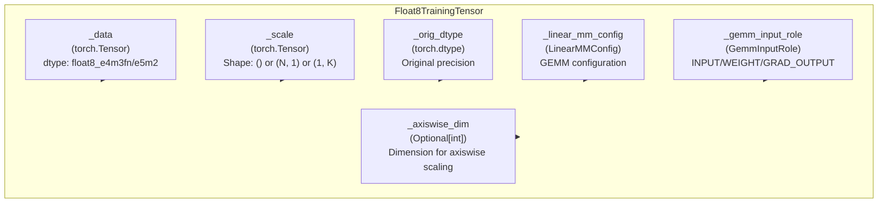
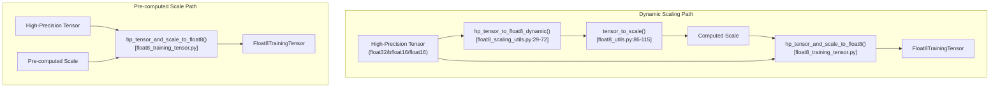
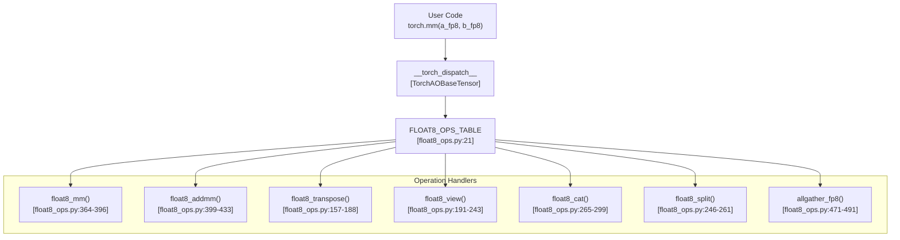
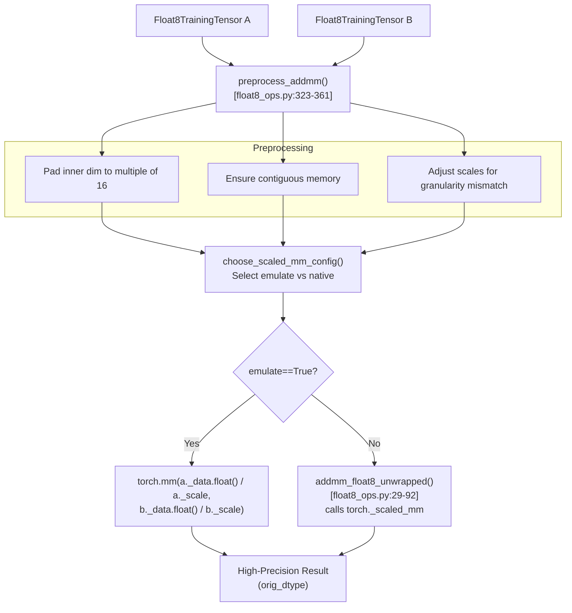
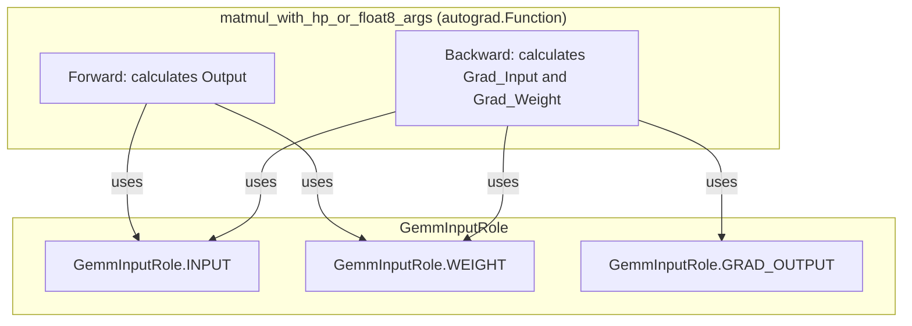
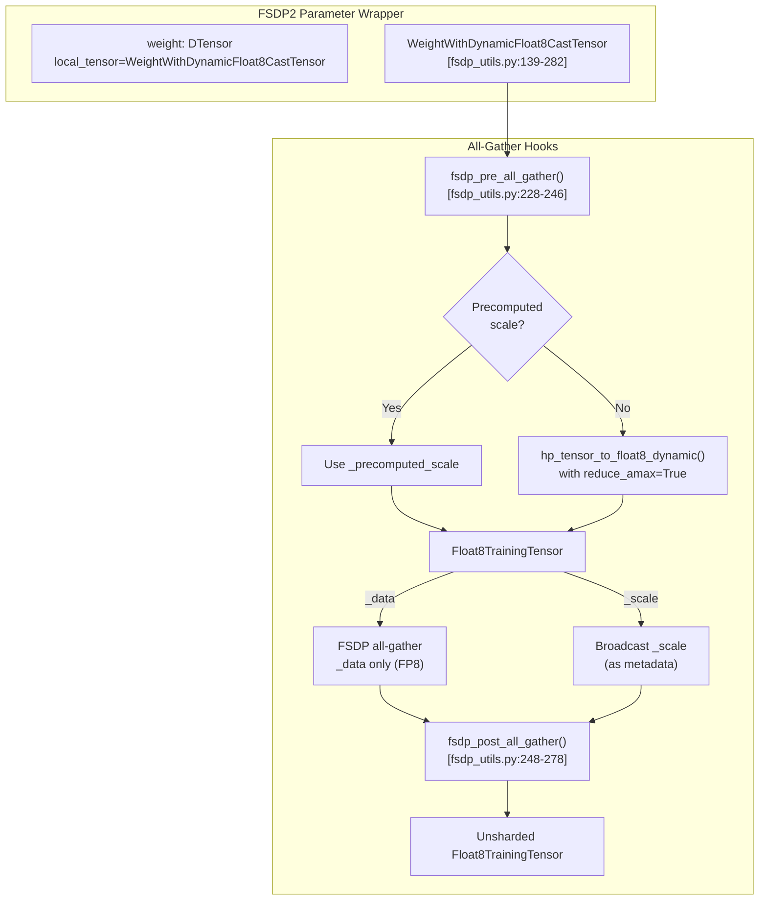

<!-- source: DeepWiki mcp.deepwiki.com · repo pytorch/ao · page 5.2 Float8TrainingTensor · fetched 2026-10-21 -->

# Float8TrainingTensor

<details>
<summary>Relevant source files</summary>

The following files were used as context for generating this wiki page:

- [test/float8/test_base.py](test/float8/test_base.py)
- [test/float8/test_compile.py](test/float8/test_compile.py)
- [test/float8/test_dtensor.py](test/float8/test_dtensor.py)
- [test/float8/test_fsdp.py](test/float8/test_fsdp.py)
- [test/float8/test_fsdp2/test_fsdp2.py](test/float8/test_fsdp2/test_fsdp2.py)
- [test/float8/test_fsdp_compile.py](test/float8/test_fsdp_compile.py)
- [test/float8/test_numerics_integration.py](test/float8/test_numerics_integration.py)
- [torchao/float8/README.md](torchao/float8/README.md)
- [torchao/float8/__init__.py](torchao/float8/__init__.py)
- [torchao/float8/config.py](torchao/float8/config.py)
- [torchao/float8/float8_linear.py](torchao/float8/float8_linear.py)
- [torchao/float8/float8_linear_utils.py](torchao/float8/float8_linear_utils.py)
- [torchao/float8/float8_ops.py](torchao/float8/float8_ops.py)
- [torchao/float8/float8_scaling_utils.py](torchao/float8/float8_scaling_utils.py)
- [torchao/float8/float8_tensor_parallel.py](torchao/float8/float8_tensor_parallel.py)
- [torchao/float8/float8_training_tensor.py](torchao/float8/float8_training_tensor.py)
- [torchao/float8/float8_utils.py](torchao/float8/float8_utils.py)
- [torchao/float8/fsdp_utils.py](torchao/float8/fsdp_utils.py)
- [torchao/float8/types.py](torchao/float8/types.py)

</details>


## Purpose and Scope

`Float8TrainingTensor` is a PyTorch tensor subclass that encapsulates FP8 quantized data along with its scaling metadata for training workflows. It enables efficient FP8 training by wrapping quantized tensors and providing automatic dispatch to optimized FP8 operations while maintaining compatibility with PyTorch's autograd system.

For information about:
- High-level Float8 training configuration and usage: see [Float8Linear and Configuration](#5.1)
- Float8 scaling strategies and operations: see [Float8 Scaling and Operations](#5.3)
- FSDP2-specific integration: see [FSDP2 Integration](#5.4)

## Tensor Structure

`Float8TrainingTensor` wraps FP8-quantized data with associated metadata required for training:



**Sources:** [test/float8/test_base.py:57-60](), [test/float8/test_base.py:125-130](), [torchao/float8/float8_ops.py:131-137]()

### Attributes

| Attribute | Type | Purpose |
|-----------|------|---------|
| `_data` | `torch.Tensor` | FP8 quantized tensor (e4m3fn, e5m2, e4m3fnuz, or e5m2fnuz) [torchao/float8/float8_utils.py:23-28]() |
| `_scale` | `torch.Tensor` | Scaling factor: scalar for tensorwise, (N,1)/(1,K) for axiswise |
| `_orig_dtype` | `torch.dtype` | Original high-precision dtype (float32/bfloat16/float16) |
| `_linear_mm_config` | `LinearMMConfig` | Configuration for `torch._scaled_mm` operations |
| `_gemm_input_role` | `GemmInputRole` | Role in GEMM: `INPUT`, `WEIGHT`, or `GRAD_OUTPUT` |
| `_axiswise_dim` | `Optional[int]` | Dimension index for axiswise scaling (0 or -1), None for tensorwise |

**Sources:** [test/float8/test_base.py:125-132](), [torchao/float8/float8_ops.py:131-137](), [torchao/float8/float8_utils.py:23-28]()

## Tensor Creation Workflow

`Float8TrainingTensor` instances are created through two primary pathways, depending on whether the scaling factor is pre-computed or needs dynamic calculation:



**Sources:** [torchao/float8/float8_scaling_utils.py:29-72](), [torchao/float8/float8_utils.py:86-115](), [test/float8/test_base.py:71-72]()

### Creation Functions

#### `hp_tensor_and_scale_to_float8()`

Creates a `Float8TrainingTensor` from a high-precision tensor and pre-computed scale. This is the lower-level function used when the scale is already available.

**Parameters:**
- `hp_tensor`: High-precision tensor to quantize
- `scale`: Pre-computed scaling factor
- `float8_dtype`: Target FP8 dtype (e4m3fn or e5m2)
- `linear_mm_config`: Configuration for scaled matmul operations
- `gemm_input_role`: Role of tensor in GEMM operations
- `axiswise_dim`: Optional dimension for axiswise scaling

**Sources:** [test/float8/test_base.py:71](), [test/float8/test_base.py:89-90]()

#### `hp_tensor_to_float8_dynamic()`

Creates a `Float8TrainingTensor` with dynamically computed scaling factors. This is the higher-level function typically used in training code.

**Parameters:**
- `hp_tensor`: High-precision tensor to quantize
- `float8_dtype`: Target FP8 dtype
- `linear_mm_config`: Configuration for scaled matmul
- `reduce_amax`: Whether to reduce amax across distributed ranks
- `gemm_input_role`: Role in GEMM operations
- `scaling_granularity`: `TENSORWISE` or `AXISWISE` [torchao/float8/config.py:42-50]()
- `axiswise_dim`: Dimension for axiswise scaling
- `round_scales_to_power_of_2`: Whether to round scales to power of 2

**Sources:** [torchao/float8/float8_scaling_utils.py:29-72](), [test/float8/test_base.py:161-168](), [torchao/float8/config.py:42-50]()

## Operations Dispatch

`Float8TrainingTensor` implements `__torch_dispatch__` to intercept PyTorch operations and route them to FP8-optimized implementations defined in `FLOAT8_OPS_TABLE`.



**Sources:** [torchao/float8/float8_ops.py:21](), [torchao/float8/float8_ops.py:103-115]()

### Supported Operations

| Operation Category | ATen Ops | Handler Function | Purpose |
|-------------------|----------|------------------|---------|
| Matrix Multiplication | `aten.mm`, `aten.matmul`, `aten.addmm` | `float8_mm()`, `float8_addmm()` | FP8 GEMM using `torch._scaled_mm` |
| Shape Manipulation | `aten.view`, `aten.reshape`, `aten.transpose`, `aten.t` | `float8_view()`, `float8_transpose()` | Reshape while preserving scales |
| Tensor Splitting | `aten.split`, `aten.cat` | `float8_split()`, `float8_cat()` | Split/concatenate with scale handling |
| Copy Operations | `aten.copy_`, `aten.clone` | `copy_fp8()`, `float8_desugar_op()` | Copy FP8 data and scales |
| Distributed Ops | `c10d_functional.all_gather_into_tensor`, `wait_tensor` | `allgather_fp8()`, `wait_tensor_fp8()` | FP8 collective operations |
| Casting | `aten._to_copy` | `autocast_to_copy()` | Autocast compatibility |

**Sources:** [torchao/float8/float8_ops.py:118-606]()

### Matrix Multiplication Implementation

The `float8_mm` handler demonstrates how FP8 matrix multiplication is performed:



**Sources:** [torchao/float8/float8_ops.py:364-396](), [torchao/float8/float8_ops.py:323-361](), [torchao/float8/float8_ops.py:29-92]()

## Autograd Integration

`Float8TrainingTensor` integrates with autograd via `matmul_with_hp_or_float8_args`. This custom `torch.autograd.Function` manages the forward and backward passes for linear layers, ensuring appropriate FP8 casts for all three training GEMMs.



**Sources:** [torchao/float8/float8_linear.py:29-204](), [torchao/float8/float8_linear.py:21-24]()

### Training GEMM Roles

During training, three distinct matrix multiplications are performed, each involving different roles defined by `GemmInputRole`:

1.  **Forward (Output)**: `Input (INPUT)` @ `Weight (WEIGHT)`.
2.  **Backward (Grad Input)**: `Grad_Output (GRAD_OUTPUT)` @ `Weight.T (WEIGHT)`.
3.  **Backward (Grad Weight)**: `Input.T (INPUT)` @ `Grad_Output (GRAD_OUTPUT)`.

**Sources:** [torchao/float8/float8_linear.py:51-91](), [torchao/float8/float8_linear.py:104-204]()

## FSDP2 Integration

`Float8TrainingTensor` supports FSDP2 through specialized hooks that enable FP8 all-gather operations, reducing communication overhead. The `WeightWithDynamicFloat8CastTensor` subclass is used to preserve metadata through FSDP sharding.



**Sources:** [torchao/float8/fsdp_utils.py:139-282](), [torchao/float8/fsdp_utils.py:228-278](), [torchao/float8/fsdp_utils.py:28-85]()

### Precomputed Scales for FSDP

`precompute_float8_dynamic_scale_for_fsdp` performs a single all-reduce to compute scales for all FP8 weights in a module, typically run after the optimizer step to optimize the subsequent forward pass.

**Sources:** [torchao/float8/fsdp_utils.py:28-85]()

## Conversion to/from High Precision

`Float8TrainingTensor` provides methods for converting between FP8 and high precision:

### Quantization (HP → FP8)

```python
# Via hp_tensor_to_float8_dynamic
fp8_tensor = hp_tensor_to_float8_dynamic(
    hp_tensor=input,
    float8_dtype=torch.float8_e4m3fn,
    linear_mm_config=config,
    scaling_granularity=ScalingGranularity.TENSORWISE,
)
```

**Sources:** [torchao/float8/float8_scaling_utils.py:29-72](), [test/float8/test_base.py:71-72]()

### Dequantization (FP8 → HP)

```python
# Convert back to original precision
hp_tensor = fp8_tensor.to_original_precision()
```

The formula for dequantization is: `high_precision_value = fp8_data / scale`.

**Sources:** [test/float8/test_base.py:72](), [test/float8/test_base.py:169](), [torchao/float8/float8_ops.py:44-45]()

## Configuration Objects

### `LinearMMConfig`
Encapsulates `ScaledMMConfig` for the three GEMMs in a linear layer.

**Sources:** [torchao/float8/float8_linear.py:231-253](), [test/float8/test_base.py:534-542]()

### `ScaledMMConfig`
Controls behavior of individual `torch._scaled_mm` calls, including `emulate`, `use_fast_accum`, and `pad_inner_dim`.

**Sources:** [test/float8/test_base.py:534-542]()

### `GemmInputRole`
Enum (`INPUT`, `WEIGHT`, `GRAD_OUTPUT`) indicating a tensor's role, used to select the correct config from `LinearMMConfig`.

**Sources:** [torchao/float8/float8_ops.py:11-14](), [torchao/float8/float8_linear.py:21-24]()

---

