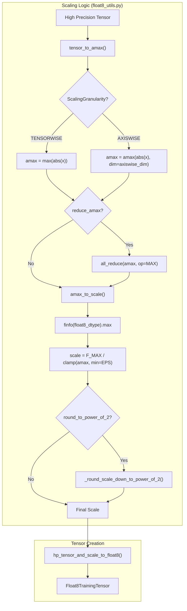
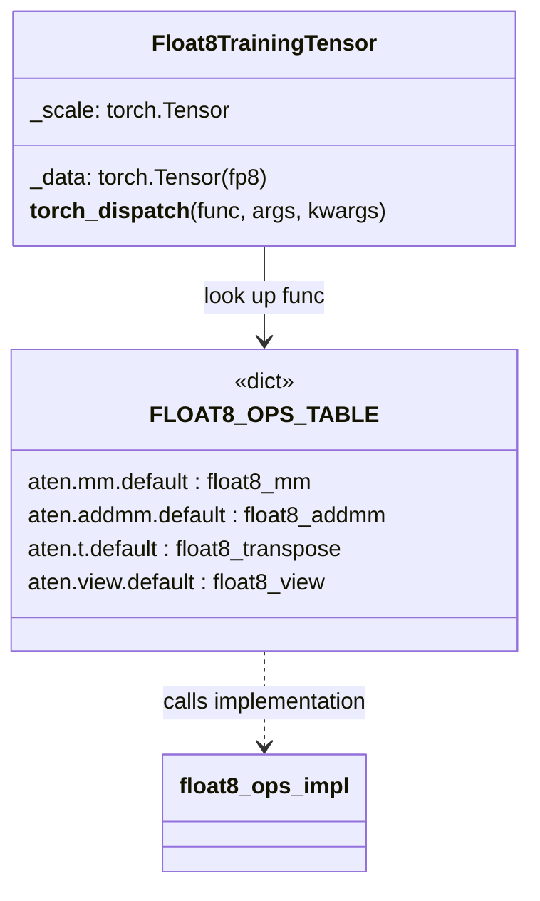

<!-- source: DeepWiki mcp.deepwiki.com · repo pytorch/ao · page 5.3 Float8 Scaling and Operations · fetched 2026-10-21 -->

# Float8 Scaling and Operations

<details>
<summary>Relevant source files</summary>

The following files were used as context for generating this wiki page:

- [benchmarks/float8/bench_matmul.py](benchmarks/float8/bench_matmul.py)
- [benchmarks/float8/float8_inference_roofline.py](benchmarks/float8/float8_inference_roofline.py)
- [benchmarks/float8/float8_roofline.py](benchmarks/float8/float8_roofline.py)
- [benchmarks/float8/utils.py](benchmarks/float8/utils.py)
- [benchmarks/prototype/blockwise_fp8_training/bench_linear_roofline.py](benchmarks/prototype/blockwise_fp8_training/bench_linear_roofline.py)
- [docs/source/workflows/inference.md](docs/source/workflows/inference.md)
- [test/float8/test_base.py](test/float8/test_base.py)
- [test/float8/test_compile.py](test/float8/test_compile.py)
- [test/float8/test_dtensor.py](test/float8/test_dtensor.py)
- [test/float8/test_fsdp.py](test/float8/test_fsdp.py)
- [test/float8/test_fsdp2/test_fsdp2.py](test/float8/test_fsdp2/test_fsdp2.py)
- [test/float8/test_fsdp_compile.py](test/float8/test_fsdp_compile.py)
- [test/float8/test_numerics_integration.py](test/float8/test_numerics_integration.py)
- [test/prototype/mx_formats/test_mx_mm.py](test/prototype/mx_formats/test_mx_mm.py)
- [torchao/float8/README.md](torchao/float8/README.md)
- [torchao/float8/__init__.py](torchao/float8/__init__.py)
- [torchao/float8/config.py](torchao/float8/config.py)
- [torchao/float8/float8_linear.py](torchao/float8/float8_linear.py)
- [torchao/float8/float8_linear_utils.py](torchao/float8/float8_linear_utils.py)
- [torchao/float8/float8_ops.py](torchao/float8/float8_ops.py)
- [torchao/float8/float8_scaling_utils.py](torchao/float8/float8_scaling_utils.py)
- [torchao/float8/float8_tensor_parallel.py](torchao/float8/float8_tensor_parallel.py)
- [torchao/float8/float8_training_tensor.py](torchao/float8/float8_training_tensor.py)
- [torchao/float8/float8_utils.py](torchao/float8/float8_utils.py)
- [torchao/float8/fsdp_utils.py](torchao/float8/fsdp_utils.py)
- [torchao/float8/types.py](torchao/float8/types.py)
- [torchao/testing/training/roofline_utils.py](torchao/testing/training/roofline_utils.py)

</details>


This page documents the scaling strategies and operations dispatch system for Float8 training tensors. It covers how high-precision tensors are scaled to float8, the different scaling granularities available, and how operations are dispatched on `Float8TrainingTensor` objects.

For information about the `Float8TrainingTensor` subclass structure itself, see [Float8TrainingTensor](#5.2). For configuration of `Float8Linear` modules, see [Float8Linear and Configuration](#5.1).

## Overview

Float8 training requires careful scaling to map high-precision values to the limited range of 8-bit floating point formats. This page covers two main topics:

1.  **Scaling strategies**: How tensors are scaled to float8 (`e4m3fn` or `e5m2`) using dynamic scaling with tensorwise or axiswise granularity.
2.  **Operations dispatch**: How operations on `Float8TrainingTensor` objects are intercepted and executed with float8-aware kernels via the `FLOAT8_OPS_TABLE` registry.

Sources: [torchao/float8/config.py:19-64](), [torchao/float8/float8_ops.py:21]()

## Scaling Strategies

### Scaling Types

The `ScalingType` enum defines whether scaling is performed:

| ScalingType | Description | Usage |
| :--- | :--- | :--- |
| `DYNAMIC` | Compute scaling factor dynamically based on the tensor's values. | Default for most training workflows. |
| `DISABLED` | Skip scaling for this tensor, leave it in its original precision. | Used for high-precision gradient computation in specific recipes. |

Sources: [torchao/float8/config.py:19-40]()

### Scaling Granularities

The `ScalingGranularity` enum controls the level at which scaling factors are computed:

| Granularity | Scale Shape | Description | Use Case |
| :--- | :--- | :--- | :--- |
| `TENSORWISE` | Scalar `()` or `(1,)` | A single scaling factor for the entire tensor. | Fastest, default for cuBLAS kernels. |
| `AXISWISE` | `(dim0, 1)` or `(1, dim1)` | Scaling factors computed along one axis (rowwise/colwise). | Better accuracy, used with specialized kernels. |

Sources: [torchao/float8/config.py:42-64](), [test/float8/test_base.py:137-145]()

### Scaling Factor Computation Flow

The system converts high-precision (HP) tensors to Float8 by first calculating an `amax` (absolute maximum) and then deriving a scale.



Sources: [torchao/float8/float8_utils.py:57-115](), [torchao/float8/float8_scaling_utils.py:29-73]()

### Scale Computation Details

The core scaling formula is:
`scale = fp8_max_value / clamp(amax, min=EPS)`

*   **fp8_max_value**: Retrieved via `torch.finfo(float8_dtype).max`. For `e4m3fn`, this is 448.0; for `e5m2`, it is 57344.0 [torchao/float8/float8_utils.py:47-48]().
*   **EPS**: Set to `1e-12` to avoid division by zero [torchao/float8/float8_utils.py:20]().
*   **Power-of-2 Rounding**: If `round_scales_to_power_of_2` is enabled, the scale is rounded down to the nearest power of 2 to ensure exact multiplication/division and reduce potential numerical drift [torchao/float8/float8_utils.py:51-53]().

Sources: [torchao/float8/float8_utils.py:32-54](), [torchao/float8/float8_utils.py:86-115]()

### Axiswise Scaling and Reshaping

Axiswise scaling introduces constraints on tensor operations. For example, if a tensor is scaled across `dim=0`, it can only be reshaped in ways that preserve that dimension's structure (e.g., `[3, 5, 7]` to `[3, 35]`).

Sources: [test/float8/test_base.py:180-224]()

## Float8 Operations Dispatch

### Operation Table Architecture

The `FLOAT8_OPS_TABLE` registry maps ATen operators to custom implementations that handle `Float8TrainingTensor` wrappers.



Sources: [torchao/float8/float8_ops.py:21](), [torchao/float8/float8_ops.py:103-116]()

### Matmul and addmm Operations

When a matmul is performed on `Float8TrainingTensor` objects, the system routes the call to `addmm_float8_unwrapped`.

**addmm_float8_unwrapped logic**:
1.  **Scale Inversion**: Hardware kernels like `torch._scaled_mm` expect multiplicative factors for dequantization (inverse scales). The library calculates `a_scale.reciprocal()` [torchao/float8/float8_ops.py:44-45]().
2.  **Kernel Selection**: 
    *   If rowwise scaling is used without `use_fast_accum`, the system may fallback to a tensorwise cuBLAS kernel and apply scaling manually to avoid performance regressions [torchao/float8/float8_ops.py:53-59]().
3.  **Dispatch**: Calls `torch._scaled_mm` with the unwrapped data and inverse scales [torchao/float8/float8_ops.py:73-82]().

Sources: [torchao/float8/float8_ops.py:29-92](), [torchao/float8/float8_ops.py:364-397]()

### Implementation of Common Ops

| Implementation | Registered Ops | Behavior |
| :--- | :--- | :--- |
| `float8_desugar_op` | `slice`, `clone`, `reshape`, `fill_` | Operates on `._data` while preserving the existing `._scale`. [torchao/float8/float8_ops.py:118-137]() |
| `float8_transpose` | `t`, `transpose` | Transposes both `._data` and `._scale` (if axiswise). Updates `_axiswise_dim`. [torchao/float8/float8_ops.py:157-188]() |
| `float8_view` | `view` | Validates if the view is compatible with the `_axiswise_dim` before reshaping data and scales. [torchao/float8/float8_ops.py:191-240]() |

Sources: [torchao/float8/float8_ops.py:118-240]()

## Scaling Configuration

### CastConfig

Defines the parameters for casting a single high-precision tensor to Float8.

*   `scaling_type`: `DYNAMIC` or `DISABLED`.
*   `scaling_granularity`: `TENSORWISE` or `AXISWISE`.
*   `target_dtype`: The specific float8 format (e.g., `torch.float8_e4m3fn`).

Sources: [torchao/float8/config.py:93-122]()

### Float8LinearConfig

Aggregates multiple `CastConfig` objects to define the behavior of a `Float8Linear` layer's forward and backward passes. It allows distinct scaling for the three GEMMs:
1.  **Output GEMM** (Forward)
2.  **Grad Input GEMM** (Backward)
3.  **Grad Weight GEMM** (Backward)

Sources: [torchao/float8/config.py:180-203](), [torchao/float8/float8_linear.py:38-176]()

### Pre-made Recipes

The library provides `Float8LinearRecipeName` for common configurations:
*   `TENSORWISE`: Default dynamic per-tensor scaling using cuBLAS.
*   `ROWWISE`: Dynamic rowwise scaling using CUTLASS kernels. Uses `e4m3` for all operands.
*   `ROWWISE_WITH_GW_HP`: Rowwise scaling for activations/weights, but keeps the `grad_weight` calculation in high precision for maximum accuracy.

Sources: [torchao/float8/config.py:141-176]()

## Scaling Utilities

### hp_tensor_to_float8_dynamic

A high-level utility used within `Float8Linear` and `matmul_with_hp_or_float8_args` to perform the dynamic cast.

```python
# Inside matmul_with_hp_or_float8_args.forward
input_maybe_fp8 = hp_tensor_to_float8_dynamic(
    input_hp,
    c.cast_config_input.target_dtype,
    linear_mm_config,
    gemm_input_role=GemmInputRole.INPUT,
    scaling_granularity=c.cast_config_input.scaling_granularity,
    axiswise_dim=get_maybe_axiswise_dim(-1, c.cast_config_input.scaling_granularity),
    round_scales_to_power_of_2=c.round_scales_to_power_of_2,
)
```

Sources: [torchao/float8/float8_linear.py:56-66](), [torchao/float8/float8_scaling_utils.py:29-73]()

### Distributed Scaling

When training across multiple GPUs, consistent scaling factors are often required (e.g., for weights). `tensor_to_scale` supports a `reduce_amax` flag which triggers a `dist.all_reduce(amax, op=dist.ReduceOp.MAX)` across the specified `device_mesh`.

Sources: [torchao/float8/float8_utils.py:74-82](), [torchao/float8/float8_utils.py:89-94]()

---

