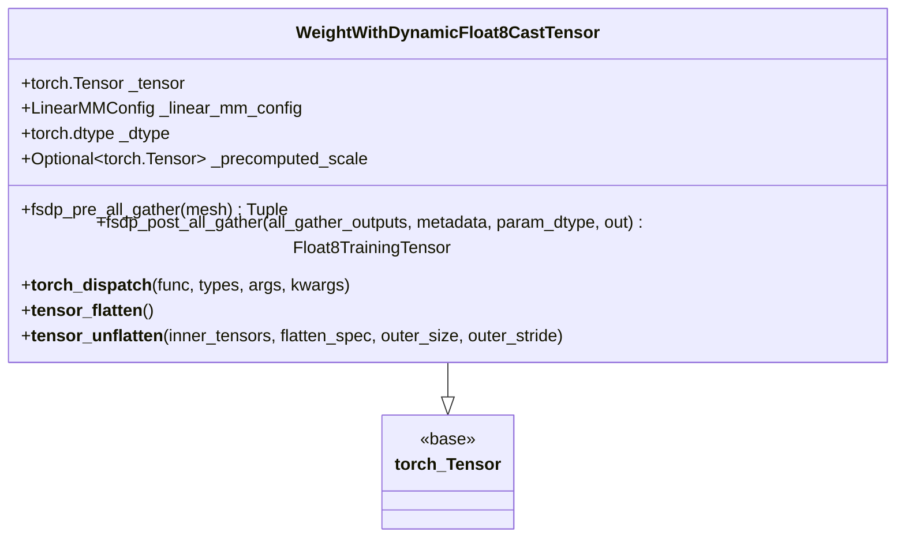
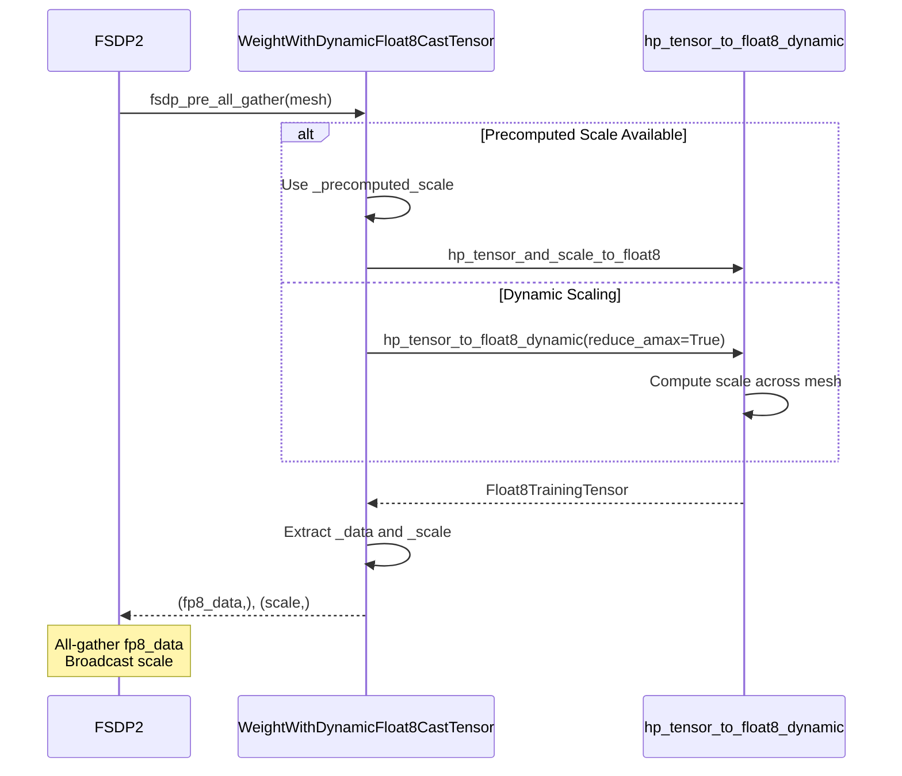
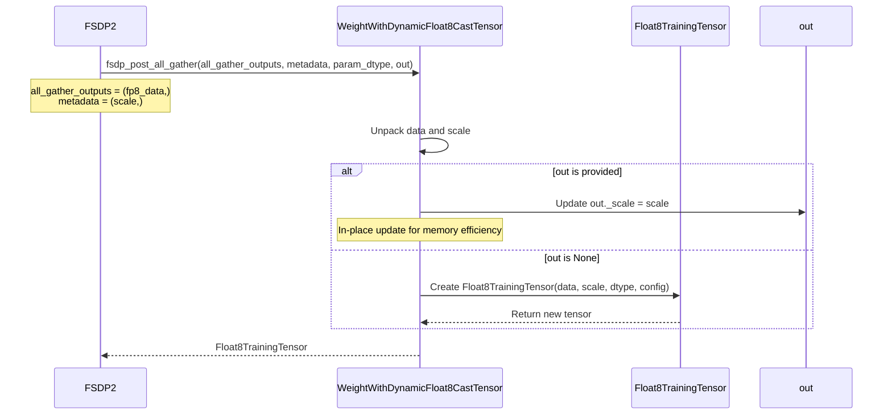
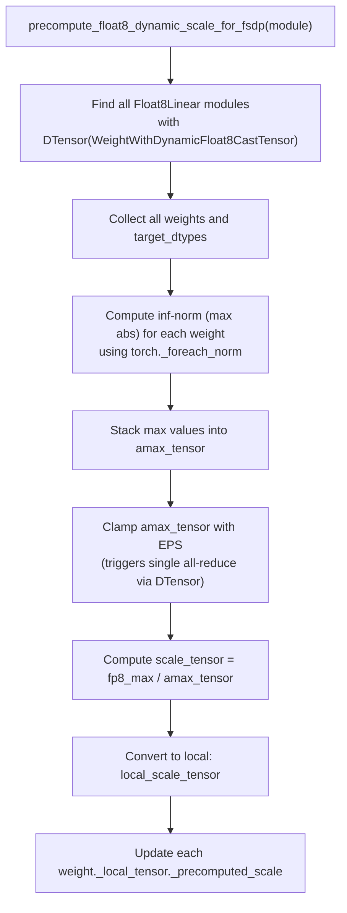

<!-- source: DeepWiki mcp.deepwiki.com · repo pytorch/ao · page 5.4 FSDP2 Integration · fetched 2026-10-21 -->

# FSDP2 Integration

<details>
<summary>Relevant source files</summary>

The following files were used as context for generating this wiki page:

- [test/float8/test_base.py](test/float8/test_base.py)
- [test/float8/test_compile.py](test/float8/test_compile.py)
- [test/float8/test_dtensor.py](test/float8/test_dtensor.py)
- [test/float8/test_fsdp.py](test/float8/test_fsdp.py)
- [test/float8/test_fsdp2/test_fsdp2.py](test/float8/test_fsdp2/test_fsdp2.py)
- [test/float8/test_fsdp2_tp.py](test/float8/test_fsdp2_tp.py)
- [test/float8/test_fsdp_compile.py](test/float8/test_fsdp_compile.py)
- [test/float8/test_numerics_integration.py](test/float8/test_numerics_integration.py)
- [test/prototype/mx_formats/test_mx_dtensor.py](test/prototype/mx_formats/test_mx_dtensor.py)
- [torchao/float8/README.md](torchao/float8/README.md)
- [torchao/float8/__init__.py](torchao/float8/__init__.py)
- [torchao/float8/config.py](torchao/float8/config.py)
- [torchao/float8/float8_linear.py](torchao/float8/float8_linear.py)
- [torchao/float8/float8_linear_utils.py](torchao/float8/float8_linear_utils.py)
- [torchao/float8/float8_ops.py](torchao/float8/float8_ops.py)
- [torchao/float8/float8_scaling_utils.py](torchao/float8/float8_scaling_utils.py)
- [torchao/float8/float8_tensor_parallel.py](torchao/float8/float8_tensor_parallel.py)
- [torchao/float8/float8_training_tensor.py](torchao/float8/float8_training_tensor.py)
- [torchao/float8/float8_utils.py](torchao/float8/float8_utils.py)
- [torchao/float8/fsdp_utils.py](torchao/float8/fsdp_utils.py)
- [torchao/float8/types.py](torchao/float8/types.py)
- [torchao/testing/training/dtensor_utils.py](torchao/testing/training/dtensor_utils.py)

</details>


## Purpose and Scope

This document describes the integration between Float8 training and FSDP2 (Fully Sharded Data Parallel v2). The integration enables **all-gather operations in FP8 format** instead of high precision, significantly reducing communication volume during distributed training.

This page covers the tensor subclass implementation, pre/post all-gather hooks, scale precomputation optimization, and usage patterns. For general Float8 training configuration, see [5.1](). For Tensor Parallel integration with Float8, see [5.5]().

---

## System Overview

The FSDP2 integration allows `Float8Linear` weights to be all-gathered in FP8 format rather than their original high precision (FP32/BF16). This reduces the communication volume by approximately 2-4x, depending on the original precision.

**Key Mechanism**: Weights are wrapped in a tensor subclass (`WeightWithDynamicFloat8CastTensor`) that implements FSDP2 hooks to cast to FP8 before all-gather and unwrap after all-gather.

```mermaid
graph TB
    subgraph "Without FP8 All-Gather"
        W1["Sharded Weight<br/>(BF16/FP32)"]
        AG1["All-Gather<br/>(BF16/FP32)"]
        UW1["Unsharded Weight<br/>(BF16/FP32)"]
        CAST1["Cast to FP8"]
        COMP1["FP8 Computation"]
        
        W1 --> AG1
        AG1 --> UW1
        UW1 --> CAST1
        CAST1 --> COMP1
    end
    
    subgraph "With FP8 All-Gather"
        W2["Sharded Weight<br/>WeightWithDynamicFloat8CastTensor"]
        PRE2["fsdp_pre_all_gather<br/>Cast to FP8"]
        AG2["All-Gather<br/>(FP8)"]
        POST2["fsdp_post_all_gather<br/>Wrap as Float8TrainingTensor"]
        COMP2["FP8 Computation"]
        
        W2 --> PRE2
        PRE2 --> AG2
        AG2 --> POST2
        POST2 --> COMP2
    end
```



**Sources**: [torchao/float8/fsdp_utils.py:104-137](), [torchao/float8/float8_linear.py:318-334]()

---

## Core Components

### WeightWithDynamicFloat8CastTensor

`WeightWithDynamicFloat8CastTensor` is a tensor subclass defined in [torchao/float8/fsdp_utils.py:139-159]() that wraps `Float8Linear` weights and implements the FSDP2 protocol for custom all-gather behavior.

**Class Definition**:



**Key Attributes** [torchao/float8/fsdp_utils.py:161-174]():
- `_tensor`: The underlying high-precision weight tensor.
- `_linear_mm_config`: Configuration for scaled matrix multiplication (`LinearMMConfig`).
- `_dtype`: Target FP8 dtype (e.g., `torch.float8_e4m3fn`).
- `_precomputed_scale`: Optional pre-computed scale for dynamic scaling optimization.

**Key Methods**:

| Method | Purpose |
|--------|---------|
| `fsdp_pre_all_gather` | Called before all-gather; casts weight to FP8 and returns FP8 data and scale. |
| `fsdp_post_all_gather` | Called after all-gather; wraps FP8 data and scale into `Float8TrainingTensor`. |
| `__torch_dispatch__` | Handles operations on the subclass, preserving subclass wrapper through transformations. |

**Sources**: [torchao/float8/fsdp_utils.py:139-283]()

---

### Pre All-Gather Hook

The `fsdp_pre_all_gather` method is called by FSDP2 before the all-gather collective operation. It converts the weight to FP8 format.



**Implementation** [torchao/float8/fsdp_utils.py:228-246]():
If `_precomputed_scale` is present, it uses `hp_tensor_and_scale_to_float8` [torchao/float8/float8_training_tensor.py:37-38](). Otherwise, it triggers `hp_tensor_to_float8_dynamic` with `reduce_amax=True` [torchao/float8/float8_scaling_utils.py:16-19](), which performs a distributed reduction across the `device_mesh`.

**Sources**: [torchao/float8/fsdp_utils.py:228-246](), [torchao/float8/float8_scaling_utils.py:16-19]()

---

### Post All-Gather Hook

The `fsdp_post_all_gather` method is called after all-gather to reconstruct the `Float8TrainingTensor` from the gathered FP8 data and replicated scale.



**Implementation** [torchao/float8/fsdp_utils.py:248-278]():
The method supports in-place updates of the `out` tensor if provided, which is critical for memory efficiency in FSDP2. It handles both raw `Float8TrainingTensor` and `DTensor` wrappers.

**Sources**: [torchao/float8/fsdp_utils.py:248-278]()

---

## Scale Precomputation Optimization

### precompute_float8_dynamic_scale_for_fsdp

This function [torchao/float8/fsdp_utils.py:28-86]() provides an optimization for dynamic scaling by pre-computing scales for all `Float8Linear` weights after the optimizer step. This avoids redundant scale computation and all-reduce operations in the next forward pass.

**Usage Pattern** [torchao/float8/fsdp_utils.py:38-43]():
```python
model(input).sum().backward()
optim.step()
precompute_float8_dynamic_scale_for_fsdp(model)
```

**Algorithm Overview**:



**Key Implementation Details**:
1. **Single All-Reduce**: All scales are computed and reduced in a single collective operation via `torch._foreach_norm` and `torch.clamp` on the `DTensor` [torchao/float8/fsdp_utils.py:70-74]().
2. **Numerical Precision**: Upcasts to `float64` during scale computation to ensure consistency between eager and compiled modes [torchao/float8/fsdp_utils.py:76-80]().
3. **Assignment**: Stores precomputed scales in the `_precomputed_scale` attribute of the local tensor subclass [torchao/float8/fsdp_utils.py:85]().

**Sources**: [torchao/float8/fsdp_utils.py:28-86]()

---

## Integration with Float8Linear

The `Float8Linear.from_float` method wraps weights in `WeightWithDynamicFloat8CastTensor` if `enable_fsdp_float8_all_gather` is enabled in the config.

**Integration Point** [torchao/float8/float8_linear.py:318-334]():
```python
if config.enable_fsdp_float8_all_gather:
    assert config.cast_config_weight.scaling_type is ScalingType.DYNAMIC
    new_mod.weight = torch.nn.Parameter(
        WeightWithDynamicFloat8CastTensor(
            new_mod.weight,
            new_mod.linear_mm_config,
            new_mod.config.cast_config_weight.target_dtype,
        ),
        requires_grad=new_mod.weight.requires_grad,
    )
```

**Constraints**:
- Only supports `ScalingType.DYNAMIC` [torchao/float8/float8_linear.py:325]().
- Only supports `ScalingGranularity.TENSORWISE` [torchao/float8/config.py:271-274]().

**Sources**: [torchao/float8/float8_linear.py:318-334](), [torchao/float8/config.py:271-274]()

---

## Tensor Parallel and FSDP2 Composition

Float8 training supports composing Tensor Parallel (TP) and FSDP2. The application order matters:

```mermaid
graph TB
    subgraph "Initialization Order"
        INIT["nn.Linear(weight=torch.Tensor)"]
        F8["convert_to_float8_training<br/>Float8Linear(weight=WeightWithDynamicFloat8CastTensor)"]
        TP["parallelize_module (TP)<br/>Float8Linear(weight=DTensor(local=WeightWithDynamicFloat8CastTensor,<br/>mesh=tp_mesh, placements=Shard))"]
        FSDP["fully_shard (FSDP2)<br/>Float8Linear(weight=DTensor(local=WeightWithDynamicFloat8CastTensor,<br/>mesh=2D_mesh, placements=(Shard, Shard)))"]
        
        INIT --> F8
        F8 --> TP
        TP --> FSDP
    end
    
    subgraph "Forward/Backward Order"
        FWD_START["Forward Pass Start"]
        FSDP_UNSHARD["FSDP2: Unshard on dp dimension<br/>DTensor(mesh=tp_mesh, placements=Shard)"]
        FP8_ALLGATHER["FP8 All-Gather via fsdp_pre/post_all_gather"]
        TP_COMPUTE["TP: Compute with torch.mm"]
        
        FWD_START --> FSDP_UNSHARD
        FSDP_UNSHARD --> FP8_ALLGATHER
        FP8_ALLGATHER --> TP_COMPUTE
    end
```



**Key Points** [torchao/float8/fsdp_utils.py:104-137]():
1. **Initialization**: Apply float8 conversion → TP → FSDP2.
2. **Forward/Backward**: FSDP2 unshards first (within the DP mesh), then TP computes (within the TP mesh).
3. **DeviceMesh**: FSDP2 and TP use a 2D mesh with dimensions `(dp, tp)`.

**Sources**: [torchao/float8/fsdp_utils.py:104-137](), [test/float8/test_dtensor.py:209-237]()

---

## Memory Optimization

The FP8 all-gather provides significant memory savings during training. The savings come from:
1. **Reduced all-gather buffer size**: FP8 (1 byte) vs BF16/FP32 (2-4 bytes).
2. **Reduced peak memory**: FSDP2 only needs to keep the all-gathered FP8 weights in memory during the forward pass of the block, rather than high-precision weights.

**Memory Comparison Logic** [test/float8/test_fsdp2/test_fsdp2.py:192-308]():
- Without FP8: Peak memory includes `3 * block_params * HP_size`.
- With FP8: Peak memory includes `3 * (block_lin_params * 1 + block_other_params * HP_size)`.

**Sources**: [test/float8/test_fsdp2/test_fsdp2.py:192-308]()

---

## Configuration

### Float8LinearConfig

The `enable_fsdp_float8_all_gather` flag in `Float8LinearConfig` enables the FSDP2 integration.

**Configuration Validation** [torchao/float8/config.py:270-274]():
```python
if self.cast_config_weight.scaling_granularity != ScalingGranularity.TENSORWISE:
    assert not self.enable_fsdp_float8_all_gather, (
        f"enable_fsdp_float8_all_gather only supports tensorwise scaling granularity"
    )
```

**Sources**: [torchao/float8/config.py:223-225](), [torchao/float8/config.py:270-274]()

---

## Implementation Details

### Tensor Subclass Dispatch

`WeightWithDynamicFloat8CastTensor` preserves the subclass wrapper through FSDP2 operations using `__torch_dispatch__` [torchao/float8/fsdp_utils.py:177-222]().

**Preserved Operations** [torchao/float8/fsdp_utils.py:91-102]():
Operations like `empty_like`, `slice`, `copy_`, `view`, and `clone` are registered in `_ops_to_preserve_subclass` to ensure that FSDP2's internal transformations (like padding or moving to GPU) do not strip the subclass wrapper.

**Sources**: [torchao/float8/fsdp_utils.py:88-102](), [torchao/float8/fsdp_utils.py:177-222]()

### Serialization Support

The `Float8TrainingTensor` and related configs are registered as safe globals to support `weights_only=True` serialization [torchao/float8/__init__.py:27-36]().

**Sources**: [torchao/float8/__init__.py:27-36](), [torchao/float8/fsdp_utils.py:282]()

---

