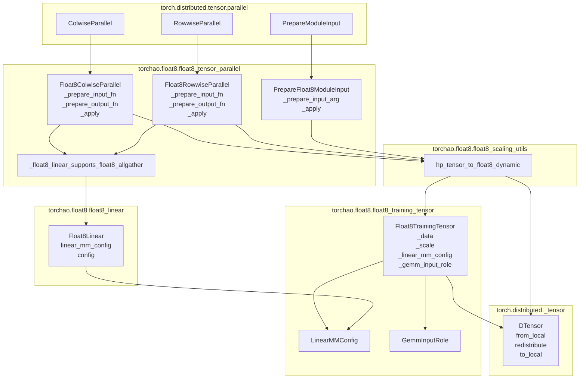
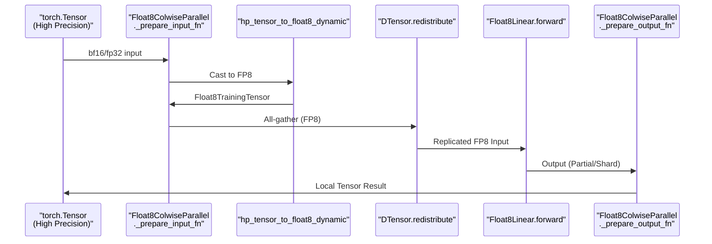

<!-- source: DeepWiki mcp.deepwiki.com · repo pytorch/ao · page 5.5 Tensor Parallelism Integration · fetched 2026-10-21 -->

# Tensor Parallelism Integration

Relevant source files

The following files were used as context for generating this wiki page:

- [test/float8/test_base.py](test/float8/test_base.py)
- [test/float8/test_compile.py](test/float8/test_compile.py)
- [test/float8/test_dtensor.py](test/float8/test_dtensor.py)
- [test/float8/test_fsdp.py](test/float8/test_fsdp.py)
- [test/float8/test_fsdp2/test_fsdp2.py](test/float8/test_fsdp2/test_fsdp2.py)
- [test/float8/test_fsdp2_tp.py](test/float8/test_fsdp2_tp.py)
- [test/float8/test_fsdp_compile.py](test/float8/test_fsdp_compile.py)
- [test/float8/test_numerics_integration.py](test/float8/test_numerics_integration.py)
- [test/prototype/mx_formats/test_mx_dtensor.py](test/prototype/mx_formats/test_mx_dtensor.py)
- [torchao/float8/README.md](torchao/float8/README.md)
- [torchao/float8/__init__.py](torchao/float8/__init__.py)
- [torchao/float8/config.py](torchao/float8/config.py)
- [torchao/float8/float8_linear.py](torchao/float8/float8_linear.py)
- [torchao/float8/float8_linear_utils.py](torchao/float8/float8_linear_utils.py)
- [torchao/float8/float8_ops.py](torchao/float8/float8_ops.py)
- [torchao/float8/float8_scaling_utils.py](torchao/float8/float8_scaling_utils.py)
- [torchao/float8/float8_tensor_parallel.py](torchao/float8/float8_tensor_parallel.py)
- [torchao/float8/float8_training_tensor.py](torchao/float8/float8_training_tensor.py)
- [torchao/float8/float8_utils.py](torchao/float8/float8_utils.py)
- [torchao/float8/fsdp_utils.py](torchao/float8/fsdp_utils.py)
- [torchao/float8/types.py](torchao/float8/types.py)
- [torchao/testing/training/dtensor_utils.py](torchao/testing/training/dtensor_utils.py)

TorchAO integrates with PyTorch's DTensor-based tensor parallelism (TP) to enable float8 all-gather communication during distributed training. This reduces inter-GPU bandwidth by 2x while maintaining training accuracy through dynamic scaling.

The integration is implemented via three main classes in [torchao/float8/float8_tensor_parallel.py]():
- `Float8ColwiseParallel`: Extends `ColwiseParallel` for column-wise weight sharding with fp8 all-gather.
- `Float8RowwiseParallel`: Extends `RowwiseParallel` for row-wise weight sharding with fp8 all-gather.
- `PrepareFloat8ModuleInput`: Extends `PrepareModuleInput` for shared input fp8 casting.

For float8 integration with FSDP2 (data parallelism), see page 5.4. For basic `Float8Linear` configuration, see page 5.1.

## Core Concepts

Tensor parallelism shards model parameters across GPUs by splitting weight matrices along rows or columns. Each GPU holds a partition of each weight tensor. During forward/backward passes, DTensor performs collective operations (all-gather, reduce-scatter, all-reduce) to reconstruct or aggregate tensors.

TorchAO's TP integration modifies these collective operations to communicate in float8 precision:
- **Standard TP**: All-gather weights in bf16/fp32 → Cast to fp8 → Compute.
- **Float8 TP**: Cast to fp8 → All-gather in fp8 → Compute.

This reduces communication volume by 2x (1 byte per element vs 2 bytes for bf16).

**Current Requirements**:
- `Float8Linear` modules with `ScalingType.DYNAMIC` for input and grad_output [torchao/float8/float8_tensor_parallel.py:34-39]().
- Tensorwise scaling granularity (axiswise not yet supported for fp8 all-gather) [torchao/float8/config.py:270-274]().
- Compatible with `torch.compile` and DTensor APIs.

Sources: [torchao/float8/float8_tensor_parallel.py:1-40](), [torchao/float8/config.py:270-274]()

## Class Hierarchy and Dependencies

Diagram: Float8 Tensor Parallelism Architecture

Sources: [torchao/float8/float8_tensor_parallel.py:1-266](), [torchao/float8/float8_linear.py:28-91](), [torchao/float8/float8_training_tensor.py:11-22]()

## Float8ColwiseParallel

`Float8ColwiseParallel` extends PyTorch's `ColwiseParallel` to perform float8 all-gather for column-wise parameter sharding. In colwise parallelism, each GPU holds a column slice of the weight matrix, and the output is sharded across the column dimension.

### Implementation Details

| Aspect | Behavior |
|--------|----------|
| **Base Class** | `torch.distributed.tensor.parallel.ColwiseParallel` |
| **Scaling Support** | Dynamic scaling only (tensorwise granularity) [torchao/float8/float8_tensor_parallel.py:34-39]() |
| **Input Preparation** | Converts input to `Float8TrainingTensor`, then all-gathers [torchao/float8/float8_tensor_parallel.py:49-72]() |
| **Output Preparation** | Uses `NoopFwToFloat8BwDynamic` for backward fp8 casting [torchao/float8/float8_tensor_parallel.py:75-90]() |
| **Validation** | Checks `Float8Linear` module and scaling type compatibility [torchao/float8/float8_tensor_parallel.py:92-104]() |

### Key Methods

**`_prepare_input_fn(input_layouts, desired_input_layouts, mod, inputs, device_mesh)`** [torchao/float8/float8_tensor_parallel.py:49-72]():
1. Wraps input in `DTensor` with `input_layouts` placements.
2. Casts input to fp8 using `hp_tensor_to_float8_dynamic()` if not already casted.
3. Redistributes to `desired_input_layouts` (all-gather happens here in fp8).
4. Returns `DTensor` wrapping the `Float8TrainingTensor`.

**`_prepare_output_fn(output_layouts, use_local_output, mod, outputs, device_mesh)`** [torchao/float8/float8_tensor_parallel.py:75-90]():
1. Redistributes output to `output_layouts` if needed.
2. Applies `NoopFwToFloat8BwDynamic.apply()` for backward fp8 casting.
3. Converts to local tensor if `use_local_output=True`.

**`_apply(module, device_mesh)`** [torchao/float8/float8_tensor_parallel.py:92-104]():
- Validates that `module` is `Float8Linear`.
- Checks that scaling types support float8 all-gather via `_float8_linear_supports_float8_allgather()`.
- Delegates to parent class `_apply()`.

Sources: [torchao/float8/float8_tensor_parallel.py:49-104](), [torchao/float8/float8_scaling_utils.py:15-30]()

## Float8RowwiseParallel

`Float8RowwiseParallel` extends `RowwiseParallel` for row-wise parameter sharding. In rowwise parallelism, each GPU holds a row slice of the weight matrix, and outputs are partial results that require reduction.

### Differences from ColwiseParallel

| Aspect | ColwiseParallel | RowwiseParallel |
|--------|-----------------|-----------------|
| **Weight Sharding** | Column dimension (dim=0) | Row dimension (dim=1) |
| **Output Type** | Sharded (each GPU has partial columns) | Partial (requires all-reduce/reduce-scatter) |
| **Communication** | All-gather input before matmul | Reduce output after matmul |
| **Input Casting** | Cast then all-gather | Cast then all-gather |

### Implementation

**`_prepare_input_fn()`** [torchao/float8/float8_tensor_parallel.py:114-135]():
- Nearly identical to `Float8ColwiseParallel._prepare_input_fn()`.
- Wraps input in `DTensor`, casts to fp8, then redistributes.

**`_prepare_output_fn()`** [torchao/float8/float8_tensor_parallel.py:138-153]():
- Redistributes output based on `output_layouts`:
  - To `Replicate`: performs all-reduce.
  - To `Shard`: performs reduce-scatter.
- Applies `NoopFwToFloat8BwDynamic` for backward fp8 casting.

Sources: [torchao/float8/float8_tensor_parallel.py:114-153]()

## PrepareFloat8ModuleInput

`PrepareFloat8ModuleInput` handles float8 casting before input redistribution. This ensures float8 all-gather happens only once when multiple TP layers share the same input tensor.

### `_prepare_input_arg()` Implementation

The `_prepare_input_arg()` method [torchao/float8/float8_tensor_parallel.py:218-243]() processes input tensors:

1. **DTensor Wrapping**: Wraps input using `DTensor.from_local()` with `input_layout` if not already a `DTensor`.
2. **Float8 Casting**: Calls `hp_tensor_to_float8_dynamic()` using `linear_mm_config` retrieved from `Float8Linear` submodules.
3. **Redistribution**: Triggers all-gather in fp8 via `DTensor.redistribute()`.

The `_apply()` method [torchao/float8/float8_tensor_parallel.py:245-265]() extracts and validates `linear_mm_config` from submodules to ensure consistent quantization parameters across the parallel group.

Sources: [torchao/float8/float8_tensor_parallel.py:218-265]()

## Forward Pass Data Flow

Diagram: Float8 Tensor Parallel Forward Pass

Sources: [torchao/float8/float8_tensor_parallel.py:49-90](), [torchao/float8/float8_scaling_utils.py:15-30]()

## Scaling Configuration Requirements

Float8 all-gather requires specific scaling configurations validated by `_float8_linear_supports_float8_allgather()` [torchao/float8/float8_tensor_parallel.py:34-39]().

| Field | Required Value |
|-------|---------------|
| `scaling_type_input` | `ScalingType.DYNAMIC` |
| `scaling_type_grad_output` | `ScalingType.DYNAMIC` |
| `scaling_granularity` | `ScalingGranularity.TENSORWISE` |

The tensorwise granularity requirement is enforced in `Float8LinearConfig.__post_init__()` [torchao/float8/config.py:270-274](), as axiswise scaling with collective operations is not yet implemented.

Sources: [torchao/float8/float8_tensor_parallel.py:34-39](), [torchao/float8/config.py:270-274]()

## Composition with FSDP2 (2D Parallelism)

Float8 TP can be combined with FSDP2 for 2D parallelism. The initialization sequence is:
1. **Float8 Conversion**: `convert_to_float8_training` swaps `nn.Linear` for `Float8Linear` [torchao/float8/float8_linear_utils.py:86-123]().
2. **Tensor Parallel**: `parallelize_module` shards the module across the TP mesh dimension [test/float8/test_fsdp2_tp.py:49-98]().
3. **FSDP**: `fully_shard` shards the resulting `DTensor` parameters across the DP mesh dimension [torchao/float8/fsdp_utils.py:104-124]().

With `enable_fsdp_float8_all_gather=True`, weights are wrapped in `WeightWithDynamicFloat8CastTensor` [torchao/float8/fsdp_utils.py:139-160](), allowing FSDP all-gathers to also occur in fp8.

Sources: [torchao/float8/fsdp_utils.py:104-160](), [torchao/float8/float8_linear_utils.py:86-123](), [test/float8/test_fsdp2_tp.py:49-98]()

## Summary

TorchAO's tensor parallelism integration provides:
- **Bandwidth Efficiency**: 2x reduction via fp8 all-gather.
- **Classes**: `Float8ColwiseParallel`, `Float8RowwiseParallel`, and `PrepareFloat8ModuleInput`.
- **Validation**: Enforces `DYNAMIC` scaling and `TENSORWISE` granularity.
- **Composition**: Seamless integration with FSDP2 for high-scale 2D parallel training.

---

