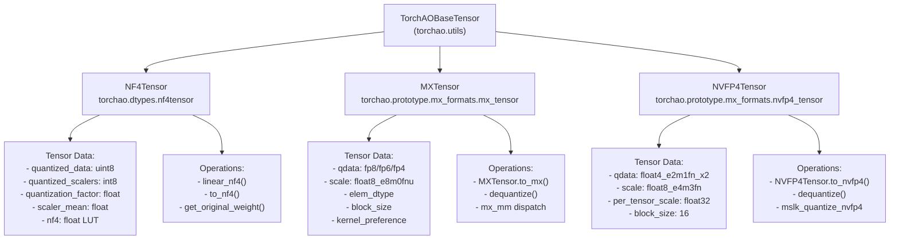
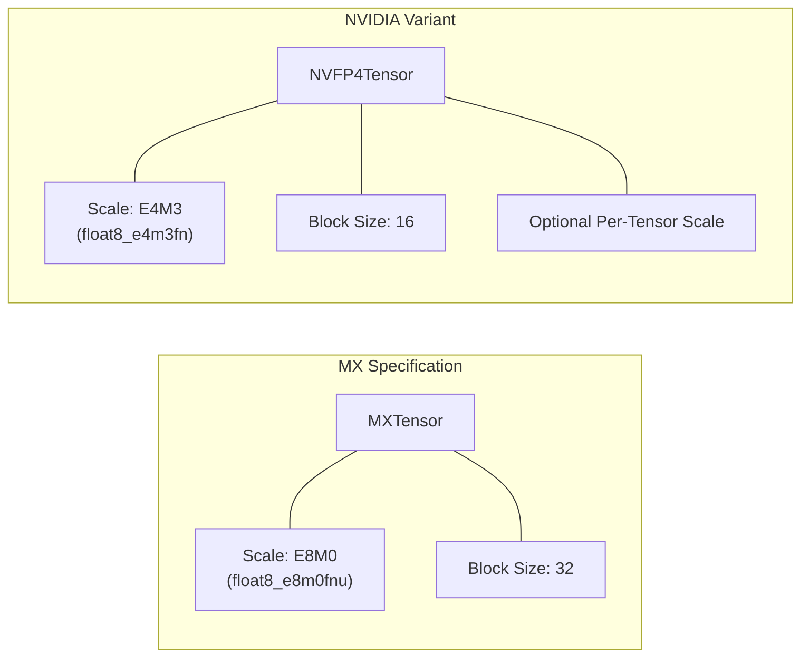

<!-- source: DeepWiki mcp.deepwiki.com · repo pytorch/ao · page 6 Advanced Quantization Formats · fetched 2026-10-21 -->

# Advanced Quantization Formats

Relevant source files

The following files were used as context for generating this wiki page:

- [benchmarks/mx_formats/cast_bench.py](benchmarks/mx_formats/cast_bench.py)
- [benchmarks/prototype/moe_training/mxfp8/bench_dequantize.py](benchmarks/prototype/moe_training/mxfp8/bench_dequantize.py)
- [test/integration/test_vllm.py](test/integration/test_vllm.py)
- [test/prototype/mx_formats/test_inference_workflow.py](test/prototype/mx_formats/test_inference_workflow.py)
- [test/prototype/mx_formats/test_kernels.py](test/prototype/mx_formats/test_kernels.py)
- [test/prototype/mx_formats/test_mx_serialization.py](test/prototype/mx_formats/test_mx_serialization.py)
- [test/prototype/mx_formats/test_mx_tensor.py](test/prototype/mx_formats/test_mx_tensor.py)
- [test/prototype/mx_formats/test_nvfp4_tensor.py](test/prototype/mx_formats/test_nvfp4_tensor.py)
- [test/quantization/quantize_/workflows/nf4/ddp/check_ddp_nf4.py](test/quantization/quantize_/workflows/nf4/ddp/check_ddp_nf4.py)
- [test/quantization/quantize_/workflows/nf4/ddp/ddp_nf4.py](test/quantization/quantize_/workflows/nf4/ddp/ddp_nf4.py)
- [test/quantization/quantize_/workflows/nf4/ddp/run_ddp_nf4_test.sh](test/quantization/quantize_/workflows/nf4/ddp/run_ddp_nf4_test.sh)
- [test/quantization/quantize_/workflows/nf4/test_nf4_tensor.py](test/quantization/quantize_/workflows/nf4/test_nf4_tensor.py)
- [torchao/prototype/_nf4tensor_api.py](torchao/prototype/_nf4tensor_api.py)
- [torchao/prototype/mx_formats/README.md](torchao/prototype/mx_formats/README.md)
- [torchao/prototype/mx_formats/__init__.py](torchao/prototype/mx_formats/__init__.py)
- [torchao/prototype/mx_formats/config.py](torchao/prototype/mx_formats/config.py)
- [torchao/prototype/mx_formats/constants.py](torchao/prototype/mx_formats/constants.py)
- [torchao/prototype/mx_formats/fp_format_spec.py](torchao/prototype/mx_formats/fp_format_spec.py)
- [torchao/prototype/mx_formats/inference_workflow.py](torchao/prototype/mx_formats/inference_workflow.py)
- [torchao/prototype/mx_formats/kernels.py](torchao/prototype/mx_formats/kernels.py)
- [torchao/prototype/mx_formats/mx_tensor.py](torchao/prototype/mx_formats/mx_tensor.py)
- [torchao/prototype/mx_formats/nvfp4_tensor.py](torchao/prototype/mx_formats/nvfp4_tensor.py)
- [torchao/prototype/mx_formats/utils.py](torchao/prototype/mx_formats/utils.py)
- [torchao/quantization/quantize_/workflows/nf4/__init__.py](torchao/quantization/quantize_/workflows/nf4/__init__.py)

## Purpose and Scope

This page documents TorchAO's specialized quantization formats beyond standard integer and float8 quantization: **NF4** (4-bit NormalFloat), **MX** (Microscaling formats), and **NVFP4** (NVIDIA FP4). These formats support specific use cases:

- **NF4**: Primarily for QLoRA fine-tuning with double quantization.
- **MX Formats**: OCP Microscaling spec implementation for training and inference.
- **NVFP4**: NVIDIA's FP4 variant optimized for Blackwell+ GPUs.

For standard integer quantization (Int4/Int8), see [Quantization API Reference](#2). For float8 training without MX format, see [Float8 Training System](#5).

---

## Overview of Advanced Formats

### Format Comparison

| Format | Element Dtype | Scale Dtype | Block Size | Primary Use Case | Hardware Requirements |
|--------|---------------|-------------|------------|------------------|----------------------|
| NF4 | 4-bit (uint8 packed) | float32 (double quantized to int8) | 32-256 | QLoRA fine-tuning | General GPU |
| MXFP8 | float8_e4m3fn / float8_e5m2 | float8_e8m0fnu | 32 | Training & Inference | SM89+ for training, SM100+ for best perf |
| MXFP6 | uint8 (6-bit packed) | float8_e8m0fnu | 32 | Research | SM89+ |
| MXFP4 | float4_e2m1fn_x2 | float8_e8m0fnu | 32 | Training & Inference | SM100+ |
| NVFP4 | float4_e2m1fn_x2 | float8_e4m3fn + optional float32 | 16 | Inference | SM100+ |

Sources: [torchao/prototype/mx_formats/constants.py:42-60](), [torchao/dtypes/nf4tensor.py:588-727](), [torchao/prototype/mx_formats/nvfp4_tensor.py:52-67]()

### Tensor Subclass Architecture

Sources: [torchao/dtypes/nf4tensor.py:588-654](), [torchao/prototype/mx_formats/mx_tensor.py:447-505](), [torchao/prototype/mx_formats/nvfp4_tensor.py:52-123]()

---

## NF4Tensor and QLoRA

### What is NF4?

`NF4Tensor` implements 4-bit NormalFloat quantization with double quantization, designed for the QLoRA (Quantized Low-Rank Adaptation) workflow. NF4 uses an information-theoretically optimal quantization lookup table for normally distributed data.

For details, see [NF4Tensor and QLoRA](#6.1).

**Key Features:**
- **4-bit quantization**: 16 quantization bins optimized for normal distribution [torchao/dtypes/nf4tensor.py:674-695]().
- **Double quantization**: Quantize the block scales to int8 for further memory savings [torchao/dtypes/nf4tensor.py:728-774]().
- **Block-wise quantization**: Configurable block size (typically 32-256).
- **Frozen base weights**: NF4 weights have `requires_grad=False`.
- **LoRA adapters**: Trainable adapters in higher precision (fp32/bf16).

Sources: [torchao/dtypes/nf4tensor.py:588-727](), [test/dtypes/test_nf4.py:82-122]()

---

## MX Formats (MXTensor and NVFP4Tensor)

### What is MX Format?

MX (Microscaling) is an open standard from OCP (Open Compute Project) for block-wise floating point quantization. `MXTensor` implements the [OCP MX v1.0 specification](https://www.opencompute.org/documents/ocp-microscaling-formats-mx-v1-0-spec-final-pdf).

For details, see [MX Formats (MXTensor and NVFP4Tensor)](#6.2).

### MXTensor and NVFP4 Comparison

`MXTensor` and `NVFP4Tensor` both utilize block-wise scaling but differ in their specific implementation and hardware targets.

**Scale Calculation Modes:**
MXTensor supports four modes via `ScaleCalculationMode` [torchao/prototype/mx_formats/config.py:38-63]():
- **FLOOR**: OCP spec recommended.
- **RCEIL**: NVIDIA recommended for FP8/UE8M0 [torchao/prototype/mx_formats/mx_tensor.py:109-132]().
- **CEIL**: Avoids overflow, may underflow small values.
- **EVEN**: Accuracy trade-off for MX4 training.

Sources: [torchao/prototype/mx_formats/mx_tensor.py:447-512](), [torchao/prototype/mx_formats/nvfp4_tensor.py:52-123](), [torchao/prototype/mx_formats/config.py:38-63]()

---

## MoE Training with FP8/MXFP8

### What is MoE Training with MX?

For Mixture-of-Experts (MoE) models, MX formats enable efficient training with FP8 or MXFP8. This system handles the complex sharding and expert parallelism required for MoE while maintaining numerical stability through block-wise scaling.

For details, see [MoE Training with FP8/MXFP8](#6.3).

**Key Components:**
- **MXFP8TrainingRecipe**: Configures dtypes and scaling modes for training [torchao/prototype/mx_formats/mx_linear.py:25-79]().
- **Grouped GEMM**: Triton kernels optimized for expert-parallel workloads.
- **Differentiable MX Matmul**: `mx_mm` autograd function for training [torchao/prototype/mx_formats/mx_linear.py:83-229]().

Sources: [torchao/prototype/mx_formats/mx_linear.py:25-79](), [torchao/prototype/mx_formats/mx_linear.py:83-229]()

---

## Performance Considerations

### Hardware Requirements Summary

| Format | Minimum GPU | Optimal GPU | Emulation Available |
|--------|------------|-------------|---------------------|
| NF4 | Any | Any | N/A (always emulated) |
| MXFP8 Training | SM89+ (triton) | SM100+ (CUDA) | Yes |
| MXFP8 Inference | SM100+ (AUTO) | SM100+ | Yes (EMULATED mode) |
| MXFP4 | SM100+ | SM100+ | Yes (EMULATED mode) |
| NVFP4 Dynamic | SM100+ | SM100+ | No |
| NVFP4 Weight-Only | Any | SM100+ | Yes (dequant to fp16/bf16) |

Sources: [torchao/prototype/mx_formats/config.py:81-93](), [torchao/prototype/mx_formats/mx_tensor.py:644-732](), [torchao/prototype/mx_formats/nvfp4_tensor.py:160-169]()

---

## Related Pages

- For basic quantization API and integer formats: [Quantization API Reference](#2)
- For standard float8 training without MX: [Float8 Training System](#5)
- For quantization-aware training: [Quantization-Aware Training (QAT)](#4)
- For NF4 specifics: [NF4Tensor and QLoRA](#6.1)
- For MX/NVFP4 details: [MX Formats (MXTensor and NVFP4Tensor)](#6.2)
- For MoE training: [MoE Training with FP8/MXFP8](#6.3)

---

