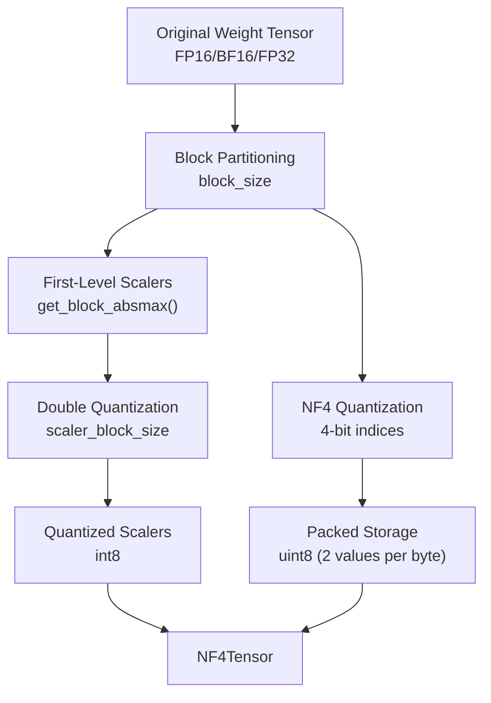
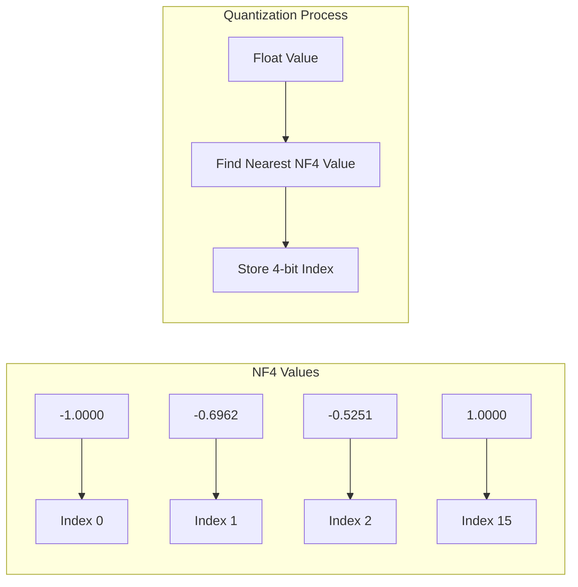
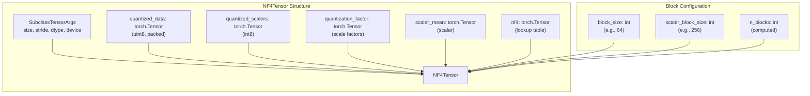
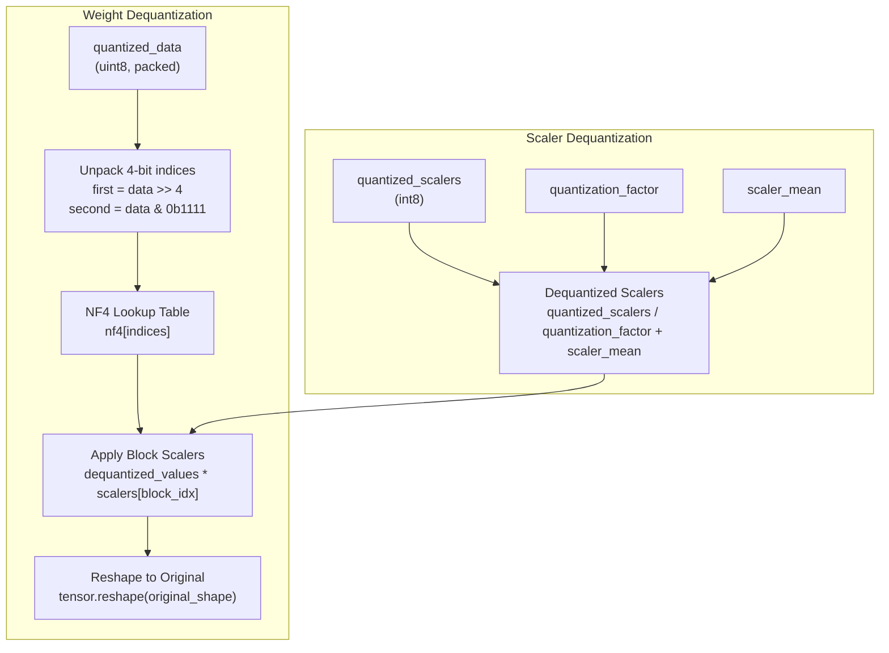
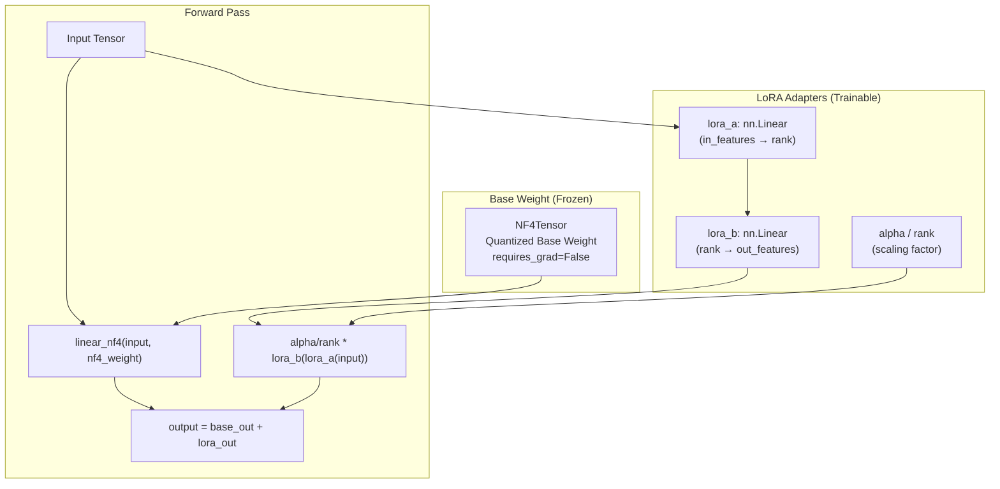
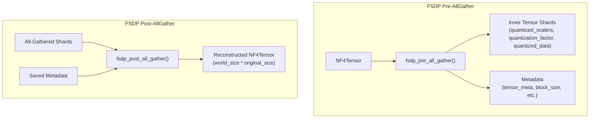

<!-- source: DeepWiki mcp.deepwiki.com · repo pytorch/ao · page 6.1 NF4Tensor and QLoRA · fetched 2026-10-21 -->

# NF4Tensor and QLoRA

<details>
<summary>Relevant source files</summary>

The following files were used as context for generating this wiki page:

- [README.md](README.md)
- [test/integration/test_integration.py](test/integration/test_integration.py)
- [test/quantization/quantize_/workflows/nf4/ddp/check_ddp_nf4.py](test/quantization/quantize_/workflows/nf4/ddp/check_ddp_nf4.py)
- [test/quantization/quantize_/workflows/nf4/ddp/ddp_nf4.py](test/quantization/quantize_/workflows/nf4/ddp/ddp_nf4.py)
- [test/quantization/quantize_/workflows/nf4/ddp/run_ddp_nf4_test.sh](test/quantization/quantize_/workflows/nf4/ddp/run_ddp_nf4_test.sh)
- [test/quantization/quantize_/workflows/nf4/test_nf4_tensor.py](test/quantization/quantize_/workflows/nf4/test_nf4_tensor.py)
- [test/quantization/test_quant_api.py](test/quantization/test_quant_api.py)
- [test/quantization/test_quant_primitives.py](test/quantization/test_quant_primitives.py)
- [torchao/prototype/_nf4tensor_api.py](torchao/prototype/_nf4tensor_api.py)
- [torchao/prototype/hqq/hqq_tinygemm_linear.py](torchao/prototype/hqq/hqq_tinygemm_linear.py)
- [torchao/quantization/README.md](torchao/quantization/README.md)
- [torchao/quantization/__init__.py](torchao/quantization/__init__.py)
- [torchao/quantization/qat/README.md](torchao/quantization/qat/README.md)
- [torchao/quantization/quant_api.py](torchao/quantization/quant_api.py)
- [torchao/quantization/quant_primitives.py](torchao/quantization/quant_primitives.py)
- [torchao/quantization/quantize_/workflows/nf4/__init__.py](torchao/quantization/quantize_/workflows/nf4/__init__.py)
- [torchao/quantization/utils.py](torchao/quantization/utils.py)

</details>


This document covers the NF4 (4-bit Normal Float) quantization implementation in torchao, including the `NF4Tensor` subclass and QLoRA (Quantized LoRA) integration. NF4 provides memory-efficient weight-only quantization while maintaining model quality, particularly useful for large language model inference and parameter-efficient fine-tuning.

For Float8 quantization including training support, see [Float8 Training System](#5). For general quantization APIs and configurations, see [quantize_ Function](#2.1).

## NF4 Quantization Overview

NF4 quantization reduces model weights from FP16/BF16/FP32 to 4-bit representations using a normal float distribution. The implementation supports block-wise quantization with double quantization of scaling factors to minimize quantization error.

### Quantization Flow



Sources: [torchao/quantization/quantize_/workflows/nf4/nf4_tensor.py:568-585]() (get_block_absmax), [torchao/quantization/quantize_/workflows/nf4/nf4_tensor.py:728-786]() (double_quantize_scalers), [torchao/quantization/quantize_/workflows/nf4/nf4_tensor.py:813-851]() (convert_to_norm_float_weight)

### NF4 Lookup Table

The NF4 format uses a predefined lookup table of 16 values optimized for normal distributions:



The complete NF4 lookup table contains 16 values ranging from -1.0 to 1.0, designed to approximate a normal distribution. During quantization, float values are mapped to the nearest NF4 value and stored as 4-bit indices (0-15).

Sources: [torchao/quantization/quantize_/workflows/nf4/nf4_tensor.py:674-695]() (NF4 lookup table in from_tensor method)

## NF4Tensor Implementation

### Core Architecture



Sources: [torchao/quantization/quantize_/workflows/nf4/nf4_tensor.py:588-653]() (NF4Tensor.__new__ and __init__), [torchao/quantization/quantize_/workflows/nf4/nf4_tensor.py:557-565]() (SubclassTensorArgs), [torchao/quantization/quantize_/workflows/nf4/nf4_tensor.py:108-130]() (construct_nf4_args helper)

### Tensor Operations Support

The `NF4Tensor` implements `__torch_dispatch__` to support common tensor operations. Operations are registered using the `@implements` decorator pattern:

| Operation Category | Supported Operations | Implementation |
|-------------------|---------------------|----------------|
| Basic Operations | `detach`, `clone`, `t` | [nf4_tensor.py:196-214](), [nf4_tensor.py:201-203](), [nf4_tensor.py:405-427]() |
| View Operations | `view`, `as_strided`, `slice` | [nf4_tensor.py:314-350](), [nf4_tensor.py:353-383](), [nf4_tensor.py:297-311]() |
| Device Movement | `to`, `_to_copy` | [nf4_tensor.py:386-402]() |
| Linear Algebra | `mm`, `linear_nf4` | [nf4_tensor.py:430-432](), [nf4_tensor.py:1054-1078]() |
| Distributed Ops | `all_gather_into_tensor`, `scatter_`, `wait_tensor` | [nf4_tensor.py:25-40](), [nf4_tensor.py:43-63](), [nf4_tensor.py:521-532]() |

The operations dispatch table is maintained in `NF4_OPS_TABLE`.

Sources: [torchao/quantization/quantize_/workflows/nf4/nf4_tensor.py:66-69]() (NF4_OPS_TABLE), [torchao/quantization/quantize_/workflows/nf4/nf4_tensor.py:97-105]() (implements decorator)

### Dequantization Process

Dequantization reverses both the NF4 quantization and the double quantization of scalers:



The dequantization is performed by `get_original_weight()` which handles both levels of quantization reversal.

Sources: [torchao/quantization/quantize_/workflows/nf4/nf4_tensor.py:853-879]() (get_original_weight), [torchao/quantization/quantize_/workflows/nf4/nf4_tensor.py:788-811]() (dequantize_scalers)

## QLoRA Integration

QLoRA (Quantized LoRA) combines NF4-quantized base weights with trainable LoRA adapters for parameter-efficient fine-tuning.

### QLoRA Architecture



This diagram shows a reference LoRA implementation pattern used in tests. Base weights are frozen `NF4Tensor` instances while LoRA adapters remain in full precision and trainable.

Sources: [test/quantization/quantize_/workflows/nf4/ddp/ddp_nf4.py:21-57]() (reference LoRALinear implementation), [test/quantization/quantize_/workflows/nf4/test_nf4_tensor.py:611-640]() (LoRALinear test implementation)

### LinearNF4 Autograd Function

The `LinearNF4` class is a `torch.autograd.Function` that handles automatic differentiation for NF4 linear operations. During the forward pass, it dequantizes the weight to full precision for the matmul but does not compute gradients for the frozen base weight.

Sources: [torchao/quantization/quantize_/workflows/nf4/nf4_tensor.py:1054-1078]() (LinearNF4 autograd function and linear_nf4 wrapper)

## Distributed Training Support

### FSDP Integration

`NF4Tensor` supports Fully Sharded Data Parallel (FSDP) training through custom sharding methods that handle the inner quantized components:



Sources: [torchao/quantization/quantize_/workflows/nf4/nf4_tensor.py:984-1006]() (fsdp_pre_all_gather), [torchao/quantization/quantize_/workflows/nf4/nf4_tensor.py:1008-1052]() (fsdp_post_all_gather)

## API Usage and Configuration

### Configuration and Transformation

The `NF4WeightOnlyConfig` defines the block sizes used for quantization. A module handler is registered to transform standard `nn.Linear` layers into NF4-quantized layers during the `quantize_` workflow.

```python
from torchao.prototype._nf4tensor_api import NF4WeightOnlyConfig
from torchao.quantization import quantize_

# Apply NF4 quantization to a model
quantize_(model, NF4WeightOnlyConfig(block_size=64, scaler_block_size=256))
```

Sources: [torchao/prototype/_nf4tensor_api.py:15-39]() (NF4WeightOnlyConfig and transform handler)

### Memory Layout and Storage

The NF4 format achieves significant memory savings through bit-packing and double quantization. The `convert_to_norm_float_weight` function stores two 4-bit values in each `uint8` byte using bit shifts.

Sources: [torchao/quantization/quantize_/workflows/nf4/nf4_tensor.py:813-851]() (convert_to_norm_float_weight), [torchao/quantization/quantize_/workflows/nf4/nf4_tensor.py:728-786]() (double_quantize_scalers)

---

