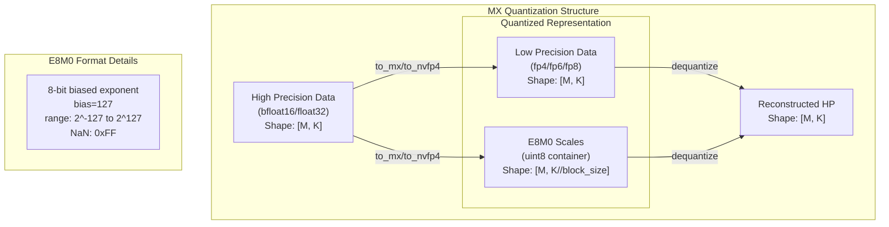
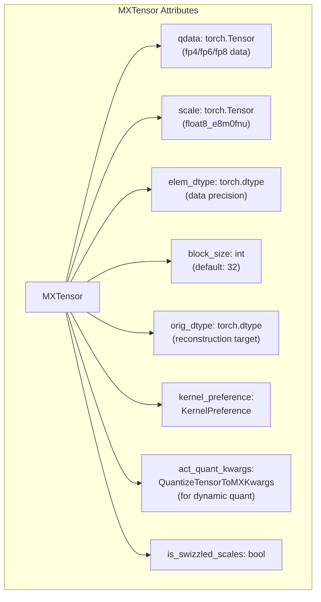
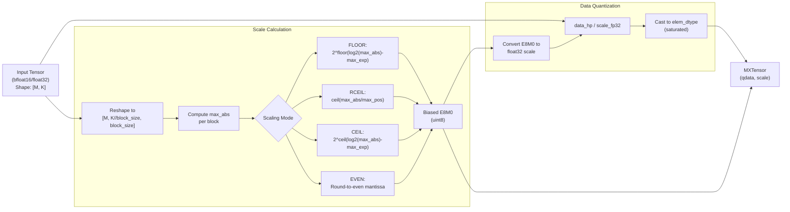
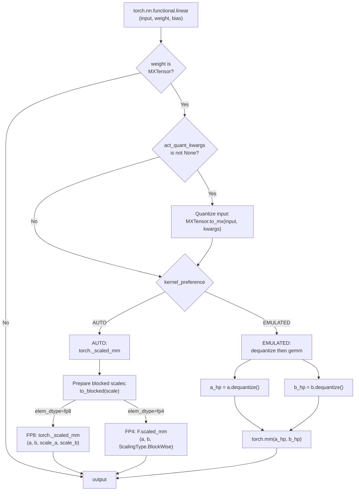
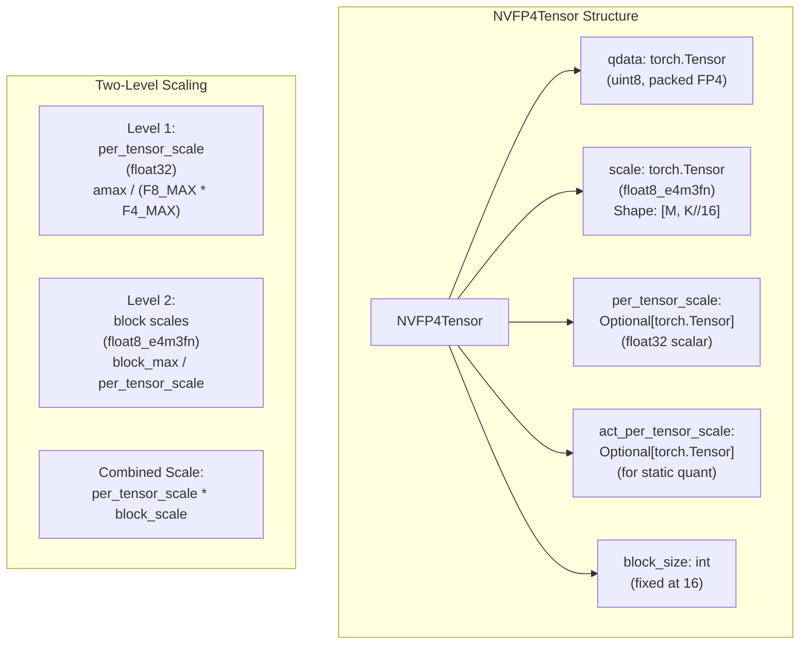

<!-- source: DeepWiki mcp.deepwiki.com · repo pytorch/ao · page 6.2 MX Formats (MXTensor and NVFP4Tensor) · fetched 2026-10-21 -->

# MX Formats (MXTensor and NVFP4Tensor)

<details>
<summary>Relevant source files</summary>

The following files were used as context for generating this wiki page:

- [benchmarks/mx_formats/cast_bench.py](benchmarks/mx_formats/cast_bench.py)
- [benchmarks/prototype/moe_training/mxfp8/bench_dequantize.py](benchmarks/prototype/moe_training/mxfp8/bench_dequantize.py)
- [test/integration/test_vllm.py](test/integration/test_vllm.py)
- [test/prototype/mx_formats/test_inference_workflow.py](test/prototype/mx_formats/test_inference_workflow.py)
- [test/prototype/mx_formats/test_kernels.py](test/prototype/mx_formats/test_kernels.py)
- [test/prototype/mx_formats/test_mx_serialization.py](test/prototype/mx_formats/test_mx_serialization.py)
- [test/prototype/mx_formats/test_mx_tensor.py](test/prototype/mx_formats/test_mx_tensor.py)
- [test/prototype/mx_formats/test_nvfp4_tensor.py](test/prototype/mx_formats/test_nvfp4_tensor.py)
- [torchao/prototype/mx_formats/README.md](torchao/prototype/mx_formats/README.md)
- [torchao/prototype/mx_formats/__init__.py](torchao/prototype/mx_formats/__init__.py)
- [torchao/prototype/mx_formats/config.py](torchao/prototype/mx_formats/config.py)
- [torchao/prototype/mx_formats/constants.py](torchao/prototype/mx_formats/constants.py)
- [torchao/prototype/mx_formats/fp_format_spec.py](torchao/prototype/mx_formats/fp_format_spec.py)
- [torchao/prototype/mx_formats/inference_workflow.py](torchao/prototype/mx_formats/inference_workflow.py)
- [torchao/prototype/mx_formats/kernels.py](torchao/prototype/mx_formats/kernels.py)
- [torchao/prototype/mx_formats/mx_tensor.py](torchao/prototype/mx_formats/mx_tensor.py)
- [torchao/prototype/mx_formats/nvfp4_tensor.py](torchao/prototype/mx_formats/nvfp4_tensor.py)
- [torchao/prototype/mx_formats/utils.py](torchao/prototype/mx_formats/utils.py)

</details>


## Purpose and Scope

This document covers the MX (Microscaling) format tensor implementations in TorchAO: `MXTensor` and `NVFP4Tensor`. These tensor subclasses provide block-wise quantization with shared exponents, enabling efficient low-precision inference and training. `MXTensor` implements the OCP MX format specification, while `NVFP4Tensor` implements NVIDIA's variant optimized for Blackwell+ GPUs.

For MX format training workflows (including MoE training), see [6.3](). For QAT with NVFP4, see [4]().

## MX Format Fundamentals

### Block-Wise Quantization with Shared Exponents

MX formats use block-wise quantization where each block of elements shares a single scale factor encoded in E8M0 format (8-bit biased exponent with no mantissa). This differs from per-tensor or per-channel quantization by providing fine-grained scaling without per-element overhead.



Sources: [torchao/prototype/mx_formats/mx_tensor.py:8-18](), [torchao/prototype/mx_formats/constants.py:45-50]()

### Supported Element Data Types

| Element Type | Container | Bits | Max Value | Usage |
|--------------|-----------|------|-----------|-------|
| `torch.float8_e4m3fn` | `torch.float8_e4m3fn` | 8 | 448 | MXTensor, NVFP4 scales |
| `torch.float8_e5m2` | `torch.float8_e5m2` | 8 | 57344 | MXTensor |
| `DTYPE_FP6_E2M3` | `torch.uint8` | 6 | 28 | MXTensor |
| `DTYPE_FP6_E3M2` | `torch.uint8` | 6 | 28 | MXTensor |
| `torch.float4_e2m1fn_x2` | `torch.uint8` (packed) | 4 | 6 | MXTensor, NVFP4 |

Sources: [torchao/prototype/mx_formats/constants.py:12-20](), [torchao/prototype/mx_formats/mx_tensor.py:90-97]()

## MXTensor Implementation

### Class Structure

`MXTensor` is a `TorchAOBaseTensor` subclass that stores quantized data and scales separately. It handles the dispatch logic for operations like matrix multiplication when one or more operands are in MX format.



Sources: [torchao/prototype/mx_formats/mx_tensor.py:447-505]()

### Quantization: `to_mx`

The `to_mx` function converts high precision tensors to MX format through scale calculation and data quantization. It supports multiple scaling modes to balance accuracy and overflow risk.



Sources: [torchao/prototype/mx_formats/mx_tensor.py:270-348](), [torchao/prototype/mx_formats/config.py:38-63]()

### Scale Calculation Modes

Four modes are supported via the `ScaleCalculationMode` enum:

*   **FLOOR**: Recommended by OCP MX Spec 1.0. Uses `2^floor(log2(max_abs(v))-max_exp)`. May cause overflow for large values. [torchao/prototype/mx_formats/config.py:43-44]()
*   **RCEIL**: NVIDIA's method using `ceil(max_abs / max_pos)` then converting to E8M0. Blackwell GPUs accelerate this via `cvt.rp.satfinite.ue8m0x2.f32`. [torchao/prototype/mx_formats/mx_tensor.py:109-132]()
*   **CEIL**: Uses `2^ceil(log2(max_abs(v))-max_exp)`. Avoids overflow but small values may round to zero. [torchao/prototype/mx_formats/config.py:50-51]()
*   **EVEN**: A trade-off using `2^(floor(log2(rounding(max_abs(v)))-max_exp))`. Provides better accuracy for MX4 training. [torchao/prototype/mx_formats/config.py:53-57]()

Sources: [torchao/prototype/mx_formats/config.py:38-63](), [torchao/prototype/mx_formats/mx_tensor.py:109-200]()

### Matrix Multiplication Dispatch

`MXTensor` overrides `aten.mm`, `aten.matmul`, `aten.addmm`, and `aten.linear` to dispatch to optimized kernels like `torch._scaled_mm` (for FP8) or `F.scaled_mm` (for FP4). If `kernel_preference` is `EMULATED`, it falls back to dequantizing operands.



Sources: [torchao/prototype/mx_formats/mx_tensor.py:644-771]()

## NVFP4Tensor Implementation

### Two-Level Scaling Architecture

`NVFP4Tensor` implements NVIDIA's variant of the FP4 format, which uses "double quantization": a global per-tensor or per-expert scale (float32) and per-block scales (float8_e4m3fn, block_size=16).



Sources: [torchao/prototype/mx_formats/nvfp4_tensor.py:52-123]()

### Quantization and Dequantization

The quantization process (`to_nvfp4`) computes the two scale levels and packs two FP4 values into a single `uint8`. Dequantization (`dequantize`) reverses this by unpacking the values and applying the combined scales.

*   **`to_nvfp4`**: [torchao/prototype/mx_formats/nvfp4_tensor.py:131-224]()
*   **`dequantize`**: [torchao/prototype/mx_formats/nvfp4_tensor.py:226-259]()

## Inference Configuration Classes

### MXDynamicActivationMXWeightConfig

Used for dynamic quantization where both activations and weights are converted to MX format (FP8 or FP4).

```python
from torchao.prototype.mx_formats import MXDynamicActivationMXWeightConfig
from torchao.quantization import quantize_

config = MXDynamicActivationMXWeightConfig(
    block_size=32,
    activation_dtype=torch.float8_e4m3fn,
    weight_dtype=torch.float8_e4m3fn,
    kernel_preference=KernelPreference.AUTO,
    scaling_mode=ScaleCalculationMode.RCEIL,
)
quantize_(model, config)
```

Sources: [torchao/prototype/mx_formats/inference_workflow.py:81-121]()

### NVFP4 Configurations

`NVFP4DynamicActivationNVFP4WeightConfig` supports both dynamic and static per-tensor scaling. Static scaling uses the `NVFP4ObservedLinear` module during a "prepare" step to track activation `amax`.

*   **Dynamic**: Both weight and activation per-tensor scales are computed at runtime.
*   **Static**: Activation per-tensor scale is calibrated using an observer, then baked into the weight during "convert".
*   **Weight-Only**: Only the weight is quantized to NVFP4; activations remain in high precision.

Sources: [torchao/prototype/mx_formats/inference_workflow.py:174-239](), [torchao/prototype/mx_formats/inference_workflow.py:37-77]()

## Scale Swizzling for Hardware Optimization

To achieve optimal performance on NVIDIA GPUs, scales must be "swizzled" (rearranged) into a specific blocked layout required by `torch._scaled_mm`.

**Blocking Transformation**:
1.  Pad the scale matrix to multiples of 128 rows and 4 columns.
2.  Rearrange the blocks using a specific permutation pattern.
3.  The `to_blocked` function handles this transformation, while `from_blocked` performs the inverse.

Sources: [torchao/prototype/mx_formats/utils.py:31-70](), [torchao/prototype/mx_formats/utils.py:73-102]()

## Hardware Requirements

| Format | Minimum Hardware | Acceleration |
|--------|------------------|--------------|
| MX FP8 | NVIDIA SM89 (Ada) | `torch._scaled_mm` |
| MX FP4 | NVIDIA SM100 (Blackwell) | `F.scaled_mm` |
| NVFP4 Dynamic | NVIDIA SM100 (Blackwell) | Hardware `scaled_mm` |
| NVFP4 Static | NVIDIA SM89 (Ada) | `torch._scaled_mm` |

Sources: [torchao/prototype/mx_formats/inference_workflow.py:88-89](), [torchao/prototype/mx_formats/inference_workflow.py:185-188](), [test/prototype/mx_formats/test_inference_workflow.py:84-91]()

## Handler Registration

Quantization is applied to `nn.Linear` modules via registered handlers that transform the module weights into `MXTensor` or `NVFP4Tensor` and inject activation quantization parameters.

*   **MX Handler**: `_mx_inference_linear_transform` [torchao/prototype/mx_formats/inference_workflow.py:126-170]()
*   **NVFP4 Handler**: `_nvfp4_inference_linear_transform` [torchao/prototype/mx_formats/inference_workflow.py:241-351]()

Sources: [torchao/prototype/mx_formats/inference_workflow.py:126-351]()

---

