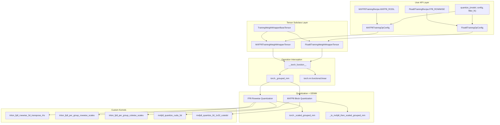
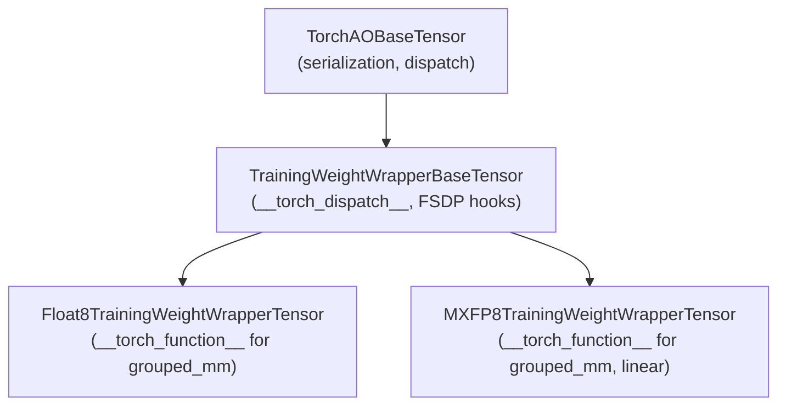
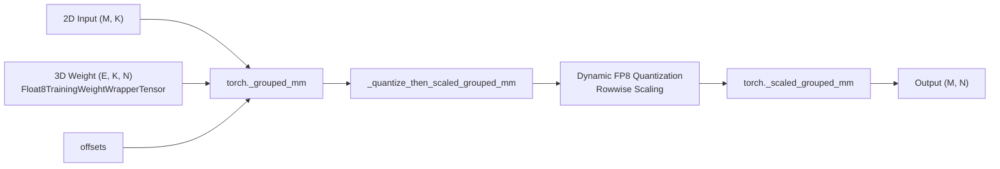

<!-- source: DeepWiki mcp.deepwiki.com · repo pytorch/ao · page 6.3 MoE Training with FP8/MXFP8 · fetched 2026-10-21 -->

# MoE Training with FP8/MXFP8

<details>
<summary>Relevant source files</summary>

The following files were used as context for generating this wiki page:

- [benchmarks/prototype/moe_training/benchmark_scaled_grouped_mm_dq.py](benchmarks/prototype/moe_training/benchmark_scaled_grouped_mm_dq.py)
- [benchmarks/prototype/moe_training/fp8_rowwise/bench_triton_fp8_colwise_3d_scale_and_cast.py](benchmarks/prototype/moe_training/fp8_rowwise/bench_triton_fp8_colwise_3d_scale_and_cast.py)
- [benchmarks/prototype/moe_training/mxfp8/bench_mx_block_rearrange_2d_M_groups.py](benchmarks/prototype/moe_training/mxfp8/bench_mx_block_rearrange_2d_M_groups.py)
- [benchmarks/prototype/moe_training/mxfp8/bench_quantize_3d.py](benchmarks/prototype/moe_training/mxfp8/bench_quantize_3d.py)
- [benchmarks/prototype/moe_training/mxfp8/dsv3_rooflines.png](benchmarks/prototype/moe_training/mxfp8/dsv3_rooflines.png)
- [benchmarks/prototype/moe_training/mxfp8/llama_rooflines.png](benchmarks/prototype/moe_training/mxfp8/llama_rooflines.png)
- [benchmarks/prototype/moe_training/mxfp8/roofline_unified.py](benchmarks/prototype/moe_training/mxfp8/roofline_unified.py)
- [docs/static/mxfp8_with_loss.png](docs/static/mxfp8_with_loss.png)
- [test/prototype/moe_training/test_kernels.py](test/prototype/moe_training/test_kernels.py)
- [test/prototype/moe_training/test_mxfp8_grouped_mm.py](test/prototype/moe_training/test_mxfp8_grouped_mm.py)
- [test/prototype/moe_training/test_tensor.py](test/prototype/moe_training/test_tensor.py)
- [test/prototype/moe_training/test_training.py](test/prototype/moe_training/test_training.py)
- [torchao/csrc/cuda/mx_kernels/mx_block_rearrange_2d_M_groups.cu](torchao/csrc/cuda/mx_kernels/mx_block_rearrange_2d_M_groups.cu)
- [torchao/csrc/cuda/mx_kernels/mxfp8_cuda.cu](torchao/csrc/cuda/mx_kernels/mxfp8_cuda.cu)
- [torchao/csrc/cuda/mx_kernels/mxfp8_extension.cpp](torchao/csrc/cuda/mx_kernels/mxfp8_extension.cpp)
- [torchao/csrc/cuda/mx_kernels/mxfp8_quantize.cuh](torchao/csrc/cuda/mx_kernels/mxfp8_quantize.cuh)
- [torchao/csrc/cuda/mx_kernels/ptx.cuh](torchao/csrc/cuda/mx_kernels/ptx.cuh)
- [torchao/prototype/moe_training/README.md](torchao/prototype/moe_training/README.md)
- [torchao/prototype/moe_training/__init__.py](torchao/prototype/moe_training/__init__.py)
- [torchao/prototype/moe_training/config.py](torchao/prototype/moe_training/config.py)
- [torchao/prototype/moe_training/conversion_utils.py](torchao/prototype/moe_training/conversion_utils.py)
- [torchao/prototype/moe_training/fp8_grouped_mm.py](torchao/prototype/moe_training/fp8_grouped_mm.py)
- [torchao/prototype/moe_training/kernels/__init__.py](torchao/prototype/moe_training/kernels/__init__.py)
- [torchao/prototype/moe_training/kernels/float8_rowwise.py](torchao/prototype/moe_training/kernels/float8_rowwise.py)
- [torchao/prototype/moe_training/kernels/jagged_float8_scales.py](torchao/prototype/moe_training/kernels/jagged_float8_scales.py)
- [torchao/prototype/moe_training/kernels/mxfp8/cutedsl_quantize_2d_1x32.py](torchao/prototype/moe_training/kernels/mxfp8/cutedsl_quantize_2d_1x32.py)
- [torchao/prototype/moe_training/kernels/mxfp8/cutedsl_quantize_2d_32x1.py](torchao/prototype/moe_training/kernels/mxfp8/cutedsl_quantize_2d_32x1.py)
- [torchao/prototype/moe_training/kernels/mxfp8/cutedsl_quantize_3d.py](torchao/prototype/moe_training/kernels/mxfp8/cutedsl_quantize_3d.py)
- [torchao/prototype/moe_training/kernels/mxfp8/quant.py](torchao/prototype/moe_training/kernels/mxfp8/quant.py)
- [torchao/prototype/moe_training/mxfp8_grouped_mm.py](torchao/prototype/moe_training/mxfp8_grouped_mm.py)
- [torchao/prototype/moe_training/tensor.py](torchao/prototype/moe_training/tensor.py)
- [torchao/prototype/moe_training/utils.py](torchao/prototype/moe_training/utils.py)

</details>


## Purpose and Scope

This document covers TorchAO's support for training Mixture-of-Experts (MoE) models using low-precision FP8 and MXFP8 formats. The system enables memory-efficient training of MoE architectures by dynamically quantizing activations and weights during grouped GEMM operations.

For general Float8 training of dense models, see [Float8 Training System](#5). For MXFP8 inference and general MX format details, see [MX Formats (MXTensor and NVFP4Tensor)](#6.2).

## Overview

MoE models route tokens to different expert subnetworks using a gating mechanism. The core computational pattern is **grouped GEMM** - matrix multiplications where different subsets of tokens are routed to different weight matrices (experts). This creates irregular computation patterns with variable token counts per expert.

TorchAO provides two low-precision training approaches for MoE:

- **FP8 Training**: Uses `torch.float8_e4m3fn` with rowwise scaling.
- **MXFP8 Training**: Uses MX format FP8 with block-structured scales (32-element blocks), optimized for B200 (SM100) hardware.

Both approaches dynamically quantize inputs during forward and backward passes, using specialized kernels optimized for grouped GEMM operations.

**Key Features:**
- Dynamic quantization with rowwise or blockwise scaling granularity.
- Custom Triton kernels for "jagged" quantization (different scales per expert group).
- Autograd integration for automatic gradient computation via `_MXFP8GroupedMM`.
- FSDP2 support for distributed training.
- Hardware-optimized paths for different GPU architectures (SM90, SM100, MI300).

Sources: [torchao/prototype/moe_training/README.md:17-31](), [torchao/prototype/moe_training/mxfp8_grouped_mm.py:111-131](), [test/prototype/moe_training/test_training.py:1-101]()

## Architecture Overview



Sources: [torchao/prototype/moe_training/tensor.py:52-318](), [torchao/prototype/moe_training/mxfp8_grouped_mm.py:56-108](), [torchao/prototype/moe_training/conversion_utils.py:21-48]()

## Configuration System

### Recipes and Configs

TorchAO provides recipe-based configuration for MoE training via `Float8TrainingRecipe` and `MXFP8TrainingRecipe`.

| Recipe | Hardware | Description |
|--------|----------|-------------|
| `Float8TrainingRecipe.FP8_ROWWISE` | SM90+ (H100), MI300/MI350 | FP8 with rowwise scaling. |
| `MXFP8TrainingRecipe.MXFP8_RCEIL` | SM100 (B200) | MXFP8 with ceil rounding, full MXFP8 weight gradients. |
| `MXFP8TrainingRecipe.MXFP8_RCEIL_WGRAD_WITH_HP` | SM100 (B200) | MXFP8 with ceil rounding, high-precision weight gradients. |
| `MXFP8TrainingRecipe.MXFP8_EMULATED_RCEIL` | Any | Emulated MXFP8 for debugging/development. |

**Creating Configurations:**

```python
# From recipe
config = Float8TrainingOpConfig.from_recipe(
    Float8TrainingRecipe.FP8_ROWWISE
)

config = MXFP8TrainingOpConfig.from_recipe(
    MXFP8TrainingRecipe.MXFP8_RCEIL
)
```

### Configuration Fields

**Float8TrainingOpConfig:**
- `float8_dtype`: FP8 dtype (`torch.float8_e4m3fn` or `torch.float8_e4m3fnuz` for MI300).
- `out_dtype`: Output dtype for GEMM results (default: `torch.bfloat16`).

**MXFP8TrainingOpConfig:**
- `kernel_preference`: `AUTO` (hardware-optimized) or `EMULATED` (fallback).
- `wgrad_with_hp`: Whether to compute weight gradients in high precision.
- `pad_token_groups_for_grouped_mm`: If True, pads token groups to multiple of 32 (required for MXFP8 kernels).

Sources: [torchao/prototype/moe_training/config.py:23-154](), [torchao/prototype/moe_training/mxfp8_grouped_mm.py:65-84]()

## Tensor Subclass System

### Class Hierarchy



### TrainingWeightWrapperBaseTensor

Base class `TrainingWeightWrapperBaseTensor` [torchao/prototype/moe_training/tensor.py:52-89]() providing common functionality:

**Key Methods:**
- `__torch_dispatch__`: Handles most operations by unwrapping tensors via `pytree.tree_map_only` [torchao/prototype/moe_training/tensor.py:97-134]().
- `fsdp_pre_all_gather`: Casts to mixed precision dtype before all-gather [torchao/prototype/moe_training/tensor.py:157-168]().
- `fsdp_post_all_gather`: Reconstructs tensor subclass after all-gather [torchao/prototype/moe_training/tensor.py:170-208]().
- `__tensor_flatten__`/`__tensor_unflatten__`: Serialization support [torchao/prototype/moe_training/tensor.py:141-154]().

**Preserved Operations:**
The following operations in `_ops_to_preserve_subclass` [torchao/prototype/moe_training/tensor.py:34-49]() preserve the tensor subclass:
- `aten.empty_like`, `aten.view`, `aten.as_strided`, `aten.clone`, `aten.transpose`.

Sources: [torchao/prototype/moe_training/tensor.py:34-208]()

### Float8TrainingWeightWrapperTensor

Intercepts `torch._grouped_mm` operations for FP8 quantization:



Sources: [torchao/prototype/moe_training/tensor.py:211-254]()

### MXFP8TrainingWeightWrapperTensor

Intercepts both `torch._grouped_mm` and linear operations to use `_to_mxfp8_then_scaled_grouped_mm` [torchao/prototype/moe_training/mxfp8_grouped_mm.py:56-108]() or `_to_mxfp8_then_scaled_mm` [torchao/prototype/moe_training/mxfp8_linear.py:10-44]().

Sources: [torchao/prototype/moe_training/tensor.py:256-318]()

## Quantization and Grouped GEMM

### FP8 Grouped GEMM Workflow

The `_quantize_then_scaled_grouped_mm` utility [torchao/prototype/moe_training/fp8_grouped_mm.py:20-254]() manages the lifecycle:

1. **Forward Pass**:
    - Activation $A$ is quantized rowwise.
    - Weight $B_t$ is quantized per-expert rowwise (logical columns) using `triton_fp8_rowwise_3d_transpose_rhs`.
    - `torch._scaled_grouped_mm` executes the kernel.
2. **Backward - grad_input**:
    - `grad_output` is quantized rowwise.
    - Weight $B$ is transposed and quantized per-expert rowwise.
3. **Backward - grad_weight**:
    - Uses "jagged" column-wise scales via `triton_fp8_per_group_colwise_scales` to handle the irregular token counts per expert.

Sources: [torchao/prototype/moe_training/fp8_grouped_mm.py:20-254](), [torchao/prototype/moe_training/utils.py:20-153]()

### MXFP8 Grouped GEMM Workflow

The `_MXFP8GroupedMM` autograd function [torchao/prototype/moe_training/mxfp8_grouped_mm.py:111-131]() handles MXFP8:
- **Token Padding**: Optionally pads token groups to multiple of 32 using `fused_pad_token_groups_cuda` [torchao/prototype/moe_training/mxfp8_grouped_mm.py:177-178]().
- **Quantization**: Uses `mxfp8_quantize_cuda_3d` [torchao/prototype/moe_training/kernels/mxfp8/quant.py:86-127]() for expert weights and `triton_to_mxfp8_dim0` for activations.
- **Rearrangement**: Uses `mx_block_rearrange_2d_M_groups_cuda` [torchao/prototype/moe_training/mxfp8_grouped_mm.py:206-208]() to prepare scales for the hardware kernel.

Sources: [torchao/prototype/moe_training/mxfp8_grouped_mm.py:111-230](), [torchao/prototype/moe_training/kernels/mxfp8/quant.py:130-190]()

## Custom Kernels

### FP8 Rowwise 3D Transpose
`triton_fp8_rowwise_3d_transpose_rhs` [torchao/prototype/moe_training/kernels/float8_rowwise.py:45-117]() quantizes a 3D weight tensor $(E, K, N)$ to FP8 with rowwise scaling and transposes it to $(E, N, K)$ in column-major layout.

### Jagged FP8 Scales
- `triton_fp8_per_group_rowwise_scales` [torchao/prototype/moe_training/kernels/jagged_float8_scales.py:71-133](): Computes rowwise scales for groups defined by offsets.
- `triton_fp8_per_group_colwise_scales`: Computes column-wise scales for jagged groups, used in backward weight gradients.

### MXFP8 Specific Kernels
- `mxfp8_quantize_cuda_3d` [torchao/prototype/moe_training/kernels/mxfp8/quant.py:58-127](): Performs 3D block-quantization.
- `mx_block_rearrange_2d_M_groups_cuda`: Rearranges MX scales to match the expected layout for grouped GEMM on SM100.
- `fused_pad_token_groups_cuda`: Efficiently pads variable-length token groups to a block boundary.

Sources: [torchao/prototype/moe_training/kernels/float8_rowwise.py:45-117](), [torchao/prototype/moe_training/kernels/jagged_float8_scales.py:71-133](), [torchao/prototype/moe_training/kernels/mxfp8/quant.py:58-127]()

## Usage with quantize_ API

The `quantize_` function [torchao/quantization/quant_api.py:32]() can be used with `MXFP8TrainingOpConfig` or `Float8TrainingOpConfig`. The handler `_moe_training_transform` [torchao/prototype/moe_training/config.py:156-178]() is triggered to swap parameters.

```python
from torchao.quantization.quant_api import quantize_
from torchao.prototype.moe_training.config import MXFP8TrainingOpConfig, MXFP8TrainingRecipe

# Target experts only
def moe_filter(mod, fqn):
    return "experts" in fqn

config = MXFP8TrainingOpConfig.from_recipe(MXFP8TrainingRecipe.MXFP8_RCEIL)
quantize_(model, config=config, filter_fn=moe_filter)
```

The underlying `_swap_params` [torchao/prototype/moe_training/conversion_utils.py:50-125]() replaces `nn.Parameter.data` with `MXFP8TrainingWeightWrapperTensor` or `Float8TrainingWeightWrapperTensor`.

Sources: [torchao/prototype/moe_training/conversion_utils.py:50-125](), [torchao/prototype/moe_training/config.py:156-178]()

## Hardware Requirements and Performance

| Format | Minimum Hardware | Recommended |
|--------|-----------------|-------------|
| FP8 Rowwise | SM89+ (Ada), SM90+ (Hopper), MI300 | H100, MI350 |
| MXFP8 | SM100 (Blackwell) | B200 |

**Performance Highlights:**
- **Llama4 Scout**: MXFP8 on B200 provides **~1.4x - 1.8x speedups** over bfloat16 `torch._grouped_mm`.
- **DeepSeekV3**: MXFP8 provides **~1.19x - 1.6x speedups** for 671B shapes.
- **End-to-End**: 1.3x e2e speedup demonstrated in TorchTitan on a 64-node GB200 cluster.

Sources: [torchao/prototype/moe_training/README.md:17-43](), [test/prototype/moe_training/test_training.py:14-23]()

---

