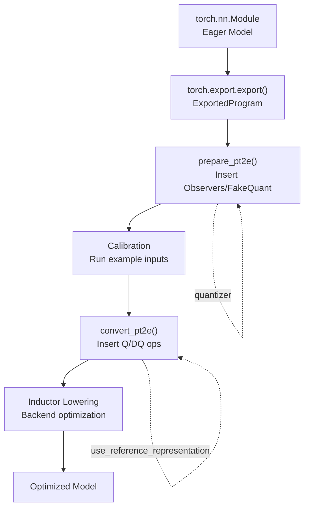
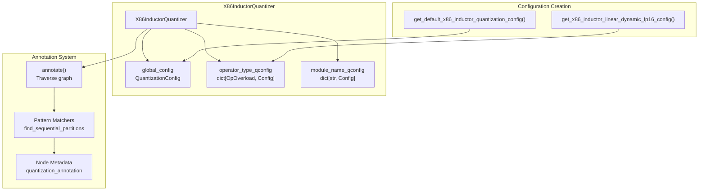
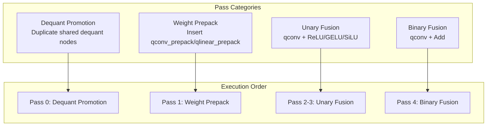
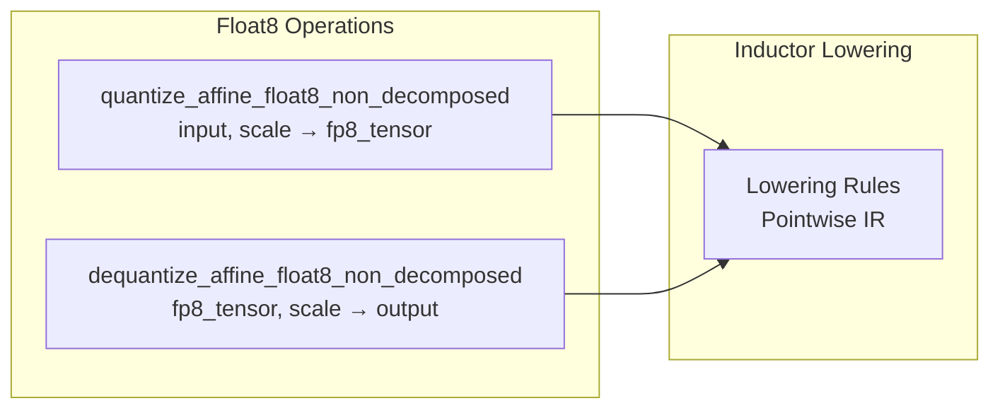

<!-- source: DeepWiki mcp.deepwiki.com · repo pytorch/ao · page 7 PT2E Quantization and Backend Optimization · fetched 2026-10-21 -->

# PT2E Quantization and Backend Optimization

Relevant source files

The following files were used as context for generating this wiki page:

- [test/quantization/pt2e/test_graph_utils.py](test/quantization/pt2e/test_graph_utils.py)
- [test/quantization/pt2e/test_numeric_debugger.py](test/quantization/pt2e/test_numeric_debugger.py)
- [test/quantization/pt2e/test_quantize_pt2e.py](test/quantization/pt2e/test_quantize_pt2e.py)
- [test/quantization/pt2e/test_x86inductor_fusion.py](test/quantization/pt2e/test_x86inductor_fusion.py)
- [torchao/quantization/pt2e/_numeric_debugger.py](torchao/quantization/pt2e/_numeric_debugger.py)
- [torchao/quantization/pt2e/constant_fold.py](torchao/quantization/pt2e/constant_fold.py)
- [torchao/quantization/pt2e/convert.py](torchao/quantization/pt2e/convert.py)
- [torchao/quantization/pt2e/graph_utils.py](torchao/quantization/pt2e/graph_utils.py)
- [torchao/quantization/pt2e/inductor_passes/__init__.py](torchao/quantization/pt2e/inductor_passes/__init__.py)
- [torchao/quantization/pt2e/inductor_passes/lowering.py](torchao/quantization/pt2e/inductor_passes/lowering.py)
- [torchao/quantization/pt2e/inductor_passes/x86.py](torchao/quantization/pt2e/inductor_passes/x86.py)
- [torchao/quantization/pt2e/lowering.py](torchao/quantization/pt2e/lowering.py)
- [torchao/quantization/pt2e/prepare.py](torchao/quantization/pt2e/prepare.py)
- [torchao/quantization/pt2e/quantize_pt2e.py](torchao/quantization/pt2e/quantize_pt2e.py)
- [torchao/quantization/pt2e/quantizer/x86_inductor_quantizer.py](torchao/quantization/pt2e/quantizer/x86_inductor_quantizer.py)
- [torchao/quantization/pt2e/utils.py](torchao/quantization/pt2e/utils.py)
- [torchao/testing/model_architectures.py](torchao/testing/model_architectures.py)
- [torchao/testing/pt2e/utils.py](torchao/testing/pt2e/utils.py)

## Purpose and Scope

This document covers the PyTorch 2 Export (PT2E) quantization flow and its backend optimization infrastructure. PT2E quantization uses `torch.export` to capture models as FX graphs, applies quantization through a prepare-convert workflow, and integrates with the Inductor compiler for hardware-specific optimizations.

For details on the PT2E quantization overview, see [PT2E Quantization Overview](#7.1). For x86-specific quantization, see [X86InductorQuantizer](#7.2). For details on Inductor passes, see [Inductor Passes and Fusion](#7.3). For Float8 lowering details, see [Float8 Lowering](#7.4).

**Key capabilities covered:**
- PT2E quantization workflow (export → prepare → convert)
- X86InductorQuantizer for x86 CPU optimization
- Inductor fusion passes for Conv2d/Linear operators
- OneDNN backend integration
- Float8 quantization primitives and lowering

---

## PT2E Quantization Workflow

### Overview

PT2E quantization follows a three-phase workflow that operates on exported FX graphs. The `prepare_pt2e` function [torchao/quantization/pt2e/quantize_pt2e.py:36-139]() and `convert_pt2e` function [torchao/quantization/pt2e/quantize_pt2e.py:221-255]() are the primary entry points.

**PT2E Quantization Workflow**

The workflow consists of:

1. **Export**: Capture the model as an FX graph using `torch.export.export()` [test/quantization/pt2e/test_quantize_pt2e.py:175-175]().
2. **Prepare**: Insert observer/fake quantization nodes via `prepare_pt2e()` with a `Quantizer` abstraction [torchao/quantization/pt2e/prepare.py:67-124]().
3. **Calibrate**: Run example inputs through the prepared model to collect statistics [test/quantization/pt2e/test_quantize_pt2e.py:178-178]().
4. **Convert**: Replace observers with quantize/dequantize operations via `convert_pt2e()` [torchao/quantization/pt2e/convert.py:25-103]().
5. **Lower**: Apply Inductor passes to optimize for the target backend [torchao/quantization/pt2e/lowering.py:16-65]().

Sources: [torchao/quantization/pt2e/quantize_pt2e.py:36-255](), [torchao/testing/pt2e/utils.py:50-133]()

---

## X86InductorQuantizer

### Architecture

The `X86InductorQuantizer` [torchao/quantization/pt2e/quantizer/x86_inductor_quantizer.py:55-635]() is the primary quantizer for x86 CPU backends, supporting both static and dynamic quantization with OneDNN integration.

**X86InductorQuantizer Architecture**

Sources: [torchao/quantization/pt2e/quantizer/x86_inductor_quantizer.py:55-101](), [torchao/quantization/pt2e/quantizer/x86_inductor_quantizer.py:411-530]()

### Configuration and Supported Ops

The quantizer supports fine-grained control via `set_global`, `set_module_name`, and `set_module_type` [torchao/quantization/pt2e/quantizer/x86_inductor_quantizer.py:458-479](). It targets specific optimized sets of operators like `int8_in_int8_out_ops` (e.g., `max_pool2d`, `cat`) and `default_quantizable_ops` (e.g., `conv2d`, `linear`) [torchao/quantization/pt2e/quantizer/x86_inductor_quantizer.py:74-99]().

For detailed configuration documentation, see [X86InductorQuantizer](#7.2).

---

## Inductor Optimization Passes

### Fusion and Prepacking

Inductor applies a series of fusion and optimization passes to quantized models during the lowering phase to leverage OneDNN capabilities.

**Inductor Pass Execution Flow**

Key passes include:
- **Dequant Promotion**: Duplicates dequantization nodes with multiple users to enable individual fusion [torchao/quantization/pt2e/inductor_passes/x86.py:580-681]().
- **Weight Prepack**: Transforms weights into optimized layouts for OneDNN using `qconv_weight_prepack` [torchao/quantization/pt2e/inductor_passes/x86.py:720-900]().
- **Unary/Binary Fusion**: Fuses activations (ReLU, GELU, SiLU) and additions directly into the quantized convolution/linear kernels [torchao/quantization/pt2e/inductor_passes/x86.py:215-296]().

For detailed pass logic, see [Inductor Passes and Fusion](#7.3).

---

## Float8 Quantization and Lowering

### Float8 Support

PT2E supports Float8 quantization through custom non-decomposed operations that Inductor can lower to efficient hardware kernels.

**Float8 Quantization Lowering**

The lowering rules for `quantize_affine_float8_non_decomposed` and `dequantize_affine_float8_non_decomposed` generate optimized Pointwise IR [torchao/quantization/pt2e/inductor_passes/lowering.py:14-83](). This infrastructure supports dtypes such as `torch.float8_e4m3fn` and `torch.float8_e5m2` [torchao/quantization/pt2e/utils.py:100-101]().

For detailed lowering documentation, see [Float8 Lowering](#7.4).

---

## Numeric Debugging Infrastructure

PT2E provides a debug handle system to track nodes through transformations using `from_node` metadata [torchao/quantization/pt2e/_numeric_debugger.py:29-144](). This is essential for comparing intermediate values between a floating-point reference and the quantized model using the `OutputLogger` [torchao/quantization/pt2e/_numeric_debugger.py:194-254]().

Sources: [test/quantization/pt2e/test_numeric_debugger.py:28-181](), [torchao/quantization/pt2e/_numeric_debugger.py:14-254]()

---

