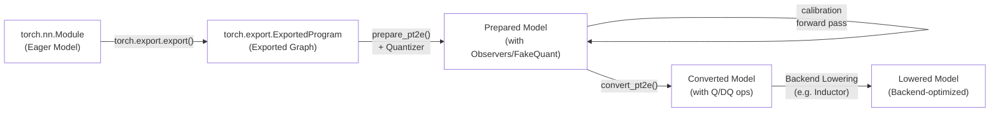
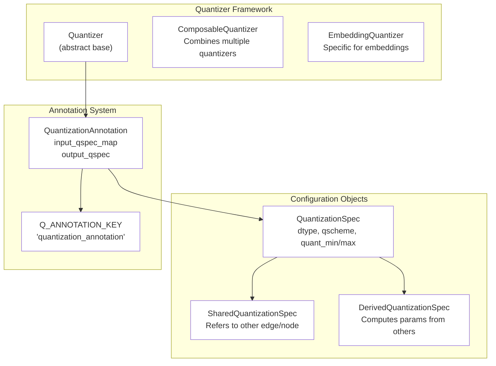

<!-- source: DeepWiki mcp.deepwiki.com · repo pytorch/ao · page 7.1 PT2E Quantization Overview · fetched 2026-10-21 -->

# PT2E Quantization Overview

<details>
<summary>Relevant source files</summary>

The following files were used as context for generating this wiki page:

- [test/quantization/pt2e/test_graph_utils.py](test/quantization/pt2e/test_graph_utils.py)
- [test/quantization/pt2e/test_quantize_pt2e.py](test/quantization/pt2e/test_quantize_pt2e.py)
- [torchao/quantization/pt2e/constant_fold.py](torchao/quantization/pt2e/constant_fold.py)
- [torchao/quantization/pt2e/convert.py](torchao/quantization/pt2e/convert.py)
- [torchao/quantization/pt2e/export_utils.py](torchao/quantization/pt2e/export_utils.py)
- [torchao/quantization/pt2e/graph_utils.py](torchao/quantization/pt2e/graph_utils.py)
- [torchao/quantization/pt2e/prepare.py](torchao/quantization/pt2e/prepare.py)
- [torchao/quantization/pt2e/qat_utils.py](torchao/quantization/pt2e/qat_utils.py)
- [torchao/quantization/pt2e/quantize_pt2e.py](torchao/quantization/pt2e/quantize_pt2e.py)
- [torchao/quantization/pt2e/quantizer/__init__.py](torchao/quantization/pt2e/quantizer/__init__.py)
- [torchao/quantization/pt2e/quantizer/composable_quantizer.py](torchao/quantization/pt2e/quantizer/composable_quantizer.py)
- [torchao/quantization/pt2e/quantizer/duplicate_dq_pass.py](torchao/quantization/pt2e/quantizer/duplicate_dq_pass.py)
- [torchao/quantization/pt2e/quantizer/embedding_quantizer.py](torchao/quantization/pt2e/quantizer/embedding_quantizer.py)
- [torchao/quantization/pt2e/quantizer/port_metadata_pass.py](torchao/quantization/pt2e/quantizer/port_metadata_pass.py)
- [torchao/quantization/pt2e/quantizer/quantizer.py](torchao/quantization/pt2e/quantizer/quantizer.py)
- [torchao/quantization/pt2e/quantizer/utils.py](torchao/quantization/pt2e/quantizer/utils.py)
- [torchao/quantization/pt2e/utils.py](torchao/quantization/pt2e/utils.py)
- [torchao/testing/model_architectures.py](torchao/testing/model_architectures.py)
- [torchao/testing/pt2e/_xnnpack_quantizer.py](torchao/testing/pt2e/_xnnpack_quantizer.py)
- [torchao/testing/pt2e/_xnnpack_quantizer_utils.py](torchao/testing/pt2e/_xnnpack_quantizer_utils.py)

</details>


## Purpose and Scope

PT2E (PyTorch 2 Export) quantization is a graph-based quantization approach that operates on exported `torch.fx.GraphModule` models. It provides a compiler-friendly quantization path that enables aggressive backend optimizations through operator fusion, kernel selection, and constant folding. This page covers the PT2E quantization workflow, its key components, and implementation details of the prepare and convert phases.

For information about eager-mode quantization using the `quantize_` API, see [Quantization API Reference](). For QAT-specific workflows, see [Quantization-Aware Training (QAT)]().

**Sources:** [torchao/quantization/pt2e/quantize_pt2e.py:36-93](), [torchao/quantization/pt2e/prepare.py:45-47]()

## Quantization Workflow

PT2E quantization follows a four-stage workflow that transforms a PyTorch model into an optimized quantized representation:



**Diagram: PT2E Quantization Four-Stage Workflow**

**Sources:** [torchao/quantization/pt2e/quantize_pt2e.py:78-93](), [torchao/quantization/pt2e/quantize_pt2e.py:206-224]()

### Stage 1: Export

The model is captured into a static graph representation using `torch.export.export()`. This produces an `ExportedProgram` containing a `torch.fx.GraphModule`.

```python
# Example of program capture
m = torch.export.export(model, example_inputs).module()
```

**Key characteristics:**
- All Python control flow is traced into graph nodes.
- The model is represented using ATen operators.
- Module hierarchy is typically flattened.

**Sources:** [torchao/quantization/pt2e/quantize_pt2e.py:81-82](), [test/quantization/pt2e/test_quantize_pt2e.py:175-175]()

### Stage 2: Prepare

The exported model is annotated with quantization specifications using a `Quantizer` object. The `prepare_pt2e` function orchestrates fusion, annotation, and observer insertion.

```python
# Typical prepare flow
from torchao.quantization.pt2e.quantize_pt2e import prepare_pt2e
from torchao.testing.pt2e._xnnpack_quantizer import XNNPACKQuantizer

quantizer = XNNPACKQuantizer()
prepared_model = prepare_pt2e(exported_model, quantizer)
```

**What happens during `prepare_pt2e`:**
1. **Fusion**: Conv-BN and Linear-BN are fused using `_fuse_conv_bn_` and `_fuse_linear_bn_` [torchao/quantization/pt2e/quantize_pt2e.py:100-101]().
2. **Annotation**: The `quantizer.annotate(model)` method is called to populate `node.meta["quantization_annotation"]` [torchao/quantization/pt2e/quantize_pt2e.py:103]().
3. **Observer Insertion**: `prepare` (from `torchao/quantization/pt2e/prepare.py`) inserts `ObserverOrFakeQuantize` modules based on the annotations [torchao/quantization/pt2e/prepare.py:67-124]().

**Sources:** [torchao/quantization/pt2e/quantize_pt2e.py:36-139](), [torchao/quantization/pt2e/prepare.py:9-42]()

### Stage 3: Convert

After calibration, `convert_pt2e` replaces observers with explicit quantization and dequantization operations.

```python
# Conversion
from torchao.quantization.pt2e.quantize_pt2e import convert_pt2e
converted_model = convert_pt2e(prepared_model)
```

**Key operations:**
- **Constant Folding**: Static weights are quantized and folded using `constant_fold` [torchao/quantization/pt2e/quantize_pt2e.py:218]().
- **Reference Representation**: Observers are replaced by `quantize_per_tensor` and `dequantize_per_tensor` (or per-channel variants) [torchao/quantization/pt2e/convert.py:126-144]().
- **Graph Rewriting**: Patterns like quantized Conv-BN are rewritten for the target reference representation [torchao/quantization/pt2e/quantize_pt2e.py:222]().

**Sources:** [torchao/quantization/pt2e/quantize_pt2e.py:206-224](), [torchao/quantization/pt2e/convert.py:126-167]()

## Key Components



**Diagram: PT2E Quantization Component Architecture**

**Sources:** [torchao/quantization/pt2e/quantizer/quantizer.py:21-125](), [torchao/quantization/pt2e/quantizer/composable_quantizer.py:15-22]()

### Quantizer Abstraction

The `Quantizer` class is the primary entry point for backend developers to define quantization logic.

| Method | Purpose |
|--------|---------|
| `annotate` | Annotates the `GraphModule` with `QuantizationSpec`s [torchao/quantization/pt2e/quantizer/quantizer.py:155](). |
| `validate` | Ensures the graph is correctly annotated for the backend [torchao/quantization/pt2e/quantizer/quantizer.py:161](). |
| `transform_for_annotation` | Optional pass to prepare the graph (e.g., fusion) before annotation [torchao/quantization/pt2e/quantizer/quantizer.py:149](). |

**Sources:** [torchao/quantization/pt2e/quantizer/quantizer.py:146-168]()

### Quantization Specifications

Specifications define how a specific tensor (input, weight, or output) should be quantized.

- **`QuantizationSpec`**: Standard spec containing `dtype`, `qscheme`, `quant_min`, `quant_max`, and the `observer_or_fake_quant_ctr` [torchao/quantization/pt2e/quantizer/quantizer.py:53-70]().
- **`SharedQuantizationSpec`**: Used when multiple tensors must share the same quantization parameters (e.g., inputs to an `add` operation) [torchao/quantization/pt2e/quantizer/quantizer.py:91-98]().
- **`DerivedQuantizationSpec`**: Used when quantization parameters are derived from other observers (e.g., bias quantization scale derived from input and weight scales) [torchao/quantization/pt2e/quantizer/quantizer.py:101-125]().

**Sources:** [torchao/quantization/pt2e/quantizer/quantizer.py:53-125]()

## Implementation Details

### Prepare Phase Implementation

The `prepare` function in `torchao/quantization/pt2e/prepare.py` is responsible for translating annotations into executable observer nodes.

1. **Map Construction**: It creates a mapping from graph edges/nodes to `ObserverOrFakeQuantize` instances [torchao/quantization/pt2e/prepare.py:69-70]().
2. **Spec Resolution**: It handles `SharedQuantizationSpec` by finding root nodes in a sharing tree using path compression [torchao/quantization/pt2e/prepare.py:126-143]().
3. **Node Insertion**: It uses `_insert_obs_or_fq` to place the actual observer modules into the FX graph [torchao/quantization/pt2e/prepare.py:236]().

**Sources:** [torchao/quantization/pt2e/prepare.py:67-124](), [torchao/quantization/pt2e/prepare.py:126-175]()

### Convert Phase and Constant Folding

The conversion process finalizes the quantization by freezing parameters.

**Constant Folding Workflow:**
1. **Identify Constants**: `ConstantFolder` identifies `get_attr` nodes and nodes that can be pre-computed [torchao/quantization/pt2e/constant_fold.py:75-130]().
2. **Execution**: The interpreter runs these nodes to produce concrete `torch.Tensor` values [torchao/quantization/pt2e/constant_fold.py:136-152]().
3. **Replacement**: `replace_node_with_constant` removes the compute nodes and registers the result as a buffer in the `GraphModule` [torchao/quantization/pt2e/constant_fold.py:27-67]().

**Sources:** [torchao/quantization/pt2e/constant_fold.py:27-67](), [torchao/quantization/pt2e/constant_fold.py:75-130]()

### QAT Support

`prepare_qat_pt2e` follows a similar flow to `prepare_pt2e` but inserts fake quantization nodes instead of observers. It also performs specific QAT fusions, such as folding BN weights into Conv nodes for training-time simulation [torchao/quantization/pt2e/qat_utils.py:89-127]().

**Sources:** [torchao/quantization/pt2e/quantize_pt2e.py:142-203](), [torchao/quantization/pt2e/qat_utils.py:200-240]()

## Utility Functions

The `torchao/quantization/pt2e/utils.py` file provides critical helpers for graph manipulation:

| Function | Purpose |
|----------|---------|
| `getattr_from_fqn` | Retrieves an attribute from a module using a string FQN [torchao/quantization/pt2e/utils.py:81-85](). |
| `calculate_qmin_qmax` | Computes valid integer ranges based on dtype and `reduce_range` [torchao/quantization/pt2e/utils.py:172-230](). |
| `find_sequential_partitions` | Locates sequences of nodes (e.g., Conv -> BN -> ReLU) for fusion [torchao/quantization/pt2e/graph_utils.py:100-126](). |
| `collect_producer_nodes` | Traces back from a node to its constant or input sources [torchao/quantization/pt2e/graph_utils.py:194-205](). |

**Sources:** [torchao/quantization/pt2e/utils.py:81-85](), [torchao/quantization/pt2e/utils.py:172-230](), [torchao/quantization/pt2e/graph_utils.py:100-126]()

---

