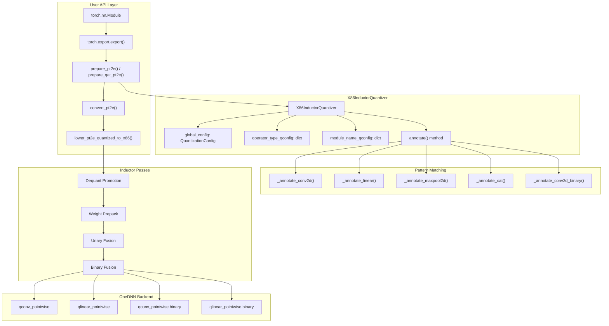
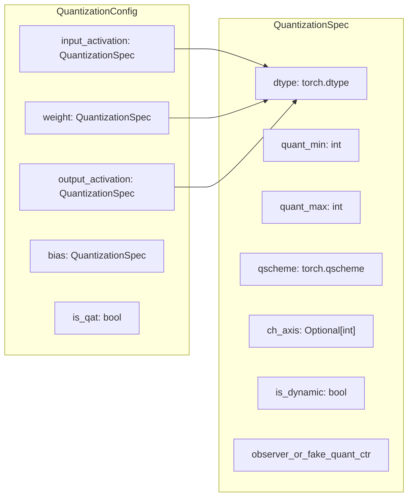
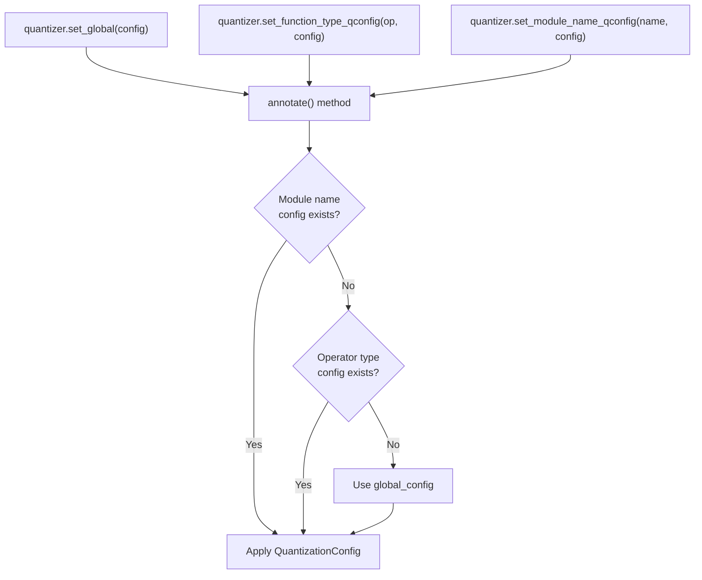
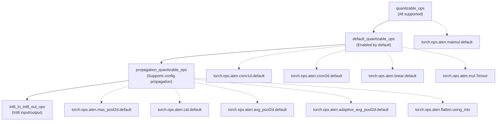
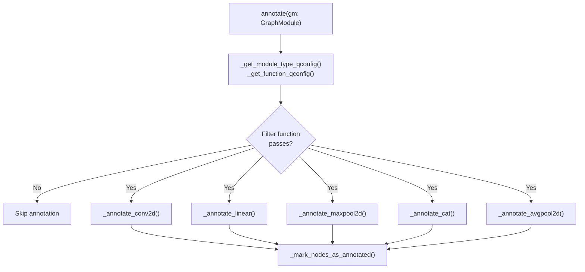
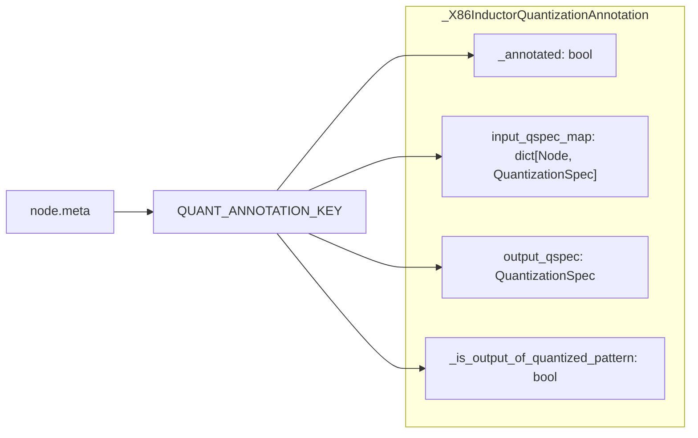

<!-- source: DeepWiki mcp.deepwiki.com · repo pytorch/ao · page 7.2 X86InductorQuantizer · fetched 2026-10-21 -->

# X86InductorQuantizer

Relevant source files

The following files were used as context for generating this wiki page:

- [test/quantization/pt2e/test_arm_inductor_quantizer.py](test/quantization/pt2e/test_arm_inductor_quantizer.py)
- [test/quantization/pt2e/test_duplicate_dq.py](test/quantization/pt2e/test_duplicate_dq.py)
- [test/quantization/pt2e/test_metadata_porting.py](test/quantization/pt2e/test_metadata_porting.py)
- [test/quantization/pt2e/test_numeric_debugger.py](test/quantization/pt2e/test_numeric_debugger.py)
- [test/quantization/pt2e/test_quantize_pt2e_qat.py](test/quantization/pt2e/test_quantize_pt2e_qat.py)
- [test/quantization/pt2e/test_representation.py](test/quantization/pt2e/test_representation.py)
- [test/quantization/pt2e/test_x86inductor_fusion.py](test/quantization/pt2e/test_x86inductor_fusion.py)
- [test/quantization/pt2e/test_x86inductor_quantizer.py](test/quantization/pt2e/test_x86inductor_quantizer.py)
- [torchao/quantization/pt2e/_numeric_debugger.py](torchao/quantization/pt2e/_numeric_debugger.py)
- [torchao/quantization/pt2e/inductor_passes/__init__.py](torchao/quantization/pt2e/inductor_passes/__init__.py)
- [torchao/quantization/pt2e/inductor_passes/lowering.py](torchao/quantization/pt2e/inductor_passes/lowering.py)
- [torchao/quantization/pt2e/inductor_passes/x86.py](torchao/quantization/pt2e/inductor_passes/x86.py)
- [torchao/quantization/pt2e/lowering.py](torchao/quantization/pt2e/lowering.py)
- [torchao/quantization/pt2e/quantizer/arm_inductor_quantizer.py](torchao/quantization/pt2e/quantizer/arm_inductor_quantizer.py)
- [torchao/quantization/pt2e/quantizer/x86_inductor_quantizer.py](torchao/quantization/pt2e/quantizer/x86_inductor_quantizer.py)
- [torchao/testing/pt2e/utils.py](torchao/testing/pt2e/utils.py)

## Purpose and Scope

`X86InductorQuantizer` is a quantizer implementation for PyTorch 2 Export (PT2E) quantization flow targeting x86 CPU architectures. It enables INT8 and FP8 quantization with OneDNN backend integration for optimized inference on Intel CPUs. This quantizer annotates computation graphs with quantization specifications that are later lowered to optimized OneDNN operations through the Inductor compiler.

For general PT2E quantization concepts, see [PT2E Quantization Overview](). For Inductor fusion patterns and optimization passes, see [Inductor Passes and Fusion](). For Float8 quantization workflows, see [Float8 Lowering]().

Sources: [torchao/quantization/pt2e/quantizer/x86_inductor_quantizer.py:54-60]()

---

## Architecture Overview

### System Components

The `X86InductorQuantizer` integrates with PyTorch's PT2E quantization infrastructure and Inductor compiler to provide CPU-optimized quantized inference:

**X86InductorQuantizer Data Flow**

Sources: [torchao/quantization/pt2e/quantizer/x86_inductor_quantizer.py:541-650](), [torchao/quantization/pt2e/inductor_passes/x86.py:64-78]()

---

## Quantization Configuration

### Configuration Types

`X86InductorQuantizer` supports three main quantization configuration factory functions:

| Configuration Function | Precision | Activation | Weight | Use Case |
|------------------------|-----------|------------|--------|----------|
| `get_default_x86_inductor_quantization_config(is_qat=False, is_dynamic=False)` | INT8 | UINT8 per-tensor | INT8 per-channel | Static PTQ |
| `get_default_x86_inductor_quantization_config(is_qat=False, is_dynamic=True)` | INT8 | Dynamic | INT8 per-channel | Dynamic quantization |
| `get_default_x86_inductor_quantization_config(is_qat=True, is_dynamic=False)` | INT8 | UINT8 per-tensor | INT8 per-channel | QAT |
| `get_x86_inductor_linear_dynamic_fp16_config()` | FP16 | FP32 | FP16 | Dynamic FP16 linear |

Sources: [torchao/quantization/pt2e/quantizer/x86_inductor_quantizer.py:280-363]()

### QuantizationConfig Structure

**QuantizationConfig and QuantizationSpec Structure**

Sources: [torchao/quantization/pt2e/quantizer/x86_inductor_quantizer.py:35-46]()

### Configuration Application

The quantizer supports three levels of configuration priority:

1. **Module Name Configuration**: Target specific modules by name via `set_module_name_qconfig`.
2. **Operator Type Configuration**: Target specific operator types (e.g., `torch.ops.aten.linear.default`) via `set_function_type_qconfig`.
3. **Global Configuration**: Default configuration for all quantizable operations via `set_global`.

**Configuration Priority Resolution**

Sources: [torchao/quantization/pt2e/quantizer/x86_inductor_quantizer.py:471-540]()

---

## Operator Support

### Quantizable Operator Sets

The quantizer defines multiple operator sets with different levels of support:

**Operator Set Hierarchy:**

**Operator Support Hierarchy**

| Operator Set | Operations | Default Enabled | Notes |
|--------------|------------|-----------------|-------|
| `int8_in_int8_out_ops` | `max_pool2d`, `cat`, `avg_pool2d`, `adaptive_avg_pool2d`, `flatten` | Yes (via propagation) | Optimized for int8 I/O [torchao/quantization/pt2e/quantizer/x86_inductor_quantizer.py:74-80]() |
| `default_quantizable_ops` | Above + `conv1d`, `conv2d`, `linear`, `mul` | Yes | Enabled by `set_global()` [torchao/quantization/pt2e/quantizer/x86_inductor_quantizer.py:88-93]() |
| `quantizable_ops` | Above + `matmul` | No | Requires explicit configuration [torchao/quantization/pt2e/quantizer/x86_inductor_quantizer.py:97-99]() |

---

## Pattern Annotation System

### Annotation Architecture

The `X86InductorQuantizer.annotate()` method orchestrates pattern matching and annotation:

**Annotation Workflow**

Sources: [torchao/quantization/pt2e/quantizer/x86_inductor_quantizer.py:541-650]()

### Annotation Node Metadata

Each annotated node receives metadata in `node.meta[QUANT_ANNOTATION_KEY]`:

**Node Annotation Metadata Structure**

The `_is_output_of_quantized_pattern` flag (unique to X86InductorQuantizer) marks nodes that are outputs of fused patterns and have quantized inputs. This enables downstream passes to identify fusion boundaries.

Sources: [torchao/quantization/pt2e/quantizer/x86_inductor_quantizer.py:61-68]()

---

## Inductor Integration and Lowering

### Inductor Pass Pipeline

Inductor-specific passes for x86 are implemented to optimize the graph before code generation. These passes include Dequant Promotion, Weight Prepacking, and Unary/Binary fusion.

Sources: [torchao/quantization/pt2e/inductor_passes/x86.py:64-78]()

### Freezing Pass Details

**Pass 1: Dequant Promotion**

Duplicates dequantization nodes when they have multiple users, enabling more fusion opportunities.

**Pass 2: Weight Prepack**

Replaces `dequantize → conv/linear` patterns with `qconv_prepack → qconv_pointwise` or `qlinear_prepack → qlinear_pointwise`. Inductor uses `torch.ops.onednn.qconv_pointwise` and `torch.ops.onednn.qlinear_pointwise` for these optimized operations.

Sources: [torchao/quantization/pt2e/inductor_passes/x86.py:216-221]()

### FP8 Lowering

FP8 quantization support is integrated via specialized lowering rules for `quantize_affine_float8_non_decomposed` and `dequantize_affine_float8_non_decomposed`. These are translated into Inductor `Pointwise` IR.

Sources: [torchao/quantization/pt2e/inductor_passes/lowering.py:14-84]()

---

## Key Implementation Details

### Quantization Mode Validation

`X86InductorQuantizer` validates that all configurations use consistent modes (static vs dynamic, QAT vs non-QAT). The `_need_skip_config` function checks if the new configuration matches the existing model state.

Sources: [torchao/quantization/pt2e/quantizer/x86_inductor_quantizer.py:422-456]()

### Observer Selection by Mode

The quantizer selects appropriate observers based on the configuration:

| Mode | Activation Observer | Weight Observer |
|------|---------------------|-----------------|
| Static PTQ | `HistogramObserver` | `PerChannelMinMaxObserver` |
| Dynamic PTQ | `PlaceholderObserver` | `PerChannelMinMaxObserver` |
| QAT Static | `FusedMovingAvgObsFakeQuantize` | `FusedMovingAvgObsFakeQuantize` |

Sources: [torchao/quantization/pt2e/quantizer/x86_inductor_quantizer.py:280-333]()

### Reduce Range Support

For x86 CPUs, `reduce_range` is often set to `True` (default in many configs) to prevent overflow during accumulation in INT8. This is specifically handled in `get_default_x86_inductor_quantization_config`.

Sources: [torchao/quantization/pt2e/quantizer/x86_inductor_quantizer.py:281-309]()

---

## Limitations and Constraints

- **Supported Convolution Dimensions**: Only Conv1d and Conv2d are optimized through the OneDNN path [torchao/quantization/pt2e/quantizer/x86_inductor_quantizer.py:89-90]().
- **Mixed Mode Restrictions**: Mixing static and dynamic quantization in a single `X86InductorQuantizer` instance is restricted via `_need_skip_config` [torchao/quantization/pt2e/quantizer/x86_inductor_quantizer.py:458-470]().
- **FP8 Support**: Limited to per-tensor quantization for float8 currently [torchao/quantization/pt2e/inductor_passes/lowering.py:25-27]().

---

