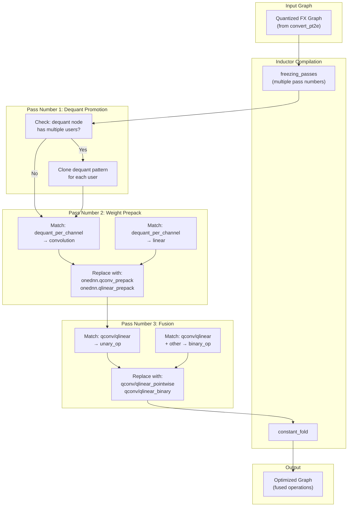
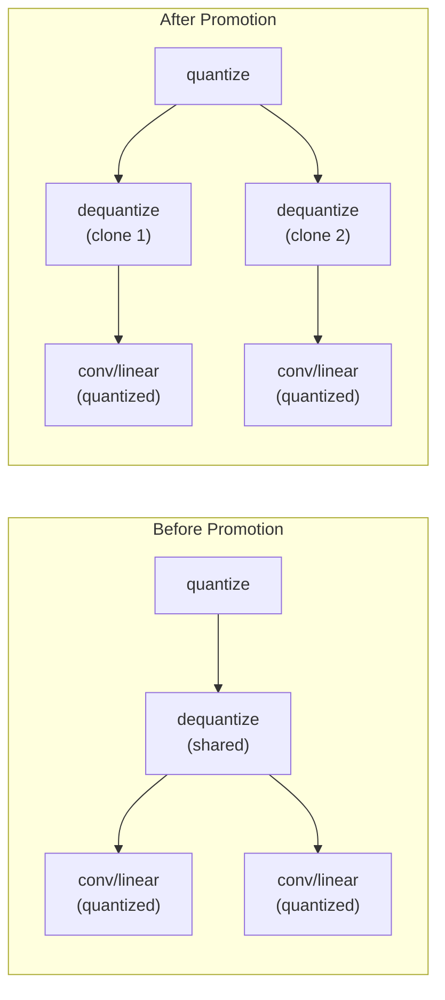
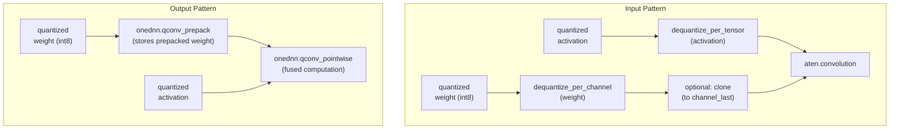
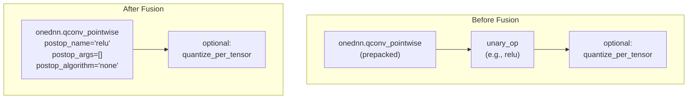

<!-- source: DeepWiki mcp.deepwiki.com · repo pytorch/ao · page 7.3 Inductor Passes and Fusion · fetched 2026-10-21 -->

# Inductor Passes and Fusion

Relevant source files

The following files were used as context for generating this wiki page:

- [test/prototype/inductor/test_qsdpa_fusion.py](test/prototype/inductor/test_qsdpa_fusion.py)
- [test/quantization/pt2e/test_numeric_debugger.py](test/quantization/pt2e/test_numeric_debugger.py)
- [test/quantization/pt2e/test_x86inductor_fusion.py](test/quantization/pt2e/test_x86inductor_fusion.py)
- [torchao/prototype/inductor/__init__.py](torchao/prototype/inductor/__init__.py)
- [torchao/prototype/inductor/codegen/__init__.py](torchao/prototype/inductor/codegen/__init__.py)
- [torchao/prototype/inductor/codegen/cpp_qsdpa_template.py](torchao/prototype/inductor/codegen/cpp_qsdpa_template.py)
- [torchao/prototype/inductor/codegen/utils.py](torchao/prototype/inductor/codegen/utils.py)
- [torchao/prototype/inductor/fx_passes/README.md](torchao/prototype/inductor/fx_passes/README.md)
- [torchao/prototype/inductor/fx_passes/__init__.py](torchao/prototype/inductor/fx_passes/__init__.py)
- [torchao/prototype/inductor/fx_passes/qsdpa_fusion.py](torchao/prototype/inductor/fx_passes/qsdpa_fusion.py)
- [torchao/prototype/inductor/fx_passes/quantized_concat_linear_fusion_cpu.py](torchao/prototype/inductor/fx_passes/quantized_concat_linear_fusion_cpu.py)
- [torchao/quantization/pt2e/_numeric_debugger.py](torchao/quantization/pt2e/_numeric_debugger.py)
- [torchao/quantization/pt2e/inductor_passes/__init__.py](torchao/quantization/pt2e/inductor_passes/__init__.py)
- [torchao/quantization/pt2e/inductor_passes/lowering.py](torchao/quantization/pt2e/inductor_passes/lowering.py)
- [torchao/quantization/pt2e/inductor_passes/x86.py](torchao/quantization/pt2e/inductor_passes/x86.py)
- [torchao/quantization/pt2e/lowering.py](torchao/quantization/pt2e/lowering.py)
- [torchao/quantization/pt2e/quantizer/x86_inductor_quantizer.py](torchao/quantization/pt2e/quantizer/x86_inductor_quantizer.py)
- [torchao/testing/pt2e/utils.py](torchao/testing/pt2e/utils.py)

## Purpose and Scope

This page documents the Inductor fusion passes and pattern optimization system used in TorchAO's PT2E quantization flow. These passes transform quantized graphs to leverage hardware-optimized kernels (primarily OneDNN on x86/CPU) by detecting and fusing common quantized operation patterns. The passes run during PyTorch's Inductor compilation phase after a model has been quantized via PT2E.

For information about the PT2E quantization workflow that produces the graphs these passes operate on, see [PT2E Quantization Overview](#7.1). For details on the X86InductorQuantizer that annotates graphs for quantization, see [X86InductorQuantizer](#7.2). For float8-specific lowering outside of the main fusion system, see [Float8 Lowering](#7.4).

**Sources**: [torchao/quantization/pt2e/inductor_passes/x86.py:1-78]()

## Overview of Inductor Passes

The Inductor passes system transforms quantized FX graphs into optimized representations by applying a sequence of pattern-matching transformations. The main passes are:

| Pass Name | Purpose | Primary Pattern |
|-----------|---------|-----------------|
| **Dequant Promotion** | Duplicates dequant nodes with multiple users to enable fusion | `quant → dequant (shared)` → `quant → dequant (per-user)` |
| **Weight Prepack** | Converts dequant-weight patterns to prepacked format | `dequant_per_channel → conv/linear` → `qconv/qlinear_prepack` |
| **Unary Fusion** | Fuses quantized ops with unary post-ops | `qconv/qlinear → relu/hardtanh/...` → `qconv/qlinear_pointwise` |
| **Binary Fusion** | Fuses quantized ops with binary post-ops | `qconv/qlinear + other_input → add` → `qconv/qlinear_binary` |

These passes execute in multiple numbered stages during Inductor's freezing passes, with dequant promotion happening early and fusion passes happening later after weight prepacking.

**Sources**: [torchao/quantization/pt2e/inductor_passes/x86.py:63-78](), [test/quantization/pt2e/test_x86inductor_fusion.py:260-260]()

## Pass Execution Flow

**Diagram: Inductor Pass Execution Pipeline**

The passes register with Inductor using `register_freezing_graph_pattern` with specific `pass_number` values to control execution order. Pass 1 handles dequant promotion, pass 2 performs weight prepacking, and pass 3 executes fusion patterns.

**Sources**: [torchao/quantization/pt2e/inductor_passes/x86.py:580-681](), [torchao/quantization/pt2e/lowering.py:57-65]()

## Dequant Promotion Pass

The dequant promotion pass solves a critical fusion-blocking problem: when a dequantize node's output is consumed by multiple quantized operations, fusion cannot occur because the dequant operation is shared. The solution is to clone the entire dequant pattern for each consumer.

### Transformation Pattern

**Diagram: Dequant Promotion Transformation**

### Implementation Details

The promotion logic in `_register_dequant_promotion_pass`:

1. **Detection**: Check if a dequant pattern end node has more than one user via `_is_valid_dequant_promotion_pattern` [torchao/quantization/pt2e/inductor_passes/x86.py:384-405]().
2. **Pattern Identification**: Find the start node (the actual `dequantize_per_tensor` op) and end node (may include optional `to_bf16` or `reshape` ops).
3. **Cloning**: For each user except the first, clone all nodes in the dequant pattern from end to start.
4. **Rewiring**: Replace inputs to each user node with the newly cloned dequant pattern [torchao/quantization/pt2e/inductor_passes/x86.py:580-681]().

The pass handles both `torch.float32` and `torch.bfloat16` dtypes, and supports both default and tensor overloads of dequantize operations. It also handles FP8 dequantization patterns using `torch.ops.torchao.dequantize_affine_float8_non_decomposed.default` [torchao/quantization/pt2e/inductor_passes/x86.py:154-173]().

**Sources**: [torchao/quantization/pt2e/inductor_passes/x86.py:580-681](), [torchao/quantization/pt2e/inductor_passes/x86.py:532-577]()

## Weight Prepack Pass

Weight prepacking converts the standard dequantization → computation pattern into a more efficient prepacked format where quantized weights are stored in an optimized layout for OneDNN kernels.

### Conv2d Weight Prepack

**Diagram: Conv2d Weight Prepack Transformation**

The pattern matcher in `_register_qconv_weight_prepack_pass` identifies:
- Quantized activation input with `dequantize_per_tensor` [torchao/quantization/pt2e/inductor_passes/x86.py:151-173]().
- Quantized weight with `dequantize_per_channel` [torchao/quantization/pt2e/inductor_passes/x86.py:176-185]().
- Optional `aten.clone` for memory format conversion.
- Optional `to_bf16` conversion for mixed precision [torchao/quantization/pt2e/inductor_passes/x86.py:195-199]().
- The `aten.convolution` operation.

After matching, the pass inserts `onednn.qconv_prepack` to prepack the quantized weight and replaces computation with `onednn.qconv_pointwise` [torchao/quantization/pt2e/inductor_passes/x86.py:720-898]().

**Sources**: [torchao/quantization/pt2e/inductor_passes/x86.py:720-898](), [test/quantization/pt2e/test_x86inductor_fusion.py:261-315]()

### Linear Weight Prepack

Linear weight prepacking follows a similar pattern but for `aten.linear` operations. The key difference is that linear layers use a transposed weight format, requiring `aten.permute` instead of convolution-specific layout conversions [torchao/quantization/pt2e/inductor_passes/x86.py:125-139]().

**Sources**: [torchao/quantization/pt2e/inductor_passes/x86.py:900-1090](), [torchao/quantization/pt2e/inductor_passes/x86.py:125-139]()

## Unary Fusion Pass

Unary fusion combines quantized convolution or linear operations with element-wise unary post-operations like ReLU, Hardtanh, or GELU into a single fused kernel call.

### Supported Unary Operations

| Operation | PyTorch Op | Nodes in Pattern |
|-----------|-----------|------------------|
| ReLU | `torch.nn.ReLU` | 2 |
| Sigmoid | `torch.nn.Sigmoid` | 2 |
| Tanh | `torch.nn.Tanh` | 2 |
| Hardswish | `torch.nn.Hardswish` | 6 |
| LeakyReLU | `torch.nn.LeakyReLU` | 4 |
| Hardtanh | `torch.nn.Hardtanh` | 3 |
| GELU | `torch.nn.GELU` | 6-10 |
| ReLU6 | `torch.nn.ReLU6` | 3 |
| SiLU | `torch.nn.SiLU` | 3 |
| Hardsigmoid | `torch.nn.Hardsigmoid` | 5 |

**Sources**: [test/quantization/pt2e/test_x86inductor_fusion.py:76-90]()

### Fusion Pattern

**Diagram: Unary Operation Fusion**

The fusion pass in `_register_qconv_unary_fusion_pass` replaces the pattern with a single `qconv_pointwise` call with `postop_name`, `postop_args`, and `postop_algorithm` parameters set to encode the unary operation [torchao/quantization/pt2e/inductor_passes/x86.py:1092-1296]().

**Sources**: [torchao/quantization/pt2e/inductor_passes/x86.py:1092-1296](), [test/quantization/pt2e/test_x86inductor_fusion.py:54-68](), [test/quantization/pt2e/test_x86inductor_fusion.py:345-403]()

## Binary Fusion Pass

Binary fusion handles patterns where a quantized operation's output is combined with another tensor via a binary operation like addition.

### Validation Checks

The `_is_valid_quantized_op_binary_optimization_pattern` function performs several critical checks:

1. **Single User**: The qconv/qlinear node must have exactly one user (the binary op) [torchao/quantization/pt2e/inductor_passes/x86.py:455-456]().
2. **Shape Compatibility**: Both inputs to the binary operation must have the same shape [torchao/quantization/pt2e/inductor_passes/x86.py:461-464]().
3. **Ancestor Check**: All users of the extra input should be ancestor nodes of the compute node, except the binary node itself [torchao/quantization/pt2e/inductor_passes/x86.py:494-526]().

**Sources**: [torchao/quantization/pt2e/inductor_passes/x86.py:446-529](), [test/quantization/pt2e/test_x86inductor_fusion.py:621-698]()

## Prototype QSDPA Fusion

For transformer architectures, TorchAO provides prototype fusion for Quantized Scaled Dot Product Attention (QSDPA). This pass matches dequantized Q, K, V inputs going into an attention pattern and replaces them with a fused `torch.ops.torchao.qscaled_dot_product.default` operation [torchao/prototype/inductor/fx_passes/qsdpa_fusion.py:89-114]().

### QSDPA Lowering
The fusion relies on custom C++ templates for CPU, implementing kernels that combine dequantization, masking, and softmax max-reduction [torchao/prototype/inductor/codegen/cpp_qsdpa_template.py:87-143](). It supports both `uint8` and `float8_e4m3fn` dtypes [torchao/prototype/inductor/fx_passes/qsdpa_fusion.py:30-31]().

**Sources**: [torchao/prototype/inductor/fx_passes/qsdpa_fusion.py:1-116](), [torchao/prototype/inductor/codegen/cpp_qsdpa_template.py:21-191]()

## Float8 Lowering

Float8 quantization uses a separate lowering mechanism. The lowering rules define how `torchao.quantize_affine_float8_non_decomposed` and `torchao.dequantize_affine_float8_non_decomposed` operations are compiled to Inductor IR.

### Quantize FP8 Lowering

The `quantize_fp8` lowering registered in `_register_quantize_dequantize_fp8_lowering` creates a `Pointwise` IR node that computes `val = input * (1.0 / scale)`, clamps it to the FP8 range, and casts to the target dtype [torchao/quantization/pt2e/inductor_passes/lowering.py:19-51]().

### Dequantize FP8 Lowering

The `dequantize_fp8` lowering creates a `Pointwise` IR node that computes `val = input * scale` and casts to the output dtype [torchao/quantization/pt2e/inductor_passes/lowering.py:57-83]().

**Sources**: [torchao/quantization/pt2e/inductor_passes/lowering.py:14-84]()

## Pattern Matching and Registration

### Pattern Definition with CallFunction

Patterns are defined using `CallFunction` from PyTorch's pattern matcher API. Patterns specify the operations to match and use `KeywordArg` and `Arg` to capture arguments [torchao/quantization/pt2e/inductor_passes/x86.py:151-173]().

### Integration with Inductor

The Inductor freezing passes execute in three numbered stages:
1. **Pass Number 1**: Dequant Promotion [torchao/quantization/pt2e/inductor_passes/x86.py:580-681]().
2. **Pass Number 2**: Weight Prepack [torchao/quantization/pt2e/inductor_passes/x86.py:720-898]().
3. **Pass Number 3**: Unary and Binary Fusion [torchao/quantization/pt2e/inductor_passes/x86.py:1092-1296]().

**Sources**: [torchao/quantization/pt2e/inductor_passes/x86.py:580-1296]()

### Counters for Observability

The passes update `counters["inductor"]` to track fusion statistics, such as `qconv_unary_matcher_count` and `qconv_weight_prepack_matcher_count` [torchao/quantization/pt2e/inductor_passes/x86.py:895](), [torchao/quantization/pt2e/inductor_passes/x86.py:1293]().

**Sources**: [test/quantization/pt2e/test_x86inductor_fusion.py:284-298](), [test/quantization/pt2e/test_x86inductor_fusion.py:676-689]()

---

