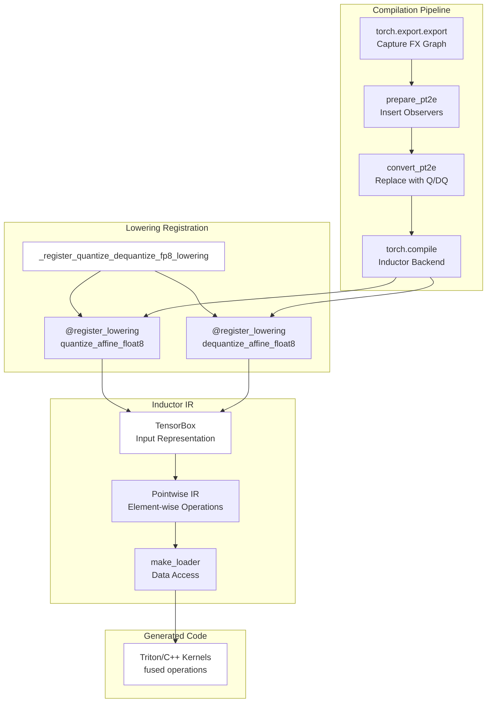
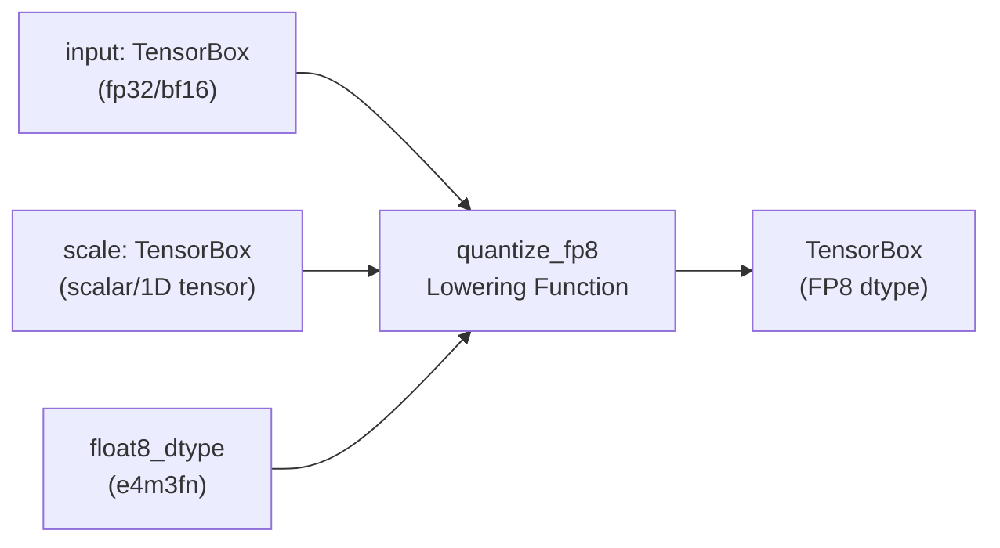
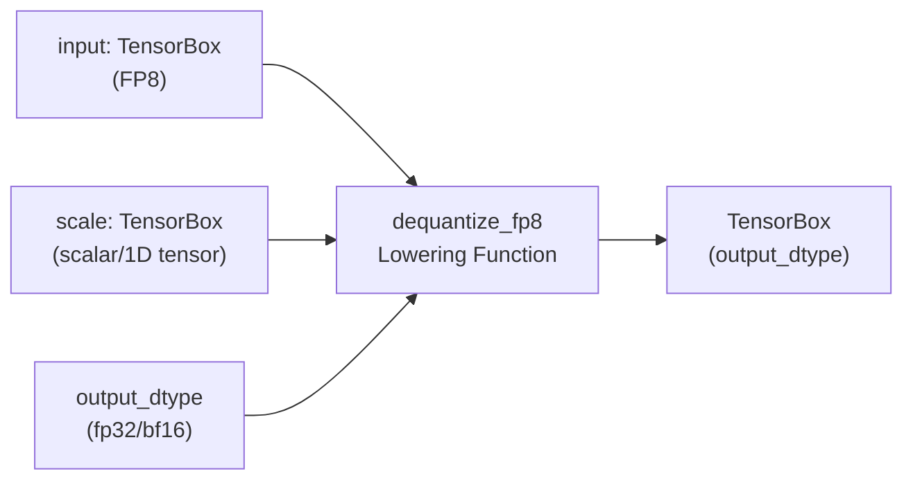
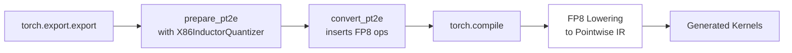

<!-- source: DeepWiki mcp.deepwiki.com · repo pytorch/ao · page 7.4 Float8 Lowering · fetched 2026-10-21 -->

# Float8 Lowering

<details>
<summary>Relevant source files</summary>

The following files were used as context for generating this wiki page:

- [docs/source/eager_tutorials/mxfp8_expert_parallel_training.rst](docs/source/eager_tutorials/mxfp8_expert_parallel_training.rst)
- [docs/source/pt2e_quantization/pt2e_quant_xpu_inductor.rst](docs/source/pt2e_quantization/pt2e_quant_xpu_inductor.rst)
- [test/prototype/quant_logger/test_quant_logger.py](test/prototype/quant_logger/test_quant_logger.py)
- [test/quantization/pt2e/test_numeric_debugger.py](test/quantization/pt2e/test_numeric_debugger.py)
- [test/quantization/pt2e/test_x86inductor_fusion.py](test/quantization/pt2e/test_x86inductor_fusion.py)
- [test/quantization/quantize_/workflows/float8/test_float8_sparse_2x4_1d_data_1d_metadata_tensor.py](test/quantization/quantize_/workflows/float8/test_float8_sparse_2x4_1d_data_1d_metadata_tensor.py)
- [test/quantization/quantize_/workflows/float8/test_float8_sparse_2x4_2d_data_2d_metadata_tensor.py](test/quantization/quantize_/workflows/float8/test_float8_sparse_2x4_2d_data_2d_metadata_tensor.py)
- [torchao/quantization/pt2e/_numeric_debugger.py](torchao/quantization/pt2e/_numeric_debugger.py)
- [torchao/quantization/pt2e/inductor_passes/__init__.py](torchao/quantization/pt2e/inductor_passes/__init__.py)
- [torchao/quantization/pt2e/inductor_passes/lowering.py](torchao/quantization/pt2e/inductor_passes/lowering.py)
- [torchao/quantization/pt2e/inductor_passes/x86.py](torchao/quantization/pt2e/inductor_passes/x86.py)
- [torchao/quantization/pt2e/lowering.py](torchao/quantization/pt2e/lowering.py)
- [torchao/quantization/pt2e/quantizer/x86_inductor_quantizer.py](torchao/quantization/pt2e/quantizer/x86_inductor_quantizer.py)
- [torchao/testing/pt2e/utils.py](torchao/testing/pt2e/utils.py)

</details>


## Purpose and Scope

This page documents the Float8 lowering system in TorchAO's PT2E quantization infrastructure. Float8 lowering converts high-level FP8 quantization and dequantization operations into Inductor intermediate representation (IR) for efficient compilation and kernel generation.

For information about FP8 training workflows, see [5 Float8 Training System](). For general PT2E quantization concepts, see [7.1 PT2E Quantization Overview]().

---

## Overview

Float8 lowering is the process of translating abstract FP8 quantize/dequantize operations into concrete Inductor IR nodes that can be compiled into optimized kernels. This lowering happens during the PT2E (PyTorch 2 Export) compilation pipeline when models containing FP8 quantization are compiled with `torch.compile`.

The lowering system handles two primary operations:
- **Quantization**: Converting higher-precision tensors (fp32/bf16) to FP8 format.
- **Dequantization**: Converting FP8 tensors back to higher-precision format.

These operations use non-decomposed variants (`quantize_affine_float8_non_decomposed`, `dequantize_affine_float8_non_decomposed`) which are custom TorchAO operators registered under the `torchao` namespace.

Sources: [torchao/quantization/pt2e/inductor_passes/lowering.py:14-84]()

---

## Lowering Registration Architecture



**Float8 Lowering Registration Flow**: Shows how FP8 operations are registered and processed through the Inductor compilation pipeline via `register_lowering`.

Sources: [torchao/quantization/pt2e/inductor_passes/lowering.py:14-84](), [test/quantization/pt2e/test_x86inductor_fusion.py:119-147]()

---

## Quantization Lowering Implementation

The quantization lowering converts a higher-precision tensor to FP8 format using scale-based affine quantization.

### Lowering Function Signature



**Quantize FP8 Lowering Function**: Input/output flow for the quantization lowering operation.

### Implementation Details

The quantization lowering at [torchao/quantization/pt2e/inductor_passes/lowering.py:19-51]() performs:

1.  **Type Promotion**: Converts input to `torch.float32` if not already via `to_dtype(input, torch.float32)`.
2.  **Scale Computation**: Computes `inv_scale = 1.0 / scale` using `ops.truediv`.
3.  **Quantization**: `val = input * inv_scale`.
4.  **Clamping**: Clamps to FP8 range `[q_min, q_max]` using `ops.minimum(ops.maximum(val, qmin), qmax)`.
5.  **Type Conversion**: Converts to target FP8 dtype (e.g., `torch.float8_e4m3fn`) using `ops.to_dtype`.

The operation is represented as a `Pointwise` IR node, which enables fusion with surrounding operations during kernel generation.

Sources: [torchao/quantization/pt2e/inductor_passes/lowering.py:19-51]()

---

## Dequantization Lowering Implementation

The dequantization lowering converts FP8 tensors back to higher-precision format.

### Lowering Function Signature



**Dequantize FP8 Lowering Function**: Input/output flow for the dequantization lowering operation.

### Implementation Details

The dequantization lowering at [torchao/quantization/pt2e/inductor_passes/lowering.py:57-83]() performs:

1.  **Type Promotion**: Converts input to `torch.float32` if necessary.
2.  **Dequantization**: `val = input * scale`.
3.  **Type Conversion**: Converts to desired `output_dtype` (fp32 or bf16).

This is simpler than quantization as it only requires scaling without clamping.

Sources: [torchao/quantization/pt2e/inductor_passes/lowering.py:57-83]()

---

## Integration with X86 Backend

The X86 backend integration supports FP8 quantization for CPU inference using OneDNN library fusions.

### FP8 Patterns in X86 Quantizer

The X86 backend at [torchao/quantization/pt2e/inductor_passes/x86.py:187-192]() defines the FP8 weight dequantization pattern:

```python
dequantize_fp8_weight_pattern = CallFunction(
    torch.ops.torchao.dequantize_affine_float8_non_decomposed.default,
    KeywordArg("q_weight"),
    KeywordArg("w_scale"),
    output_dtype=KeywordArg("w_dtype"),
)
```

This pattern is used in weight prepacking passes to identify FP8 weights and fuse them with subsequent operations like convolution or linear layers.

### FP8 Quantization Flow in X86

The X86 quantizer supports FP8 for both activations and weights:

| Component | FP8 Support | Implementation |
|-----------|-------------|----------------|
| Activation Quantization | `quantize_affine_float8_non_decomposed` | Per-tensor scaling [x86.py:36-40]() |
| Weight Dequantization | `dequantize_affine_float8_non_decomposed` | Pattern matching [x86.py:187-192]() |
| Output Dtype | `torch.float8_e4m3fn` | Metadata tracking [x86.py:91-97]() |

Sources: [torchao/quantization/pt2e/inductor_passes/x86.py:36-40](), [torchao/quantization/pt2e/inductor_passes/x86.py:187-192](), [torchao/quantization/pt2e/quantizer/x86_inductor_quantizer.py:61-70]()

---

## Constraints and Limitations

### Per-Tensor Quantization Only
The current lowering implementation only supports per-tensor quantization, as enforced by assertions in the lowering registration. The scale must be a scalar tensor or a 1D tensor with size 1.

Sources: [torchao/quantization/pt2e/inductor_passes/lowering.py:25-27](), [torchao/quantization/pt2e/inductor_passes/lowering.py:63-65]()

### Hardware and Versioning
- **AOTI Support**: FP8 fusion path in AOTI requires `add_dont_constant_fold` on the FP8 dequant op to ensure the scale survives into the inductor graph.
- **Dtypes**: Primarily targets `torch.float8_e4m3fn` (enum 24).

Sources: [test/quantization/pt2e/test_x86inductor_fusion.py:119-147](), [torchao/quantization/pt2e/inductor_passes/x86.py:59-62]()

---

## Relationship to Other Systems

### PT2E Quantization Integration

FP8 lowering is invoked automatically during the PT2E quantization workflow when FP8 quantization configs are used. The `X86InductorQuantizer` handles the annotation and pattern matching, while `lowering.py` handles the final translation to Inductor IR.



**PT2E + FP8 Lowering Integration**: FP8 lowering happens during the `torch.compile` step.

Sources: [torchao/quantization/pt2e/inductor_passes/lowering.py:1-84](), [torchao/quantization/pt2e/quantizer/x86_inductor_quantizer.py:88-93]()

---

