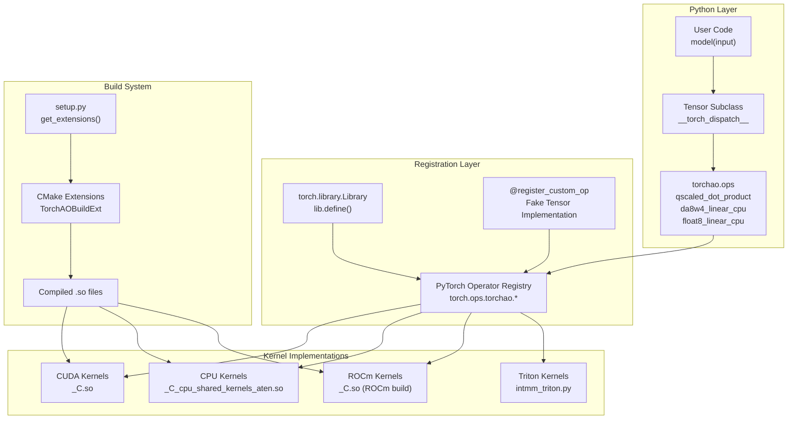
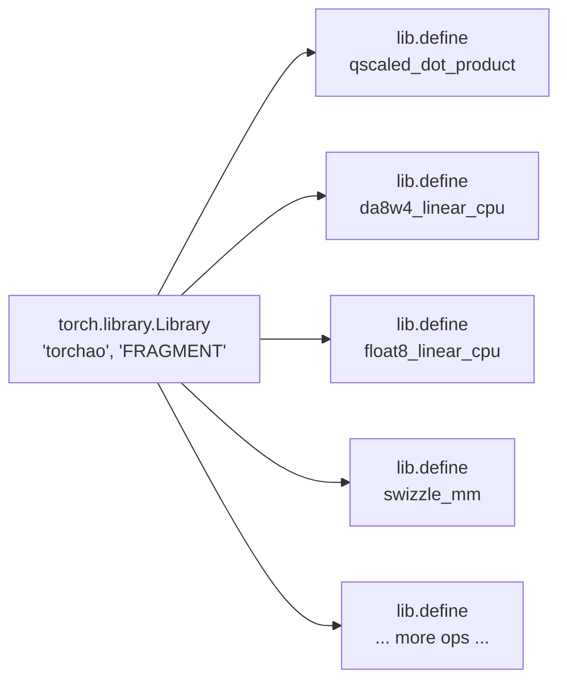

<!-- source: DeepWiki mcp.deepwiki.com · repo pytorch/ao · page 8 Custom Operations and Kernels · fetched 2026-10-21 -->

# Custom Operations and Kernels

<details>
<summary>Relevant source files</summary>

The following files were used as context for generating this wiki page:

- [setup.py](setup.py)
- [test/kernel/test_autotuner.py](test/kernel/test_autotuner.py)
- [test/test_ops.py](test/test_ops.py)
- [torchao/__init__.py](torchao/__init__.py)
- [torchao/csrc/cpu/README.md](torchao/csrc/cpu/README.md)
- [torchao/csrc/cpu/aten_kernels/da8w4_linear.cpp](torchao/csrc/cpu/aten_kernels/da8w4_linear.cpp)
- [torchao/csrc/cpu/aten_kernels/float8_linear.cpp](torchao/csrc/cpu/aten_kernels/float8_linear.cpp)
- [torchao/csrc/cpu/aten_kernels/quantized_sdpa.cpp](torchao/csrc/cpu/aten_kernels/quantized_sdpa.cpp)
- [torchao/csrc/cpu/aten_kernels/scaled_embedding_bag.cpp](torchao/csrc/cpu/aten_kernels/scaled_embedding_bag.cpp)
- [torchao/csrc/cpu/aten_kernels/utils.h](torchao/csrc/cpu/aten_kernels/utils.h)
- [torchao/kernel/__init__.py](torchao/kernel/__init__.py)
- [torchao/kernel/autotuner.py](torchao/kernel/autotuner.py)
- [torchao/kernel/intmm.py](torchao/kernel/intmm.py)
- [torchao/kernel/intmm_triton.py](torchao/kernel/intmm_triton.py)
- [torchao/ops.py](torchao/ops.py)
- [torchao/prototype/inductor/qsdpa_lowering.py](torchao/prototype/inductor/qsdpa_lowering.py)

</details>


This document covers TorchAO's custom operation framework and high-performance kernel implementations. It explains how TorchAO defines custom operators, registers them with PyTorch's dispatch system, and implements specialized kernels across CPU, CUDA, and ROCm platforms. For information about how quantized tensor subclasses dispatch to these operations, see [Tensor Subclass Framework](#3). For details on the build system that compiles these extensions, see [Build System](#10.1).

## Architecture Overview

TorchAO's custom operations provide the computational backbone for quantized tensor operations. The system consists of three main layers:

1.  **Python API Layer** (`torchao.ops`): Defines operator signatures and validation logic.
2.  **Dispatch Layer**: Routes operations to platform-specific kernels via PyTorch's dispatch mechanism.
3.  **Kernel Layer**: Platform-optimized implementations in C++/CUDA/ROCm.



**Diagram: Custom Operations Architecture**

Sources: [torchao/ops.py:1-80](), [torchao/__init__.py:108-121](), [setup.py:94-126](), [torchao/kernel/intmm.py:23-31]()

## Operator Definition and Registration

### Library Definition

TorchAO defines a custom operator library using PyTorch's `torch.library.Library` API. All operators are registered under the `torchao` namespace. The library is created at module initialization as a `FRAGMENT` to extend the existing PyTorch operator set.



**Diagram: Operator Library Structure**

Sources: [torchao/ops.py:12-48]()

### Registration Decorators

TorchAO provides specialized decorators to register both the "fake" implementation (for `torch.compile` and meta-programming) and the "real" implementation.

*   `@register_custom_op`: Registers a meta/fake kernel implementation. This is used for shape and dtype inference without performing actual computation [torchao/ops.py:51-55]().
*   `@register_custom_op_impl`: Registers the actual implementation logic [torchao/ops.py:58-62]().

### Example: qscaled_dot_product

The `qscaled_dot_product` operator provides a high-performance implementation for quantized Scaled Dot Product Attention (SDPA). It supports both `uint8` and `float8_e4m3fn` dtypes [test/test_ops.py:114-114]().

**Definition:**
```python
lib.define(
    "qscaled_dot_product(Tensor query, Tensor key, Tensor value, Tensor? attn_mask=None, ...)"
)
```
[torchao/ops.py:32-33]()

**Fake Implementation:**
[torchao/ops.py:135-155]()
- Handles shape inference for `torch.compile`.
- Returns a tensor with the same shape as the query after transposition.

Sources: [torchao/ops.py:32-33](), [torchao/ops.py:135-155](), [test/test_ops.py:114-120]()

## Platform-Specific Kernels

### CUDA Kernels
TorchAO leverages CUDA for high-performance quantized matrix multiplications and specialized layouts. This includes support for CUTLASS-based row-wise scaled linear operations and sparse implementations.
For details, see [CUDA Kernels](#8.2).

Sources: [torchao/ops.py:13-24](), [setup.py:141-150]()

### CPU Kernels
CPU optimizations target x86 (AVX-512, AMX) and ARM architectures. Key implementations include `float8_linear_cpu` and `da8w4_linear_cpu`.
For details, see [CPU Kernels](#8.3).

Sources: [torchao/ops.py:34-48](), [torchao/csrc/cpu/aten_kernels/float8_linear.cpp:12-34]()

### ROCm and AMD Support
ROCm support includes specialized swizzled layouts to maximize memory bandwidth on AMD hardware, integrated via `swizzle_mm` and `swizzle_scaled_mm`.
For details, see [ROCm and AMD Support](#8.4).

Sources: [torchao/ops.py:20-24](), [torchao/csrc/cpu/aten_kernels/utils.h:34-38]()

### Triton Kernels
TorchAO uses Triton for flexible, high-performance kernels that can be autotuned at runtime, such as integer matrix multiplication (`int_matmul`) and blockwise quantization.
For details, see [Triton Kernels](#8.5).

Sources: [torchao/kernel/intmm.py:96-110](), [torchao/kernel/intmm.py:179-184]()

## Build System Integration

The build system in `setup.py` manages the compilation of these various kernels based on the available hardware and environment variables.

*   `USE_CPP`: Primary gate for C++ extensions [setup.py:95-95]().
*   `USE_CPU_KERNELS`: Enables optimized CPU kernels like AVX512 [setup.py:96-96]().
*   `TORCHAO_BUILD_CPU_AARCH64`: Enables ARM64 specific optimizations [setup.py:207-213]().

The build system generates several shared libraries, such as `_C.so` and `_C_cpu_shared_kernels_aten.so`, which are loaded during package initialization [torchao/__init__.py:89-98]().

Sources: [setup.py:94-126](), [torchao/__init__.py:82-103]()

---

