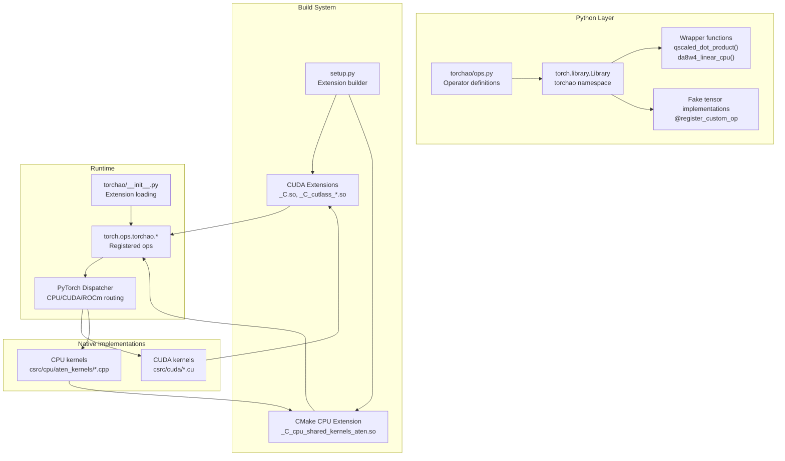
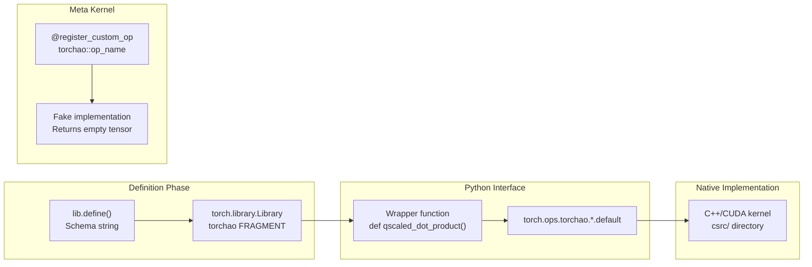
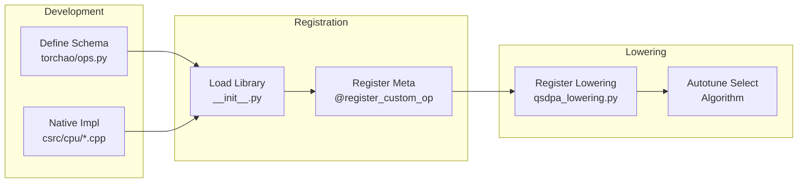

<!-- source: DeepWiki mcp.deepwiki.com · repo pytorch/ao · page 8.1 Custom Operators Framework · fetched 2026-10-21 -->

# Custom Operators Framework

Relevant source files

The following files were used as context for generating this wiki page:

- [setup.py](setup.py)
- [test/kernel/test_autotuner.py](test/kernel/test_autotuner.py)
- [test/test_ops.py](test/test_ops.py)
- [torchao/__init__.py](torchao/__init__.py)
- [torchao/csrc/cpu/README.md](torchao/csrc/cpu/README.md)
- [torchao/csrc/cpu/aten_kernels/da8w4_linear.cpp](torchao/csrc/cpu/aten_kernels/da8w4_linear.cpp)
- [torchao/csrc/cpu/aten_kernels/float8_linear.cpp](torchao/csrc/cpu/aten_kernels/float8_linear.cpp)
- [torchao/csrc/cpu/aten_kernels/quantized_sdpa.cpp](torchao/csrc/cpu/aten_kernels/quantized_sdpa.cpp)
- [torchao/csrc/cpu/aten_kernels/scaled_embedding_bag.cpp](torchao/csrc/cpu/aten_kernels/scaled_embedding_bag.cpp)
- [torchao/csrc/cpu/aten_kernels/utils.h](torchao/csrc/cpu/aten_kernels/utils.h)
- [torchao/kernel/__init__.py](torchao/kernel/__init__.py)
- [torchao/kernel/autotuner.py](torchao/kernel/autotuner.py)
- [torchao/kernel/intmm.py](torchao/kernel/intmm.py)
- [torchao/kernel/intmm_triton.py](torchao/kernel/intmm_triton.py)
- [torchao/ops.py](torchao/ops.py)
- [torchao/prototype/inductor/qsdpa_lowering.py](torchao/prototype/inductor/qsdpa_lowering.py)

## Purpose and Scope

This page documents TorchAO's custom operators framework, which provides the infrastructure for defining, building, and dispatching high-performance native operations. The framework enables seamless integration of CUDA, ROCm, and CPU kernels into PyTorch's operator system.

The framework leverages PyTorch's `torch.library` API to register operators that can be traced, compiled, and exported while maintaining compatibility with `torch.compile` and other PyTorch tooling.

---

## Architecture Overview

The custom operators framework consists of three interconnected layers: operator registration in Python, native implementations compiled as extensions, and runtime loading and dispatch.

**Diagram: Custom Operators Framework Architecture**

Sources: [torchao/ops.py:12-48](), [setup.py:94-125](), [torchao/__init__.py:85-103]()

---

## Operator Registration System

TorchAO operators are registered using PyTorch's `torch.library` API in the `torchao` namespace. Each operator has three components: a schema definition, a wrapper function for user-facing calls, and a meta/fake tensor implementation for tracing and compilation.

**Diagram: Operator Registration Flow**

Sources: [torchao/ops.py:12-48](), [torchao/ops.py:51-62]()

### Schema Definition

Operator schemas are defined using `lib.define()` with type-annotated signatures. The library object is created with the `FRAGMENT` mode, allowing definition-only registration without immediate implementations.

[torchao/ops.py:12-48]()

**Key Schema Definitions:**
- `qscaled_dot_product(Tensor query, Tensor key, Tensor value, Tensor? attn_mask=None, ...) -> Tensor`: Quantized SDPA supporting INT8 and FP8 [torchao/ops.py:32-33]().
- `da8w4_linear_cpu(Tensor input, Tensor input_scales, Tensor input_qzeros, Tensor weight, ...) -> Tensor`: CPU-optimized W4A8 linear operation [torchao/ops.py:37-39]().
- `mx_fp8_bf16(Tensor a, Tensor b, Tensor a_scale, Tensor b_scale) -> Tensor`: Microscaling FP8 matmul with fixed stride order constraints [torchao/ops.py:27-30]().

### Wrapper Functions and Meta Kernels

Wrapper functions provide the user-facing API and dispatch to the `torch.ops.torchao` namespace. Meta kernels (fake tensor implementations) are registered to allow `torch.compile` to infer output shapes without running the actual kernel.

**Example: Quantized SDPA (qscaled_dot_product)**
- **Wrapper**: `qscaled_dot_product` calls `torch.ops.torchao.qscaled_dot_product.default` [torchao/ops.py:72-132]().
- **Meta Kernel**: Registered via `@register_custom_op("torchao::qscaled_dot_product")`. It returns a tensor with the correct layout for tracing [torchao/ops.py:135-156]().

---

## Build System and Hardware Detection

The build system conditionally compiles native extensions based on available hardware and environment variables.

### Build Configuration

Build options are controlled through environment variables in `setup.py`:

| Variable | Default | Purpose |
|----------|---------|---------|
| `USE_CPP` | `"1"` | Master toggle for all C++ extensions [setup.py:95](). |
| `USE_CPU_KERNELS` | `"0"` | Enable optimized CPU kernels (AVX512, etc.) [setup.py:96](). |
| `TORCHAO_BUILD_CPU_AARCH64` | Auto | Build ARM64 CPU kernels [setup.py:207-210](). |
| `TORCHAO_BUILD_KLEIDIAI` | `False` | Build Kleidi AI integration [setup.py:218-220](). |

### Native Extensions

TorchAO builds multiple extension types:
1. **Main Extension**: Built via `CppExtension` or `CUDAExtension` [setup.py:147-148]().
2. **CUTLASS Extensions**: Architecture-specific extensions for SM90a (Hopper) and SM100a (Blackwell) [setup.py:263-291]().
3. **CMake Extension**: Used for experimental CPU kernels, especially on ARM64 macOS [setup.py:116-125]().

---

## Runtime Loading Lifecycle

At import time, TorchAO loads compiled extensions and registers meta kernels.

### .so Loading in `__init__.py`

The loading logic handles version compatibility and user overrides:
1. **Version Check**: Compares `torch.__version__` against requirements unless `TORCHAO_FORCE_SKIP_LOADING_SO_FILES` is set [torchao/__init__.py:53-80]().
2. **Library Loading**: Uses `torch.ops.load_library` to load all `_C*.so` files found in the package [torchao/__init__.py:89-96]().
3. **Meta Registration**: Imports `torchao.csrc_meta_ops` to register meta kernels for CPU operations [torchao/__init__.py:99-100]().

### Dispatch Logic

Kernels are dispatched based on device and ISA support. For example, in `int_scaled_matmul`:
- On **CPU**, it routes to `_int_scaled_matmul_cpu` [torchao/kernel/intmm.py:174-175]().
- If **Triton** and `TORCHAO_AUTOTUNER_ENABLE` are present, it routes to `torch.ops.torchao.int_scaled_matmul` [torchao/kernel/intmm.py:179-180]().
- Otherwise, it uses `safe_int_mm` [torchao/kernel/intmm.py:182]().

Sources: [torchao/kernel/intmm.py:148-184](), [torchao/__init__.py:47-103]()

---

## CPU Kernel Framework

CPU kernels in TorchAO utilize AVX-512 and AMX optimizations where available.

### Dispatch Macros

Native CPU code uses specialized macros to handle different output types and quantization modes:
- `AT_DISPATCH_OUT_TYPES`: Dispatches between Float, BFloat16, and Half for output [torchao/csrc/cpu/aten_kernels/utils.h:50-59]().
- `AT_DISPATCH_QUANT_MODE`: Dispatches between `PER_TENSOR`, `PER_ROW`, and `PER_GROUP` modes [torchao/csrc/cpu/aten_kernels/utils.h:79-86]().

### Example: Quantized SDPA CPU Implementation

The CPU implementation of `qscaled_dot_product` features several fused kernels for performance:
- `_dequant_mask_max_fusion_kernel`: Fuses dequantization, mask addition, and max reduction for softmax [torchao/csrc/cpu/aten_kernels/quantized_sdpa.cpp:143-200]().
- `_scale_dequant_attn_mask_fusion_kernel`: Fuses scaling, dequantization, and attention mask addition [torchao/csrc/cpu/aten_kernels/quantized_sdpa.cpp:100-136]().

Sources: [torchao/csrc/cpu/aten_kernels/utils.h:50-100](), [torchao/csrc/cpu/aten_kernels/quantized_sdpa.cpp:100-200]()

---

## Operator Lifecycle and Inductor Integration

Operators can be integrated into the Inductor compiler for better fusion and performance.

**Diagram: Operator Lifecycle**

### Inductor Lowering

TorchAO registers custom lowering rules to allow Inductor to recognize and optimize these operators.
- **Example**: `register_qsdpa` registers a lowering for `torch.ops.torchao.qscaled_dot_product.default` [torchao/prototype/inductor/qsdpa_lowering.py:31-34]().
- **Autotuning**: It uses `autotune_select_algorithm` to choose between a template implementation (if AMX is supported) and the default extern kernel [torchao/prototype/inductor/qsdpa_lowering.py:151-158]().

Sources: [torchao/prototype/inductor/qsdpa_lowering.py:31-158]()

---

