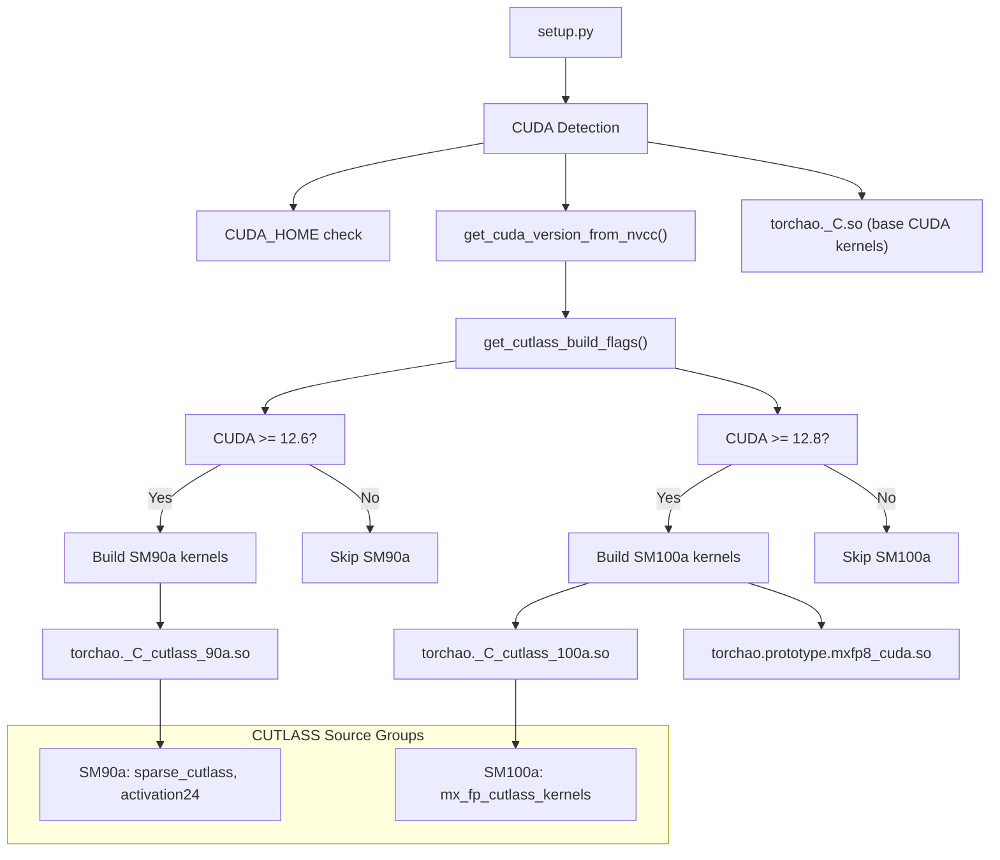
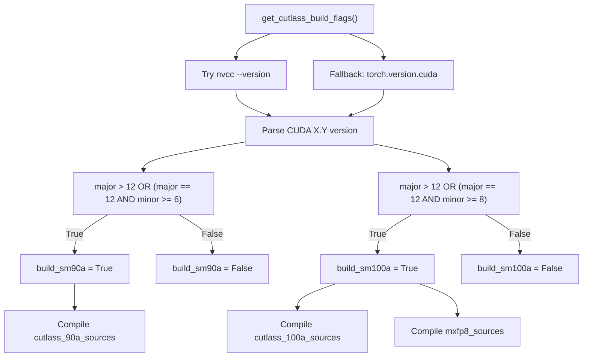
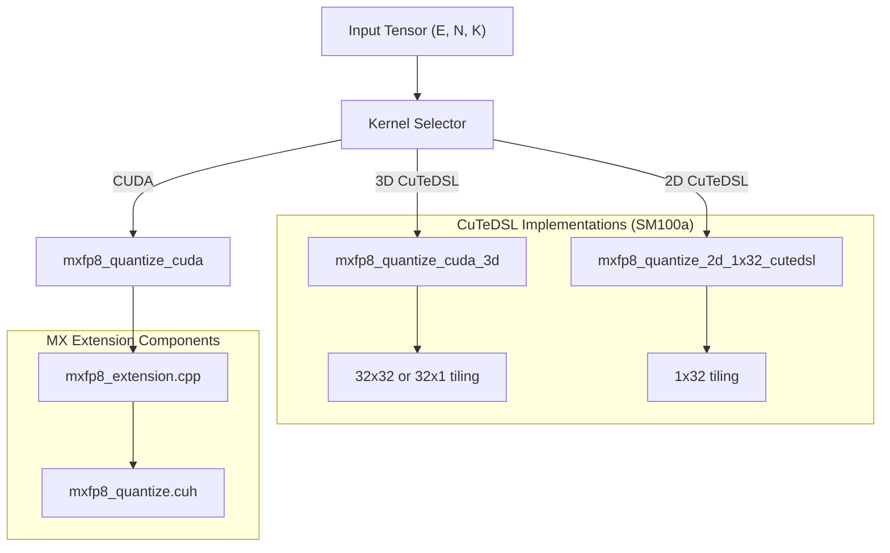

<!-- source: DeepWiki mcp.deepwiki.com · repo pytorch/ao · page 8.2 CUDA Kernels · fetched 2026-10-21 -->

# CUDA Kernels

Relevant source files

The following files were used as context for generating this wiki page:

- [benchmarks/prototype/moe_training/mxfp8/bench_mx_block_rearrange_2d_M_groups.py](benchmarks/prototype/moe_training/mxfp8/bench_mx_block_rearrange_2d_M_groups.py)
- [benchmarks/prototype/moe_training/mxfp8/bench_quantize_3d.py](benchmarks/prototype/moe_training/mxfp8/bench_quantize_3d.py)
- [benchmarks/prototype/moe_training/mxfp8/roofline_unified.py](benchmarks/prototype/moe_training/mxfp8/roofline_unified.py)
- [test/prototype/moe_training/test_kernels.py](test/prototype/moe_training/test_kernels.py)
- [test/prototype/moe_training/test_mxfp8_grouped_mm.py](test/prototype/moe_training/test_mxfp8_grouped_mm.py)
- [torchao/csrc/cuda/cutlass_extensions/common.h](torchao/csrc/cuda/cutlass_extensions/common.h)
- [torchao/csrc/cuda/mx_kernels/mx_block_rearrange_2d_M_groups.cu](torchao/csrc/cuda/mx_kernels/mx_block_rearrange_2d_M_groups.cu)
- [torchao/csrc/cuda/mx_kernels/mxfp8_cuda.cu](torchao/csrc/cuda/mx_kernels/mxfp8_cuda.cu)
- [torchao/csrc/cuda/mx_kernels/mxfp8_extension.cpp](torchao/csrc/cuda/mx_kernels/mxfp8_extension.cpp)
- [torchao/csrc/cuda/mx_kernels/mxfp8_quantize.cuh](torchao/csrc/cuda/mx_kernels/mxfp8_quantize.cuh)
- [torchao/csrc/cuda/mx_kernels/ptx.cuh](torchao/csrc/cuda/mx_kernels/ptx.cuh)
- [torchao/csrc/cuda/rowwise_scaled_linear_sparse_cutlass/rowwise_scaled_linear_sparse_cutlass.cuh](torchao/csrc/cuda/rowwise_scaled_linear_sparse_cutlass/rowwise_scaled_linear_sparse_cutlass.cuh)
- [torchao/csrc/cuda/rowwise_scaled_linear_sparse_cutlass/rowwise_scaled_linear_sparse_cutlass_e4m3e4m3.cu](torchao/csrc/cuda/rowwise_scaled_linear_sparse_cutlass/rowwise_scaled_linear_sparse_cutlass_e4m3e4m3.cu)
- [torchao/csrc/cuda/rowwise_scaled_linear_sparse_cutlass/rowwise_scaled_linear_sparse_cutlass_e4m3e4m3.h](torchao/csrc/cuda/rowwise_scaled_linear_sparse_cutlass/rowwise_scaled_linear_sparse_cutlass_e4m3e4m3.h)
- [torchao/csrc/cuda/rowwise_scaled_linear_sparse_cutlass/rowwise_scaled_linear_sparse_cutlass_e4m3e5m2.cu](torchao/csrc/cuda/rowwise_scaled_linear_sparse_cutlass/rowwise_scaled_linear_sparse_cutlass_e4m3e5m2.cu)
- [torchao/csrc/cuda/rowwise_scaled_linear_sparse_cutlass/rowwise_scaled_linear_sparse_cutlass_e4m3e5m2.h](torchao/csrc/cuda/rowwise_scaled_linear_sparse_cutlass/rowwise_scaled_linear_sparse_cutlass_e4m3e5m2.h)
- [torchao/csrc/cuda/rowwise_scaled_linear_sparse_cutlass/rowwise_scaled_linear_sparse_cutlass_e5m2e4m3.cu](torchao/csrc/cuda/rowwise_scaled_linear_sparse_cutlass/rowwise_scaled_linear_sparse_cutlass_e5m2e4m3.cu)
- [torchao/csrc/cuda/rowwise_scaled_linear_sparse_cutlass/rowwise_scaled_linear_sparse_cutlass_e5m2e4m3.h](torchao/csrc/cuda/rowwise_scaled_linear_sparse_cutlass/rowwise_scaled_linear_sparse_cutlass_e5m2e4m3.h)
- [torchao/csrc/cuda/rowwise_scaled_linear_sparse_cutlass/rowwise_scaled_linear_sparse_cutlass_e5m2e5m2.cu](torchao/csrc/cuda/rowwise_scaled_linear_sparse_cutlass/rowwise_scaled_linear_sparse_cutlass_e5m2e5m2.cu)
- [torchao/csrc/cuda/rowwise_scaled_linear_sparse_cutlass/rowwise_scaled_linear_sparse_cutlass_e5m2e5m2.h](torchao/csrc/cuda/rowwise_scaled_linear_sparse_cutlass/rowwise_scaled_linear_sparse_cutlass_e5m2e5m2.h)
- [torchao/csrc/cuda/rowwise_scaled_linear_sparse_cutlass/rowwise_scaled_linear_sparse_cutlass_f8f8.cu](torchao/csrc/cuda/rowwise_scaled_linear_sparse_cutlass/rowwise_scaled_linear_sparse_cutlass_f8f8.cu)
- [torchao/csrc/cuda/to_sparse_semi_structured_cutlass_sm9x/to_sparse_semi_structured_cutlass_sm9x.cuh](torchao/csrc/cuda/to_sparse_semi_structured_cutlass_sm9x/to_sparse_semi_structured_cutlass_sm9x.cuh)
- [torchao/csrc/cuda/to_sparse_semi_structured_cutlass_sm9x/to_sparse_semi_structured_cutlass_sm9x_f8.cu](torchao/csrc/cuda/to_sparse_semi_structured_cutlass_sm9x/to_sparse_semi_structured_cutlass_sm9x_f8.cu)
- [torchao/prototype/moe_training/kernels/mxfp8/cutedsl_quantize_2d_1x32.py](torchao/prototype/moe_training/kernels/mxfp8/cutedsl_quantize_2d_1x32.py)
- [torchao/prototype/moe_training/kernels/mxfp8/cutedsl_quantize_2d_32x1.py](torchao/prototype/moe_training/kernels/mxfp8/cutedsl_quantize_2d_32x1.py)
- [torchao/prototype/moe_training/kernels/mxfp8/cutedsl_quantize_3d.py](torchao/prototype/moe_training/kernels/mxfp8/cutedsl_quantize_3d.py)
- [torchao/prototype/moe_training/kernels/mxfp8/quant.py](torchao/prototype/moe_training/kernels/mxfp8/quant.py)
- [torchao/prototype/moe_training/mxfp8_grouped_mm.py](torchao/prototype/moe_training/mxfp8_grouped_mm.py)

This document covers CUDA kernel implementations that provide GPU acceleration for TorchAO quantization and matrix operations. These kernels leverage NVIDIA-specific features including CUTLASS template libraries, Tensor Cores, and architecture-specific optimizations for Hopper (SM90a) and Blackwell (SM100a) GPUs.

For ROCm/AMD GPU support, see page 8.4. For CPU kernel implementations, see page 8.3. For the custom operator registration framework, see page 8.1.

## CUDA Extension Compilation

The build system detects CUDA capabilities and compiles specialized extensions for different GPU architectures. CUDA extensions are built conditionally based on CUDA version and target architecture.

### CUDA Extension Architecture

**Sources:** [setup.py:244-291](), [setup.py:563-629](), [setup.py:689-729]()

### CUDA Version Detection and Architecture Targeting

The build system determines which CUTLASS kernels to compile based on CUDA version:

**CUDA Extension Compilation Matrix**

| Extension | GPU Architecture | CUDA Version | Source Files | Purpose |
|-----------|------------------|--------------|--------------|---------|
| `torchao._C` | All CUDA GPUs (sm_75+) | Any | `torchao/csrc/cuda/**/*.cu` | Core CUDA operations |
| `torchao._C_cutlass_90a` | sm_90a (H100/H200) | 12.6+ | `rowwise_scaled_linear_sparse_cutlass_*.cu`, `activation24/*.cu` | CUTLASS FP8 sparse kernels |
| `torchao._C_cutlass_100a` | sm_100a (B200/B300) | 12.8+ | `mx_kernels/mx_fp_cutlass_kernels.cu` | MX format CUTLASS kernels |
| `torchao.prototype.mxfp8_cuda` | sm_100a/sm_120 | 12.8+ | `mx_kernels/mxfp8_extension.cpp`, `mxfp8_cuda.cu` | MX format casting operations |

**Sources:** [setup.py:263-291](), [setup.py:591-629](), [setup.py:661-687]()

## MX Format Kernels (Experimental)

Microscaling (MX) format operations provide efficient matrix multiplication and casting for next-generation GPUs. These kernels are particularly relevant for Mixture-of-Experts (MoE) training.

### MXFP8 Quantization and Casting

TorchAO implements specialized kernels for quantizing high-precision tensors (BF16/FP32) into MXFP8 format (E4M3 with E8M0 scales).

**MXFP8 Quantization Kernel Logic**

**Implementation Details:**
- **3D Quantization**: Supports expert-parallel layouts with 32x1 or 32x32 scale blocks. The kernel is implemented using CuTeDSL for warp-specialized TMA (Tensor Memory Accelerator) performance on Blackwell [torchao/prototype/moe_training/kernels/mxfp8/cutedsl_quantize_3d.py:166-215]().
- **2D Quantization**: Optimized for input activations and token groups, supporting 1x32 [torchao/prototype/moe_training/kernels/mxfp8/cutedsl_quantize_2d_1x32.py:78-109]() and 32x1 [torchao/prototype/moe_training/kernels/mxfp8/cutedsl_quantize_2d_32x1.py:81-112]() scaling.
- **Hardware Requirement**: Native FP8 conversion and Blackwell-specific instructions are utilized when `__CUDA_ARCH__ >= 1000` [torchao/csrc/cuda/mx_kernels/mxfp8_quantize.cuh:34-38]().

**Sources:** [torchao/prototype/moe_training/kernels/mxfp8/quant.py:58-127](), [torchao/csrc/cuda/mx_kernels/mxfp8_extension.cpp:108-174](), [torchao/csrc/cuda/mx_kernels/mxfp8_quantize.cuh:126-149]()

### MX Block Rearrange

For kernels requiring blocked scale layouts (like `tcgen05` on Blackwell), TorchAO provides kernels to rearrange standard row-major scales into blocked formats.

- **M-Groups Rearrange**: Rearranges scales along the row dimension (M) for 2D tensors. This is critical for token groups in MoE where each group might have different padding requirements [torchao/csrc/cuda/mx_kernels/mx_block_rearrange_2d_M_groups.cu:159-210]().
- **Pipelined Execution**: The kernel uses a pipelined TMA load/store design with double buffering (`NUM_BUFFERS = 2`) to hide memory latency [torchao/csrc/cuda/mx_kernels/mx_block_rearrange_2d_M_groups.cu:67-72]().

**Sources:** [torchao/csrc/cuda/mx_kernels/mxfp8_extension.cpp:176-200](), [torchao/csrc/cuda/mx_kernels/mx_block_rearrange_2d_M_groups.cu:76-119]()

## MoE Training Kernels

TorchAO includes specialized kernels for Mixture-of-Experts (MoE) training, specifically focusing on FP8 and MXFP8 grouped matrix multiplications.

### Grouped GEMM with MXFP8

The `_MXFP8GroupedMM` autograd function provides a differentiable implementation of grouped GEMM with dynamic MXFP8 quantization [torchao/prototype/moe_training/mxfp8_grouped_mm.py:111-131]().

**MoE Kernel Workflow**

| Stage | Operation | Code Entity |
|-------|-----------|-------------|
| **Forward** | Quantize input/weights to MXFP8 + Grouped GEMM | `_MXFP8GroupedMM.forward` [torchao/prototype/moe_training/mxfp8_grouped_mm.py:121-147]() |
| **Backward (Dgrad)** | Quantize grad_output/weights + Grouped GEMM | `_MXFP8GroupedMM.backward` |
| **Backward (Wgrad)** | Quantize input/grad_output + Grouped GEMM | `_MXFP8GroupedMM.backward` |
| **Padding** | Pad token groups to multiple of 32 | `fused_pad_token_groups_cuda` [torchao/csrc/cuda/mx_kernels/mxfp8_extension.cpp:63-73]() |

**Performance Characteristics:**
- **Net Speedup**: Targets BF16 vs MXFP8 speedups in MoE training by reducing memory bandwidth requirements for weights and activations [benchmarks/prototype/moe_training/mxfp8/roofline_unified.py:100-115]().
- **Memory Bandwidth**: Quantization kernels are designed to be memory-bound, aiming for high utilization of peak GPU memory bandwidth [benchmarks/prototype/moe_training/mxfp8/roofline_unified.py:117-138]().

**Sources:** [torchao/prototype/moe_training/mxfp8_grouped_mm.py:56-108](), [test/prototype/moe_training/test_mxfp8_grouped_mm.py:136-165](), [benchmarks/prototype/moe_training/mxfp8/bench_quantize_3d.py:193-208]()

## CUTLASS-Based Sparse Operations

CUTLASS integration provides optimized implementations for row-wise scaled operations and 2:4 structured sparsity.

### Row-wise Scaled Sparse Linear

The `rowwise_scaled_linear_sparse_cutlass` kernels implement 2:4 sparse matrix multiplication with FP8 inputs.

- **SM90a Integration**: Leverages Hopper Tensor Cores for 2:4 structured sparsity.
- **Precision Variants**: Supports multiple FP8 combinations, including E4M3 and E5M2 for both weights and activations [torchao/csrc/cuda/rowwise_scaled_linear_sparse_cutlass/rowwise_scaled_linear_sparse_cutlass_f8f8.cu]().
- **Metadata Handling**: Includes kernels for converting dense weights to the compressed 2:4 metadata format required by the hardware [torchao/csrc/cuda/to_sparse_semi_structured_cutlass_sm9x/to_sparse_semi_structured_cutlass_sm9x.cuh]().

**Sources:** [torchao/ops.py:669-755](), [setup.py:592-614]()

## Runtime Hardware Detection

To ensure kernels are only executed on compatible hardware, TorchAO uses several utility functions:

- `is_sm_10x()`: Checks for Blackwell (SM100) capability [test/prototype/moe_training/test_kernels.py:14-16]().
- `is_MI300()` / `is_MI350()`: Detects AMD CDNA3 hardware for ROCm kernels [test/prototype/moe_training/test_kernels.py:11]().
- `cached_compute_capability()`: PyTorch-native check for general CUDA capability [torchao/ops.py:90-95]().

**Sources:** [torchao/prototype/moe_training/kernels/mxfp8/quant.py:28-29](), [test/prototype/moe_training/test_mxfp8_grouped_mm.py:19-25]()

---

