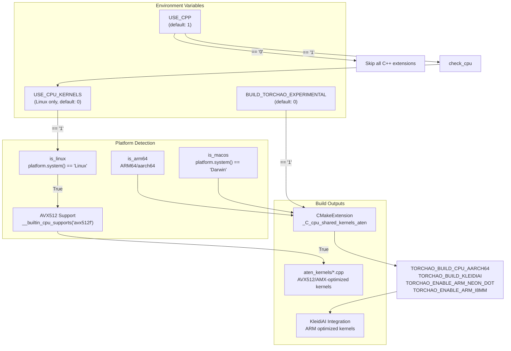
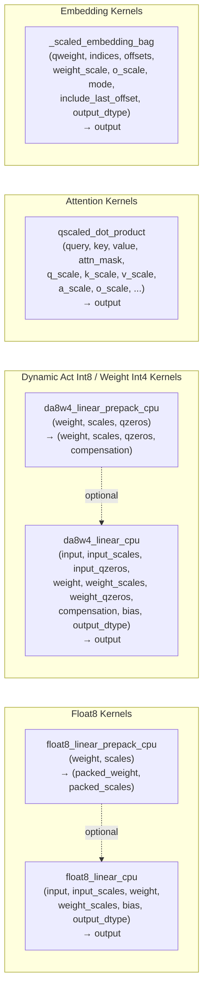
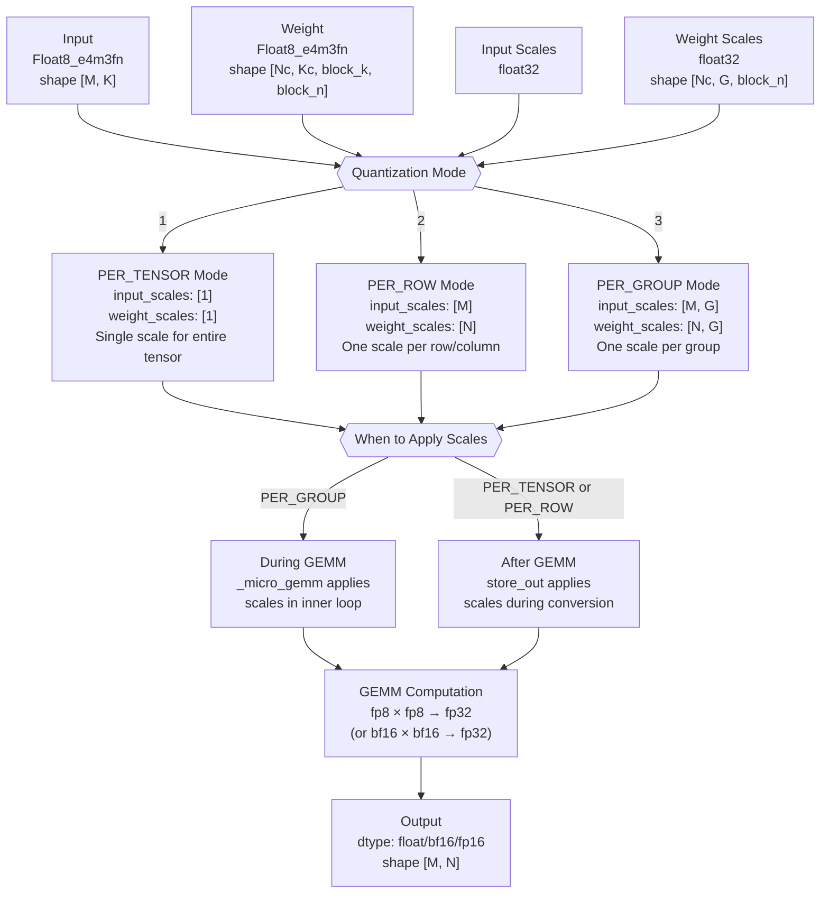

<!-- source: DeepWiki mcp.deepwiki.com · repo pytorch/ao · page 8.3 CPU Kernels · fetched 2026-10-21 -->

# CPU Kernels

<details>
<summary>Relevant source files</summary>

The following files were used as context for generating this wiki page:

- [setup.py](setup.py)
- [test/test_ops.py](test/test_ops.py)
- [torchao/__init__.py](torchao/__init__.py)
- [torchao/csrc/cpu/README.md](torchao/csrc/cpu/README.md)
- [torchao/csrc/cpu/aten_kernels/da8w4_linear.cpp](torchao/csrc/cpu/aten_kernels/da8w4_linear.cpp)
- [torchao/csrc/cpu/aten_kernels/float8_linear.cpp](torchao/csrc/cpu/aten_kernels/float8_linear.cpp)
- [torchao/csrc/cpu/aten_kernels/quantized_sdpa.cpp](torchao/csrc/cpu/aten_kernels/quantized_sdpa.cpp)
- [torchao/csrc/cpu/aten_kernels/scaled_embedding_bag.cpp](torchao/csrc/cpu/aten_kernels/scaled_embedding_bag.cpp)
- [torchao/csrc/cpu/aten_kernels/utils.h](torchao/csrc/cpu/aten_kernels/utils.h)
- [torchao/csrc/cpu/shared_kernels/embedding_xbit/op_embedding_xbit-impl.h](torchao/csrc/cpu/shared_kernels/embedding_xbit/op_embedding_xbit-impl.h)
- [torchao/csrc/cpu/shared_kernels/embedding_xbit/tests/test_pack_embedding.py](torchao/csrc/cpu/shared_kernels/embedding_xbit/tests/test_pack_embedding.py)
- [torchao/csrc/cpu/torch_free_kernels/fallback/bitpacking/bitpack.h](torchao/csrc/cpu/torch_free_kernels/fallback/bitpacking/bitpack.h)
- [torchao/csrc/cpu/torch_free_kernels/fallback/bitpacking/uint1.h](torchao/csrc/cpu/torch_free_kernels/fallback/bitpacking/uint1.h)
- [torchao/csrc/cpu/torch_free_kernels/fallback/bitpacking/uint3.h](torchao/csrc/cpu/torch_free_kernels/fallback/bitpacking/uint3.h)
- [torchao/csrc/cpu/torch_free_kernels/fallback/bitpacking/uint4.h](torchao/csrc/cpu/torch_free_kernels/fallback/bitpacking/uint4.h)
- [torchao/csrc/cpu/torch_free_kernels/fallback/bitpacking/uint5.h](torchao/csrc/cpu/torch_free_kernels/fallback/bitpacking/uint5.h)
- [torchao/csrc/cpu/torch_free_kernels/fallback/bitpacking/uint6.h](torchao/csrc/cpu/torch_free_kernels/fallback/bitpacking/uint6.h)
- [torchao/csrc/cpu/torch_free_kernels/fallback/embedding/embedding.h](torchao/csrc/cpu/torch_free_kernels/fallback/embedding/embedding.h)
- [torchao/ops.py](torchao/ops.py)
- [torchao/prototype/inductor/qsdpa_lowering.py](torchao/prototype/inductor/qsdpa_lowering.py)

</details>


This document describes the CPU kernel implementations in TorchAO. These are optimized native C++ kernels for quantized operations that run on x86-64 and ARM CPUs. For CUDA kernels, see [8.2](). For ROCm kernels, see [8.4](). For the custom operators framework that registers these kernels, see [8.1]().

CPU kernels provide high-performance implementations for quantized linear layers, attention operations, and embedding lookups, with specialized code paths for different hardware capabilities (AVX-512, AMX, ARM NEON, etc.).

**Sources:** [torchao/csrc/cpu/aten_kernels/float8_linear.cpp:1-125](), [setup.py:94-96](), [torchao/ops.py:66-79]()

## Build System Configuration

CPU kernels are conditionally compiled based on environment variables and platform detection. The build system uses both setuptools extensions and CMake for different kernel sets.



**Build Configuration Details:**

| Environment Variable | Default | Platform Requirement | Description |
|---------------------|---------|---------------------|-------------|
| `USE_CPP` | `"1"` | All | Master switch for C++ extensions |
| `USE_CPU_KERNELS` | `"0"` | Linux only | Enable AVX-512/AMX optimized aten kernels |
| `BUILD_TORCHAO_EXPERIMENTAL` | `"0"` | All | Enable CMake-based CPU kernels |
| `TORCHAO_BUILD_CPU_AARCH64` | Auto (macOS ARM) | ARM64 | Enable ARM64-specific kernels |
| `TORCHAO_BUILD_KLEIDIAI` | `"0"` | ARM64 | Enable Kleidi AI library integration |
| `TORCHAO_ENABLE_ARM_NEON_DOT` | Auto (macOS ARM) | ARM64 | Enable ARM NEON dot product instructions |
| `TORCHAO_ENABLE_ARM_I8MM` | `"0"` | ARM64 | Enable ARM i8mm instructions |
| `TORCHAO_PARALLEL_BACKEND` | `"aten_openmp"` | All | Backend for parallel execution |

**Sources:** [setup.py:94-125](), [setup.py:207-220](), [torchao/csrc/cpu/aten_kernels/utils.h:34-38]()

## Available CPU Kernels

TorchAO provides several CPU kernels registered through the `torchao.ops` namespace. Each kernel has both a prepacking step (optional) and an execution step.



**Kernel Registration:**

All CPU kernels are registered in [torchao/ops.py]() using `lib.define()`:

- Line 44-47: `float8_linear_prepack_cpu` and `float8_linear_cpu` [torchao/ops.py:44-47]()
- Line 34-39: `da8w4_linear_prepack_cpu` and `da8w4_linear_cpu` [torchao/ops.py:34-39]()
- Line 32-33: `qscaled_dot_product` [torchao/ops.py:32-33]()
- Line 41-42: `_scaled_embedding_bag` [torchao/ops.py:41-42]()

**Sources:** [torchao/ops.py:32-48](), [torchao/csrc/cpu/aten_kernels/float8_linear.cpp:39-48](), [torchao/csrc/cpu/aten_kernels/da8w4_linear.cpp:26-38]()

## Float8 Linear Implementation

The `float8_linear_cpu` kernel implements matrix multiplication with float8 (E4M3) inputs and supports three quantization modes: per-tensor, per-row, and per-group.

### Quantization Mode Dispatch



**Mode Constants:**

```cpp
#define PER_TENSOR 1
#define PER_ROW 2
#define PER_GROUP 3
```

**Sources:** [torchao/csrc/cpu/aten_kernels/float8_linear.cpp:18-21](), [torchao/csrc/cpu/aten_kernels/utils.h:79-87]()

### Weight Prepacking and Layout

The prepacking step reorganizes weights into a blocked layout optimized for SIMD operations. On AVX-512 systems, weights are reordered into VNNI (Vector Neural Network Instructions) format to enable high-throughput matrix multiplication.

**VNNI Packing Logic:**
- **Float8 (VNNI size 4):** Groups 4 elements along the K dimension. [torchao/csrc/cpu/aten_kernels/float8_linear.cpp:83-84]()
- **BFloat16 (VNNI size 2):** Groups 2 elements along the K dimension. [torchao/csrc/cpu/aten_kernels/float8_linear.cpp:85-86]()

The `float8_linear_prepack_impl` function performs the following steps:
1. Reorders weight to `[N/block_n, K/block_k, block_k, block_n]`. [torchao/csrc/cpu/aten_kernels/float8_linear.cpp:75-76]()
2. If `cpublas_could_pack()` is true, it further reorders the block to VNNI format. [torchao/csrc/cpu/aten_kernels/float8_linear.cpp:81-113]()

**Sources:** [torchao/csrc/cpu/aten_kernels/float8_linear.cpp:39-121](), [torchao/csrc/cpu/aten_kernels/utils.h:40-47]()

## Dynamic Activation Int8 / Weight Int4 Linear

The `da8w4_linear_cpu` kernel implements matrix multiplication with dynamically quantized int8 activations and statically quantized int4 weights.

### Compensation Mechanism
To handle zero points efficiently, the prepacking step computes a compensation term: `Σ(k)(W[k][n] - ZP[n])`. [torchao/csrc/cpu/aten_kernels/da8w4_linear.cpp:65-70]()

### Packing Strategy
On AVX-512 systems, weights are packed into a VNNI4 format. Two int4 values are packed into a single uint8, and the layout is optimized for the `_mm512_dpbusd_epi32` instruction. [torchao/csrc/cpu/aten_kernels/da8w4_linear.cpp:73-107]()

**Sources:** [torchao/csrc/cpu/aten_kernels/da8w4_linear.cpp:26-122](), [torchao/ops.py:38-39]()

## Quantized Scaled Dot Product Attention (SDPA)

The `qscaled_dot_product` kernel implements a high-performance CPU version of attention with quantized inputs. It supports both `uint8` and `float8_e4m3fn` data types. [test/test_ops.py:114]()

### Implementation Details
- **Fusion:** The kernel fuses dequantization, attention mask addition, and max reduction for softmax to minimize memory passes. [torchao/csrc/cpu/aten_kernels/quantized_sdpa.cpp:144-200]()
- **SIMD Optimization:** Extensive use of `at::vec::Vectorized<float>` and AVX-512 intrinsics for scaling and dequantization. [torchao/csrc/cpu/aten_kernels/quantized_sdpa.cpp:42-136]()
- **Inductor Integration:** A prototype lowering exists to allow `torch.compile` to use specialized C++ templates for QSDPA on CPUs with AMX support. [torchao/prototype/inductor/qsdpa_lowering.py:95-124]()

**Sources:** [torchao/csrc/cpu/aten_kernels/quantized_sdpa.cpp:42-200](), [torchao/ops.py:72-132](), [torchao/prototype/inductor/qsdpa_lowering.py:31-158]()

## Scaled Embedding Bag

The `_scaled_embedding_bag` kernel provides optimized lookups for quantized embeddings (int8 or float8).

### Hardware Acceleration
On AVX-512 CPUs, the kernel uses `CHUNK` processing (loading 128 bytes at a time) and specialized conversion functions like `cvtfp8e4m3_fp32` to dequantize values directly in registers. [torchao/csrc/cpu/aten_kernels/scaled_embedding_bag.cpp:50-105]()

### Shared Kernel Framework
TorchAO also provides a shared kernel implementation for low-bit embeddings (e.g., 1-bit to 6-bit). These kernels are designed to be portable across ATen and ExecuTorch.
- **Header-based dispatch:** Uses `PackedWeightsHeader` to verify compatibility. [torchao/csrc/cpu/shared_kernels/embedding_xbit/op_embedding_xbit-impl.h:49-57]()
- **Bit-packing:** Includes fallback implementations for unpacking arbitrary bit-widths. [torchao/csrc/cpu/torch_free_kernels/fallback/embedding/embedding.h:104-162]()

**Sources:** [torchao/csrc/cpu/aten_kernels/scaled_embedding_bag.cpp:50-151](), [torchao/csrc/cpu/shared_kernels/embedding_xbit/op_embedding_xbit-impl.h:95-163](), [torchao/csrc/cpu/torch_free_kernels/fallback/embedding/embedding.h:79-198]()

## Performance and Optimization Summary

### Blocking and Parallelization
Kernels use a sophisticated blocking strategy for the M dimension to maximize cache hit rates. The `get_m_blocking` utility determines whether to parallelize based on the workload size. [torchao/csrc/cpu/aten_kernels/utils.h:25-32]()

| M Range | Block Size (block_m) |
|---------|----------------------|
| M ≤ 48  | M                    |
| M < 64  | 32                   |
| M < 96  | 64                   |
| M ≥ 96  | 128                  |

### Instruction Set Support
- **AVX-512:** Primary target for high-performance x86 kernels. [torchao/csrc/cpu/aten_kernels/utils.h:34-38]()
- **AMX (Advanced Matrix Extensions):** Supported via OneDNN integration and specialized templates. [torchao/prototype/inductor/qsdpa_lowering.py:95-102]()
- **AArch64 (ARM):** Supported via `TORCHAO_BUILD_CPU_AARCH64` with specialized embedding and linear kernels. [torchao/csrc/cpu/shared_kernels/embedding_xbit/op_embedding_xbit-impl.h:9-14]()

**Sources:** [torchao/csrc/cpu/aten_kernels/utils.h:13-32](), [torchao/csrc/cpu/shared_kernels/embedding_xbit/op_embedding_xbit-impl.h:9-14](), [setup.py:207-213]()

---

