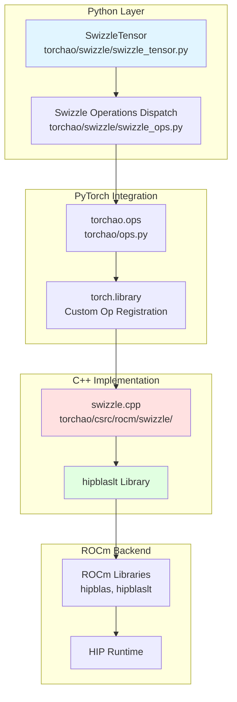
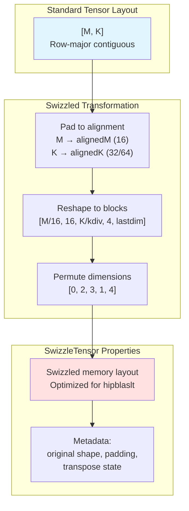
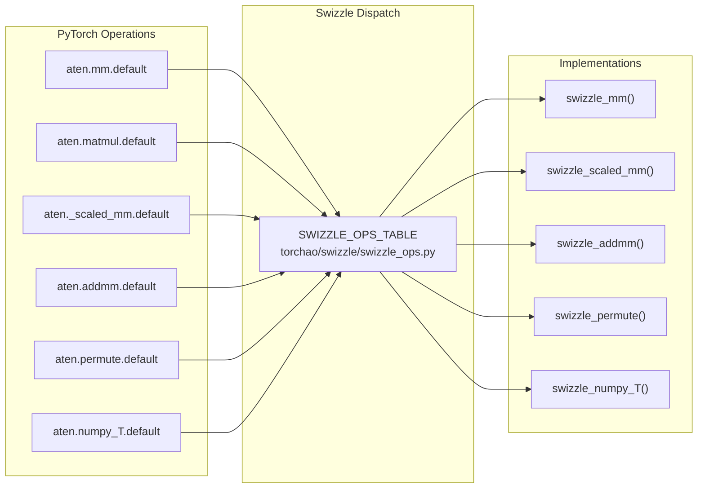
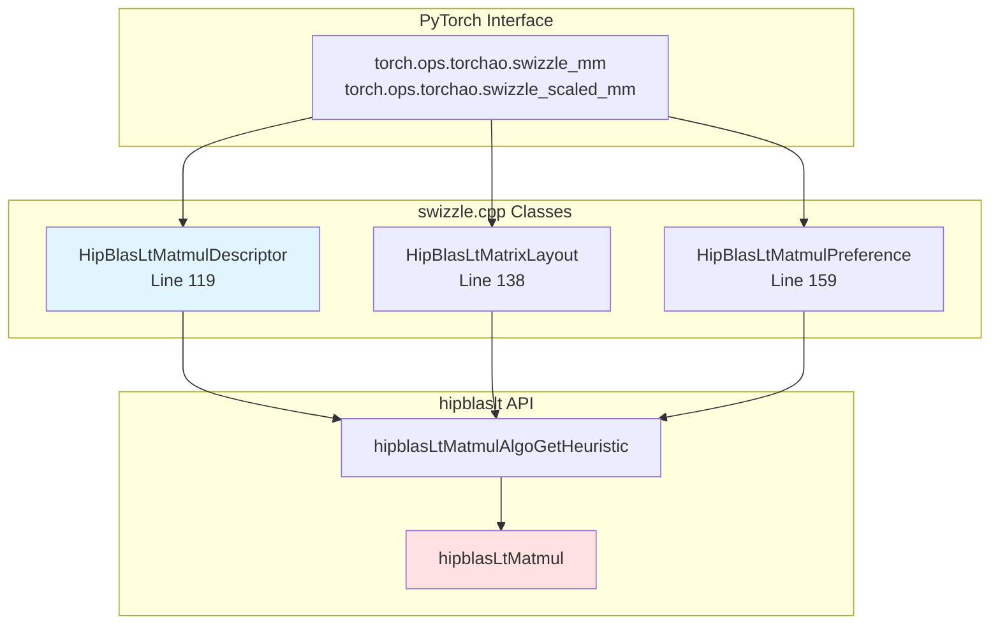

<!-- source: DeepWiki mcp.deepwiki.com · repo pytorch/ao · page 8.4 ROCm and AMD Support · fetched 2026-10-21 -->

# ROCm and AMD Support

Relevant source files

The following files were used as context for generating this wiki page:

- [.github/workflows/1xH100_tests.yml](.github/workflows/1xH100_tests.yml)
- [.github/workflows/1xL4_tests.yml](.github/workflows/1xL4_tests.yml)
- [.github/workflows/4xH100_tests.yml](.github/workflows/4xH100_tests.yml)
- [.github/workflows/regression_test_rocm.yml](.github/workflows/regression_test_rocm.yml)
- [benchmarks/prototype/moe_training/bench_moe_layer.py](benchmarks/prototype/moe_training/bench_moe_layer.py)
- [benchmarks/prototype/moe_training/benchmark_moe_layer_fsdp.py](benchmarks/prototype/moe_training/benchmark_moe_layer_fsdp.py)
- [test/prototype/moe_training/test_everything.sh](test/prototype/moe_training/test_everything.sh)
- [test/prototype/mx_formats/test_mxfp8_allgather.py](test/prototype/mx_formats/test_mxfp8_allgather.py)
- [test/prototype/mx_formats/test_mxfp8_allgather.sh](test/prototype/mx_formats/test_mxfp8_allgather.sh)
- [torchao/csrc/rocm/swizzle/swizzle.cpp](torchao/csrc/rocm/swizzle/swizzle.cpp)
- [torchao/swizzle/__init__.py](torchao/swizzle/__init__.py)
- [torchao/swizzle/swizzle_ops.py](torchao/swizzle/swizzle_ops.py)
- [torchao/swizzle/swizzle_tensor.py](torchao/swizzle/swizzle_tensor.py)

## Purpose and Scope

This page documents TorchAO's support for AMD GPUs through the ROCm platform. The primary focus is on **swizzled tensor operations** that optimize matrix multiplication performance on AMD hardware by avoiding Local Data Store (LDS) contention, and integration with the **hipblaslt** library for high-performance GEMM operations. This includes support for FP8 quantization on AMD MI300/MI350 GPUs and specialized handling for `float8_e4m3fnuz` dtypes.

For general custom operations across all hardware backends, see [Custom Operations and Kernels](#8). For CUDA-specific kernels, see [CUDA Kernels](#8.2).

---

## Architecture Overview

TorchAO's ROCm support consists of three main layers: a Python tensor abstraction (`SwizzleTensor`), operation dispatch logic, and C++ implementations using hipblaslt.

**Sources:** [torchao/swizzle/swizzle_tensor.py:16-144](), [torchao/swizzle/swizzle_ops.py:1-120](), [torchao/csrc/rocm/swizzle/swizzle.cpp:1-214]()

---

## Build System and CI Workflows

### ROCm Regression Testing

TorchAO maintains a dedicated regression test workflow for ROCm to ensure hardware compatibility, specifically targeting `gfx942` (MI300X).

| Workflow File | Target Runner | Torch Spec |
|---------------|---------------|------------|
| `regression_test_rocm.yml` | `linux.rocm.gpu.gfx942.1` | `--pre torch torchvision --index-url https://download.pytorch.org/whl/nightly/rocm7.2` |

**Sources:** [.github/workflows/regression_test_rocm.yml:23-28]()

### Build Configuration

The build system automatically detects ROCm availability. For AMD hardware, the compilation includes ROCm-specific source files and sets the offload architecture.

**Sources:** [torchao/csrc/rocm/swizzle/swizzle.cpp:1-5]()

---

## SwizzleTensor Abstraction

### Purpose and Memory Layout

`SwizzleTensor` is a tensor subclass that reorganizes tensor memory layout to optimize for AMD GPU memory access patterns. It transforms standard row-major tensors into a swizzled layout that reduces LDS contention during matrix multiplication.

**Sources:** [torchao/swizzle/swizzle_tensor.py:16-65]()

### Implementation Details

The `SwizzleTensor` class performs several transformations:

1. **Alignment Padding**: Ensures dimensions are properly aligned for hardware.
   - M dimension aligned to 16.
   - K dimension aligned to 32 (for 2-byte dtypes) or 64 (for 1-byte dtypes).
2. **Block Reshaping**: Breaks tensor into hardware-friendly blocks.
   - `lastdim = 8` (2-byte) or `16` (1-byte).
   - `kdiv = 32` (2-byte) or `64` (1-byte).
3. **Dimension Permutation**: Reorders for optimal memory access via `x.permute(0, 2, 3, 1, 4)`.

**Sources:** [torchao/swizzle/swizzle_tensor.py:33-56]()

---

## Operation Dispatch System

### Dispatch Table

The `SWIZZLE_OPS_TABLE` in `torchao/swizzle/swizzle_ops.py` maps PyTorch operations to swizzle-aware implementations.

**Sources:** [torchao/swizzle/swizzle_ops.py:14-120]()

### Key Operations

*   **swizzle_mm**: Detects if inputs are `SwizzleTensor` instances, extracts aligned tensors via `as_tensor()`, and calls `torchao.ops.swizzle_mm(a, b, a_is_swizzled, b_is_swizzled)`. [torchao/swizzle/swizzle_ops.py:28-52]()
*   **swizzle_scaled_mm**: Handles FP8 scaled matrix multiplication. It supports per-tensor scaling and routes to `torchao.ops.swizzle_scaled_mm`. [torchao/swizzle/swizzle_ops.py:75-104]()
*   **swizzle_permute**: Handles shallow transposes for swizzled tensors without moving data. [torchao/swizzle/swizzle_ops.py:107-114]()

---

## hipblaslt Integration

### C++ Implementation Architecture

The core C++ implementation in `swizzle.cpp` provides the bridge between PyTorch and hipblaslt, using RAII wrappers for descriptors.

**Sources:** [torchao/csrc/rocm/swizzle/swizzle.cpp:119-172]()

### MI300/MI350 and Float8 Detection

ROCm support includes logic to detect the specific architecture and adjust FP8 handling. AMD GPUs like MI300 (gfx940/941/942) use the `fnuz` (Finite, Non-zero, Unsigned Zero) variant of the FP8 dtype.

The `_scaled_mm_is_fnuz` function checks the `gcnArchName` from device properties to determine if the hardware requires `fnuz` adjustments for scaled matrix multiplication.

**Sources:** [torchao/csrc/rocm/swizzle/swizzle.cpp:201-212]()

### Workspace Management

The implementation allows configuring the hipblaslt workspace size via environment variables:
*   `CUBLASLT_WORKSPACE_SIZE`
*   `HIPBLASLT_WORKSPACE_SIZE`

The default workspace size is set to 76 MB.

**Sources:** [torchao/csrc/rocm/swizzle/swizzle.cpp:174-194]()

---

## Testing and Benchmarking

### Distributed Testing
TorchAO tests ROCm support in distributed environments, including Mixture of Experts (MoE) training and All-Gather operations for MXFP8 formats.

**Sources:** [.github/workflows/4xH100_tests.yml:65](), [test/prototype/mx_formats/test_mxfp8_allgather.sh:12]()

### MoE Training Benchmarks
Benchmarks for MoE layers on ROCm check for hardware capability and skip tests if the required compute capability (e.g., 9.0 for FP8 rowwise) is not met.

**Sources:** [benchmarks/prototype/moe_training/bench_moe_layer.py:70-81](), [test/prototype/moe_training/test_everything.sh:10-20]()

---

