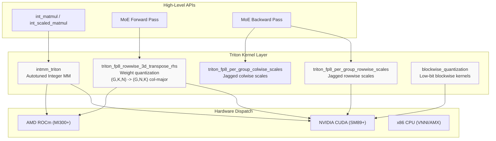
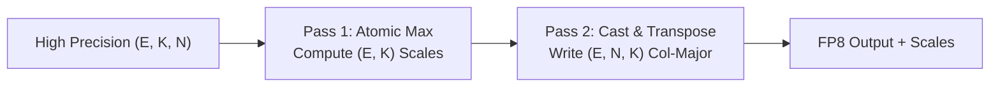

<!-- source: DeepWiki mcp.deepwiki.com · repo pytorch/ao · page 8.5 Triton Kernels · fetched 2026-10-21 -->

# Triton Kernels

<details>
<summary>Relevant source files</summary>

The following files were used as context for generating this wiki page:

- [benchmarks/prototype/moe_training/benchmark_scaled_grouped_mm_dq.py](benchmarks/prototype/moe_training/benchmark_scaled_grouped_mm_dq.py)
- [benchmarks/prototype/moe_training/fp8_rowwise/bench_triton_fp8_colwise_3d_scale_and_cast.py](benchmarks/prototype/moe_training/fp8_rowwise/bench_triton_fp8_colwise_3d_scale_and_cast.py)
- [test/kernel/test_autotuner.py](test/kernel/test_autotuner.py)
- [test/kernel/test_blockwise_triton.py](test/kernel/test_blockwise_triton.py)
- [test/prototype/moe_training/test_tensor.py](test/prototype/moe_training/test_tensor.py)
- [test/prototype/moe_training/test_training.py](test/prototype/moe_training/test_training.py)
- [test/test_lean_import.py](test/test_lean_import.py)
- [torchao/kernel/__init__.py](torchao/kernel/__init__.py)
- [torchao/kernel/autotuner.py](torchao/kernel/autotuner.py)
- [torchao/kernel/blockwise_quantization.py](torchao/kernel/blockwise_quantization.py)
- [torchao/kernel/bsr_triton_ops.py](torchao/kernel/bsr_triton_ops.py)
- [torchao/kernel/intmm.py](torchao/kernel/intmm.py)
- [torchao/kernel/intmm_triton.py](torchao/kernel/intmm_triton.py)
- [torchao/prototype/moe_training/config.py](torchao/prototype/moe_training/config.py)
- [torchao/prototype/moe_training/conversion_utils.py](torchao/prototype/moe_training/conversion_utils.py)
- [torchao/prototype/moe_training/fp8_grouped_mm.py](torchao/prototype/moe_training/fp8_grouped_mm.py)
- [torchao/prototype/moe_training/kernels/__init__.py](torchao/prototype/moe_training/kernels/__init__.py)
- [torchao/prototype/moe_training/kernels/float8_rowwise.py](torchao/prototype/moe_training/kernels/float8_rowwise.py)
- [torchao/prototype/moe_training/kernels/jagged_float8_scales.py](torchao/prototype/moe_training/kernels/jagged_float8_scales.py)
- [torchao/prototype/moe_training/tensor.py](torchao/prototype/moe_training/tensor.py)
- [torchao/prototype/moe_training/utils.py](torchao/prototype/moe_training/utils.py)
- [torchao/sparsity/blocksparse.py](torchao/sparsity/blocksparse.py)

</details>


## Purpose and Scope

This document describes the Triton kernel implementations in TorchAO, specifically for FP8 quantization, integer matrix multiplication (`intmm_triton`), and Mixture-of-Experts (MoE) training workflows. These kernels handle dynamic quantization to FP8 with rowwise and per-group scaling strategies, optimized for the memory access patterns required by grouped GEMM operations and high-performance inference.

**Key Areas Covered:**
- FP8 rowwise quantization with transposition for grouped GEMM.
- Per-group (jagged) scale computation for MoE backward pass.
- Integer matrix multiplication (`intmm_triton`) with autotuning support.
- CPU-optimized paths for scaled integer matmul (VNNI/AMX).
- Blockwise quantization kernels for low-bit formats.

---

## Overview of Triton Kernels in TorchAO

TorchAO implements several Triton kernels to support efficient training and inference. While many kernels focus on MoE training on CUDA GPUs, others provide foundational support for integer arithmetic across different hardware backends.



**Sources:** [torchao/kernel/intmm.py:23-32](), [torchao/prototype/moe_training/kernels/float8_rowwise.py:1-516](), [torchao/prototype/moe_training/kernels/jagged_float8_scales.py:1-471]()

---

## Integer Matrix Multiplication (`intmm_triton`)

TorchAO provides an autotuned Triton implementation for integer matrix multiplication, accessible via `torchao.kernel.intmm`.

### Dispatch Logic and Autotuning
The system routes calls between `safe_int_mm` (cublas/aten fallback) and `intmm_triton` based on the `TORCHAO_AUTOTUNER_ENABLE` environment variable.

```python
def int_matmul(a: torch.Tensor, b: torch.Tensor) -> torch.Tensor:
    if intmm_triton is not None and AUTOTUNER_ENABLE:
        return torch.ops.torchao.int_matmul(a, b)
    return safe_int_mm(a, b)
```

**Sources:** [torchao/kernel/intmm.py:32-32](), [torchao/kernel/intmm.py:96-110]()

### CPU Path Optimizations
For x86 CPUs, `_int_scaled_matmul_cpu` selects paths based on ISA support (AVX512_VNNI vs. AMX). 
- **u8s8 Path:** On VNNI-supported CPUs without AMX, it converts int8 to uint8 and applies a compensation term `comp = b.sum(dim=0) * 128` to maintain correctness [torchao/kernel/intmm.py:132-142]().
- **s8s8 Path:** Uses AMX or standard `torch._int_mm` fallback [torchao/kernel/intmm.py:143-145]().

**Sources:** [torchao/kernel/intmm.py:113-146](), [test/kernel/test_autotuner.py:102-183]()

---

## FP8 Rowwise Quantization and Transpose Kernels

The `triton_fp8_rowwise_3d_transpose_rhs` kernel performs quantization and transposition of 3D weight tensors for use as the right-hand side operand in MoE grouped GEMM operations.

### Two-Pass Implementation Strategy
The kernel typically uses a two-kernel approach to compute scales globally across tiles:
1. **Scale Computation Kernel** (`_triton_fp8_rowwise_3d_transpose_scales_rhs_kernel`): Computes rowwise scales using atomic operations [torchao/prototype/moe_training/kernels/float8_rowwise.py:138-224]().
2. **Cast Kernel** (`_triton_fp8_rowwise_3d_transpose_cast_rhs_kernel`): Applies computed scales and transposes data [torchao/prototype/moe_training/kernels/float8_rowwise.py:226-289]().



**Sources:** [torchao/prototype/moe_training/kernels/float8_rowwise.py:42-117](), [torchao/prototype/moe_training/kernels/float8_rowwise.py:151-224]()

---

## Jagged/Per-Group Scale Kernels

For MoE training, input and gradient tensors are "jagged" — each expert receives a different number of tokens. These kernels compute separate scales for each group as determined by an offsets tensor.

### Per-Group Rowwise Scales
`triton_fp8_per_group_rowwise_scales` quantizes a 2D tensor with separate rowwise scales for each group [torchao/prototype/moe_training/kernels/jagged_float8_scales.py:68-133]().

```python
grid = lambda meta: (
    triton.cdiv(m, meta["BLOCK_SIZE"]),  # Row blocks
    offsets.numel(),                      # Number of groups
)
```

Each program instance loads its group boundaries from `offsets_ptr` and computes rowwise amaxes for its assigned block [torchao/prototype/moe_training/kernels/jagged_float8_scales.py:183-197]().

**Sources:** [torchao/prototype/moe_training/kernels/jagged_float8_scales.py:8-11](), [torchao/prototype/moe_training/kernels/jagged_float8_scales.py:162-231]()

---

## Integration with Autograd (MoE)

The Triton kernels are orchestrated via the `_Float8GroupedMM` autograd function to support differentiable MoE training.

| Phase | Operation | Triton Kernel |
|-------|-----------|---------------|
| **Forward** | Quantize Weight (RHS) | `triton_fp8_rowwise_3d_transpose_rhs` [torchao/prototype/moe_training/fp8_grouped_mm.py:148-152]() |
| **Forward** | Quantize Input (LHS) | `triton_fp8_rowwise_2d_scale_and_cast` [torchao/prototype/moe_training/fp8_grouped_mm.py:136-140]() |
| **Backward** | grad_input | `triton_fp8_rowwise_3d_transpose_rhs` (on grad_output) [torchao/prototype/moe_training/fp8_grouped_mm.py:180-185]() |
| **Backward** | grad_weight | `triton_fp8_per_group_colwise_scales` (jagged) [torchao/prototype/moe_training/fp8_grouped_mm.py:214-224]() |

**Sources:** [torchao/prototype/moe_training/fp8_grouped_mm.py:65-253](), [torchao/prototype/moe_training/utils.py:24-86]()

---

## Blockwise Quantization Kernels

TorchAO includes experimental Triton kernels for blockwise quantization, located in `torchao/kernel/blockwise_quantization.py`. These kernels support fine-grained quantization where different blocks of a tensor have different scaling factors, often used in low-bit (e.g., 4-bit) weight quantization.

**Sources:** [torchao/kernel/blockwise_quantization.py:1-50](), [test/kernel/test_blockwise_triton.py:1-100]()

---

## Performance and Hardware Support

### ROCm (AMD GPU) Support
Triton kernels in TorchAO include specific paths for ROCm, particularly for MI300 and MI350 architectures.
- **Atomic Semantics:** Uses `sem="relaxed"` for `tl.atomic_min` on HIP backends to improve performance [torchao/prototype/moe_training/kernels/float8_rowwise.py:216-224]().
- **Dtype Mapping:** Maps PyTorch dtypes like `torch.float8_e4m3fnuz` to Triton's `tl.float8e4b8` [torchao/prototype/moe_training/kernels/float8_rowwise.py:25-27]().

### Autotuning
The `torchao.kernel.autotuner` module provides the infrastructure to benchmark multiple Triton configurations and select the fastest one for a given tensor shape and hardware [torchao/kernel/autotuner.py:1-100]().

**Sources:** [torchao/prototype/moe_training/kernels/float8_rowwise.py:19-32](), [torchao/kernel/intmm.py:32-32](), [torchao/prototype/moe_training/config.py:57-59]()

---

## Summary of Triton Kernel Operators

| Operator Name | File | Description |
|---------------|------|-------------|
| `torchao::triton_fp8_rowwise_transpose_rhs` | `float8_rowwise.py` | 3D Weight quantization + Transpose for MoE [torchao/prototype/moe_training/kernels/float8_rowwise.py:42-45]() |
| `torchao::triton_fp8_per_group_rowwise_scales` | `jagged_float8_scales.py` | Jagged rowwise scales for grad_output [torchao/prototype/moe_training/kernels/jagged_float8_scales.py:68-71]() |
| `torchao::int_matmul` | `intmm.py` | Autotuned integer matrix multiplication [torchao/kernel/intmm.py:108-109]() |
| `torchao::int_scaled_matmul` | `intmm.py` | Scaled integer matrix multiplication [torchao/kernel/intmm.py:179-180]() |

**Sources:** [torchao/prototype/moe_training/kernels/__init__.py:1-18](), [torchao/kernel/intmm.py:96-184]()

---

