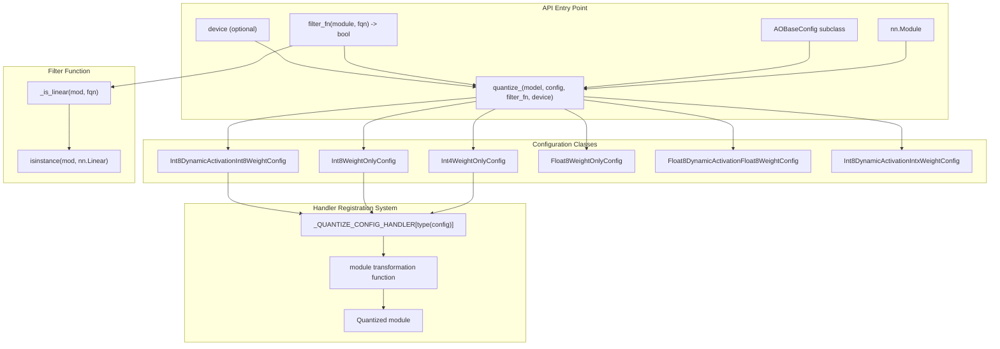
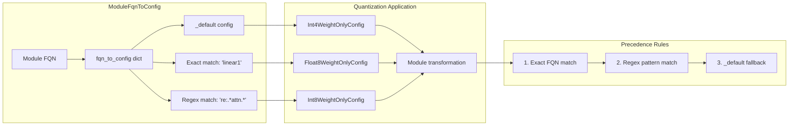
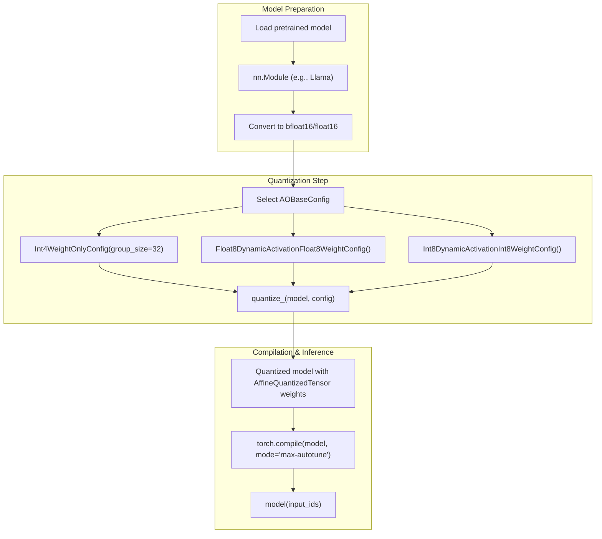
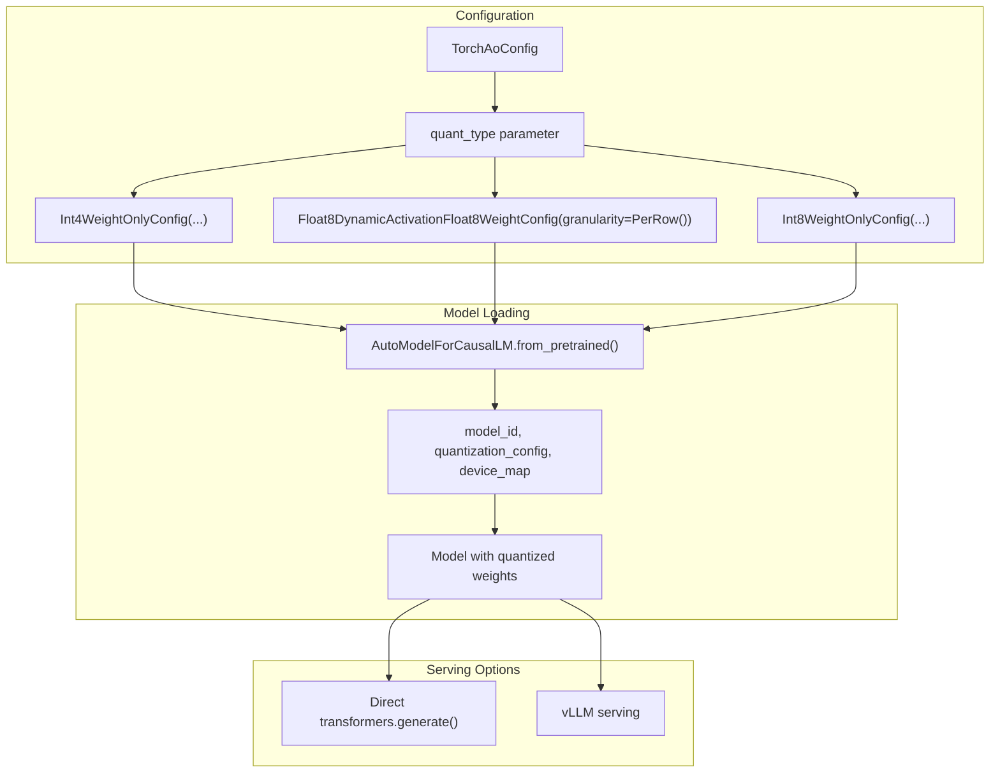
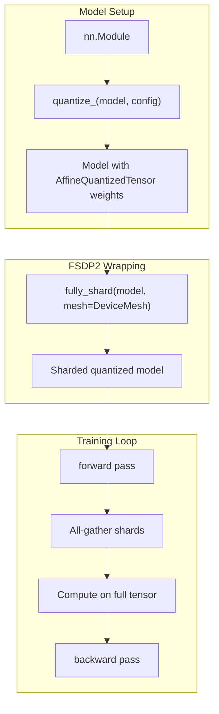

<!-- source: DeepWiki mcp.deepwiki.com · repo pytorch/ao · page 9 Model Integration and Examples · fetched 2026-10-21 -->

# Model Integration and Examples

Relevant source files

The following files were used as context for generating this wiki page:

- [benchmarks/quantization/calibration_based/create_quantized_model.py](benchmarks/quantization/calibration_based/create_quantized_model.py)
- [benchmarks/quantization/calibration_based/measure_accuracy_and_performance.sh](benchmarks/quantization/calibration_based/measure_accuracy_and_performance.sh)
- [benchmarks/quantization/calibration_based/utils.py](benchmarks/quantization/calibration_based/utils.py)
- [benchmarks/quantization/create_quantized_model.py](benchmarks/quantization/create_quantized_model.py)
- [benchmarks/quantization/eval_accuracy_and_perf_of_flux.py](benchmarks/quantization/eval_accuracy_and_perf_of_flux.py)
- [benchmarks/quantization/eval_accuracy_and_perf_of_flux.sh](benchmarks/quantization/eval_accuracy_and_perf_of_flux.sh)
- [benchmarks/quantization/measure_accuracy_and_performance.sh](benchmarks/quantization/measure_accuracy_and_performance.sh)
- [benchmarks/quantization/parse_log.py](benchmarks/quantization/parse_log.py)
- [benchmarks/quantization/utils.py](benchmarks/quantization/utils.py)
- [examples/sam2_amg_server/README.md](examples/sam2_amg_server/README.md)
- [examples/sam2_amg_server/compare_rle_lists.py](examples/sam2_amg_server/compare_rle_lists.py)
- [examples/sam2_amg_server/dog_rle.json](examples/sam2_amg_server/dog_rle.json)
- [examples/sam2_amg_server/server.py](examples/sam2_amg_server/server.py)
- [torchao/_models/sam2/automatic_mask_generator.py](torchao/_models/sam2/automatic_mask_generator.py)
- [torchao/_models/sam2/modeling/sam/mask_decoder.py](torchao/_models/sam2/modeling/sam/mask_decoder.py)
- [torchao/_models/sam2/sam2_image_predictor.py](torchao/_models/sam2/sam2_image_predictor.py)
- [torchao/_models/sam2/utils/amg.py](torchao/_models/sam2/utils/amg.py)
- [torchao/_models/sam2/utils/transforms.py](torchao/_models/sam2/utils/transforms.py)

This page demonstrates practical integration of TorchAO quantization with real models and frameworks. It focuses on the `quantize_()` API and configuration system, showing how to apply quantization to PyTorch models for inference and training workflows.

For detailed API reference, see [Quantization API Reference](#2). For tensor subclass internals, see [Tensor Subclass Framework](#3). For QAT and Float8 training, see [Quantization-Aware Training (QAT)](#4) and [Float8 Training System](#5).

## Using quantize_ with Models

The `quantize_()` function is the primary API for applying quantization to PyTorch models. It takes a model, a configuration object, and an optional filter function to control which modules are quantized.

**quantize_() Function Signature**

Title: quantize_ API and Configuration System

Sources: [torchao/quantization/quant_api.py:431-504](), [torchao/quantization/quant_api.py:226-244](), [torchao/quantization/transform_module.py:94-96]()

The function signature is defined at [torchao/quantization/quant_api.py:431-445]() and uses a handler registry system at [torchao/quantization/transform_module.py:94]() to dispatch to the appropriate transformation function for each config type.

### Configuration Objects

Each quantization scheme has a corresponding configuration class that inherits from `AOBaseConfig`:

| Configuration Class | Purpose | Key Parameters |
|---------------------|---------|----------------|
| `Int4WeightOnlyConfig` | 4-bit weight quantization | `group_size`, `int4_packing_format`, `int4_choose_qparams_algorithm` |
| `Int8WeightOnlyConfig` | 8-bit weight quantization | `granularity`, `group_size` |
| `Int8DynamicActivationInt8WeightConfig` | Dynamic int8 quantization | `act_mapping_type` |
| `Int8DynamicActivationIntxWeightConfig` | Dynamic int8 act with 1-8 bit weights | `weight_dtype`, `weight_granularity`, `weight_mapping_type` |
| `Float8WeightOnlyConfig` | FP8 weight quantization | `granularity` |
| `Float8DynamicActivationFloat8WeightConfig` | FP8 dynamic quantization | `granularity` |

Sources: [torchao/quantization/quant_api.py:742-774](), [torchao/quantization/quant_api.py:939-963](), [torchao/quantization/quant_api.py:566-631](), [torchao/quantization/quant_api.py:1015-1095]()

### Per-Module Configuration with ModuleFqnToConfig

For fine-grained control, use `ModuleFqnToConfig` to apply different quantization schemes to different modules. This system supports exact FQN matches or regex patterns.

Title: Per-Module Quantization Configuration

Sources: [torchao/quantization/quant_api.py:1516-1668](), [benchmarks/quantization/eval_accuracy_and_perf_of_flux.py:26-28]()

For details on selective quantization and advanced configuration, see [Using quantize_ with Models](#9.1).

## LLM Inference Examples

TorchAO provides optimized pathways for LLM inference, including 4-bit and 8-bit quantization for models like Llama.

Title: LLM Model Quantization Workflow

Sources: [benchmarks/quantization/create_quantized_model.py:14-30](), [benchmarks/quantization/utils.py:25-54]()

Common LLM patterns include using `Int4WeightOnlyConfig` with HQQ for high compression or `Float8DynamicActivationFloat8WeightConfig` for modern hardware like H100. Benchmarks for models like Flux also demonstrate these patterns using specialized eval scripts [benchmarks/quantization/eval_accuracy_and_perf_of_flux.py:78-100]().

For details, see [LLM Inference Examples](#9.2).

## vLLM Integration

TorchAO is integrated as a quantization backend in vLLM for production model serving. This allows users to load models quantized with TorchAO directly into vLLM's high-performance inference engine.

Title: TorchAO + HuggingFace Integration Flow

Sources: [benchmarks/quantization/create_quantized_model.py:20-26](), [benchmarks/quantization/utils.py:11-22]()

The integration relies on `TorchAoConfig` [benchmarks/quantization/create_quantized_model.py:20]() which translates string-based or object-based recipes into TorchAO quantization commands during HuggingFace model loading.

For details, see [vLLM Integration](#9.3).

## Distributed Training Examples

TorchAO supports distributed training workflows using FSDP2, Tensor Parallelism (TP), and DDP. This enables training or fine-tuning quantized models at scale.

Title: FSDP2 + TorchAO Integration

Sources: [benchmarks/quantization/eval_accuracy_and_perf_of_flux.sh:8-27]()

Distributed examples include scaling Flux models with FP8 rowwise quantization [benchmarks/quantization/eval_accuracy_and_perf_of_flux.sh:8-13]() and MXFP8 [benchmarks/quantization/eval_accuracy_and_perf_of_flux.sh:16-19](). These workflows typically involve `torchrun` and multi-GPU configurations.

For details, see [Distributed Training Examples](#9.4).

## Computer Vision Integration (SAM2)

TorchAO also provides specialized optimizations for vision models like Segment Anything Model 2 (SAM2). These optimizations include `fast` (compiled) and `furious` (float16) modes to reduce latency and memory footprint for mask generation [examples/sam2_amg_server/server.py:23-28]().

| Optimization Mode | mIoU | Avg. Latency (ms) | Max Memory (MiB) |
|-------------------|------|-------------------|------------------|
| Baseline | 1.0 | 863 | 4013 |
| AO Optimized | 0.999 | 586 | 3257 |
| Fast + Furious | 0.981 | 120 | 13616 |

Sources: [examples/sam2_amg_server/README.md:50-57]()

The SAM2 server implementation [examples/sam2_amg_server/server.py:42-46]() utilizes `torch.compile` and TorchAO's image predictor [torchao/_models/sam2/sam2_image_predictor.py:19]() to achieve significant speedups in real-world server environments.

---

