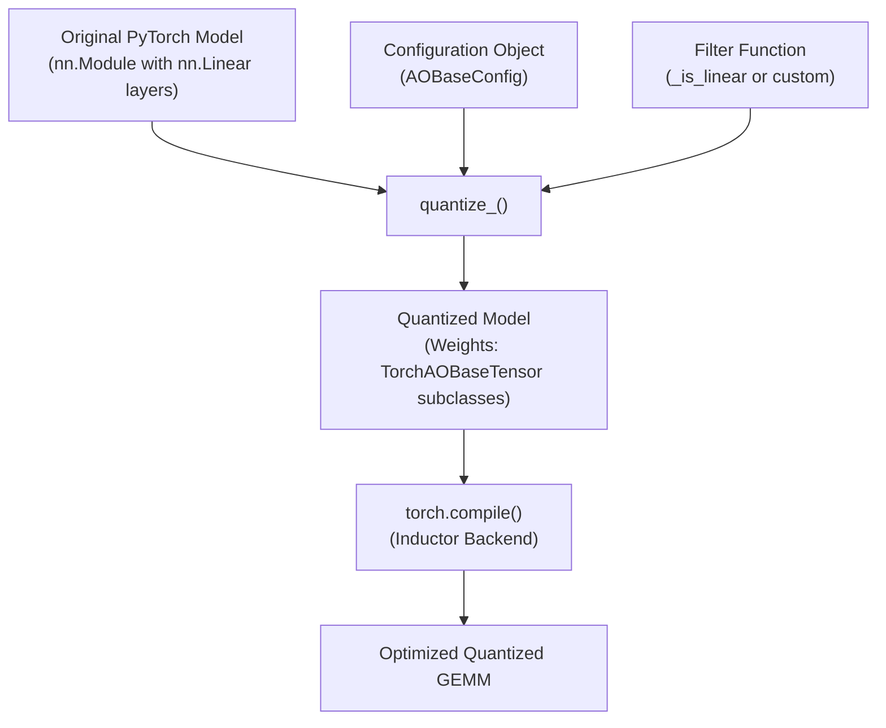
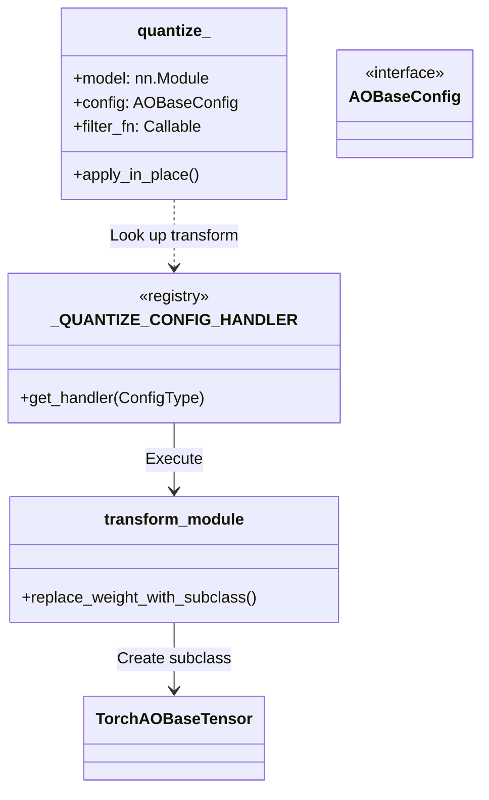

<!-- source: DeepWiki mcp.deepwiki.com · repo pytorch/ao · page 9.1 Using quantize_ with Models · fetched 2026-10-21 -->

# Using quantize_ with Models

<details>
<summary>Relevant source files</summary>

The following files were used as context for generating this wiki page:

- [README.md](README.md)
- [benchmarks/quantization/calibration_based/create_quantized_model.py](benchmarks/quantization/calibration_based/create_quantized_model.py)
- [benchmarks/quantization/calibration_based/measure_accuracy_and_performance.sh](benchmarks/quantization/calibration_based/measure_accuracy_and_performance.sh)
- [benchmarks/quantization/calibration_based/utils.py](benchmarks/quantization/calibration_based/utils.py)
- [benchmarks/quantization/create_quantized_model.py](benchmarks/quantization/create_quantized_model.py)
- [benchmarks/quantization/eval_accuracy_and_perf_of_flux.py](benchmarks/quantization/eval_accuracy_and_perf_of_flux.py)
- [benchmarks/quantization/eval_accuracy_and_perf_of_flux.sh](benchmarks/quantization/eval_accuracy_and_perf_of_flux.sh)
- [benchmarks/quantization/measure_accuracy_and_performance.sh](benchmarks/quantization/measure_accuracy_and_performance.sh)
- [benchmarks/quantization/parse_log.py](benchmarks/quantization/parse_log.py)
- [benchmarks/quantization/utils.py](benchmarks/quantization/utils.py)
- [test/integration/test_integration.py](test/integration/test_integration.py)
- [test/quantization/test_quant_api.py](test/quantization/test_quant_api.py)
- [test/quantization/test_quant_primitives.py](test/quantization/test_quant_primitives.py)
- [torchao/prototype/hqq/hqq_tinygemm_linear.py](torchao/prototype/hqq/hqq_tinygemm_linear.py)
- [torchao/quantization/README.md](torchao/quantization/README.md)
- [torchao/quantization/__init__.py](torchao/quantization/__init__.py)
- [torchao/quantization/qat/README.md](torchao/quantization/qat/README.md)
- [torchao/quantization/quant_api.py](torchao/quantization/quant_api.py)
- [torchao/quantization/quant_primitives.py](torchao/quantization/quant_primitives.py)
- [torchao/quantization/utils.py](torchao/quantization/utils.py)

</details>


## Purpose and Scope

This page provides a practical guide for using the `quantize_` API to apply quantization to PyTorch models. It covers basic usage patterns, configuration options, filtering mechanisms, and common use cases for model quantization.

For detailed information about the `quantize_` function signature and parameters, see [quantize_ Function](2.1). For comprehensive documentation on configuration objects, see [Configuration System](2.2). For specific inference workflows and benchmarks, see [LLM Inference Examples](9.2).

## Overview of quantize_

The `quantize_` function is TorchAO's primary API for applying quantization to PyTorch models. It modifies models **in-place**, replacing module weights with quantized tensor subclasses according to the specified configuration.

### Quantization Flow Architecture

Title: Model Transformation Lifecycle


**Key Characteristics:**
- **In-place modification**: The model is quantized directly without creating a copy [torchao/quantization/quant_api.py:431-504]().
- **Configuration-driven**: Behavior is controlled by `AOBaseConfig` subclasses [torchao/quantization/quant_api.py:441-445]().
- **Selective quantization**: Filter functions control which modules are quantized [torchao/quantization/quant_api.py:452-454]().
- **Compile-friendly**: Designed to work seamlessly with `torch.compile()` for kernel fusion [torchao/quantization/quant_api.py:7-16]().

Sources: [torchao/quantization/quant_api.py:7-16](), [torchao/quantization/quant_api.py:431-504](), [README.md:62-80]()

## Basic Usage Patterns

### Simple Weight-Only Quantization

The most basic usage quantizes all linear layers to int4 weights:

```python
import torch
from torchao.quantization import quantize_, Int4WeightOnlyConfig

# Create or load your model
model = torch.nn.Sequential(
    torch.nn.Linear(128, 256),
    torch.nn.ReLU(),
    torch.nn.Linear(256, 128)
)

# Quantize with int4 weight-only
quantize_(model, Int4WeightOnlyConfig(group_size=32))

# Use the model (torch.compile recommended)
compiled_model = torch.compile(model)
```

**What happens internally:**
1. `quantize_` iterates through the model's modules using `_replace_with_custom_fn_if_matches_filter` [torchao/quantization/quant_api.py:180-223]().
2. For each `torch.nn.Linear` module matching the filter, the weight is replaced with a subclass like `Int4TilePackedTo4dTensor` [torchao/quantization/quant_api.py:756-764]().
3. The module is marked with custom `extra_repr` for debugging [torchao/quantization/quant_api.py:398-408]().

Sources: [torchao/quantization/quant_api.py:180-223](), [torchao/quantization/quant_api.py:756-764](), [test/quantization/test_quant_api.py:245-267]()

### Dynamic Activation Quantization

For quantizing both weights and activations dynamically:

```python
from torchao.quantization import (
    quantize_, 
    Int8DynamicActivationInt8WeightConfig,
    MappingType
)

# Int8 dynamic quantization (symmetric)
quantize_(model, Int8DynamicActivationInt8WeightConfig())
```

This configuration uses `LinearActivationQuantizedTensor` to intercept linear operations and apply on-the-fly quantization to activations [torchao/quantization/quant_api.py:566-631]().

Sources: [torchao/quantization/quant_api.py:566-631](), [test/integration/test_integration.py:111-121]()

## Configuration Objects Reference

Commonly used configuration objects defined in `torchao.quantization.quant_api`:

| Configuration | Weights | Activations | Use Case |
|--------------|---------|-------------|----------|
| `Int4WeightOnlyConfig` | int4 groupwise | fp16/bf16 | Memory reduction [torchao/quantization/quant_api.py:707-739]() |
| `Int8WeightOnlyConfig` | int8 per-channel | fp16/bf16 | Standard weight-only [torchao/quantization/quant_api.py:833-863]() |
| `Int8DynamicActivationInt8WeightConfig` | int8 per-channel | int8 per-token | Higher throughput [torchao/quantization/quant_api.py:566-631]() |
| `Float8DynamicActivationFloat8WeightConfig` | fp8 | fp8 (dynamic) | Hopper/Ada GPUs [torchao/quantization/quant_api.py:1100-1227]() |

Sources: [torchao/quantization/quant_api.py:566-1227](), [torchao/quantization/__init__.py:72-131]()

## Filter Functions

Filter functions control which modules or parameters get quantized. The default filter `_is_linear` targets `torch.nn.Linear` modules that have not yet been quantized [torchao/quantization/quant_api.py:226-244]().

### Custom Filter Functions

Provide a custom filter for more control:

```python
def custom_filter(module: torch.nn.Module, fqn: str) -> bool:
    # Example: Only quantize large linear layers
    if isinstance(module, torch.nn.Linear):
        return module.in_features >= 512
    return False

quantize_(model, Int4WeightOnlyConfig(), filter_fn=custom_filter)
```

Sources: [torchao/quantization/quant_api.py:180-223](), [test/quantization/test_quant_api.py:528-566]()

## Device Parameter for Streaming Quantization

The `device` parameter in `quantize_` enables **streaming quantization**, which reduces peak memory usage by moving and quantizing modules incrementally [torchao/quantization/quant_api.py:180-223]().

```python
# Modules quantized on GPU one at a time to save CPU->GPU transfer memory spikes
quantize_(model, Int4WeightOnlyConfig(), device="cuda")
```

Sources: [torchao/quantization/quant_api.py:180-223](), [test/quantization/test_quant_api.py:323-346]()

## Per-Module and Per-Parameter Configuration

### ModuleFqnToConfig and FqnToConfig

Use `ModuleFqnToConfig` (aliased as `AOPerModuleConfig`) to apply different configurations to different modules based on their Fully Qualified Name (FQN) [torchao/quantization/quant_api.py:118]().

```python
from torchao.quantization import ModuleFqnToConfig, Int4WeightOnlyConfig

config = ModuleFqnToConfig({
    "layers.0.attention": Int4WeightOnlyConfig(),
    "re:.*mlp.*": Int8WeightOnlyConfig(), # Regex support
    "_default": None, # Skip others
})

quantize_(model, config, filter_fn=None)
```

### Regex Patterns

Both `ModuleFqnToConfig` and `FqnToConfig` support regex patterns prefixed with `"re:"` [torchao/quantization/quant_api.py:1514-1617]().

Sources: [torchao/quantization/quant_api.py:118](), [torchao/quantization/quant_api.py:1514-1617](), [test/quantization/test_quant_api.py:431-527]()

## Integration with torch.compile

The `quantize_` API is designed to work with `torch.compile()`. Compilation is **strongly recommended** as many TorchAO primitives are designed around the fusions that `torch.compile` provides [torchao/quantization/quant_api.py:7-16]().

### Implementation Logic for quantize_

Title: Code Entity Relationship for quantize_


Sources: [torchao/quantization/quant_api.py:431-504](), [torchao/quantization/transform_module.py:72-75]()

## Common Workflow Patterns

### Pattern: Quantize, Save, Load

When saving a quantized model, the state dict contains the flattened data of the tensor subclasses [test/quantization/test_quant_api.py:216-243]().

```python
# Save
torch.save(model.state_dict(), "quant.pt")

# Load
model = MyModel()
quantize_(model, Int4WeightOnlyConfig()) # Must apply same config first
model.load_state_dict(torch.load("quant.pt"))
```

Sources: [test/quantization/test_quant_api.py:216-243](), [test/quantization/test_quant_api.py:270-285]()

## Error Handling and Debugging

- **Shape Incompatibility**: `Int4WeightOnlyConfig` requires `in_features` to be divisible by `group_size`. If not, it may skip quantization with a warning [torchao/quantization/quant_api.py:786-790]().
- **Already Quantized**: The default filter `_is_linear` prevents double-quantization by checking if `mod.weight` is already a subclass [torchao/quantization/quant_api.py:226-244]().
- **Module Introspection**: Use `print(model)` to see the updated `extra_repr` which details the quantization parameters applied to each layer [torchao/quantization/quant_api.py:398-408]().

Sources: [torchao/quantization/quant_api.py:226-244](), [torchao/quantization/quant_api.py:398-408](), [torchao/quantization/quant_api.py:786-790]()

---

