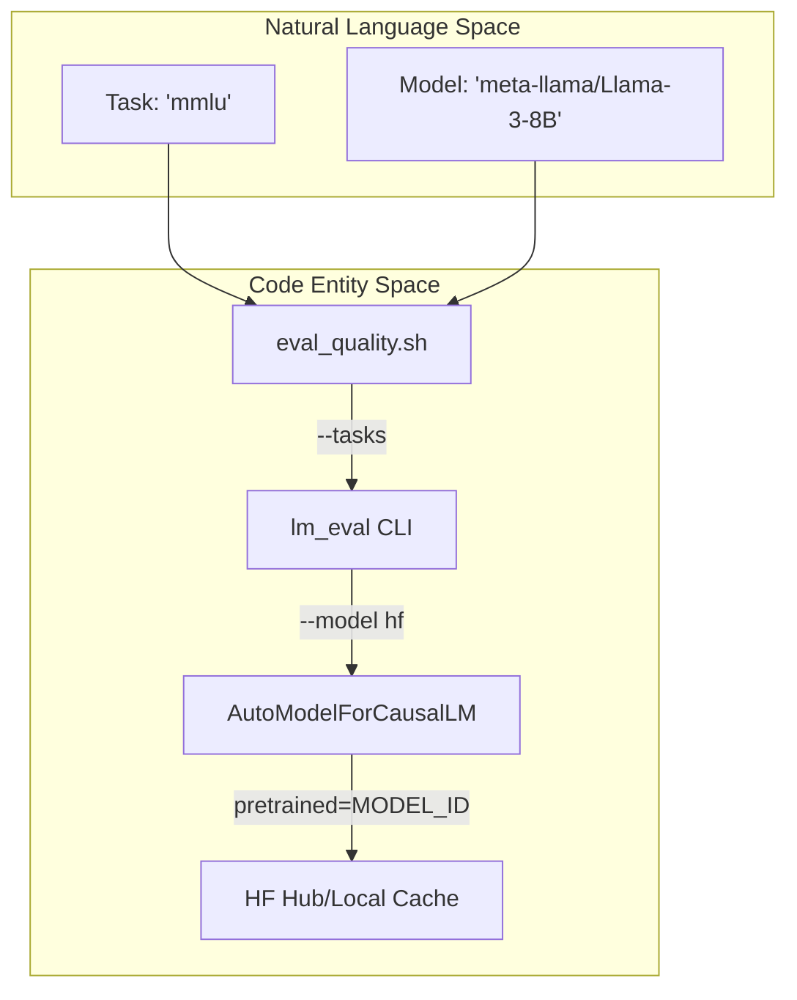
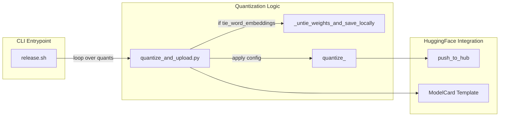

<!-- source: DeepWiki mcp.deepwiki.com · repo pytorch/ao · page 9.2 LLM Inference Examples · fetched 2026-10-21 -->

# LLM Inference Examples

<details>
<summary>Relevant source files</summary>

The following files were used as context for generating this wiki page:

- [.github/scripts/torchao_model_releases/README.md](.github/scripts/torchao_model_releases/README.md)
- [.github/scripts/torchao_model_releases/eval.sh](.github/scripts/torchao_model_releases/eval.sh)
- [.github/scripts/torchao_model_releases/eval_env_checks.sh](.github/scripts/torchao_model_releases/eval_env_checks.sh)
- [.github/scripts/torchao_model_releases/eval_latency.sh](.github/scripts/torchao_model_releases/eval_latency.sh)
- [.github/scripts/torchao_model_releases/eval_memory.sh](.github/scripts/torchao_model_releases/eval_memory.sh)
- [.github/scripts/torchao_model_releases/eval_mm_quality.sh](.github/scripts/torchao_model_releases/eval_mm_quality.sh)
- [.github/scripts/torchao_model_releases/eval_peak_memory_usage.py](.github/scripts/torchao_model_releases/eval_peak_memory_usage.py)
- [.github/scripts/torchao_model_releases/eval_quality.sh](.github/scripts/torchao_model_releases/eval_quality.sh)
- [.github/scripts/torchao_model_releases/quantize_and_upload.py](.github/scripts/torchao_model_releases/quantize_and_upload.py)
- [.github/scripts/torchao_model_releases/release.sh](.github/scripts/torchao_model_releases/release.sh)
- [.github/scripts/torchao_model_releases/summarize_results.sh](.github/scripts/torchao_model_releases/summarize_results.sh)
- [.github/workflows/release_model.yml](.github/workflows/release_model.yml)
- [scripts/convert_hf_checkpoint.py](scripts/convert_hf_checkpoint.py)
- [scripts/download.py](scripts/download.py)
- [scripts/prepare.sh](scripts/prepare.sh)
- [torchao/_models/sam/setup.sh](torchao/_models/sam/setup.sh)

</details>


This page demonstrates practical examples of quantizing and running LLMs with TorchAO. It covers three main integration patterns:
1. **HuggingFace Integration**: Using `TorchAoConfig` with Transformers and Diffusers.
2. **vLLM Serving**: Production inference with quantized models.
3. **Reference Scripts**: Direct usage via `generate.py` and `eval.py` in `torchao/_models/llama/`.

## Quick Start: Quantizing LLMs

The recommended approach uses HuggingFace's `TorchAoConfig` for automatic quantization during model loading. This is supported by the `quantize_and_upload.py` script which automates the process of loading, quantizing, and pushing models to the HuggingFace Hub [ .github/scripts/torchao_model_releases/quantize_and_upload.py:125-139]().

```python
from transformers import TorchAoConfig, AutoModelForCausalLM
from torchao.quantization import Float8DynamicActivationFloat8WeightConfig, PerRow

# Create quantization configuration
quantization_config = TorchAoConfig(
    quant_type=Float8DynamicActivationFloat8WeightConfig(granularity=PerRow())
)

# Load and automatically quantize
model = AutoModelForCausalLM.from_pretrained(
    "Qwen/Qwen3-32B",
    dtype="auto",
    device_map="auto",
    quantization_config=quantization_config
)
```

Alternative API when HuggingFace integration doesn't work:

```python
import torch
from torchao.quantization import Int4WeightOnlyConfig, quantize_

# Load model first
model = AutoModelForCausalLM.from_pretrained("meta-llama/Llama-3-8B")

# Apply quantization
if torch.cuda.is_available():
    quantize_(model, Int4WeightOnlyConfig(
        group_size=32,
    ))
```

Sources: [.github/scripts/torchao_model_releases/quantize_and_upload.py:30-42](), [.github/scripts/torchao_model_releases/quantize_and_upload.py:125-139]()

## Integration Patterns

### HuggingFace Transformers

TorchAO supports a variety of quantization configurations through the `TorchAoConfig` interface, including `Int4WeightOnlyConfig`, `Int8DynamicActivationInt8WeightConfig`, and prototype formats like `AWQConfig` or `SmoothQuantConfig` [.github/scripts/torchao_model_releases/quantize_and_upload.py:22-42]().

**Quantization During Loading**

```python
from transformers import TorchAoConfig, AutoModelForCausalLM
from torchao.quantization import Int4WeightOnlyConfig

# Configure quantization
config = TorchAoConfig(Int4WeightOnlyConfig(group_size=128))

# Load and quantize
model = AutoModelForCausalLM.from_pretrained(
    "meta-llama/Llama-3-8B",
    quantization_config=config,
    torch_dtype="auto",
    device_map="auto"
)
```

Sources: [.github/scripts/torchao_model_releases/quantize_and_upload.py:14-42]()

### HuggingFace Checkpoint Conversion

Before running inference with the reference Llama implementation, HuggingFace checkpoints must be converted to the compatible `model.pth` format. The `convert_hf_checkpoint.py` script handles this by mapping HuggingFace keys to the internal model architecture [.scripts/convert_hf_checkpoint.py:58-72]().

**Conversion Workflow**
1. Download model via `download.py` [.scripts/download.py:14-24]().
2. Run `convert_hf_checkpoint.py` to remap weights and permute query/key tensors for rotary embeddings [.scripts/convert_hf_checkpoint.py:75-81]().
3. (Optional) Untie word embeddings if required by the target quantization scheme [.github/scripts/torchao_model_releases/quantize_and_upload.py:66-79]().

Sources: [.scripts/convert_hf_checkpoint.py:21-125](), [.scripts/download.py:14-31](), [.scripts/prepare.sh:6-16]()

### vLLM Serving

TorchAO-quantized models can be evaluated for latency using vLLM. The `eval_latency.sh` script benchmarks throughput and latency across different batch sizes [.github/scripts/torchao_model_releases/eval_latency.sh:71-83]().

```bash
# Benchmark latency with vLLM
VLLM_DISABLE_COMPILE_CACHE=1 vllm bench latency \
  --input-len 256 \
  --output-len 256 \
  --model pytorch/Qwen3-32B-FP8 \
  --batch-size 1
```

Sources: [.github/scripts/torchao_model_releases/eval_latency.sh:79-80](), [.github/scripts/torchao_model_releases/README.md:117-131]()

## Evaluation Framework

TorchAO provides a robust evaluation suite for model quality, memory, and latency.

### Model Quality Evaluation
Quality is measured using `lm-evaluation-harness` [.github/scripts/torchao_model_releases/eval_quality.sh:60-66](). The `eval_quality.sh` script supports caching results to avoid redundant runs [.github/scripts/torchao_model_releases/eval_quality.sh:68-70]().

**Quality Eval Pipeline**

Sources: [.github/scripts/torchao_model_releases/eval_quality.sh:51-76](), [.github/scripts/torchao_model_releases/README.md:133-149]()

### Performance Summarization
The `summarize_results.sh` script aggregates quality, memory, and latency logs into a single summary report for a given model ID [.github/scripts/torchao_model_releases/summarize_results.sh:36-106]().

| Metric | Source Log Pattern |
|--------|--------------------|
| Quality | `{SAFE_MODEL_ID}_quality_*.log` |
| Multi-modal | `{SAFE_MODEL_ID}_mm_quality_*.log` |
| Memory | `{SAFE_MODEL_ID}_memory.log` |
| Latency | `{SAFE_MODEL_ID}_latency_batch*_in*_out*.log` |

Sources: [.github/scripts/torchao_model_releases/summarize_results.sh:44-101]()

## Model Release Workflow

The `release.sh` script orchestrates the full quantization and upload process for new models, defaulting to FP8, INT4, and INT8-INT4 variants [.github/scripts/torchao_model_releases/release.sh:12-62]().

**Quantization and Upload Workflow**

Sources: [.github/scripts/torchao_model_releases/release.sh:59-62](), [.github/scripts/torchao_model_releases/quantize_and_upload.py:54-87](), [.github/scripts/torchao_model_releases/quantize_and_upload.py:90-212]()

### Automated Release Pipeline
A GitHub Action `release_model.yml` is available to trigger model releases on H100 hardware, ensuring optimized environments for FP8 quantization [.github/workflows/release_model.yml:20-51]().

Sources: [.github/workflows/release_model.yml:1-51]()

---

