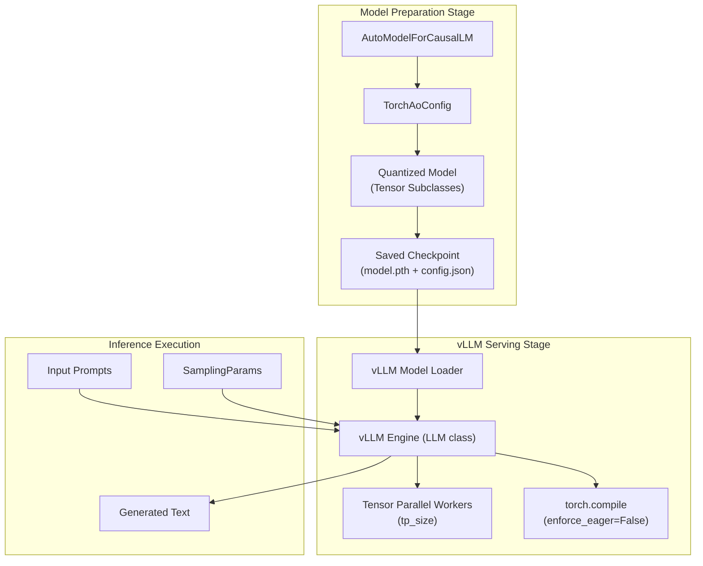
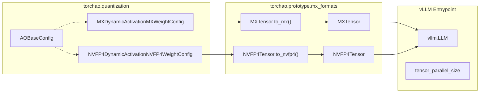

<!-- source: DeepWiki mcp.deepwiki.com · repo pytorch/ao · page 9.3 vLLM Integration · fetched 2026-10-21 -->

# vLLM Integration

<details>
<summary>Relevant source files</summary>

The following files were used as context for generating this wiki page:

- [benchmarks/mx_formats/cast_bench.py](benchmarks/mx_formats/cast_bench.py)
- [benchmarks/prototype/moe_training/mxfp8/bench_dequantize.py](benchmarks/prototype/moe_training/mxfp8/bench_dequantize.py)
- [docs/source/contributing/sparsity.rst](docs/source/contributing/sparsity.rst)
- [docs/source/eager_tutorials/finetuning.rst](docs/source/eager_tutorials/finetuning.rst)
- [docs/source/eager_tutorials/pretraining.rst](docs/source/eager_tutorials/pretraining.rst)
- [docs/source/eager_tutorials/serving.rst](docs/source/eager_tutorials/serving.rst)
- [docs/source/pt2e_quantization/pt2e_quant_openvino_inductor.rst](docs/source/pt2e_quantization/pt2e_quant_openvino_inductor.rst)
- [docs/source/pt2e_quantization/pt2e_quant_ptq.rst](docs/source/pt2e_quantization/pt2e_quant_ptq.rst)
- [docs/source/pt2e_quantization/pt2e_quant_qat.rst](docs/source/pt2e_quantization/pt2e_quant_qat.rst)
- [docs/source/pt2e_quantization/pt2e_quant_x86_inductor.rst](docs/source/pt2e_quantization/pt2e_quant_x86_inductor.rst)
- [docs/source/pt2e_quantization/pt2e_quantizer.rst](docs/source/pt2e_quantization/pt2e_quantizer.rst)
- [test/integration/test_vllm.py](test/integration/test_vllm.py)
- [test/prototype/moe_training/test_fp8_grouped_mm.py](test/prototype/moe_training/test_fp8_grouped_mm.py)
- [test/prototype/mx_formats/test_inference_workflow.py](test/prototype/mx_formats/test_inference_workflow.py)
- [test/prototype/mx_formats/test_kernels.py](test/prototype/mx_formats/test_kernels.py)
- [test/prototype/mx_formats/test_mx_serialization.py](test/prototype/mx_formats/test_mx_serialization.py)
- [test/prototype/mx_formats/test_mx_tensor.py](test/prototype/mx_formats/test_mx_tensor.py)
- [test/prototype/mx_formats/test_nvfp4_tensor.py](test/prototype/mx_formats/test_nvfp4_tensor.py)
- [torchao/prototype/mx_formats/README.md](torchao/prototype/mx_formats/README.md)
- [torchao/prototype/mx_formats/__init__.py](torchao/prototype/mx_formats/__init__.py)
- [torchao/prototype/mx_formats/config.py](torchao/prototype/mx_formats/config.py)
- [torchao/prototype/mx_formats/constants.py](torchao/prototype/mx_formats/constants.py)
- [torchao/prototype/mx_formats/fp_format_spec.py](torchao/prototype/mx_formats/fp_format_spec.py)
- [torchao/prototype/mx_formats/inference_workflow.py](torchao/prototype/mx_formats/inference_workflow.py)
- [torchao/prototype/mx_formats/kernels.py](torchao/prototype/mx_formats/kernels.py)
- [torchao/prototype/mx_formats/mx_tensor.py](torchao/prototype/mx_formats/mx_tensor.py)
- [torchao/prototype/mx_formats/nvfp4_tensor.py](torchao/prototype/mx_formats/nvfp4_tensor.py)
- [torchao/prototype/mx_formats/utils.py](torchao/prototype/mx_formats/utils.py)

</details>


This document describes TorchAO's integration with vLLM, a high-performance LLM serving framework. TorchAO provides quantization capabilities as a backend for vLLM, enabling efficient model deployment with reduced memory footprint and improved throughput.

## Overview

TorchAO is integrated as a quantization backend in vLLM, allowing users to serve quantized models through vLLM's high-performance inference engine. The integration supports multiple quantization formats, including micro-scaling (MX) and NVIDIA FP4 formats, and works seamlessly with vLLM's tensor parallelism and compilation features.

The integration workflow typically consists of two stages:
1. **Quantize and save**: Use HuggingFace Transformers with `TorchAoConfig` to quantize a model and save it to disk.
2. **Serve with vLLM**: Load the quantized model with vLLM's `LLM` class for high-throughput serving.

**Sources**: [test/integration/test_vllm.py:151-169](), [torchao/prototype/mx_formats/inference_workflow.py:81-100]()

## Basic Usage Example

```python
from transformers import AutoModelForCausalLM, TorchAoConfig
from torchao.quantization import Float8DynamicActivationFloat8WeightConfig, PerRow
from vllm import LLM, SamplingParams

# Stage 1: Quantize and save model
quantization_config = TorchAoConfig(
    quant_type=Float8DynamicActivationFloat8WeightConfig(granularity=PerRow())
)

quantized_model = AutoModelForCausalLM.from_pretrained(
    "Qwen/Qwen3-32B",
    dtype="auto",
    device_map="auto",
    quantization_config=quantization_config
)
quantized_model.save_pretrained("./quantized_model")

# Stage 2: Serve with vLLM
llm = LLM(
    model="./quantized_model",
    dtype="bfloat16",
    enforce_eager=False,  # Enable compilation
    tensor_parallel_size=1
)

sampling_params = SamplingParams(temperature=0.8, top_p=0.95, max_tokens=100)
outputs = llm.generate(["Hello, my name is"], sampling_params)
```

**Sources**: [test/integration/test_vllm.py:151-169](), [test/integration/test_vllm.py:219-225]()

## Integration Architecture

The following diagram illustrates the flow from a standard PyTorch/HuggingFace model to a production-ready vLLM service using TorchAO.

### Data Flow: Quantization to Serving

**Sources**: [test/integration/test_vllm.py:146-169](), [test/integration/test_vllm.py:219-225]()

### Code Entity Mapping
This diagram maps Natural Language concepts to specific classes and functions within the `torchao` and `vllm` integration space.


**Sources**: [torchao/prototype/mx_formats/inference_workflow.py:81-120](), [torchao/prototype/mx_formats/mx_tensor.py:216-240](), [torchao/prototype/mx_formats/nvfp4_tensor.py:52-123]()

## Supported Quantization Methods

TorchAO provides several specialized configurations that are tested for vLLM compatibility, categorized by hardware requirements:

| Configuration | Format | Hardware | Scaling Granularity |
|---------------|--------|----------|---------------------|
| `Int8WeightOnlyConfig` | Int8 | All CUDA | Per-Channel |
| `Float8DynamicActivationFloat8WeightConfig` | FP8 | SM 8.9+ (H100+) | Per-Tensor / Per-Row |
| `MXDynamicActivationMXWeightConfig` | MXFP8/MXFP4 | SM 10.0+ (Blackwell) | Block-wise (size 32) |
| `NVFP4DynamicActivationNVFP4WeightConfig` | NVFP4 | SM 10.0+ (Blackwell) | Block-wise (size 16) |

**Sources**: [test/integration/test_vllm.py:54-99](), [torchao/prototype/mx_formats/inference_workflow.py:81-102](), [torchao/prototype/mx_formats/inference_workflow.py:174-203]()

### Microscaling (MX) and NVFP4 Integration
For next-generation hardware (SM 10.0+), TorchAO introduces `MXTensor` and `NVFP4Tensor`. These subclasses handle the complex block-scaling logic required by OCP MX and NVIDIA FP4 specs.

*   **MX Format**: Uses `MXDynamicActivationMXWeightConfig`. It supports `ScaleCalculationMode` options like `RCEIL`, `FLOOR`, `CEIL`, and `EVEN` [torchao/prototype/mx_formats/config.py:38-63]().
*   **NVFP4 Format**: Uses `NVFP4DynamicActivationNVFP4WeightConfig`. It features "double quantization" with a global `per_tensor_scale` and dynamic per-block scales [torchao/prototype/mx_formats/inference_workflow.py:174-198]().

## Hardware Detection Logic

The integration test suite automatically detects GPU capabilities to determine which quantization methods to benchmark:

```python
major, minor = torch.cuda.get_device_capability()

# SM 8.9+ (H100+)
if major > 8 or (major == 8 and minor >= 9):
    # Enable Float8 quantization tests
    
# SM 10.0+ (Blackwell)
if major >= 10:
    # Enable MX and NVFP4 format tests
```

**Sources**: [test/integration/test_vllm.py:79-98](), [torchao/prototype/mx_formats/mx_tensor.py:146-152]()

## Tensor Parallelism and Compilation

vLLM's `tensor_parallel_size` distributes model computation across multiple GPUs. TorchAO quantized tensors are designed to be compatible with this sharding.

*   **TP Support**: Quantized weights (e.g., `AffineQuantizedTensor`, `MXTensor`) are automatically sharded across GPUs when `tp_size > 1` [test/integration/test_vllm.py:186-189]().
*   **Compilation**: The `enforce_eager=False` flag in vLLM triggers `torch.compile`. TorchAO kernels for MX and FP8 are optimized for the Inductor backend to ensure maximum throughput [test/integration/test_vllm.py:185-185](), [torchao/prototype/mx_formats/mx_tensor.py:139-146]().

## Model Preparation Workflow

The `quantize_and_save_model` helper demonstrates how to prepare a checkpoint for vLLM:

```python
def quantize_and_save_model(self, model_name, quantization_config, output_dir):
    # Load and quantize using HF + TorchAO
    model = AutoModelForCausalLM.from_pretrained(
        model_name,
        device_map="cuda",
        quantization_config=quantization_config,
    )
    # Save with safe_serialization=False to preserve tensor subclasses
    model.save_pretrained(output_dir, safe_serialization=False)
    return output_dir
```

**Sources**: [test/integration/test_vllm.py:146-169]()

## Known Issues and Workarounds

*   **vLLM Version**: Versions exactly equal to `0.9.0` are incompatible due to specific `AOPerModuleConfig` changes [test/integration/test_vllm.py:36-39]().
*   **Compilation Cache**: It is recommended to set `VLLM_TEST_STANDALONE_COMPILE=1` in testing environments to avoid cache collisions [test/integration/test_vllm.py:111-112]().
*   **MX/FP4 Alignment**: Slicing for Tensor Parallelism on `NVFP4Tensor` with swizzled scales requires alignment with 128-row or 64-column boundaries [torchao/prototype/mx_formats/nvfp4_tensor.py:348-352]().

**Sources**: [test/prototype/mx_formats/test_nvfp4_tensor.py:120-135](), [test/integration/test_vllm.py:106-114]()

---

