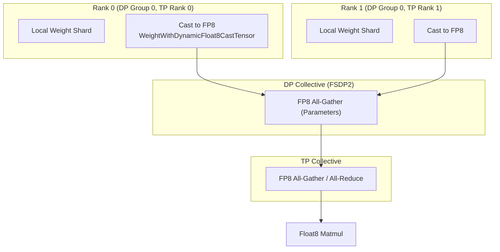
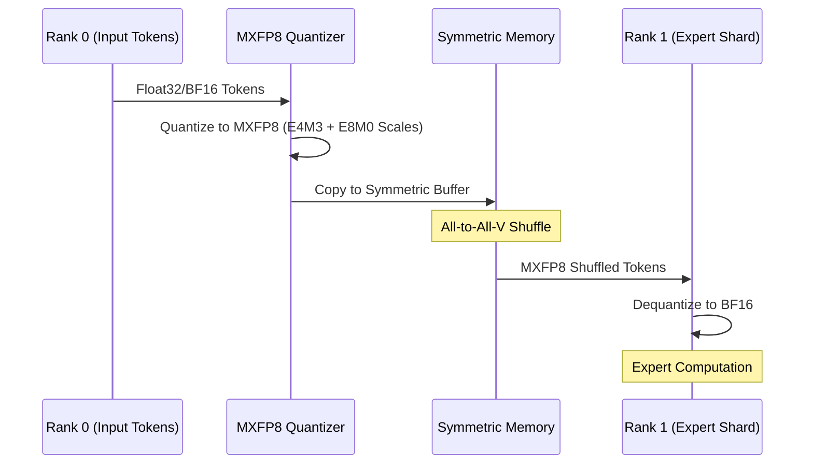

<!-- source: DeepWiki mcp.deepwiki.com · repo pytorch/ao · page 9.4 Distributed Training Examples · fetched 2026-10-21 -->

# Distributed Training Examples

<details>
<summary>Relevant source files</summary>

The following files were used as context for generating this wiki page:

- [benchmarks/prototype/moe_training/fp8_rowwise/bench_colwise_block_configs.py](benchmarks/prototype/moe_training/fp8_rowwise/bench_colwise_block_configs.py)
- [benchmarks/prototype/moe_training/fp8_rowwise/bench_triton_fp8_per_group_colwise_scales_dual.py](benchmarks/prototype/moe_training/fp8_rowwise/bench_triton_fp8_per_group_colwise_scales_dual.py)
- [benchmarks/prototype/moe_training/fp8_rowwise/bench_triton_fp8_rowwise_2d_fused_scale_and_cast.py](benchmarks/prototype/moe_training/fp8_rowwise/bench_triton_fp8_rowwise_2d_fused_scale_and_cast.py)
- [benchmarks/prototype/moe_training/mxfp8/bench_all_to_all_v.py](benchmarks/prototype/moe_training/mxfp8/bench_all_to_all_v.py)
- [benchmarks/utils.py](benchmarks/utils.py)
- [test/float8/test_fsdp2_tp.py](test/float8/test_fsdp2_tp.py)
- [test/prototype/moe_training/mxfp8/__init__.py](test/prototype/moe_training/mxfp8/__init__.py)
- [test/prototype/moe_training/mxfp8/test_mxfp8_a2a.py](test/prototype/moe_training/mxfp8/test_mxfp8_a2a.py)
- [test/prototype/moe_training/reference_parallel_styles.py](test/prototype/moe_training/reference_parallel_styles.py)
- [test/prototype/moe_training/test_distributed.py](test/prototype/moe_training/test_distributed.py)
- [test/prototype/moe_training/test_distributed.sh](test/prototype/moe_training/test_distributed.sh)
- [test/prototype/moe_training/testing_utils.py](test/prototype/moe_training/testing_utils.py)
- [test/prototype/mx_formats/test_mx_dtensor.py](test/prototype/mx_formats/test_mx_dtensor.py)
- [torchao/prototype/moe_training/kernels/mxfp8/comms.py](torchao/prototype/moe_training/kernels/mxfp8/comms.py)
- [torchao/prototype/moe_training/kernels/triton_utils.py](torchao/prototype/moe_training/kernels/triton_utils.py)
- [torchao/testing/training/dtensor_utils.py](torchao/testing/training/dtensor_utils.py)

</details>


This page provides practical examples of using TorchAO with distributed training frameworks including FSDP2 (Fully Sharded Data Parallel 2), Tensor Parallelism (TP), and Expert Parallelism (EP) for Mixture-of-Experts (MoE). These techniques enable efficient training of large models by distributing computation, parameters, and activations across multiple GPUs while leveraging float8 and MXFP8 formats.

---

## Overview of Distributed Training Support

TorchAO integrates with PyTorch's native distributed training frameworks through specialized tensor subclasses and configuration options. Key features include reduced-precision communication (FP8/MXFP8 all-gather and all-to-all) and specialized kernels for distributed MoE training.

### Supported Distributed Strategies

| Strategy | Description | Communication Reduction | Key Classes / Functions |
|----------|-------------|------------------------|-------------------------|
| **FSDP2** | Data parallel with parameter sharding | Up to 50% with FP8 all-gather | `WeightWithDynamicFloat8CastTensor`, `precompute_float8_dynamic_scale_for_fsdp` |
| **Tensor Parallelism** | Model parallel with tensor sharding | Up to 50% with FP8 all-gather | `Float8ColwiseParallel`, `Float8RowwiseParallel`, `MXFP8TrainingOpConfig` |
| **Expert Parallelism** | Expert sharding for MoE models | Up to 50% with MXFP8 all-to-all | `MXFP8OnDeviceAllToAllV`, `to_mxfp8_a2a_dequant` |
| **2D Parallelism** | Combined DP (FSDP2) and MP (TP) | Multi-faceted reduction | Combined use of FSDP2 and TP classes |

**Sources:** [torchao/float8/fsdp_utils.py:1-283](), [torchao/float8/float8_tensor_parallel.py:1-266](), [torchao/prototype/moe_training/kernels/mxfp8/comms.py:25-58]()

---

## FSDP2 and Tensor Parallelism Integration

FSDP2 shards model parameters across data-parallel ranks. With float8 all-gather enabled, parameters are communicated in FP8 format, reducing communication volume. Tensor Parallelism (TP) shards model parameters along tensor dimensions, and TorchAO provides FP8-aware TP implementations.

### 2D Parallelism Architecture (FSDP2 + TP)



**Sources:** [test/float8/test_fsdp2_tp.py:33-88](), [torchao/float8/fsdp_utils.py:139-283]()

### Basic FSDP2 + TP Example
The order of application is critical: convert to float8 first, then apply TP, and finally apply FSDP2 [torchao/testing/training/dtensor_utils.py:93-115]().

```python
from torch.distributed._composable.fsdp import fully_shard
from torch.distributed.tensor.parallel import parallelize_module
from torchao.float8 import convert_to_float8_training, Float8LinearConfig
from torchao.float8.float8_tensor_parallel import Float8ColwiseParallel, Float8RowwiseParallel

# 1. Convert to Float8 Training
config = Float8LinearConfig(enable_fsdp_float8_all_gather=True)
convert_to_float8_training(model, config=config)

# 2. Apply Tensor Parallelism
parallelize_module(model, mesh["tp"], {
    "ffn.w1": Float8ColwiseParallel(),
    "ffn.out_proj": Float8RowwiseParallel(),
})

# 3. Apply FSDP2
fully_shard(model, mesh=mesh["dp"])
```

**Sources:** [test/float8/test_fsdp2_tp.py:54-80](), [torchao/testing/training/dtensor_utils.py:101-135]()

---

## Distributed MoE Training (Expert Parallelism)

For Mixture-of-Experts (MoE) models, TorchAO provides prototype support for MXFP8-based Expert Parallelism (EP). This involves sharding experts across GPUs and using specialized collectives to route tokens.

### MXFP8 All-to-All Communication

The `MXFP8OnDeviceAllToAllV` class implements a dynamic MXFP8 quantization followed by an on-device all-to-all-v operation using symmetric memory [torchao/prototype/moe_training/kernels/mxfp8/comms.py:25-58]().



**Sources:** [torchao/prototype/moe_training/kernels/mxfp8/comms.py:75-167](), [test/prototype/moe_training/mxfp8/test_mxfp8_a2a.py:91-128]()

### MoE Parallelization Strategies

TorchAO supports multiple MoE parallelization styles through the `ParallelStrategy` enum [test/prototype/moe_training/test_distributed.py:74-82]():
*   **Expert Parallel (EP):** Experts are sharded across the `ep` mesh dimension [test/prototype/moe_training/reference_parallel_styles.py:62-158]().
*   **Expert Tensor Parallel (ETP):** Combined EP and TP, where experts are sharded and individual expert layers are also tensor-parallelized [test/prototype/moe_training/reference_parallel_styles.py:161-195]().

### MXFP8 MoE Training Example

```python
from torchao.prototype.moe_training.config import MXFP8TrainingRecipe, MXFP8TrainingOpConfig
from torchao.quantization import quantize_

# Configure MXFP8 Training
recipe = MXFP8TrainingRecipe.MXFP8_RCEIL
config = MXFP8TrainingOpConfig.from_recipe(recipe)

# Parallelize MoE model (using ExpertParallel style)
# Then apply MXFP8 quantization
parallelize_module(model, ep_mesh, {"experts": ExpertParallel()})
quantize_(model, config=config)
```

**Sources:** [test/prototype/moe_training/test_distributed.py:136-160](), [torchao/testing/training/dtensor_utils.py:113-115]()

---

## Multi-GPU Quantization Workflows

For inference, TorchAO supports distributing quantized models using `DTensor`.

### MXTensor with DTensor
`MXTensor` can wrap `DTensor` as its inner data (`qdata`) and scale components. This allows `to_mx` and `dequantize` operations to be performed across a `DeviceMesh` [test/prototype/mx_formats/test_mx_dtensor.py:42-61]().

| Component | Type | Distributed Placement |
|-----------|------|-----------------------|
| `MXTensor.qdata` | `DTensor` | `Shard(0)` or `Replicate()` |
| `MXTensor.scale` | `DTensor` | Matches `qdata` placement |

**Sources:** [test/prototype/mx_formats/test_mx_dtensor.py:53-61]()

### Benchmarking Distributed Collectives
TorchAO includes utilities for benchmarking distributed communication, such as the `bench_all_to_all_v.py` script which compares BF16 all-to-all against MXFP8 all-to-all [benchmarks/prototype/moe_training/mxfp8/bench_all_to_all_v.py:13-33]().

```python
# Benchmarking BF16 vs MXFP8 All-to-All Forward
bf16_ms = default_a2a_fwd(x_bf16, out_splits, in_splits, mesh)
mxfp8_ms = mxfp8_a2a_fwd(x_bf16, out_splits, in_splits, mesh)
```

**Sources:** [benchmarks/prototype/moe_training/mxfp8/bench_all_to_all_v.py:158-194]()

---

## Summary of Distributed APIs

| Function / Class | File Path | Role |
|------------------|-----------|------|
| `precompute_float8_dynamic_scale_for_fsdp` | [torchao/float8/fsdp_utils.py:28]() | Syncs weight scales across DP ranks after optimizer step. |
| `MXFP8OnDeviceAllToAllV` | [torchao/prototype/moe_training/kernels/mxfp8/comms.py:25]() | Autograd function for MXFP8 MoE token routing. |
| `Float8ColwiseParallel` | [torchao/float8/float8_tensor_parallel.py:42]() | TP strategy that casts activations to FP8 before communication. |
| `to_mxfp8_a2a_dequant` | [torchao/prototype/moe_training/kernels/mxfp8/comms.py:263]() | High-level API for MXFP8-based all-to-all communication. |

**Sources:** [torchao/float8/fsdp_utils.py:28-86](), [torchao/prototype/moe_training/kernels/mxfp8/comms.py:25-58](), [torchao/float8/float8_tensor_parallel.py:42-102](), [torchao/prototype/moe_training/kernels/mxfp8/comms.py:263-290]()

---

