# Page: Overview

# Overview

<details>
<summary>Relevant source files</summary>

The following files were used as context for generating this wiki page:

- [CODE_OF_CONDUCT.md](CODE_OF_CONDUCT.md)
- [CONTRIBUTING.md](CONTRIBUTING.md)
- [LICENSE](LICENSE)
- [README.md](README.md)
- [docs/source/api_reference/api_ref_float8.rst](docs/source/api_reference/api_ref_float8.rst)
- [docs/source/api_reference/api_ref_qat.rst](docs/source/api_reference/api_ref_qat.rst)
- [docs/source/api_reference/api_ref_sparsity.rst](docs/source/api_reference/api_ref_sparsity.rst)
- [docs/source/api_reference/api_ref_utils.rst](docs/source/api_reference/api_ref_utils.rst)
- [docs/source/contributing/benchmarking_api_guide.md](docs/source/contributing/benchmarking_api_guide.md)
- [docs/source/index.rst](docs/source/index.rst)
- [docs/source/pt2e_quantization/index.rst](docs/source/pt2e_quantization/index.rst)
- [docs/source/workflows/training.md](docs/source/workflows/training.md)
- [test/dtypes/test_affine_quantized_float.py](test/dtypes/test_affine_quantized_float.py)
- [test/integration/test_integration.py](test/integration/test_integration.py)
- [test/quantization/quantize_/workflows/float8/test_float8_tensor.py](test/quantization/quantize_/workflows/float8/test_float8_tensor.py)
- [test/quantization/quantize_/workflows/float8/test_float8_tensor_mi300.py](test/quantization/quantize_/workflows/float8/test_float8_tensor_mi300.py)
- [test/quantization/test_quant_api.py](test/quantization/test_quant_api.py)
- [test/quantization/test_quant_primitives.py](test/quantization/test_quant_primitives.py)
- [test/test_utils.py](test/test_utils.py)
- [torchao/float8/inference.py](torchao/float8/inference.py)
- [torchao/prototype/hqq/hqq_tinygemm_linear.py](torchao/prototype/hqq/hqq_tinygemm_linear.py)
- [torchao/quantization/README.md](torchao/quantization/README.md)
- [torchao/quantization/__init__.py](torchao/quantization/__init__.py)
- [torchao/quantization/qat/README.md](torchao/quantization/qat/README.md)
- [torchao/quantization/quant_api.py](torchao/quantization/quant_api.py)
- [torchao/quantization/quant_primitives.py](torchao/quantization/quant_primitives.py)
- [torchao/quantization/quantize_/common/kernel_preference.py](torchao/quantization/quantize_/common/kernel_preference.py)
- [torchao/quantization/quantize_/workflows/float8/float8_tensor.py](torchao/quantization/quantize_/workflows/float8/float8_tensor.py)
- [torchao/quantization/utils.py](torchao/quantization/utils.py)
- [torchao/testing/utils.py](torchao/testing/utils.py)
- [torchao/utils.py](torchao/utils.py)

</details>


TorchAO is a PyTorch-native library for model optimization, providing quantization, sparsity, and training acceleration techniques that work seamlessly with `torch.compile()` and distributed training frameworks. The library enables users to apply post-training quantization (PTQ), quantization-aware training (QAT), and specialized training techniques (e.g., float8 training) with minimal code changes, achieving significant speedups and memory reductions while maintaining model quality.

For detailed installation instructions, see [Installation and Setup](#1.1). For in-depth architectural concepts, see [Core Concepts and Architecture](#1.2). For immediate usage examples, see [Quickstart Guide](#1.3).

Sources: [README.md:1-55](), [torchao/quantization/quant_api.py:7-16]()

## Key Capabilities

TorchAO provides three primary optimization approaches:

*   **Post-Training Quantization (PTQ)**: Apply quantization to pre-trained models without retraining. Supports weight-only quantization (Int4, Int8, Float8), dynamic activation quantization, and static quantization. The primary API is `quantize_()` with configuration objects [torchao/quantization/quant_api.py:115]().
*   **Quantization-Aware Training (QAT)**: Insert fake quantization operations during training to recover accuracy degradation. Uses a prepare-train-convert workflow where `_AffineFakeQuantizedTensor` [torchao/quantization/quant_api.py:170-172]() simulates numerics during training.
*   **Accelerated Training**: Native float8 training achieves significant speedups (up to 1.5x) on large-scale pretraining [README.md:8-10](). It also includes support for 2:4 sparsity and low-bit optimizers [README.md:46-48]().

Sources: [README.md:53-60](), [torchao/quantization/quant_api.py:111-120](), [torchao/quantization/quant_primitives.py:55-78]()

## Primary API Entry Points

The `quantize_` function serves as the central entry point for applying optimizations to a `torch.nn.Module`.

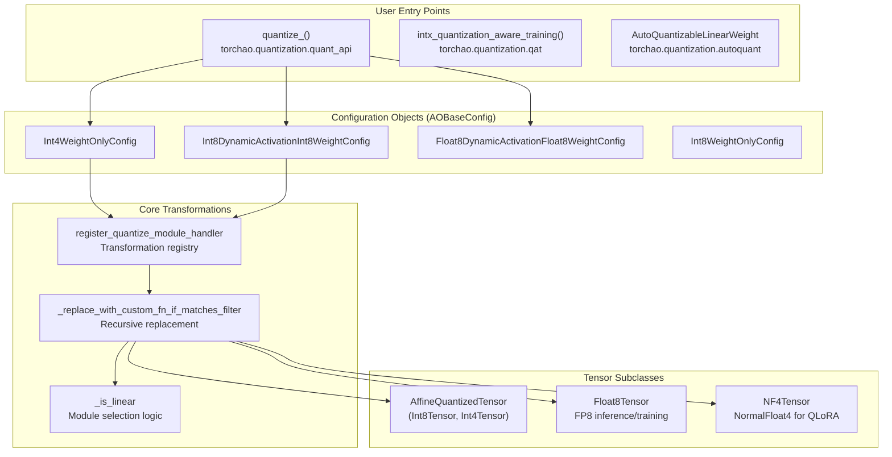

The `quantize_` function in [torchao/quantization/quant_api.py:115]() accepts a model and a configuration object. It uses `_replace_with_custom_fn_if_matches_filter` [torchao/quantization/quant_api.py:122-165]() to recursively traverse the module tree and apply transformations to modules that satisfy the `filter_fn` (usually `_is_linear` [torchao/quantization/quant_api.py:168-183]()).

Sources: [torchao/quantization/quant_api.py:111-214](), [torchao/quantization/__init__.py:72-131]()

## Quantization Workflows

### Post-Training Quantization Flow

The PTQ workflow converts standard high-precision weights into tensor subclasses that store quantized data and metadata.

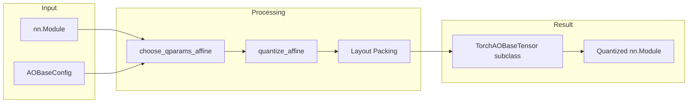

The workflow relies on quantization primitives defined in [torchao/quantization/quant_primitives.py](). `choose_qparams_affine` [torchao/quantization/quant_primitives.py:25]() calculates scales and zero points based on the `MappingType` [torchao/quantization/quant_primitives.py:55-78](). Then `quantize_affine` [torchao/quantization/quant_primitives.py:27]() performs the actual conversion. The resulting data is wrapped in a subclass like `Int4Tensor` or `Float8Tensor` [torchao/quantization/quantize_/workflows.py:53-65]().

Sources: [torchao/quantization/quant_primitives.py:25-52](), [torchao/quantization/quant_api.py:102-106]()

## Tensor Subclass Foundation

All quantized tensor types in TorchAO inherit from `TorchAOBaseTensor` [torchao/utils.py:30](). This framework allows quantized tensors to behave like standard `torch.Tensor` objects while intercepting operations (like `linear` or `matmul`) to dispatch to optimized kernels.

*   **`AffineQuantizedTensor`**: The base for affine quantization (Int8, Int4) [torchao/quantization/__init__.py:92-98]().
*   **`Float8Tensor`**: Implements FP8 inference and dynamic quantization [torchao/quantization/quantize_/workflows/float8/float8_tensor.py:84-155]().
*   **`NF4Tensor`**: Implements 4-bit NormalFloat for parameter-efficient fine-tuning [torchao/quantization/__init__.py:100]().

Sources: [torchao/utils.py:29-30](), [torchao/quantization/quantize_/workflows/float8/float8_tensor.py:84-155](), [torchao/quantization/__init__.py:91-101]()

## Hardware and Performance

TorchAO targets multiple backends with optimized kernels:
*   **CUDA**: Uses `_scaled_mm` and `safe_int_mm` [torchao/quantization/__init__.py:1-4]().
*   **CPU**: Supports AVX-512, AMX, and ARM (KleidiAI) [torchao/utils.py:39-40]().
*   **XPU**: Support for Intel accelerators [torchao/quantization/quant_api.py:75-77]().

Performance gains include up to **1.89x faster** inference and **58% less memory** for Llama-3-8B using int4 quantization [README.md:10]().

Sources: [README.md:7-11](), [torchao/utils.py:32-42](), [torchao/quantization/quant_api.py:70-79]()

## Related Pages

*   [Installation and Setup](#1.1) — Methods to install via pip, conda, or source.
*   [Core Concepts and Architecture](#1.2) — Deep dive into tensor subclasses and dispatch.
*   [Quickstart Guide](#1.3) — Minimal code snippets for PTQ, QAT, and Float8.
*   [Ecosystem Integrations](#1.4) — Details on HuggingFace, vLLM, and ExecuTorch support.

---

# Page: Installation and Setup

# Installation and Setup

<details>
<summary>Relevant source files</summary>

The following files were used as context for generating this wiki page:

- [.github/scripts/validate_binaries.sh](.github/scripts/validate_binaries.sh)
- [.github/workflows/build_wheels_linux_aarch64.yml](.github/workflows/build_wheels_linux_aarch64.yml)
- [.github/workflows/build_wheels_linux_x86.yml](.github/workflows/build_wheels_linux_x86.yml)
- [.github/workflows/validate-binaries.yml](.github/workflows/validate-binaries.yml)
- [packaging/env_var_script_linux.sh](packaging/env_var_script_linux.sh)
- [packaging/post_build_script.sh](packaging/post_build_script.sh)
- [packaging/pre_build_script.sh](packaging/pre_build_script.sh)
- [packaging/smoke_test.py](packaging/smoke_test.py)
- [scripts/test_torch_version_torchao_version_compatibility.sh](scripts/test_torch_version_torchao_version_compatibility.sh)
- [setup.py](setup.py)
- [test/smoke_tests/smoke_tests.py](test/smoke_tests/smoke_tests.py)
- [test/test_ops.py](test/test_ops.py)
- [torchao/__init__.py](torchao/__init__.py)
- [torchao/csrc/cpu/CMakeLists.txt](torchao/csrc/cpu/CMakeLists.txt)
- [torchao/csrc/cpu/README.md](torchao/csrc/cpu/README.md)
- [torchao/csrc/cpu/aten_kernels/da8w4_linear.cpp](torchao/csrc/cpu/aten_kernels/da8w4_linear.cpp)
- [torchao/csrc/cpu/aten_kernels/float8_linear.cpp](torchao/csrc/cpu/aten_kernels/float8_linear.cpp)
- [torchao/csrc/cpu/aten_kernels/quantized_sdpa.cpp](torchao/csrc/cpu/aten_kernels/quantized_sdpa.cpp)
- [torchao/csrc/cpu/aten_kernels/scaled_embedding_bag.cpp](torchao/csrc/cpu/aten_kernels/scaled_embedding_bag.cpp)
- [torchao/csrc/cpu/aten_kernels/utils.h](torchao/csrc/cpu/aten_kernels/utils.h)
- [torchao/csrc/cpu/shared_kernels/Utils.cmake](torchao/csrc/cpu/shared_kernels/Utils.cmake)
- [torchao/ops.py](torchao/ops.py)
- [torchao/prototype/inductor/qsdpa_lowering.py](torchao/prototype/inductor/qsdpa_lowering.py)
- [version.txt](version.txt)

</details>


This page covers installation methods, build configuration, hardware requirements, and environment setup for TorchAO. For information about using TorchAO's quantization APIs after installation, see **Quickstart Guide**. For detailed build system internals, see **Build System**.

---

## Installation Methods

TorchAO provides multiple installation paths depending on your hardware platform and development needs. The library supports CUDA, ROCm, Intel XPU, and CPU-only deployments.

### Stable Release Installation

The simplest installation method uses pip to install the latest stable release:

```bash
pip install torchao
```

This installs a pre-built wheel for your platform with default CUDA support if available. The versioning follows a prefix defined in `version.txt` [version.txt:1]().

### Platform-Specific Installation

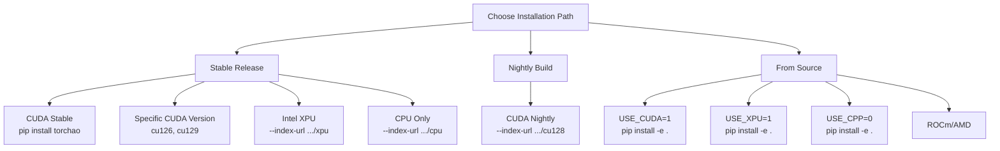

**Platform-Specific Installation Commands**

| Platform | Command |
|----------|---------|
| CUDA 12.6 | `pip install torchao --index-url https://download.pytorch.org/whl/cu126` |
| CUDA 12.9 | `pip install torchao --index-url https://download.pytorch.org/whl/cu129` |
| Intel XPU | `pip install torchao --index-url https://download.pytorch.org/whl/xpu` |
| CPU Only | `pip install torchao --index-url https://download.pytorch.org/whl/cpu` |
| Nightly (CUDA 12.8) | `pip install --pre torchao --index-url https://download.pytorch.org/whl/nightly/cu128` |

**Sources:** [setup.py:128-134](), [packaging/env_var_script_linux.sh:11-13]()

### Developer Installation (From Source)

For development or when pre-built wheels are unavailable, install from source. The build process uses `setup.py` to compile C++ and CUDA extensions [setup.py:19-20]().

```bash
# CUDA development
USE_CUDA=1 pip install -e . --no-build-isolation

# Intel XPU development
USE_XPU=1 pip install -e . --no-build-isolation

# Python-only mode (no C++ extensions)
USE_CPP=0 pip install -e . --no-build-isolation
```

The `--no-build-isolation` flag is **required** for source builds to ensure proper environment variable propagation to the `BuildOptions` class [setup.py:201-202]().

**Sources:** [setup.py:94-106](), [setup.py:201-213]()

---

## Build Configuration System

TorchAO's build system uses environment variables to control which components are compiled. The hierarchy determines which extensions are built:

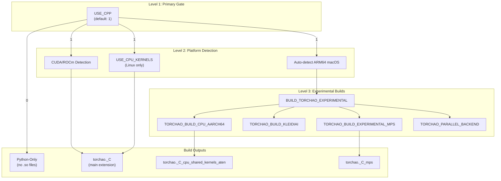

**Sources:** [setup.py:90-126](), [packaging/env_var_script_linux.sh:23-38]()

### Primary Build Variables

| Variable | Default | Description |
|----------|---------|-------------|
| `USE_CPP` | `1` | Master switch for C++ extensions. Set to `0` for Python-only mode [setup.py:95]() |
| `USE_CUDA` | Auto | Build CUDA kernels if CUDA toolkit detected [setup.py:142-148]() |
| `USE_CPU_KERNELS` | `0` | Enable optimized CPU kernels on Linux (AVX512, VNNI) [setup.py:96]() |
| `DEBUG` | `0` | Enable debug mode compilation [setup.py:137-138]() |

### Experimental Build Options

These options are available when `BUILD_TORCHAO_EXPERIMENTAL=1` or on ARM64 macOS [setup.py:103-104]():

| Variable | Default | Description | Requirements |
|----------|---------|-------------|--------------|
| `TORCHAO_BUILD_CPU_AARCH64` | ARM64 macOS | Build ARM64 CPU kernels | ARM64 machine [setup.py:207-213]() |
| `TORCHAO_BUILD_KLEIDIAI` | `0` | Build Kleidi AI library integration | `TORCHAO_BUILD_CPU_AARCH64=1` [setup.py:214-218]() |
| `TORCHAO_BUILD_EXPERIMENTAL_MPS` | `0` | Build MPS acceleration ops | macOS ARM64 with MPS [setup.py:122]() |
| `TORCHAO_ENABLE_ARM_NEON_DOT` | ARM64 macOS | Enable ARM NEON dot product | ARM64 CPU [setup.py:123]() |

---

## Hardware Requirements and Platform Support

### CUDA GPU Support

TorchAO targets modern CUDA architectures for specialized quantization kernels. For example, `TORCH_CUDA_ARCH_LIST` is often set to `8.0;8.6` and `9.0` for recent chips [packaging/env_var_script_linux.sh:17-20]().

**Kernel Availability by Architecture:**
- **SM80+ (Ampere)**: Int4 weight-only quantization.
- **SM89+ (Ada/Hopper)**: FP8 quantization support.
- **SM90+ (Hopper)**: CUTLASS-based sparse FP8 kernels.

### CPU Support

TorchAO includes high-performance CPU kernels for various quantization formats, particularly leveraging AVX-512 and VNNI on x86 [torchao/csrc/cpu/aten_kernels/utils.h:34-38]().

| Feature | x86-64 | ARM64 |
|---------|--------|-------|
| **Base support** | ✓ | ✓ |
| **AVX-512** | ✓ (via `kHasAVX512`) [utils.h:37]() | N/A |
| **Quantized SDPA** | ✓ [quantized_sdpa.cpp:42]() | ✓ |
| **Float8 Linear** | ✓ [float8_linear.cpp:123]() | ✓ |
| **Dynamic Int8/Int4** | ✓ [da8w4_linear.cpp:72]() | ✓ |

**Sources:** [torchao/csrc/cpu/aten_kernels/utils.h:34-38](), [torchao/csrc/cpu/aten_kernels/float8_linear.cpp:22-34]()

### ROCm/AMD GPU Support

ROCm support is detected via `ROCM_HOME` [setup.py:145](). It enables specific swizzling and matrix multiplication logic for AMD hardware [torchao/ops.py:20-24]().

---

## Version Compatibility

TorchAO .so files are built against specific PyTorch versions. Mismatched versions will cause the library to skip loading C++ extensions and operate in Python-only mode to prevent crashes [torchao/__init__.py:70-80]().

**Automatic Compatibility Detection:**

1. If `+git` is in the version, it's assumed to be a local build [torchao/__init__.py:70]().
2. Prebuilt versions check `torch.__version__` against a `min_torch_version` (e.g., `2.11.0`) [torchao/__init__.py:71-72]().
3. If incompatible, `skip_loading_so_files` is set to `True` [torchao/__init__.py:76]().
4. Users can override this with `TORCHAO_FORCE_SKIP_LOADING_SO_FILES=1` [torchao/__init__.py:53-60]().

**Sources:** [torchao/__init__.py:51-81]()

### Minimum Requirements

- **Python**: 3.10+ (hexcode `0x030A0000`) [setup.py:24]()
- **PyTorch**: Typically 2.11.0+ for full C++ extension support [torchao/__init__.py:72]()

---

## Extension Module Loading

After installation, TorchAO loads compiled extensions at import time by scanning for `_C*.so` files in the package directory [torchao/__init__.py:89]().

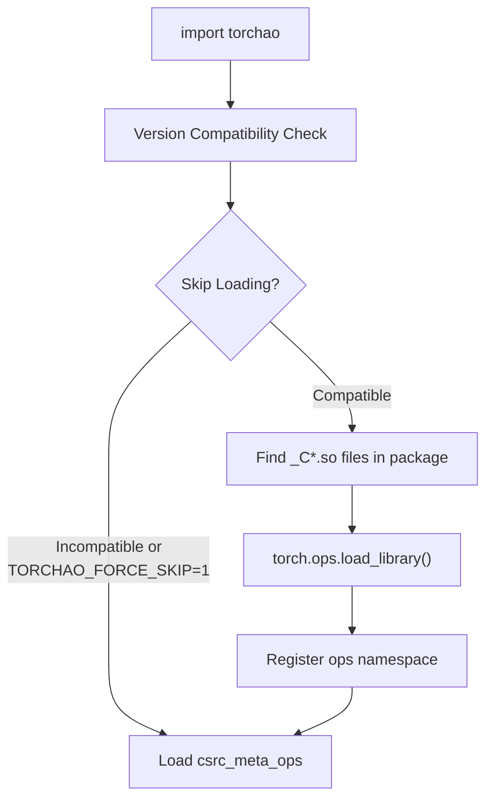

**Sources:** [torchao/__init__.py:82-100]()

---

## Environment Variables Reference

### Runtime Variables

| Variable | Effect | Default |
|----------|--------|---------|
| `TORCHAO_FORCE_SKIP_LOADING_SO_FILES` | Skip loading all .so files [torchao/__init__.py:53-55]() | `0` |

### Build-Time Variables

| Variable | Effect | Values |
|----------|--------|--------|
| `USE_CPP` | Master switch for C++ extensions [setup.py:95]() | `0`, `1` |
| `USE_CPU_KERNELS` | Enable optimized CPU kernels [setup.py:96]() | `0`, `1` |
| `TORCHAO_BUILD_CPU_AARCH64` | Build ARM64 kernels [setup.py:207]() | `0`, `1` |
| `TORCHAO_NIGHTLY` | Build as nightly version [setup.py:132]() | `1` |
| `DEBUG` | Enable debug symbols [setup.py:138]() | `0`, `1` |

---

## Verification Steps

After installation, verify TorchAO is working correctly:

### Check Version and Loaded Extensions

```python
import torchao
print(torchao.__version__) # [torchao/__init__.py:21]()

# Check if C++ extensions are registered
import torch
print("Quantized SDPA available:", "torchao::qscaled_dot_product" in dir(torch.ops.torchao)) # [torchao/ops.py:32]()
```

### Run Basic Quantization

```python
import torch
from torchao.quantization import quantize_, PerTensor # [test/test_ops.py:24]()

model = torch.nn.Linear(64, 64)
# Simple check: the quantize_ function should be available
from torchao import quantize_ # [torchao/__init__.py:108]()
print("Quantization API loaded.")
```

**Sources:** [torchao/__init__.py:21-23](), [torchao/ops.py:32-33](), [test/test_ops.py:24-25]()

---

# Page: Core Concepts and Architecture

# Core Concepts and Architecture

<details>
<summary>Relevant source files</summary>

The following files were used as context for generating this wiki page:

- [README.md](README.md)
- [test/core/test_config.py](test/core/test_config.py)
- [test/dtypes/test_affine_quantized_float.py](test/dtypes/test_affine_quantized_float.py)
- [test/integration/test_integration.py](test/integration/test_integration.py)
- [test/prototype/test_prototype_float8_tensor.py](test/prototype/test_prototype_float8_tensor.py)
- [test/quantization/quantize_/workflows/float8/test_float8_tensor.py](test/quantization/quantize_/workflows/float8/test_float8_tensor.py)
- [test/quantization/quantize_/workflows/float8/test_float8_tensor_mi300.py](test/quantization/quantize_/workflows/float8/test_float8_tensor_mi300.py)
- [test/quantization/test_quant_api.py](test/quantization/test_quant_api.py)
- [test/quantization/test_quant_primitives.py](test/quantization/test_quant_primitives.py)
- [test/test_utils.py](test/test_utils.py)
- [torchao/core/config.py](torchao/core/config.py)
- [torchao/dtypes/__init__.py](torchao/dtypes/__init__.py)
- [torchao/float8/inference.py](torchao/float8/inference.py)
- [torchao/prototype/dtypes/__init__.py](torchao/prototype/dtypes/__init__.py)
- [torchao/prototype/dtypes/uintx/__init__.py](torchao/prototype/dtypes/uintx/__init__.py)
- [torchao/prototype/hqq/hqq_tinygemm_linear.py](torchao/prototype/hqq/hqq_tinygemm_linear.py)
- [torchao/prototype/quantization/float8_static_quant/__init__.py](torchao/prototype/quantization/float8_static_quant/__init__.py)
- [torchao/prototype/quantization/float8_static_quant/prototype_float8_tensor.py](torchao/prototype/quantization/float8_static_quant/prototype_float8_tensor.py)
- [torchao/prototype/quantization/quant_api.py](torchao/prototype/quantization/quant_api.py)
- [torchao/quantization/README.md](torchao/quantization/README.md)
- [torchao/quantization/__init__.py](torchao/quantization/__init__.py)
- [torchao/quantization/qat/README.md](torchao/quantization/qat/README.md)
- [torchao/quantization/quant_api.py](torchao/quantization/quant_api.py)
- [torchao/quantization/quant_primitives.py](torchao/quantization/quant_primitives.py)
- [torchao/quantization/quantize_/common/kernel_preference.py](torchao/quantization/quantize_/common/kernel_preference.py)
- [torchao/quantization/quantize_/workflows/float8/float8_tensor.py](torchao/quantization/quantize_/workflows/float8/float8_tensor.py)
- [torchao/quantization/utils.py](torchao/quantization/utils.py)
- [torchao/testing/utils.py](torchao/testing/utils.py)
- [torchao/utils.py](torchao/utils.py)

</details>


## Purpose and Scope

This document explains the foundational concepts and architecture that power TorchAO's quantization system. It covers the fundamental mechanics of how PyTorch models are transformed, how quantized data is stored, and how operations are dispatched to optimized kernels.

- **Core Concept: Quantization** - Affine quantization primitives and mapping types.
- **The `quantize_` API** - The lifecycle of module transformation.
- **Tensor Subclass System** - `TorchAOBaseTensor` and its role in intercepting operations.
- **Layout and Granularity** - How memory organization and quantization scales are managed.
- **Dispatch Mechanisms** - Routing operations to hardware-optimized kernels like `_scaled_mm` or `_weight_int4pack_mm`.

---

## What is Quantization?

Quantization reduces the precision of tensor values to use less memory and enable faster computation. TorchAO primarily implements **affine quantization**, which maps floating-point values to lower-precision values.

**Key Quantization Concepts:**

| Concept | Description | Code Reference |
|---------|-------------|----------------|
| **MappingType** | Defines if the mapping is `SYMMETRIC` or `ASYMMETRIC`. | [torchao/quantization/quant_primitives.py:55-77]() |
| **ZeroPointDomain** | Specifies if the zero point is in the `INT` or `FLOAT` domain. | [torchao/quantization/quant_primitives.py:79-90]() |
| **Granularity** | How many values share quantization parameters (e.g., `PerTensor`, `PerRow`, `PerGroup`). | [torchao/quantization/granularity.py:6-14]() |
| **Scale & Zero Point** | The parameters derived from `choose_qparams_affine`. | [torchao/quantization/quant_primitives.py:25-51]() |

**Sources:** [torchao/quantization/quant_primitives.py:55-90](), [torchao/quantization/granularity.py:6-14]()

---

## High-Level Architecture Overview

TorchAO's architecture is built on three foundational layers that bridge high-level user configurations to low-level hardware kernels.

**Diagram: Architecture and Code Entity Mapping**
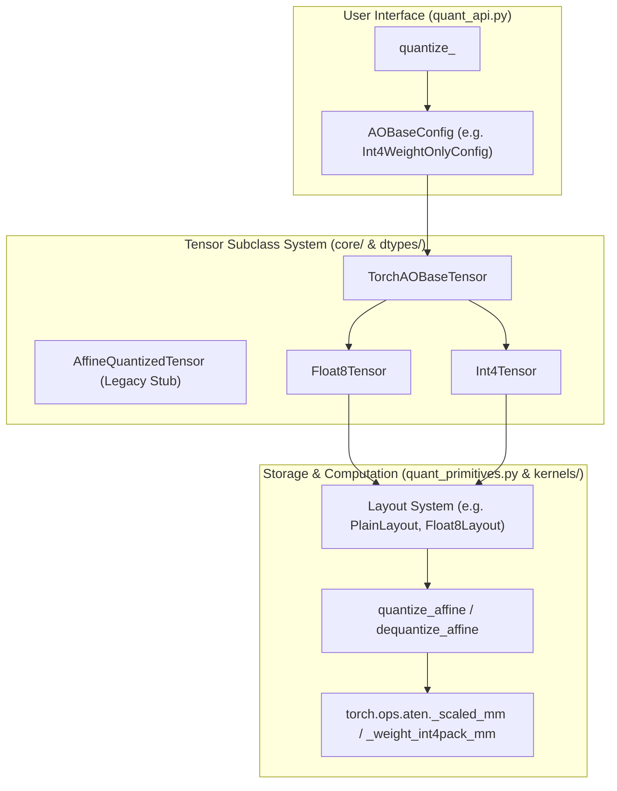

**Sources:** [torchao/quantization/quant_api.py:115-120](), [torchao/utils.py:30-35](), [torchao/core/config.py:34-34]()

---

## Tensor Subclass System

### TorchAOBaseTensor: The Foundation

`TorchAOBaseTensor` is the core base class for all custom tensor types in TorchAO. It provides the dispatch infrastructure that intercepts PyTorch operations using the `__torch_dispatch__` and `__torch_function__` protocols.

**Key Mechanisms:**
1. **`__torch_dispatch__`**: Intercepts ATen operations (e.g., `aten.mm`).
2. **`__torch_function__`**: Intercepts high-level PyTorch functions.
3. **Serialization**: Implements `__tensor_flatten__` and `__tensor_unflatten__` to allow `torch.compile` and `torch.export` to track the internal state (data, scales, etc.) of the quantized tensor.

**Sources:** [torchao/utils.py:29-30](), [torchao/quantization/quantize_/workflows/float8/float8_tensor.py:84-113]()

### Specialized Subclasses

TorchAO implements specific subclasses for different quantization formats:
- **`Int4Tensor`**: Optimized for 4-bit weight-only quantization. [torchao/quantization/quant_api.py:62-62]()
- **`Float8Tensor`**: Supports FP8 inference with dynamic or weight-only scaling. [torchao/quantization/quantize_/workflows/float8/float8_tensor.py:84-113]()
- **`NF4Tensor`**: NormalFloat4 for QLoRA workflows. [torchao/quantization/quantize_/workflows/int4/int4_tensor.py:61-61]()

---

## The `quantize_` Lifecycle

The `quantize_` function follows a specific lifecycle to transform a standard `nn.Module` into a quantized one.

**Diagram: quantize_ Transformation Lifecycle**
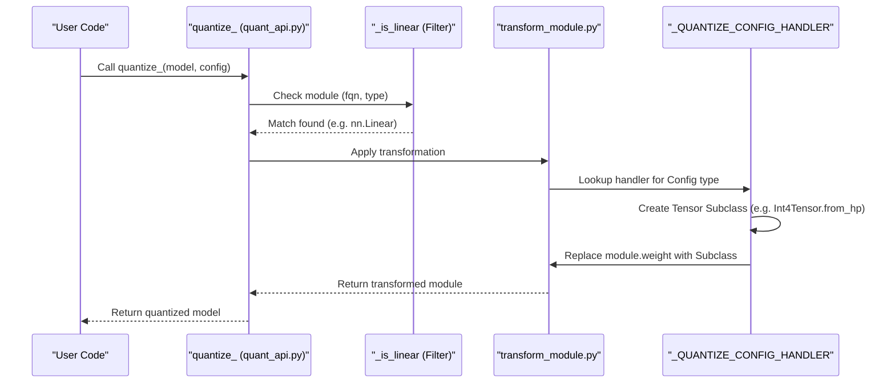

**Key Functions:**
- **`_replace_with_custom_fn_if_matches_filter`**: Recursively traverses the module tree. [torchao/quantization/quant_api.py:122-165]()
- **`register_quantize_module_handler`**: Allows developers to register custom logic for specific configurations. [torchao/quantization/transform_module.py:74-75]()

**Sources:** [torchao/quantization/quant_api.py:115-165](), [torchao/quantization/transform_module.py:72-75]()

---

## Layout and Granularity

### Layout System
Layouts control how data is packed and organized in memory. This is critical for hardware accelerators that require specific tiling or swizzling (e.g., NVIDIA Tensor Cores or ARM CPUs).
- **`PlainLayout`**: Standard contiguous storage.
- **`Int4TilePackedTo4dTensor`**: Specifically packed for 4-bit matmuls. [torchao/quantization/quant_api.py:63-63]()

### Granularity System
Granularity defines the scope of a single quantization scale.
- **`PerTensor`**: One scale for the entire tensor. [torchao/quantization/granularity.py:93-93]()
- **`PerRow` / `PerChannel`**: One scale per row/channel. [torchao/quantization/granularity.py:92-92]()
- **`PerGroup`**: Values are divided into groups (e.g., group_size=32), each with its own scale. [torchao/quantization/granularity.py:91-91]()

**Sources:** [torchao/quantization/granularity.py:88-94](), [torchao/quantization/quantize_/workflows/float8/float8_tensor.py:179-181]()

---

## Dispatch and Kernels

TorchAO intercepts standard operations and routes them to optimized custom operators.

**Diagram: Matmul Dispatch Flow**
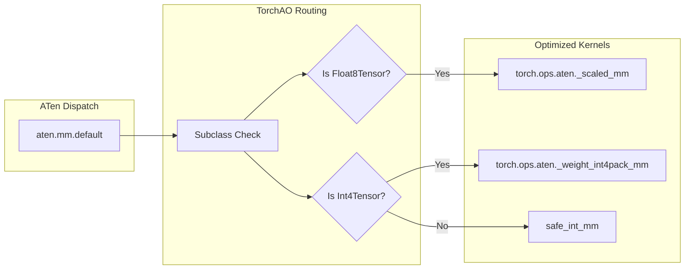

**Key Kernels:**
- **`_scaled_mm`**: Used for FP8 operations on H100+ hardware. [torchao/float8/inference.py:23-26]()
- **`safe_int_mm`**: A robust integer matrix multiplication wrapper. [torchao/quantization/__init__.py:3-3]()
- **`int_scaled_matmul`**: Handles scaling for integer matmuls. [torchao/quantization/__init__.py:2-2]()

**Sources:** [torchao/quantization/quant_api.py:37-43](), [torchao/quantization/__init__.py:1-4](), [torchao/quantization/quantize_/workflows/float8/float8_tensor.py:27-30]()

---

# Page: Quickstart Guide

# Quickstart Guide

<details>
<summary>Relevant source files</summary>

The following files were used as context for generating this wiki page:

- [README.md](README.md)
- [docs/source/api_reference/api_ref_prototype_attention.rst](docs/source/api_reference/api_ref_prototype_attention.rst)
- [docs/source/api_reference/index.rst](docs/source/api_reference/index.rst)
- [docs/source/eager_tutorials/first_quantization_example.rst](docs/source/eager_tutorials/first_quantization_example.rst)
- [docs/source/examples/prototype/low_precision_attention.py](docs/source/examples/prototype/low_precision_attention.py)
- [docs/source/workflows/index.md](docs/source/workflows/index.md)
- [test/integration/test_integration.py](test/integration/test_integration.py)
- [test/quantization/test_quant_api.py](test/quantization/test_quant_api.py)
- [test/quantization/test_quant_primitives.py](test/quantization/test_quant_primitives.py)
- [torchao/prototype/hqq/hqq_tinygemm_linear.py](torchao/prototype/hqq/hqq_tinygemm_linear.py)
- [torchao/quantization/README.md](torchao/quantization/README.md)
- [torchao/quantization/__init__.py](torchao/quantization/__init__.py)
- [torchao/quantization/qat/README.md](torchao/quantization/qat/README.md)
- [torchao/quantization/quant_api.py](torchao/quantization/quant_api.py)
- [torchao/quantization/quant_primitives.py](torchao/quantization/quant_primitives.py)
- [torchao/quantization/utils.py](torchao/quantization/utils.py)
- [tutorials/developer_api_guide/export_to_executorch.py](tutorials/developer_api_guide/export_to_executorch.py)
- [tutorials/developer_api_guide/my_dtype_tensor_subclass.py](tutorials/developer_api_guide/my_dtype_tensor_subclass.py)
- [tutorials/developer_api_guide/my_trainable_tensor_subclass.py](tutorials/developer_api_guide/my_trainable_tensor_subclass.py)
- [tutorials/developer_api_guide/tensor_parallel.py](tutorials/developer_api_guide/tensor_parallel.py)
- [tutorials/run_all.sh](tutorials/run_all.sh)

</details>


This guide provides quick examples of the most common TorchAO quantization workflows. It focuses on minimal code snippets to get you started quickly with Post-Training Quantization (PTQ), Quantization-Aware Training (QAT), and Float8 training.

For detailed API reference, see [Quantization API Reference](#2). For integration with external frameworks, see [Ecosystem Integrations](#1.4). For in-depth workflow documentation, see [Performance and Benchmarking](#11).

---

## Overview: Quantization Workflow

The following diagram shows how TorchAO transforms a standard PyTorch model into a quantized model:

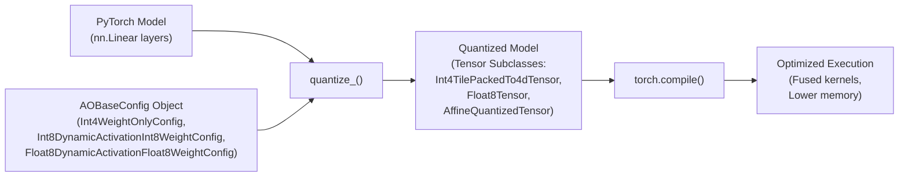

Sources: [torchao/quantization/quant_api.py:431-504](), [README.md:61-80](), [torchao/core/config.py:10-25]()

---

## Post-Training Quantization (PTQ)

PTQ quantizes a pre-trained model without retraining. This is the simplest and fastest quantization method in TorchAO.

### Int4 Weight-Only Quantization

Int4 weight-only quantization reduces memory by 75% and provides significant speedups for inference:

```python
import torch
from torchao.quantization import quantize_, Int4WeightOnlyConfig

# Load your model
model = torch.nn.Sequential(
    torch.nn.Linear(1024, 512),
    torch.nn.Linear(512, 256)
)

# Quantize model weights to int4
# Recommended for CUDA: tile_packed_to_4d
quantize_(model, Int4WeightOnlyConfig(group_size=32, int4_packing_format="tile_packed_to_4d"))

# Run inference
input = torch.randn(1, 1024)
output = model(input)

# Optional: compile for better performance
model = torch.compile(model, mode="max-autotune")
```

**Key Parameters:**
- `group_size`: Granularity of quantization (32, 64, 128, 256). Smaller = finer granularity, larger accuracy preservation. [torchao/quantization/quant_api.py:840-845]()
- `int4_packing_format`: Packing format for different hardware targets (see table below). [torchao/quantization/quant_api.py:847-850]()
- `int4_choose_qparams_algorithm`: Algorithm for choosing quantization parameters (`"tinygemm"` or `"hqq"`). [torchao/quantization/quant_api.py:852-855]()

| Target Hardware | Recommended `int4_packing_format` |
|----------------|-----------------------------------|
| CUDA GPUs | `"tile_packed_to_4d"` |
| CPU (x86) | `"plain_int32"` |
| Intel XPU | `"plain_int32"` |

Sources: [torchao/quantization/quant_api.py:742-863](), [README.md:68-78](), [test/quantization/test_quant_api.py:362-398]()

### Int8 Dynamic Activation + Int8 Weight Quantization

Int8 dynamic quantization provides a balance between speed and accuracy by quantizing activations at runtime:

```python
from torchao.quantization import quantize_, Int8DynamicActivationInt8WeightConfig

model = torch.nn.Sequential(
    torch.nn.Linear(1024, 512),
    torch.nn.Linear(512, 256)
)

# Quantize both weights and activations to int8
quantize_(model, Int8DynamicActivationInt8WeightConfig())

# Activations are quantized dynamically at runtime
output = model(torch.randn(1, 1024))
```

Sources: [torchao/quantization/quant_api.py:1158-1232](), [test/integration/test_integration.py:111-122]()

### Float8 Dynamic Quantization (Inference)

Float8 quantization for inference requires SM 8.9+ GPUs (Ada, Hopper, Blackwell):

```python
from torchao.quantization import (
    quantize_,
    Float8DynamicActivationFloat8WeightConfig,
    PerRow
)

model = torch.nn.Sequential(
    torch.nn.Linear(1024, 512),
    torch.nn.Linear(512, 256)
).to("cuda").to(torch.bfloat16)

# Quantize with per-row scaling for better accuracy
quantize_(
    model,
    Float8DynamicActivationFloat8WeightConfig(granularity=PerRow())
)

output = model(torch.randn(1, 1024, device="cuda", dtype=torch.bfloat16))
```

**Granularity Options:**
- `PerTensor()`: Single scale for entire tensor (fastest). [torchao/quantization/granularity.py:27-32]()
- `PerRow()`: Per-row scaling (better accuracy). [torchao/quantization/granularity.py:34-39]()

Sources: [torchao/quantization/quant_api.py:1234-1300](), [test/quantization/test_quant_api.py:402-413]()

---

## PTQ Workflow Diagram

This diagram maps the natural language "Quantize to Int4" to specific code entities in the `quant_api.py` and tensor subclass layers.

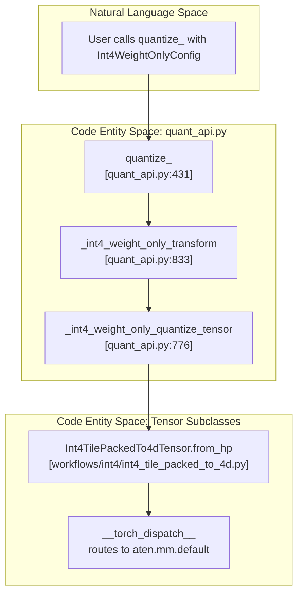

Sources: [torchao/quantization/quant_api.py:431-504](), [torchao/quantization/quant_api.py:776-863]()

---

## Quantization-Aware Training (QAT)

QAT simulates quantization during training to recover accuracy lost from PTQ. It uses a prepare-train-convert workflow.

```python
import torch
from torchao.quantization import (
    quantize_,
    Int8DynamicActivationIntxWeightConfig,
    PerGroup
)
from torchao.quantization.qat import QATConfig

# 1. Define base quantization config
base_config = Int8DynamicActivationIntxWeightConfig(
    weight_dtype=torch.int4,
    weight_granularity=PerGroup(32),
)

# 2. Prepare model for QAT (inserts fake quantization)
model = torch.nn.Sequential(
    torch.nn.Linear(1024, 512),
    torch.nn.Linear(512, 256)
)
quantize_(model, QATConfig(base_config, step="prepare"))

# 3. Train model normally (fake quantization is active)
# The Straight-Through Estimator (STE) handles gradients
optimizer = torch.optim.Adam(model.parameters(), lr=1e-4)
# ... training loop ...

# 4. Convert to actual quantized model
quantize_(model, QATConfig(base_config, step="convert"))

# 5. Use quantized model for inference
output = model(torch.randn(1, 1024))
```

**QAT Benefits:**
- Recovers accuracy degradation from PTQ. [README.md:9-10]()
- Essential for low-bit quantization (int4 and below).
- Integrated with `Straight-Through Estimator` (STE) for gradient flow. [torchao/quantization/quant_primitives.py:225-235]()

Sources: [README.md:184-203](), [torchao/quantization/qat/README.md:1-6](), [test/quantization/test_quant_api.py:1028-1047]()

### QAT Workflow Diagram

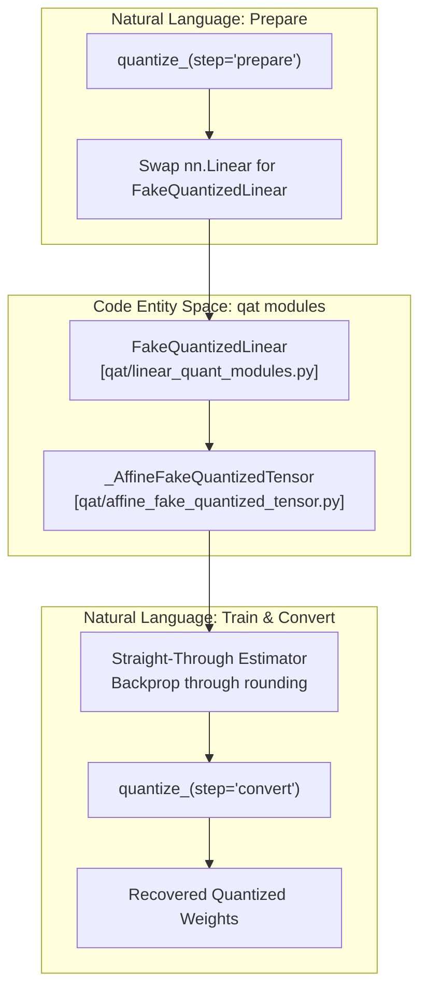

Sources: [torchao/quantization/qat/__init__.py:1-26](), [test/quantization/test_quant_api.py:1028-1047](), [torchao/quantization/quant_primitives.py:225-235]()

---

## Float8 Training

Float8 training reduces memory and increases training speed by using FP8 for GEMMs in both forward and backward passes.

```python
import torch
from torchao.float8 import convert_to_float8_training

# Create model
model = torch.nn.Sequential(
    torch.nn.Linear(1024, 512),
    torch.nn.Linear(512, 256)
).to("cuda")

# Convert to float8 training
convert_to_float8_training(model)

# Train normally - forward/backward passes use FP8
optimizer = torch.optim.Adam(model.parameters())
# ... training loop ...
```

**Float8 Training Features:**
- Dynamic scaling of activations, weights, and gradients.
- Support for FSDP2 and Tensor Parallelism. [README.md:43-45]()
- Requires SM 8.9+ hardware. [torchao/utils.py:85-86]()

Sources: [README.md:210-221](), [torchao/float8/float8_linear.py]()

---

## Configuration Reference Table

| Config Class | Use Case | Weight Precision | Activation Precision | Hardware |
|--------------|----------|------------------|----------------------|----------|
| `Int4WeightOnlyConfig` | Inference, memory reduction | int4 | float16/bfloat16 | CUDA, CPU, XPU |
| `Int8WeightOnlyConfig` | Inference, balanced | int8 | float16/bfloat16 | CUDA, CPU, XPU |
| `Int8DynamicActivationInt8WeightConfig` | Inference, speed | int8 | int8 (dynamic) | CUDA, CPU, XPU |
| `Int8DynamicActivationIntxWeightConfig` | Inference, flexible | int1-8 | int8 (dynamic) | CUDA, CPU |
| `Float8WeightOnlyConfig` | Inference, high precision | float8 | float16/bfloat16 | SM 8.9+ |
| `Float8DynamicActivationFloat8WeightConfig` | Inference, best FP8 | float8 | float8 (dynamic) | SM 8.9+ |
| `QATConfig` | Training-aware quantization | Configurable | Configurable | CUDA, CPU |

Sources: [torchao/quantization/__init__.py:54-75](), [torchao/quantization/quant_api.py:742-1300]()

---

## Using torch.compile for Performance

For best performance, always apply `torch.compile` after quantization. TorchAO primitives are designed to fuse efficiently within the Inductor compiler. [torchao/quantization/quant_api.py:11-16]()

```python
from torchao.quantization import quantize_, Int4WeightOnlyConfig

model = torch.nn.Sequential(...)
quantize_(model, Int4WeightOnlyConfig(group_size=32))

# Compile for optimized execution
model = torch.compile(model, mode="max-autotune")

# First run triggers compilation
output = model(input)
```

Sources: [torchao/quantization/quant_api.py:11-16](), [README.md:55]()

---

# Page: Ecosystem Integrations

# Ecosystem Integrations

<details>
<summary>Relevant source files</summary>

The following files were used as context for generating this wiki page:

- [docs/source/contributing/contributor_guide.rst](docs/source/contributing/contributor_guide.rst)
- [docs/source/contributing/index.rst](docs/source/contributing/index.rst)
- [docs/source/contributing/quantization_overview.rst](docs/source/contributing/quantization_overview.rst)
- [docs/source/contributing/sparsity.rst](docs/source/contributing/sparsity.rst)
- [docs/source/eager_tutorials/finetuning.rst](docs/source/eager_tutorials/finetuning.rst)
- [docs/source/eager_tutorials/pretraining.rst](docs/source/eager_tutorials/pretraining.rst)
- [docs/source/eager_tutorials/serialization.rst](docs/source/eager_tutorials/serialization.rst)
- [docs/source/eager_tutorials/serving.rst](docs/source/eager_tutorials/serving.rst)
- [docs/source/eager_tutorials/static_quantization.rst](docs/source/eager_tutorials/static_quantization.rst)
- [docs/source/eager_tutorials/subclass_advanced.rst](docs/source/eager_tutorials/subclass_advanced.rst)
- [docs/source/eager_tutorials/subclass_basic.rst](docs/source/eager_tutorials/subclass_basic.rst)
- [docs/source/eager_tutorials/torchao_hf_integration.md](docs/source/eager_tutorials/torchao_hf_integration.md)
- [docs/source/eager_tutorials/torchao_vllm_integration.md](docs/source/eager_tutorials/torchao_vllm_integration.md)
- [docs/source/pt2e_quantization/pt2e_quant_openvino_inductor.rst](docs/source/pt2e_quantization/pt2e_quant_openvino_inductor.rst)
- [docs/source/pt2e_quantization/pt2e_quant_ptq.rst](docs/source/pt2e_quantization/pt2e_quant_ptq.rst)
- [docs/source/pt2e_quantization/pt2e_quant_qat.rst](docs/source/pt2e_quantization/pt2e_quant_qat.rst)
- [docs/source/pt2e_quantization/pt2e_quant_x86_inductor.rst](docs/source/pt2e_quantization/pt2e_quant_x86_inductor.rst)
- [docs/source/pt2e_quantization/pt2e_quantizer.rst](docs/source/pt2e_quantization/pt2e_quantizer.rst)
- [test/integration/test_load_and_run_checkpoint.py](test/integration/test_load_and_run_checkpoint.py)
- [test/prototype/moe_training/test_fp8_grouped_mm.py](test/prototype/moe_training/test_fp8_grouped_mm.py)
- [test/prototype/safetensors/test_safetensors_support.py](test/prototype/safetensors/test_safetensors_support.py)
- [test/prototype/safetensors/test_safetensors_utils.py](test/prototype/safetensors/test_safetensors_utils.py)
- [test/prototype/test_autoround.py](test/prototype/test_autoround.py)
- [torchao/prototype/autoround/README.md](torchao/prototype/autoround/README.md)
- [torchao/prototype/autoround/core.py](torchao/prototype/autoround/core.py)
- [torchao/prototype/autoround/eval_autoround.py](torchao/prototype/autoround/eval_autoround.py)
- [torchao/prototype/safetensors/__init__.py](torchao/prototype/safetensors/__init__.py)
- [torchao/prototype/safetensors/safetensors_support.py](torchao/prototype/safetensors/safetensors_support.py)
- [torchao/prototype/safetensors/safetensors_utils.py](torchao/prototype/safetensors/safetensors_utils.py)

</details>


TorchAO is designed to work seamlessly with leading open-source frameworks for model training, serving, and deployment. This document covers integrations with HuggingFace, vLLM, ExecuTorch, TorchTune, and TorchTitan, as well as serialization formats like `safetensors`.

## HuggingFace Integration

TorchAO integrates with HuggingFace `transformers` via the `TorchAoConfig` class, which allows users to apply quantization during model loading. The integration supports various bit-widths and formats, including `int4`, `int8`, and `float8`.

### Checkpoint Loading and Compatibility
TorchAO maintains a suite of integration tests to ensure that quantized models can be loaded from HuggingFace Hub without breaking changes across library versions.

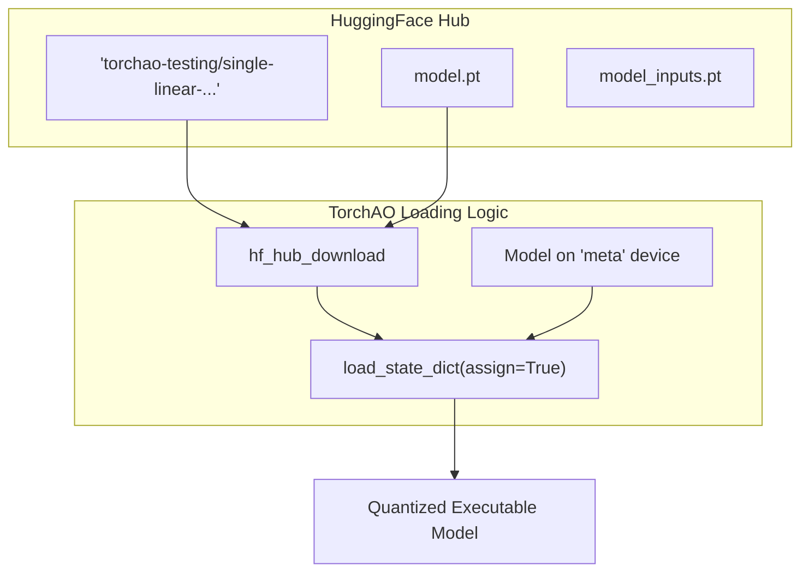
*   **BC Stability**: The `TestLoadAndRunCheckpoint` class verifies that models quantized with older versions of `Int4WeightOnlyConfig` or `Float8DynamicActivationFloat8WeightConfig` remain functional [test/integration/test_load_and_run_checkpoint.py:75-125]().
*   **Automatic Quantization**: `TorchAoConfig` (referenced in tutorials) maps HuggingFace parameters to `quantize_` calls [docs/source/eager_tutorials/serving.rst:14-18]().

**Sources**: [test/integration/test_load_and_run_checkpoint.py:31-62](), [docs/source/eager_tutorials/serving.rst:14-18]()

## vLLM and Serving

vLLM leverages TorchAO's optimized kernels to provide throughput improvements and VRAM reduction.

*   **Float8 Serving**: Using `float8` dynamic quantization in vLLM can result in ~36% VRAM reduction and 1.15x-1.2x speedup on H100 hardware [docs/source/eager_tutorials/serving.rst:54-55]().
*   **Kernel Integration**: vLLM automatically detects TorchAO-quantized models and dispatches to optimized kernels for inference [docs/source/eager_tutorials/serving.rst:26-34]().

**Sources**: [docs/source/eager_tutorials/serving.rst:23-58]()

## ExecuTorch and Mobile Deployment

For mobile and edge devices, TorchAO provides specialized quantization schemes that integrate with the ExecuTorch runtime.

*   **Mobile-Optimized Configs**: The `Int8DynamicActivationIntxWeightConfig` (8da4w) is specifically designed for mobile deployment via ExecuTorch [docs/source/eager_tutorials/serving.rst:116-120]().
*   **Weight Untying**: For models like Phi-4, TorchAO supports untying embedding weights from the `lm_head` to allow different quantization granularities for each, which is critical for maintaining accuracy on mobile [docs/source/eager_tutorials/serving.rst:121-160]().

**Sources**: [docs/source/eager_tutorials/serving.rst:116-178]()

## TorchTune and TorchTitan (Training)

TorchAO provides the underlying quantization and sparsity engines for PyTorch's primary training libraries.

### TorchTitan (Pre-training)
TorchTitan uses `torchao.float8` recipes to accelerate large-scale pre-training.
*   **Rowwise Scaling**: Prioritizes numerical stability and accuracy [docs/source/eager_tutorials/pretraining.rst:44-87]().
*   **Tensorwise Scaling**: Prioritizes throughput, achieving up to 1.21x speedup over bfloat16 baselines [docs/source/eager_tutorials/pretraining.rst:88-108]().

### TorchTune (Fine-tuning)
TorchTune integrates TorchAO for QAT and QLoRA workflows.
*   **QAT Workflow**: Uses the `prepare` and `convert` steps to simulate quantization during fine-tuning [docs/source/eager_tutorials/finetuning.rst:33-52]().
*   **QLoRA**: Reduces memory requirements by combining TorchAO's 4-bit quantization with low-rank adapters [docs/source/eager_tutorials/finetuning.rst:22-27]().

**Sources**: [docs/source/eager_tutorials/pretraining.rst:21-115](), [docs/source/eager_tutorials/finetuning.rst:16-52]()

## Serialization with Safetensors

TorchAO provides specialized support for the `safetensors` format to handle the complex state of tensor subclasses (e.g., weights, scales, and zero-points).

### Flattening and Unflattening Logic
Because `safetensors` only supports standard `torch.Tensor` types, TorchAO must "flatten" its subclasses into multiple tensors and metadata.

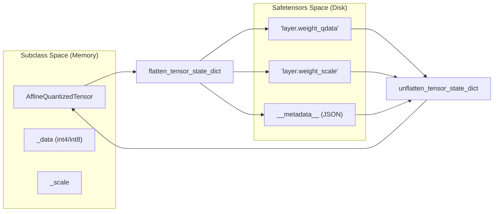

*   **`flatten_tensor_state_dict`**: Deconstructs a subclass into a dictionary of raw tensors and a JSON-encoded metadata string [torchao/prototype/safetensors/safetensors_support.py:117-164]().
*   **`unflatten_tensor_state_dict`**: Reconstructs the original subclass using the metadata and the raw tensors [torchao/prototype/safetensors/safetensors_support.py:16-62]().
*   **Supported Subclasses**: Includes `Float8Tensor`, `Int4Tensor`, `Int8Tensor`, `MXTensor`, and `NVFP4Tensor` [torchao/prototype/safetensors/safetensors_utils.py:51-60]().

**Sources**: [torchao/prototype/safetensors/safetensors_support.py:16-190](), [torchao/prototype/safetensors/safetensors_utils.py:30-60](), [test/prototype/safetensors/test_safetensors_support.py:94-129]()

## Partner Frameworks (Unsloth & Axolotl)

TorchAO is integrated into popular fine-tuning wrappers to provide QAT capabilities.

| Framework | Integration Detail | Command/API |
| :--- | :--- | :--- |
| **Unsloth** | LoRA + QAT integration | `qat_scheme="int4"` in `get_peft_model` |
| **Axolotl** | FSDP2 + QAT recipes | `axolotl train llama-3-qat.yaml` |

**Sources**: [docs/source/eager_tutorials/finetuning.rst:61-135]()

## Auto-Round Integration

Auto-Round is a calibration-based algorithm for low-bit LLM inference integrated into TorchAO's prototype namespace.

*   **Workflow**:
    1.  **Prepare**: `prepare_model_for_applying_auto_round_` inserts hooks and wraps parameters in `MultiTensor` [torchao/prototype/autoround/core.py:84-110]().
    2.  **Optimize**: Run forward passes with calibration data to tune rounding values [torchao/prototype/autoround/README.md:71-79]().
    3.  **Finalize**: `quantize_(model, apply_auto_round())` converts optimized weights to `AffineQuantizedTensor` [torchao/prototype/autoround/README.md:80-88]().
*   **MultiTensor**: Used to track calibration data across multiple batches without immediate memory overhead [torchao/prototype/autoround/core.py:124-126]().

**Sources**: [torchao/prototype/autoround/core.py:84-165](), [torchao/prototype/autoround/README.md:36-88](), [test/prototype/test_autoround.py:96-132]()

---

# Page: Quantization API Reference

# Quantization API Reference

<details>
<summary>Relevant source files</summary>

The following files were used as context for generating this wiki page:

- [README.md](README.md)
- [test/integration/test_integration.py](test/integration/test_integration.py)
- [test/quantization/pt2e/test_learnable_fake_quantize.py](test/quantization/pt2e/test_learnable_fake_quantize.py)
- [test/quantization/test_observer.py](test/quantization/test_observer.py)
- [test/quantization/test_quant_api.py](test/quantization/test_quant_api.py)
- [test/quantization/test_quant_primitives.py](test/quantization/test_quant_primitives.py)
- [torchao/prototype/hqq/hqq_tinygemm_linear.py](torchao/prototype/hqq/hqq_tinygemm_linear.py)
- [torchao/quantization/README.md](torchao/quantization/README.md)
- [torchao/quantization/__init__.py](torchao/quantization/__init__.py)
- [torchao/quantization/granularity.py](torchao/quantization/granularity.py)
- [torchao/quantization/observer.py](torchao/quantization/observer.py)
- [torchao/quantization/pt2e/__init__.py](torchao/quantization/pt2e/__init__.py)
- [torchao/quantization/pt2e/_affine_quantization.py](torchao/quantization/pt2e/_affine_quantization.py)
- [torchao/quantization/pt2e/learnable_fake_quantize.py](torchao/quantization/pt2e/learnable_fake_quantize.py)
- [torchao/quantization/pt2e/observer.py](torchao/quantization/pt2e/observer.py)
- [torchao/quantization/qat/README.md](torchao/quantization/qat/README.md)
- [torchao/quantization/quant_api.py](torchao/quantization/quant_api.py)
- [torchao/quantization/quant_primitives.py](torchao/quantization/quant_primitives.py)
- [torchao/quantization/utils.py](torchao/quantization/utils.py)

</details>


This document describes TorchAO's primary quantization API and configuration system. The `quantize_()` function serves as the main entry point for applying quantization to PyTorch models, accepting configuration objects that specify how quantization should be performed. This system provides a unified interface for weight-only, dynamic activation, static activation, and quantization-aware training workflows.

For details on specific topics, see the following child pages:
- [quantize_ Function](#2.1) — Detailed documentation of the main entry point and its parameters.
- [Configuration System (AOBaseConfig)](#2.2) — Reference for all available quantization configuration classes.
- [Quantization Primitives](#2.3) — Low-level mathematical functions for affine quantization.
- [Module Handler Registration](#2.4) — How to extend the system with custom module transformations.
- [Autoquantization](#2.5) — Automated benchmarking and selection of optimal configurations.
- [GPTQ Quantization](#2.6) — Advanced second-order quantization for improved accuracy.

## System Architecture

The quantization API is built on three primary components: the `quantize_()` function, a hierarchy of configuration classes derived from `AOBaseConfig`, and a handler registration system that maps configurations to transformation functions.

### Architecture Overview: Config to Handler Mapping

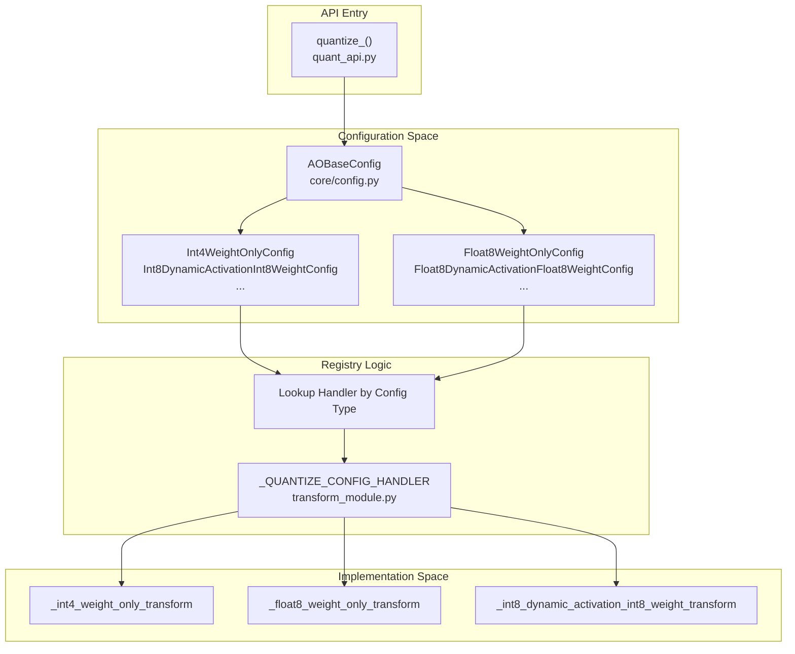

**Sources:** [torchao/quantization/quant_api.py:115-119](), [torchao/quantization/transform_module.py:72-75](), [torchao/core/config.py:34-34]()

## The quantize_() Function

The `quantize_()` function is the primary user-facing API. it modifies a model in-place by replacing linear weights with quantized tensor subclasses. It uses a recursive replacement strategy to traverse the module tree.

**Function Signature:**
```python
def quantize_(
    model: torch.nn.Module,
    config: AOBaseConfig,
    filter_fn: Optional[Callable[[torch.nn.Module, str], bool]] = None,
    device: Optional[torch.types.Device] = None,
) -> None
```

**Workflow:**
1. It identifies the appropriate handler from the `_QUANTIZE_CONFIG_HANDLER` registry based on the provided `config` type [torchao/quantization/quant_api.py:511-512]().
2. It uses `_replace_with_custom_fn_if_matches_filter` to traverse the model [torchao/quantization/quant_api.py:534-540]().
3. For every module where `filter_fn` is true, it applies the transformation [torchao/quantization/quant_api.py:145-149]().

**Sources:** [torchao/quantization/quant_api.py:476-540](), [torchao/quantization/quant_api.py:122-165]()

## Configuration System (AOBaseConfig)

Configurations in TorchAO are structured as dataclasses inheriting from `AOBaseConfig`. These objects encapsulate all hyperparameters needed for a specific quantization strategy, such as group size, mapping types, and hardware-specific layouts.

### Core Configuration Entities

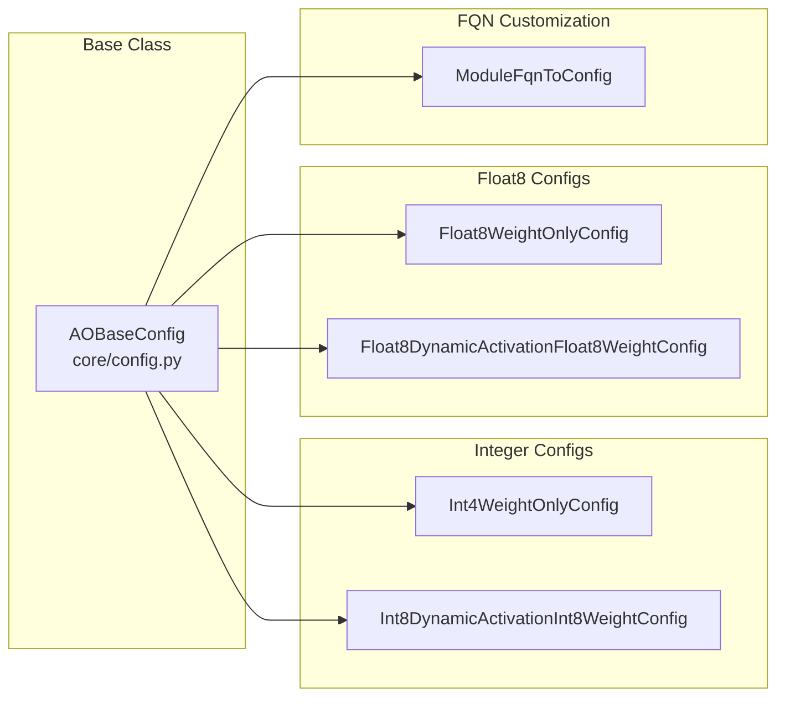

For details on specific parameters for each class, see [Configuration System (AOBaseConfig)](#2.2).

**Sources:** [torchao/quantization/quant_api.py:37-49](), [torchao/quantization/quant_api.py:602-626](), [torchao/quantization/quant_api.py:2133-2159]()

## Quantization Primitives

Primitives are the low-level building blocks used by handlers. They include functions like `choose_qparams_affine`, `quantize_affine`, and `dequantize_affine`. These functions support various `MappingType` (Symmetric/Asymmetric) and `ZeroPointDomain` (INT/FLOAT/NONE) settings.

**Key Primitives:**
- `choose_qparams_affine`: Calculates scale and zero point [torchao/quantization/quant_primitives.py:25-25]().
- `quantize_affine`: Converts a float tensor to a quantized integer/float representation [torchao/quantization/quant_primitives.py:27-27]().
- `dequantize_affine`: Recovers floating point approximations from quantized values [torchao/quantization/quant_primitives.py:28-28]().

For details, see [Quantization Primitives](#2.3).

**Sources:** [torchao/quantization/quant_primitives.py:55-90](), [torchao/quantization/quant_primitives.py:103-106]()

## Module Handler Registration

The system is extensible via `register_quantize_module_handler`. This allows developers to define how a specific `AOBaseConfig` should transform a standard `nn.Module`.

**Registry:** `_QUANTIZE_CONFIG_HANDLER` stores the mapping between config classes and their transformation functions [torchao/quantization/transform_module.py:73-73]().

For details on implementing new handlers, see [Module Handler Registration](#2.4).

**Sources:** [torchao/quantization/transform_module.py:72-75]()

## Autoquantization and GPTQ

TorchAO provides advanced workflows for optimizing model performance and accuracy:

- **Autoquantization**: Automatically benchmarks different quantization configurations (e.g., int8 vs int4) on the user's specific hardware and selects the fastest one for each layer. For details, see [Autoquantization](#2.5).
- **GPTQ**: A post-training quantization method that uses second-order information (Hessian-based) to minimize the error of quantized weights. For details, see [GPTQ Quantization](#2.6).

**Sources:** [torchao/quantization/quant_api.py:58-62](), [torchao/quantization/quant_api.py:96-101]()

---

# Page: quantize_ Function

# quantize_ Function

<details>
<summary>Relevant source files</summary>

The following files were used as context for generating this wiki page:

- [README.md](README.md)
- [test/integration/test_integration.py](test/integration/test_integration.py)
- [test/quantization/test_quant_api.py](test/quantization/test_quant_api.py)
- [test/quantization/test_quant_primitives.py](test/quantization/test_quant_primitives.py)
- [torchao/prototype/hqq/hqq_tinygemm_linear.py](torchao/prototype/hqq/hqq_tinygemm_linear.py)
- [torchao/quantization/README.md](torchao/quantization/README.md)
- [torchao/quantization/__init__.py](torchao/quantization/__init__.py)
- [torchao/quantization/qat/README.md](torchao/quantization/qat/README.md)
- [torchao/quantization/quant_api.py](torchao/quantization/quant_api.py)
- [torchao/quantization/quant_primitives.py](torchao/quantization/quant_primitives.py)
- [torchao/quantization/utils.py](torchao/quantization/utils.py)

</details>


## Purpose and Scope

The `quantize_` function is the primary entrypoint for applying quantization to PyTorch models in TorchAO. It performs in-place modification of model weights and/or modules according to a provided configuration object, enabling users to quantize models with a single function call. The API is designed to work seamlessly with `torch.compile` to access optimized kernels.

For information about:
- The configuration classes that `quantize_` accepts, see [Configuration System (AOBaseConfig)](./2.2)
- The handler registration mechanism used internally, see [Module Handler Registration](./2.4)
- Autoquantization workflows, see [Autoquantization](./2.5)
- GPTQ-based quantization, see [GPTQ Quantization](./2.6)

Sources: [torchao/quantization/quant_api.py:7-16](), [torchao/quantization/quant_api.py:476-540]()

## Function Signature

```python
def quantize_(
    model: torch.nn.Module,
    config: AOBaseConfig,
    filter_fn: Optional[Callable[[torch.nn.Module, str], bool]] = None,
    device: Optional[torch.types.Device] = None,
) -> None
```

**Parameters:**

| Parameter | Type | Description |
|-----------|------|-------------|
| `model` | `torch.nn.Module` | Input model to be quantized (modified in-place) |
| `config` | `AOBaseConfig` | Configuration object specifying quantization workflow |
| `filter_fn` | `Optional[Callable]` | Function that takes `(module, fqn)` and returns `True` if the module should be quantized. If `None`, defaults to `_is_linear` |
| `device` | `Optional[torch.types.Device]` | Device to move modules to before quantization. Final model will remain on this device |

**Returns:** `None` (model is modified in-place)

Sources: [torchao/quantization/quant_api.py:476-540](), [torchao/quantization/quant_api.py:115-115]()

## Core Workflow

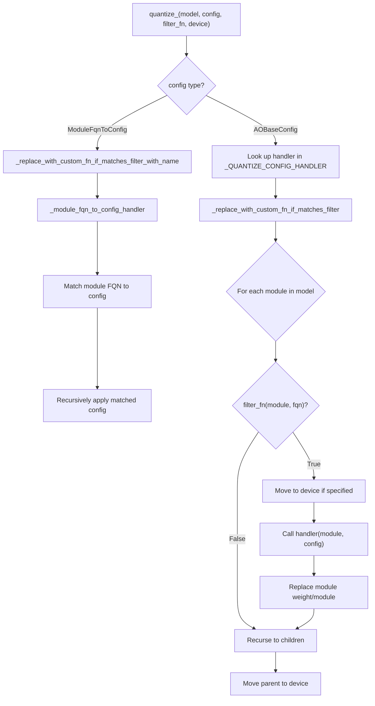

**Workflow Diagram: quantize_ Execution Flow**

The `quantize_` function operates in two main modes:

1. **Single Config Mode** (when `config` is an `AOBaseConfig` subclass):
   - Looks up the registered handler for the config type in `_QUANTIZE_CONFIG_HANDLER` [torchao/quantization/transform_module.py:73-73]().
   - Traverses the model tree in post-order depth-first search using `_replace_with_custom_fn_if_matches_filter` [torchao/quantization/quant_api.py:122-165]().
   - Applies `filter_fn` to each module to determine if it should be quantized.
   - Calls the handler function to transform matching modules.

2. **Per-Module Config Mode** (when `config` is `ModuleFqnToConfig`):
   - Maps fully qualified names (FQNs) or regex patterns to different configs.
   - Allows different quantization strategies for different layers via `_module_fqn_to_config_handler` [torchao/quantization/quant_api.py:226-263]().

Sources: [torchao/quantization/quant_api.py:476-540](), [torchao/quantization/quant_api.py:180-223](), [torchao/quantization/quant_api.py:226-263]()

## Default Filter Function

The default filter function `_is_linear` determines which modules are quantized when no custom `filter_fn` is provided:

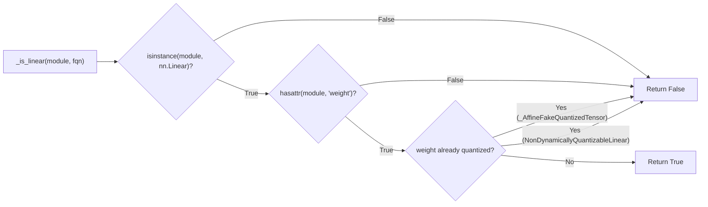

**Default Filter Logic**

The filter ensures:
- Only `torch.nn.Linear` modules are quantized [torchao/quantization/quant_api.py:178-178]().
- Weights are not quantized multiple times if shared across layers [torchao/quantization/quant_api.py:174-175]().
- `NonDynamicallyQuantizableLinear` modules are skipped [torchao/quantization/quant_api.py:181-181]().

Sources: [torchao/quantization/quant_api.py:168-182]()

## Handler Registration and Dispatch System

The handler system provides extensibility through a decorator-based registration pattern:

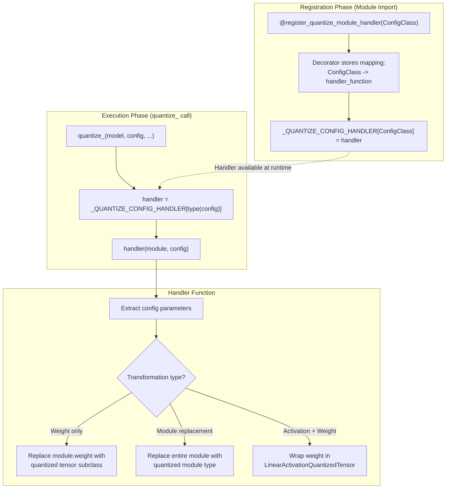

**Handler Registration and Dispatch Architecture**

**Registration Example:**
```python
@register_quantize_module_handler(Int8DynamicActivationInt8WeightConfig)
def _int8_dynamic_activation_int8_weight_transform(
    module: torch.nn.Module,
    config: Int8DynamicActivationInt8WeightConfig,
    **kwargs,
) -> torch.nn.Module:
    # Transform module according to config
    ...
```

The `_QUANTIZE_CONFIG_HANDLER` dictionary maps configuration classes to their corresponding transformation functions [torchao/quantization/transform_module.py:73-73]().

Sources: [torchao/quantization/quant_api.py:634-711](), [torchao/quantization/transform_module.py:72-75]()

## Module Transformation Patterns

### Pattern 1: Weight Tensor Replacement

Used for weight-only quantization (e.g., `Int4WeightOnlyConfig`, `Int8WeightOnlyConfig`).

**Process:**
1. Quantize `module.weight` to a quantized tensor subclass like `Int4Tensor` [torchao/quantization/quant_api.py:56-62]().
2. Wrap in `torch.nn.Parameter(quantized_weight, requires_grad=False)` [torchao/quantization/quant_api.py:209-213]().
3. Replace the module's weight parameter.

Sources: [torchao/quantization/quant_api.py:209-213]()

### Pattern 2: Weight + Activation Quantization

Used when activations are dynamically quantized during the forward pass (e.g., `Int8DynamicActivationInt8WeightConfig`).

**Process:**
1. Quantize weight to a subclass like `Int8Tensor`.
2. Intercept the linear operation to apply on-the-fly quantization to activations using functions like `_quantize_activation_per_token_absmax` [torchao/quantization/utils.py:162-193]().

Sources: [torchao/quantization/quant_api.py:634-711](), [torchao/quantization/utils.py:195-212]()

### Pattern 3: Module Replacement

Used for specialized quantization modules, such as Float8 training.

**Process:**
1. Create a new module instance (e.g., `Float8Linear`) [torchao/float8/float8_linear.py:36-36]().
2. Copy weights and configuration.
3. Replace the entire module in the parent module [torchao/quantization/quant_api.py:161-162]().

Sources: [torchao/quantization/quant_api.py:161-162](), [torchao/float8/float8_linear.py:36-36]()

## Device-Aware Quantization

The `device` parameter enables performance optimization by performing quantization on the target accelerator (e.g., CUDA) rather than CPU.

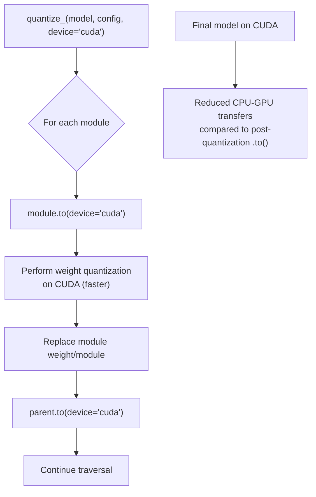

**Device-Aware Quantization Flow**

The `device` parameter is particularly beneficial for large models, as it moves modules to the device before applying the transformation [torchao/quantization/quant_api.py:146-147]().

Sources: [torchao/quantization/quant_api.py:145-165]()

## Configuration Hierarchy

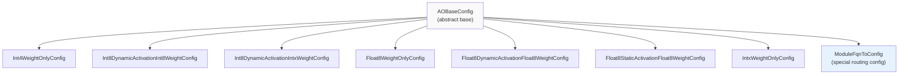

**Configuration Class Hierarchy**

Each configuration class inherits from `AOBaseConfig` [torchao/core/config.py:34-34]() and has a corresponding handler registered via `@register_quantize_module_handler`.

Sources: [torchao/quantization/quant_api.py:24-44](), [torchao/quantization/quant_api.py:118-118]()

## Common Usage Patterns

### Basic Weight-Only Quantization

```python
import torch
from torchao.quantization import Int4WeightOnlyConfig, quantize_

# Quantize all linear layers to INT4
quantize_(model, Int4WeightOnlyConfig(group_size=32))
```

### Per-Module Configuration

`AOPerModuleConfig` is an alias for `ModuleFqnToConfig` [torchao/quantization/__init__.py:70-70]().

```python
from torchao.quantization import ModuleFqnToConfig, Int4WeightOnlyConfig, Int8WeightOnlyConfig

config = ModuleFqnToConfig({
    "layers.0": Int8WeightOnlyConfig(),
    "re:.*attention.*": Int4WeightOnlyConfig(group_size=64)
})

quantize_(model, config)
```

Sources: [torchao/quantization/quant_api.py:492-509](), [torchao/quantization/__init__.py:70-70]()

## Implementation Details

### Module Traversal

The `_replace_with_custom_fn_if_matches_filter` function implements post-order depth-first traversal [torchao/quantization/quant_api.py:122-165]():

1. **Check current module**: Apply `filter_fn(model, cur_fqn)`.
2. **If matched**: Move to `device` and call `replacement_fn`.
3. **If not matched**: Recurse to children via `named_children()`.

Sources: [torchao/quantization/quant_api.py:145-165]()

### Inductor Configuration

Many configs include logic to automatically apply recommended `torch.compile` settings via `recommended_inductor_config_setter` [torchao/quantization/utils.py:56-56]().

Sources: [torchao/quantization/utils.py:56-56]()

### Module Extra Representation

After quantization, linear modules have their `extra_repr` method overridden to display quantization information via `_linear_extra_repr` [torchao/quantization/quant_api.py:78-78]().

Sources: [torchao/quantization/quant_api.py:78-78]()

---

# Page: Configuration System (AOBaseConfig)

# Configuration System (AOBaseConfig)

<details>
<summary>Relevant source files</summary>

The following files were used as context for generating this wiki page:

- [README.md](README.md)
- [test/core/test_config.py](test/core/test_config.py)
- [test/integration/test_integration.py](test/integration/test_integration.py)
- [test/prototype/test_prototype_float8_tensor.py](test/prototype/test_prototype_float8_tensor.py)
- [test/quantization/test_quant_api.py](test/quantization/test_quant_api.py)
- [test/quantization/test_quant_primitives.py](test/quantization/test_quant_primitives.py)
- [torchao/core/config.py](torchao/core/config.py)
- [torchao/prototype/hqq/hqq_tinygemm_linear.py](torchao/prototype/hqq/hqq_tinygemm_linear.py)
- [torchao/prototype/quantization/float8_static_quant/__init__.py](torchao/prototype/quantization/float8_static_quant/__init__.py)
- [torchao/prototype/quantization/float8_static_quant/prototype_float8_tensor.py](torchao/prototype/quantization/float8_static_quant/prototype_float8_tensor.py)
- [torchao/prototype/quantization/quant_api.py](torchao/prototype/quantization/quant_api.py)
- [torchao/quantization/README.md](torchao/quantization/README.md)
- [torchao/quantization/__init__.py](torchao/quantization/__init__.py)
- [torchao/quantization/qat/README.md](torchao/quantization/qat/README.md)
- [torchao/quantization/quant_api.py](torchao/quantization/quant_api.py)
- [torchao/quantization/quant_primitives.py](torchao/quantization/quant_primitives.py)
- [torchao/quantization/utils.py](torchao/quantization/utils.py)

</details>


The Configuration System provides a declarative API for specifying quantization workflows in TorchAO. Rather than manually constructing tensor subclasses and applying transformations, users create configuration objects that encapsulate quantization parameters and dispatch to optimized implementations. This page documents the `AOBaseConfig` hierarchy, configuration classes for different quantization schemes, and the handler registration mechanism.

For information about the actual quantization primitives (choose_qparams, quantize_affine, dequantize_affine), see [Quantization Primitives](#2.3). For details on the `quantize_` function that consumes these configs, see [quantize_ Function](#2.1). For module handler registration, see [Module Handler Registration](#2.4).

---

## Overview and Architecture

The configuration system consists of three main components:

1. **Configuration Classes**: Dataclasses (using `@dataclass` decorator) that inherit from `AOBaseConfig` and define quantization parameters.
2. **Handler Functions**: Functions decorated with `@register_quantize_module_handler` that transform modules based on a config.
3. **Dispatch Registry**: The `_QUANTIZE_CONFIG_HANDLER` dictionary mapping config types to handler functions.

**Config-to-Handler Dispatch Flow**

```mermaid
graph TD
    User["User Code"]
    Config["AOBaseConfig subclass<br/>(e.g. Int4WeightOnlyConfig)"]
    QuantizeAPI["quantize_(model, config)"]
    Registry["_QUANTIZE_CONFIG_HANDLER<br/>registry lookup"]
    Handler["Handler Function<br/>(e.g. _int4_weight_only_transform)"]
    Module["torch.nn.Linear"]
    QuantModule["Quantized Module<br/>(AffineQuantizedTensor weight)"]
    
    User -->|"instantiates"| Config
    User -->|"calls with"| QuantizeAPI
    Config --> QuantizeAPI
    QuantizeAPI -->|"looks up"| Registry
    Registry -->|"returns"| Handler
    Handler -->|"transforms"| Module
    Module --> QuantModule
```

Sources: [torchao/quantization/quant_api.py:440-511](), [torchao/quantization/transform_module.py:73-75](), [torchao/core/config.py:27-50]()

---

## AOBaseConfig Base Class

`AOBaseConfig` is the abstract base class defined in `torchao/core/config.py`. All quantization configuration classes inherit from this base. It serves as a marker interface that `quantize_` recognizes to dispatch to the handler registry.

### Versioning and Serialization
`AOBaseConfig` implements an instance-level versioning system to support backward compatibility during loading.
- `version`: Defaults to `_DEFAULT_VERSION = 1` [torchao/core/config.py:24-67]().
- **Serialization**: Handled via `config_to_dict` and `config_from_dict` [torchao/core/config.py:174-236]().
- **JSON Encoding**: A custom `ConfigJSONEncoder` handles nested objects, `torch.dtype`, and Enums [torchao/core/config.py:70-172]().

```python
from torchao.core.config import AOBaseConfig
from dataclasses import dataclass

@dataclass
class MyQuantConfig(AOBaseConfig):
    # quantization parameters here
    version: int = 1
```

Sources: [torchao/core/config.py:24-189](), [torchao/quantization/quant_api.py:34]()

---

## Configuration Class Taxonomy

**Configuration Class Hierarchy by Quantization Scheme**

```mermaid
graph TB
    AOBaseConfig["AOBaseConfig<br/>(base class)"]
    
    subgraph "Weight-Only Quantization"
        Int4WO["Int4WeightOnlyConfig"]
        Int8WO["Int8WeightOnlyConfig"]
        IntxWO["IntxWeightOnlyConfig"]
        UIntxWO["UIntxWeightOnlyConfig (Prototype)"]
        F8WO["Float8WeightOnlyConfig"]
    end
    
    subgraph "Dynamic Activation Quantization"
        Int8DA_Int8W["Int8DynamicActivationInt8WeightConfig"]
        Int8DA_IntxW["Int8DynamicActivationIntxWeightConfig"]
        Int8DA_Int4W["Int8DynamicActivationInt4WeightConfig"]
        F8DA_F8W["Float8DynamicActivationFloat8WeightConfig"]
        F8DA_Int4W["Float8DynamicActivationInt4WeightConfig"]
        MXDA_MXW["MXDynamicActivationMXWeightConfig"]
    end
    
    subgraph "Static Activation Quantization"
        F8SA_F8W["Float8StaticActivationFloat8WeightConfig"]
        Int8SA_Int8W["Int8StaticActivationInt8WeightConfig"]
    end
    
    AOBaseConfig --> Int4WO
    AOBaseConfig --> Int8WO
    AOBaseConfig --> IntxWO
    AOBaseConfig --> UIntxWO
    AOBaseConfig --> F8WO
    
    AOBaseConfig --> Int8DA_Int8W
    AOBaseConfig --> Int8DA_IntxW
    AOBaseConfig --> Int8DA_Int4W
    AOBaseConfig --> F8DA_F8W
    AOBaseConfig --> F8DA_Int4W
    AOBaseConfig --> MXDA_MXW
    
    AOBaseConfig --> F8SA_F8W
    AOBaseConfig --> Int8SA_Int8W
```

Sources: [torchao/quantization/quant_api.py:572-1953](), [torchao/prototype/quantization/quant_api.py:52-180](), [test/quantization/test_quant_api.py:20-51]()

---

## Weight-Only Quantization Configs

Weight-only quantization applies quantization only to weights, leaving activations in high precision (typically float16/bfloat16).

### Int4WeightOnlyConfig
The primary configuration for 4-bit weight-only quantization.

| Parameter | Type | Default | Description |
|-----------|------|---------|-------------|
| `group_size` | `int` | `256` | Elements per quantization group |
| `version` | `int` | `1` or `2` | Legacy (v1) vs Recommended (v2) |
| `int4_packing_format` | `Int4PackingFormat` | Varies | Format like `tile_packed_to_4d` or `plain_int32` |
| `int4_choose_qparams_algorithm` | `Int4ChooseQParamsAlgorithm` | `AFFINE` | Algorithm like `hqq` or `affine` |
| `use_hqq` | `bool` | `False` | Enable Half-Quadratic Quantization |

Sources: [torchao/quantization/quant_api.py:1306-1344](), [torchao/quantization/quant_api.py:1346-1634]()

### Float8WeightOnlyConfig
FP8 weight-only quantization for modern GPUs (requires SM89+).

| Parameter | Type | Default | Description |
|-----------|------|---------|-------------|
| `granularity` | `FP8Granularity` | `PerRow()` | `PerTensor` or `PerRow` quantization |
| `mm_config` | `Float8MMConfig` | `None` | Matrix multiplication configuration |

Sources: [torchao/quantization/quant_api.py:998-1058]()

---

## Dynamic Activation Quantization Configs

Dynamic activation quantization computes quantization parameters per-forward-pass at runtime.

### Int8DynamicActivationInt8WeightConfig
Standard 8-bit dynamic quantization for activations and weights.

| Parameter | Type | Default | Description |
|-----------|------|---------|-------------|
| `act_mapping_type` | `MappingType` | `SYMMETRIC` | Symmetric vs Asymmetric for activations |
| `layout` | `Layout` | `PlainLayout()` | Memory layout for weights |

Sources: [torchao/quantization/quant_api.py:1754-1808]()

### Float8DynamicActivationFloat8WeightConfig
FP8 dynamic activation and weight quantization (SM90+ recommended).

| Parameter | Type | Default | Description |
|-----------|------|---------|-------------|
| `activation_granularity` | `FP8Granularity` | `PerRow()` | Activation scaling granularity |
| `weight_granularity` | `FP8Granularity` | `PerRow()` | Weight scaling granularity |

Sources: [torchao/quantization/quant_api.py:1060-1134](), [torchao/quantization/quant_api.py:2060-2158]()

---

## Static/Calibrated Activation Quantization Configs

Static quantization uses pre-computed scales for activations, determined during a calibration phase.

### Float8StaticActivationFloat8WeightConfig
FP8 static activation quantization with FP8 weights.

| Parameter | Type | Default | Description |
|-----------|------|---------|-------------|
| `act_quant_scale` | `torch.Tensor` | Required | Pre-computed activation scale |
| `granularity` | `FP8Granularity` | `PerRow()` | Granularity for weight and activation |

Sources: [torchao/prototype/quantization/quant_api.py:23-28](), [test/prototype/test_prototype_float8_tensor.py:15-24]()

---

## Handler Registration Mechanism

The system uses a registry to link configuration classes to their transformation logic.

**Code Entity Space Mapping**

| Code Entity | File Path | Role |
|-------------|-----------|------|
| `AOBaseConfig` | `torchao/core/config.py` | Abstract base for all configs |
| `_QUANTIZE_CONFIG_HANDLER` | `torchao/quantization/transform_module.py` | Global registry dictionary |
| `register_quantize_module_handler` | `torchao/quantization/transform_module.py` | Decorator to register handlers |
| `quantize_` | `torchao/quantization/quant_api.py` | Entry point that invokes handlers |

**Registration Example:**
```python
@register_quantize_module_handler(Int4WeightOnlyConfig)
def _int4_weight_only_transform(module, config):
    # logic to swap weight with Int4Tensor
    ...
```

Sources: [torchao/quantization/transform_module.py:72-75](), [torchao/quantization/quant_api.py:440-511]()

---

## Serialization via config_to_dict

The configuration system supports robust serialization to allow saving quantization settings alongside model checkpoints.

```python
from torchao.core.config import config_to_dict, config_from_dict
from torchao.quantization import Int4WeightOnlyConfig

config = Int4WeightOnlyConfig(group_size=128)
# Convert to serializable dict
config_dict = config_to_dict(config)
# Reconstruct from dict
new_config = config_from_dict(config_dict)
```

The `ConfigJSONEncoder` specifically handles `torch.dtype` (e.g., `torch.bfloat16`) and `Layout` objects which are not standard JSON serializable [torchao/core/config.py:70-156]().

Sources: [torchao/core/config.py:174-236](), [torchao/core/config.py:70-156]()

---

# Page: Quantization Primitives

# Quantization Primitives

<details>
<summary>Relevant source files</summary>

The following files were used as context for generating this wiki page:

- [README.md](README.md)
- [test/integration/test_integration.py](test/integration/test_integration.py)
- [test/quantization/pt2e/test_learnable_fake_quantize.py](test/quantization/pt2e/test_learnable_fake_quantize.py)
- [test/quantization/test_observer.py](test/quantization/test_observer.py)
- [test/quantization/test_quant_api.py](test/quantization/test_quant_api.py)
- [test/quantization/test_quant_primitives.py](test/quantization/test_quant_primitives.py)
- [torchao/prototype/hqq/hqq_tinygemm_linear.py](torchao/prototype/hqq/hqq_tinygemm_linear.py)
- [torchao/quantization/README.md](torchao/quantization/README.md)
- [torchao/quantization/__init__.py](torchao/quantization/__init__.py)
- [torchao/quantization/granularity.py](torchao/quantization/granularity.py)
- [torchao/quantization/observer.py](torchao/quantization/observer.py)
- [torchao/quantization/pt2e/__init__.py](torchao/quantization/pt2e/__init__.py)
- [torchao/quantization/pt2e/_affine_quantization.py](torchao/quantization/pt2e/_affine_quantization.py)
- [torchao/quantization/pt2e/learnable_fake_quantize.py](torchao/quantization/pt2e/learnable_fake_quantize.py)
- [torchao/quantization/pt2e/observer.py](torchao/quantization/pt2e/observer.py)
- [torchao/quantization/qat/README.md](torchao/quantization/qat/README.md)
- [torchao/quantization/quant_api.py](torchao/quantization/quant_api.py)
- [torchao/quantization/quant_primitives.py](torchao/quantization/quant_primitives.py)
- [torchao/quantization/utils.py](torchao/quantization/utils.py)

</details>


This page documents the low-level quantization primitive operations that form the foundation of TorchAO's quantization system. These primitives implement the core mathematical operations for affine quantization: computing quantization parameters, quantizing tensors, and dequantizing tensors. For higher-level quantization workflows and configurations, see [Quantization API Reference](2) and [Configuration System](2.2).

---

## Purpose and Scope

Quantization primitives provide the fundamental operations for converting between high-precision floating-point tensors and low-precision quantized representations. The primitives support:

- **Affine quantization**: `quantized_val = (float_val / scale) + zero_point`
- **Multiple mapping types**: symmetric, asymmetric, and no-clipping-error variants
- **Multiple zero-point domains**: integer, float, or none
- **Block-wise granularity**: per-tensor, per-channel, per-group, per-token
- **Multiple target dtypes**: int8, int4, uint8, uint4, float8, and custom floatx formats

These primitives are used internally by all higher-level quantization APIs in TorchAO, including `quantize_()`, `AffineQuantizedTensor`, and configuration classes.

Sources: [torchao/quantization/quant_primitives.py:1-54](), [torchao/quantization/__init__.py:106-111]()

---

## Core Quantization Operations

### Natural Language to Code Entity Mapping: Primitives

```mermaid
graph TB
    subgraph "Main Primitive Operations"
        ChooseQP["choose_qparams_affine()<br/>[torchao/quantization/quant_primitives.py]"]
        Quantize["quantize_affine()<br/>[torchao/quantization/quant_primitives.py]"]
        Dequantize["dequantize_affine()<br/>[torchao/quantization/quant_primitives.py]"]
    end
    
    subgraph "Input Parameters"
        Input["Input Tensor<br/>torch.Tensor"]
        BlockSize["block_size: List[int]<br/>Granularity"]
        Mapping["mapping_type: MappingType<br/>SYMMETRIC/ASYMMETRIC"]
        TargetDtype["target_dtype: torch.dtype<br/>int8/int4/uint8/float8"]
        QPParams["Quantization Parameters<br/>scale, zero_point"]
    end
    
    subgraph "Output"
        QuantOut["Quantized Tensor<br/>target_dtype"]
        DequantOut["Dequantized Tensor<br/>float32/float16/bfloat16"]
    end
    
    Input --> ChooseQP
    BlockSize --> ChooseQP
    Mapping --> ChooseQP
    TargetDtype --> ChooseQP
    
    ChooseQP --> QPParams
    
    Input --> Quantize
    QPParams --> Quantize
    Quantize --> QuantOut
    
    QuantOut --> Dequantize
    QPParams --> Dequantize
    Dequantize --> DequantOut
```

**Diagram: Core Quantization Primitive Operations**

The three fundamental operations work together to perform quantization:

1. **choose_qparams_affine**: Analyzes the input tensor and computes optimal quantization parameters (scale and zero_point). [torchao/quantization/quant_primitives.py:322-367]()
2. **quantize_affine**: Applies quantization using the computed parameters. [torchao/quantization/quant_primitives.py:658-736]()
3. **dequantize_affine**: Reverses quantization to reconstruct approximate floating-point values. [torchao/quantization/quant_primitives.py:738-806]()

Sources: [torchao/quantization/quant_primitives.py:322-806]()

---

## MappingType Enum

The `MappingType` enum controls how floating-point ranges are mapped to integer ranges during quantization:

| MappingType | Description | Mathematical Formula |
|-------------|-------------|---------------------|
| `SYMMETRIC` | Symmetric mapping around zero | Range: `[-max_abs, max_abs]` → `[quant_min, quant_max]` |
| `ASYMMETRIC` | Direct mapping of min/max range | Range: `[min_val, max_val]` → `[quant_min, quant_max]` |
| `SYMMETRIC_NO_CLIPPING_ERR` | Symmetric with separate min/max scales | `scale = max(smin, smax)` where `smin = min_val_neg / quant_min` |

**SYMMETRIC Example:**
- Float range: `(-3.5, 10.2)` with int4 range `(-8, 7)`
- Symmetric range: `(-10.2, 10.2)` → `(-8, 7)`
- Scale: `(10.2 - (-10.2)) / (7 - (-8)) = 1.36`

**ASYMMETRIC Example:**
- Float range: `(-3.5, 10.2)` with int4 range `(-8, 7)`
- Direct mapping: `(-3.5, 10.2)` → `(-8, 7)`
- Scale: `(10.2 - (-3.5)) / (7 - (-8)) = 0.913`

Sources: [torchao/quantization/quant_primitives.py:55-78]()

---

## ZeroPointDomain Enum

The `ZeroPointDomain` enum specifies whether the zero-point is represented in integer or floating-point domain:

```mermaid
graph LR
    subgraph "ZeroPointDomain.INT"
        INT_Formula["quantized_val = (float_val / scale) + zero_point_int"]
    end
    
    subgraph "ZeroPointDomain.FLOAT"
        FLOAT_Formula["quantized_val = (float_val - zero_point_float) / scale"]
    end
    
    subgraph "ZeroPointDomain.NONE"
        NONE_Formula["quantized_val = (float_val / scale)"]
    end
```

**Diagram: Zero Point Domain Variants**

| Domain | Typical Use |
|--------|-------------|
| `INT` | Standard PyTorch quantization, ONNX export. [torchao/quantization/quant_primitives.py:82-82]() |
| `FLOAT` | TensorCore tiled layouts, tinygemm kernels. [torchao/quantization/quant_primitives.py:83-83]() |
| `NONE` | Symmetric quantization (weight-only, some activations). [torchao/quantization/quant_primitives.py:84-84]() |

Sources: [torchao/quantization/quant_primitives.py:79-91]()

---

## Block Size and Granularity

The `block_size` parameter (a `List[int]`) controls the granularity of quantization by specifying which tensor elements share the same quantization parameters.

The implementation uses `_get_reduction_params()` to compute the reshape and reduction dimensions for calculating statistics:

```python
# For block_size = (1, 32) and input_size = (128, 128)
# It identifies dimensions to reduce over to get per-group scales
shape_for_reduction, reduction_dims = _get_reduction_params(block_size, input_size)
```

This allows efficient computation of per-group, per-channel, or per-tensor statistics using standard PyTorch reduction operations like `torch.amin` and `torch.amax`. [torchao/quantization/quant_primitives.py:280-318]()

Sources: [torchao/quantization/quant_primitives.py:280-318](), [torchao/quantization/observer.py:148-155]()

---

## choose_qparams_affine

This function analyzes an input tensor to compute the `scale` and `zero_point`.

```python
def choose_qparams_affine(
    input: torch.Tensor,
    mapping_type: MappingType,
    block_size: Tuple[int, ...],
    target_dtype: torch.dtype,
    quant_min: Optional[int] = None,
    quant_max: Optional[int] = None,
    eps: Optional[float] = None,
    scale_dtype: Optional[torch.dtype] = None,
    zero_point_dtype: Optional[torch.dtype] = None,
) -> Tuple[torch.Tensor, torch.Tensor]:
```

**Key Implementation Details:**
1. **Reduction**: It computes `min_val` and `max_val` over the dimensions specified by the `block_size`. [torchao/quantization/quant_primitives.py:688-693]()
2. **Epsilon**: An `eps` value is used to prevent division by zero when calculating scales. [torchao/quantization/quant_primitives.py:706-706]()
3. **Symmetric vs Asymmetric**: For `MappingType.SYMMETRIC`, the zero_point is forced to 0. [torchao/quantization/quant_primitives.py:712-713]()

Sources: [torchao/quantization/quant_primitives.py:658-736]()

---

## quantize_affine

`quantize_affine` converts high-precision tensors into quantized representations.

### Natural Language to Code Entity Mapping: Quantization Logic

```mermaid
graph TB
    subgraph "Input"
        Input["input: torch.Tensor"]
        Scale["scale: torch.Tensor"]
        ZP["zero_point: torch.Tensor"]
    end
    
    subgraph "Internal Logic"
        Dispatch["_quantize_affine()<br/>[torchao/quantization/quant_primitives.py]"]
        Bounds["_get_and_check_qmin_qmax()<br/>[torchao/quantization/quant_primitives.py]"]
        Core["_quantize_affine_no_dtype_cast()<br/>[torchao/quantization/quant_primitives.py]"]
        Compute["round(input / scale) + zero_point"]
        Clamp["torch.clamp(..., qmin, qmax)"]
    end
    
    Input --> Dispatch
    Dispatch --> Bounds
    Bounds --> Core
    Core --> Compute
    Compute --> Clamp
    Clamp --> Output["Quantized Tensor"]
```

**Diagram: quantize_affine Implementation Flow**

The function performs three main steps:
1. **Reshape**: Reshapes the input and qparams based on `block_size` to ensure broadcasting. [torchao/quantization/quant_primitives.py:441-444]()
2. **Compute**: Applies the affine formula `(input / scale) + zero_point`. [torchao/quantization/quant_primitives.py:456-456]()
3. **Clamp and Cast**: Clamps values to the valid range for the `target_dtype` and performs the final cast. [torchao/quantization/quant_primitives.py:465-474]()

Sources: [torchao/quantization/quant_primitives.py:322-475]()

---

## dequantize_affine

Dequantization reverses the process to reconstruct floating-point values: `dequantized = (quantized - zero_point) * scale`.

**Key Points:**
1. **Precision**: The `output_dtype` can be specified to return values in `float32`, `float16`, or `bfloat16`. [torchao/quantization/quant_primitives.py:738-747]()
2. **Broadcasting**: Like quantization, it handles broadcasting of scales and zero-points across the tensor based on `block_size`. [torchao/quantization/quant_primitives.py:788-791]()

Sources: [torchao/quantization/quant_primitives.py:738-806]()

---

## Specialized Primitive Variants

TorchAO provides specialized versions of these primitives for specific formats and kernels:

| Variant Family | Functions | Use Case |
|----------------|-----------|----------|
| **Tinygemm** | `_choose_qparams_affine_tinygemm` | Used for kernels requiring `FLOAT` domain zero points. [torchao/quantization/quant_primitives.py:478-524]() |
| **Float8** | `_quantize_affine_float8` | Specialized for `torch.float8_e4m3fn` and other FP8 types. [torchao/quantization/quant_primitives.py:916-953]() |
| **HQQ** | `_choose_qparams_and_quantize_affine_hqq` | Implementation of Half-Quadratic Quantization. [torchao/quantization/quant_primitives.py:1020-1065]() |
| **Floatx** | `_quantize_affine_floatx` | For custom floating point formats (e.g. 3-bit float). [torchao/quantization/quant_primitives.py:851-885]() |

Sources: [torchao/quantization/quant_primitives.py:478-1100]()

---

## Custom Op Registration

To ensure compatibility with `torch.compile` and `torch.export`, primitives are registered as custom operators using `torch.library`.

```python
# torchao/quantization/quant_primitives.py:205-222
quant_lib = torch.library.Library("torchao", "FRAGMENT")
register_custom_op = _register_custom_op(quant_lib)

@register_custom_op
def _quantize_affine(
    input: torch.Tensor,
    block_size: List[int],
    scale: torch.Tensor,
    zero_point: Optional[torch.Tensor],
    output_dtype: torch.dtype,
    # ...
):
```

**Straight-Through Estimator (STE):**
The `_Round` class implements a custom autograd function where the backward pass is an identity operation (`gy`), allowing gradients to flow through the non-differentiable `round` function during QAT. [torchao/quantization/quant_primitives.py:225-242]()

Sources: [torchao/quantization/quant_primitives.py:205-242](), [torchao/quantization/quant_primitives.py:369-411]()

---

## Testing and Validation

Primitives are validated in `test/quantization/test_quant_primitives.py` for:
- **Idempotency**: Ensuring multiple calls yield consistent results. [test/quantization/test_quant_primitives.py:53-60]()
- **Numerical Parity**: Comparing against PyTorch core observers and standard formulas. [test/quantization/test_quant_primitives.py:196-225]()
- **Device Support**: Verified across CPU, CUDA, and XPU. [test/quantization/test_quant_primitives.py:157-159]()

Sources: [test/quantization/test_quant_primitives.py:1-611]()

---

# Page: Module Handler Registration

# Module Handler Registration

<details>
<summary>Relevant source files</summary>

The following files were used as context for generating this wiki page:

- [README.md](README.md)
- [test/integration/test_integration.py](test/integration/test_integration.py)
- [test/quantization/test_quant_api.py](test/quantization/test_quant_api.py)
- [test/quantization/test_quant_primitives.py](test/quantization/test_quant_primitives.py)
- [torchao/prototype/hqq/hqq_tinygemm_linear.py](torchao/prototype/hqq/hqq_tinygemm_linear.py)
- [torchao/quantization/README.md](torchao/quantization/README.md)
- [torchao/quantization/__init__.py](torchao/quantization/__init__.py)
- [torchao/quantization/qat/README.md](torchao/quantization/qat/README.md)
- [torchao/quantization/quant_api.py](torchao/quantization/quant_api.py)
- [torchao/quantization/quant_primitives.py](torchao/quantization/quant_primitives.py)
- [torchao/quantization/utils.py](torchao/quantization/utils.py)

</details>


## Purpose and Scope

This document describes the **module handler registration system** in TorchAO, which provides an extensible mechanism for mapping quantization configuration classes to transformation functions. This system is the backbone of how `quantize_` applies different quantization schemes to neural network modules.

For information about the `quantize_` API itself, see [2.1. quantize_ Function](). For details on configuration classes, see [2.2. Configuration System (AOBaseConfig)]().

## System Architecture

The module handler registration system acts as a dispatcher between configuration objects and the functions that implement quantization transformations. When users call `quantize_` with a specific configuration, the system looks up the appropriate handler function and applies it to matching modules in the model.

### Handler Dispatch Flow
Title: Handler Registration and Application Flow
```mermaid
graph TB
    subgraph "User Code"
        Model["nn.Module<br/>(User Model)"]
        Config["AOBaseConfig<br/>(e.g., Int4WeightOnlyConfig)"]
    end
    
    subgraph "quantize_ Function"
        Entry["quantize_()<br/>torchao/quantization/quant_api.py:476"]
        Lookup["Handler Lookup<br/>_QUANTIZE_CONFIG_HANDLER[type(config)]<br/>Line 526"]
        Traverse["Module Traversal<br/>_replace_with_custom_fn_if_matches_filter<br/>Line 528-534"]
    end
    
    subgraph "Handler Registry"
        Registry["_QUANTIZE_CONFIG_HANDLER<br/>Dict[Type[AOBaseConfig], Callable]"]
        Decorator["@register_quantize_module_handler<br/>Decorator for registration"]
    end
    
    subgraph "Handler Functions"
        Handler1["_int4_weight_only_transform<br/>Line 1105"]
        Handler2["_int8_dynamic_activation_int4_weight_transform<br/>Line 635"]
        Handler3["_int8_dynamic_activation_intx_weight_transform<br/>Line 955"]
        HandlerN["...(other handlers)"]
    end
    
    Model --> Entry
    Config --> Entry
    Entry --> Lookup
    Lookup --> Registry
    Registry --> Lookup
    Lookup --> Traverse
    Traverse --> Handler1
    Traverse --> Handler2
    Traverse --> Handler3
    Traverse --> HandlerN
    
    Decorator -.registers.-> Registry
    Handler1 -.registered by.-> Decorator
    Handler2 -.registered by.-> Decorator
    Handler3 -.registered by.-> Decorator
```

**Sources:** [torchao/quantization/quant_api.py:476-540](), [torchao/quantization/transform_module.py:1-20]()

## Handler Registry

The handler registry is a module-level dictionary `_QUANTIZE_CONFIG_HANDLER` that maps configuration class types to handler functions. It is managed in `torchao.quantization.transform_module` and used by the `quantize_` entry point.

At runtime, when `quantize_` is called with a configuration object, the system performs the lookup:

```python
# torchao/quantization/quant_api.py:525-534
if isinstance(config, AOBaseConfig):
    handler = _QUANTIZE_CONFIG_HANDLER[type(config)]
    # Apply handler to filtered modules
    _replace_with_custom_fn_if_matches_filter(
        model,
        handler,
        filter_fn,
        device=device,
        extra_args=(config,),
    )
```

**Sources:** [torchao/quantization/quant_api.py:525-534](), [torchao/quantization/transform_module.py:1-15]()

## Registration Mechanism

### The `@register_quantize_module_handler` Decorator

Handlers are registered using the `@register_quantize_module_handler` decorator. This decorator maps a configuration class (subclass of `AOBaseConfig`) to a specific transformation function.

```python
# torchao/quantization/transform_module.py:17-25
def register_quantize_module_handler(config_cls):
    def decorator(handler):
        _QUANTIZE_CONFIG_HANDLER[config_cls] = handler
        return handler
    return decorator
```

**Sources:** [torchao/quantization/transform_module.py:17-25]()

### Registration Flow
Title: Static Registration Sequence
```mermaid
sequenceDiagram
    participant Dev as "Developer"
    participant Decorator as "@register_quantize_module_handler"
    participant Registry as "_QUANTIZE_CONFIG_HANDLER"
    
    Note over Dev: Define handler function
    Dev->>Decorator: @register_quantize_module_handler(Int4WeightOnlyConfig)
    Note over Dev: def _int4_weight_only_transform(module, config)
    Decorator->>Registry: _QUANTIZE_CONFIG_HANDLER[Int4WeightOnlyConfig] = _int4_weight_only_transform
    Registry-->>Decorator: Registration complete
    
    Note over Dev,Registry: Later, at runtime...
    
    participant User as "User Code"
    participant QuantizeAPI as "quantize_()"
    
    User->>QuantizeAPI: quantize_(model, Int4WeightOnlyConfig())
    QuantizeAPI->>Registry: Lookup handler for Int4WeightOnlyConfig
    Registry-->>QuantizeAPI: Return _int4_weight_only_transform
    QuantizeAPI->>QuantizeAPI: Apply handler to modules
```

**Sources:** [torchao/quantization/quant_api.py:476-540](), [torchao/quantization/transform_module.py:17-25]()

## Handler Function Signature

All handler functions must follow a specific signature pattern to be compatible with the `_replace_with_custom_fn_if_matches_filter` traversal.

### Required Parameters

| Parameter | Type | Description |
|-----------|------|-------------|
| `module` | `torch.nn.Module` | The module to be transformed (typically `nn.Linear`). |
| `config` | `AOBaseConfig` subclass | The configuration object containing quantization parameters. |

### Optional Keyword-Only Parameters

Handler functions may accept additional keyword-only parameters for specialized use cases like GPTQ:

| Parameter | Type | Use Case |
|-----------|------|----------|
| `custom_scale` | `Optional[torch.Tensor]` | Pre-computed quantization scales. |
| `custom_zero_point` | `Optional[torch.Tensor]` | Pre-computed zero points. |

**Sources:** [torchao/quantization/quant_api.py:635-711](), [torchao/quantization/quant_api.py:955-972]()

## Dispatch Process

The dispatch process follows a recursive post-order traversal of the model tree.

Title: Runtime Dispatch Logic
```mermaid
graph TD
    Start["quantize_(model, config, filter_fn)"]
    TypeCheck{"config instanceof<br/>AOBaseConfig?"}
    Lookup["handler = _QUANTIZE_CONFIG_HANDLER[type(config)]<br/>Line 526"]
    Traverse["Traverse model tree<br/>Post-order DFS"]
    Filter{"filter_fn(module, fqn)<br/>returns True?"}
    Device{"device parameter<br/>specified?"}
    MoveDevice["module.to(device)"]
    Invoke["handler(module, config, **extra_args)"]
    Replace["Replace module if changed"]
    NextModule["Next module"]
    Done["Return modified model"]
    
    Start --> TypeCheck
    TypeCheck -->|Yes| Lookup
    TypeCheck -->|No| Error["Raise AssertionError"]
    Lookup --> Traverse
    Traverse --> Filter
    Filter -->|Yes| Device
    Filter -->|No| NextModule
    Device -->|Yes| MoveDevice
    Device -->|No| Invoke
    MoveDevice --> Invoke
    Invoke --> Replace
    Replace --> NextModule
    NextModule --> Traverse
    Traverse --> Done
```

**Sources:** [torchao/quantization/quant_api.py:476-540](), [torchao/quantization/quant_api.py:122-165]()

## Built-in Handlers

TorchAO provides handlers for all standard quantization configurations. Below is a mapping of configuration classes to their registered handlers:

| Configuration Class | Handler Function | Line Reference |
|---------------------|------------------|----------------|
| `Int8DynamicActivationInt4WeightConfig` | `_int8_dynamic_activation_int4_weight_transform` | [quant_api.py:634-711]() |
| `Int8DynamicActivationIntxWeightConfig` | `_int8_dynamic_activation_intx_weight_transform` | [quant_api.py:954-972]() |
| `Int8DynamicActivationInt8WeightConfig` | `_int8_dynamic_activation_int8_weight_transform` | [quant_api.py:1002-1026]() |
| `Int8WeightOnlyConfig` | `_int8_weight_only_transform` | [quant_api.py:1080-1103]() |
| `Int4WeightOnlyConfig` | `_int4_weight_only_transform` | [quant_api.py:1180-1247]() |
| `IntxWeightOnlyConfig` | `_intx_weight_only_transform` | [quant_api.py:1320-1345]() |
| `Float8WeightOnlyConfig` | `_float8_weight_only_transform` | [quant_api.py:1587-1622]() |
| `Float8DynamicActivationFloat8WeightConfig` | `_float8_dynamic_activation_float8_weight_transform` | [quant_api.py:1696-1803]() |
| `Float8StaticActivationFloat8WeightConfig` | `_float8_static_activation_float8_weight_transform` | [quant_api.py:1890-1953]() |

### Handler Implementation Pattern

Each handler typically follows this pattern:

1. **Extract Parameters**: Retrieve settings from the config object (e.g., `group_size`, `mapping_type`).
2. **Inductor Config**: Optionally call `recommended_inductor_config_setter()` if `config.set_inductor_config` is True.
3. **Weight Transformation**: Quantize `module.weight` using primitives like `quantize_affine`.
4. **Subclass Wrapping**: Wrap the quantized data in a tensor subclass (e.g., `Int4Tensor`, `AffineQuantizedTensor`).
5. **State Update**: Assign the new quantized parameter back to the module and update its `extra_repr`.

**Sources:** [torchao/quantization/quant_api.py:1180-1247](), [torchao/quantization/quant_api.py:1696-1803]()

## Module Traversal and Filtering

The handler system integrates with the module traversal mechanism in `quantize_`:

### Filter Function

The `filter_fn` parameter determines which modules receive the transformation. It receives the current module instance and its fully qualified name (FQN).

```python
# torchao/quantization/quant_api.py:122-145
def _replace_with_custom_fn_if_matches_filter(
    model,
    replacement_fn,
    filter_fn,
    cur_fqn="",
    device=None,
    extra_args: Optional[Tuple[Any, ...]] = (),
) -> None:
    if filter_fn(model, cur_fqn[:-1]):
        # ... transformation logic
```

### Default Filter

If no filter is provided, `quantize_` defaults to `_is_linear`, which matches:
- Instances of `torch.nn.Linear`.
- Modules that have a `weight` attribute.
- Modules not already quantized (no existing quantized tensor subclasses).
- Not `nn.modules.linear.NonDynamicallyQuantizableLinear`.

**Sources:** [torchao/quantization/quant_api.py:168-182](), [torchao/quantization/quant_api.py:514]()

## Public API

The handler registration system is part of TorchAO's public API through the `register_quantize_module_handler` function. This allows library users and third-party extensions to register handlers for custom configuration classes, making the quantization system fully extensible.

**Sources:** [torchao/quantization/__init__.py:115](), [torchao/quantization/transform_module.py:17]()

---

# Page: Autoquantization

# Autoquantization

<details>
<summary>Relevant source files</summary>

The following files were used as context for generating this wiki page:

- [README.md](README.md)
- [benchmarks/microbenchmarks/README.md](benchmarks/microbenchmarks/README.md)
- [benchmarks/microbenchmarks/benchmark_inference.py](benchmarks/microbenchmarks/benchmark_inference.py)
- [benchmarks/microbenchmarks/benchmark_runner.py](benchmarks/microbenchmarks/benchmark_runner.py)
- [benchmarks/microbenchmarks/profiler.py](benchmarks/microbenchmarks/profiler.py)
- [benchmarks/microbenchmarks/test/benchmark_config.yml](benchmarks/microbenchmarks/test/benchmark_config.yml)
- [benchmarks/microbenchmarks/test/test_benchmark_inference.py](benchmarks/microbenchmarks/test/test_benchmark_inference.py)
- [benchmarks/microbenchmarks/test/test_benchmark_profiler.py](benchmarks/microbenchmarks/test/test_benchmark_profiler.py)
- [benchmarks/microbenchmarks/test/test_benchmark_runner.py](benchmarks/microbenchmarks/test/test_benchmark_runner.py)
- [benchmarks/microbenchmarks/test/test_utils.py](benchmarks/microbenchmarks/test/test_utils.py)
- [benchmarks/microbenchmarks/utils.py](benchmarks/microbenchmarks/utils.py)
- [test/integration/test_integration.py](test/integration/test_integration.py)
- [test/quantization/test_quant_api.py](test/quantization/test_quant_api.py)
- [test/quantization/test_quant_primitives.py](test/quantization/test_quant_primitives.py)
- [test/test_model_architecture.py](test/test_model_architecture.py)
- [torchao/prototype/hqq/hqq_tinygemm_linear.py](torchao/prototype/hqq/hqq_tinygemm_linear.py)
- [torchao/quantization/README.md](torchao/quantization/README.md)
- [torchao/quantization/__init__.py](torchao/quantization/__init__.py)
- [torchao/quantization/qat/README.md](torchao/quantization/qat/README.md)
- [torchao/quantization/quant_api.py](torchao/quantization/quant_api.py)
- [torchao/quantization/quant_primitives.py](torchao/quantization/quant_primitives.py)
- [torchao/quantization/utils.py](torchao/quantization/utils.py)

</details>


The AutoQuant system in TorchAO is designed to automatically determine the optimal quantization technique for each linear layer in a model by benchmarking candidate methods against actual activation shapes and data types encountered during execution. This avoids a "one-size-fits-all" approach and optimizes for specific hardware and model workloads.

## Overview

AutoQuant operates through a lifecycle of profiling, benchmarking, and selection. It wraps standard linear layers with a specialized tensor subclass that monitors traffic and evaluates performance.

1.  **Profiling Phase**: During the initial forward pass(es), the system records the shapes and dtypes of activations entering each linear layer.
2.  **Benchmarking Phase**: For each recorded activation pattern, the system runs performance tests across a suite of quantization configurations.
3.  **Selection Phase**: The configuration with the lowest latency (that meets accuracy constraints like SQNR) is selected and applied to the layer.

Sources: [torchao/quantization/quant_api.py:10-16](), [torchao/utils.py:56-61]()

## Core Architecture

The system leverages PyTorch tensor subclasses to intercept operations and the `torch.compile` infrastructure to access optimized kernels.

### System Entity Mapping

The following diagram maps high-level AutoQuant concepts to their specific implementations in the `torchao` codebase.

```mermaid
graph TB
    subgraph "User Interface"
        autoquant_func["autoquant()"]
        Config["AOBaseConfig / Int4WeightOnlyConfig"]
    end
    
    subgraph "Profiling & Interception"
        AQLW["AutoQuantizableLinearWeight<br/>(Tensor Subclass)"]
        log_shape["log_shape()<br/>Records activation patterns"]
        logged_data["_fqn_to_op_to_shape_to_count<br/>Global tracking dict"]
    end
    
    subgraph "Benchmarking & Performance"
        bench_model["benchmark_model()<br/>Latency measurement"]
        bench_inf["benchmark_inference.py<br/>Runner script"]
        cache["_BASELINE_CACHE<br/>Internal benchmark cache"]
    end
    
    subgraph "Quantization Implementation"
        QAPI["quantize_()<br/>Main entry point"]
        QP["quant_primitives.py<br/>choose_qparams / quantize_affine"]
        TS["Tensor Subclasses<br/>Int4Tensor / Int8Tensor / Float8Tensor"]
    end
    
    autoquant_func --> AQLW
    AQLW --> log_shape
    log_shape --> logged_data
    logged_data --> bench_model
    bench_model --> cache
    bench_model --> QAPI
    QAPI --> TS
    TS --> QP
```

**Autoquant System Entity Mapping**

Sources: [torchao/quantization/quant_api.py:36-106](), [torchao/quantization/utils.py:88-113](), [benchmarks/microbenchmarks/benchmark_inference.py:50-77](), [torchao/utils.py:56-61]()

## AutoQuantizable Workflow

The system relies on `AutoQuantizableLinearWeight` (a tensor subclass) to manage the transition from floating point to quantized states.

```mermaid
graph TD
    subgraph "Lifecycle"
        create["from_float()<br/>Wrap original weights"]
        profile["Profiling<br/>Intercept forward() via log_shape()"]
        benchmark["Benchmarking<br/>Evaluate candidate configs"]
        select["Selection<br/>Choose best SQNR vs Latency"]
        convert["to_quantized()<br/>Apply final subclass"]
    end
    
    subgraph "Data Structures"
        weight["self.weight<br/>Original FP weight"]
        logged["_fqn_to_op_to_shape_to_count<br/>Shape/Dtype/Count Map"]
        candidates["qtensor_class_list<br/>List of candidate dtypes"]
    end
    
    create --> weight
    profile --> logged
    benchmark --> candidates
    select --> convert
```

**AutoQuantizable Component Logic**

Sources: [torchao/quantization/utils.py:88-113](), [torchao/quantization/quant_api.py:185-214](), [torchao/quantization/quant_primitives.py:55-89]()

## Benchmarking System

The benchmarking system measures the inference time of different configurations. It uses a caching mechanism to avoid redundant calculations for identical layer shapes across the model.

### Cache Key Structure
The cache key is uniquely identified by:
*   **Model Type**: (e.g., `linear`)
*   **Shape Dimensions**: (m, k, n)
*   **Dtype**: High precision input dtype (e.g., `torch.bfloat16`)
*   **Device**: Target hardware (e.g., `cuda`, `cpu`)
*   **Compile Mode**: Settings for `torch.compile`

Sources: [benchmarks/microbenchmarks/benchmark_inference.py:53-77]()

### Performance Metrics
The system evaluates configurations using:
*   **Latency**: Measured in milliseconds (ms) using `model_inference_time_in_ms`.
*   **SQNR**: Signal-to-Quantization-Noise Ratio, calculated via `compute_error(x, y)` to ensure accuracy is maintained.
*   **Speedup**: Calculated as `baseline_time / quantized_time`.

Sources: [torchao/quantization/utils.py:63-66](), [benchmarks/microbenchmarks/utils.py:109-144]()

## Implementation Details

### Key Functions and Classes

| Entity | Location | Description |
| :--- | :--- | :--- |
| `quantize_` | [torchao/quantization/quant_api.py:115]() | Primary API to apply a selected config to a module. |
| `compute_error` | [torchao/quantization/utils.py:63]() | Calculates SQNR between original and quantized tensors. |
| `MappingType` | [torchao/quantization/quant_primitives.py:55]() | Defines if mapping is `SYMMETRIC` or `ASYMMETRIC`. |
| `LoggingTensorMode` | [torchao/quantization/utils.py:93]() | A `TorchDispatchMode` used to record op names and shapes during profiling. |
| `string_to_config` | [benchmarks/microbenchmarks/utils.py:147]() | Utility to map string identifiers (e.g., "int4wo") to `AOBaseConfig` objects. |

Sources: [torchao/quantization/quant_api.py:115-119](), [torchao/quantization/utils.py:63-66](), [torchao/quantization/quant_primitives.py:55-77](), [torchao/quantization/utils.py:93-115](), [benchmarks/microbenchmarks/utils.py:147-180]()

### Sequence of Execution

```mermaid
sequenceDiagram
    participant User
    participant AQ as "autoquant()"
    participant Model
    participant Bench as "benchmark_inference.run()"
    participant Cache as "_BASELINE_CACHE"

    User->>AQ: autoquant(model)
    AQ->>Model: Replace weights with AQLW Subclass
    User->>Model: First Forward Pass
    Model->>AQ: log_shape(input_shape)
    AQ->>Bench: run(BenchmarkConfig)
    Bench->>Cache: Check for (m, k, n, dtype)
    alt Cache Miss
        Bench->>Bench: Measure Eager/Compile Baselines
        Bench->>Cache: Store Baseline
    end
    Bench->>Bench: Measure Quantized Latency
    Bench-->>AQ: Return BenchmarkResult
    AQ->>Model: to_quantized(best_config)
```

**Autoquant Execution Sequence**

Sources: [benchmarks/microbenchmarks/benchmark_inference.py:79-180](), [torchao/quantization/utils.py:88-113](), [torchao/quantization/quant_api.py:122-165]()

## Integration with torch.compile

AutoQuant is designed to be used in conjunction with `torch.compile`. The recommended flow is to apply quantization configurations that produce `torch.compile` friendly primitives. This allows the compiler to fuse dequantization with subsequent operations (like `addmm`) or use specialized quantized kernels like `int_scaled_matmul`.

Sources: [torchao/quantization/quant_api.py:10-16](), [torchao/quantization/utils.py:12-27]()

---

# Page: GPTQ Quantization

# GPTQ Quantization

<details>
<summary>Relevant source files</summary>

The following files were used as context for generating this wiki page:

- [benchmarks/benchmark_gptq.py](benchmarks/benchmark_gptq.py)
- [test/prototype/gptq/test_gptqv2.py](test/prototype/gptq/test_gptqv2.py)
- [torchao/prototype/float8_opaque_tensor/inference_workflow.py](torchao/prototype/float8_opaque_tensor/inference_workflow.py)
- [torchao/prototype/gptq/__init__.py](torchao/prototype/gptq/__init__.py)
- [torchao/prototype/gptq/api.py](torchao/prototype/gptq/api.py)
- [torchao/prototype/gptq/gptq_example.py](torchao/prototype/gptq/gptq_example.py)
- [torchao/prototype/gptq/gptq_nvfp4_llama3_2_1b_nonsequential_wikitext.sh](torchao/prototype/gptq/gptq_nvfp4_llama3_2_1b_nonsequential_wikitext.sh)
- [torchao/prototype/gptq/gptq_nvfp4_olmoe_1b_7b_nonsequential_wikitext.sh](torchao/prototype/gptq/gptq_nvfp4_olmoe_1b_7b_nonsequential_wikitext.sh)
- [torchao/prototype/gptq/observer.py](torchao/prototype/gptq/observer.py)

</details>


## Purpose and Scope

GPTQ (Generalized Post-Training Quantization) is an optimization-based quantization method that finds better quantization parameters (scales and zero points) by minimizing the reconstruction error of the layer outputs. Unlike simple min-max quantization, GPTQ uses second-order information (Hessian matrix of activations) to compensate for the error introduced by quantization.

In TorchAO, GPTQ is implemented as a two-step "observe and convert" workflow. It supports standard integer formats (Int4, Int8) as well as advanced formats like NVFP4.

**Sources:** [torchao/prototype/gptq/api.py:64-85](), [torchao/prototype/gptq/observer.py:13-65]()

## Overview and Architecture

The GPTQ implementation in TorchAO leverages a specialized tensor subclass, `GPTQObserverTensor`, to collect calibration statistics during a forward pass. Once statistics are gathered, the `gptq_quantize` function performs the optimization.

### GPTQ Data Flow

```mermaid
graph TD
    subgraph "Observation Phase (Step 1)"
        INPUT["Calibration Data"]
        MODEL_OBS["Model with GPTQObserverTensor weights"]
        FWD["Forward Pass"]
        HESSIAN["Hessian Matrix Update"]
        
        INPUT --> FWD
        MODEL_OBS --> FWD
        FWD --> HESSIAN
    end
    
    subgraph "Conversion Phase (Step 2)"
        HESSIAN --> OPT["gptq_quantize optimization"]
        WEIGHTS["Original High-Precision Weights"] --> OPT
        CONFIG["GPTQConfig (base_config)"] --> OPT
        OPT --> FINAL["Quantized Model (Int4/Int8/NVFP4)"]
    end
```

**Diagram: GPTQ Two-Step Workflow**

**Sources:** [torchao/prototype/gptq/api.py:67-70](), [torchao/prototype/gptq/api.py:111-160]()

## The GPTQ API

The primary interface for GPTQ is the `GPTQConfig` class, which is used with the standard `quantize_` API.

### GPTQConfig
The `GPTQConfig` determines whether the model is currently in the observation phase or the conversion phase.

| Argument | Type | Description |
| :--- | :--- | :--- |
| `step` | `str` | `"observe"` to wrap weights in observers, `"convert"` to perform quantization. |
| `base_config` | `AOBaseConfig` | The target quantization format (e.g., `Int4WeightOnlyConfig`, `NVFP4DynamicActivationNVFP4WeightConfig`). |
| `percdamp` | `float` | Damping factor for the Hessian diagonal (default: 0.01). |
| `gptq_quantize_block_size` | `int` | Block size for the GPTQ algorithm (default: 256). |

**Sources:** [torchao/prototype/gptq/api.py:64-95]()

### Observation Mechanism: GPTQObserverTensor
The `GPTQObserverTensor` is a `TorchAOBaseTensor` subclass that intercepts linear operations (via `aten.linear.default` and `aten.bmm.default`) to calculate a running average of the Hessian matrix $H = X^T X$.

```mermaid
classDiagram
    class GPTQObserverTensor {
        +Tensor hp_data
        +Tensor hessian
        +Tensor total_batches
        +from_hp(hp_tensor)
        +update_2d(input)
        +update_3d(input)
    }
    class TorchAOBaseTensor {
        <<subclass>>
    }
    GPTQObserverTensor --|> TorchAOBaseTensor
```

**Diagram: GPTQ Observer Entity Relationship**

**Sources:** [torchao/prototype/gptq/observer.py:13-65](), [torchao/prototype/gptq/observer.py:131-178]()

## Integration with NVFP4 and Other Formats

GPTQ in TorchAO is designed to be format-agnostic. By providing different `base_config` objects to `GPTQConfig`, users can apply GPTQ optimization to various target dtypes.

### Supported Target Configs
- `Int4WeightOnlyConfig`: For 4-bit integer weight-only quantization. [torchao/prototype/gptq/api.py:57]()
- `Int8WeightOnlyConfig`: For 8-bit integer weight-only quantization. [torchao/prototype/gptq/api.py:58]()
- `NVFP4DynamicActivationNVFP4WeightConfig`: For NVIDIA's FP4 format. [torchao/prototype/gptq/api.py:59]()

### NVFP4 Specifics
When using `NVFP4DynamicActivationNVFP4WeightConfig`, the GPTQ optimization uses specialized kernels and swizzling logic to ensure the resulting weights are compatible with Blackwell-generation hardware.

**Sources:** [torchao/prototype/gptq/api.py:27-44](), [torchao/prototype/gptq/api.py:56-60]()

## Usage Workflows

### Standard Non-Sequential GPTQ
In this workflow, the entire model is first wrapped in observers, a forward pass is run on calibration data, and then the entire model is converted.

```python
from torchao.prototype.gptq import GPTQConfig
from torchao.quantization import quantize_, Int4WeightOnlyConfig

# 1. Observe
gptq_config = GPTQConfig(step="observe", base_config=Int4WeightOnlyConfig())
quantize_(model, gptq_config)

# 2. Calibration forward passes
for batch in calibration_loader:
    model(batch)

# 3. Convert
gptq_config.step = "convert"
quantize_(model, gptq_config)
```

**Sources:** [torchao/prototype/gptq/api.py:111-160](), [test/prototype/gptq/test_gptqv2.py:116-146]()

### Sequential GPTQ (HuggingFace)
For better accuracy, sequential quantization quantizes the model block-by-block. This ensures that layer $N$ observes the quantized outputs of layer $N-1$ during calibration.

The `sequential_quantize` utility handles this by iterating through `model.model.layers`, performing observation and conversion on a per-block basis.

**Sources:** [torchao/prototype/gptq/gptq_example.py:48-94]()

## Implementation Details

### Hessian Calculation
The Hessian is updated using a running average to avoid storing all activations in memory.
For a new activation $X$ with $n$ samples and existing total samples $T$:
$H_{new} = H_{old} \cdot \frac{T}{T+n} + \frac{2}{T+n} \cdot X^T X$

**Sources:** [torchao/prototype/gptq/observer.py:67-90](), [test/prototype/gptq/test_gptqv2.py:37-58]()

### Optimization Loop
The `gptq_quantize` function implements the core GPTQ algorithm, iterating through columns of the weight matrix and updating remaining weights based on the quantization error and the inverse Hessian.

**Sources:** [torchao/prototype/gptq/api.py:204-325]()

### Expert Support (MoE)
The implementation supports 3D tensors and grouped matrix multiplications, enabling GPTQ for Mixture-of-Experts (MoE) models. The `update_3d_with_offs` method handles `aten._grouped_mm.default` by using offset indices to attribute activations to specific experts.

**Sources:** [torchao/prototype/gptq/observer.py:104-119](), [torchao/prototype/gptq/observer.py:170-178]()

---

# Page: Tensor Subclass Framework

# Tensor Subclass Framework

<details>
<summary>Relevant source files</summary>

The following files were used as context for generating this wiki page:

- [test/dtypes/test_affine_quantized_float.py](test/dtypes/test_affine_quantized_float.py)
- [test/quantization/quantize_/workflows/float8/test_float8_tensor.py](test/quantization/quantize_/workflows/float8/test_float8_tensor.py)
- [test/quantization/quantize_/workflows/float8/test_float8_tensor_mi300.py](test/quantization/quantize_/workflows/float8/test_float8_tensor_mi300.py)
- [test/test_utils.py](test/test_utils.py)
- [torchao/dtypes/__init__.py](torchao/dtypes/__init__.py)
- [torchao/float8/inference.py](torchao/float8/inference.py)
- [torchao/prototype/dtypes/__init__.py](torchao/prototype/dtypes/__init__.py)
- [torchao/prototype/dtypes/uintx/__init__.py](torchao/prototype/dtypes/uintx/__init__.py)
- [torchao/quantization/quantize_/common/kernel_preference.py](torchao/quantization/quantize_/common/kernel_preference.py)
- [torchao/quantization/quantize_/workflows/float8/float8_tensor.py](torchao/quantization/quantize_/workflows/float8/float8_tensor.py)
- [torchao/testing/utils.py](torchao/testing/utils.py)
- [torchao/utils.py](torchao/utils.py)

</details>


## Purpose and Scope

The Tensor Subclass Framework provides the foundational infrastructure for implementing quantized and specialized tensor types in TorchAO. It defines base classes, dispatch mechanisms, serialization protocols, and common operations that enable tensor subclasses to integrate seamlessly with PyTorch's tensor system while providing custom behavior for quantization and optimization.

This page covers the core framework components used by all tensor subclasses in TorchAO. For information about specific quantized tensor implementations, see [AffineQuantizedTensor](#3.2), [Float8Tensor (Inference)](#3.3), and [LinearActivationQuantizedTensor](#3.4). For layout-specific details, see [Layout System](#3.5).

---

## Tensor Subclass Architecture

The tensor subclass system is organized around a base class that provides common functionality, with specialized subclasses implementing specific quantization strategies.

### Class Hierarchy

```mermaid
graph TB
    torch_Tensor["torch.Tensor"]
    TorchAOBaseTensor["TorchAOBaseTensor<br/>__tensor_flatten__<br/>__tensor_unflatten__<br/>__torch_dispatch__<br/>__torch_function__"]
    
    AffineQuantizedTensor["AffineQuantizedTensor<br/>(Stub for BC)"]
    
    Float8Tensor["Float8Tensor<br/>qdata: fp8<br/>scale: tensor<br/>mm_config<br/>act_quant_kwargs"]
    
    LinearActivationQuantizedTensor["LinearActivationQuantizedTensor<br/>original_weight_tensor<br/>input_quant_func<br/>quant_kwargs"]
    
    NF4Tensor["NF4Tensor<br/>quantized_data: uint8<br/>quantized_scalers: int8"]
    
    MXTensor["MXTensor<br/>qdata: fp4/fp6/fp8<br/>scale: E8M0<br/>elem_dtype"]
    
    Int8Tensor["Int8Tensor<br/>int_data, scale, zero_point"]
    
    torch_Tensor --> TorchAOBaseTensor
    TorchAOBaseTensor --> AffineQuantizedTensor
    TorchAOBaseTensor --> Float8Tensor
    TorchAOBaseTensor --> LinearActivationQuantizedTensor
    TorchAOBaseTensor --> NF4Tensor
    TorchAOBaseTensor --> MXTensor
    TorchAOBaseTensor --> Int8Tensor
    
    style TorchAOBaseTensor fill:#f9f9f9
```

**Sources:** [torchao/utils.py:783-985](), [torchao/dtypes/__init__.py:2-20](), [torchao/quantization/quantize_/workflows/float8/float8_tensor.py:84-155](), [torchao/testing/utils.py:210-218]()

---

## TorchAOBaseTensor Base Class

`TorchAOBaseTensor` is the foundational base class that provides common functionality for all TorchAO tensor subclasses. It implements serialization protocols, dispatch mechanisms, and default operations.

### Core Attributes and Structure

Subclasses must define metadata about their tensor data and attributes to leverage automatic dispatch and serialization:

| Attribute | Type | Required | Purpose |
|-----------|------|----------|---------|
| `tensor_data_names` | `List[str]` | Yes | Names of tensor attributes (e.g., `["qdata", "scale"]`) |
| `tensor_attribute_names` | `List[str]` | Yes | Names of non-tensor attributes (e.g., `["attr", "device"]`) |
| `optional_tensor_data_names` | `List[str]` | No | Names of optional tensor attributes |
| `optional_tensor_attribute_names` | `List[str]` | No | Names of optional non-tensor attributes |

**Example structure from Float8Tensor:**

```python
class Float8Tensor(TorchAOBaseTensor):
    tensor_data_names = ["qdata", "scale"]
    tensor_attribute_names = []
    optional_tensor_attribute_names = [
        "block_size",
        "mm_config", 
        "act_quant_kwargs",
        "kernel_preference",
        "dtype",
    ]
```

**Sources:** [torchao/utils.py:783-865](), [torchao/quantization/quantize_/workflows/float8/float8_tensor.py:105-113]()

### Initialization and Subclass Registration

The `__init_subclass__` method automatically sets up dispatch tables for each subclass:

```mermaid
graph LR
    subclass_init["__init_subclass__"]
    create_tables["Create _ATEN_OP_TABLE<br/>and _TORCH_FN_TABLE"]
    inherit_ops["Inherit ops from<br/>parent classes"]
    setup_common["Setup common ops<br/>if tensor_data_names defined"]
    
    subclass_init --> create_tables
    create_tables --> inherit_ops
    inherit_ops --> setup_common
```

This mechanism enables:
1. Each subclass to have independent dispatch tables.
2. Automatic inheritance of operations from parent classes via MRO.
3. Default implementations for common operations (detach, clone, etc.) when metadata is defined.

**Sources:** [torchao/utils.py:947-975]()

---

## Serialization and Lifecycle

The framework provides standard serialization protocols for saving and loading quantized tensors, specifically integrated with `torch.export` and `safetensors`.

### Tensor Flatten and Unflatten

```mermaid
graph TB
    subgraph "Serialization (__tensor_flatten__)"
        A["TorchAOBaseTensor instance"]
        B["Extract tensor_data_names"]
        C["Extract tensor_attribute_names"]
        D["Return<br/>(tensor_data_names,<br/>tensor_attributes)"]
        A --> B
        A --> C
        B --> D
        C --> D
    end
    
    subgraph "Deserialization (__tensor_unflatten__)"
        E["tensor_data_dict<br/>tensor_attributes"]
        F["Reconstruct tensors<br/>from dict"]
        G["Reconstruct attributes"]
        H["Create new instance"]
        E --> F
        E --> G
        F --> H
        G --> H
    end
    
    D -.save/serialize.-> E
```

**Sources:** [torchao/utils.py:818-822](), [test/test_utils.py:105-114](), [torchao/testing/utils.py:223-231]()

### State Management and Backward Compatibility

The `__setstate__` method handles loading old checkpoints when new optional attributes have been added to a subclass, ensuring `None` is assigned to missing keys rather than raising errors.

**Sources:** [torchao/utils.py:828-830]()

---

## Dispatch Mechanisms

TorchAO uses two dispatch mechanisms for routing operations: `__torch_dispatch__` for `aten` ops and `__torch_function__` for `torch` functions.

### Operation Registration Flow

```mermaid
graph TB
    define_op["Define operation handler"]
    decorator["Use @implements or<br/>@implements_torch_function"]
    register["Register in dispatch table<br/>_ATEN_OP_TABLE or<br/>_TORCH_FN_TABLE"]
    dispatch["__torch_dispatch__ or<br/>__torch_function__ called"]
    lookup["Lookup in dispatch table"]
    execute["Execute handler"]
    fallback["Fallback to default<br/>or raise NotImplementedError"]
    
    define_op --> decorator
    decorator --> register
    dispatch --> lookup
    lookup -->|found| execute
    lookup -->|not found| fallback
```

**Sources:** [torchao/utils.py:404-436](), [torchao/utils.py:438-471]()

### Implementing Operations

Subclasses use the `implements` decorator to define custom behavior for specific ops. For example, `Float8Tensor` implements `aten.addmm.default` to route to optimized FP8 kernels.

**Sources:** [torchao/quantization/quantize_/workflows/float8/float8_tensor.py:254-266](), [torchao/utils.py:418-434]()

---

## Default Operation Implementations

`TorchAOBaseTensor` provides default implementations for common operations when `tensor_data_names` and `tensor_attribute_names` are defined.

### Supported Operations

| Operation | aten op | Purpose |
|-----------|---------|---------|
| `detach` | `aten.detach.default` | Detach from autograd graph |
| `clone` | `aten.clone.default` | Create a copy |
| `alias` | `aten.alias.default` | Create an alias |
| `contiguous` | `aten.contiguous.default` | Make tensor contiguous |
| `copy_` | `aten.copy_.default` | In-place copy |
| `to` | `aten._to_copy.default` | Device/dtype conversion |

**Sources:** [torchao/utils.py:473-531](), [torchao/utils.py:570-626]()

### Device Transfer (`to` operation)

The framework handles moving all internal components (e.g., `qdata` and `scale`) to the target device automatically via `_get_to_kwargs`.

```mermaid
graph LR
    input["Tensor.to(device)"]
    get_kwargs["_get_to_kwargs<br/>extract device, dtype"]
    move_tensors["Move each tensor<br/>in tensor_data_names"]
    update_attrs["Update device attribute<br/>in tensor_attribute_names"]
    reconstruct["Reconstruct instance<br/>with new tensors and attrs"]
    
    input --> get_kwargs
    get_kwargs --> move_tensors
    move_tensors --> update_attrs
    update_attrs --> reconstruct
```

**Sources:** [torchao/utils.py:583-626](), [torchao/utils.py:759-780]()

---

## Specialized Tensor Subclasses

### Float8Tensor (Inference)

`Float8Tensor` implements float8 quantization for weights, supporting dynamic quantization for activations. It manages `qdata` (FP8) and `scale` (HP) and supports various `KernelPreference` options like `TORCH`, `MSLK`, and `TRITON`.

**Sources:** [torchao/quantization/quantize_/workflows/float8/float8_tensor.py:84-155](), [torchao/quantization/quantize_/common/kernel_preference.py:17-49]()

### LinearActivationQuantizedTensor

This subclass is used to intercept linear operations to apply dynamic activation quantization. It wraps an `original_weight_tensor` and uses an `input_quant_func` to quantize the input on-the-fly during the forward pass.

**Sources:** [torchao/quantization/linear_activation_quantized_tensor.py:21-77]()

---

## Layout and Granularity Integration

The framework interacts closely with:
- **Layouts**: Classes like `PlainLayout` or `TensorCoreTiledLayout` define how data is packed. For details, see [Layout System](#3.5).
- **Granularity**: Classes like `PerRow` or `PerGroup` define how scaling factors are shared. For details, see [Granularity System](#3.6).

**Sources:** [torchao/quantization/granularity.py](), [torchao/float8/inference.py:177-212]()

---

## Summary

The Tensor Subclass Framework provides:

1. **Base Infrastructure**: `TorchAOBaseTensor` for serialization and dispatch.
2. **Dispatch System**: `_ATEN_OP_TABLE` for routing aten operations.
3. **Default Behavior**: Automatic handling of `detach`, `clone`, and `to` operations.
4. **Hardware Routing**: Ability to select kernels via `KernelPreference`.
5. **Serialization**: Full support for `torch.export` and `safetensors` via flattening.

**Sources:** [torchao/utils.py:783-985](), [torchao/quantization/quantize_/workflows/float8/float8_tensor.py:84-155]()

---

# Page: TorchAOBaseTensor

# TorchAOBaseTensor

<details>
<summary>Relevant source files</summary>

The following files were used as context for generating this wiki page:

- [test/dtypes/test_affine_quantized_float.py](test/dtypes/test_affine_quantized_float.py)
- [test/quantization/quantize_/workflows/float8/test_float8_tensor.py](test/quantization/quantize_/workflows/float8/test_float8_tensor.py)
- [test/quantization/quantize_/workflows/float8/test_float8_tensor_mi300.py](test/quantization/quantize_/workflows/float8/test_float8_tensor_mi300.py)
- [test/test_utils.py](test/test_utils.py)
- [torchao/float8/inference.py](torchao/float8/inference.py)
- [torchao/quantization/quantize_/common/kernel_preference.py](torchao/quantization/quantize_/common/kernel_preference.py)
- [torchao/quantization/quantize_/workflows/float8/float8_tensor.py](torchao/quantization/quantize_/workflows/float8/float8_tensor.py)
- [torchao/testing/utils.py](torchao/testing/utils.py)
- [torchao/utils.py](torchao/utils.py)
- [tutorials/developer_api_guide/export_to_executorch.py](tutorials/developer_api_guide/export_to_executorch.py)
- [tutorials/developer_api_guide/my_dtype_tensor_subclass.py](tutorials/developer_api_guide/my_dtype_tensor_subclass.py)
- [tutorials/developer_api_guide/my_trainable_tensor_subclass.py](tutorials/developer_api_guide/my_trainable_tensor_subclass.py)
- [tutorials/developer_api_guide/tensor_parallel.py](tutorials/developer_api_guide/tensor_parallel.py)
- [tutorials/run_all.sh](tutorials/run_all.sh)

</details>


## Purpose and Scope

`TorchAOBaseTensor` is the foundational base class for all quantized tensor subclasses in TorchAO. It provides a dispatch infrastructure, default implementations for common operations, and a metadata-driven framework that simplifies the creation of custom tensor types. This page documents the dispatch mechanisms, decorator systems, metadata conventions, and utility methods that `TorchAOBaseTensor` provides.

For information about specific tensor subclasses that inherit from `TorchAOBaseTensor`, see:
- **3.2 AffineQuantizedTensor** - Core affine quantized tensor implementation
- **3.3 Float8Tensor (Inference)** - Float8 quantization for inference
- **3.4 LinearActivationQuantizedTensor** - Dynamic activation quantization

## Class Overview

`TorchAOBaseTensor` is a `torch.Tensor` subclass that intercepts PyTorch operations and routes them to custom implementations registered by subclasses. It eliminates boilerplate code by providing default implementations for serialization, device movement, and common tensor operations when subclasses declare metadata about their structure.

### System Architecture Diagram

```mermaid
graph TB
    subgraph "PyTorch Core"
        [torch.Tensor]
    end
    
    subgraph "TorchAO Infrastructure"
        TorchAOBase["TorchAOBaseTensor<br/>torchao/utils.py:762-1267"]
    end
    
    subgraph "Quantized Tensor Subclasses"
        AQT["AffineQuantizedTensor<br/>Affine quantization"]
        Float8["Float8Tensor<br/>torchao/quantization/quantize_/workflows/float8/float8_tensor.py:84"]
        NF4["NF4Tensor<br/>4-bit NormalFloat"]
        LAQ["LinearActivationQuantizedTensor<br/>Dynamic activation quant"]
    end
    
    subgraph "Dispatch Tables"
        AtenTable["_ATEN_OP_TABLE<br/>Maps aten ops to handlers"]
        TorchFnTable["_TORCH_FN_TABLE<br/>Maps torch functions to handlers"]
    end
    
    [torch.Tensor] --> TorchAOBase
    TorchAOBase --> AQT
    TorchAOBase --> Float8
    TorchAOBase --> NF4
    TorchAOBase --> LAQ
    
    TorchAOBase --> AtenTable
    TorchAOBase --> TorchFnTable
```

**Sources:** [torchao/utils.py:762-890](), [torchao/quantization/quantize_/workflows/float8/float8_tensor.py:84-113]()

## Dispatch Mechanism

### Two-Level Dispatch System

`TorchAOBaseTensor` implements both `__torch_dispatch__` and `__torch_function__` protocols to intercept operations at different levels:

```mermaid
graph LR
    subgraph "User Code"
        UserOp["User calls operation<br/>e.g., torch.nn.functional.linear"]
    end
    
    subgraph "PyTorch Dispatch"
        TorchFunction["__torch_function__<br/>torchao/utils.py:886"]
        TorchDispatch["__torch_dispatch__<br/>torchao/utils.py:885"]
    end
    
    subgraph "Dispatch Tables"
        FnTable["_TORCH_FN_TABLE[cls][func]<br/>torchao/utils.py:658-664"]
        OpTable["_ATEN_OP_TABLE[cls][op]<br/>torchao/utils.py:675-680"]
    end
    
    subgraph "Custom Implementation"
        Handler["Custom implementation<br/>(Registered via decorators)"]
    end
    
    UserOp --> TorchFunction
    UserOp --> TorchDispatch
    TorchFunction --> FnTable
    TorchDispatch --> OpTable
    FnTable --> Handler
    OpTable --> Handler
```

The dispatch process:
1. **`__torch_function__`** intercepts high-level PyTorch functions (e.g., `torch.nn.functional.linear`).
2. **`__torch_dispatch__`** intercepts low-level aten operations (e.g., `aten.mm.default`).
3. Each looks up the operation in the corresponding class-level dispatch table.
4. If found, it routes to the custom implementation.
5. If not found, `__torch_dispatch__` raises `NotImplementedError` with diagnostic information including argument types [test/test_utils.py:41-57]().

**Sources:** [torchao/utils.py:648-687](), [torchao/utils.py:885-886](), [test/test_utils.py:41-57]()

### Implements Decorators

Subclasses use two primary decorators to populate dispatch tables:
*   **`@implements(aten_ops)`**: Registers handlers for low-level `aten` operators [torchao/utils.py:461-481]().
*   **`@implements_torch_function(torch_functions)`**: Registers handlers for high-level `torch` functions [torchao/utils.py:483-502]().

**Sources:** [torchao/utils.py:461-502](), [tutorials/developer_api_guide/my_dtype_tensor_subclass.py:183-184]()

## Metadata Declaration System

`TorchAOBaseTensor` uses class variables to declare tensor structure. This enables automatic implementation of serialization, device movement, and common operations via `__init_subclass__` [torchao/utils.py:857-880]().

### Core Metadata Attributes

| Attribute | Purpose | Required |
|-----------|---------|----------|
| `tensor_data_names` | Names of `torch.Tensor` attributes (e.g., `qdata`, `scale`) | Yes |
| `tensor_attribute_names` | Names of non-Tensor metadata attributes (e.g., `transposed`) | Yes |
| `optional_tensor_data_names` | Names of Tensor attributes that may be `None` | No |
| `optional_tensor_attribute_names` | Names of non-Tensor attributes that may be `None` | No |

**Example (Float8Tensor):**
```python
class Float8Tensor(TorchAOBaseTensor):
    tensor_data_names = ["qdata", "scale"]
    tensor_attribute_names = []
    optional_tensor_attribute_names = [
        "block_size",
        "mm_config",
        "act_quant_kwargs",
        "kernel_preference",
        "dtype",
    ]
```
[torchao/quantization/quantize_/workflows/float8/float8_tensor.py:105-113]()

**Sources:** [torchao/utils.py:795-854](), [torchao/quantization/quantize_/workflows/float8/float8_tensor.py:105-113]()

## Key Functions and Implementation

### Serialization for `torch.export`

To support `torch.compile` and `torch.export`, `TorchAOBaseTensor` provides default implementations for flattening and unflattening:

*   **`__tensor_flatten__`**: Returns the names of tensor fields and a list of non-tensor attributes [torchao/utils.py:894-918]().
*   **`__tensor_unflatten__`**: Reconstructs the subclass instance from the flattened components [torchao/utils.py:920-954]().

These methods rely on the metadata declared in `tensor_data_names` and `tensor_attribute_names` [test/test_utils.py:105-130]().

### Data Manipulation

*   **`_apply_fn_to_data(fn)`**: A utility that applies a function (like `clone` or `detach`) to all tensor components defined in the metadata while preserving non-tensor attributes [torchao/utils.py:956-989](). This is frequently used to implement `aten.clone` and `aten.detach` [tutorials/developer_api_guide/my_dtype_tensor_subclass.py:155-165]().

### Common Operation Registration

During `__init_subclass__`, the base class automatically registers common operations if the metadata is present:
*   `detach`, `clone`, `alias` [torchao/utils.py:518-526]().
*   `to`, `_to_copy` (handles device and dtype movement) [torchao/utils.py:583-621]().
*   `copy_` [torchao/utils.py:570-581]().

**Sources:** [torchao/utils.py:857-989](), [test/test_utils.py:92-165](), [tutorials/developer_api_guide/my_dtype_tensor_subclass.py:155-165]()

## Layout and Kernel Selection

`TorchAOBaseTensor` integrates with the `KernelPreference` system to route operations to specialized kernels:

```mermaid
graph TD
    subgraph "Kernel Routing"
        Pref["KernelPreference<br/>torchao/quantization/quantize_/common/kernel_preference.py"]
        Auto["AUTO (Default)"]
        Torch["TORCH (Native)"]
        MSLK["MSLK (Specialized)"]
        Triton["TRITON"]
    end
    
    subgraph "Implementation Example: Float8Tensor"
        F8T["Float8Tensor.from_hp<br/>torchao/quantization/quantize_/workflows/float8/float8_tensor.py:168"]
        CheckMSLK["Check _is_mslk_available()"]
        CheckArch["Check is_sm_at_least_90()"]
    end
    
    Pref --> F8T
    F8T --> CheckMSLK
    CheckMSLK --> CheckArch
```

**Sources:** [torchao/quantization/quantize_/common/kernel_preference.py:17-49](), [torchao/quantization/quantize_/workflows/float8/float8_tensor.py:168-190]()

## Testing and Validation

The framework includes comprehensive tests to ensure that subclasses maintain PyTorch contracts:
*   **`test_flatten_unflatten`**: Ensures that tensors can be serialized and reconstructed without data loss [test/quantization/quantize_/workflows/float8/test_float8_tensor.py:223-231]().
*   **`_get_to_kwargs`**: Validates that flags like `non_blocking` are correctly propagated during device transfers [test/test_utils.py:59-90]().
*   **`TorchAOBasicTestCase`**: A reusable test base for new tensor subclasses that checks basic arithmetic and SQNR [torchao/testing/utils.py:210-222]().

**Sources:** [test/test_utils.py:59-90](), [torchao/testing/utils.py:210-222](), [test/quantization/quantize_/workflows/float8/test_float8_tensor.py:223-231]()

---

# Page: AffineQuantizedTensor

# AffineQuantizedTensor

<details>
<summary>Relevant source files</summary>

The following files were used as context for generating this wiki page:

- [test/quantization/quantize_/workflows/int4/test_int4_plain_int32_tensor.py](test/quantization/quantize_/workflows/int4/test_int4_plain_int32_tensor.py)
- [test/quantization/quantize_/workflows/int4/test_int4_preshuffled_tensor.py](test/quantization/quantize_/workflows/int4/test_int4_preshuffled_tensor.py)
- [test/quantization/quantize_/workflows/int4/test_int4_tensor.py](test/quantization/quantize_/workflows/int4/test_int4_tensor.py)
- [test/quantization/quantize_/workflows/int4/test_int4_tile_packed_to_4d_tensor.py](test/quantization/quantize_/workflows/int4/test_int4_tile_packed_to_4d_tensor.py)
- [test/quantization/quantize_/workflows/int8/test_int8_tensor.py](test/quantization/quantize_/workflows/int8/test_int8_tensor.py)
- [test/quantization/quantize_/workflows/int8/test_int8_tensor_cpu.py](test/quantization/quantize_/workflows/int8/test_int8_tensor_cpu.py)
- [torchao/quantization/quantize_/common/__init__.py](torchao/quantization/quantize_/common/__init__.py)
- [torchao/quantization/quantize_/common/packing_format.py](torchao/quantization/quantize_/common/packing_format.py)
- [torchao/quantization/quantize_/common/protocol.py](torchao/quantization/quantize_/common/protocol.py)
- [torchao/quantization/quantize_/common/quantize_tensor_kwargs.py](torchao/quantization/quantize_/common/quantize_tensor_kwargs.py)
- [torchao/quantization/quantize_/workflows/__init__.py](torchao/quantization/quantize_/workflows/__init__.py)
- [torchao/quantization/quantize_/workflows/float8/float8_packing_format.py](torchao/quantization/quantize_/workflows/float8/float8_packing_format.py)
- [torchao/quantization/quantize_/workflows/float8/float8_sparse_2x4_1d_data_1d_metadata_tensor.py](torchao/quantization/quantize_/workflows/float8/float8_sparse_2x4_1d_data_1d_metadata_tensor.py)
- [torchao/quantization/quantize_/workflows/float8/float8_sparse_2x4_2d_data_2d_metadata_tensor.py](torchao/quantization/quantize_/workflows/float8/float8_sparse_2x4_2d_data_2d_metadata_tensor.py)
- [torchao/quantization/quantize_/workflows/int4/__init__.py](torchao/quantization/quantize_/workflows/int4/__init__.py)
- [torchao/quantization/quantize_/workflows/int4/int4_choose_qparams_algorithm.py](torchao/quantization/quantize_/workflows/int4/int4_choose_qparams_algorithm.py)
- [torchao/quantization/quantize_/workflows/int4/int4_plain_int32_tensor.py](torchao/quantization/quantize_/workflows/int4/int4_plain_int32_tensor.py)
- [torchao/quantization/quantize_/workflows/int4/int4_preshuffled_tensor.py](torchao/quantization/quantize_/workflows/int4/int4_preshuffled_tensor.py)
- [torchao/quantization/quantize_/workflows/int4/int4_tensor.py](torchao/quantization/quantize_/workflows/int4/int4_tensor.py)
- [torchao/quantization/quantize_/workflows/int4/int4_tile_packed_to_4d_tensor.py](torchao/quantization/quantize_/workflows/int4/int4_tile_packed_to_4d_tensor.py)
- [torchao/quantization/quantize_/workflows/int8/int8_tensor.py](torchao/quantization/quantize_/workflows/int8/int8_tensor.py)

</details>


## Purpose and Scope

`AffineQuantizedTensor` is the primary tensor subclass in TorchAO for representing affine quantized tensors. It provides a unified abstraction for storing quantized data with scale and zero point parameters, supporting various quantization formats (INT4, INT8, FP8, etc.) and hardware-specific layouts. 

In addition to the general-purpose `AffineQuantizedTensor`, TorchAO provides specialized variants like `Int8Tensor` and `Int4Tensor` which are optimized for specific workflows and packing formats, including support for the `mslk` kernel and sparse layouts.

This page covers the structure, quantization/dequantization process, and the specialized implementations of affine quantized tensors.

Sources: [torchao/dtypes/affine_quantized_tensor.py:43-82](), [torchao/quantization/quantize_/workflows/int8/int8_tensor.py:59-72](), [torchao/quantization/quantize_/workflows/int4/int4_tensor.py:12-24]()

## Core Concepts

### Affine Quantization

Affine quantization maps high-precision floating point values to low-precision quantized values using an affine transformation:

```
quantized_value = (float_value / scale) + zero_point
```

The inverse operation (dequantization) reconstructs the approximate original value:

```
float_value ≈ (quantized_value - zero_point) * scale
```

The `AffineQuantizedTensor` class encapsulates this scheme, while specialized subclasses like `Int8Tensor` [torchao/quantization/quantize_/workflows/int8/int8_tensor.py:59-72]() and `Int4Tensor` [torchao/quantization/quantize_/workflows/int4/int4_tensor.py:12-24]() provide concrete implementations for specific bit-widths and layouts.

Sources: [torchao/dtypes/affine_quantized_tensor.py:57-63](), [torchao/quantization/quant_primitives.py:321-365]()

### Tensor Structure and Variants

```mermaid
graph TB
    subgraph "Affine Quantized Tensor Hierarchy"
        Base["TorchAOBaseTensor"]
        AQT["AffineQuantizedTensor<br/>(Generic Layout System)"]
        Int8T["Int8Tensor<br/>(Plain Layout)"]
        Int4T["Int4Tensor<br/>(Plain Layout)"]
        Int4P["Int4PreshuffledTensor<br/>(mslk format)"]
        Int4Tile["Int4TilePackedTo4dTensor<br/>(TinyGEMM format)"]
        F8Sparse["Float8Sparse2x4_1DData1DMetadataTensor<br/>(ROCm/hipSPARSELt)"]

        Base --> AQT
        Base --> Int8T
        Base --> Int4T
        Base --> Int4P
        Base --> Int4Tile
        Base --> F8Sparse
    end

    subgraph "Common Attributes"
        QData["qdata: Quantized Data"]
        Scale["scale: Scale Factor"]
        ZP["zero_point: Offset"]
        BS["block_size: Granularity"]
    end

    Int8T --- QData
    Int8T --- Scale
    Int4P --- QData
    Int4P --- Scale
```

**Key Implementation Variants:**

| Class | Packing Format | Use Case | Target Backend |
|-------|----------------|----------|----------------|
| `Int8Tensor` | `PLAIN` | INT8 Weight/Act | General purpose [torchao/quantization/quantize_/workflows/int8/int8_tensor.py:59]() |
| `Int4Tensor` | `PLAIN` | INT4 Weight-only | CUDA/CPU [torchao/quantization/quantize_/workflows/int4/int4_tensor.py:12]() |
| `Int4PreshuffledTensor` | `PRESHUFFLED` | INT4 Weight + FP8/BF16 Act | H100 (mslk) [torchao/quantization/quantize_/workflows/int4/int4_preshuffled_tensor.py:33]() |
| `Int4TilePackedTo4dTensor` | `TILE_PACKED` | INT4 Weight-only | TinyGEMM (NVIDIA) [torchao/quantization/quantize_/workflows/int4/int4_tile_packed_to_4d_tensor.py:31]() |
| `Float8Sparse2x4...` | `SPARSE_1D` | FP8 + 2:4 Sparsity | ROCm (hipSPARSELt) [torchao/quantization/quantize_/workflows/float8/float8_sparse_2x4_1d_data_1d_metadata_tensor.py:42]() |

Sources: [torchao/quantization/quantize_/workflows/__init__.py:1-65](), [torchao/quantization/quantize_/common/packing_format.py:12-35]()

## Implementation Details

### Int8Tensor
`Int8Tensor` represents quantized data with a plain layout. It supports both symmetric and asymmetric quantization and is often used for dynamic activation quantization.

- **Attributes**: Stores `qdata`, `scale`, and optionally `zero_point`, `act_quant_scale`, and `act_quant_zero_point` [torchao/quantization/quantize_/workflows/int8/int8_tensor.py:74-80]().
- **Creation**: The `from_hp` factory method computes quantization parameters using `choose_qparams_affine` [torchao/quantization/quantize_/workflows/int8/int8_tensor.py:177-206]().
- **Kernels**: Dispatches to `int_scaled_matmul` for efficient computation [torchao/quantization/quantize_/workflows/int8/int8_tensor.py:13]().

### Int4PreshuffledTensor
Designed specifically for the `mslk` library on NVIDIA H100 GPUs, this tensor uses a preshuffled packing format to optimize memory loads for WGMMA instructions.

- **Motivation**: Shuffles elements so that four 4-bit weight groups can be loaded with a single 64-bit instruction [torchao/quantization/quantize_/workflows/int4/int4_preshuffled_tensor.py:55-67]().
- **Compatibility**: Supports BF16 and FP8 activations [torchao/quantization/quantize_/workflows/int4/int4_preshuffled_tensor.py:40-50]().

### Int4TilePackedTo4dTensor
This variant is used by `tinygemm` kernels (`_weight_int4pack_mm`). It stores weights in a 4D packed format optimized for Tensor Cores.

- **Structure**: Shape is transformed to `[n/8][k/(inner_k_tiles*16)][32][inner_k_tiles/2]` [torchao/quantization/quantize_/workflows/int4/int4_tile_packed_to_4d_tensor.py:36-39]().
- **Algorithms**: Supports standard TinyGEMM parameter selection and the HQQ (Half-Quadratic Quantization) algorithm for improved accuracy [torchao/quantization/quantize_/workflows/int4/int4_tile_packed_to_4d_tensor.py:143-167]().

Sources: [torchao/quantization/quantize_/workflows/int4/int4_preshuffled_tensor.py:33-71](), [torchao/quantization/quantize_/workflows/int4/int4_tile_packed_to_4d_tensor.py:31-57]()

## Quantization Workflow

The data flow from a high-precision (HP) tensor to an affine quantized variant follows a standardized path.

```mermaid
graph LR
    HP["HP Tensor<br/>(BF16/F32)"] --> Choose["choose_qparams_affine"]
    Choose --> Quant["quantize_affine"]
    Quant --> Pack["Packing/Shuffling<br/>(Layout Specific)"]
    Pack --> Subclass["Subclass Instance<br/>(Int8Tensor, etc.)"]

    subgraph "Entity Mapping"
        Choose --- C1["torchao.quantization.quant_primitives"]
        Subclass --- C2["torchao.quantization.quantize_.workflows"]
    end
```

### Quantization Parameters
Quantization granularity is defined by `block_size`. For `Int8Tensor`, common granularities include `PerRow()` and `PerTensor()` [torchao/quantization/quantize_/workflows/int8/int8_tensor.py:48](). For `Int4TilePackedTo4dTensor`, only groupwise quantization is supported [torchao/quantization/quantize_/workflows/int4/int4_tile_packed_to_4d_tensor.py:108-110]().

### Slicing and Aliasing
Affine quantized tensors in TorchAO implement slicing logic to ensure that `qdata` and `scale` tensors are sliced correctly, preserving memory aliasing where possible [torchao/quantization/quantize_/workflows/int8/int8_tensor.py:10-12]().

Example for `Int8Tensor`:
- Slicing along the row dimension slices both `qdata` and `scale`.
- Slicing along the column dimension only slices `qdata` if using per-row scales.

Sources: [test/quantization/quantize_/workflows/int8/test_int8_tensor.py:169-184](), [test/quantization/quantize_/workflows/int4/test_int4_tensor.py:105-118]()

## Operator Dispatch

Subclasses implement `__torch_dispatch__` to route operations like `aten.linear` or `aten.addmm` to optimized kernels.

| Operation | Implementation | Backend |
|-----------|----------------|---------|
| `aten.linear` (Int8) | `int_scaled_matmul` | CUDA/CPU [torchao/quantization/quantize_/workflows/int8/int8_tensor.py:13]() |
| `aten.linear` (Int4 Tile) | `_weight_int4pack_mm` | NVIDIA SM80+ [torchao/quantization/quantize_/workflows/int4/int4_tile_packed_to_4d_tensor.py:54]() |
| `aten.linear` (Int4 Preshuffle) | `mslk` kernels | NVIDIA SM90 (H100) [torchao/quantization/quantize_/workflows/int4/int4_preshuffled_tensor.py:29]() |
| `aten.linear` (FP8 Sparse) | `torch._cslt_sparse_mm` | ROCm (hipSPARSELt) [torchao/quantization/quantize_/workflows/float8/float8_sparse_2x4_1d_data_1d_metadata_tensor.py:49]() |

Sources: [torchao/quantization/quantize_/workflows/int8/int8_tensor.py:13](), [torchao/quantization/quantize_/workflows/int4/int4_tile_packed_to_4d_tensor.py:54](), [torchao/quantization/quantize_/workflows/float8/float8_sparse_2x4_1d_data_1d_metadata_tensor.py:42-52]()

---

# Page: Float8Tensor (Inference)

# Float8Tensor (Inference)

<details>
<summary>Relevant source files</summary>

The following files were used as context for generating this wiki page:

- [test/dtypes/test_affine_quantized_float.py](test/dtypes/test_affine_quantized_float.py)
- [test/quantization/quantize_/workflows/float8/test_float8_tensor.py](test/quantization/quantize_/workflows/float8/test_float8_tensor.py)
- [test/quantization/quantize_/workflows/float8/test_float8_tensor_mi300.py](test/quantization/quantize_/workflows/float8/test_float8_tensor_mi300.py)
- [test/quantization/quantize_/workflows/int4/test_int4_tile_packed_to_4d_tensor.py](test/quantization/quantize_/workflows/int4/test_int4_tile_packed_to_4d_tensor.py)
- [test/test_utils.py](test/test_utils.py)
- [torchao/float8/inference.py](torchao/float8/inference.py)
- [torchao/quantization/quantize_/common/kernel_preference.py](torchao/quantization/quantize_/common/kernel_preference.py)
- [torchao/quantization/quantize_/common/packing_format.py](torchao/quantization/quantize_/common/packing_format.py)
- [torchao/quantization/quantize_/workflows/__init__.py](torchao/quantization/quantize_/workflows/__init__.py)
- [torchao/quantization/quantize_/workflows/float8/float8_packing_format.py](torchao/quantization/quantize_/workflows/float8/float8_packing_format.py)
- [torchao/quantization/quantize_/workflows/float8/float8_sparse_2x4_1d_data_1d_metadata_tensor.py](torchao/quantization/quantize_/workflows/float8/float8_sparse_2x4_1d_data_1d_metadata_tensor.py)
- [torchao/quantization/quantize_/workflows/float8/float8_sparse_2x4_2d_data_2d_metadata_tensor.py](torchao/quantization/quantize_/workflows/float8/float8_sparse_2x4_2d_data_2d_metadata_tensor.py)
- [torchao/quantization/quantize_/workflows/float8/float8_tensor.py](torchao/quantization/quantize_/workflows/float8/float8_tensor.py)
- [torchao/quantization/quantize_/workflows/int4/__init__.py](torchao/quantization/quantize_/workflows/int4/__init__.py)
- [torchao/quantization/quantize_/workflows/int4/int4_choose_qparams_algorithm.py](torchao/quantization/quantize_/workflows/int4/int4_choose_qparams_algorithm.py)
- [torchao/quantization/quantize_/workflows/int4/int4_tile_packed_to_4d_tensor.py](torchao/quantization/quantize_/workflows/int4/int4_tile_packed_to_4d_tensor.py)
- [torchao/testing/utils.py](torchao/testing/utils.py)
- [torchao/utils.py](torchao/utils.py)

</details>


## Overview

`Float8Tensor` is a tensor subclass designed for efficient inference using FP8 (8-bit floating point) quantization. It supports both **weight-only quantization** (FP8 weights with BF16/FP32 activations) and **dynamic activation quantization** (FP8 weights with runtime FP8 activation quantization).

`Float8Tensor` is created via the `quantize_` API with `Float8WeightOnlyConfig` or `Float8DynamicActivationFloat8WeightConfig`. It extends `TorchAOBaseTensor` and provides optimized kernels for matrix multiplication, convolution, and other operations on CUDA and XPU devices.

**Sources:** [torchao/quantization/quantize_/workflows/float8/float8_tensor.py:84-114](), [test/quantization/quantize_/workflows/float8/test_float8_tensor.py:19-29]()

## Tensor Structure and Attributes

### Core Components

```mermaid
graph TB
    subgraph "Float8Tensor Structure"
        FT["Float8Tensor"]
        
        subgraph "Tensor Data"
            QDATA["qdata: torch.Tensor<br/>FP8 quantized data<br/>(e4m3fn or e5m2)"]
            SCALE["scale: torch.Tensor<br/>Quantization scales<br/>(per-tensor/row/block)"]
        end
        
        subgraph "Non-Tensor Attributes"
            BS["block_size: List[int]<br/>Granularity of quantization"]
            MMC["mm_config: Float8MMConfig<br/>Matrix multiply configuration"]
            AQK["act_quant_kwargs:<br/>QuantizeTensorToFloat8Kwargs<br/>Activation quantization params"]
            KP["kernel_preference:<br/>KernelPreference<br/>(AUTO/TORCH/MSLK)"]
            DT["dtype: torch.dtype<br/>Original tensor dtype"]
        end
        
        FT --> QDATA
        FT --> SCALE
        FT --> BS
        FT --> MMC
        FT --> AQK
        FT --> KP
        FT --> DT
    end
```

### Attribute Details

| Attribute | Type | Purpose |
|-----------|------|---------|
| `qdata` | `torch.Tensor` | FP8 quantized data (dtype: `float8_e4m3fn` or `float8_e5m2`) |
| `scale` | `torch.Tensor` | Scales for dequantization, shape depends on granularity |
| `block_size` | `List[int]` | Dimensions of quantization blocks; empty list means per-tensor |
| `mm_config` | `Float8MMConfig` | Configuration for scaled matrix multiply operations |
| `act_quant_kwargs` | `QuantizeTensorToFloat8Kwargs` | Parameters for dynamic activation quantization (if enabled) |
| `kernel_preference` | `KernelPreference` | Kernel selection: `AUTO`, `TORCH`, `MSLK`, or `EMULATED` |
| `dtype` | `torch.dtype` | Original high-precision dtype (e.g., `bfloat16`, `float32`) |

**Sources:** [torchao/quantization/quantize_/workflows/float8/float8_tensor.py:84-114](), [torchao/quantization/quantize_/workflows/float8/float8_tensor.py:132-149]()

## Quantization and Creation

### Factory Method: `from_hp`

The primary way to create a `Float8Tensor` is via the `from_hp` (from high-precision) class method. This method handles scale calculation and data quantization.

```mermaid
graph LR
    subgraph "Float8Tensor_from_hp"
        HP["High Precision Tensor<br/>(BF16/FP32)"]
        
        subgraph "Quantization Path Selection"
            CHECK{"KernelPreference?"}
            MSLK_PATH["mslk.quantize.triton.fp8_quantize"]
            TORCH_PATH["_quantize_affine_float8"]
            
            CHECK -->|AUTO/MSLK| MSLK_PATH
            CHECK -->|TORCH| TORCH_PATH
        end
        
        F8T["Float8Tensor Instance"]
        
        HP --> CHECK
        MSLK_PATH --> F8T
        TORCH_PATH --> F8T
    end
```

**Key Logic:**
1. **Kernel Selection**: If `kernel_preference=AUTO` and MSLK is available on SM90+ hardware with `PerRow` granularity, it uses optimized MSLK quantization kernels.
2. **Scale Computation**: Uses `_choose_scale_float8` to calculate scales based on the specified `granularity`.
3. **Bounds Handling**: Supports `hp_value_lb` and `hp_value_ub` to clamp high-precision values during scale calculation.

**Sources:** [torchao/quantization/quantize_/workflows/float8/float8_tensor.py:168-252](), [torchao/quantization/quant_primitives.py:321-348]()

### Granularity Options

The `granularity` parameter controls the scale computation:

| Granularity | Block Size Example | Scale Shape (N×K tensor) |
|-------------|-------------------|------------------------|
| `PerTensor()` | `[N, K]` | `(1, 1)` |
| `PerRow()` | `[1, K]` | `(N, 1)` |
| `PerBlock([128, 128])` | `[128, 128]` | `(N//128, K//128)` |

**Sources:** [torchao/quantization/quantize_/workflows/float8/float8_tensor.py:179-181](), [test/quantization/quantize_/workflows/float8/test_float8_tensor.py:58-76]()

## Kernel Preference and Dispatch

### Kernel Preference Enum

`Float8Tensor` supports multiple kernel backends via the `KernelPreference` enum:

- **AUTO**: Automatically selects the most efficient kernel based on hardware (e.g., SM90/SM100) and available libraries (MSLK).
- **TORCH**: Uses native PyTorch operators like `torch._scaled_mm`.
- **MSLK**: Uses the MSLK library for optimized GEMM and Conv kernels.
- **EMULATED**: Performs matmuls in FP32 by dequantizing first (for debugging).

**Sources:** [torchao/quantization/quantize_/common/kernel_preference.py:17-50]()

### Matrix Multiplication Routing

The `_float8_addmm_impl` function routes matrix multiplications based on the tensor's configuration:

1. **Dynamic Activation**: If `act_quant_kwargs` is present, the input activation is dynamically quantized to FP8 using `Float8Tensor.from_hp`.
2. **Kernel Selection**:
   - On **SM100+ (Blackwell)**: Defaults to `torch._scaled_mm` for per-tensor scales.
   - On **SM90 (Hopper)**: Prefers `mslk.gemm` for per-row/per-block scaling if available.
   - **Blockwise**: If granularity is `128x128`, it dispatches to `blockwise_fp8_gemm`.

**Sources:** [torchao/quantization/quantize_/workflows/float8/float8_tensor.py:344-462](), [torchao/float8/inference.py:86-123]()

## Supported Operations

### Linear and Matmul
The subclass implements `aten.addmm`, `aten.mm`, and `aten.bmm`. For `bmm` (batched matrix multiplication), it currently requires the MSLK backend and per-row scaling.

**Sources:** [torchao/quantization/quantize_/workflows/float8/float8_tensor.py:258-281](), [torchao/quantization/quantize_/workflows/float8/float8_tensor.py:464-518]()

### Convolution
Supports `aten.convolution` for 2D and 3D. It handles `channels_last` memory formats and routes to `mslk.conv` when applicable.

**Sources:** [torchao/quantization/quantize_/workflows/float8/float8_tensor.py:520-722]()

### Slicing and Aliasing
`Float8Tensor` supports slicing (`aten.slice`, `aten.narrow`) and aliasing (`aten.alias`). When a tensor is sliced, the `scale` tensor is also sliced according to the quantization block size to maintain consistency.

```python
# Example of scale slicing logic
def _slice_scale_for_dimension(scale, data_shape, dim, start, end, step):
    # Calculates which scale elements correspond to the sliced data
    # based on the block_size in that dimension.
```

**Sources:** [torchao/float8/inference.py:126-175](), [torchao/quantization/quantize_/workflows/float8/float8_tensor.py:724-811]()

## Sparse 2:4 Support (ROCm)

For AMD/ROCm hardware (specifically MI350+), `Float8Sparse2x4_1DData1DMetadataTensor` provides a specialized subclass for 2:4 structured sparsity combined with FP8 quantization.

- **Packing**: Uses `torch._cslt_compress` to pack specified values and metadata.
- **Computation**: Dispatches to `torch._cslt_sparse_mm` for execution.
- **Restriction**: Currently only supports per-tensor scaling.

**Sources:** [torchao/quantization/quantize_/workflows/float8/float8_sparse_2x4_1d_data_1d_metadata_tensor.py:42-108](), [torchao/quantization/quantize_/workflows/float8/float8_sparse_2x4_1d_data_1d_metadata_tensor.py:138-183]()

---

# Page: LinearActivationQuantizedTensor

# LinearActivationQuantizedTensor

<details>
<summary>Relevant source files</summary>

The following files were used as context for generating this wiki page:

- [README.md](README.md)
- [test/dtypes/test_affine_quantized_float.py](test/dtypes/test_affine_quantized_float.py)
- [test/integration/test_integration.py](test/integration/test_integration.py)
- [test/quantization/quantize_/workflows/float8/test_float8_tensor.py](test/quantization/quantize_/workflows/float8/test_float8_tensor.py)
- [test/quantization/quantize_/workflows/float8/test_float8_tensor_mi300.py](test/quantization/quantize_/workflows/float8/test_float8_tensor_mi300.py)
- [test/quantization/test_quant_api.py](test/quantization/test_quant_api.py)
- [test/quantization/test_quant_primitives.py](test/quantization/test_quant_primitives.py)
- [test/test_utils.py](test/test_utils.py)
- [torchao/float8/inference.py](torchao/float8/inference.py)
- [torchao/prototype/hqq/hqq_tinygemm_linear.py](torchao/prototype/hqq/hqq_tinygemm_linear.py)
- [torchao/quantization/README.md](torchao/quantization/README.md)
- [torchao/quantization/__init__.py](torchao/quantization/__init__.py)
- [torchao/quantization/qat/README.md](torchao/quantization/qat/README.md)
- [torchao/quantization/quant_api.py](torchao/quantization/quant_api.py)
- [torchao/quantization/quant_primitives.py](torchao/quantization/quant_primitives.py)
- [torchao/quantization/quantize_/common/kernel_preference.py](torchao/quantization/quantize_/common/kernel_preference.py)
- [torchao/quantization/quantize_/workflows/float8/float8_tensor.py](torchao/quantization/quantize_/workflows/float8/float8_tensor.py)
- [torchao/quantization/utils.py](torchao/quantization/utils.py)
- [torchao/testing/utils.py](torchao/testing/utils.py)
- [torchao/utils.py](torchao/utils.py)

</details>


## Purpose and Scope

`LinearActivationQuantizedTensor` is a tensor subclass for applying dynamic activation quantization in linear layers. It wraps weight tensors and defers activation quantization until the linear operation is executed, enabling per-token or per-batch dynamic quantization strategies.

This class is primarily used for dynamic int8 activation quantization schemes where the input activation is quantized at runtime based on its statistics. For static quantization or weight-only quantization, see [AffineQuantizedTensor](#3.2) and related layouts.

Sources: [torchao/quantization/linear_activation_quantized_tensor.py:1-308]()

## Overview

`LinearActivationQuantizedTensor` enables dynamic quantization of activations without pre-computing quantization parameters. The class stores the original weight tensor and a user-provided quantization function that is applied to the input during the forward pass.

### Key Characteristics

| Characteristic | Description |
|---------------|-------------|
| **Quantization Timing** | Dynamic (runtime) |
| **Primary Use Case** | Int8 dynamic activation with quantized weights |
| **Weight Storage** | Can wrap any tensor type (plain, quantized, etc.) |
| **Quantization Function** | User-provided callable for activation quantization |
| **Supported Operations** | `linear`, `mm`, `addmm` |
| **Typical Workflow** | Weight pre-quantized → Activation quantized at runtime |

Sources: [torchao/quantization/linear_activation_quantized_tensor.py:21-36]()

## Design Philosophy

### Deferred Quantization Pattern

`LinearActivationQuantizedTensor` implements a deferred quantization pattern where the weight is wrapped but activation quantization is delayed until computation:

```mermaid
graph LR
    subgraph "ConstructionTime"
        weight["Weight Tensor<br/>(may be pre-quantized)"]
        quant_func["input_quant_func<br/>(quantization logic)"]
        weight --> wrap["LinearActivationQuantizedTensor<br/>constructor"]
        quant_func --> wrap
        wrap --> laqt["LAQT instance<br/>(no activation quantized yet)"]
    end
    
    subgraph "ForwardPassTime"
        input["Input Activation<br/>(floating point)"]
        input --> apply_func["input_quant_func(input)"]
        apply_func --> quantized_input["Quantized Input"]
        quantized_input --> compute["F.linear(quantized_input,<br/>original_weight_tensor)"]
        compute --> output["Output"]
    end
    
    laqt --> apply_func
```

**Diagram: Deferred Quantization Flow**

This pattern enables per-token dynamic quantization where quantization parameters are computed based on the statistics of each input batch or token.

Sources: [torchao/quantization/linear_activation_quantized_tensor.py:79-90]()

### Tensor Attributes

| Attribute | Type | Description |
|-----------|------|-------------|
| `original_weight_tensor` | `torch.Tensor` | The weight tensor (can be quantized or floating point) |
| `input_quant_func` | `Callable` | Function that takes activation and returns quantized activation |
| `quant_kwargs` | `Dict[str, Any]` | Additional keyword arguments for `input_quant_func` (no tensor values) |

**Invariant:** The `quant_kwargs` dictionary must not contain tensor values to ensure proper serialization.

Sources: [torchao/quantization/linear_activation_quantized_tensor.py:27-62]()

## Construction Methods

### Constructor: Direct Instantiation

The primary constructor creates a `LinearActivationQuantizedTensor` by wrapping a weight tensor:

```mermaid
graph TB
    original_weight["original_weight_tensor<br/>Any torch.Tensor"]
    input_func["input_quant_func<br/>Callable quantization function"]
    kwargs["quant_kwargs<br/>Dict (no tensors)"]
    
    original_weight --> new_method["__new__()<br/>Create wrapper subclass<br/>with weight shape/dtype/device"]
    input_func --> init_method["__init__()<br/>Store attributes"]
    kwargs --> init_method
    
    new_method --> laqt["LinearActivationQuantizedTensor<br/>instance"]
    init_method --> laqt
```

**Diagram: Constructor Flow**

**Usage:**
```python
laqt = LinearActivationQuantizedTensor(
    original_weight_tensor=weight,
    input_quant_func=my_quantize_func,
    quant_kwargs={"scale": 0.1}
)
```

Sources: [torchao/quantization/linear_activation_quantized_tensor.py:40-62]()

### from_float: Convenience Factory Method

The `from_float` class method provides a simpler interface:

```mermaid
graph LR
    input_float["input_float<br/>torch.Tensor"] --> from_float["from_float(input_float,<br/>input_quant_func,<br/>quant_kwargs=None)"]
    from_float --> constructor["Calls constructor with<br/>default quant_kwargs={}"]
    constructor --> laqt["LinearActivationQuantizedTensor"]
```

**Diagram: from_float Factory Method**

**Method Signature:**
```python
@classmethod
def from_float(
    cls,
    input_float: torch.Tensor,
    input_quant_func: Callable,
    quant_kwargs: Optional[Dict[str, Any]] = None,
)
```

This method is aliased as `to_linear_activation_quantized` for convenience.

Sources: [torchao/quantization/linear_activation_quantized_tensor.py:92-101](), [torchao/quantization/linear_activation_quantized_tensor.py:304]()

## Operator Dispatch

`LinearActivationQuantizedTensor` implements custom dispatch for matrix multiplication operations to apply dynamic activation quantization:

### Linear Operation

```mermaid
graph TB
    linear_call["torch.nn.functional.linear(input, weight, bias)"]
    
    linear_call --> check_type{"isinstance(weight,<br/>LinearActivationQuantizedTensor)?"}
    
    check_type -->|No| not_impl["NotImplementedError"]
    check_type -->|Yes| extract["Extract weight attributes:<br/>input_quant_func<br/>original_weight_tensor<br/>quant_kwargs"]
    
    extract --> check_empty{"input.numel() == 0?"}
    check_empty -->|Yes| return_empty["return input"]
    check_empty -->|No| quantize["quantized_tensor =<br/>input_quant_func(input, **quant_kwargs)"]
    
    quantize --> linear_impl["torch.nn.functional.linear(<br/>quantized_tensor,<br/>original_weight_tensor,<br/>bias)"]
    
    linear_impl --> output["Output tensor"]
```

**Diagram: Linear Operation Dispatch Flow**

The dispatch handles both `aten.linear.default` and `torch.nn.functional.linear`.

Sources: [torchao/quantization/linear_activation_quantized_tensor.py:135-150](), [torchao/quantization/linear_activation_quantized_tensor.py:79-90]()

### Matrix Multiplication (mm and addmm)

```mermaid
graph TB
    op_call["aten.mm or aten.addmm"]
    
    op_call --> validate_fp["Check input is<br/>floating point"]
    validate_fp --> check_op{"Which operation?"}
    
    check_op -->|aten.addmm| extract_addmm["Extract args:<br/>input=args[1]<br/>weight=args[2]<br/>bias=args[0]"]
    check_op -->|aten.mm| extract_mm["Extract args:<br/>input=args[0]<br/>weight=args[1]<br/>bias=None"]
    
    extract_addmm --> get_attrs["Get weight attributes:<br/>input_quant_func<br/>original_weight_tensor<br/>quant_kwargs"]
    extract_mm --> get_attrs
    
    get_attrs --> quantize_act["qtensor = input_quant_func(<br/>input, **quant_kwargs)"]
    
    quantize_act --> check_op2{"Which operation?"}
    check_op2 -->|aten.addmm| call_addmm["aten.addmm(bias, qtensor,<br/>original_weight_tensor)"]
    check_op2 -->|aten.mm| call_mm["aten.mm(qtensor,<br/>original_weight_tensor)"]
    
    call_addmm --> output
    call_mm --> output["Output tensor"]
```

**Diagram: mm/addmm Operation Dispatch**

Both operations apply the quantization function to the input before calling the corresponding aten operation with the original weight tensor.

Sources: [torchao/quantization/linear_activation_quantized_tensor.py:153-188]()

### Tensor Manipulation Operations

`LinearActivationQuantizedTensor` supports various tensor operations by applying them to the underlying weight:

| Operation | Behavior |
|-----------|----------|
| `aten.detach.default` | Detaches `original_weight_tensor` |
| `aten.alias.default` | Creates alias of wrapped weight |
| `aten.clone.default` | Clones `original_weight_tensor` |
| `aten._to_copy.default` | Moves to device/dtype and clones |
| `aten.copy_.default` | Copies between matching LAQT instances |
| `aten.t.default` | Transposes `original_weight_tensor` |
| `aten.slice.Tensor` | Slices `original_weight_tensor` |
| `aten.select.int` | Selects from `original_weight_tensor` |
| `aten.index.Tensor` | Indexes `original_weight_tensor` |
| `aten.view.default` | Reshapes `original_weight_tensor` |
| `aten.abs.default` | Applies abs to `original_weight_tensor` |

These operations preserve the `input_quant_func` and `quant_kwargs` while modifying the weight.

Sources: [torchao/quantization/linear_activation_quantized_tensor.py:190-302]()

## Class Implementation Details

### Inheritance Hierarchy

```mermaid
graph TB
    torch_Tensor["torch.Tensor"]
    TorchAOBaseTensor["TorchAOBaseTensor<br/>from torchao.utils"]
    LAQT["LinearActivationQuantizedTensor"]
    
    torch_Tensor --> TorchAOBaseTensor
    TorchAOBaseTensor --> LAQT
    
    subgraph "ProvidedByTorchAOBaseTensor"
        dispatch["__torch_dispatch__<br/>dispatch mechanism"]
        to_impl["_get_to_kwargs<br/>to() helper"]
    end
    
    subgraph "ImplementedByLAQT"
        flatten["__tensor_flatten__<br/>serialization"]
        unflatten["__tensor_unflatten__<br/>deserialization"]
        implements["implements decorator<br/>for aten ops"]
        implements_torch["implements_torch_function<br/>for torch functions"]
    end
    
    TorchAOBaseTensor -.provides.-> dispatch
    TorchAOBaseTensor -.provides.-> to_impl
    
    LAQT --> flatten
    LAQT --> unflatten
    LAQT --> implements
    LAQT --> implements_torch
```

**Diagram: Class Hierarchy and Dispatch Mechanism**

Sources: [torchao/quantization/linear_activation_quantized_tensor.py:21](), [torchao/quantization/linear_activation_quantized_tensor.py:131-132]()

### Tensor Subclass Protocol

The class implements the tensor subclass protocol for serialization:

```mermaid
graph TB
    tensor_flatten["__tensor_flatten__()"] --> return_tensors["Returns:<br/>['original_weight_tensor']"]
    tensor_flatten --> return_attrs["Returns:<br/>[input_quant_func, quant_kwargs]"]
    
    tensor_unflatten["__tensor_unflatten__(tensor_data_dict,<br/>tensor_attributes, ...)"] --> extract_tensor["Extract original_weight_tensor<br/>from tensor_data_dict"]
    tensor_unflatten --> extract_attrs["Extract input_quant_func<br/>and quant_kwargs from<br/>tensor_attributes"]
    
    extract_tensor --> reconstruct["Reconstruct<br/>LinearActivationQuantizedTensor"]
    extract_attrs --> reconstruct
```

**Diagram: Serialization Protocol**

| Component | Contents |
|-----------|----------|
| **Tensor Data** | `["original_weight_tensor"]` |
| **Attributes** | `[input_quant_func, quant_kwargs]` |

The `input_quant_func` (a callable) and `quant_kwargs` (a dict) are stored as attributes rather than tensor data. This requires that `quant_kwargs` contains only serializable non-tensor values.

Sources: [torchao/quantization/linear_activation_quantized_tensor.py:67-76]()

## Integration with quantize_ Workflow

`LinearActivationQuantizedTensor` is typically used as a building block in quantization configurations that require dynamic activation quantization:

```mermaid
graph TB
    model["torch.nn.Module<br/>with Linear layers"]
    
    model --> config["QuantizationConfig<br/>(e.g., Int8DynamicActivationInt8WeightConfig)"]
    config --> quantize_api["quantize_(model, config)"]
    
    quantize_api --> handler["Handler processes<br/>each Linear layer"]
    
    handler --> quantize_weight["Step 1: Quantize weight<br/>(if needed)"]
    quantize_weight --> wrap_laqt["Step 2: Wrap weight in<br/>LinearActivationQuantizedTensor<br/>with input_quant_func"]
    
    wrap_laqt --> replace["Replace linear.weight with<br/>LinearActivationQuantizedTensor"]
    
    replace --> inference["At inference time:<br/>Forward pass triggers<br/>dynamic activation quantization"]
    
    subgraph "ExampleInt8DynamicActivation"
        weight_quant["Weight → Int8<br/>AffineQuantizedTensor"]
        activation_quant_func["input_quant_func =<br/>dynamic_int8_quantize"]
        weight_quant --> wrap_example["Wrap in LAQT"]
        activation_quant_func --> wrap_example
    end
```

**Diagram: Integration with quantize_ API**

### Typical Usage Pattern

1. **Weight Quantization**: Pre-quantize the weight (e.g., to int8 using `AffineQuantizedTensor`)
2. **Wrap with LAQT**: Wrap the quantized weight in `LinearActivationQuantizedTensor` with an `input_quant_func` that performs dynamic quantization
3. **Runtime Execution**: During forward pass, the `input_quant_func` dynamically quantizes each input batch/token before the linear operation

Sources: [torchao/quantization/linear_activation_quantized_tensor.py:21-36](), [torchao/quantization/linear_activation_quantized_tensor.py:79-90]()

## Runtime Behavior and Metadata Checking

### Copy Operation Behavior

The `copy_` operation has special handling for `LinearActivationQuantizedTensor`:

```mermaid
graph TB
    copy_call["aten.copy_(self, src)"]
    
    copy_call --> check_same{"_same_metadata(self, src)?"}
    
    check_same -->|Yes| copy_tensors["Copy each tensor attribute:<br/>self.original_weight_tensor.copy_(src.original_weight_tensor)"]
    
    check_same -->|No| check_plain{"type(self) is torch.Tensor<br/>and src is LAQT?"}
    
    check_plain -->|Yes| convert_copy["new_src = src.to(dtype=self.dtype,<br/>device=self.device)<br/>self.copy_(new_src)"]
    
    check_plain -->|No| error["ValueError:<br/>Metadata mismatch"]
    
    copy_tensors --> success["Return"]
    convert_copy --> success
```

**Diagram: copy_ Operation Logic**

**Metadata Comparison:**
The `_same_metadata` function checks:
- Both are `LinearActivationQuantizedTensor` instances
- Same shape
- Same `input_quant_func`
- Same `quant_kwargs`

Sources: [torchao/quantization/linear_activation_quantized_tensor.py:119-128](), [torchao/quantization/linear_activation_quantized_tensor.py:214-230]()

### Device and Type Conversion

The `to()` method handles device/dtype conversion:

```mermaid
graph LR
    to_call["tensor.to(*args, **kwargs)"] --> parse["_get_to_kwargs()<br/>Parse device/dtype/etc"]
    parse --> new_weight["original_weight_tensor.to(**kwargs)"]
    new_weight --> new_laqt["New LinearActivationQuantizedTensor<br/>with converted weight"]
```

**Diagram: to() Method Flow**

The `input_quant_func` and `quant_kwargs` are preserved during device/dtype conversion.

Sources: [torchao/quantization/linear_activation_quantized_tensor.py:110-116]()

## Usage Examples

### Basic Usage with Custom Quantization Function

```python
import torch
from torchao.quantization.linear_activation_quantized_tensor import (
    LinearActivationQuantizedTensor,
)

# Define a simple per-tensor dynamic int8 quantization function
def dynamic_int8_quantize(x, **kwargs):
    scale = x.abs().max() / 127.0
    return (x / scale).round().clamp(-128, 127).to(torch.int8)

# Original weight
weight = torch.randn(512, 256, device='cuda', dtype=torch.float32)

# Wrap weight with dynamic activation quantization
quantized_weight = LinearActivationQuantizedTensor(
    original_weight_tensor=weight,
    input_quant_func=dynamic_int8_quantize,
    quant_kwargs={}
)

# Use in linear operation
input_activation = torch.randn(32, 256, device='cuda', dtype=torch.float32)
output = torch.nn.functional.linear(input_activation, quantized_weight)
```

Sources: [torchao/quantization/linear_activation_quantized_tensor.py:92-101](), [torchao/quantization/linear_activation_quantized_tensor.py:79-90]()

## Serialization

`LinearActivationQuantizedTensor` supports PyTorch's serialization mechanisms:

```python
import torch
from torchao.quantization.linear_activation_quantized_tensor import LinearActivationQuantizedTensor

# Add to safe globals for weights_only=True loading
torch.serialization.add_safe_globals([LinearActivationQuantizedTensor])

# Save state_dict
torch.save(model.state_dict(), 'model.pt')
```

The `input_quant_func` must be a globally accessible callable for proper serialization.

Sources: [torchao/quantization/linear_activation_quantized_tensor.py:306-307](), [torchao/quantization/linear_activation_quantized_tensor.py:67-76]()

---

# Page: Layout System

# Layout System

<details>
<summary>Relevant source files</summary>

The following files were used as context for generating this wiki page:

- [test/quantization/quantize_/workflows/int4/test_int4_plain_int32_tensor.py](test/quantization/quantize_/workflows/int4/test_int4_plain_int32_tensor.py)
- [test/quantization/quantize_/workflows/int4/test_int4_preshuffled_tensor.py](test/quantization/quantize_/workflows/int4/test_int4_preshuffled_tensor.py)
- [test/quantization/quantize_/workflows/int4/test_int4_tensor.py](test/quantization/quantize_/workflows/int4/test_int4_tensor.py)
- [test/quantization/quantize_/workflows/int4/test_int4_tile_packed_to_4d_tensor.py](test/quantization/quantize_/workflows/int4/test_int4_tile_packed_to_4d_tensor.py)
- [torchao/dtypes/__init__.py](torchao/dtypes/__init__.py)
- [torchao/prototype/dtypes/__init__.py](torchao/prototype/dtypes/__init__.py)
- [torchao/prototype/dtypes/uintx/__init__.py](torchao/prototype/dtypes/uintx/__init__.py)
- [torchao/quantization/quantize_/common/__init__.py](torchao/quantization/quantize_/common/__init__.py)
- [torchao/quantization/quantize_/common/packing_format.py](torchao/quantization/quantize_/common/packing_format.py)
- [torchao/quantization/quantize_/common/protocol.py](torchao/quantization/quantize_/common/protocol.py)
- [torchao/quantization/quantize_/workflows/__init__.py](torchao/quantization/quantize_/workflows/__init__.py)
- [torchao/quantization/quantize_/workflows/float8/float8_packing_format.py](torchao/quantization/quantize_/workflows/float8/float8_packing_format.py)
- [torchao/quantization/quantize_/workflows/float8/float8_sparse_2x4_1d_data_1d_metadata_tensor.py](torchao/quantization/quantize_/workflows/float8/float8_sparse_2x4_1d_data_1d_metadata_tensor.py)
- [torchao/quantization/quantize_/workflows/float8/float8_sparse_2x4_2d_data_2d_metadata_tensor.py](torchao/quantization/quantize_/workflows/float8/float8_sparse_2x4_2d_data_2d_metadata_tensor.py)
- [torchao/quantization/quantize_/workflows/int4/__init__.py](torchao/quantization/quantize_/workflows/int4/__init__.py)
- [torchao/quantization/quantize_/workflows/int4/int4_choose_qparams_algorithm.py](torchao/quantization/quantize_/workflows/int4/int4_choose_qparams_algorithm.py)
- [torchao/quantization/quantize_/workflows/int4/int4_plain_int32_tensor.py](torchao/quantization/quantize_/workflows/int4/int4_plain_int32_tensor.py)
- [torchao/quantization/quantize_/workflows/int4/int4_preshuffled_tensor.py](torchao/quantization/quantize_/workflows/int4/int4_preshuffled_tensor.py)
- [torchao/quantization/quantize_/workflows/int4/int4_tensor.py](torchao/quantization/quantize_/workflows/int4/int4_tensor.py)
- [torchao/quantization/quantize_/workflows/int4/int4_tile_packed_to_4d_tensor.py](torchao/quantization/quantize_/workflows/int4/int4_tile_packed_to_4d_tensor.py)

</details>


## Purpose and Overview

The Layout System is the mechanism by which `AffineQuantizedTensor` (and newer workflow-specific tensors) selects storage formats and computational kernels for quantized weights. Different quantization schemes require different data layouts and memory organizations to achieve optimal performance on various hardware backends (CUDA, CPU, XPU, ROCm).

The Layout System provides:
- **Pluggable storage formats**: Different layouts pack quantized data differently (e.g., plain tensors, tiled 4D tensors, or preshuffled formats for MSLK).
- **Kernel dispatch**: Each layout routes operations to optimized kernel implementations.
- **Hardware specialization**: Layouts target specific hardware features, such as NVIDIA Tensor Cores or AMD hipSPARSELt.

Note: While `AffineQuantizedTensor` was the original implementation, the system has evolved into specialized tensor subclasses like `Int4Tensor`, `Int4PreshuffledTensor`, and `Float8Sparse2x4_1DData1DMetadataTensor` which encapsulate layout logic.

Sources: [torchao/dtypes/__init__.py:1-20](), [torchao/quantization/quantize_/common/packing_format.py:12-35]()

## Architecture Overview

```mermaid
graph TB
    subgraph "Layout & Packing Concepts"
        PF["PackingFormat (Enum)<br/>PLAIN, OPAQUE"]
        F8PF["Float8PackingFormat (Enum)<br/>PLAIN, SPARSE_2D, SPARSE_1D"]
        I4PF["Int4PackingFormat (Enum)<br/>PLAIN, PRESHUFFLED, TILE_PACKED_4D"]
    end
    
    subgraph "Tensor Implementations (Layout Entities)"
        I4Plain["Int4Tensor<br/>(Plain Packing)"]
        I4Shuffle["Int4PreshuffledTensor<br/>(MSLK optimized)"]
        I4Tile["Int4TilePackedTo4dTensor<br/>(Tinygemm optimized)"]
        F8SparseROCm["Float8Sparse2x4_1DData1DMetadataTensor<br/>(hipSPARSELt)"]
        F8SparseCUDA["Float8Sparse2x4_2DData2DMetadataTensor<br/>(CUTLASS)"]
    end
    
    subgraph "Kernel Selection & Dispatch"
        MSLK["mslk.quantize.shuffle<br/>(Preshuffled Kernels)"]
        Tinygemm["_weight_int4pack_mm<br/>(Tiled Kernels)"]
        hipSPARSELt["torch._cslt_sparse_mm<br/>(ROCm Sparse Kernels)"]
        CUTLASS["rowwise_scaled_linear_sparse_cutlass<br/>(CUDA Sparse Kernels)"]
    end
    
    PF --> I4Plain
    I4PF --> I4Shuffle
    I4PF --> I4Tile
    F8PF --> F8SparseROCm
    F8PF --> F8SparseCUDA
    
    I4Shuffle --> MSLK
    I4Tile --> Tinygemm
    F8SparseROCm --> hipSPARSELt
    F8SparseCUDA --> CUTLASS
```

**Architecture Overview: Packing formats drive the selection of Tensor subclasses, which in turn dispatch to specific hardware kernels.**

Sources: [torchao/quantization/quantize_/common/packing_format.py:12-35](), [torchao/quantization/quantize_/workflows/float8/float8_packing_format.py:19-52](), [torchao/quantization/quantize_/workflows/int4/int4_preshuffled_tensor.py:33-71]()

## Key Layout Classes and Packing Formats

### Plain Packing (`PLAIN`)
The simplest layout where quantized data elements are laid out sequentially in memory. For `int4`, two adjacent elements are typically packed into a single `uint8` or `int8` value.

**Implementation:** `Int4Tensor` or `Int8Tensor`.
**Use cases:** Standard quantization without hardware-specific shuffling requirements.

Sources: [torchao/quantization/quantize_/common/packing_format.py:17-27](), [torchao/quantization/quantize_/workflows/int4/int4_tensor.py:11-20]()

### Preshuffled Layout (`PRESHUFFLED`)
A specialized layout for `mslk` kernels on NVIDIA H100 (SM90) GPUs. It addresses inefficiencies in how WGMMA (Wait Group Matrix Multiply Accumulate) tiles are loaded into shared memory.

**Implementation:** `Int4PreshuffledTensor`.
**Mechanism:** Shuffles the order of elements so that multiple groups can be loaded using a single 64-bit load instruction instead of multiple smaller, slower loads.
**Attributes:**
- `qdata`: Preshuffled and packed int4 weight.
- `group_scale`: Scaling factors for quantization groups.

Sources: [torchao/quantization/quantize_/workflows/int4/int4_preshuffled_tensor.py:33-71]()

### Tile Packed to 4D (`TILE_PACKED_TO_4D`)
Optimized for `tinygemm` kernels (`_weight_int4pack_mm`). The weight is stored as a 4D packed tensor to align with Tensor Core matrix multiplication patterns.

**Implementation:** `Int4TilePackedTo4dTensor`.
**Data Organization:**
- `qdata` shape: `[n / 8][k / (inner_k_tiles * 16)][32][inner_k_tiles / 2]`.
- `inner_k_tiles` is fixed to 8.
- `scale_and_zero`: Combined tensor packed specifically for `tinygemm`.

Sources: [torchao/quantization/quantize_/workflows/int4/int4_tile_packed_to_4d_tensor.py:31-57]()

### Sparse Layouts (2:4 Sparsity)
These layouts handle the memory organization for 2:4 structured sparsity combined with Float8 quantization.

| Layout Name | Implementation Class | Backend | Memory Organization |
|-------------|----------------------|---------|---------------------|
| `SPARSE_2D_DATA_2D_METADATA` | `Float8Sparse2x4_2DData2DMetadataTensor` | CUDA (CUTLASS) | Stores specified values and metadata as two separate tensors. |
| `SPARSE_1D_DATA_1D_METADATA` | `Float8Sparse2x4_1DData1DMetadataTensor` | ROCm (hipSPARSELt) | Packs data and metadata into a single 1D tensor: `[compressed_data \| metadata]`. |

Sources: [torchao/quantization/quantize_/workflows/float8/float8_packing_format.py:29-52](), [torchao/quantization/quantize_/workflows/float8/float8_sparse_2x4_1d_data_1d_metadata_tensor.py:42-63]()

## Data Flow and Kernel Selection

The layout system controls how high-precision (HP) tensors are transformed into quantized representations and which kernels are invoked during inference.

```mermaid
graph LR
    subgraph "Quantization Phase (from_hp)"
        HP[High Precision Tensor]
        Config{Packing Format?}
        HP --> Config
        Config -->|Plain| I4P[Int4Tensor]
        Config -->|Preshuffled| I4S[Int4PreshuffledTensor]
        Config -->|Tiled| I4T[Int4TilePackedTo4dTensor]
    end
    
    subgraph "Execution Phase (Forward)"
        I4S --> MSLK_K[mslk.quantize.shuffle]
        I4T --> TG_K[_weight_int4pack_mm]
        I4P --> ATEN_K[aten.linear]
    end
```

**Data Flow: From HP tensor to specialized layout subclass to hardware-optimized kernel.**

### Kernel Dispatch Examples

1.  **Int4 Preshuffled**: Uses `quantize_int4_preshuffle` from the `mslk` library to prepare data and routes to `mslk` optimized linear kernels during the forward pass.
    Sources: [torchao/quantization/quantize_/workflows/int4/int4_preshuffled_tensor.py:25-30, 137-166]()
2.  **Int4 Tile Packed**: Uses `_quantize_affine_tinygemm` to pack data into 4D tiles and dispatches to `_weight_int4pack_mm`.
    Sources: [torchao/quantization/quantize_/workflows/int4/int4_tile_packed_to_4d_tensor.py:13-18, 54-57]()
3.  **Float8 Sparse (ROCm)**: Uses `torch._cslt_compress` to pack data and metadata into a single 1D tensor and dispatches to `torch._cslt_sparse_mm`.
    Sources: [torchao/quantization/quantize_/workflows/float8/float8_sparse_2x4_1d_data_1d_metadata_tensor.py:48-52, 172-173]()

## Layout Selection Logic

Layout selection is primarily driven by the `PackingFormat` specified in the quantization configuration (e.g., `Int4WeightOnlyConfig`).

| Hardware/Capability | Recommended Packing Format | Implementation |
|---------------------|---------------------------|----------------|
| NVIDIA SM90 (H100)  | `preshuffled`             | `Int4PreshuffledTensor` |
| NVIDIA SM80+ (Ampere+) | `tile_packed_to_4d`    | `Int4TilePackedTo4dTensor` |
| AMD ROCm (MI350)    | `sparse_1d_data_1d_metadata` | `Float8Sparse2x4_1DData1DMetadataTensor` |
| CPU (x86)           | `plain`                   | `Int4PlainInt32Tensor` |

Sources: [test/quantization/quantize_/workflows/int4/test_int4_preshuffled_tensor.py:32-40](), [test/quantization/quantize_/workflows/int4/test_int4_tile_packed_to_4d_tensor.py:27-36](), [torchao/quantization/quantize_/workflows/float8/float8_sparse_2x4_1d_data_1d_metadata_tensor.py:148-157]()

---

# Page: Granularity System

# Granularity System

<details>
<summary>Relevant source files</summary>

The following files were used as context for generating this wiki page:

- [README.md](README.md)
- [test/integration/test_integration.py](test/integration/test_integration.py)
- [test/quantization/pt2e/test_learnable_fake_quantize.py](test/quantization/pt2e/test_learnable_fake_quantize.py)
- [test/quantization/test_observer.py](test/quantization/test_observer.py)
- [test/quantization/test_quant_api.py](test/quantization/test_quant_api.py)
- [test/quantization/test_quant_primitives.py](test/quantization/test_quant_primitives.py)
- [torchao/prototype/hqq/hqq_tinygemm_linear.py](torchao/prototype/hqq/hqq_tinygemm_linear.py)
- [torchao/quantization/README.md](torchao/quantization/README.md)
- [torchao/quantization/__init__.py](torchao/quantization/__init__.py)
- [torchao/quantization/granularity.py](torchao/quantization/granularity.py)
- [torchao/quantization/observer.py](torchao/quantization/observer.py)
- [torchao/quantization/pt2e/__init__.py](torchao/quantization/pt2e/__init__.py)
- [torchao/quantization/pt2e/_affine_quantization.py](torchao/quantization/pt2e/_affine_quantization.py)
- [torchao/quantization/pt2e/learnable_fake_quantize.py](torchao/quantization/pt2e/learnable_fake_quantize.py)
- [torchao/quantization/pt2e/observer.py](torchao/quantization/pt2e/observer.py)
- [torchao/quantization/qat/README.md](torchao/quantization/qat/README.md)
- [torchao/quantization/quant_api.py](torchao/quantization/quant_api.py)
- [torchao/quantization/quant_primitives.py](torchao/quantization/quant_primitives.py)
- [torchao/quantization/utils.py](torchao/quantization/utils.py)

</details>


The granularity system in TorchAO defines how quantization parameters (scale and zero_point) are shared across tensor elements during quantization. It provides a high-level abstraction for specifying the grouping strategy of quantization parameters, which directly impacts quantization accuracy, memory usage, and computational efficiency.

For information about quantization primitives that use granularity, see [Quantization Primitives](2.3). For configuration objects that accept granularity arguments, see [Configuration System](2.2).

## Overview and Core Concepts

Granularity determines the **block size** - the size of tensor elements sharing the same quantization parameters. Finer granularity (smaller blocks) typically provides better accuracy at the cost of increased memory for storing more quantization parameters.

### Granularity to Block Size Mapping

```mermaid
graph TB
    subgraph "Granularity Classes"
        PT["PerTensor()"]
        PA["PerAxis(axis=0)"]
        PR["PerRow()"]
        PG["PerGroup(group_size=32)"]
        PB["PerBlock(block_size=[1,32])"]
        PTok["PerToken()"]
    end
    
    subgraph "Block Size Representation"
        BS1["block_size = input.shape<br/>(all dimensions)"]
        BS2["block_size = (1, input.shape[1], ...)"]
        BS3["block_size = (1, input.shape[1])"]
        BS4["block_size = (..., 1, group_size)"]
        BS5["block_size = [1, 32]<br/>(explicit)"]
        BS6["block_size = (1, 1, ..., input.shape[-1])"]
    end
    
    subgraph "Example for 2D Tensor [128, 512]"
        E1["[128, 512]<br/>1 scale total"]
        E2["[1, 512]<br/>128 scales"]
        E3["[1, 512]<br/>128 scales"]
        E4["[1, 32]<br/>128 * 16 scales"]
        E5["[1, 32]<br/>custom"]
        E6["varies by input"]
    end
    
    PT --> BS1 --> E1
    PA --> BS2 --> E2
    PR --> BS3 --> E3
    PG --> BS4 --> E4
    PB --> BS5 --> E5
    PTok --> BS6 --> E6
```

**Sources:** [torchao/quantization/granularity.py:1-125](), [torchao/quantization/utils.py:151-156]()

### Relationship to Quantization Parameters

The block size determines the shape of scale and zero_point tensors. For a weight tensor of shape `[out_features, in_features]`:

| Granularity Type | Block Size | Scale Shape | Use Case |
|------------------|------------|-------------|----------|
| `PerTensor()` | `[out_features, in_features]` | `[1, 1]` | Uniform quantization across entire tensor |
| `PerRow()` | `[1, in_features]` | `[out_features, 1]` | Per-channel weight quantization (common) |
| `PerAxis(axis=0)` | `[1, in_features]` | `[out_features, 1]` | Same as PerRow for 2D tensors |
| `PerGroup(32)` | `[1, 32]` | `[out_features, in_features//32]` | Group-wise quantization (4-bit common) |
| `PerBlock([1, 32])` | `[1, 32]` | `[out_features, in_features//32]` | Explicit block specification |

**Sources:** [torchao/quantization/granularity.py:1-125](), [torchao/quantization/quant_primitives.py:278-316]()

## Granularity Class Hierarchy

The base `Granularity` class and its variants are defined in `torchao/quantization/granularity.py`. Each subclass implements `get_block_size(shape)` to return a list of integers representing the quantization block.

```mermaid
classDiagram
    class Granularity {
        <<abstract>>
        +get_block_size(shape: List[int]) List[int]*
    }
    
    class PerTensor {
        +get_block_size(shape: List[int]) List[int]
        Returns shape unchanged
    }
    
    class PerAxis {
        +axis: int
        +get_block_size(shape: List[int]) List[int]
        Sets dimension at axis to 1
    }
    
    class PerRow {
        +get_block_size(shape: List[int]) List[int]
        Equivalent to PerAxis(axis=0) for 2D
    }
    
    class PerGroup {
        +group_size: int
        +get_block_size(shape: List[int]) List[int]
        Sets last dimension to group_size
    }
    
    class PerBlock {
        +block_size: List[int]
        +get_block_size(shape: List[int]) List[int]
        Returns block_size directly
    }
    
    class PerToken {
        +get_block_size(shape: List[int]) List[int]
        For activation quantization
    }
    
    Granularity <|-- PerTensor
    Granularity <|-- PerAxis
    Granularity <|-- PerRow
    Granularity <|-- PerGroup
    Granularity <|-- PerBlock
    Granularity <|-- PerToken
```

**Sources:** [torchao/quantization/granularity.py:11-125](), [torchao/quantization/__init__.py:6-14]()

## Usage in Configuration Objects

Granularity objects are primary arguments in quantization configuration classes, typically passed to `quantize_`.

### Int8DynamicActivationIntxWeightConfig

This configuration uses `weight_granularity` to determine how the weight tensor is partitioned for quantization.

```mermaid
graph LR
    Config["Int8DynamicActivationIntxWeightConfig"] --> WG["weight_granularity: Granularity<br/>default: PerGroup(32)"]
    Config --> WD["weight_dtype: torch.dtype"]
    Config --> WM["weight_mapping_type: MappingType"]
    
    WG --> BS["Converted to block_size<br/>via get_block_size()"]
    BS --> QT["quantize_affine(weight, block_size, ...)"]
```

**Sources:** [torchao/quantization/quant_api.py:588-605](), [torchao/quantization/quant_api.py:612-628]()

### Int8WeightOnlyConfig

In `Int8WeightOnlyConfig`, the `granularity` parameter (defaulting to `PerRow()`) controls the quantization of weights.

```mermaid
graph LR
    Config["Int8WeightOnlyConfig"] --> G["granularity: Granularity<br/>default: PerRow()"]
    Config --> V["version: int"]
    
    G --> V2{"version == 2?"}
    V2 -->|Yes| IT["Int8Tensor.from_hp<br/>uses granularity"]
    V2 -->|No| BS["Legacy path converts<br/>group_size to block_size"]
```

**Sources:** [torchao/quantization/quant_api.py:938-994]()

## Configuration to Tensor Subclass Flow

The following diagram illustrates how the `quantize_` function routes different configurations and their granularities to the underlying tensor subclasses like `Int8Tensor` or `IntxUnpackedToInt8Tensor`.

```mermaid
flowchart TD
    Start["quantize_(model, config)"] --> Check{Config Type?}
    
    Check -->|Int8DynamicActivationIntxWeightConfig| Handler1["_int8_dynamic_activation_intx_weight_transform"]
    Check -->|Int8WeightOnlyConfig| Handler2["_int8_weight_only_transform"]
    Check -->|Int4WeightOnlyConfig| Handler3["_int4_weight_only_transform"]
    
    Handler1 --> Extract1["Extract weight_granularity"]
    Extract1 --> BS1["block_size = weight_granularity.get_block_size(w.shape)"]
    BS1 --> Quant1["IntxUnpackedToInt8Tensor.from_hp<br/>(block_size)"]
    
    Handler2 --> Extract2["Extract granularity"]
    Extract2 --> Quant2["Int8Tensor.from_hp<br/>(granularity)"]
    
    Handler3 --> Extract3["Extract group_size"]
    Extract3 --> BS3["block_size = [1, ..., group_size]"]
    BS3 --> Quant3["Int4Tensor.from_hp<br/>(block_size)"]
    
    Quant1 --> AQT["AffineQuantizedTensor"]
    Quant2 --> AQT
    Quant3 --> AQT
```

**Sources:** [torchao/quantization/quant_api.py:707-738](), [torchao/quantization/quant_api.py:833-863](), [torchao/quantization/quant_api.py:997-1018]()

## Internal Implementation Details

### Block Size Calculation in quantize_affine

The `quantize_affine` primitive uses `block_size` to determine reduction dimensions via `_get_reduction_params`.

```mermaid
graph TB
    Input["input tensor<br/>shape: [3, 3, 10, 10]"] --> BS["block_size: [3, 3, 2, 10]"]
    
    BS --> Reduce["_get_reduction_params(block_size, input.size())"]
    
    Reduce --> SFR["shape_for_reduction:<br/>[3, 3, 5, 2, 10]"]
    Reduce --> RD["reduction_dims:<br/>[0, 1, 3, 4]"]
    
    SFR --> Reshape["input.view(shape_for_reduction)"]
    Reshape --> Scale["scale.view(shape_after_reduction)"]
    Scale --> Quant["torch.clamp(input / scale + zp, qmin, qmax)"]
```

**Sources:** [torchao/quantization/quant_primitives.py:278-316](), [torchao/quantization/quant_primitives.py:412-473]()

### Granularity in choose_qparams_affine

The function `choose_qparams_affine` calculates quantization parameters based on the specified `block_size`.

```mermaid
sequenceDiagram
    participant User
    participant choose_qparams
    participant _get_reduction_params
    participant Compute
    
    User->>choose_qparams: input, mapping_type, block_size
    choose_qparams->>_get_reduction_params: block_size, input.size()
    _get_reduction_params-->>choose_qparams: shape_for_reduction, reduction_dims
    choose_qparams->>Compute: input.view(shape_for_reduction)
    Compute->>Compute: amax/amin along reduction_dims
    Compute-->>choose_qparams: scale, zero_point
    choose_qparams-->>User: scale.view(shape), zero_point.view(shape)
```

**Sources:** [torchao/quantization/quant_primitives.py:878-1009]()

## Common Granularity Patterns by Data Type

| Weight Dtype | Typical Granularity | Rationale |
|--------------|---------------------|-----------|
| `torch.int8` | `PerRow()` or `PerTensor()` | Per-channel quantization is standard for 8-bit to balance accuracy and speed. |
| `torch.int4` | `PerGroup(32)` or `PerGroup(64)` | Finer group-wise granularity is required for 4-bit to minimize accuracy loss. |
| `torch.float8_e4m3fn` | `PerRow()` or `PerTensor()` | FP8 typically uses per-tensor or per-row scaling for hardware compatibility. |

**Sources:** [torchao/quantization/quant_api.py:593](), [torchao/quantization/quant_api.py:958](), [torchao/quantization/quant_api.py:1052-1065]()

## Testing and Validation

Granularity behavior is validated in `test/integration/test_integration.py` and `test/quantization/test_quant_primitives.py`.

```mermaid
graph TB
    Tests["Granularity Tests"]
    
    Tests --> T1["test_int8_wo_quant<br/>PerRow validation"]
    Tests --> T2["test_int8_wo_groupwise_quant<br/>PerGroup(32) validation"]
    Tests --> T3["test_get_group_qparams_symmetric<br/>Group-wise computation"]
    
    T1 --> V1["Verifies scale shape matches<br/>expected row-wise pattern"]
    T2 --> V2["Verifies scale shape:<br/>[out_features, in_features//group_size]"]
    T3 --> V3["Verifies numeric consistency<br/>with observer-based params"]
```

**Sources:** [test/integration/test_integration.py:83-91](), [test/quantization/test_quant_primitives.py:196-223]()

---

# Page: Quantization-Aware Training (QAT)

# Quantization-Aware Training (QAT)

<details>
<summary>Relevant source files</summary>

The following files were used as context for generating this wiki page:

- [test/quantization/test_qat.py](test/quantization/test_qat.py)
- [torchao/quantization/linear_quant_modules.py](torchao/quantization/linear_quant_modules.py)
- [torchao/quantization/prototype/__init__.py](torchao/quantization/prototype/__init__.py)
- [torchao/quantization/prototype/qat/README.md](torchao/quantization/prototype/qat/README.md)
- [torchao/quantization/prototype/qat/__init__.py](torchao/quantization/prototype/qat/__init__.py)
- [torchao/quantization/prototype/qat/_module_swap_api.py](torchao/quantization/prototype/qat/_module_swap_api.py)
- [torchao/quantization/prototype/qat/affine_fake_quantized_tensor.py](torchao/quantization/prototype/qat/affine_fake_quantized_tensor.py)
- [torchao/quantization/prototype/qat/api.py](torchao/quantization/prototype/qat/api.py)
- [torchao/quantization/prototype/qat/embedding.py](torchao/quantization/prototype/qat/embedding.py)
- [torchao/quantization/prototype/qat/fake_quantizer.py](torchao/quantization/prototype/qat/fake_quantizer.py)
- [torchao/quantization/prototype/qat/linear.py](torchao/quantization/prototype/qat/linear.py)
- [torchao/quantization/qat/__init__.py](torchao/quantization/qat/__init__.py)
- [torchao/quantization/qat/affine_fake_quantized_tensor.py](torchao/quantization/qat/affine_fake_quantized_tensor.py)
- [torchao/quantization/qat/api.py](torchao/quantization/qat/api.py)
- [torchao/quantization/qat/embedding.py](torchao/quantization/qat/embedding.py)
- [torchao/quantization/qat/fake_quantize_config.py](torchao/quantization/qat/fake_quantize_config.py)
- [torchao/quantization/qat/fake_quantizer.py](torchao/quantization/qat/fake_quantizer.py)
- [torchao/quantization/qat/linear.py](torchao/quantization/qat/linear.py)
- [torchao/quantization/qat/two_step_quantizer.py](torchao/quantization/qat/two_step_quantizer.py)
- [torchao/quantization/qat/utils.py](torchao/quantization/qat/utils.py)

</details>


## Purpose and Scope

This document covers the Quantization-Aware Training (QAT) system in TorchAO, which enables training neural network models with simulated quantization numerics to minimize accuracy degradation when deploying quantized models. QAT applies "fake quantization" during training—simulating low-precision quantization (e.g., int4, int8, float8) using high-precision arithmetic—so that the model learns to be robust to quantization errors.

For post-training quantization without retraining, see [Quantization API Reference](#2). For native float8 training that uses actual FP8 precision rather than simulation, see [Float8 Training System](#5).

**Sources:** [torchao/quantization/qat/api.py:1-186](), [test/quantization/test_qat.py:1-110]()

---

## QAT Workflow Overview

QAT follows a two-step workflow: **prepare** and **convert**. The prepare step inserts fake quantization operations into the model before training, and the convert step replaces fake quantized modules with actual quantized implementations after training.

```mermaid
graph LR
    Original["Original Model<br/>(nn.Linear, nn.Embedding)"]
    Prepare["Prepare Step<br/>quantize_(model, QATConfig(step='prepare'))"]
    FakeQuant["Model with Fake Quantization<br/>(FakeQuantizedLinear)"]
    Train["Training Loop<br/>Gradients flow through fake quant"]
    Convert["Convert Step<br/>quantize_(model, QATConfig(step='convert'))"]
    Quantized["Quantized Model<br/>(AffineQuantizedTensor weights)"]
    
    Original --> Prepare
    Prepare --> FakeQuant
    FakeQuant --> Train
    Train --> Convert
    Convert --> Quantized
```

### Prepare Step
In the prepare step, `torch.nn.Linear` modules are replaced with `FakeQuantizedLinear` modules, which apply fake quantization to weights and/or activations during the forward pass:
- **Weights**: Quantized per-group or per-channel using specified bit-width and granularity.
- **Activations**: Optionally quantized per-token (dynamic) or per-tensor (static).
- **Backward pass**: Gradients flow through the fake quantization operation using straight-through estimation (STE).

### Convert Step
In the convert step, `FakeQuantizedLinear` modules are converted back to `torch.nn.Linear`, then the base post-training quantization (PTQ) config is applied to produce the final quantized model. If range learning is used, custom learned scales and zero points are recovered from the fake quantizers.

**Sources:** [torchao/quantization/qat/api.py:33-148](), [torchao/quantization/qat/linear.py:42-156]()

---

## QATConfig: Main API

The `QATConfig` class is the primary entry point for QAT, designed to work with the `quantize_` API. It has two usage modes:

### Mode 1: Base PTQ Config (Recommended)
Specify a base post-training quantization config, and `QATConfig` will automatically infer the corresponding fake quantization schemes.

```python
from torchao.quantization import quantize_, Int8DynamicActivationInt4WeightConfig
from torchao.quantization.qat import QATConfig

# Define base PTQ config
base_config = Int8DynamicActivationInt4WeightConfig(group_size=32)

# Prepare: Insert fake quantization
quantize_(model, QATConfig(base_config, step="prepare"))

# Train the model...

# Convert: Apply actual quantization
quantize_(model, QATConfig(base_config, step="convert"))
```

### Mode 2: Custom Fake Quantization Configs
Directly specify fake quantization configs for experimentation.

```python
from torchao.quantization.qat import QATConfig, IntxFakeQuantizeConfig

# Define custom fake quantization configs
activation_config = IntxFakeQuantizeConfig(dtype=torch.int8, granularity="per_token")
weight_config = IntxFakeQuantizeConfig(dtype=torch.int4, group_size=32)

# Prepare: Insert fake quantization
quantize_(model, QATConfig(
    activation_config=activation_config,
    weight_config=weight_config,
    step="prepare",
))
```

For details on configuration and workflow, see [QATConfig and Workflow](#4.1).

**Sources:** [torchao/quantization/qat/api.py:42-186]()

---

## Fake Quantization System

The fake quantization system simulates quantization numerics in high precision to enable gradient-based training.

**Fake Quantization Data Flow with Code Primitives**

```mermaid
graph TB
    Input["Input Tensor<br/>(torch.float32 or torch.bfloat16)"]
    ChooseQParams["choose_qparams_affine()<br/>Returns (scale, zero_point)<br/>torchao.quantization.quant_primitives"]
    FakeQuantAffine["_fake_quantize_affine()<br/>1. q = round(input / scale + zp)<br/>2. q = clamp(q, qmin, qmax)<br/>3. dq = (q - zp) * scale"]
    Output["Output Tensor<br/>(same dtype as input,<br/>but with quantized values)"]
    Backward["Backward via<br/>Straight-Through Estimator (STE)<br/>∂L/∂input = ∂L/∂output"]
    
    Input --> ChooseQParams
    ChooseQParams --> FakeQuantAffine
    FakeQuantAffine --> Output
    Output -.backward().-> Backward
    Backward -.-> Input
```

### Key Components
- **Fake Quantization Configs**: `IntxFakeQuantizeConfig` [torchao/quantization/qat/fake_quantize_config.py:105-150](), `Float8FakeQuantizeConfig` [torchao/quantization/qat/fake_quantize_config.py:49-64](), and `Int4WeightFakeQuantizeConfig` [torchao/quantization/qat/fake_quantize_config.py:82-95]().
- **Fake Quantizers**: `IntxFakeQuantizer` [torchao/quantization/qat/fake_quantizer.py:184-196](), `Float8FakeQuantizer` [torchao/quantization/qat/fake_quantizer.py:73-82](), and `Int4WeightFakeQuantizer` [torchao/quantization/qat/fake_quantizer.py:98-111]().

For details on range learning and STE, see [Fake Quantization System](#4.2).

**Sources:** [torchao/quantization/qat/fake_quantize_config.py:40-185](), [torchao/quantization/qat/fake_quantizer.py:48-196]()

---

## QAT Linear and Embedding Modules

TorchAO provides specialized modules that wrap standard PyTorch layers to inject fake quantization.

### FakeQuantizedLinear
`FakeQuantizedLinear` replaces `torch.nn.Linear`. It holds an `activation_fake_quantizer` and a `weight_fake_quantizer`.

```mermaid
graph LR
    Input["input: torch.Tensor"]
    ActFQ["self.activation_fake_quantizer(x)"]
    WeightFQ["self.weight_fake_quantizer(self.weight)"]
    LinearCall["F.linear(x_fq, w_fq, self.bias)"]
    Output["output: torch.Tensor"]
    
    Input --> ActFQ
    ActFQ --> LinearCall
    WeightFQ --> LinearCall
    LinearCall --> Output
```

### FakeQuantizedEmbedding
`FakeQuantizedEmbedding` replaces `torch.nn.Embedding` to simulate weight quantization in look-up tables.

### Legacy Quantizers
TorchAO also supports a "Two-Step" pattern using classes like `Int8DynActInt4WeightQATQuantizer` [torchao/quantization/qat/linear.py:201-215]() which manually handle the `prepare` and `convert` logic via module swapping.

For details on module swap mechanics, see [QAT Linear and Embedding Modules](#4.3).

**Sources:** [torchao/quantization/qat/linear.py:42-115](), [torchao/quantization/qat/embedding.py:26-88](), [torchao/quantization/qat/two_step_quantizer.py]() (referenced via inheritance)

---

## Implementation Details

### Module Transformation
The `quantize_` API uses the `_QUANTIZE_CONFIG_HANDLER` registry to dispatch to `_qat_config_transform` [torchao/quantization/qat/api.py:188-191](). This handler inspects the `QATStep` and either swaps modules for their fake-quantized counterparts or reverts them to standard layers for final PTQ conversion.

**Sources:** [torchao/quantization/qat/api.py:188-308](), [torchao/quantization/transform_module.py:16-19]()

### Related Documentation
- [QATConfig and Workflow](#4.1)
- [Fake Quantization System](#4.2)
- [QAT Linear and Embedding Modules](#4.3)

---

# Page: QATConfig and Workflow

# QATConfig and Workflow

<details>
<summary>Relevant source files</summary>

The following files were used as context for generating this wiki page:

- [test/quantization/test_qat.py](test/quantization/test_qat.py)
- [torchao/quantization/linear_quant_modules.py](torchao/quantization/linear_quant_modules.py)
- [torchao/quantization/qat/__init__.py](torchao/quantization/qat/__init__.py)
- [torchao/quantization/qat/affine_fake_quantized_tensor.py](torchao/quantization/qat/affine_fake_quantized_tensor.py)
- [torchao/quantization/qat/api.py](torchao/quantization/qat/api.py)
- [torchao/quantization/qat/embedding.py](torchao/quantization/qat/embedding.py)
- [torchao/quantization/qat/fake_quantize_config.py](torchao/quantization/qat/fake_quantize_config.py)
- [torchao/quantization/qat/fake_quantizer.py](torchao/quantization/qat/fake_quantizer.py)
- [torchao/quantization/qat/linear.py](torchao/quantization/qat/linear.py)
- [torchao/quantization/qat/two_step_quantizer.py](torchao/quantization/qat/two_step_quantizer.py)
- [torchao/quantization/qat/utils.py](torchao/quantization/qat/utils.py)

</details>


This document covers `QATConfig`, the primary configuration class for Quantization-Aware Training (QAT) in TorchAO, and its prepare-train-convert workflow. QAT is a technique for training models with simulated quantization to preserve accuracy when deploying quantized models.

For details on the fake quantization primitives and configurations used during QAT, see [Fake Quantization System](#4.2). For the specific module implementations like `FakeQuantizedLinear` and `FakeQuantizedEmbedding`, see [QAT Linear and Embedding Modules](#4.3).

## Purpose and Scope

`QATConfig` provides a unified interface for applying QAT to PyTorch models using the `quantize_` API. It orchestrates a two-phase workflow:

1. **Prepare phase**: Inserts fake quantization into the model before training.
2. **Convert phase**: Converts the trained model with fake quantization into an actual quantized model.

The config integrates seamlessly with the existing `quantize_` API and supports both automatic inference of fake quantization schemes from Post-Training Quantization (PTQ) configs and manual specification of custom fake quantization configurations.

Sources: [torchao/quantization/qat/api.py:43-127]()

## QATConfig Class

`QATConfig` is a dataclass that inherits from `AOBaseConfig` and represents the configuration for applying QAT to a model.

### Class Structure

```mermaid
classDiagram
    class AOBaseConfig {
        <<abstract>>
    }
    class QATConfig {
        +base_config: Optional[AOBaseConfig]
        +activation_config: Optional[FakeQuantizeConfigBase]
        +weight_config: Optional[FakeQuantizeConfigBase]
        +step: QATStep
        +__init__()
        +__post_init__()
    }
    class QATStep {
        <<enumeration>>
        PREPARE
        CONVERT
    }
    AOBaseConfig <|-- QATConfig
    QATConfig --> QATStep
```

### Configuration Fields

| Field | Type | Description |
|-------|------|-------------|
| `base_config` | `Optional[AOBaseConfig]` | Base PTQ config to infer fake quantization configs in prepare phase and apply in convert phase. |
| `activation_config` | `Optional[FakeQuantizeConfigBase]` | Custom fake quantization config for activations (mutually exclusive with `base_config`). |
| `weight_config` | `Optional[FakeQuantizeConfigBase]` | Custom fake quantization config for weights (mutually exclusive with `base_config`). |
| `step` | `QATStep` | One of "prepare" or "convert", determines the QAT phase. |

Sources: [torchao/quantization/qat/api.py:129-147]()

## The Prepare-Train-Convert Workflow

```mermaid
flowchart TB
    subgraph "Phase 1: Prepare"
        A["Original Model<br/>(nn.Linear, nn.Embedding)"]
        B["quantize_(model, QATConfig(..., step='prepare'))"]
        C["Model with Fake Quantization<br/>(FakeQuantizedLinear, FakeQuantizedEmbedding)"]
        A --> B
        B --> C
    end
    
    subgraph "Phase 2: Train"
        D["Training Loop"]
        E["Forward Pass<br/>(fake quant applied)"]
        F["Backward Pass<br/>(gradients flow through)"]
        G["Optimizer Step<br/>(update weights)"]
        C --> D
        D --> E
        E --> F
        F --> G
        G --> D
    end
    
    subgraph "Phase 3: Convert"
        H["quantize_(model, QATConfig(..., step='convert'))"]
        I["Revert to Original Modules<br/>(nn.Linear, nn.Embedding)"]
        J["Apply Base PTQ Config<br/>(if specified)"]
        K["Quantized Model<br/>(AffineQuantizedTensor, etc.)"]
        G --> H
        H --> I
        I --> J
        J --> K
    end
```

### Workflow Steps

1. **Prepare**: Module swap from standard PyTorch modules to fake quantized modules.
   - `nn.Linear` → `FakeQuantizedLinear` [torchao/quantization/qat/linear.py:134-155]()
   - `nn.Embedding` → `FakeQuantizedEmbedding` [torchao/quantization/qat/embedding.py:109-131]()
   - Fake quantizers are attached to weights and optionally activations.

2. **Train**: Standard training loop with fake quantization active.
   - Forward pass applies fake quantization (simulates low-precision numerics) via `FakeQuantizerBase` subclasses. [torchao/quantization/qat/fake_quantizer.py:48-71]()
   - Weights adapt to quantization effects during training using STE (Straight-Through Estimator).

3. **Convert**: Module swap from fake quantized modules back to standard modules, then apply quantization.
   - `FakeQuantizedLinear` → `nn.Linear` [torchao/quantization/qat/linear.py:117-131]()
   - `FakeQuantizedEmbedding` → `nn.Embedding` [torchao/quantization/qat/embedding.py:89-106]()
   - If `base_config` is provided, applies PTQ to produce actual quantized weights (e.g., `AffineQuantizedTensor`).

Sources: [torchao/quantization/qat/api.py:43-73](), [torchao/quantization/qat/api.py:187-307]()

## Two Usage Patterns

### Pattern 1: Using Base PTQ Config (Recommended)

The recommended approach uses a base PTQ config, which automatically infers the corresponding fake quantization schemes.

```python
# Example usage
from torchao.quantization import quantize_, Int4WeightOnlyConfig
from torchao.quantization.qat import QATConfig

# Define base PTQ config
base_config = Int4WeightOnlyConfig(group_size=32)

# Prepare: insert fake quantization
quantize_(model, QATConfig(base_config, step="prepare"))

# Train the model
train_loop(model)

# Convert: apply actual quantization
quantize_(model, QATConfig(base_config, step="convert"))
```

In this pattern:
- During `step="prepare"`: The `_infer_fake_quantize_configs` function derives fake quantization configs from `base_config`. [torchao/quantization/qat/fake_quantize_config.py:347-507]()
- During `step="convert"`: The same `base_config` is applied directly to quantize the model.

Sources: [torchao/quantization/qat/api.py:61-72]()

### Pattern 2: Using Custom Fake Quantization Configs

For experimentation or when no PTQ config exists, users can specify fake quantization configs directly.

```python
# Example usage
from torchao.quantization import quantize_
from torchao.quantization.qat import QATConfig, IntxFakeQuantizeConfig

# Define custom fake quantization configs
activation_config = IntxFakeQuantizeConfig(
    torch.int8, "per_token", is_symmetric=False
)
weight_config = IntxFakeQuantizeConfig(
    torch.int4, group_size=32, is_symmetric=True
)

# Prepare: insert fake quantization with custom configs
qat_config = QATConfig(
    activation_config=activation_config,
    weight_config=weight_config,
    step="prepare",
)
quantize_(model, qat_config)

# Train the model
train_loop(model)

# Convert: revert to original modules (no actual quantization)
quantize_(model, QATConfig(step="convert"))
```

Sources: [torchao/quantization/qat/api.py:84-102]()

## Supported Base Configs

The following PTQ configs can be used as `base_config` in Pattern 1:

| Base Config | Fake Quantization Behavior |
|-------------|----------------------------|
| `Int4WeightOnlyConfig` | Weight-only int4 fake quantization with per-group granularity. |
| `Float8DynamicActivationFloat8WeightConfig` | Float8 fake quantization for both activations and weights. |
| `Float8DynamicActivationInt4WeightConfig` | Float8 activation + int4 weight fake quantization. |
| `Int8DynamicActivationIntxWeightConfig` | Int8 activation + intx weight fake quantization. |
| `IntxWeightOnlyConfig` | Weight-only intx fake quantization. |

Sources: [torchao/quantization/qat/fake_quantize_config.py:347-507]()

## Module Transformation During Prepare and Convert

```mermaid
stateDiagram-v2
    direction LR
    
    [*] --> nn_Linear: Original Model
    nn_Linear --> FakeQuantizedLinear: Prepare (step="prepare")
    FakeQuantizedLinear --> nn_Linear_trained: Convert (step="convert")
    nn_Linear_trained --> QuantizedLinear: Apply base_config<br/>(if specified)
    QuantizedLinear --> [*]
    
    note right of FakeQuantizedLinear
        Contains:
        - activation_fake_quantizer
        - weight_fake_quantizer
        Training happens here
    end note
    
    note right of QuantizedLinear
        Contains:
        - AffineQuantizedTensor weights
        - Or other quantized tensor types
    end note
```

### Prepare Step Module Transformation Logic

The `_qat_config_transform` function handles module transformations:

**For `step="prepare"`:**
1. If `base_config` is provided, calls `_infer_fake_quantize_configs` to derive fake quantization configs. [torchao/quantization/qat/api.py:214-216]()
2. For `nn.Linear`: Creates `FakeQuantizedLinear`. [torchao/quantization/qat/api.py:221-230]()
3. For `nn.Embedding`: Creates `FakeQuantizedEmbedding`. [torchao/quantization/qat/api.py:231-237]()
4. Attaches fake quantizers based on the derived or provided configs.

**For `step="convert"`:**
1. Reverts fake quantized modules to original modules. [torchao/quantization/qat/api.py:260-268]()
2. If `base_config` is provided, applies the PTQ config's transform handler to quantize the model. [torchao/quantization/qat/api.py:270-304]()
3. Optionally passes learned scales and zero points (for range learning) to the quantization handler.

Sources: [torchao/quantization/qat/api.py:187-307]()

## Integration with quantize_

`QATConfig` integrates with the `quantize_` API through the module handler registration system.

```mermaid
graph TB
    A["quantize_(model, config)"]
    B["_QUANTIZE_CONFIG_HANDLER"]
    C["_qat_config_transform"]
    D["Module Traversal"]
    E["Module Transformation"]
    
    A --> B
    B -- "QATConfig → handler" --> C
    C --> D
    D --> E
    
    subgraph "Registered via"
        F["@register_quantize_module_handler(QATConfig)"]
    end
    
    F -.-> C
```

The registration happens at [torchao/quantization/qat/api.py:187-188]():

```python
@register_quantize_module_handler(QATConfig)
def _qat_config_transform(
    module: torch.nn.Module,
    config: QATConfig,
) -> torch.nn.Module:
    ...
```

Sources: [torchao/quantization/qat/api.py:187-188]()

## QATStep Enum

`QATStep` is a string enumeration defining the two phases of QAT. [torchao/quantization/qat/api.py:33-40]()

- **PREPARE**: Inserts fake quantization into the model.
- **CONVERT**: Converts fake quantized model to actual quantized model.

Sources: [torchao/quantization/qat/api.py:33-40]()

## Fake Quantization Config Inference

The `_infer_fake_quantize_configs` function maps PTQ configs to corresponding fake quantization configs. [torchao/quantization/qat/fake_quantize_config.py:347-507]()

### Mapping Examples

| PTQ Config | Activation Fake Config | Weight Fake Config |
|------------|------------------------|-------------------|
| `Int4WeightOnlyConfig` | None | `IntxFakeQuantizeConfig` |
| `Float8DynamicActivationFloat8WeightConfig` | `Float8FakeQuantizeConfig` | `Float8FakeQuantizeConfig` |
| `Int8DynamicActivationIntxWeightConfig` | `IntxFakeQuantizeConfig` | `IntxFakeQuantizeConfig` |

Sources: [torchao/quantization/qat/fake_quantize_config.py:347-507]()

## Validation and Error Handling

`QATConfig.__post_init__` performs validation:

```python
def __post_init__(self):
    self.step = self.step.lower()
    if self.step not in [s.value for s in QATStep]:
        raise ValueError(f"`step` must be one of {all_step_values}")
    
    if self.base_config is not None and self.activation_config is not None:
        raise ValueError("Cannot specify both `base_config` and `activation_config`")
    
    if self.base_config is not None and self.weight_config is not None:
        raise ValueError("Cannot specify both `base_config` and `weight_config`")
```

Sources: [torchao/quantization/qat/api.py:150-184]()

## Range Learning (Prototype)

`QATConfig` supports an experimental feature called range learning, where scales and zero points become trainable parameters during QAT. [torchao/quantization/qat/fake_quantize_config.py:159]()

To use range learning:
1. Set `range_learning=True` in `IntxFakeQuantizeConfig`.
2. Call `initialize_fake_quantizers(model, example_inputs)` before training. [torchao/quantization/qat/api.py:462-481]()

During the convert step with range learning:
- Learned scales and zero points are recovered from the fake quantizers and passed to the final quantization logic. [torchao/quantization/qat/api.py:276-291]()

Sources: [torchao/quantization/qat/api.py:269-305](), [torchao/quantization/qat/api.py:462-481]()

---

# Page: Fake Quantization System

# Fake Quantization System

<details>
<summary>Relevant source files</summary>

The following files were used as context for generating this wiki page:

- [test/quantization/test_qat.py](test/quantization/test_qat.py)
- [torchao/quantization/linear_quant_modules.py](torchao/quantization/linear_quant_modules.py)
- [torchao/quantization/qat/__init__.py](torchao/quantization/qat/__init__.py)
- [torchao/quantization/qat/affine_fake_quantized_tensor.py](torchao/quantization/qat/affine_fake_quantized_tensor.py)
- [torchao/quantization/qat/api.py](torchao/quantization/qat/api.py)
- [torchao/quantization/qat/embedding.py](torchao/quantization/qat/embedding.py)
- [torchao/quantization/qat/fake_quantize_config.py](torchao/quantization/qat/fake_quantize_config.py)
- [torchao/quantization/qat/fake_quantizer.py](torchao/quantization/qat/fake_quantizer.py)
- [torchao/quantization/qat/linear.py](torchao/quantization/qat/linear.py)
- [torchao/quantization/qat/two_step_quantizer.py](torchao/quantization/qat/two_step_quantizer.py)
- [torchao/quantization/qat/utils.py](torchao/quantization/qat/utils.py)

</details>


The fake quantization system simulates quantization numerics in high precision during training without actually casting tensors to lower bit-width dtypes. This enables Quantization-Aware Training (QAT) by allowing models to learn weight values that account for quantization error while maintaining full-precision gradients for stable training. For the broader QAT workflow and how fake quantization fits into the prepare and convert steps, see [4.1](). For the actual QAT modules that use fake quantization, see [4.3]().

The system consists of three main layers: **configuration classes** that specify quantization schemes, **quantizer modules** that apply fake quantization transformations, and **primitive operations** that implement the core fake quantization math.

## Fake Quantization Configuration Hierarchy

Fake quantization configurations define the target dtype, granularity, symmetry, and other properties for simulating quantization. All configs inherit from `FakeQuantizeConfigBase` [torchao/quantization/qat/fake_quantize_config.py:40-45]() and are used to construct the appropriate `FakeQuantizerBase` instance.

```mermaid
graph TB
    Base["FakeQuantizeConfigBase<br/>(abstract base)"]
    
    Intx["IntxFakeQuantizeConfig<br/>dtype: int1-int8, uint1-uint8<br/>granularity: PerToken, PerAxis, PerGroup<br/>mapping_type: SYMMETRIC, ASYMMETRIC<br/>scale_precision, zero_point_precision<br/>zero_point_domain: INT, FLOAT<br/>is_dynamic, range_learning"]
    
    Float8["Float8FakeQuantizeConfig<br/>dtype: float8_e4m3fn, float8_e5m2<br/>granularity: PerRow, PerTensor<br/>hp_value_lb, hp_value_ub"]
    
    Int4Weight["Int4WeightFakeQuantizeConfig<br/>group_size: int<br/>activation_dtype: float8_e4m3fn, bfloat16<br/>(targets MSLK kernels)"]
    
    Base --> Intx
    Base --> Float8
    Base --> Int4Weight
    
    style Base fill:#f9f9f9
    style Intx fill:#e6f3ff
    style Float8 fill:#e6f3ff
```

**Sources:** [torchao/quantization/qat/fake_quantize_config.py:40-335](), [torchao/quantization/qat/fake_quantizer.py:62-71]()

### IntxFakeQuantizeConfig

`IntxFakeQuantizeConfig` is the most flexible configuration, supporting integer dtypes from 1-bit up to 8-bit with multiple granularities and mapping types [torchao/quantization/qat/fake_quantize_config.py:105-150]().

| Property | Type | Description |
|----------|------|-------------|
| `dtype` | `torch.dtype` or `TorchAODType` | Target quantization dtype (int1-int8, uint1-uint8) |
| `granularity` | `Granularity` | Per-token, per-channel (axis=0), or per-group |
| `mapping_type` | `MappingType` | Symmetric or asymmetric quantization |
| `scale_precision` | `torch.dtype` | Dtype for scales (default: float32) |
| `zero_point_precision` | `torch.dtype` | Dtype for zero points (default: int32) |
| `zero_point_domain` | `ZeroPointDomain` | Whether zero point is integer or float domain |
| `is_dynamic` | `bool` | Compute scales/zero points dynamically (default: True) |
| `range_learning` | `bool` | Make scales/zero points trainable parameters |

The config supports multiple initialization styles, including string aliases for granularities like `"per_token"`, `"per_channel"`, and `"per_group"` [torchao/quantization/qat/fake_quantize_config.py:180-210]().

**Sources:** [torchao/quantization/qat/fake_quantize_config.py:105-335]()

### Float8FakeQuantizeConfig

`Float8FakeQuantizeConfig` targets float8 dtypes with per-row or per-tensor granularity [torchao/quantization/qat/fake_quantize_config.py:49-64]():

```python
Float8FakeQuantizeConfig(
    dtype=torch.float8_e4m3fn,
    granularity=PerRow(),
    hp_value_lb=1e-12,  # lower bound for scale calculation
    hp_value_ub=None,   # upper bound for scale calculation
)
```

This config validates that the dtype is a float8 type and the granularity is supported for FP8 inference workflows [torchao/quantization/qat/fake_quantize_config.py:65-79]().

**Sources:** [torchao/quantization/qat/fake_quantize_config.py:48-80]()

### Int4WeightFakeQuantizeConfig

`Int4WeightFakeQuantizeConfig` targets specific MSLK kernels (`torch.ops.mslk.f8i4bf16_shuffled`, `torch.ops.mslk.bf16i4bf16_shuffled`, `torch.ops.mslk.bf16i4bf16_rowwise`) with specialized numerics [torchao/quantization/qat/fake_quantize_config.py:82-96]():

```python
Int4WeightFakeQuantizeConfig(
    group_size=128,
    activation_dtype=torch.float8_e4m3fn,  # or torch.bfloat16
)
```

**Sources:** [torchao/quantization/qat/fake_quantize_config.py:82-103]()

## Fake Quantizer Implementation Hierarchy

Fake quantizers are `torch.nn.Module` instances that apply fake quantization transformations based on their configuration. They maintain quantization parameters (scales, zero points) and implement the forward pass logic [torchao/quantization/qat/fake_quantizer.py:48-60]().

```mermaid
graph TB
    Base["FakeQuantizerBase<br/>config: FakeQuantizeConfigBase<br/>from_config(config) → FakeQuantizerBase"]
    
    Intx["IntxFakeQuantizer<br/>enabled: bool<br/>scale: Optional[Tensor]<br/>zero_point: Optional[Tensor]"]
    
    Float8["Float8FakeQuantizer<br/>(stateless)"]
    
    Int4W["Int4WeightFakeQuantizer<br/>(stateless)"]
    
    Base --> Intx
    Base --> Float8
    Base --> Int4W
    
    style Base fill:#f9f9f9
    style Intx fill:#e6f3ff
```

**Sources:** [torchao/quantization/qat/fake_quantizer.py:48-196]()

### IntxFakeQuantizer

`IntxFakeQuantizer` is the primary quantizer for integer dtypes, supporting both dynamic and static quantization as well as range learning [torchao/quantization/qat/fake_quantizer.py:184-196]().

**Forward pass logic:**

```mermaid
flowchart TD
    Start["forward(x)"] --> CheckEnabled{"enabled?"}
    CheckEnabled -->|No| ReturnX["return x"]
    CheckEnabled -->|Yes| CheckRange{"range_learning<br/>and not initialized?"}
    CheckRange -->|Yes| RaiseError["Raise ValueError:<br/>Must call initialize_fake_quantizers"]
    CheckRange -->|No| CheckGran{"granularity type?"}
    
    CheckGran -->|"PerToken"| PerToken["_per_token_forward(x)"]
    CheckGran -->|"PerAxis or PerGroup"| PerGroup["_per_channel_or_group_forward(x)"]
    
    PerToken --> ShouldCompute1{"_should_compute_qparams()?"}
    ShouldCompute1 -->|Yes| ComputeToken["choose_qparams_affine<br/>compute scale, zero_point"]
    ShouldCompute1 -->|No| UseExisting1["use existing scale, zero_point"]
    ComputeToken --> MaybeUpdate1["_maybe_update_qparams_for_range_learning"]
    UseExisting1 --> FakeQuantToken["_fake_quantize_per_token"]
    MaybeUpdate1 --> FakeQuantToken
    
    PerGroup --> ShouldCompute2{"_should_compute_qparams()?"}
    ShouldCompute2 -->|Yes| ComputeGroup["get_group_qparams_symmetric<br/>or get_groupwise_affine_qparams"]
    ShouldCompute2 -->|No| UseExisting2["use existing scale, zero_point"]
    ComputeGroup --> MaybeUpdate2["_maybe_update_qparams_for_range_learning"]
    UseExisting2 --> FakeQuantGroup["_fake_quantize_per_channel_group"]
    MaybeUpdate2 --> FakeQuantGroup
    
    FakeQuantToken --> Return["return fake quantized tensor"]
    FakeQuantGroup --> Return
```

**Sources:** [torchao/quantization/qat/fake_quantizer.py:198-303]()

For range learning, `_maybe_update_qparams_for_range_learning()` converts scales and zero points to `torch.nn.Parameter` with `requires_grad=True` [torchao/quantization/qat/fake_quantizer.py:305-333]().

### Float8FakeQuantizer

`Float8FakeQuantizer` applies float8 fake quantization using `_choose_scale_float8` and FP8-specific quant/dequant primitives [torchao/quantization/qat/fake_quantizer.py:83-95]().

### Int4WeightFakeQuantizer

`Int4WeightFakeQuantizer` implements specialized numerics matching MSLK kernels for int4 weights. For FP8 activations, it first simulates a per-row FP8 quantization of weights before the per-group Int4 quantization [torchao/quantization/qat/fake_quantizer.py:120-159](). For BF16 activations, it uses an asymmetric scheme with an offset zero point [torchao/quantization/qat/fake_quantizer.py:161-181]().

**Sources:** [torchao/quantization/qat/fake_quantizer.py:98-182]()

## Fake Quantization Primitives

### _fake_quantize_affine

The fundamental operation is `_fake_quantize_affine`, which performs the quantize-dequantize cycle using the Straight-Through Estimator (STE) [torchao/quantization/quant_primitives.py:83]().

```python
# Simulation math
q_val = clamp(round((x - zero_point) / scale), qmin, qmax)
fake_q = q_val * scale + zero_point
```

**Sources:** [torchao/quantization/qat/utils.py:12-15](), [torchao/quantization/qat/affine_fake_quantized_tensor.py:89-98]()

### _AffineFakeQuantizedTensor

This is a `TorchAOBaseTensor` subclass that wraps a float tensor and a `apply_fake_quant_fn` [torchao/quantization/qat/affine_fake_quantized_tensor.py:112-127](). It is created via `_ToAffineFakeQuantized.apply`, which ensures the quantization parameters are computed in a differentiable way [torchao/quantization/qat/affine_fake_quantized_tensor.py:26-46]().

**Sources:** [torchao/quantization/qat/affine_fake_quantized_tensor.py:112-205]()

## Integration with QAT Modules

Fake quantizers are used by `FakeQuantizedLinear` and `FakeQuantizedEmbedding` modules [torchao/quantization/qat/linear.py:42-65](), [torchao/quantization/qat/embedding.py:26-42]().

```python
# FakeQuantizedLinear Forward Pass
def forward(self, x: torch.Tensor) -> torch.Tensor:
    if self.activation_fake_quantizer is not None:
        x = self.activation_fake_quantizer(x)
    if self.weight_fake_quantizer is not None:
        w = self.weight_fake_quantizer(self.weight)
    else:
        w = self.weight
    return F.linear(x, w, self.bias)
```

**Sources:** [torchao/quantization/qat/linear.py:108-115](), [torchao/quantization/qat/embedding.py:74-87]()

## Range Learning (Prototype)

Range learning allows the optimizer to adjust quantization ranges. It requires setting `range_learning=True` in `IntxFakeQuantizeConfig` [torchao/quantization/qat/fake_quantize_config.py:159]() and calling `initialize_fake_quantizers(model, example_inputs)` before training [torchao/quantization/qat/api.py:446-466]().

During initialization, `_maybe_update_qparams_for_range_learning` is triggered, which converts `scale` and `zero_point` into `torch.nn.Parameter` [torchao/quantization/qat/fake_quantizer.py:311-333]().

**Sources:** [torchao/quantization/qat/fake_quantizer.py:305-333](), [torchao/quantization/qat/api.py:446-466]()

---

# Page: QAT Linear and Embedding Modules

# QAT Linear and Embedding Modules

<details>
<summary>Relevant source files</summary>

The following files were used as context for generating this wiki page:

- [test/quantization/test_qat.py](test/quantization/test_qat.py)
- [torchao/quantization/linear_quant_modules.py](torchao/quantization/linear_quant_modules.py)
- [torchao/quantization/prototype/__init__.py](torchao/quantization/prototype/__init__.py)
- [torchao/quantization/prototype/qat/README.md](torchao/quantization/prototype/qat/README.md)
- [torchao/quantization/prototype/qat/__init__.py](torchao/quantization/prototype/qat/__init__.py)
- [torchao/quantization/prototype/qat/_module_swap_api.py](torchao/quantization/prototype/qat/_module_swap_api.py)
- [torchao/quantization/prototype/qat/affine_fake_quantized_tensor.py](torchao/quantization/prototype/qat/affine_fake_quantized_tensor.py)
- [torchao/quantization/prototype/qat/api.py](torchao/quantization/prototype/qat/api.py)
- [torchao/quantization/prototype/qat/embedding.py](torchao/quantization/prototype/qat/embedding.py)
- [torchao/quantization/prototype/qat/fake_quantizer.py](torchao/quantization/prototype/qat/fake_quantizer.py)
- [torchao/quantization/prototype/qat/linear.py](torchao/quantization/prototype/qat/linear.py)
- [torchao/quantization/qat/__init__.py](torchao/quantization/qat/__init__.py)
- [torchao/quantization/qat/affine_fake_quantized_tensor.py](torchao/quantization/qat/affine_fake_quantized_tensor.py)
- [torchao/quantization/qat/api.py](torchao/quantization/qat/api.py)
- [torchao/quantization/qat/embedding.py](torchao/quantization/qat/embedding.py)
- [torchao/quantization/qat/fake_quantize_config.py](torchao/quantization/qat/fake_quantize_config.py)
- [torchao/quantization/qat/fake_quantizer.py](torchao/quantization/qat/fake_quantizer.py)
- [torchao/quantization/qat/linear.py](torchao/quantization/qat/linear.py)
- [torchao/quantization/qat/two_step_quantizer.py](torchao/quantization/qat/two_step_quantizer.py)
- [torchao/quantization/qat/utils.py](torchao/quantization/qat/utils.py)

</details>


This page documents the core module classes used in Quantization-Aware Training (QAT), specifically the linear and embedding layers that support fake quantization during training. These modules simulate quantization numerics using high-precision arithmetic while maintaining trainable weights.

**Scope**: This page covers `FakeQuantizedLinear`, `FakeQuantizedEmbedding`, specialized QAT module variants (int8 dynamic activation + int4 weight, int4 weight-only, float8 + int4), and the legacy quantizer classes that perform module swaps. For the QAT workflow and API usage, see [QAT Config and Workflow](4.1). For fake quantization configuration and implementation details, see [Fake Quantization System](4.2).

---

## Module Architecture Overview

The QAT system provides two general-purpose module classes that can be customized with different quantization schemes, plus several specialized variants optimized for specific configurations.

**General-Purpose Modules**
```mermaid
graph TB
    subgraph "Base PyTorch Modules"
        TorchLinear["torch.nn.Linear"]
        TorchEmbedding["torch.nn.Embedding"]
    end

    subgraph "TorchAO QAT Modules"
        FakeQuantizedLinear["FakeQuantizedLinear<br/>(torchao/quantization/qat/linear.py)"]
        FakeQuantizedEmbedding["FakeQuantizedEmbedding<br/>(torchao/quantization/qat/embedding.py)"]
    end
    
    subgraph "Quantization Logic"
        ActFQ["activation_fake_quantizer<br/>(FakeQuantizerBase)"]
        WeightFQ["weight_fake_quantizer<br/>(FakeQuantizerBase)"]
        ActConfig["activation_config<br/>(FakeQuantizeConfigBase)"]
        WeightConfig["weight_config<br/>(FakeQuantizeConfigBase)"]
    end
    
    TorchLinear -. "from_linear()" .-> FakeQuantizedLinear
    TorchEmbedding -. "from_embedding()" .-> FakeQuantizedEmbedding
    
    FakeQuantizedLinear --> ActFQ
    FakeQuantizedLinear --> WeightFQ
    FakeQuantizedEmbedding --> WeightFQ
    
    ActConfig -. "FakeQuantizerBase.from_config()" .-> ActFQ
    WeightConfig -. "FakeQuantizerBase.from_config()" .-> WeightFQ
```

**Sources**: [torchao/quantization/qat/linear.py:42-156](), [torchao/quantization/qat/embedding.py:26-132](), [torchao/quantization/qat/fake_quantizer.py:62-71]()

---

## FakeQuantizedLinear

`FakeQuantizedLinear` is the general-purpose linear layer with fake quantization support. It extends `torch.nn.Linear` and applies fake quantization to weights and/or activations based on the provided configs.

### Structure and Forward Pass

```mermaid
graph LR
    Input["Input Tensor<br/>(x)"]
    ActFQ["activation_fake_quantizer<br/>(Optional)"]
    WeightFQ["weight_fake_quantizer<br/>(Optional)"]
    Weight["self.weight"]
    LinearOp["F.linear"]
    Output["Output Tensor"]
    
    Input --> ActFQ
    ActFQ --> LinearOp
    Weight --> WeightFQ
    WeightFQ --> LinearOp
    LinearOp --> Output
```

| Field | Type | Description |
|-------|------|-------------|
| `in_features` | int | Input dimension |
| `out_features` | int | Output dimension |
| `bias` | bool | Whether to use bias |
| `activation_fake_quantizer` | Optional[FakeQuantizerBase] | Fake quantizer for input activations |
| `weight_fake_quantizer` | Optional[FakeQuantizerBase] | Fake quantizer for weights |

**Sources**: [torchao/quantization/qat/linear.py:42-107]()

### Forward Pass Logic

The forward pass applies fake quantization in sequence:
1. If `activation_fake_quantizer` is present, fake quantize the input: `x = self.activation_fake_quantizer(x)` [torchao/quantization/qat/linear.py:109-110]()
2. If `weight_fake_quantizer` is present, fake quantize the weight: `w = self.weight_fake_quantizer(self.weight)` [torchao/quantization/qat/linear.py:111-112]()
3. Perform linear operation: `return F.linear(x, w, self.bias)` [torchao/quantization/qat/linear.py:115-115]()

**Sources**: [torchao/quantization/qat/linear.py:108-115]()

### Module Conversion Methods

**from_linear (classmethod)**: Creates a `FakeQuantizedLinear` from an existing `torch.nn.Linear` [torchao/quantization/qat/linear.py:133-156](). This method copies dimensions, bias, and weights (unless on meta device).

**to_linear**: Converts back to a standard `torch.nn.Linear` [torchao/quantization/qat/linear.py:117-131](). This is used during the convert phase to recover a standard module before applying actual quantization.

**Sources**: [torchao/quantization/qat/linear.py:117-156]()

---

## FakeQuantizedEmbedding

`FakeQuantizedEmbedding` extends `torch.nn.Embedding` with fake quantization support for embedding weights.

### Structure and Forward Pass

```mermaid
graph LR
    Input["Input Indices<br/>(x)"]
    Weight["self.weight"]
    WeightFQ["weight_fake_quantizer<br/>(Optional)"]
    EmbeddingOp["F.embedding"]
    Output["Output Embeddings"]
    
    Weight --> WeightFQ
    WeightFQ --> EmbeddingOp
    Input --> EmbeddingOp
    EmbeddingOp --> Output
```

The forward pass is similar to `FakeQuantizedLinear` but only quantizes weights:
1. If `weight_fake_quantizer` is present, fake quantize the embedding weight: `w = self.weight_fake_quantizer(self.weight)` [torchao/quantization/qat/embedding.py:75-76]()
2. Perform embedding lookup: `return F.embedding(x, w, self.padding_idx, ...)` [torchao/quantization/qat/embedding.py:79-87]()

**Sources**: [torchao/quantization/qat/embedding.py:26-88]()

---

## Specialized QAT Linear Modules

TorchAO provides specialized linear modules with pre-configured settings to match specific PTQ kernels.

### Int8DynActInt4WeightQATLinear

This module implements int8 dynamic per-token fake quantized activations with int4 fake quantized grouped per-channel weights. It matches the numerics of `Int8DynActInt4WeightLinear`.

**Key Parameters**:
- `groupsize`: Number of elements in each quantized group for weights (default: 256) [torchao/quantization/qat/linear.py:313-313]()
- `precision`: Weight dtype (default: torch.float32) [torchao/quantization/qat/linear.py:315-315]()
- `scales_precision`: Precision of per-group scales (default: torch.float32) [torchao/quantization/qat/linear.py:316-316]()

**Sources**: [torchao/quantization/qat/linear.py:301-347]()

### Int4WeightOnlyQATLinear

This module implements int4 fake quantized grouped per-channel weights with no activation quantization. The forward numerics match `WeightOnlyInt4Linear` which uses efficient int4 tinygemm kernels.

**Important**: Padding for QAT 4w is not supported yet. The constructor validates input dimensions with `_check_linear_int4_k` [torchao/quantization/qat/linear.py:515-515]().

**Sources**: [torchao/quantization/qat/linear.py:501-545]()

---

## Legacy QAT Quantizers and TwoStepQuantizer

Legacy quantizer classes implement the `TwoStepQuantizer` interface, providing `prepare` and `convert` methods for module swapping.

### Quantizer Class Hierarchy

```mermaid
graph TB
    TwoStepQuantizer["TwoStepQuantizer<br/>(torchao/quantization/qat/two_step_quantizer.py)"]
    
    LegacyBase["_LegacyQATQuantizer<br/>(torchao/quantization/qat/linear.py)"]
    
    Int8DA4W["Int8DynActInt4WeightQATQuantizer<br/>(torchao/quantization/qat/linear.py)"]
    
    Int4WO["Int4WeightOnlyQATQuantizer<br/>(torchao/quantization/qat/linear.py)"]
    
    Int4Emb["Int4WeightOnlyEmbeddingQATQuantizer<br/>(torchao/quantization/qat/embedding.py)"]
    
    TwoStepQuantizer --> LegacyBase
    TwoStepQuantizer --> Int4Emb
    LegacyBase --> Int8DA4W
    LegacyBase --> Int4WO
```

### Module Swap Mechanics

1. **Prepare Phase**: The quantizer traverses the model and swaps `nn.Linear` or `nn.Embedding` with their QAT counterparts (e.g., `Int8DynActInt4WeightQATLinear`) [torchao/quantization/qat/linear.py:218-245]().
2. **Convert Phase**: After training, the quantizer swaps the QAT modules with actual quantized modules (e.g., `Int8DynActInt4WeightLinear`), performing the final quantization of the learned weights [torchao/quantization/qat/linear.py:247-299]().

**Sources**: [torchao/quantization/qat/linear.py:201-299](), [torchao/quantization/qat/linear.py:408-499](), [torchao/quantization/qat/embedding.py:139-267]()

---

## Helper Functions

### Enabling and Disabling Fake Quantization

These helper functions allow users to toggle fake quantization during training, which is useful for debugging or specific training schedules.

- `enable_linear_fake_quant(mod, enabled=True)`: Sets the `enabled` flag on both activation and weight fake quantizers within a `FakeQuantizedLinear` [torchao/quantization/qat/linear.py:158-170]().
- `disable_linear_fake_quant(mod)`: Helper to call `enable_linear_fake_quant(mod, enabled=False)` [torchao/quantization/qat/linear.py:172-177]().

**Sources**: [torchao/quantization/qat/linear.py:158-177]()

---

## Testing and Validation

The test suite in `test/quantization/test_qat.py` validates that QAT modules match PTQ numerics exactly.

| Test Case | Target Module | Validation |
|-----------|---------------|------------|
| `test_qat_8da4w_linear` | `Int8DynActInt4WeightQATLinear` | Matches `Int8DynActInt4WeightLinear` PTQ numerics [test/quantization/test_qat.py:361-361]() |
| `test_qat_4w_linear` | `Int4WeightOnlyQATLinear` | Matches `WeightOnlyInt4Linear` PTQ numerics [test/quantization/test_qat.py:539-539]() |
| `test_qat_4w_embedding` | `Int4WeightOnlyQATEmbedding` | Validates learned scales and zero points [test/quantization/test_qat.py:1016-1016]() |

**Sources**: [test/quantization/test_qat.py:361-1066]()

---

# Page: Float8 Training System

# Float8 Training System

<details>
<summary>Relevant source files</summary>

The following files were used as context for generating this wiki page:

- [test/float8/test_base.py](test/float8/test_base.py)
- [test/float8/test_compile.py](test/float8/test_compile.py)
- [test/float8/test_dtensor.py](test/float8/test_dtensor.py)
- [test/float8/test_fsdp.py](test/float8/test_fsdp.py)
- [test/float8/test_fsdp2/test_fsdp2.py](test/float8/test_fsdp2/test_fsdp2.py)
- [test/float8/test_fsdp_compile.py](test/float8/test_fsdp_compile.py)
- [test/float8/test_numerics_integration.py](test/float8/test_numerics_integration.py)
- [torchao/float8/README.md](torchao/float8/README.md)
- [torchao/float8/__init__.py](torchao/float8/__init__.py)
- [torchao/float8/config.py](torchao/float8/config.py)
- [torchao/float8/float8_linear.py](torchao/float8/float8_linear.py)
- [torchao/float8/float8_linear_utils.py](torchao/float8/float8_linear_utils.py)
- [torchao/float8/float8_ops.py](torchao/float8/float8_ops.py)
- [torchao/float8/float8_scaling_utils.py](torchao/float8/float8_scaling_utils.py)
- [torchao/float8/float8_tensor_parallel.py](torchao/float8/float8_tensor_parallel.py)
- [torchao/float8/float8_training_tensor.py](torchao/float8/float8_training_tensor.py)
- [torchao/float8/float8_utils.py](torchao/float8/float8_utils.py)
- [torchao/float8/fsdp_utils.py](torchao/float8/fsdp_utils.py)
- [torchao/float8/types.py](torchao/float8/types.py)

</details>


The Float8 training system in PyTorch AO accelerates neural network training using 8-bit floating-point data types. It provides memory-efficient training and significant speedups on modern hardware (e4m3 for weights/activations, e5m2 for gradients) while maintaining numerical accuracy comparable to bfloat16.

## Core Architecture

The system is built on a modular architecture that integrates with PyTorch's autograd and distributed systems.

```mermaid
graph TB
    subgraph "High-Level API"
        CV[convert_to_float8_training]
        Recipe[Float8LinearRecipeName]
    end
    
    subgraph "Module Layer"
        FL[Float8Linear]
        Config[Float8LinearConfig]
    end
    
    subgraph "Tensor Layer"
        FTT[Float8TrainingTensor]
        WDF[WeightWithDynamicFloat8CastTensor]
    end
    
    subgraph "Operation Layer"
        Ops[FLOAT8_OPS_TABLE]
        SMM[torch._scaled_mm]
        AMAX[amax_to_scale]
    end

    CV --> FL
    Recipe --> Config
    FL --> Config
    FL --> FTT
    FTT --> Ops
    Ops --> SMM
    WDF --> FTT
```

Sources: [torchao/float8/float8_linear.py:25-26](), [torchao/float8/config.py:141-177](), [torchao/float8/float8_training_tensor.py:242-250]()

### Float8Linear and Configuration
The primary entry point is `convert_to_float8_training`, which swaps `nn.Linear` modules for `Float8Linear`. This module manages the three distinct GEMMs required for training: forward, grad-input, and grad-weight.

For details on module swapping and recipe-based configuration, see [Float8Linear and Configuration](#5.1).

Sources: [torchao/float8/float8_linear_utils.py:86-123](), [torchao/float8/float8_linear.py:207-215]()

### Float8TrainingTensor
`Float8TrainingTensor` is a tensor subclass that encapsulates the float8 `_data`, the `_scale` factor, and metadata like `_orig_dtype`. It uses `matmul_with_hp_or_float8_args` to handle autograd, ensuring that casts to float8 happen at the correct points in the computation graph.

For details on the subclass structure and GEMM roles, see [Float8TrainingTensor](#5.2).

Sources: [torchao/float8/float8_training_tensor.py:242-359](), [torchao/float8/float8_linear.py:29-36]()

## Scaling and Operations

The system supports both **Tensorwise** (one scale per tensor) and **Axiswise** (one scale per row/column) scaling. Scaling factors are typically computed dynamically during the forward and backward passes to maximize the dynamic range of the 8-bit format.

```mermaid
graph LR
    subgraph "Code Entities"
        T2S[tensor_to_scale]
        A2S[amax_to_scale]
        F8Ops[FLOAT8_OPS_TABLE]
        Unwrapped[addmm_float8_unwrapped]
    end

    subgraph "Logic Flow"
        Input[HP Tensor] --> T2S
        T2S --> A2S
        A2S --> Scale[Scale Factor]
        Scale --> Unwrapped
        Unwrapped --> SMM[torch._scaled_mm]
    end
```

For details on scaling strategies, amax calculation, and the internal ops table, see [Float8 Scaling and Operations](#5.3).

Sources: [torchao/float8/float8_utils.py:86-115](), [torchao/float8/float8_ops.py:21-29]()

## Distributed Training

### FSDP2 Integration
Float8 training integrates with FSDP2 to reduce communication bandwidth. By using `WeightWithDynamicFloat8CastTensor`, the system can perform all-gather operations in float8 precision. The `precompute_float8_dynamic_scale_for_fsdp` utility allows for synchronized scale calculation across ranks after optimizer steps.

For details on FSDP2 hooks and weight casting, see [FSDP2 Integration](#5.4).

Sources: [torchao/float8/fsdp_utils.py:28-86](), [torchao/float8/fsdp_utils.py:139-160]()

### Tensor Parallelism
The system supports Tensor Parallelism (TP) by sharding float8 tensors across devices. `Float8ColwiseParallel` and `Float8RowwiseParallel` handle the specific communication patterns (like all-gather or reduce-scatter) while maintaining the tensors in float8 format to save bandwidth.

For details on DTensor integration and parallel primitives, see [Tensor Parallelism Integration](#5.5).

Sources: [torchao/float8/float8_tensor_parallel.py:42-167](), [test/float8/test_dtensor.py:88-100]()

## Hardware and Performance

Float8 training is optimized for NVIDIA Hopper (SM90) and Ada Lovelace (SM89) architectures, as well as AMD MI300/MI350 series. On unsupported hardware, the system provides an emulation mode that performs calculations in higher precision while simulating float8 range constraints.

| Feature | Support |
| :--- | :--- |
| **NVIDIA SM90+** | Native `torch._scaled_mm` |
| **AMD MI300/350** | `e4m3fnuz`/`e5m2fnuz` support |
| **Legacy/CPU** | Emulated via high-precision |

Sources: [torchao/float8/config.py:67-85](), [torchao/utils.py:48-52](), [torchao/float8/float8_ops.py:38-92]()

---

# Page: Float8Linear and Configuration

# Float8Linear and Configuration

<details>
<summary>Relevant source files</summary>

The following files were used as context for generating this wiki page:

- [test/float8/test_base.py](test/float8/test_base.py)
- [test/float8/test_compile.py](test/float8/test_compile.py)
- [test/float8/test_dtensor.py](test/float8/test_dtensor.py)
- [test/float8/test_fsdp.py](test/float8/test_fsdp.py)
- [test/float8/test_fsdp2/test_fsdp2.py](test/float8/test_fsdp2/test_fsdp2.py)
- [test/float8/test_fsdp_compile.py](test/float8/test_fsdp_compile.py)
- [test/float8/test_numerics_integration.py](test/float8/test_numerics_integration.py)
- [torchao/float8/README.md](torchao/float8/README.md)
- [torchao/float8/__init__.py](torchao/float8/__init__.py)
- [torchao/float8/config.py](torchao/float8/config.py)
- [torchao/float8/float8_linear.py](torchao/float8/float8_linear.py)
- [torchao/float8/float8_linear_utils.py](torchao/float8/float8_linear_utils.py)
- [torchao/float8/float8_ops.py](torchao/float8/float8_ops.py)
- [torchao/float8/float8_scaling_utils.py](torchao/float8/float8_scaling_utils.py)
- [torchao/float8/float8_tensor_parallel.py](torchao/float8/float8_tensor_parallel.py)
- [torchao/float8/float8_training_tensor.py](torchao/float8/float8_training_tensor.py)
- [torchao/float8/float8_utils.py](torchao/float8/float8_utils.py)
- [torchao/float8/fsdp_utils.py](torchao/float8/fsdp_utils.py)
- [torchao/float8/types.py](torchao/float8/types.py)

</details>


This document describes the `Float8Linear` module and its configuration system, which form the core of TorchAO's float8 training workflow. This system enables training neural networks with 8-bit floating point precision to accelerate training while maintaining accuracy.

For information about the underlying tensor subclass used by `Float8Linear`, see [Float8TrainingTensor](#5.2). For details on scaling operations and utilities, see [Float8 Scaling and Operations](#5.3). For distributed training integration, see [FSDP2 Integration](#5.4) and [Tensor Parallelism Integration](#5.5).

## Overview

Float8 training accelerates model training by performing matrix multiplications in 8-bit floating point precision (FP8) while maintaining high precision for activations and gradients. The system provides:

- **Dynamic Scaling**: Automatically computes scaling factors for float8 tensors during training.
- **Multiple Recipes**: Pre-configured settings optimized for different accuracy/performance tradeoffs.
- **Distributed Training Support**: Integration with FSDP2 and tensor parallelism.
- **Torch.compile Compatibility**: Works with PyTorch's compilation system.

Sources: [torchao/float8/README.md:1-6](), [torchao/float8/config.py:19-56]()

## Architecture Overview

```mermaid
graph TB
    subgraph "User API"
        ConvertAPI["convert_to_float8_training()"]
        Config["Float8LinearConfig"]
    end
    
    subgraph "Configuration Objects"
        CastConfig["CastConfig<br/>scaling_type, granularity, dtype"]
        GemmConfig["Float8GemmConfig<br/>use_fast_accum"]
        Recipe["Float8LinearRecipeName<br/>TENSORWISE/ROWWISE/ROWWISE_WITH_GW_HP"]
    end
    
    subgraph "Module Implementation"
        Float8Linear["Float8Linear<br/>(extends nn.Linear)"]
        MatmulFunc["matmul_with_hp_or_float8_args<br/>(autograd.Function)"]
        LinearMMConfig["LinearMMConfig<br/>output/grad_input/grad_weight"]
    end
    
    subgraph "Scaling & Casting"
        HPToF8["hp_tensor_to_float8_dynamic()"]
        Float8Tensor["Float8TrainingTensor"]
        ScaledMM["torch._scaled_mm"]
    end
    
    ConvertAPI --> Config
    Config --> Recipe
    Config --> CastConfig
    Config --> GemmConfig
    
    ConvertAPI --> Float8Linear
    Float8Linear --> Config
    Float8Linear --> LinearMMConfig
    Float8Linear --> MatmulFunc
    
    MatmulFunc --> HPToF8
    HPToF8 --> Float8Tensor
    Float8Tensor --> ScaledMM
    
    Recipe -.creates.-> Config
```

**Diagram: Float8Linear System Architecture**

The system consists of three layers:
1. **User API**: `convert_to_float8_training()` accepts a `Float8LinearConfig` and converts `nn.Linear` modules.
2. **Configuration**: Multiple objects define casting behavior for inputs, weights, and gradients.
3. **Runtime**: `Float8Linear` uses custom autograd functions to cast tensors and perform scaled matrix multiplications.

Sources: [torchao/float8/float8_linear.py:29-91](), [torchao/float8/config.py:141-184](), [torchao/float8/float8_linear_utils.py:86-123]()

## Float8LinearConfig

`Float8LinearConfig` is the primary configuration object that controls all aspects of float8 training in a linear layer. It is a frozen dataclass.

### Core Structure

```mermaid
graph LR
    subgraph "Float8LinearConfig"
        InputCast["cast_config_input<br/>CastConfig"]
        WeightCast["cast_config_weight<br/>CastConfig"]
        GradOutputCast["cast_config_grad_output<br/>CastConfig"]
        
        InputCastGW["cast_config_input_for_grad_weight<br/>Optional[CastConfig]"]
        WeightCastGI["cast_config_weight_for_grad_input<br/>Optional[CastConfig]"]
        GradOutputCastGW["cast_config_grad_output_for_grad_weight<br/>Optional[CastConfig]"]
        
        OutputGemm["gemm_config_output<br/>Float8GemmConfig"]
        GradInputGemm["gemm_config_grad_input<br/>Float8GemmConfig"]
        GradWeightGemm["gemm_config_grad_weight<br/>Float8GemmConfig"]
        
        Flags["enable_fsdp_float8_all_gather<br/>pad_inner_dim<br/>emulate<br/>round_scales_to_power_of_2"]
    end
```

**Diagram: Float8LinearConfig Structure**

### CastConfig

Each `CastConfig` object controls how a single tensor is cast to float8.

| Field | Type | Description |
|-------|------|-------------|
| `scaling_type` | `ScalingType` | `DYNAMIC` (compute scale during forward) or `DISABLED` (no casting). |
| `scaling_granularity` | `ScalingGranularity` | `TENSORWISE` (single scale) or `AXISWISE` (per-row/column scales). |
| `target_dtype` | `torch.dtype` | Target float8 dtype (e.g., `torch.float8_e4m3fn`). |

Sources: [torchao/float8/config.py:92-123]()

### Float8GemmConfig

Controls behavior of the scaled matrix multiplication.

| Field | Type | Description |
|-------|------|-------------|
| `use_fast_accum` | `bool` | Enable fast accumulation in lower precision. |

Sources: [torchao/float8/config.py:124-138]()

### Configuration Overrides

The config supports separate configurations for each operand in each of the three gemms:

1. **Forward GEMM** (`output = input @ weight.t()`):
   - `cast_config_input`: How to cast input.
   - `cast_config_weight`: How to cast weight.
   - `gemm_config_output`: GEMM configuration.

2. **Backward Input GEMM** (`grad_input = grad_output @ weight`):
   - `cast_config_grad_output`: How to cast grad_output.
   - `cast_config_weight_for_grad_input`: Optional override for weight casting.
   - `gemm_config_grad_input`: GEMM configuration.

3. **Backward Weight GEMM** (`grad_weight = input.t() @ grad_output`):
   - `cast_config_input_for_grad_weight`: Optional override for input casting.
   - `cast_config_grad_output_for_grad_weight`: Optional override for grad_output casting.
   - `gemm_config_grad_weight`: GEMM configuration.

Sources: [torchao/float8/config.py:180-228]()

## Float8LinearRecipeName

Pre-configured recipes optimize for different accuracy vs. performance tradeoffs.

### Available Recipes

| Recipe | Description | Characteristics |
|--------|-------------|-----------------|
| `TENSORWISE` | Default recipe | Single scale per tensor, uses cuBLAS tensorwise kernel, fastest. |
| `ROWWISE` | Rowwise scaling | Per-row/column scales, uses CUTLASS rowwise kernel, better accuracy. |
| `ROWWISE_WITH_GW_HP` | Rowwise with high-precision grad_weight | Combines rowwise forward with high-precision backward weight grad computation. |

Sources: [torchao/float8/config.py:141-177]()

### Recipe Implementation Details

```mermaid
graph TB
    subgraph "TENSORWISE Recipe"
        TW_Input["Input: e4m3, tensorwise"]
        TW_Weight["Weight: e4m3, tensorwise"]
        TW_GradOut["GradOutput: e5m2, tensorwise"]
        TW_FastAccum["use_fast_accum: True"]
    end
    
    subgraph "ROWWISE Recipe"
        RW_Input["Input: e4m3, axiswise"]
        RW_Weight["Weight: e4m3, axiswise"]
        RW_GradOut["GradOutput: e4m3, axiswise"]
        RW_PowerOf2["round_scales_to_power_of_2: True"]
    end
    
    subgraph "ROWWISE_WITH_GW_HP Recipe"
        RWHP_Forward["Forward: input(axiswise) @ weight(axiswise)"]
        RWHP_GradInput["GradInput: grad_output(axiswise) @ weight(tensorwise)"]
        RWHP_GradWeight["GradWeight: input(disabled) @ grad_output(disabled)"]
        RWHP_Note["Grad weight computed in high precision"]
    end
```

**Diagram: Float8 Recipe Configurations**

### Creating Configs from Recipes

```python
# Using from_recipe_name class method
config = Float8LinearConfig.from_recipe_name(Float8LinearRecipeName.ROWWISE)
```

The `from_recipe_name()` static method creates a `Float8LinearConfig` with recipe-specific settings.

**ROWWISE_WITH_GW_HP Recipe Details**:
- Forward: `output_hp = input_fp8_axiswise_dim0 @ weight_t_axiswise_dim1`
- Backward input: `grad_input_hp = grad_output_fp8_axiswise_dim0 @ weight_fp8_tensorwise`
- Backward weight: `grad_weight_hp = input_t_hp @ grad_output_hp` (high precision)

Sources: [torchao/float8/config.py:275-340]()

## Float8Linear Module

`Float8Linear` is a drop-in replacement for `torch.nn.Linear` that performs float8 computation.

### Class Structure

```mermaid
graph TB
    nnLinear["torch.nn.Linear"]
    Float8Linear["Float8Linear"]
    
    nnLinear -.inherits.-> Float8Linear
    
    subgraph "Float8Linear Attributes"
        Config["config: Float8LinearConfig"]
        LinearMMConfig["linear_mm_config: LinearMMConfig"]
        ScalingTypes["scaling_type_input<br/>scaling_type_weight<br/>scaling_type_grad_output"]
    end
    
    subgraph "Methods"
        Forward["forward(input) -> Tensor"]
        FromFloat["from_float(cls, mod, config)"]
        ExtraRepr["extra_repr()"]
    end
    
    Float8Linear --> Config
    Float8Linear --> LinearMMConfig
    Float8Linear --> ScalingTypes
    Float8Linear --> Forward
    Float8Linear --> FromFloat
    Float8Linear --> ExtraRepr
```

**Diagram: Float8Linear Class Structure**

### Forward Pass

The forward method handles autocast check, calls the custom autograd function `matmul_with_hp_or_float8_args`, and adds bias if present.

```mermaid
flowchart LR
    Input["Input Tensor<br/>(high precision)"]
    AutocastCheck{"torch.is_autocast_enabled()"}
    AutocastCast["Cast to autocast dtype"]
    MatmulFunc["matmul_with_hp_or_float8_args.apply()"]
    BiasCheck{"bias is not None"}
    AddBias["output + bias"]
    Output["Output Tensor<br/>(high precision)"]
    
    Input --> AutocastCheck
    AutocastCheck -->|Yes| AutocastCast
    AutocastCheck -->|No| MatmulFunc
    AutocastCast --> MatmulFunc
    MatmulFunc --> BiasCheck
    BiasCheck -->|Yes| AddBias
    BiasCheck -->|No| Output
    AddBias --> Output
```

**Diagram: Float8Linear Forward Pass Flow**

Sources: [torchao/float8/float8_linear.py:255-273]()

## matmul_with_hp_or_float8_args

Custom autograd function that handles float8 casting and matrix multiplication.

### Forward Pass Logic

```mermaid
flowchart TB
    Start["forward(input_hp, weight_hp_t, linear_mm_config, config)"]
    
    CheckInputCasted{"tensor_already_casted_to_fp8(input_hp)"}
    CheckInputDisabled{"config.cast_config_input.scaling_type == DISABLED"}
    
    CastInput["hp_tensor_to_float8_dynamic(input_hp)"]
    SkipInputCast["input_maybe_fp8 = input_hp"]
    
    CheckWeightCasted{"tensor_already_casted_to_fp8(weight_hp_t)"}
    CheckWeightDisabled{"config.cast_config_weight.scaling_type == DISABLED"}
    
    CastWeight["hp_tensor_to_float8_dynamic(weight_hp_t)"]
    SkipWeightCast["weight_maybe_fp8_t = weight_hp_t"]
    
    Reshape["Reshape for torch.mm<br/>(flatten batch dims)"]
    Matmul["torch.mm(input_reshaped, weight_t)"]
    ReshapeOut["Reshape back to original batch dims"]
    Output["Return output"]
    
    Start --> CheckInputCasted
    CheckInputCasted -->|Yes| SkipInputCast
    CheckInputCasted -->|No| CheckInputDisabled
    CheckInputDisabled -->|Yes| SkipInputCast
    CheckInputDisabled -->|No| CastInput
    
    CastInput --> CheckWeightCasted
    SkipInputCast --> CheckWeightCasted
    
    CheckWeightCasted -->|Yes| SkipWeightCast
    CheckWeightCasted -->|No| CheckWeightDisabled
    CheckWeightDisabled -->|Yes| SkipWeightCast
    CheckWeightDisabled -->|No| CastWeight
    
    CastWeight --> Reshape
    SkipWeightCast --> Reshape
    Reshape --> Matmul
    Matmul --> ReshapeOut
    ReshapeOut --> Output
```

**Diagram: matmul_with_hp_or_float8_args Forward Pass**

The forward pass checks if inputs are already cast or disabled; otherwise, it dynamically casts them to FP8 and performs `torch.mm`.

### Backward Pass Logic

The backward pass computes gradients for input and weight by casting `grad_output`, `input`, and `weight` according to the `Float8LinearConfig`.

Sources: [torchao/float8/float8_linear.py:29-204]()

## convert_to_float8_training API

The main user-facing function for converting models to use float8 training.

### Parameters

| Parameter | Type | Description |
|-----------|------|-------------|
| `module` | `nn.Module` | Module to modify (modified in-place). |
| `module_filter_fn` | `Optional[Callable]` | Filter which `nn.Linear` layers to convert. |
| `config` | `Optional[Float8LinearConfig]` | Configuration for float8 conversion. |

Sources: [torchao/float8/float8_linear_utils.py:86-123]()

## Auto-Filtering for Recipes

TorchAO provides an experimental auto-filtering API to automatically exclude layers that don't benefit from float8 due to hardware requirements or performance heuristics.

**Filtering Criteria**:
- **Hardware Requirement**: All dimensions must be divisible by 16.
- **Performance Heuristics**: Filters out layers with dimensions below certain thresholds (e.g., `N <= 2048` for rowwise scaling).

Sources: [torchao/float8/float8_linear_utils.py:126-200]()

## Configuration Post-Initialization

`Float8LinearConfig` performs validation and defaulting during `__post_init__`:

- **Platform Detection**: Selects appropriate FP8 dtypes (e.g., `fnuz` variants for MI300).
- **Validation**: Ensures axiswise scaling uses dynamic scaling.
- **Defaulting**: Maps optional override configs to base configs if not specified.

Sources: [torchao/float8/config.py:67-90](), [torchao/float8/config.py:230-273]()

## ScalingType and ScalingGranularity Enums

### ScalingType

| Value | Description |
|-------|-------------|
| `DYNAMIC` | Compute scale factor dynamically during runtime. |
| `DISABLED` | Skip scaling; leave in original precision. |

Sources: [torchao/float8/config.py:19-40]()

### ScalingGranularity

| Value | Description |
|-------|-------------|
| `TENSORWISE` | Single scaling factor for the entire tensor. |
| `AXISWISE` | Per-axis (rowwise) scaling factors. |

Sources: [torchao/float8/config.py:42-64]()

## Float8Linear from_float Class Method

The `from_float()` class method creates a `Float8Linear` from an existing `nn.Linear`, copying weights and biases. If `enable_fsdp_float8_all_gather` is enabled, the weight is wrapped in `WeightWithDynamicFloat8CastTensor` to support FP8 communication in FSDP2.

Sources: [torchao/float8/float8_linear.py:293-335](), [torchao/float8/fsdp_utils.py:139-175]()

---

# Page: Float8TrainingTensor

# Float8TrainingTensor

<details>
<summary>Relevant source files</summary>

The following files were used as context for generating this wiki page:

- [test/float8/test_base.py](test/float8/test_base.py)
- [test/float8/test_compile.py](test/float8/test_compile.py)
- [test/float8/test_dtensor.py](test/float8/test_dtensor.py)
- [test/float8/test_fsdp.py](test/float8/test_fsdp.py)
- [test/float8/test_fsdp2/test_fsdp2.py](test/float8/test_fsdp2/test_fsdp2.py)
- [test/float8/test_fsdp_compile.py](test/float8/test_fsdp_compile.py)
- [test/float8/test_numerics_integration.py](test/float8/test_numerics_integration.py)
- [torchao/float8/README.md](torchao/float8/README.md)
- [torchao/float8/__init__.py](torchao/float8/__init__.py)
- [torchao/float8/config.py](torchao/float8/config.py)
- [torchao/float8/float8_linear.py](torchao/float8/float8_linear.py)
- [torchao/float8/float8_linear_utils.py](torchao/float8/float8_linear_utils.py)
- [torchao/float8/float8_ops.py](torchao/float8/float8_ops.py)
- [torchao/float8/float8_scaling_utils.py](torchao/float8/float8_scaling_utils.py)
- [torchao/float8/float8_tensor_parallel.py](torchao/float8/float8_tensor_parallel.py)
- [torchao/float8/float8_training_tensor.py](torchao/float8/float8_training_tensor.py)
- [torchao/float8/float8_utils.py](torchao/float8/float8_utils.py)
- [torchao/float8/fsdp_utils.py](torchao/float8/fsdp_utils.py)
- [torchao/float8/types.py](torchao/float8/types.py)

</details>


## Purpose and Scope

`Float8TrainingTensor` is a PyTorch tensor subclass that encapsulates FP8 quantized data along with its scaling metadata for training workflows. It enables efficient FP8 training by wrapping quantized tensors and providing automatic dispatch to optimized FP8 operations while maintaining compatibility with PyTorch's autograd system.

For information about:
- High-level Float8 training configuration and usage: see [Float8Linear and Configuration](#5.1)
- Float8 scaling strategies and operations: see [Float8 Scaling and Operations](#5.3)
- FSDP2-specific integration: see [FSDP2 Integration](#5.4)

## Tensor Structure

`Float8TrainingTensor` wraps FP8-quantized data with associated metadata required for training:

```mermaid
graph TB
    subgraph Float8TrainingTensor["Float8TrainingTensor"]
        data["_data<br/>(torch.Tensor)<br/>dtype: float8_e4m3fn/e5m2"]
        scale["_scale<br/>(torch.Tensor)<br/>Shape: () or (N, 1) or (1, K)"]
        orig_dtype["_orig_dtype<br/>(torch.dtype)<br/>Original precision"]
        linear_mm_config["_linear_mm_config<br/>(LinearMMConfig)<br/>GEMM configuration"]
        gemm_input_role["_gemm_input_role<br/>(GemmInputRole)<br/>INPUT/WEIGHT/GRAD_OUTPUT"]
        axiswise_dim["_axiswise_dim<br/>(Optional[int])<br/>Dimension for axiswise scaling"]
    end
    
    data --> Float8TrainingTensor
    scale --> Float8TrainingTensor
    orig_dtype --> Float8TrainingTensor
    linear_mm_config --> Float8TrainingTensor
    gemm_input_role --> Float8TrainingTensor
    axiswise_dim --> Float8TrainingTensor
```

**Sources:** [test/float8/test_base.py:57-60](), [test/float8/test_base.py:125-130](), [torchao/float8/float8_ops.py:131-137]()

### Attributes

| Attribute | Type | Purpose |
|-----------|------|---------|
| `_data` | `torch.Tensor` | FP8 quantized tensor (e4m3fn, e5m2, e4m3fnuz, or e5m2fnuz) [torchao/float8/float8_utils.py:23-28]() |
| `_scale` | `torch.Tensor` | Scaling factor: scalar for tensorwise, (N,1)/(1,K) for axiswise |
| `_orig_dtype` | `torch.dtype` | Original high-precision dtype (float32/bfloat16/float16) |
| `_linear_mm_config` | `LinearMMConfig` | Configuration for `torch._scaled_mm` operations |
| `_gemm_input_role` | `GemmInputRole` | Role in GEMM: `INPUT`, `WEIGHT`, or `GRAD_OUTPUT` |
| `_axiswise_dim` | `Optional[int]` | Dimension index for axiswise scaling (0 or -1), None for tensorwise |

**Sources:** [test/float8/test_base.py:125-132](), [torchao/float8/float8_ops.py:131-137](), [torchao/float8/float8_utils.py:23-28]()

## Tensor Creation Workflow

`Float8TrainingTensor` instances are created through two primary pathways, depending on whether the scaling factor is pre-computed or needs dynamic calculation:

```mermaid
graph TB
    subgraph "Dynamic Scaling Path"
        hp1["High-Precision Tensor<br/>(float32/bfloat16/float16)"]
        tts["tensor_to_scale()<br/>[float8_utils.py:86-115]"]
        scale1["Computed Scale"]
        hts1["hp_tensor_and_scale_to_float8()<br/>[float8_training_tensor.py]"]
        fp81["Float8TrainingTensor"]
        
        hp1 --> htf8d["hp_tensor_to_float8_dynamic()<br/>[float8_scaling_utils.py:29-72]"]
        htf8d --> tts
        tts --> scale1
        scale1 --> hts1
        hp1 --> hts1
        hts1 --> fp81
    end
    
    subgraph "Pre-computed Scale Path"
        hp2["High-Precision Tensor"]
        scale2["Pre-computed Scale"]
        hts2["hp_tensor_and_scale_to_float8()<br/>[float8_training_tensor.py]"]
        fp82["Float8TrainingTensor"]
        
        hp2 --> hts2
        scale2 --> hts2
        hts2 --> fp82
    end
```

**Sources:** [torchao/float8/float8_scaling_utils.py:29-72](), [torchao/float8/float8_utils.py:86-115](), [test/float8/test_base.py:71-72]()

### Creation Functions

#### `hp_tensor_and_scale_to_float8()`

Creates a `Float8TrainingTensor` from a high-precision tensor and pre-computed scale. This is the lower-level function used when the scale is already available.

**Parameters:**
- `hp_tensor`: High-precision tensor to quantize
- `scale`: Pre-computed scaling factor
- `float8_dtype`: Target FP8 dtype (e4m3fn or e5m2)
- `linear_mm_config`: Configuration for scaled matmul operations
- `gemm_input_role`: Role of tensor in GEMM operations
- `axiswise_dim`: Optional dimension for axiswise scaling

**Sources:** [test/float8/test_base.py:71](), [test/float8/test_base.py:89-90]()

#### `hp_tensor_to_float8_dynamic()`

Creates a `Float8TrainingTensor` with dynamically computed scaling factors. This is the higher-level function typically used in training code.

**Parameters:**
- `hp_tensor`: High-precision tensor to quantize
- `float8_dtype`: Target FP8 dtype
- `linear_mm_config`: Configuration for scaled matmul
- `reduce_amax`: Whether to reduce amax across distributed ranks
- `gemm_input_role`: Role in GEMM operations
- `scaling_granularity`: `TENSORWISE` or `AXISWISE` [torchao/float8/config.py:42-50]()
- `axiswise_dim`: Dimension for axiswise scaling
- `round_scales_to_power_of_2`: Whether to round scales to power of 2

**Sources:** [torchao/float8/float8_scaling_utils.py:29-72](), [test/float8/test_base.py:161-168](), [torchao/float8/config.py:42-50]()

## Operations Dispatch

`Float8TrainingTensor` implements `__torch_dispatch__` to intercept PyTorch operations and route them to FP8-optimized implementations defined in `FLOAT8_OPS_TABLE`.

```mermaid
graph TB
    user["User Code<br/>torch.mm(a_fp8, b_fp8)"]
    dispatch["__torch_dispatch__<br/>[TorchAOBaseTensor]"]
    lookup["FLOAT8_OPS_TABLE<br/>[float8_ops.py:21]"]
    
    subgraph "Operation Handlers"
        mm["float8_mm()<br/>[float8_ops.py:364-396]"]
        addmm["float8_addmm()<br/>[float8_ops.py:399-433]"]
        transpose["float8_transpose()<br/>[float8_ops.py:157-188]"]
        view["float8_view()<br/>[float8_ops.py:191-243]"]
        cat["float8_cat()<br/>[float8_ops.py:265-299]"]
        split["float8_split()<br/>[float8_ops.py:246-261]"]
        allgather["allgather_fp8()<br/>[float8_ops.py:471-491]"]
    end
    
    user --> dispatch
    dispatch --> lookup
    lookup --> mm
    lookup --> addmm
    lookup --> transpose
    lookup --> view
    lookup --> cat
    lookup --> split
    lookup --> allgather
```

**Sources:** [torchao/float8/float8_ops.py:21](), [torchao/float8/float8_ops.py:103-115]()

### Supported Operations

| Operation Category | ATen Ops | Handler Function | Purpose |
|-------------------|----------|------------------|---------|
| Matrix Multiplication | `aten.mm`, `aten.matmul`, `aten.addmm` | `float8_mm()`, `float8_addmm()` | FP8 GEMM using `torch._scaled_mm` |
| Shape Manipulation | `aten.view`, `aten.reshape`, `aten.transpose`, `aten.t` | `float8_view()`, `float8_transpose()` | Reshape while preserving scales |
| Tensor Splitting | `aten.split`, `aten.cat` | `float8_split()`, `float8_cat()` | Split/concatenate with scale handling |
| Copy Operations | `aten.copy_`, `aten.clone` | `copy_fp8()`, `float8_desugar_op()` | Copy FP8 data and scales |
| Distributed Ops | `c10d_functional.all_gather_into_tensor`, `wait_tensor` | `allgather_fp8()`, `wait_tensor_fp8()` | FP8 collective operations |
| Casting | `aten._to_copy` | `autocast_to_copy()` | Autocast compatibility |

**Sources:** [torchao/float8/float8_ops.py:118-606]()

### Matrix Multiplication Implementation

The `float8_mm` handler demonstrates how FP8 matrix multiplication is performed:

```mermaid
graph TB
    a["Float8TrainingTensor A"]
    b["Float8TrainingTensor B"]
    
    preprocess["preprocess_addmm()<br/>[float8_ops.py:323-361]"]
    
    subgraph "Preprocessing"
        pad["Pad inner dim to multiple of 16"]
        contiguous["Ensure contiguous memory"]
        scale_adjust["Adjust scales for granularity mismatch"]
    end
    
    config["choose_scaled_mm_config()<br/>Select emulate vs native"]
    
    emulate{"emulate==True?"}
    emulated_mm["torch.mm(a._data.float() / a._scale,<br/>b._data.float() / b._scale)"]
    native_mm["addmm_float8_unwrapped()<br/>[float8_ops.py:29-92]<br/>calls torch._scaled_mm"]
    
    result["High-Precision Result<br/>(orig_dtype)"]
    
    a --> preprocess
    b --> preprocess
    preprocess --> pad
    preprocess --> contiguous
    preprocess --> scale_adjust
    
    pad --> config
    contiguous --> config
    scale_adjust --> config
    
    config --> emulate
    emulate -->|Yes| emulated_mm
    emulate -->|No| native_mm
    
    emulated_mm --> result
    native_mm --> result
```

**Sources:** [torchao/float8/float8_ops.py:364-396](), [torchao/float8/float8_ops.py:323-361](), [torchao/float8/float8_ops.py:29-92]()

## Autograd Integration

`Float8TrainingTensor` integrates with autograd via `matmul_with_hp_or_float8_args`. This custom `torch.autograd.Function` manages the forward and backward passes for linear layers, ensuring appropriate FP8 casts for all three training GEMMs.

```mermaid
graph TB
    subgraph matmul_with_hp_or_float8_args["matmul_with_hp_or_float8_args (autograd.Function)"]
        FW["Forward: calculates Output"]
        BW["Backward: calculates Grad_Input and Grad_Weight"]
    end

    subgraph Roles["GemmInputRole"]
        INPUT["GemmInputRole.INPUT"]
        WEIGHT["GemmInputRole.WEIGHT"]
        GRAD_OUTPUT["GemmInputRole.GRAD_OUTPUT"]
    end

    FW -->|uses| INPUT
    FW -->|uses| WEIGHT
    BW -->|uses| GRAD_OUTPUT
    BW -->|uses| WEIGHT
    BW -->|uses| INPUT
```

**Sources:** [torchao/float8/float8_linear.py:29-204](), [torchao/float8/float8_linear.py:21-24]()

### Training GEMM Roles

During training, three distinct matrix multiplications are performed, each involving different roles defined by `GemmInputRole`:

1.  **Forward (Output)**: `Input (INPUT)` @ `Weight (WEIGHT)`.
2.  **Backward (Grad Input)**: `Grad_Output (GRAD_OUTPUT)` @ `Weight.T (WEIGHT)`.
3.  **Backward (Grad Weight)**: `Input.T (INPUT)` @ `Grad_Output (GRAD_OUTPUT)`.

**Sources:** [torchao/float8/float8_linear.py:51-91](), [torchao/float8/float8_linear.py:104-204]()

## FSDP2 Integration

`Float8TrainingTensor` supports FSDP2 through specialized hooks that enable FP8 all-gather operations, reducing communication overhead. The `WeightWithDynamicFloat8CastTensor` subclass is used to preserve metadata through FSDP sharding.

```mermaid
graph TB
    subgraph "FSDP2 Parameter Wrapper"
        weight["weight: DTensor<br/>local_tensor=WeightWithDynamicFloat8CastTensor"]
        wrapper["WeightWithDynamicFloat8CastTensor<br/>[fsdp_utils.py:139-282]"]
    end
    
    subgraph "All-Gather Hooks"
        pre["fsdp_pre_all_gather()<br/>[fsdp_utils.py:228-246]"]
        
        scale_compute{"Precomputed<br/>scale?"}
        use_precomputed["Use _precomputed_scale"]
        dynamic_scale["hp_tensor_to_float8_dynamic()<br/>with reduce_amax=True"]
        
        fp8_data["Float8TrainingTensor"]
        allgather["FSDP all-gather<br/>_data only (FP8)"]
        broadcast_scale["Broadcast _scale<br/>(as metadata)"]
        
        post["fsdp_post_all_gather()<br/>[fsdp_utils.py:248-278]"]
        unsharded["Unsharded Float8TrainingTensor"]
    end
    
    wrapper --> pre
    pre --> scale_compute
    scale_compute -->|Yes| use_precomputed
    scale_compute -->|No| dynamic_scale
    use_precomputed --> fp8_data
    dynamic_scale --> fp8_data
    
    fp8_data -->|"_data"| allgather
    fp8_data -->|"_scale"| broadcast_scale
    
    allgather --> post
    broadcast_scale --> post
    post --> unsharded
```

**Sources:** [torchao/float8/fsdp_utils.py:139-282](), [torchao/float8/fsdp_utils.py:228-278](), [torchao/float8/fsdp_utils.py:28-85]()

### Precomputed Scales for FSDP

`precompute_float8_dynamic_scale_for_fsdp` performs a single all-reduce to compute scales for all FP8 weights in a module, typically run after the optimizer step to optimize the subsequent forward pass.

**Sources:** [torchao/float8/fsdp_utils.py:28-85]()

## Conversion to/from High Precision

`Float8TrainingTensor` provides methods for converting between FP8 and high precision:

### Quantization (HP → FP8)

```python
# Via hp_tensor_to_float8_dynamic
fp8_tensor = hp_tensor_to_float8_dynamic(
    hp_tensor=input,
    float8_dtype=torch.float8_e4m3fn,
    linear_mm_config=config,
    scaling_granularity=ScalingGranularity.TENSORWISE,
)
```

**Sources:** [torchao/float8/float8_scaling_utils.py:29-72](), [test/float8/test_base.py:71-72]()

### Dequantization (FP8 → HP)

```python
# Convert back to original precision
hp_tensor = fp8_tensor.to_original_precision()
```

The formula for dequantization is: `high_precision_value = fp8_data / scale`.

**Sources:** [test/float8/test_base.py:72](), [test/float8/test_base.py:169](), [torchao/float8/float8_ops.py:44-45]()

## Configuration Objects

### `LinearMMConfig`
Encapsulates `ScaledMMConfig` for the three GEMMs in a linear layer.

**Sources:** [torchao/float8/float8_linear.py:231-253](), [test/float8/test_base.py:534-542]()

### `ScaledMMConfig`
Controls behavior of individual `torch._scaled_mm` calls, including `emulate`, `use_fast_accum`, and `pad_inner_dim`.

**Sources:** [test/float8/test_base.py:534-542]()

### `GemmInputRole`
Enum (`INPUT`, `WEIGHT`, `GRAD_OUTPUT`) indicating a tensor's role, used to select the correct config from `LinearMMConfig`.

**Sources:** [torchao/float8/float8_ops.py:11-14](), [torchao/float8/float8_linear.py:21-24]()

---

# Page: Float8 Scaling and Operations

# Float8 Scaling and Operations

<details>
<summary>Relevant source files</summary>

The following files were used as context for generating this wiki page:

- [benchmarks/float8/bench_matmul.py](benchmarks/float8/bench_matmul.py)
- [benchmarks/float8/float8_inference_roofline.py](benchmarks/float8/float8_inference_roofline.py)
- [benchmarks/float8/float8_roofline.py](benchmarks/float8/float8_roofline.py)
- [benchmarks/float8/utils.py](benchmarks/float8/utils.py)
- [benchmarks/prototype/blockwise_fp8_training/bench_linear_roofline.py](benchmarks/prototype/blockwise_fp8_training/bench_linear_roofline.py)
- [docs/source/workflows/inference.md](docs/source/workflows/inference.md)
- [test/float8/test_base.py](test/float8/test_base.py)
- [test/float8/test_compile.py](test/float8/test_compile.py)
- [test/float8/test_dtensor.py](test/float8/test_dtensor.py)
- [test/float8/test_fsdp.py](test/float8/test_fsdp.py)
- [test/float8/test_fsdp2/test_fsdp2.py](test/float8/test_fsdp2/test_fsdp2.py)
- [test/float8/test_fsdp_compile.py](test/float8/test_fsdp_compile.py)
- [test/float8/test_numerics_integration.py](test/float8/test_numerics_integration.py)
- [test/prototype/mx_formats/test_mx_mm.py](test/prototype/mx_formats/test_mx_mm.py)
- [torchao/float8/README.md](torchao/float8/README.md)
- [torchao/float8/__init__.py](torchao/float8/__init__.py)
- [torchao/float8/config.py](torchao/float8/config.py)
- [torchao/float8/float8_linear.py](torchao/float8/float8_linear.py)
- [torchao/float8/float8_linear_utils.py](torchao/float8/float8_linear_utils.py)
- [torchao/float8/float8_ops.py](torchao/float8/float8_ops.py)
- [torchao/float8/float8_scaling_utils.py](torchao/float8/float8_scaling_utils.py)
- [torchao/float8/float8_tensor_parallel.py](torchao/float8/float8_tensor_parallel.py)
- [torchao/float8/float8_training_tensor.py](torchao/float8/float8_training_tensor.py)
- [torchao/float8/float8_utils.py](torchao/float8/float8_utils.py)
- [torchao/float8/fsdp_utils.py](torchao/float8/fsdp_utils.py)
- [torchao/float8/types.py](torchao/float8/types.py)
- [torchao/testing/training/roofline_utils.py](torchao/testing/training/roofline_utils.py)

</details>


This page documents the scaling strategies and operations dispatch system for Float8 training tensors. It covers how high-precision tensors are scaled to float8, the different scaling granularities available, and how operations are dispatched on `Float8TrainingTensor` objects.

For information about the `Float8TrainingTensor` subclass structure itself, see [Float8TrainingTensor](#5.2). For configuration of `Float8Linear` modules, see [Float8Linear and Configuration](#5.1).

## Overview

Float8 training requires careful scaling to map high-precision values to the limited range of 8-bit floating point formats. This page covers two main topics:

1.  **Scaling strategies**: How tensors are scaled to float8 (`e4m3fn` or `e5m2`) using dynamic scaling with tensorwise or axiswise granularity.
2.  **Operations dispatch**: How operations on `Float8TrainingTensor` objects are intercepted and executed with float8-aware kernels via the `FLOAT8_OPS_TABLE` registry.

Sources: [torchao/float8/config.py:19-64](), [torchao/float8/float8_ops.py:21]()

## Scaling Strategies

### Scaling Types

The `ScalingType` enum defines whether scaling is performed:

| ScalingType | Description | Usage |
| :--- | :--- | :--- |
| `DYNAMIC` | Compute scaling factor dynamically based on the tensor's values. | Default for most training workflows. |
| `DISABLED` | Skip scaling for this tensor, leave it in its original precision. | Used for high-precision gradient computation in specific recipes. |

Sources: [torchao/float8/config.py:19-40]()

### Scaling Granularities

The `ScalingGranularity` enum controls the level at which scaling factors are computed:

| Granularity | Scale Shape | Description | Use Case |
| :--- | :--- | :--- | :--- |
| `TENSORWISE` | Scalar `()` or `(1,)` | A single scaling factor for the entire tensor. | Fastest, default for cuBLAS kernels. |
| `AXISWISE` | `(dim0, 1)` or `(1, dim1)` | Scaling factors computed along one axis (rowwise/colwise). | Better accuracy, used with specialized kernels. |

Sources: [torchao/float8/config.py:42-64](), [test/float8/test_base.py:137-145]()

### Scaling Factor Computation Flow

The system converts high-precision (HP) tensors to Float8 by first calculating an `amax` (absolute maximum) and then deriving a scale.

```mermaid
graph TD
    subgraph "Scaling Logic (float8_utils.py)"
        HP[High Precision Tensor] --> T2A["tensor_to_amax()"]
        T2A --> Gran{"ScalingGranularity?"}
        Gran -- TENSORWISE --> T_AMAX["amax = max(abs(x))"]
        Gran -- AXISWISE --> A_AMAX["amax = amax(abs(x), dim=axiswise_dim)"]
        
        T_AMAX --> Dist{"reduce_amax?"}
        A_AMAX --> Dist
        Dist -- Yes --> AR["all_reduce(amax, op=MAX)"]
        Dist -- No --> A2S["amax_to_scale()"]
        AR --> A2S
        
        A2S --> F_MAX["finfo(float8_dtype).max"]
        F_MAX --> DIV["scale = F_MAX / clamp(amax, min=EPS)"]
        DIV --> RND{"round_to_power_of_2?"}
        RND -- Yes --> P2["_round_scale_down_to_power_of_2()"]
        RND -- No --> FIN[Final Scale]
        P2 --> FIN
    end
    
    subgraph "Tensor Creation"
        FIN --> HP8["hp_tensor_and_scale_to_float8()"]
        HP8 --> FTT["Float8TrainingTensor"]
    end
```

Sources: [torchao/float8/float8_utils.py:57-115](), [torchao/float8/float8_scaling_utils.py:29-73]()

### Scale Computation Details

The core scaling formula is:
`scale = fp8_max_value / clamp(amax, min=EPS)`

*   **fp8_max_value**: Retrieved via `torch.finfo(float8_dtype).max`. For `e4m3fn`, this is 448.0; for `e5m2`, it is 57344.0 [torchao/float8/float8_utils.py:47-48]().
*   **EPS**: Set to `1e-12` to avoid division by zero [torchao/float8/float8_utils.py:20]().
*   **Power-of-2 Rounding**: If `round_scales_to_power_of_2` is enabled, the scale is rounded down to the nearest power of 2 to ensure exact multiplication/division and reduce potential numerical drift [torchao/float8/float8_utils.py:51-53]().

Sources: [torchao/float8/float8_utils.py:32-54](), [torchao/float8/float8_utils.py:86-115]()

### Axiswise Scaling and Reshaping

Axiswise scaling introduces constraints on tensor operations. For example, if a tensor is scaled across `dim=0`, it can only be reshaped in ways that preserve that dimension's structure (e.g., `[3, 5, 7]` to `[3, 35]`).

Sources: [test/float8/test_base.py:180-224]()

## Float8 Operations Dispatch

### Operation Table Architecture

The `FLOAT8_OPS_TABLE` registry maps ATen operators to custom implementations that handle `Float8TrainingTensor` wrappers.

```mermaid
classDiagram
    class FLOAT8_OPS_TABLE {
        <<dict>>
        aten.mm.default : float8_mm
        aten.addmm.default : float8_addmm
        aten.t.default : float8_transpose
        aten.view.default : float8_view
    }
    
    class Float8TrainingTensor {
        _data: torch.Tensor (fp8)
        _scale: torch.Tensor
        __torch_dispatch__(func, args, kwargs)
    }

    Float8TrainingTensor --> FLOAT8_OPS_TABLE : look up func
    FLOAT8_OPS_TABLE ..> float8_ops_impl : calls implementation
```

Sources: [torchao/float8/float8_ops.py:21](), [torchao/float8/float8_ops.py:103-116]()

### Matmul and addmm Operations

When a matmul is performed on `Float8TrainingTensor` objects, the system routes the call to `addmm_float8_unwrapped`.

**addmm_float8_unwrapped logic**:
1.  **Scale Inversion**: Hardware kernels like `torch._scaled_mm` expect multiplicative factors for dequantization (inverse scales). The library calculates `a_scale.reciprocal()` [torchao/float8/float8_ops.py:44-45]().
2.  **Kernel Selection**: 
    *   If rowwise scaling is used without `use_fast_accum`, the system may fallback to a tensorwise cuBLAS kernel and apply scaling manually to avoid performance regressions [torchao/float8/float8_ops.py:53-59]().
3.  **Dispatch**: Calls `torch._scaled_mm` with the unwrapped data and inverse scales [torchao/float8/float8_ops.py:73-82]().

Sources: [torchao/float8/float8_ops.py:29-92](), [torchao/float8/float8_ops.py:364-397]()

### Implementation of Common Ops

| Implementation | Registered Ops | Behavior |
| :--- | :--- | :--- |
| `float8_desugar_op` | `slice`, `clone`, `reshape`, `fill_` | Operates on `._data` while preserving the existing `._scale`. [torchao/float8/float8_ops.py:118-137]() |
| `float8_transpose` | `t`, `transpose` | Transposes both `._data` and `._scale` (if axiswise). Updates `_axiswise_dim`. [torchao/float8/float8_ops.py:157-188]() |
| `float8_view` | `view` | Validates if the view is compatible with the `_axiswise_dim` before reshaping data and scales. [torchao/float8/float8_ops.py:191-240]() |

Sources: [torchao/float8/float8_ops.py:118-240]()

## Scaling Configuration

### CastConfig

Defines the parameters for casting a single high-precision tensor to Float8.

*   `scaling_type`: `DYNAMIC` or `DISABLED`.
*   `scaling_granularity`: `TENSORWISE` or `AXISWISE`.
*   `target_dtype`: The specific float8 format (e.g., `torch.float8_e4m3fn`).

Sources: [torchao/float8/config.py:93-122]()

### Float8LinearConfig

Aggregates multiple `CastConfig` objects to define the behavior of a `Float8Linear` layer's forward and backward passes. It allows distinct scaling for the three GEMMs:
1.  **Output GEMM** (Forward)
2.  **Grad Input GEMM** (Backward)
3.  **Grad Weight GEMM** (Backward)

Sources: [torchao/float8/config.py:180-203](), [torchao/float8/float8_linear.py:38-176]()

### Pre-made Recipes

The library provides `Float8LinearRecipeName` for common configurations:
*   `TENSORWISE`: Default dynamic per-tensor scaling using cuBLAS.
*   `ROWWISE`: Dynamic rowwise scaling using CUTLASS kernels. Uses `e4m3` for all operands.
*   `ROWWISE_WITH_GW_HP`: Rowwise scaling for activations/weights, but keeps the `grad_weight` calculation in high precision for maximum accuracy.

Sources: [torchao/float8/config.py:141-176]()

## Scaling Utilities

### hp_tensor_to_float8_dynamic

A high-level utility used within `Float8Linear` and `matmul_with_hp_or_float8_args` to perform the dynamic cast.

```python
# Inside matmul_with_hp_or_float8_args.forward
input_maybe_fp8 = hp_tensor_to_float8_dynamic(
    input_hp,
    c.cast_config_input.target_dtype,
    linear_mm_config,
    gemm_input_role=GemmInputRole.INPUT,
    scaling_granularity=c.cast_config_input.scaling_granularity,
    axiswise_dim=get_maybe_axiswise_dim(-1, c.cast_config_input.scaling_granularity),
    round_scales_to_power_of_2=c.round_scales_to_power_of_2,
)
```

Sources: [torchao/float8/float8_linear.py:56-66](), [torchao/float8/float8_scaling_utils.py:29-73]()

### Distributed Scaling

When training across multiple GPUs, consistent scaling factors are often required (e.g., for weights). `tensor_to_scale` supports a `reduce_amax` flag which triggers a `dist.all_reduce(amax, op=dist.ReduceOp.MAX)` across the specified `device_mesh`.

Sources: [torchao/float8/float8_utils.py:74-82](), [torchao/float8/float8_utils.py:89-94]()

---

# Page: FSDP2 Integration

# FSDP2 Integration

<details>
<summary>Relevant source files</summary>

The following files were used as context for generating this wiki page:

- [test/float8/test_base.py](test/float8/test_base.py)
- [test/float8/test_compile.py](test/float8/test_compile.py)
- [test/float8/test_dtensor.py](test/float8/test_dtensor.py)
- [test/float8/test_fsdp.py](test/float8/test_fsdp.py)
- [test/float8/test_fsdp2/test_fsdp2.py](test/float8/test_fsdp2/test_fsdp2.py)
- [test/float8/test_fsdp2_tp.py](test/float8/test_fsdp2_tp.py)
- [test/float8/test_fsdp_compile.py](test/float8/test_fsdp_compile.py)
- [test/float8/test_numerics_integration.py](test/float8/test_numerics_integration.py)
- [test/prototype/mx_formats/test_mx_dtensor.py](test/prototype/mx_formats/test_mx_dtensor.py)
- [torchao/float8/README.md](torchao/float8/README.md)
- [torchao/float8/__init__.py](torchao/float8/__init__.py)
- [torchao/float8/config.py](torchao/float8/config.py)
- [torchao/float8/float8_linear.py](torchao/float8/float8_linear.py)
- [torchao/float8/float8_linear_utils.py](torchao/float8/float8_linear_utils.py)
- [torchao/float8/float8_ops.py](torchao/float8/float8_ops.py)
- [torchao/float8/float8_scaling_utils.py](torchao/float8/float8_scaling_utils.py)
- [torchao/float8/float8_tensor_parallel.py](torchao/float8/float8_tensor_parallel.py)
- [torchao/float8/float8_training_tensor.py](torchao/float8/float8_training_tensor.py)
- [torchao/float8/float8_utils.py](torchao/float8/float8_utils.py)
- [torchao/float8/fsdp_utils.py](torchao/float8/fsdp_utils.py)
- [torchao/float8/types.py](torchao/float8/types.py)
- [torchao/testing/training/dtensor_utils.py](torchao/testing/training/dtensor_utils.py)

</details>


## Purpose and Scope

This document describes the integration between Float8 training and FSDP2 (Fully Sharded Data Parallel v2). The integration enables **all-gather operations in FP8 format** instead of high precision, significantly reducing communication volume during distributed training.

This page covers the tensor subclass implementation, pre/post all-gather hooks, scale precomputation optimization, and usage patterns. For general Float8 training configuration, see [5.1](). For Tensor Parallel integration with Float8, see [5.5]().

---

## System Overview

The FSDP2 integration allows `Float8Linear` weights to be all-gathered in FP8 format rather than their original high precision (FP32/BF16). This reduces the communication volume by approximately 2-4x, depending on the original precision.

**Key Mechanism**: Weights are wrapped in a tensor subclass (`WeightWithDynamicFloat8CastTensor`) that implements FSDP2 hooks to cast to FP8 before all-gather and unwrap after all-gather.

```mermaid
graph TB
    subgraph "Without FP8 All-Gather"
        W1["Sharded Weight<br/>(BF16/FP32)"]
        AG1["All-Gather<br/>(BF16/FP32)"]
        UW1["Unsharded Weight<br/>(BF16/FP32)"]
        CAST1["Cast to FP8"]
        COMP1["FP8 Computation"]
        
        W1 --> AG1
        AG1 --> UW1
        UW1 --> CAST1
        CAST1 --> COMP1
    end
    
    subgraph "With FP8 All-Gather"
        W2["Sharded Weight<br/>WeightWithDynamicFloat8CastTensor"]
        PRE2["fsdp_pre_all_gather<br/>Cast to FP8"]
        AG2["All-Gather<br/>(FP8)"]
        POST2["fsdp_post_all_gather<br/>Wrap as Float8TrainingTensor"]
        COMP2["FP8 Computation"]
        
        W2 --> PRE2
        PRE2 --> AG2
        AG2 --> POST2
        POST2 --> COMP2
    end
```

**Sources**: [torchao/float8/fsdp_utils.py:104-137](), [torchao/float8/float8_linear.py:318-334]()

---

## Core Components

### WeightWithDynamicFloat8CastTensor

`WeightWithDynamicFloat8CastTensor` is a tensor subclass defined in [torchao/float8/fsdp_utils.py:139-159]() that wraps `Float8Linear` weights and implements the FSDP2 protocol for custom all-gather behavior.

**Class Definition**:

```mermaid
classDiagram
    class WeightWithDynamicFloat8CastTensor {
        +torch.Tensor _tensor
        +LinearMMConfig _linear_mm_config
        +torch.dtype _dtype
        +Optional~torch.Tensor~ _precomputed_scale
        
        +fsdp_pre_all_gather(mesh) Tuple
        +fsdp_post_all_gather(all_gather_outputs, metadata, param_dtype, out) Float8TrainingTensor
        +__torch_dispatch__(func, types, args, kwargs)
        +__tensor_flatten__()
        +__tensor_unflatten__(inner_tensors, flatten_spec, outer_size, outer_stride)
    }
    
    class torch_Tensor {
        <<base>>
    }
    
    WeightWithDynamicFloat8CastTensor --|> torch_Tensor
```

**Key Attributes** [torchao/float8/fsdp_utils.py:161-174]():
- `_tensor`: The underlying high-precision weight tensor.
- `_linear_mm_config`: Configuration for scaled matrix multiplication (`LinearMMConfig`).
- `_dtype`: Target FP8 dtype (e.g., `torch.float8_e4m3fn`).
- `_precomputed_scale`: Optional pre-computed scale for dynamic scaling optimization.

**Key Methods**:

| Method | Purpose |
|--------|---------|
| `fsdp_pre_all_gather` | Called before all-gather; casts weight to FP8 and returns FP8 data and scale. |
| `fsdp_post_all_gather` | Called after all-gather; wraps FP8 data and scale into `Float8TrainingTensor`. |
| `__torch_dispatch__` | Handles operations on the subclass, preserving subclass wrapper through transformations. |

**Sources**: [torchao/float8/fsdp_utils.py:139-283]()

---

### Pre All-Gather Hook

The `fsdp_pre_all_gather` method is called by FSDP2 before the all-gather collective operation. It converts the weight to FP8 format.

```mermaid
sequenceDiagram
    participant FSDP as FSDP2
    participant Weight as WeightWithDynamicFloat8CastTensor
    participant Cast as hp_tensor_to_float8_dynamic
    
    FSDP->>Weight: fsdp_pre_all_gather(mesh)
    
    alt Precomputed Scale Available
        Weight->>Weight: Use _precomputed_scale
        Weight->>Cast: hp_tensor_and_scale_to_float8
    else Dynamic Scaling
        Weight->>Cast: hp_tensor_to_float8_dynamic(reduce_amax=True)
        Cast->>Cast: Compute scale across mesh
    end
    
    Cast-->>Weight: Float8TrainingTensor
    Weight->>Weight: Extract _data and _scale
    Weight-->>FSDP: (fp8_data,), (scale,)
    
    Note over FSDP: All-gather fp8_data<br/>Broadcast scale
```

**Implementation** [torchao/float8/fsdp_utils.py:228-246]():
If `_precomputed_scale` is present, it uses `hp_tensor_and_scale_to_float8` [torchao/float8/float8_training_tensor.py:37-38](). Otherwise, it triggers `hp_tensor_to_float8_dynamic` with `reduce_amax=True` [torchao/float8/float8_scaling_utils.py:16-19](), which performs a distributed reduction across the `device_mesh`.

**Sources**: [torchao/float8/fsdp_utils.py:228-246](), [torchao/float8/float8_scaling_utils.py:16-19]()

---

### Post All-Gather Hook

The `fsdp_post_all_gather` method is called after all-gather to reconstruct the `Float8TrainingTensor` from the gathered FP8 data and replicated scale.

```mermaid
sequenceDiagram
    participant FSDP as FSDP2
    participant Weight as WeightWithDynamicFloat8CastTensor
    participant FP8Tensor as Float8TrainingTensor
    
    FSDP->>Weight: fsdp_post_all_gather(all_gather_outputs, metadata, param_dtype, out)
    Note over FSDP: all_gather_outputs = (fp8_data,)<br/>metadata = (scale,)
    
    Weight->>Weight: Unpack data and scale
    
    alt out is provided
        Weight->>out: Update out._scale = scale
        Note over Weight: In-place update for memory efficiency
    else out is None
        Weight->>FP8Tensor: Create Float8TrainingTensor(data, scale, dtype, config)
        FP8Tensor-->>Weight: Return new tensor
    end
    
    Weight-->>FSDP: Float8TrainingTensor
```

**Implementation** [torchao/float8/fsdp_utils.py:248-278]():
The method supports in-place updates of the `out` tensor if provided, which is critical for memory efficiency in FSDP2. It handles both raw `Float8TrainingTensor` and `DTensor` wrappers.

**Sources**: [torchao/float8/fsdp_utils.py:248-278]()

---

## Scale Precomputation Optimization

### precompute_float8_dynamic_scale_for_fsdp

This function [torchao/float8/fsdp_utils.py:28-86]() provides an optimization for dynamic scaling by pre-computing scales for all `Float8Linear` weights after the optimizer step. This avoids redundant scale computation and all-reduce operations in the next forward pass.

**Usage Pattern** [torchao/float8/fsdp_utils.py:38-43]():
```python
model(input).sum().backward()
optim.step()
precompute_float8_dynamic_scale_for_fsdp(model)
```

**Algorithm Overview**:

```mermaid
graph TB
    START["precompute_float8_dynamic_scale_for_fsdp(module)"]
    FIND["Find all Float8Linear modules<br/>with DTensor(WeightWithDynamicFloat8CastTensor)"]
    COLLECT["Collect all weights and target_dtypes"]
    NORM["Compute inf-norm (max abs) for each weight<br/>using torch._foreach_norm"]
    STACK["Stack max values into amax_tensor"]
    CLAMP["Clamp amax_tensor with EPS<br/>(triggers single all-reduce via DTensor)"]
    SCALE["Compute scale_tensor = fp8_max / amax_tensor"]
    LOCAL["Convert to local: local_scale_tensor"]
    UPDATE["Update each weight._local_tensor._precomputed_scale"]
    
    START --> FIND
    FIND --> COLLECT
    COLLECT --> NORM
    NORM --> STACK
    STACK --> CLAMP
    CLAMP --> SCALE
    SCALE --> LOCAL
    LOCAL --> UPDATE
```

**Key Implementation Details**:
1. **Single All-Reduce**: All scales are computed and reduced in a single collective operation via `torch._foreach_norm` and `torch.clamp` on the `DTensor` [torchao/float8/fsdp_utils.py:70-74]().
2. **Numerical Precision**: Upcasts to `float64` during scale computation to ensure consistency between eager and compiled modes [torchao/float8/fsdp_utils.py:76-80]().
3. **Assignment**: Stores precomputed scales in the `_precomputed_scale` attribute of the local tensor subclass [torchao/float8/fsdp_utils.py:85]().

**Sources**: [torchao/float8/fsdp_utils.py:28-86]()

---

## Integration with Float8Linear

The `Float8Linear.from_float` method wraps weights in `WeightWithDynamicFloat8CastTensor` if `enable_fsdp_float8_all_gather` is enabled in the config.

**Integration Point** [torchao/float8/float8_linear.py:318-334]():
```python
if config.enable_fsdp_float8_all_gather:
    assert config.cast_config_weight.scaling_type is ScalingType.DYNAMIC
    new_mod.weight = torch.nn.Parameter(
        WeightWithDynamicFloat8CastTensor(
            new_mod.weight,
            new_mod.linear_mm_config,
            new_mod.config.cast_config_weight.target_dtype,
        ),
        requires_grad=new_mod.weight.requires_grad,
    )
```

**Constraints**:
- Only supports `ScalingType.DYNAMIC` [torchao/float8/float8_linear.py:325]().
- Only supports `ScalingGranularity.TENSORWISE` [torchao/float8/config.py:271-274]().

**Sources**: [torchao/float8/float8_linear.py:318-334](), [torchao/float8/config.py:271-274]()

---

## Tensor Parallel and FSDP2 Composition

Float8 training supports composing Tensor Parallel (TP) and FSDP2. The application order matters:

```mermaid
graph TB
    subgraph "Initialization Order"
        INIT["nn.Linear(weight=torch.Tensor)"]
        F8["convert_to_float8_training<br/>Float8Linear(weight=WeightWithDynamicFloat8CastTensor)"]
        TP["parallelize_module (TP)<br/>Float8Linear(weight=DTensor(local=WeightWithDynamicFloat8CastTensor,<br/>mesh=tp_mesh, placements=Shard))"]
        FSDP["fully_shard (FSDP2)<br/>Float8Linear(weight=DTensor(local=WeightWithDynamicFloat8CastTensor,<br/>mesh=2D_mesh, placements=(Shard, Shard)))"]
        
        INIT --> F8
        F8 --> TP
        TP --> FSDP
    end
    
    subgraph "Forward/Backward Order"
        FWD_START["Forward Pass Start"]
        FSDP_UNSHARD["FSDP2: Unshard on dp dimension<br/>DTensor(mesh=tp_mesh, placements=Shard)"]
        FP8_ALLGATHER["FP8 All-Gather via fsdp_pre/post_all_gather"]
        TP_COMPUTE["TP: Compute with torch.mm"]
        
        FWD_START --> FSDP_UNSHARD
        FSDP_UNSHARD --> FP8_ALLGATHER
        FP8_ALLGATHER --> TP_COMPUTE
    end
```

**Key Points** [torchao/float8/fsdp_utils.py:104-137]():
1. **Initialization**: Apply float8 conversion → TP → FSDP2.
2. **Forward/Backward**: FSDP2 unshards first (within the DP mesh), then TP computes (within the TP mesh).
3. **DeviceMesh**: FSDP2 and TP use a 2D mesh with dimensions `(dp, tp)`.

**Sources**: [torchao/float8/fsdp_utils.py:104-137](), [test/float8/test_dtensor.py:209-237]()

---

## Memory Optimization

The FP8 all-gather provides significant memory savings during training. The savings come from:
1. **Reduced all-gather buffer size**: FP8 (1 byte) vs BF16/FP32 (2-4 bytes).
2. **Reduced peak memory**: FSDP2 only needs to keep the all-gathered FP8 weights in memory during the forward pass of the block, rather than high-precision weights.

**Memory Comparison Logic** [test/float8/test_fsdp2/test_fsdp2.py:192-308]():
- Without FP8: Peak memory includes `3 * block_params * HP_size`.
- With FP8: Peak memory includes `3 * (block_lin_params * 1 + block_other_params * HP_size)`.

**Sources**: [test/float8/test_fsdp2/test_fsdp2.py:192-308]()

---

## Configuration

### Float8LinearConfig

The `enable_fsdp_float8_all_gather` flag in `Float8LinearConfig` enables the FSDP2 integration.

**Configuration Validation** [torchao/float8/config.py:270-274]():
```python
if self.cast_config_weight.scaling_granularity != ScalingGranularity.TENSORWISE:
    assert not self.enable_fsdp_float8_all_gather, (
        f"enable_fsdp_float8_all_gather only supports tensorwise scaling granularity"
    )
```

**Sources**: [torchao/float8/config.py:223-225](), [torchao/float8/config.py:270-274]()

---

## Implementation Details

### Tensor Subclass Dispatch

`WeightWithDynamicFloat8CastTensor` preserves the subclass wrapper through FSDP2 operations using `__torch_dispatch__` [torchao/float8/fsdp_utils.py:177-222]().

**Preserved Operations** [torchao/float8/fsdp_utils.py:91-102]():
Operations like `empty_like`, `slice`, `copy_`, `view`, and `clone` are registered in `_ops_to_preserve_subclass` to ensure that FSDP2's internal transformations (like padding or moving to GPU) do not strip the subclass wrapper.

**Sources**: [torchao/float8/fsdp_utils.py:88-102](), [torchao/float8/fsdp_utils.py:177-222]()

### Serialization Support

The `Float8TrainingTensor` and related configs are registered as safe globals to support `weights_only=True` serialization [torchao/float8/__init__.py:27-36]().

**Sources**: [torchao/float8/__init__.py:27-36](), [torchao/float8/fsdp_utils.py:282]()

---

# Page: Tensor Parallelism Integration

# Tensor Parallelism Integration

<details>
<summary>Relevant source files</summary>

The following files were used as context for generating this wiki page:

- [test/float8/test_base.py](test/float8/test_base.py)
- [test/float8/test_compile.py](test/float8/test_compile.py)
- [test/float8/test_dtensor.py](test/float8/test_dtensor.py)
- [test/float8/test_fsdp.py](test/float8/test_fsdp.py)
- [test/float8/test_fsdp2/test_fsdp2.py](test/float8/test_fsdp2/test_fsdp2.py)
- [test/float8/test_fsdp2_tp.py](test/float8/test_fsdp2_tp.py)
- [test/float8/test_fsdp_compile.py](test/float8/test_fsdp_compile.py)
- [test/float8/test_numerics_integration.py](test/float8/test_numerics_integration.py)
- [test/prototype/mx_formats/test_mx_dtensor.py](test/prototype/mx_formats/test_mx_dtensor.py)
- [torchao/float8/README.md](torchao/float8/README.md)
- [torchao/float8/__init__.py](torchao/float8/__init__.py)
- [torchao/float8/config.py](torchao/float8/config.py)
- [torchao/float8/float8_linear.py](torchao/float8/float8_linear.py)
- [torchao/float8/float8_linear_utils.py](torchao/float8/float8_linear_utils.py)
- [torchao/float8/float8_ops.py](torchao/float8/float8_ops.py)
- [torchao/float8/float8_scaling_utils.py](torchao/float8/float8_scaling_utils.py)
- [torchao/float8/float8_tensor_parallel.py](torchao/float8/float8_tensor_parallel.py)
- [torchao/float8/float8_training_tensor.py](torchao/float8/float8_training_tensor.py)
- [torchao/float8/float8_utils.py](torchao/float8/float8_utils.py)
- [torchao/float8/fsdp_utils.py](torchao/float8/fsdp_utils.py)
- [torchao/float8/types.py](torchao/float8/types.py)
- [torchao/testing/training/dtensor_utils.py](torchao/testing/training/dtensor_utils.py)

</details>


TorchAO integrates with PyTorch's DTensor-based tensor parallelism (TP) to enable float8 all-gather communication during distributed training. This reduces inter-GPU bandwidth by 2x while maintaining training accuracy through dynamic scaling.

The integration is implemented via three main classes in [torchao/float8/float8_tensor_parallel.py]():
- `Float8ColwiseParallel`: Extends `ColwiseParallel` for column-wise weight sharding with fp8 all-gather.
- `Float8RowwiseParallel`: Extends `RowwiseParallel` for row-wise weight sharding with fp8 all-gather.
- `PrepareFloat8ModuleInput`: Extends `PrepareModuleInput` for shared input fp8 casting.

For float8 integration with FSDP2 (data parallelism), see page 5.4. For basic `Float8Linear` configuration, see page 5.1.

## Core Concepts

Tensor parallelism shards model parameters across GPUs by splitting weight matrices along rows or columns. Each GPU holds a partition of each weight tensor. During forward/backward passes, DTensor performs collective operations (all-gather, reduce-scatter, all-reduce) to reconstruct or aggregate tensors.

TorchAO's TP integration modifies these collective operations to communicate in float8 precision:
- **Standard TP**: All-gather weights in bf16/fp32 → Cast to fp8 → Compute.
- **Float8 TP**: Cast to fp8 → All-gather in fp8 → Compute.

This reduces communication volume by 2x (1 byte per element vs 2 bytes for bf16).

**Current Requirements**:
- `Float8Linear` modules with `ScalingType.DYNAMIC` for input and grad_output [torchao/float8/float8_tensor_parallel.py:34-39]().
- Tensorwise scaling granularity (axiswise not yet supported for fp8 all-gather) [torchao/float8/config.py:270-274]().
- Compatible with `torch.compile` and DTensor APIs.

Sources: [torchao/float8/float8_tensor_parallel.py:1-40](), [torchao/float8/config.py:270-274]()

## Class Hierarchy and Dependencies

Diagram: Float8 Tensor Parallelism Architecture

```mermaid
graph TB
    subgraph "torch.distributed.tensor.parallel"
        ColwiseBase["ColwiseParallel"]
        RowwiseBase["RowwiseParallel"]
        PrepareInputBase["PrepareModuleInput"]
    end
    
    subgraph "torchao.float8.float8_tensor_parallel"
        F8Colwise["Float8ColwiseParallel<br/>_prepare_input_fn<br/>_prepare_output_fn<br/>_apply"]
        F8Rowwise["Float8RowwiseParallel<br/>_prepare_input_fn<br/>_prepare_output_fn<br/>_apply"]
        F8PrepareInput["PrepareFloat8ModuleInput<br/>_prepare_input_arg<br/>_apply"]
        SupportCheck["_float8_linear_supports_float8_allgather"]
    end
    
    subgraph "torchao.float8.float8_linear"
        F8Linear["Float8Linear<br/>linear_mm_config<br/>config"]
    end
    
    subgraph "torchao.float8.float8_scaling_utils"
        HP2F8["hp_tensor_to_float8_dynamic"]
    end
    
    subgraph "torchao.float8.float8_training_tensor"
        F8Tensor["Float8TrainingTensor<br/>_data<br/>_scale<br/>_linear_mm_config<br/>_gemm_input_role"]
        LinearMMConfig["LinearMMConfig"]
        GemmInputRole["GemmInputRole"]
    end
    
    subgraph "torch.distributed._tensor"
        DTensor["DTensor<br/>from_local<br/>redistribute<br/>to_local"]
    end
    
    ColwiseBase --> F8Colwise
    RowwiseBase --> F8Rowwise
    PrepareInputBase --> F8PrepareInput
    
    F8Colwise --> SupportCheck
    F8Rowwise --> SupportCheck
    SupportCheck --> F8Linear
    
    F8Colwise --> HP2F8
    F8Rowwise --> HP2F8
    F8PrepareInput --> HP2F8
    
    HP2F8 --> F8Tensor
    F8Tensor --> LinearMMConfig
    F8Tensor --> GemmInputRole
    
    F8Linear --> LinearMMConfig
    
    F8Tensor --> DTensor
    HP2F8 --> DTensor
```

Sources: [torchao/float8/float8_tensor_parallel.py:1-266](), [torchao/float8/float8_linear.py:28-91](), [torchao/float8/float8_training_tensor.py:11-22]()

## Float8ColwiseParallel

`Float8ColwiseParallel` extends PyTorch's `ColwiseParallel` to perform float8 all-gather for column-wise parameter sharding. In colwise parallelism, each GPU holds a column slice of the weight matrix, and the output is sharded across the column dimension.

### Implementation Details

| Aspect | Behavior |
|--------|----------|
| **Base Class** | `torch.distributed.tensor.parallel.ColwiseParallel` |
| **Scaling Support** | Dynamic scaling only (tensorwise granularity) [torchao/float8/float8_tensor_parallel.py:34-39]() |
| **Input Preparation** | Converts input to `Float8TrainingTensor`, then all-gathers [torchao/float8/float8_tensor_parallel.py:49-72]() |
| **Output Preparation** | Uses `NoopFwToFloat8BwDynamic` for backward fp8 casting [torchao/float8/float8_tensor_parallel.py:75-90]() |
| **Validation** | Checks `Float8Linear` module and scaling type compatibility [torchao/float8/float8_tensor_parallel.py:92-104]() |

### Key Methods

**`_prepare_input_fn(input_layouts, desired_input_layouts, mod, inputs, device_mesh)`** [torchao/float8/float8_tensor_parallel.py:49-72]():
1. Wraps input in `DTensor` with `input_layouts` placements.
2. Casts input to fp8 using `hp_tensor_to_float8_dynamic()` if not already casted.
3. Redistributes to `desired_input_layouts` (all-gather happens here in fp8).
4. Returns `DTensor` wrapping the `Float8TrainingTensor`.

**`_prepare_output_fn(output_layouts, use_local_output, mod, outputs, device_mesh)`** [torchao/float8/float8_tensor_parallel.py:75-90]():
1. Redistributes output to `output_layouts` if needed.
2. Applies `NoopFwToFloat8BwDynamic.apply()` for backward fp8 casting.
3. Converts to local tensor if `use_local_output=True`.

**`_apply(module, device_mesh)`** [torchao/float8/float8_tensor_parallel.py:92-104]():
- Validates that `module` is `Float8Linear`.
- Checks that scaling types support float8 all-gather via `_float8_linear_supports_float8_allgather()`.
- Delegates to parent class `_apply()`.

Sources: [torchao/float8/float8_tensor_parallel.py:49-104](), [torchao/float8/float8_scaling_utils.py:15-30]()

## Float8RowwiseParallel

`Float8RowwiseParallel` extends `RowwiseParallel` for row-wise parameter sharding. In rowwise parallelism, each GPU holds a row slice of the weight matrix, and outputs are partial results that require reduction.

### Differences from ColwiseParallel

| Aspect | ColwiseParallel | RowwiseParallel |
|--------|-----------------|-----------------|
| **Weight Sharding** | Column dimension (dim=0) | Row dimension (dim=1) |
| **Output Type** | Sharded (each GPU has partial columns) | Partial (requires all-reduce/reduce-scatter) |
| **Communication** | All-gather input before matmul | Reduce output after matmul |
| **Input Casting** | Cast then all-gather | Cast then all-gather |

### Implementation

**`_prepare_input_fn()`** [torchao/float8/float8_tensor_parallel.py:114-135]():
- Nearly identical to `Float8ColwiseParallel._prepare_input_fn()`.
- Wraps input in `DTensor`, casts to fp8, then redistributes.

**`_prepare_output_fn()`** [torchao/float8/float8_tensor_parallel.py:138-153]():
- Redistributes output based on `output_layouts`:
  - To `Replicate`: performs all-reduce.
  - To `Shard`: performs reduce-scatter.
- Applies `NoopFwToFloat8BwDynamic` for backward fp8 casting.

Sources: [torchao/float8/float8_tensor_parallel.py:114-153]()

## PrepareFloat8ModuleInput

`PrepareFloat8ModuleInput` handles float8 casting before input redistribution. This ensures float8 all-gather happens only once when multiple TP layers share the same input tensor.

### `_prepare_input_arg()` Implementation

The `_prepare_input_arg()` method [torchao/float8/float8_tensor_parallel.py:218-243]() processes input tensors:

1. **DTensor Wrapping**: Wraps input using `DTensor.from_local()` with `input_layout` if not already a `DTensor`.
2. **Float8 Casting**: Calls `hp_tensor_to_float8_dynamic()` using `linear_mm_config` retrieved from `Float8Linear` submodules.
3. **Redistribution**: Triggers all-gather in fp8 via `DTensor.redistribute()`.

The `_apply()` method [torchao/float8/float8_tensor_parallel.py:245-265]() extracts and validates `linear_mm_config` from submodules to ensure consistent quantization parameters across the parallel group.

Sources: [torchao/float8/float8_tensor_parallel.py:218-265]()

## Forward Pass Data Flow

Diagram: Float8 Tensor Parallel Forward Pass

```mermaid
sequenceDiagram
    participant Input as "torch.Tensor<br/>(High Precision)"
    participant PrepInput as "Float8ColwiseParallel<br/>._prepare_input_fn"
    participant Cast as "hp_tensor_to_float8_dynamic"
    participant DT as "DTensor.redistribute"
    participant F8Linear as "Float8Linear.forward"
    participant PrepOutput as "Float8ColwiseParallel<br/>._prepare_output_fn"

    Input->>PrepInput: bf16/fp32 input
    PrepInput->>Cast: Cast to FP8
    Cast->>PrepInput: Float8TrainingTensor
    PrepInput->>DT: All-gather (FP8)
    DT->>F8Linear: Replicated FP8 Input
    F8Linear->>PrepOutput: Output (Partial/Shard)
    PrepOutput->>Input: Local Tensor Result
```

Sources: [torchao/float8/float8_tensor_parallel.py:49-90](), [torchao/float8/float8_scaling_utils.py:15-30]()

## Scaling Configuration Requirements

Float8 all-gather requires specific scaling configurations validated by `_float8_linear_supports_float8_allgather()` [torchao/float8/float8_tensor_parallel.py:34-39]().

| Field | Required Value |
|-------|---------------|
| `scaling_type_input` | `ScalingType.DYNAMIC` |
| `scaling_type_grad_output` | `ScalingType.DYNAMIC` |
| `scaling_granularity` | `ScalingGranularity.TENSORWISE` |

The tensorwise granularity requirement is enforced in `Float8LinearConfig.__post_init__()` [torchao/float8/config.py:270-274](), as axiswise scaling with collective operations is not yet implemented.

Sources: [torchao/float8/float8_tensor_parallel.py:34-39](), [torchao/float8/config.py:270-274]()

## Composition with FSDP2 (2D Parallelism)

Float8 TP can be combined with FSDP2 for 2D parallelism. The initialization sequence is:
1. **Float8 Conversion**: `convert_to_float8_training` swaps `nn.Linear` for `Float8Linear` [torchao/float8/float8_linear_utils.py:86-123]().
2. **Tensor Parallel**: `parallelize_module` shards the module across the TP mesh dimension [test/float8/test_fsdp2_tp.py:49-98]().
3. **FSDP**: `fully_shard` shards the resulting `DTensor` parameters across the DP mesh dimension [torchao/float8/fsdp_utils.py:104-124]().

With `enable_fsdp_float8_all_gather=True`, weights are wrapped in `WeightWithDynamicFloat8CastTensor` [torchao/float8/fsdp_utils.py:139-160](), allowing FSDP all-gathers to also occur in fp8.

Sources: [torchao/float8/fsdp_utils.py:104-160](), [torchao/float8/float8_linear_utils.py:86-123](), [test/float8/test_fsdp2_tp.py:49-98]()

## Summary

TorchAO's tensor parallelism integration provides:
- **Bandwidth Efficiency**: 2x reduction via fp8 all-gather.
- **Classes**: `Float8ColwiseParallel`, `Float8RowwiseParallel`, and `PrepareFloat8ModuleInput`.
- **Validation**: Enforces `DYNAMIC` scaling and `TENSORWISE` granularity.
- **Composition**: Seamless integration with FSDP2 for high-scale 2D parallel training.

---

# Page: Advanced Quantization Formats

# Advanced Quantization Formats

<details>
<summary>Relevant source files</summary>

The following files were used as context for generating this wiki page:

- [benchmarks/mx_formats/cast_bench.py](benchmarks/mx_formats/cast_bench.py)
- [benchmarks/prototype/moe_training/mxfp8/bench_dequantize.py](benchmarks/prototype/moe_training/mxfp8/bench_dequantize.py)
- [test/integration/test_vllm.py](test/integration/test_vllm.py)
- [test/prototype/mx_formats/test_inference_workflow.py](test/prototype/mx_formats/test_inference_workflow.py)
- [test/prototype/mx_formats/test_kernels.py](test/prototype/mx_formats/test_kernels.py)
- [test/prototype/mx_formats/test_mx_serialization.py](test/prototype/mx_formats/test_mx_serialization.py)
- [test/prototype/mx_formats/test_mx_tensor.py](test/prototype/mx_formats/test_mx_tensor.py)
- [test/prototype/mx_formats/test_nvfp4_tensor.py](test/prototype/mx_formats/test_nvfp4_tensor.py)
- [test/quantization/quantize_/workflows/nf4/ddp/check_ddp_nf4.py](test/quantization/quantize_/workflows/nf4/ddp/check_ddp_nf4.py)
- [test/quantization/quantize_/workflows/nf4/ddp/ddp_nf4.py](test/quantization/quantize_/workflows/nf4/ddp/ddp_nf4.py)
- [test/quantization/quantize_/workflows/nf4/ddp/run_ddp_nf4_test.sh](test/quantization/quantize_/workflows/nf4/ddp/run_ddp_nf4_test.sh)
- [test/quantization/quantize_/workflows/nf4/test_nf4_tensor.py](test/quantization/quantize_/workflows/nf4/test_nf4_tensor.py)
- [torchao/prototype/_nf4tensor_api.py](torchao/prototype/_nf4tensor_api.py)
- [torchao/prototype/mx_formats/README.md](torchao/prototype/mx_formats/README.md)
- [torchao/prototype/mx_formats/__init__.py](torchao/prototype/mx_formats/__init__.py)
- [torchao/prototype/mx_formats/config.py](torchao/prototype/mx_formats/config.py)
- [torchao/prototype/mx_formats/constants.py](torchao/prototype/mx_formats/constants.py)
- [torchao/prototype/mx_formats/fp_format_spec.py](torchao/prototype/mx_formats/fp_format_spec.py)
- [torchao/prototype/mx_formats/inference_workflow.py](torchao/prototype/mx_formats/inference_workflow.py)
- [torchao/prototype/mx_formats/kernels.py](torchao/prototype/mx_formats/kernels.py)
- [torchao/prototype/mx_formats/mx_tensor.py](torchao/prototype/mx_formats/mx_tensor.py)
- [torchao/prototype/mx_formats/nvfp4_tensor.py](torchao/prototype/mx_formats/nvfp4_tensor.py)
- [torchao/prototype/mx_formats/utils.py](torchao/prototype/mx_formats/utils.py)
- [torchao/quantization/quantize_/workflows/nf4/__init__.py](torchao/quantization/quantize_/workflows/nf4/__init__.py)

</details>


## Purpose and Scope

This page documents TorchAO's specialized quantization formats beyond standard integer and float8 quantization: **NF4** (4-bit NormalFloat), **MX** (Microscaling formats), and **NVFP4** (NVIDIA FP4). These formats support specific use cases:

- **NF4**: Primarily for QLoRA fine-tuning with double quantization.
- **MX Formats**: OCP Microscaling spec implementation for training and inference.
- **NVFP4**: NVIDIA's FP4 variant optimized for Blackwell+ GPUs.

For standard integer quantization (Int4/Int8), see [Quantization API Reference](#2). For float8 training without MX format, see [Float8 Training System](#5).

---

## Overview of Advanced Formats

### Format Comparison

| Format | Element Dtype | Scale Dtype | Block Size | Primary Use Case | Hardware Requirements |
|--------|---------------|-------------|------------|------------------|----------------------|
| NF4 | 4-bit (uint8 packed) | float32 (double quantized to int8) | 32-256 | QLoRA fine-tuning | General GPU |
| MXFP8 | float8_e4m3fn / float8_e5m2 | float8_e8m0fnu | 32 | Training & Inference | SM89+ for training, SM100+ for best perf |
| MXFP6 | uint8 (6-bit packed) | float8_e8m0fnu | 32 | Research | SM89+ |
| MXFP4 | float4_e2m1fn_x2 | float8_e8m0fnu | 32 | Training & Inference | SM100+ |
| NVFP4 | float4_e2m1fn_x2 | float8_e4m3fn + optional float32 | 16 | Inference | SM100+ |

Sources: [torchao/prototype/mx_formats/constants.py:42-60](), [torchao/dtypes/nf4tensor.py:588-727](), [torchao/prototype/mx_formats/nvfp4_tensor.py:52-67]()

### Tensor Subclass Architecture

```mermaid
graph TB
    Base["TorchAOBaseTensor<br/>(torchao.utils)"]
    
    NF4["NF4Tensor<br/>torchao.dtypes.nf4tensor"]
    MX["MXTensor<br/>torchao.prototype.mx_formats.mx_tensor"]
    NVFP4["NVFP4Tensor<br/>torchao.prototype.mx_formats.nvfp4_tensor"]
    
    Base --> NF4
    Base --> MX
    Base --> NVFP4
    
    NF4_Data["Tensor Data:<br/>- quantized_data: uint8<br/>- quantized_scalers: int8<br/>- quantization_factor: float<br/>- scaler_mean: float<br/>- nf4: float LUT"]
    
    MX_Data["Tensor Data:<br/>- qdata: fp8/fp6/fp4<br/>- scale: float8_e8m0fnu<br/>- elem_dtype<br/>- block_size<br/>- kernel_preference"]
    
    NVFP4_Data["Tensor Data:<br/>- qdata: float4_e2m1fn_x2<br/>- scale: float8_e4m3fn<br/>- per_tensor_scale: float32<br/>- block_size: 16"]
    
    NF4 --> NF4_Data
    MX --> MX_Data
    NVFP4 --> NVFP4_Data
    
    NF4_Ops["Operations:<br/>- linear_nf4()<br/>- to_nf4()<br/>- get_original_weight()"]
    
    MX_Ops["Operations:<br/>- MXTensor.to_mx()<br/>- dequantize()<br/>- mx_mm dispatch"]
    
    NVFP4_Ops["Operations:<br/>- NVFP4Tensor.to_nvfp4()<br/>- dequantize()<br/>- mslk_quantize_nvfp4"]
    
    NF4 --> NF4_Ops
    MX --> MX_Ops
    NVFP4 --> NVFP4_Ops
```

Sources: [torchao/dtypes/nf4tensor.py:588-654](), [torchao/prototype/mx_formats/mx_tensor.py:447-505](), [torchao/prototype/mx_formats/nvfp4_tensor.py:52-123]()

---

## NF4Tensor and QLoRA

### What is NF4?

`NF4Tensor` implements 4-bit NormalFloat quantization with double quantization, designed for the QLoRA (Quantized Low-Rank Adaptation) workflow. NF4 uses an information-theoretically optimal quantization lookup table for normally distributed data.

For details, see [NF4Tensor and QLoRA](#6.1).

**Key Features:**
- **4-bit quantization**: 16 quantization bins optimized for normal distribution [torchao/dtypes/nf4tensor.py:674-695]().
- **Double quantization**: Quantize the block scales to int8 for further memory savings [torchao/dtypes/nf4tensor.py:728-774]().
- **Block-wise quantization**: Configurable block size (typically 32-256).
- **Frozen base weights**: NF4 weights have `requires_grad=False`.
- **LoRA adapters**: Trainable adapters in higher precision (fp32/bf16).

Sources: [torchao/dtypes/nf4tensor.py:588-727](), [test/dtypes/test_nf4.py:82-122]()

---

## MX Formats (MXTensor and NVFP4Tensor)

### What is MX Format?

MX (Microscaling) is an open standard from OCP (Open Compute Project) for block-wise floating point quantization. `MXTensor` implements the [OCP MX v1.0 specification](https://www.opencompute.org/documents/ocp-microscaling-formats-mx-v1-0-spec-final-pdf).

For details, see [MX Formats (MXTensor and NVFP4Tensor)](#6.2).

### MXTensor and NVFP4 Comparison

`MXTensor` and `NVFP4Tensor` both utilize block-wise scaling but differ in their specific implementation and hardware targets.

```mermaid
graph LR
    subgraph "MX Specification"
        MXT["MXTensor"]
        E8M0["Scale: E8M0<br/>(float8_e8m0fnu)"]
        BS32["Block Size: 32"]
    end
    
    subgraph "NVIDIA Variant"
        NVT["NVFP4Tensor"]
        E4M3["Scale: E4M3<br/>(float8_e4m3fn)"]
        BS16["Block Size: 16"]
        PTS["Optional Per-Tensor Scale"]
    end
    
    MXT --- E8M0
    MXT --- BS32
    NVT --- E4M3
    NVT --- BS16
    NVT --- PTS
```

**Scale Calculation Modes:**
MXTensor supports four modes via `ScaleCalculationMode` [torchao/prototype/mx_formats/config.py:38-63]():
- **FLOOR**: OCP spec recommended.
- **RCEIL**: NVIDIA recommended for FP8/UE8M0 [torchao/prototype/mx_formats/mx_tensor.py:109-132]().
- **CEIL**: Avoids overflow, may underflow small values.
- **EVEN**: Accuracy trade-off for MX4 training.

Sources: [torchao/prototype/mx_formats/mx_tensor.py:447-512](), [torchao/prototype/mx_formats/nvfp4_tensor.py:52-123](), [torchao/prototype/mx_formats/config.py:38-63]()

---

## MoE Training with FP8/MXFP8

### What is MoE Training with MX?

For Mixture-of-Experts (MoE) models, MX formats enable efficient training with FP8 or MXFP8. This system handles the complex sharding and expert parallelism required for MoE while maintaining numerical stability through block-wise scaling.

For details, see [MoE Training with FP8/MXFP8](#6.3).

**Key Components:**
- **MXFP8TrainingRecipe**: Configures dtypes and scaling modes for training [torchao/prototype/mx_formats/mx_linear.py:25-79]().
- **Grouped GEMM**: Triton kernels optimized for expert-parallel workloads.
- **Differentiable MX Matmul**: `mx_mm` autograd function for training [torchao/prototype/mx_formats/mx_linear.py:83-229]().

Sources: [torchao/prototype/mx_formats/mx_linear.py:25-79](), [torchao/prototype/mx_formats/mx_linear.py:83-229]()

---

## Performance Considerations

### Hardware Requirements Summary

| Format | Minimum GPU | Optimal GPU | Emulation Available |
|--------|------------|-------------|---------------------|
| NF4 | Any | Any | N/A (always emulated) |
| MXFP8 Training | SM89+ (triton) | SM100+ (CUDA) | Yes |
| MXFP8 Inference | SM100+ (AUTO) | SM100+ | Yes (EMULATED mode) |
| MXFP4 | SM100+ | SM100+ | Yes (EMULATED mode) |
| NVFP4 Dynamic | SM100+ | SM100+ | No |
| NVFP4 Weight-Only | Any | SM100+ | Yes (dequant to fp16/bf16) |

Sources: [torchao/prototype/mx_formats/config.py:81-93](), [torchao/prototype/mx_formats/mx_tensor.py:644-732](), [torchao/prototype/mx_formats/nvfp4_tensor.py:160-169]()

---

## Related Pages

- For basic quantization API and integer formats: [Quantization API Reference](#2)
- For standard float8 training without MX: [Float8 Training System](#5)
- For quantization-aware training: [Quantization-Aware Training (QAT)](#4)
- For NF4 specifics: [NF4Tensor and QLoRA](#6.1)
- For MX/NVFP4 details: [MX Formats (MXTensor and NVFP4Tensor)](#6.2)
- For MoE training: [MoE Training with FP8/MXFP8](#6.3)

---

# Page: NF4Tensor and QLoRA

# NF4Tensor and QLoRA

<details>
<summary>Relevant source files</summary>

The following files were used as context for generating this wiki page:

- [README.md](README.md)
- [test/integration/test_integration.py](test/integration/test_integration.py)
- [test/quantization/quantize_/workflows/nf4/ddp/check_ddp_nf4.py](test/quantization/quantize_/workflows/nf4/ddp/check_ddp_nf4.py)
- [test/quantization/quantize_/workflows/nf4/ddp/ddp_nf4.py](test/quantization/quantize_/workflows/nf4/ddp/ddp_nf4.py)
- [test/quantization/quantize_/workflows/nf4/ddp/run_ddp_nf4_test.sh](test/quantization/quantize_/workflows/nf4/ddp/run_ddp_nf4_test.sh)
- [test/quantization/quantize_/workflows/nf4/test_nf4_tensor.py](test/quantization/quantize_/workflows/nf4/test_nf4_tensor.py)
- [test/quantization/test_quant_api.py](test/quantization/test_quant_api.py)
- [test/quantization/test_quant_primitives.py](test/quantization/test_quant_primitives.py)
- [torchao/prototype/_nf4tensor_api.py](torchao/prototype/_nf4tensor_api.py)
- [torchao/prototype/hqq/hqq_tinygemm_linear.py](torchao/prototype/hqq/hqq_tinygemm_linear.py)
- [torchao/quantization/README.md](torchao/quantization/README.md)
- [torchao/quantization/__init__.py](torchao/quantization/__init__.py)
- [torchao/quantization/qat/README.md](torchao/quantization/qat/README.md)
- [torchao/quantization/quant_api.py](torchao/quantization/quant_api.py)
- [torchao/quantization/quant_primitives.py](torchao/quantization/quant_primitives.py)
- [torchao/quantization/quantize_/workflows/nf4/__init__.py](torchao/quantization/quantize_/workflows/nf4/__init__.py)
- [torchao/quantization/utils.py](torchao/quantization/utils.py)

</details>


This document covers the NF4 (4-bit Normal Float) quantization implementation in torchao, including the `NF4Tensor` subclass and QLoRA (Quantized LoRA) integration. NF4 provides memory-efficient weight-only quantization while maintaining model quality, particularly useful for large language model inference and parameter-efficient fine-tuning.

For Float8 quantization including training support, see [Float8 Training System](#5). For general quantization APIs and configurations, see [quantize_ Function](#2.1).

## NF4 Quantization Overview

NF4 quantization reduces model weights from FP16/BF16/FP32 to 4-bit representations using a normal float distribution. The implementation supports block-wise quantization with double quantization of scaling factors to minimize quantization error.

### Quantization Flow

```mermaid
graph TB
    Input["Original Weight Tensor<br/>FP16/BF16/FP32"]
    Blocks["Block Partitioning<br/>block_size"]
    Scalers1["First-Level Scalers<br/>get_block_absmax()"]
    DoubleQuant["Double Quantization<br/>scaler_block_size"]
    Scalers2["Quantized Scalers<br/>int8"]
    NF4Quant["NF4 Quantization<br/>4-bit indices"]
    Storage["Packed Storage<br/>uint8 (2 values per byte)"]
    
    Input --> Blocks
    Blocks --> Scalers1
    Scalers1 --> DoubleQuant
    DoubleQuant --> Scalers2
    Blocks --> NF4Quant
    NF4Quant --> Storage
    
    Scalers2 --> NF4Result["NF4Tensor"]
    Storage --> NF4Result
```

Sources: [torchao/quantization/quantize_/workflows/nf4/nf4_tensor.py:568-585]() (get_block_absmax), [torchao/quantization/quantize_/workflows/nf4/nf4_tensor.py:728-786]() (double_quantize_scalers), [torchao/quantization/quantize_/workflows/nf4/nf4_tensor.py:813-851]() (convert_to_norm_float_weight)

### NF4 Lookup Table

The NF4 format uses a predefined lookup table of 16 values optimized for normal distributions:

```mermaid
graph LR
    subgraph "NF4 Values"
        V0["-1.0000"] --> I0["Index 0"]
        V1["-0.6962"] --> I1["Index 1"]
        V2["-0.5251"] --> I2["Index 2"]
        V15["1.0000"] --> I15["Index 15"]
    end
    
    subgraph "Quantization Process"
        Float["Float Value"] --> Nearest["Find Nearest NF4 Value"]
        Nearest --> Index["Store 4-bit Index"]
    end
```

The complete NF4 lookup table contains 16 values ranging from -1.0 to 1.0, designed to approximate a normal distribution. During quantization, float values are mapped to the nearest NF4 value and stored as 4-bit indices (0-15).

Sources: [torchao/quantization/quantize_/workflows/nf4/nf4_tensor.py:674-695]() (NF4 lookup table in from_tensor method)

## NF4Tensor Implementation

### Core Architecture

```mermaid
graph TB
    subgraph "NF4Tensor Structure"
        Meta["SubclassTensorArgs<br/>size, stride, dtype, device"]
        QData["quantized_data: torch.Tensor<br/>(uint8, packed)"]
        QScalers["quantized_scalers: torch.Tensor<br/>(int8)"]
        QFactor["quantization_factor: torch.Tensor<br/>(scale factors)"]
        SMean["scaler_mean: torch.Tensor<br/>(scalar)"]
        NF4LUT["nf4: torch.Tensor<br/>(lookup table)"]
        
        Meta --> NF4Tensor
        QData --> NF4Tensor
        QScalers --> NF4Tensor
        QFactor --> NF4Tensor
        SMean --> NF4Tensor
        NF4LUT --> NF4Tensor
    end
    
    subgraph "Block Configuration"
        BlockSize["block_size: int<br/>(e.g., 64)"]
        ScalerBlockSize["scaler_block_size: int<br/>(e.g., 256)"]
        NBlocks["n_blocks: int<br/>(computed)"]
    end
    
    BlockSize --> NF4Tensor
    ScalerBlockSize --> NF4Tensor
    NBlocks --> NF4Tensor
```

Sources: [torchao/quantization/quantize_/workflows/nf4/nf4_tensor.py:588-653]() (NF4Tensor.__new__ and __init__), [torchao/quantization/quantize_/workflows/nf4/nf4_tensor.py:557-565]() (SubclassTensorArgs), [torchao/quantization/quantize_/workflows/nf4/nf4_tensor.py:108-130]() (construct_nf4_args helper)

### Tensor Operations Support

The `NF4Tensor` implements `__torch_dispatch__` to support common tensor operations. Operations are registered using the `@implements` decorator pattern:

| Operation Category | Supported Operations | Implementation |
|-------------------|---------------------|----------------|
| Basic Operations | `detach`, `clone`, `t` | [nf4_tensor.py:196-214](), [nf4_tensor.py:201-203](), [nf4_tensor.py:405-427]() |
| View Operations | `view`, `as_strided`, `slice` | [nf4_tensor.py:314-350](), [nf4_tensor.py:353-383](), [nf4_tensor.py:297-311]() |
| Device Movement | `to`, `_to_copy` | [nf4_tensor.py:386-402]() |
| Linear Algebra | `mm`, `linear_nf4` | [nf4_tensor.py:430-432](), [nf4_tensor.py:1054-1078]() |
| Distributed Ops | `all_gather_into_tensor`, `scatter_`, `wait_tensor` | [nf4_tensor.py:25-40](), [nf4_tensor.py:43-63](), [nf4_tensor.py:521-532]() |

The operations dispatch table is maintained in `NF4_OPS_TABLE`.

Sources: [torchao/quantization/quantize_/workflows/nf4/nf4_tensor.py:66-69]() (NF4_OPS_TABLE), [torchao/quantization/quantize_/workflows/nf4/nf4_tensor.py:97-105]() (implements decorator)

### Dequantization Process

Dequantization reverses both the NF4 quantization and the double quantization of scalers:

```mermaid
graph TB
    subgraph "Scaler Dequantization"
        QScalers["quantized_scalers<br/>(int8)"]
        QFactor["quantization_factor"]
        SMean["scaler_mean"]
        DQScalers["Dequantized Scalers<br/>quantized_scalers / quantization_factor + scaler_mean"]
        
        QScalers --> DQScalers
        QFactor --> DQScalers
        SMean --> DQScalers
    end
    
    subgraph "Weight Dequantization"
        PackedData["quantized_data<br/>(uint8, packed)"]
        Unpack["Unpack 4-bit indices<br/>first = data >> 4<br/>second = data & 0b1111"]
        LUT["NF4 Lookup Table<br/>nf4[indices]"]
        Scale["Apply Block Scalers<br/>dequantized_values * scalers[block_idx]"]
        Reshape["Reshape to Original<br/>tensor.reshape(original_shape)"]
        
        PackedData --> Unpack
        Unpack --> LUT
        LUT --> Scale
        DQScalers --> Scale
        Scale --> Reshape
    end
```

The dequantization is performed by `get_original_weight()` which handles both levels of quantization reversal.

Sources: [torchao/quantization/quantize_/workflows/nf4/nf4_tensor.py:853-879]() (get_original_weight), [torchao/quantization/quantize_/workflows/nf4/nf4_tensor.py:788-811]() (dequantize_scalers)

## QLoRA Integration

QLoRA (Quantized LoRA) combines NF4-quantized base weights with trainable LoRA adapters for parameter-efficient fine-tuning.

### QLoRA Architecture

```mermaid
graph TB
    subgraph "Base Weight (Frozen)"
        NF4Weight["NF4Tensor<br/>Quantized Base Weight<br/>requires_grad=False"]
    end
    
    subgraph "LoRA Adapters (Trainable)"
        LoRAA["lora_a: nn.Linear<br/>(in_features → rank)"]
        LoRAB["lora_b: nn.Linear<br/>(rank → out_features)"]
        Alpha["alpha / rank<br/>(scaling factor)"]
    end
    
    subgraph "Forward Pass"
        Input["Input Tensor"] 
        BaseOut["linear_nf4(input, nf4_weight)"]
        LoRAOut["alpha/rank * lora_b(lora_a(input))"]
        Output["output = base_out + lora_out"]
    end
    
    Input --> BaseOut
    Input --> LoRAA
    NF4Weight --> BaseOut
    LoRAA --> LoRAB
    LoRAB --> LoRAOut
    Alpha --> LoRAOut
    BaseOut --> Output
    LoRAOut --> Output
```

This diagram shows a reference LoRA implementation pattern used in tests. Base weights are frozen `NF4Tensor` instances while LoRA adapters remain in full precision and trainable.

Sources: [test/quantization/quantize_/workflows/nf4/ddp/ddp_nf4.py:21-57]() (reference LoRALinear implementation), [test/quantization/quantize_/workflows/nf4/test_nf4_tensor.py:611-640]() (LoRALinear test implementation)

### LinearNF4 Autograd Function

The `LinearNF4` class is a `torch.autograd.Function` that handles automatic differentiation for NF4 linear operations. During the forward pass, it dequantizes the weight to full precision for the matmul but does not compute gradients for the frozen base weight.

Sources: [torchao/quantization/quantize_/workflows/nf4/nf4_tensor.py:1054-1078]() (LinearNF4 autograd function and linear_nf4 wrapper)

## Distributed Training Support

### FSDP Integration

`NF4Tensor` supports Fully Sharded Data Parallel (FSDP) training through custom sharding methods that handle the inner quantized components:

```mermaid
graph TB
    subgraph "FSDP Pre-AllGather"
        NF4Tensor1["NF4Tensor"] --> PreGather["fsdp_pre_all_gather()"]
        PreGather --> Shards["Inner Tensor Shards<br/>(quantized_scalers, quantization_factor, quantized_data)"]
        PreGather --> Metadata["Metadata<br/>(tensor_meta, block_size, etc.)"]
    end
    
    subgraph "FSDP Post-AllGather" 
        GatheredShards["All-Gathered Shards"] --> PostGather["fsdp_post_all_gather()"]
        SavedMetadata["Saved Metadata"] --> PostGather
        PostGather --> ReconstructedNF4["Reconstructed NF4Tensor<br/>(world_size * original_size)"]
    end
```

Sources: [torchao/quantization/quantize_/workflows/nf4/nf4_tensor.py:984-1006]() (fsdp_pre_all_gather), [torchao/quantization/quantize_/workflows/nf4/nf4_tensor.py:1008-1052]() (fsdp_post_all_gather)

## API Usage and Configuration

### Configuration and Transformation

The `NF4WeightOnlyConfig` defines the block sizes used for quantization. A module handler is registered to transform standard `nn.Linear` layers into NF4-quantized layers during the `quantize_` workflow.

```python
from torchao.prototype._nf4tensor_api import NF4WeightOnlyConfig
from torchao.quantization import quantize_

# Apply NF4 quantization to a model
quantize_(model, NF4WeightOnlyConfig(block_size=64, scaler_block_size=256))
```

Sources: [torchao/prototype/_nf4tensor_api.py:15-39]() (NF4WeightOnlyConfig and transform handler)

### Memory Layout and Storage

The NF4 format achieves significant memory savings through bit-packing and double quantization. The `convert_to_norm_float_weight` function stores two 4-bit values in each `uint8` byte using bit shifts.

Sources: [torchao/quantization/quantize_/workflows/nf4/nf4_tensor.py:813-851]() (convert_to_norm_float_weight), [torchao/quantization/quantize_/workflows/nf4/nf4_tensor.py:728-786]() (double_quantize_scalers)

---

# Page: MX Formats (MXTensor and NVFP4Tensor)

# MX Formats (MXTensor and NVFP4Tensor)

<details>
<summary>Relevant source files</summary>

The following files were used as context for generating this wiki page:

- [benchmarks/mx_formats/cast_bench.py](benchmarks/mx_formats/cast_bench.py)
- [benchmarks/prototype/moe_training/mxfp8/bench_dequantize.py](benchmarks/prototype/moe_training/mxfp8/bench_dequantize.py)
- [test/integration/test_vllm.py](test/integration/test_vllm.py)
- [test/prototype/mx_formats/test_inference_workflow.py](test/prototype/mx_formats/test_inference_workflow.py)
- [test/prototype/mx_formats/test_kernels.py](test/prototype/mx_formats/test_kernels.py)
- [test/prototype/mx_formats/test_mx_serialization.py](test/prototype/mx_formats/test_mx_serialization.py)
- [test/prototype/mx_formats/test_mx_tensor.py](test/prototype/mx_formats/test_mx_tensor.py)
- [test/prototype/mx_formats/test_nvfp4_tensor.py](test/prototype/mx_formats/test_nvfp4_tensor.py)
- [torchao/prototype/mx_formats/README.md](torchao/prototype/mx_formats/README.md)
- [torchao/prototype/mx_formats/__init__.py](torchao/prototype/mx_formats/__init__.py)
- [torchao/prototype/mx_formats/config.py](torchao/prototype/mx_formats/config.py)
- [torchao/prototype/mx_formats/constants.py](torchao/prototype/mx_formats/constants.py)
- [torchao/prototype/mx_formats/fp_format_spec.py](torchao/prototype/mx_formats/fp_format_spec.py)
- [torchao/prototype/mx_formats/inference_workflow.py](torchao/prototype/mx_formats/inference_workflow.py)
- [torchao/prototype/mx_formats/kernels.py](torchao/prototype/mx_formats/kernels.py)
- [torchao/prototype/mx_formats/mx_tensor.py](torchao/prototype/mx_formats/mx_tensor.py)
- [torchao/prototype/mx_formats/nvfp4_tensor.py](torchao/prototype/mx_formats/nvfp4_tensor.py)
- [torchao/prototype/mx_formats/utils.py](torchao/prototype/mx_formats/utils.py)

</details>


## Purpose and Scope

This document covers the MX (Microscaling) format tensor implementations in TorchAO: `MXTensor` and `NVFP4Tensor`. These tensor subclasses provide block-wise quantization with shared exponents, enabling efficient low-precision inference and training. `MXTensor` implements the OCP MX format specification, while `NVFP4Tensor` implements NVIDIA's variant optimized for Blackwell+ GPUs.

For MX format training workflows (including MoE training), see [6.3](). For QAT with NVFP4, see [4]().

## MX Format Fundamentals

### Block-Wise Quantization with Shared Exponents

MX formats use block-wise quantization where each block of elements shares a single scale factor encoded in E8M0 format (8-bit biased exponent with no mantissa). This differs from per-tensor or per-channel quantization by providing fine-grained scaling without per-element overhead.

```mermaid
graph TB
    subgraph "MX Quantization Structure"
        HP["High Precision Data<br/>(bfloat16/float32)<br/>Shape: [M, K]"]
        
        subgraph "Quantized Representation"
            DATA["Low Precision Data<br/>(fp4/fp6/fp8)<br/>Shape: [M, K]"]
            SCALE["E8M0 Scales<br/>(uint8 container)<br/>Shape: [M, K//block_size]"]
        end
        
        HP --> |"to_mx/to_nvfp4"| DATA
        HP --> |"to_mx/to_nvfp4"| SCALE
        DATA --> |"dequantize"| HP2["Reconstructed HP<br/>Shape: [M, K]"]
        SCALE --> |"dequantize"| HP2
    end
    
    subgraph "E8M0 Format Details"
        E8M0["8-bit biased exponent<br/>bias=127<br/>range: 2^-127 to 2^127<br/>NaN: 0xFF"]
    end
```

Sources: [torchao/prototype/mx_formats/mx_tensor.py:8-18](), [torchao/prototype/mx_formats/constants.py:45-50]()

### Supported Element Data Types

| Element Type | Container | Bits | Max Value | Usage |
|--------------|-----------|------|-----------|-------|
| `torch.float8_e4m3fn` | `torch.float8_e4m3fn` | 8 | 448 | MXTensor, NVFP4 scales |
| `torch.float8_e5m2` | `torch.float8_e5m2` | 8 | 57344 | MXTensor |
| `DTYPE_FP6_E2M3` | `torch.uint8` | 6 | 28 | MXTensor |
| `DTYPE_FP6_E3M2` | `torch.uint8` | 6 | 28 | MXTensor |
| `torch.float4_e2m1fn_x2` | `torch.uint8` (packed) | 4 | 6 | MXTensor, NVFP4 |

Sources: [torchao/prototype/mx_formats/constants.py:12-20](), [torchao/prototype/mx_formats/mx_tensor.py:90-97]()

## MXTensor Implementation

### Class Structure

`MXTensor` is a `TorchAOBaseTensor` subclass that stores quantized data and scales separately. It handles the dispatch logic for operations like matrix multiplication when one or more operands are in MX format.

```mermaid
graph TB
    subgraph "MXTensor Attributes"
        MXTENSOR["MXTensor"]
        QDATA["qdata: torch.Tensor<br/>(fp4/fp6/fp8 data)"]
        SCALE["scale: torch.Tensor<br/>(float8_e8m0fnu)"]
        ELEM_DTYPE["elem_dtype: torch.dtype<br/>(data precision)"]
        BLOCK_SIZE["block_size: int<br/>(default: 32)"]
        ORIG_DTYPE["orig_dtype: torch.dtype<br/>(reconstruction target)"]
        KERNEL_PREF["kernel_preference:<br/>KernelPreference"]
        ACT_QUANT["act_quant_kwargs:<br/>QuantizeTensorToMXKwargs<br/>(for dynamic quant)"]
        IS_SWIZZLED["is_swizzled_scales: bool"]
        
        MXTENSOR --> QDATA
        MXTENSOR --> SCALE
        MXTENSOR --> ELEM_DTYPE
        MXTENSOR --> BLOCK_SIZE
        MXTENSOR --> ORIG_DTYPE
        MXTENSOR --> KERNEL_PREF
        MXTENSOR --> ACT_QUANT
        MXTENSOR --> IS_SWIZZLED
    end
```

Sources: [torchao/prototype/mx_formats/mx_tensor.py:447-505]()

### Quantization: `to_mx`

The `to_mx` function converts high precision tensors to MX format through scale calculation and data quantization. It supports multiple scaling modes to balance accuracy and overflow risk.

```mermaid
graph LR
    INPUT["Input Tensor<br/>(bfloat16/float32)<br/>Shape: [M, K]"]
    
    subgraph "Scale Calculation"
        RESHAPE["Reshape to<br/>[M, K//block_size, block_size]"]
        MAX_ABS["Compute max_abs<br/>per block"]
        SCALE_MODE{"Scaling Mode"}
        FLOOR["FLOOR:<br/>2^floor(log2(max_abs)-max_exp)"]
        RCEIL["RCEIL:<br/>ceil(max_abs/max_pos)"]
        CEIL["CEIL:<br/>2^ceil(log2(max_abs)-max_exp)"]
        EVEN["EVEN:<br/>Round-to-even mantissa"]
        E8M0["Biased E8M0<br/>(uint8)"]
    end
    
    subgraph "Data Quantization"
        FP_SCALE["Convert E8M0 to<br/>float32 scale"]
        DIVIDE["data_hp / scale_fp32"]
        CAST["Cast to elem_dtype<br/>(saturated)"]
    end
    
    RESULT["MXTensor<br/>(qdata, scale)"]
    
    INPUT --> RESHAPE --> MAX_ABS --> SCALE_MODE
    SCALE_MODE --> FLOOR --> E8M0
    SCALE_MODE --> RCEIL --> E8M0
    SCALE_MODE --> CEIL --> E8M0
    SCALE_MODE --> EVEN --> E8M0
    
    E8M0 --> FP_SCALE
    INPUT --> DIVIDE
    FP_SCALE --> DIVIDE
    DIVIDE --> CAST --> RESULT
    E8M0 --> RESULT
```

Sources: [torchao/prototype/mx_formats/mx_tensor.py:270-348](), [torchao/prototype/mx_formats/config.py:38-63]()

### Scale Calculation Modes

Four modes are supported via the `ScaleCalculationMode` enum:

*   **FLOOR**: Recommended by OCP MX Spec 1.0. Uses `2^floor(log2(max_abs(v))-max_exp)`. May cause overflow for large values. [torchao/prototype/mx_formats/config.py:43-44]()
*   **RCEIL**: NVIDIA's method using `ceil(max_abs / max_pos)` then converting to E8M0. Blackwell GPUs accelerate this via `cvt.rp.satfinite.ue8m0x2.f32`. [torchao/prototype/mx_formats/mx_tensor.py:109-132]()
*   **CEIL**: Uses `2^ceil(log2(max_abs(v))-max_exp)`. Avoids overflow but small values may round to zero. [torchao/prototype/mx_formats/config.py:50-51]()
*   **EVEN**: A trade-off using `2^(floor(log2(rounding(max_abs(v)))-max_exp))`. Provides better accuracy for MX4 training. [torchao/prototype/mx_formats/config.py:53-57]()

Sources: [torchao/prototype/mx_formats/config.py:38-63](), [torchao/prototype/mx_formats/mx_tensor.py:109-200]()

### Matrix Multiplication Dispatch

`MXTensor` overrides `aten.mm`, `aten.matmul`, `aten.addmm`, and `aten.linear` to dispatch to optimized kernels like `torch._scaled_mm` (for FP8) or `F.scaled_mm` (for FP4). If `kernel_preference` is `EMULATED`, it falls back to dequantizing operands.

```mermaid
graph TB
    LINEAR["torch.nn.functional.linear<br/>(input, weight, bias)"]
    
    CHECK_MX{"weight is<br/>MXTensor?"}
    
    CHECK_ACT{"act_quant_kwargs<br/>is not None?"}
    
    QUANT_ACT["Quantize input:<br/>MXTensor.to_mx(input, kwargs)"]
    
    KERNEL_CHOICE{"kernel_preference"}
    
    AUTO["AUTO:<br/>torch._scaled_mm"]
    EMULATED["EMULATED:<br/>dequantize then gemm"]
    
    BLOCKED["Prepare blocked scales:<br/>to_blocked(scale)"]
    
    FP8_MM["FP8: torch._scaled_mm<br/>(a, b, scale_a, scale_b)"]
    FP4_MM["FP4: F.scaled_mm<br/>(a, b, ScalingType.BlockWise)"]
    
    DEQUANT_A["a_hp = a.dequantize()"]
    DEQUANT_B["b_hp = b.dequantize()"]
    HP_MM["torch.mm(a_hp, b_hp)"]
    
    OUTPUT["output"]
    
    LINEAR --> CHECK_MX
    CHECK_MX -->|No| OUTPUT
    CHECK_MX -->|Yes| CHECK_ACT
    CHECK_ACT -->|Yes| QUANT_ACT
    CHECK_ACT -->|No| KERNEL_CHOICE
    QUANT_ACT --> KERNEL_CHOICE
    
    KERNEL_CHOICE -->|AUTO| AUTO
    KERNEL_CHOICE -->|EMULATED| EMULATED
    
    AUTO --> BLOCKED
    BLOCKED --> |elem_dtype=fp8| FP8_MM
    BLOCKED --> |elem_dtype=fp4| FP4_MM
    FP8_MM --> OUTPUT
    FP4_MM --> OUTPUT
    
    EMULATED --> DEQUANT_A
    EMULATED --> DEQUANT_B
    DEQUANT_A --> HP_MM
    DEQUANT_B --> HP_MM
    HP_MM --> OUTPUT
```

Sources: [torchao/prototype/mx_formats/mx_tensor.py:644-771]()

## NVFP4Tensor Implementation

### Two-Level Scaling Architecture

`NVFP4Tensor` implements NVIDIA's variant of the FP4 format, which uses "double quantization": a global per-tensor or per-expert scale (float32) and per-block scales (float8_e4m3fn, block_size=16).

```mermaid
graph TB
    subgraph "NVFP4Tensor Structure"
        NVFP4["NVFP4Tensor"]
        
        QDATA["qdata: torch.Tensor<br/>(uint8, packed FP4)"]
        BLOCK_SCALE["scale: torch.Tensor<br/>(float8_e4m3fn)<br/>Shape: [M, K//16]"]
        PER_TENSOR["per_tensor_scale:<br/>Optional[torch.Tensor]<br/>(float32 scalar)"]
        ACT_PER_TENSOR["act_per_tensor_scale:<br/>Optional[torch.Tensor]<br/>(for static quant)"]
        BLOCK_SIZE["block_size: int<br/>(fixed at 16)"]
        
        NVFP4 --> QDATA
        NVFP4 --> BLOCK_SCALE
        NVFP4 --> PER_TENSOR
        NVFP4 --> ACT_PER_TENSOR
        NVFP4 --> BLOCK_SIZE
    end
    
    subgraph "Two-Level Scaling"
        LEVEL1["Level 1:<br/>per_tensor_scale<br/>(float32)<br/>amax / (F8_MAX * F4_MAX)"]
        LEVEL2["Level 2:<br/>block scales<br/>(float8_e4m3fn)<br/>block_max / per_tensor_scale"]
        COMBINED["Combined Scale:<br/>per_tensor_scale * block_scale"]
    end
```

Sources: [torchao/prototype/mx_formats/nvfp4_tensor.py:52-123]()

### Quantization and Dequantization

The quantization process (`to_nvfp4`) computes the two scale levels and packs two FP4 values into a single `uint8`. Dequantization (`dequantize`) reverses this by unpacking the values and applying the combined scales.

*   **`to_nvfp4`**: [torchao/prototype/mx_formats/nvfp4_tensor.py:131-224]()
*   **`dequantize`**: [torchao/prototype/mx_formats/nvfp4_tensor.py:226-259]()

## Inference Configuration Classes

### MXDynamicActivationMXWeightConfig

Used for dynamic quantization where both activations and weights are converted to MX format (FP8 or FP4).

```python
from torchao.prototype.mx_formats import MXDynamicActivationMXWeightConfig
from torchao.quantization import quantize_

config = MXDynamicActivationMXWeightConfig(
    block_size=32,
    activation_dtype=torch.float8_e4m3fn,
    weight_dtype=torch.float8_e4m3fn,
    kernel_preference=KernelPreference.AUTO,
    scaling_mode=ScaleCalculationMode.RCEIL,
)
quantize_(model, config)
```

Sources: [torchao/prototype/mx_formats/inference_workflow.py:81-121]()

### NVFP4 Configurations

`NVFP4DynamicActivationNVFP4WeightConfig` supports both dynamic and static per-tensor scaling. Static scaling uses the `NVFP4ObservedLinear` module during a "prepare" step to track activation `amax`.

*   **Dynamic**: Both weight and activation per-tensor scales are computed at runtime.
*   **Static**: Activation per-tensor scale is calibrated using an observer, then baked into the weight during "convert".
*   **Weight-Only**: Only the weight is quantized to NVFP4; activations remain in high precision.

Sources: [torchao/prototype/mx_formats/inference_workflow.py:174-239](), [torchao/prototype/mx_formats/inference_workflow.py:37-77]()

## Scale Swizzling for Hardware Optimization

To achieve optimal performance on NVIDIA GPUs, scales must be "swizzled" (rearranged) into a specific blocked layout required by `torch._scaled_mm`.

**Blocking Transformation**:
1.  Pad the scale matrix to multiples of 128 rows and 4 columns.
2.  Rearrange the blocks using a specific permutation pattern.
3.  The `to_blocked` function handles this transformation, while `from_blocked` performs the inverse.

Sources: [torchao/prototype/mx_formats/utils.py:31-70](), [torchao/prototype/mx_formats/utils.py:73-102]()

## Hardware Requirements

| Format | Minimum Hardware | Acceleration |
|--------|------------------|--------------|
| MX FP8 | NVIDIA SM89 (Ada) | `torch._scaled_mm` |
| MX FP4 | NVIDIA SM100 (Blackwell) | `F.scaled_mm` |
| NVFP4 Dynamic | NVIDIA SM100 (Blackwell) | Hardware `scaled_mm` |
| NVFP4 Static | NVIDIA SM89 (Ada) | `torch._scaled_mm` |

Sources: [torchao/prototype/mx_formats/inference_workflow.py:88-89](), [torchao/prototype/mx_formats/inference_workflow.py:185-188](), [test/prototype/mx_formats/test_inference_workflow.py:84-91]()

## Handler Registration

Quantization is applied to `nn.Linear` modules via registered handlers that transform the module weights into `MXTensor` or `NVFP4Tensor` and inject activation quantization parameters.

*   **MX Handler**: `_mx_inference_linear_transform` [torchao/prototype/mx_formats/inference_workflow.py:126-170]()
*   **NVFP4 Handler**: `_nvfp4_inference_linear_transform` [torchao/prototype/mx_formats/inference_workflow.py:241-351]()

Sources: [torchao/prototype/mx_formats/inference_workflow.py:126-351]()

---

# Page: MoE Training with FP8/MXFP8

# MoE Training with FP8/MXFP8

<details>
<summary>Relevant source files</summary>

The following files were used as context for generating this wiki page:

- [benchmarks/prototype/moe_training/benchmark_scaled_grouped_mm_dq.py](benchmarks/prototype/moe_training/benchmark_scaled_grouped_mm_dq.py)
- [benchmarks/prototype/moe_training/fp8_rowwise/bench_triton_fp8_colwise_3d_scale_and_cast.py](benchmarks/prototype/moe_training/fp8_rowwise/bench_triton_fp8_colwise_3d_scale_and_cast.py)
- [benchmarks/prototype/moe_training/mxfp8/bench_mx_block_rearrange_2d_M_groups.py](benchmarks/prototype/moe_training/mxfp8/bench_mx_block_rearrange_2d_M_groups.py)
- [benchmarks/prototype/moe_training/mxfp8/bench_quantize_3d.py](benchmarks/prototype/moe_training/mxfp8/bench_quantize_3d.py)
- [benchmarks/prototype/moe_training/mxfp8/dsv3_rooflines.png](benchmarks/prototype/moe_training/mxfp8/dsv3_rooflines.png)
- [benchmarks/prototype/moe_training/mxfp8/llama_rooflines.png](benchmarks/prototype/moe_training/mxfp8/llama_rooflines.png)
- [benchmarks/prototype/moe_training/mxfp8/roofline_unified.py](benchmarks/prototype/moe_training/mxfp8/roofline_unified.py)
- [docs/static/mxfp8_with_loss.png](docs/static/mxfp8_with_loss.png)
- [test/prototype/moe_training/test_kernels.py](test/prototype/moe_training/test_kernels.py)
- [test/prototype/moe_training/test_mxfp8_grouped_mm.py](test/prototype/moe_training/test_mxfp8_grouped_mm.py)
- [test/prototype/moe_training/test_tensor.py](test/prototype/moe_training/test_tensor.py)
- [test/prototype/moe_training/test_training.py](test/prototype/moe_training/test_training.py)
- [torchao/csrc/cuda/mx_kernels/mx_block_rearrange_2d_M_groups.cu](torchao/csrc/cuda/mx_kernels/mx_block_rearrange_2d_M_groups.cu)
- [torchao/csrc/cuda/mx_kernels/mxfp8_cuda.cu](torchao/csrc/cuda/mx_kernels/mxfp8_cuda.cu)
- [torchao/csrc/cuda/mx_kernels/mxfp8_extension.cpp](torchao/csrc/cuda/mx_kernels/mxfp8_extension.cpp)
- [torchao/csrc/cuda/mx_kernels/mxfp8_quantize.cuh](torchao/csrc/cuda/mx_kernels/mxfp8_quantize.cuh)
- [torchao/csrc/cuda/mx_kernels/ptx.cuh](torchao/csrc/cuda/mx_kernels/ptx.cuh)
- [torchao/prototype/moe_training/README.md](torchao/prototype/moe_training/README.md)
- [torchao/prototype/moe_training/__init__.py](torchao/prototype/moe_training/__init__.py)
- [torchao/prototype/moe_training/config.py](torchao/prototype/moe_training/config.py)
- [torchao/prototype/moe_training/conversion_utils.py](torchao/prototype/moe_training/conversion_utils.py)
- [torchao/prototype/moe_training/fp8_grouped_mm.py](torchao/prototype/moe_training/fp8_grouped_mm.py)
- [torchao/prototype/moe_training/kernels/__init__.py](torchao/prototype/moe_training/kernels/__init__.py)
- [torchao/prototype/moe_training/kernels/float8_rowwise.py](torchao/prototype/moe_training/kernels/float8_rowwise.py)
- [torchao/prototype/moe_training/kernels/jagged_float8_scales.py](torchao/prototype/moe_training/kernels/jagged_float8_scales.py)
- [torchao/prototype/moe_training/kernels/mxfp8/cutedsl_quantize_2d_1x32.py](torchao/prototype/moe_training/kernels/mxfp8/cutedsl_quantize_2d_1x32.py)
- [torchao/prototype/moe_training/kernels/mxfp8/cutedsl_quantize_2d_32x1.py](torchao/prototype/moe_training/kernels/mxfp8/cutedsl_quantize_2d_32x1.py)
- [torchao/prototype/moe_training/kernels/mxfp8/cutedsl_quantize_3d.py](torchao/prototype/moe_training/kernels/mxfp8/cutedsl_quantize_3d.py)
- [torchao/prototype/moe_training/kernels/mxfp8/quant.py](torchao/prototype/moe_training/kernels/mxfp8/quant.py)
- [torchao/prototype/moe_training/mxfp8_grouped_mm.py](torchao/prototype/moe_training/mxfp8_grouped_mm.py)
- [torchao/prototype/moe_training/tensor.py](torchao/prototype/moe_training/tensor.py)
- [torchao/prototype/moe_training/utils.py](torchao/prototype/moe_training/utils.py)

</details>


## Purpose and Scope

This document covers TorchAO's support for training Mixture-of-Experts (MoE) models using low-precision FP8 and MXFP8 formats. The system enables memory-efficient training of MoE architectures by dynamically quantizing activations and weights during grouped GEMM operations.

For general Float8 training of dense models, see [Float8 Training System](#5). For MXFP8 inference and general MX format details, see [MX Formats (MXTensor and NVFP4Tensor)](#6.2).

## Overview

MoE models route tokens to different expert subnetworks using a gating mechanism. The core computational pattern is **grouped GEMM** - matrix multiplications where different subsets of tokens are routed to different weight matrices (experts). This creates irregular computation patterns with variable token counts per expert.

TorchAO provides two low-precision training approaches for MoE:

- **FP8 Training**: Uses `torch.float8_e4m3fn` with rowwise scaling.
- **MXFP8 Training**: Uses MX format FP8 with block-structured scales (32-element blocks), optimized for B200 (SM100) hardware.

Both approaches dynamically quantize inputs during forward and backward passes, using specialized kernels optimized for grouped GEMM operations.

**Key Features:**
- Dynamic quantization with rowwise or blockwise scaling granularity.
- Custom Triton kernels for "jagged" quantization (different scales per expert group).
- Autograd integration for automatic gradient computation via `_MXFP8GroupedMM`.
- FSDP2 support for distributed training.
- Hardware-optimized paths for different GPU architectures (SM90, SM100, MI300).

Sources: [torchao/prototype/moe_training/README.md:17-31](), [torchao/prototype/moe_training/mxfp8_grouped_mm.py:111-131](), [test/prototype/moe_training/test_training.py:1-101]()

## Architecture Overview

```mermaid
graph TB
    subgraph "User API Layer"
        API["quantize_(model, config, filter_fn)"]
        Config1["Float8TrainingOpConfig"]
        Config2["MXFP8TrainingOpConfig"]
        Recipe1["Float8TrainingRecipe.FP8_ROWWISE"]
        Recipe2["MXFP8TrainingRecipe.MXFP8_RCEIL"]
    end
    
    subgraph "Tensor Subclass Layer"
        Base["TrainingWeightWrapperBaseTensor"]
        FP8Tensor["Float8TrainingWeightWrapperTensor"]
        MXTensor["MXFP8TrainingWeightWrapperTensor"]
    end
    
    subgraph "Operation Interception"
        TorchFunc["__torch_function__"]
        GroupedMM["torch._grouped_mm"]
        Linear["torch.nn.functional.linear"]
    end
    
    subgraph "Quantization + GEMM"
        FP8Quant["FP8 Rowwise Quantization"]
        MXQuant["MXFP8 Block Quantization"]
        ScaledGEMM["torch._scaled_grouped_mm"]
        MXScaledGEMM["_to_mxfp8_then_scaled_grouped_mm"]
    end
    
    subgraph "Custom Kernels"
        Triton1["triton_fp8_rowwise_3d_transpose_rhs"]
        Triton2["triton_fp8_per_group_rowwise_scales"]
        Triton3["triton_fp8_per_group_colwise_scales"]
        CUDA1["mxfp8_quantize_cuda_3d"]
        CUTE["mxfp8_quantize_2d_1x32_cutedsl"]
    end
    
    API --> Config1
    API --> Config2
    Recipe1 --> Config1
    Recipe2 --> Config2
    
    Config1 --> FP8Tensor
    Config2 --> MXTensor
    Base --> FP8Tensor
    Base --> MXTensor
    
    FP8Tensor --> TorchFunc
    MXTensor --> TorchFunc
    TorchFunc --> GroupedMM
    TorchFunc --> Linear
    
    GroupedMM --> FP8Quant
    GroupedMM --> MXQuant
    FP8Quant --> ScaledGEMM
    MXQuant --> MXScaledGEMM
    
    FP8Quant --> Triton1
    FP8Quant --> Triton2
    FP8Quant --> Triton3
    MXQuant --> CUDA1
    MXQuant --> CUTE
```

Sources: [torchao/prototype/moe_training/tensor.py:52-318](), [torchao/prototype/moe_training/mxfp8_grouped_mm.py:56-108](), [torchao/prototype/moe_training/conversion_utils.py:21-48]()

## Configuration System

### Recipes and Configs

TorchAO provides recipe-based configuration for MoE training via `Float8TrainingRecipe` and `MXFP8TrainingRecipe`.

| Recipe | Hardware | Description |
|--------|----------|-------------|
| `Float8TrainingRecipe.FP8_ROWWISE` | SM90+ (H100), MI300/MI350 | FP8 with rowwise scaling. |
| `MXFP8TrainingRecipe.MXFP8_RCEIL` | SM100 (B200) | MXFP8 with ceil rounding, full MXFP8 weight gradients. |
| `MXFP8TrainingRecipe.MXFP8_RCEIL_WGRAD_WITH_HP` | SM100 (B200) | MXFP8 with ceil rounding, high-precision weight gradients. |
| `MXFP8TrainingRecipe.MXFP8_EMULATED_RCEIL` | Any | Emulated MXFP8 for debugging/development. |

**Creating Configurations:**

```python
# From recipe
config = Float8TrainingOpConfig.from_recipe(
    Float8TrainingRecipe.FP8_ROWWISE
)

config = MXFP8TrainingOpConfig.from_recipe(
    MXFP8TrainingRecipe.MXFP8_RCEIL
)
```

### Configuration Fields

**Float8TrainingOpConfig:**
- `float8_dtype`: FP8 dtype (`torch.float8_e4m3fn` or `torch.float8_e4m3fnuz` for MI300).
- `out_dtype`: Output dtype for GEMM results (default: `torch.bfloat16`).

**MXFP8TrainingOpConfig:**
- `kernel_preference`: `AUTO` (hardware-optimized) or `EMULATED` (fallback).
- `wgrad_with_hp`: Whether to compute weight gradients in high precision.
- `pad_token_groups_for_grouped_mm`: If True, pads token groups to multiple of 32 (required for MXFP8 kernels).

Sources: [torchao/prototype/moe_training/config.py:23-154](), [torchao/prototype/moe_training/mxfp8_grouped_mm.py:65-84]()

## Tensor Subclass System

### Class Hierarchy

```mermaid
graph TB
    TorchAOBase["TorchAOBaseTensor<br/>(serialization, dispatch)"]
    Base["TrainingWeightWrapperBaseTensor<br/>(__torch_dispatch__, FSDP hooks)"]
    FP8["Float8TrainingWeightWrapperTensor<br/>(__torch_function__ for grouped_mm)"]
    MX["MXFP8TrainingWeightWrapperTensor<br/>(__torch_function__ for grouped_mm, linear)"]
    
    TorchAOBase --> Base
    Base --> FP8
    Base --> MX
```

### TrainingWeightWrapperBaseTensor

Base class `TrainingWeightWrapperBaseTensor` [torchao/prototype/moe_training/tensor.py:52-89]() providing common functionality:

**Key Methods:**
- `__torch_dispatch__`: Handles most operations by unwrapping tensors via `pytree.tree_map_only` [torchao/prototype/moe_training/tensor.py:97-134]().
- `fsdp_pre_all_gather`: Casts to mixed precision dtype before all-gather [torchao/prototype/moe_training/tensor.py:157-168]().
- `fsdp_post_all_gather`: Reconstructs tensor subclass after all-gather [torchao/prototype/moe_training/tensor.py:170-208]().
- `__tensor_flatten__`/`__tensor_unflatten__`: Serialization support [torchao/prototype/moe_training/tensor.py:141-154]().

**Preserved Operations:**
The following operations in `_ops_to_preserve_subclass` [torchao/prototype/moe_training/tensor.py:34-49]() preserve the tensor subclass:
- `aten.empty_like`, `aten.view`, `aten.as_strided`, `aten.clone`, `aten.transpose`.

Sources: [torchao/prototype/moe_training/tensor.py:34-208]()

### Float8TrainingWeightWrapperTensor

Intercepts `torch._grouped_mm` operations for FP8 quantization:

```mermaid
graph LR
    A["2D Input (M, K)"] --> GroupedMM["torch._grouped_mm"]
    B["3D Weight (E, K, N)<br/>Float8TrainingWeightWrapperTensor"] --> GroupedMM
    Offs["offsets"] --> GroupedMM
    
    GroupedMM --> Quant["_quantize_then_scaled_grouped_mm"]
    Quant --> DynQuant["Dynamic FP8 Quantization<br/>Rowwise Scaling"]
    DynQuant --> ScaledMM["torch._scaled_grouped_mm"]
    ScaledMM --> Out["Output (M, N)"]
```

Sources: [torchao/prototype/moe_training/tensor.py:211-254]()

### MXFP8TrainingWeightWrapperTensor

Intercepts both `torch._grouped_mm` and linear operations to use `_to_mxfp8_then_scaled_grouped_mm` [torchao/prototype/moe_training/mxfp8_grouped_mm.py:56-108]() or `_to_mxfp8_then_scaled_mm` [torchao/prototype/moe_training/mxfp8_linear.py:10-44]().

Sources: [torchao/prototype/moe_training/tensor.py:256-318]()

## Quantization and Grouped GEMM

### FP8 Grouped GEMM Workflow

The `_quantize_then_scaled_grouped_mm` utility [torchao/prototype/moe_training/fp8_grouped_mm.py:20-254]() manages the lifecycle:

1. **Forward Pass**:
    - Activation $A$ is quantized rowwise.
    - Weight $B_t$ is quantized per-expert rowwise (logical columns) using `triton_fp8_rowwise_3d_transpose_rhs`.
    - `torch._scaled_grouped_mm` executes the kernel.
2. **Backward - grad_input**:
    - `grad_output` is quantized rowwise.
    - Weight $B$ is transposed and quantized per-expert rowwise.
3. **Backward - grad_weight**:
    - Uses "jagged" column-wise scales via `triton_fp8_per_group_colwise_scales` to handle the irregular token counts per expert.

Sources: [torchao/prototype/moe_training/fp8_grouped_mm.py:20-254](), [torchao/prototype/moe_training/utils.py:20-153]()

### MXFP8 Grouped GEMM Workflow

The `_MXFP8GroupedMM` autograd function [torchao/prototype/moe_training/mxfp8_grouped_mm.py:111-131]() handles MXFP8:
- **Token Padding**: Optionally pads token groups to multiple of 32 using `fused_pad_token_groups_cuda` [torchao/prototype/moe_training/mxfp8_grouped_mm.py:177-178]().
- **Quantization**: Uses `mxfp8_quantize_cuda_3d` [torchao/prototype/moe_training/kernels/mxfp8/quant.py:86-127]() for expert weights and `triton_to_mxfp8_dim0` for activations.
- **Rearrangement**: Uses `mx_block_rearrange_2d_M_groups_cuda` [torchao/prototype/moe_training/mxfp8_grouped_mm.py:206-208]() to prepare scales for the hardware kernel.

Sources: [torchao/prototype/moe_training/mxfp8_grouped_mm.py:111-230](), [torchao/prototype/moe_training/kernels/mxfp8/quant.py:130-190]()

## Custom Kernels

### FP8 Rowwise 3D Transpose
`triton_fp8_rowwise_3d_transpose_rhs` [torchao/prototype/moe_training/kernels/float8_rowwise.py:45-117]() quantizes a 3D weight tensor $(E, K, N)$ to FP8 with rowwise scaling and transposes it to $(E, N, K)$ in column-major layout.

### Jagged FP8 Scales
- `triton_fp8_per_group_rowwise_scales` [torchao/prototype/moe_training/kernels/jagged_float8_scales.py:71-133](): Computes rowwise scales for groups defined by offsets.
- `triton_fp8_per_group_colwise_scales`: Computes column-wise scales for jagged groups, used in backward weight gradients.

### MXFP8 Specific Kernels
- `mxfp8_quantize_cuda_3d` [torchao/prototype/moe_training/kernels/mxfp8/quant.py:58-127](): Performs 3D block-quantization.
- `mx_block_rearrange_2d_M_groups_cuda`: Rearranges MX scales to match the expected layout for grouped GEMM on SM100.
- `fused_pad_token_groups_cuda`: Efficiently pads variable-length token groups to a block boundary.

Sources: [torchao/prototype/moe_training/kernels/float8_rowwise.py:45-117](), [torchao/prototype/moe_training/kernels/jagged_float8_scales.py:71-133](), [torchao/prototype/moe_training/kernels/mxfp8/quant.py:58-127]()

## Usage with quantize_ API

The `quantize_` function [torchao/quantization/quant_api.py:32]() can be used with `MXFP8TrainingOpConfig` or `Float8TrainingOpConfig`. The handler `_moe_training_transform` [torchao/prototype/moe_training/config.py:156-178]() is triggered to swap parameters.

```python
from torchao.quantization.quant_api import quantize_
from torchao.prototype.moe_training.config import MXFP8TrainingOpConfig, MXFP8TrainingRecipe

# Target experts only
def moe_filter(mod, fqn):
    return "experts" in fqn

config = MXFP8TrainingOpConfig.from_recipe(MXFP8TrainingRecipe.MXFP8_RCEIL)
quantize_(model, config=config, filter_fn=moe_filter)
```

The underlying `_swap_params` [torchao/prototype/moe_training/conversion_utils.py:50-125]() replaces `nn.Parameter.data` with `MXFP8TrainingWeightWrapperTensor` or `Float8TrainingWeightWrapperTensor`.

Sources: [torchao/prototype/moe_training/conversion_utils.py:50-125](), [torchao/prototype/moe_training/config.py:156-178]()

## Hardware Requirements and Performance

| Format | Minimum Hardware | Recommended |
|--------|-----------------|-------------|
| FP8 Rowwise | SM89+ (Ada), SM90+ (Hopper), MI300 | H100, MI350 |
| MXFP8 | SM100 (Blackwell) | B200 |

**Performance Highlights:**
- **Llama4 Scout**: MXFP8 on B200 provides **~1.4x - 1.8x speedups** over bfloat16 `torch._grouped_mm`.
- **DeepSeekV3**: MXFP8 provides **~1.19x - 1.6x speedups** for 671B shapes.
- **End-to-End**: 1.3x e2e speedup demonstrated in TorchTitan on a 64-node GB200 cluster.

Sources: [torchao/prototype/moe_training/README.md:17-43](), [test/prototype/moe_training/test_training.py:14-23]()

---

# Page: PT2E Quantization and Backend Optimization

# PT2E Quantization and Backend Optimization

<details>
<summary>Relevant source files</summary>

The following files were used as context for generating this wiki page:

- [test/quantization/pt2e/test_graph_utils.py](test/quantization/pt2e/test_graph_utils.py)
- [test/quantization/pt2e/test_numeric_debugger.py](test/quantization/pt2e/test_numeric_debugger.py)
- [test/quantization/pt2e/test_quantize_pt2e.py](test/quantization/pt2e/test_quantize_pt2e.py)
- [test/quantization/pt2e/test_x86inductor_fusion.py](test/quantization/pt2e/test_x86inductor_fusion.py)
- [torchao/quantization/pt2e/_numeric_debugger.py](torchao/quantization/pt2e/_numeric_debugger.py)
- [torchao/quantization/pt2e/constant_fold.py](torchao/quantization/pt2e/constant_fold.py)
- [torchao/quantization/pt2e/convert.py](torchao/quantization/pt2e/convert.py)
- [torchao/quantization/pt2e/graph_utils.py](torchao/quantization/pt2e/graph_utils.py)
- [torchao/quantization/pt2e/inductor_passes/__init__.py](torchao/quantization/pt2e/inductor_passes/__init__.py)
- [torchao/quantization/pt2e/inductor_passes/lowering.py](torchao/quantization/pt2e/inductor_passes/lowering.py)
- [torchao/quantization/pt2e/inductor_passes/x86.py](torchao/quantization/pt2e/inductor_passes/x86.py)
- [torchao/quantization/pt2e/lowering.py](torchao/quantization/pt2e/lowering.py)
- [torchao/quantization/pt2e/prepare.py](torchao/quantization/pt2e/prepare.py)
- [torchao/quantization/pt2e/quantize_pt2e.py](torchao/quantization/pt2e/quantize_pt2e.py)
- [torchao/quantization/pt2e/quantizer/x86_inductor_quantizer.py](torchao/quantization/pt2e/quantizer/x86_inductor_quantizer.py)
- [torchao/quantization/pt2e/utils.py](torchao/quantization/pt2e/utils.py)
- [torchao/testing/model_architectures.py](torchao/testing/model_architectures.py)
- [torchao/testing/pt2e/utils.py](torchao/testing/pt2e/utils.py)

</details>


## Purpose and Scope

This document covers the PyTorch 2 Export (PT2E) quantization flow and its backend optimization infrastructure. PT2E quantization uses `torch.export` to capture models as FX graphs, applies quantization through a prepare-convert workflow, and integrates with the Inductor compiler for hardware-specific optimizations.

For details on the PT2E quantization overview, see [PT2E Quantization Overview](#7.1). For x86-specific quantization, see [X86InductorQuantizer](#7.2). For details on Inductor passes, see [Inductor Passes and Fusion](#7.3). For Float8 lowering details, see [Float8 Lowering](#7.4).

**Key capabilities covered:**
- PT2E quantization workflow (export → prepare → convert)
- X86InductorQuantizer for x86 CPU optimization
- Inductor fusion passes for Conv2d/Linear operators
- OneDNN backend integration
- Float8 quantization primitives and lowering

---

## PT2E Quantization Workflow

### Overview

PT2E quantization follows a three-phase workflow that operates on exported FX graphs. The `prepare_pt2e` function [torchao/quantization/pt2e/quantize_pt2e.py:36-139]() and `convert_pt2e` function [torchao/quantization/pt2e/quantize_pt2e.py:221-255]() are the primary entry points.

```mermaid
graph TB
    M["torch.nn.Module<br/>Eager Model"]
    E["torch.export.export()<br/>ExportedProgram"]
    P["prepare_pt2e()<br/>Insert Observers/FakeQuant"]
    C["Calibration<br/>Run example inputs"]
    CV["convert_pt2e()<br/>Insert Q/DQ ops"]
    L["Inductor Lowering<br/>Backend optimization"]
    O["Optimized Model"]
    
    M --> E
    E --> P
    P --> C
    C --> CV
    CV --> L
    L --> O
    
    P -.quantizer.-> P
    CV -.use_reference_representation.-> CV
```

**PT2E Quantization Workflow**

The workflow consists of:

1. **Export**: Capture the model as an FX graph using `torch.export.export()` [test/quantization/pt2e/test_quantize_pt2e.py:175-175]().
2. **Prepare**: Insert observer/fake quantization nodes via `prepare_pt2e()` with a `Quantizer` abstraction [torchao/quantization/pt2e/prepare.py:67-124]().
3. **Calibrate**: Run example inputs through the prepared model to collect statistics [test/quantization/pt2e/test_quantize_pt2e.py:178-178]().
4. **Convert**: Replace observers with quantize/dequantize operations via `convert_pt2e()` [torchao/quantization/pt2e/convert.py:25-103]().
5. **Lower**: Apply Inductor passes to optimize for the target backend [torchao/quantization/pt2e/lowering.py:16-65]().

Sources: [torchao/quantization/pt2e/quantize_pt2e.py:36-255](), [torchao/testing/pt2e/utils.py:50-133]()

---

## X86InductorQuantizer

### Architecture

The `X86InductorQuantizer` [torchao/quantization/pt2e/quantizer/x86_inductor_quantizer.py:55-635]() is the primary quantizer for x86 CPU backends, supporting both static and dynamic quantization with OneDNN integration.

```mermaid
graph TB
    subgraph "X86InductorQuantizer"
        Q["X86InductorQuantizer"]
        GC["global_config<br/>QuantizationConfig"]
        OC["operator_type_qconfig<br/>dict[OpOverload, Config]"]
        MC["module_name_qconfig<br/>dict[str, Config]"]
    end
    
    subgraph "Configuration Creation"
        DC["get_default_x86_inductor_quantization_config()"]
        FP16["get_x86_inductor_linear_dynamic_fp16_config()"]
    end
    
    subgraph "Annotation System"
        AN["annotate()<br/>Traverse graph"]
        PAT["Pattern Matchers<br/>find_sequential_partitions"]
        META["Node Metadata<br/>quantization_annotation"]
    end
    
    Q --> GC
    Q --> OC
    Q --> MC
    
    DC --> GC
    FP16 --> OC
    
    Q --> AN
    AN --> PAT
    PAT --> META
```

**X86InductorQuantizer Architecture**

Sources: [torchao/quantization/pt2e/quantizer/x86_inductor_quantizer.py:55-101](), [torchao/quantization/pt2e/quantizer/x86_inductor_quantizer.py:411-530]()

### Configuration and Supported Ops

The quantizer supports fine-grained control via `set_global`, `set_module_name`, and `set_module_type` [torchao/quantization/pt2e/quantizer/x86_inductor_quantizer.py:458-479](). It targets specific optimized sets of operators like `int8_in_int8_out_ops` (e.g., `max_pool2d`, `cat`) and `default_quantizable_ops` (e.g., `conv2d`, `linear`) [torchao/quantization/pt2e/quantizer/x86_inductor_quantizer.py:74-99]().

For detailed configuration documentation, see [X86InductorQuantizer](#7.2).

---

## Inductor Optimization Passes

### Fusion and Prepacking

Inductor applies a series of fusion and optimization passes to quantized models during the lowering phase to leverage OneDNN capabilities.

```mermaid
graph TB
    subgraph "Pass Categories"
        DP["Dequant Promotion<br/>Duplicate shared dequant nodes"]
        WP["Weight Prepack<br/>Insert qconv_prepack/qlinear_prepack"]
        UF["Unary Fusion<br/>qconv + ReLU/GELU/SiLU"]
        BF["Binary Fusion<br/>qconv + Add"]
    end
    
    subgraph "Execution Order"
        P1["Pass 0: Dequant Promotion"]
        P2["Pass 1: Weight Prepack"]
        P3["Pass 2-3: Unary Fusion"]
        P4["Pass 4: Binary Fusion"]
    end
    
    DP --> P1
    WP --> P2
    UF --> P3
    BF --> P4
```

**Inductor Pass Execution Flow**

Key passes include:
- **Dequant Promotion**: Duplicates dequantization nodes with multiple users to enable individual fusion [torchao/quantization/pt2e/inductor_passes/x86.py:580-681]().
- **Weight Prepack**: Transforms weights into optimized layouts for OneDNN using `qconv_weight_prepack` [torchao/quantization/pt2e/inductor_passes/x86.py:720-900]().
- **Unary/Binary Fusion**: Fuses activations (ReLU, GELU, SiLU) and additions directly into the quantized convolution/linear kernels [torchao/quantization/pt2e/inductor_passes/x86.py:215-296]().

For detailed pass logic, see [Inductor Passes and Fusion](#7.3).

---

## Float8 Quantization and Lowering

### Float8 Support

PT2E supports Float8 quantization through custom non-decomposed operations that Inductor can lower to efficient hardware kernels.

```mermaid
graph LR
    subgraph "Float8 Operations"
        Q["quantize_affine_float8_non_decomposed<br/>input, scale → fp8_tensor"]
        DQ["dequantize_affine_float8_non_decomposed<br/>fp8_tensor, scale → output"]
    end
    
    subgraph "Inductor Lowering"
        L["Lowering Rules<br/>Pointwise IR"]
    end
    
    Q --> L
    DQ --> L
```

**Float8 Quantization Lowering**

The lowering rules for `quantize_affine_float8_non_decomposed` and `dequantize_affine_float8_non_decomposed` generate optimized Pointwise IR [torchao/quantization/pt2e/inductor_passes/lowering.py:14-83](). This infrastructure supports dtypes such as `torch.float8_e4m3fn` and `torch.float8_e5m2` [torchao/quantization/pt2e/utils.py:100-101]().

For detailed lowering documentation, see [Float8 Lowering](#7.4).

---

## Numeric Debugging Infrastructure

PT2E provides a debug handle system to track nodes through transformations using `from_node` metadata [torchao/quantization/pt2e/_numeric_debugger.py:29-144](). This is essential for comparing intermediate values between a floating-point reference and the quantized model using the `OutputLogger` [torchao/quantization/pt2e/_numeric_debugger.py:194-254]().

Sources: [test/quantization/pt2e/test_numeric_debugger.py:28-181](), [torchao/quantization/pt2e/_numeric_debugger.py:14-254]()

---

# Page: PT2E Quantization Overview

# PT2E Quantization Overview

<details>
<summary>Relevant source files</summary>

The following files were used as context for generating this wiki page:

- [test/quantization/pt2e/test_graph_utils.py](test/quantization/pt2e/test_graph_utils.py)
- [test/quantization/pt2e/test_quantize_pt2e.py](test/quantization/pt2e/test_quantize_pt2e.py)
- [torchao/quantization/pt2e/constant_fold.py](torchao/quantization/pt2e/constant_fold.py)
- [torchao/quantization/pt2e/convert.py](torchao/quantization/pt2e/convert.py)
- [torchao/quantization/pt2e/export_utils.py](torchao/quantization/pt2e/export_utils.py)
- [torchao/quantization/pt2e/graph_utils.py](torchao/quantization/pt2e/graph_utils.py)
- [torchao/quantization/pt2e/prepare.py](torchao/quantization/pt2e/prepare.py)
- [torchao/quantization/pt2e/qat_utils.py](torchao/quantization/pt2e/qat_utils.py)
- [torchao/quantization/pt2e/quantize_pt2e.py](torchao/quantization/pt2e/quantize_pt2e.py)
- [torchao/quantization/pt2e/quantizer/__init__.py](torchao/quantization/pt2e/quantizer/__init__.py)
- [torchao/quantization/pt2e/quantizer/composable_quantizer.py](torchao/quantization/pt2e/quantizer/composable_quantizer.py)
- [torchao/quantization/pt2e/quantizer/duplicate_dq_pass.py](torchao/quantization/pt2e/quantizer/duplicate_dq_pass.py)
- [torchao/quantization/pt2e/quantizer/embedding_quantizer.py](torchao/quantization/pt2e/quantizer/embedding_quantizer.py)
- [torchao/quantization/pt2e/quantizer/port_metadata_pass.py](torchao/quantization/pt2e/quantizer/port_metadata_pass.py)
- [torchao/quantization/pt2e/quantizer/quantizer.py](torchao/quantization/pt2e/quantizer/quantizer.py)
- [torchao/quantization/pt2e/quantizer/utils.py](torchao/quantization/pt2e/quantizer/utils.py)
- [torchao/quantization/pt2e/utils.py](torchao/quantization/pt2e/utils.py)
- [torchao/testing/model_architectures.py](torchao/testing/model_architectures.py)
- [torchao/testing/pt2e/_xnnpack_quantizer.py](torchao/testing/pt2e/_xnnpack_quantizer.py)
- [torchao/testing/pt2e/_xnnpack_quantizer_utils.py](torchao/testing/pt2e/_xnnpack_quantizer_utils.py)

</details>


## Purpose and Scope

PT2E (PyTorch 2 Export) quantization is a graph-based quantization approach that operates on exported `torch.fx.GraphModule` models. It provides a compiler-friendly quantization path that enables aggressive backend optimizations through operator fusion, kernel selection, and constant folding. This page covers the PT2E quantization workflow, its key components, and implementation details of the prepare and convert phases.

For information about eager-mode quantization using the `quantize_` API, see [Quantization API Reference](). For QAT-specific workflows, see [Quantization-Aware Training (QAT)]().

**Sources:** [torchao/quantization/pt2e/quantize_pt2e.py:36-93](), [torchao/quantization/pt2e/prepare.py:45-47]()

## Quantization Workflow

PT2E quantization follows a four-stage workflow that transforms a PyTorch model into an optimized quantized representation:

```mermaid
graph LR
    M["torch.nn.Module<br/>(Eager Model)"]
    EP["torch.export.ExportedProgram<br/>(Exported Graph)"]
    PREP["Prepared Model<br/>(with Observers/FakeQuant)"]
    CONV["Converted Model<br/>(with Q/DQ ops)"]
    LOW["Lowered Model<br/>(Backend-optimized)"]
    
    M -->|"torch.export.export()"| EP
    EP -->|"prepare_pt2e()<br/>+ Quantizer"| PREP
    PREP -->|"calibration<br/>forward pass"| PREP
    PREP -->|"convert_pt2e()"| CONV
    CONV -->|"Backend Lowering<br/>(e.g. Inductor)"| LOW
    
    style M fill:#fff
    style EP fill:#fff
    style PREP fill:#fff
    style CONV fill:#fff
    style LOW fill:#fff
```

**Diagram: PT2E Quantization Four-Stage Workflow**

**Sources:** [torchao/quantization/pt2e/quantize_pt2e.py:78-93](), [torchao/quantization/pt2e/quantize_pt2e.py:206-224]()

### Stage 1: Export

The model is captured into a static graph representation using `torch.export.export()`. This produces an `ExportedProgram` containing a `torch.fx.GraphModule`.

```python
# Example of program capture
m = torch.export.export(model, example_inputs).module()
```

**Key characteristics:**
- All Python control flow is traced into graph nodes.
- The model is represented using ATen operators.
- Module hierarchy is typically flattened.

**Sources:** [torchao/quantization/pt2e/quantize_pt2e.py:81-82](), [test/quantization/pt2e/test_quantize_pt2e.py:175-175]()

### Stage 2: Prepare

The exported model is annotated with quantization specifications using a `Quantizer` object. The `prepare_pt2e` function orchestrates fusion, annotation, and observer insertion.

```python
# Typical prepare flow
from torchao.quantization.pt2e.quantize_pt2e import prepare_pt2e
from torchao.testing.pt2e._xnnpack_quantizer import XNNPACKQuantizer

quantizer = XNNPACKQuantizer()
prepared_model = prepare_pt2e(exported_model, quantizer)
```

**What happens during `prepare_pt2e`:**
1. **Fusion**: Conv-BN and Linear-BN are fused using `_fuse_conv_bn_` and `_fuse_linear_bn_` [torchao/quantization/pt2e/quantize_pt2e.py:100-101]().
2. **Annotation**: The `quantizer.annotate(model)` method is called to populate `node.meta["quantization_annotation"]` [torchao/quantization/pt2e/quantize_pt2e.py:103]().
3. **Observer Insertion**: `prepare` (from `torchao/quantization/pt2e/prepare.py`) inserts `ObserverOrFakeQuantize` modules based on the annotations [torchao/quantization/pt2e/prepare.py:67-124]().

**Sources:** [torchao/quantization/pt2e/quantize_pt2e.py:36-139](), [torchao/quantization/pt2e/prepare.py:9-42]()

### Stage 3: Convert

After calibration, `convert_pt2e` replaces observers with explicit quantization and dequantization operations.

```python
# Conversion
from torchao.quantization.pt2e.quantize_pt2e import convert_pt2e
converted_model = convert_pt2e(prepared_model)
```

**Key operations:**
- **Constant Folding**: Static weights are quantized and folded using `constant_fold` [torchao/quantization/pt2e/quantize_pt2e.py:218]().
- **Reference Representation**: Observers are replaced by `quantize_per_tensor` and `dequantize_per_tensor` (or per-channel variants) [torchao/quantization/pt2e/convert.py:126-144]().
- **Graph Rewriting**: Patterns like quantized Conv-BN are rewritten for the target reference representation [torchao/quantization/pt2e/quantize_pt2e.py:222]().

**Sources:** [torchao/quantization/pt2e/quantize_pt2e.py:206-224](), [torchao/quantization/pt2e/convert.py:126-167]()

## Key Components

```mermaid
graph TB
    subgraph "Quantizer Framework"
        Q["Quantizer<br/>(abstract base)"]
        CQ["ComposableQuantizer<br/>Combines multiple quantizers"]
        EQ["EmbeddingQuantizer<br/>Specific for embeddings"]
    end
    
    subgraph "Configuration Objects"
        QS["QuantizationSpec<br/>dtype, qscheme, quant_min/max"]
        SQS["SharedQuantizationSpec<br/>Refers to other edge/node"]
        DQS["DerivedQuantizationSpec<br/>Computes params from others"]
    end
    
    subgraph "Annotation System"
        QA["QuantizationAnnotation<br/>input_qspec_map<br/>output_qspec"]
        QAK["Q_ANNOTATION_KEY<br/>'quantization_annotation'"]
    end
    
    Q --> QA
    QA --> QS
    QS --> SQS
    QS --> DQS
    QA --> QAK
    
    style Q fill:#fff
    style CQ fill:#fff
    style EQ fill:#fff
    style QS fill:#fff
    style SQS fill:#fff
    style DQS fill:#fff
    style QA fill:#fff
    style QAK fill:#fff
```

**Diagram: PT2E Quantization Component Architecture**

**Sources:** [torchao/quantization/pt2e/quantizer/quantizer.py:21-125](), [torchao/quantization/pt2e/quantizer/composable_quantizer.py:15-22]()

### Quantizer Abstraction

The `Quantizer` class is the primary entry point for backend developers to define quantization logic.

| Method | Purpose |
|--------|---------|
| `annotate` | Annotates the `GraphModule` with `QuantizationSpec`s [torchao/quantization/pt2e/quantizer/quantizer.py:155](). |
| `validate` | Ensures the graph is correctly annotated for the backend [torchao/quantization/pt2e/quantizer/quantizer.py:161](). |
| `transform_for_annotation` | Optional pass to prepare the graph (e.g., fusion) before annotation [torchao/quantization/pt2e/quantizer/quantizer.py:149](). |

**Sources:** [torchao/quantization/pt2e/quantizer/quantizer.py:146-168]()

### Quantization Specifications

Specifications define how a specific tensor (input, weight, or output) should be quantized.

- **`QuantizationSpec`**: Standard spec containing `dtype`, `qscheme`, `quant_min`, `quant_max`, and the `observer_or_fake_quant_ctr` [torchao/quantization/pt2e/quantizer/quantizer.py:53-70]().
- **`SharedQuantizationSpec`**: Used when multiple tensors must share the same quantization parameters (e.g., inputs to an `add` operation) [torchao/quantization/pt2e/quantizer/quantizer.py:91-98]().
- **`DerivedQuantizationSpec`**: Used when quantization parameters are derived from other observers (e.g., bias quantization scale derived from input and weight scales) [torchao/quantization/pt2e/quantizer/quantizer.py:101-125]().

**Sources:** [torchao/quantization/pt2e/quantizer/quantizer.py:53-125]()

## Implementation Details

### Prepare Phase Implementation

The `prepare` function in `torchao/quantization/pt2e/prepare.py` is responsible for translating annotations into executable observer nodes.

1. **Map Construction**: It creates a mapping from graph edges/nodes to `ObserverOrFakeQuantize` instances [torchao/quantization/pt2e/prepare.py:69-70]().
2. **Spec Resolution**: It handles `SharedQuantizationSpec` by finding root nodes in a sharing tree using path compression [torchao/quantization/pt2e/prepare.py:126-143]().
3. **Node Insertion**: It uses `_insert_obs_or_fq` to place the actual observer modules into the FX graph [torchao/quantization/pt2e/prepare.py:236]().

**Sources:** [torchao/quantization/pt2e/prepare.py:67-124](), [torchao/quantization/pt2e/prepare.py:126-175]()

### Convert Phase and Constant Folding

The conversion process finalizes the quantization by freezing parameters.

**Constant Folding Workflow:**
1. **Identify Constants**: `ConstantFolder` identifies `get_attr` nodes and nodes that can be pre-computed [torchao/quantization/pt2e/constant_fold.py:75-130]().
2. **Execution**: The interpreter runs these nodes to produce concrete `torch.Tensor` values [torchao/quantization/pt2e/constant_fold.py:136-152]().
3. **Replacement**: `replace_node_with_constant` removes the compute nodes and registers the result as a buffer in the `GraphModule` [torchao/quantization/pt2e/constant_fold.py:27-67]().

**Sources:** [torchao/quantization/pt2e/constant_fold.py:27-67](), [torchao/quantization/pt2e/constant_fold.py:75-130]()

### QAT Support

`prepare_qat_pt2e` follows a similar flow to `prepare_pt2e` but inserts fake quantization nodes instead of observers. It also performs specific QAT fusions, such as folding BN weights into Conv nodes for training-time simulation [torchao/quantization/pt2e/qat_utils.py:89-127]().

**Sources:** [torchao/quantization/pt2e/quantize_pt2e.py:142-203](), [torchao/quantization/pt2e/qat_utils.py:200-240]()

## Utility Functions

The `torchao/quantization/pt2e/utils.py` file provides critical helpers for graph manipulation:

| Function | Purpose |
|----------|---------|
| `getattr_from_fqn` | Retrieves an attribute from a module using a string FQN [torchao/quantization/pt2e/utils.py:81-85](). |
| `calculate_qmin_qmax` | Computes valid integer ranges based on dtype and `reduce_range` [torchao/quantization/pt2e/utils.py:172-230](). |
| `find_sequential_partitions` | Locates sequences of nodes (e.g., Conv -> BN -> ReLU) for fusion [torchao/quantization/pt2e/graph_utils.py:100-126](). |
| `collect_producer_nodes` | Traces back from a node to its constant or input sources [torchao/quantization/pt2e/graph_utils.py:194-205](). |

**Sources:** [torchao/quantization/pt2e/utils.py:81-85](), [torchao/quantization/pt2e/utils.py:172-230](), [torchao/quantization/pt2e/graph_utils.py:100-126]()

---

# Page: X86InductorQuantizer

# X86InductorQuantizer

<details>
<summary>Relevant source files</summary>

The following files were used as context for generating this wiki page:

- [test/quantization/pt2e/test_arm_inductor_quantizer.py](test/quantization/pt2e/test_arm_inductor_quantizer.py)
- [test/quantization/pt2e/test_duplicate_dq.py](test/quantization/pt2e/test_duplicate_dq.py)
- [test/quantization/pt2e/test_metadata_porting.py](test/quantization/pt2e/test_metadata_porting.py)
- [test/quantization/pt2e/test_numeric_debugger.py](test/quantization/pt2e/test_numeric_debugger.py)
- [test/quantization/pt2e/test_quantize_pt2e_qat.py](test/quantization/pt2e/test_quantize_pt2e_qat.py)
- [test/quantization/pt2e/test_representation.py](test/quantization/pt2e/test_representation.py)
- [test/quantization/pt2e/test_x86inductor_fusion.py](test/quantization/pt2e/test_x86inductor_fusion.py)
- [test/quantization/pt2e/test_x86inductor_quantizer.py](test/quantization/pt2e/test_x86inductor_quantizer.py)
- [torchao/quantization/pt2e/_numeric_debugger.py](torchao/quantization/pt2e/_numeric_debugger.py)
- [torchao/quantization/pt2e/inductor_passes/__init__.py](torchao/quantization/pt2e/inductor_passes/__init__.py)
- [torchao/quantization/pt2e/inductor_passes/lowering.py](torchao/quantization/pt2e/inductor_passes/lowering.py)
- [torchao/quantization/pt2e/inductor_passes/x86.py](torchao/quantization/pt2e/inductor_passes/x86.py)
- [torchao/quantization/pt2e/lowering.py](torchao/quantization/pt2e/lowering.py)
- [torchao/quantization/pt2e/quantizer/arm_inductor_quantizer.py](torchao/quantization/pt2e/quantizer/arm_inductor_quantizer.py)
- [torchao/quantization/pt2e/quantizer/x86_inductor_quantizer.py](torchao/quantization/pt2e/quantizer/x86_inductor_quantizer.py)
- [torchao/testing/pt2e/utils.py](torchao/testing/pt2e/utils.py)

</details>


## Purpose and Scope

`X86InductorQuantizer` is a quantizer implementation for PyTorch 2 Export (PT2E) quantization flow targeting x86 CPU architectures. It enables INT8 and FP8 quantization with OneDNN backend integration for optimized inference on Intel CPUs. This quantizer annotates computation graphs with quantization specifications that are later lowered to optimized OneDNN operations through the Inductor compiler.

For general PT2E quantization concepts, see [PT2E Quantization Overview](). For Inductor fusion patterns and optimization passes, see [Inductor Passes and Fusion](). For Float8 quantization workflows, see [Float8 Lowering]().

Sources: [torchao/quantization/pt2e/quantizer/x86_inductor_quantizer.py:54-60]()

---

## Architecture Overview

### System Components

The `X86InductorQuantizer` integrates with PyTorch's PT2E quantization infrastructure and Inductor compiler to provide CPU-optimized quantized inference:

```mermaid
graph TB
    subgraph "User API Layer"
        Model["torch.nn.Module"]
        Export["torch.export.export()"]
        Prepare["prepare_pt2e() / prepare_qat_pt2e()"]
        Convert["convert_pt2e()"]
        Lower["lower_pt2e_quantized_to_x86()"]
    end
    
    subgraph "X86InductorQuantizer"
        Quantizer["X86InductorQuantizer"]
        GlobalConfig["global_config: QuantizationConfig"]
        OpConfig["operator_type_qconfig: dict"]
        ModConfig["module_name_qconfig: dict"]
        Annotate["annotate() method"]
    end
    
    subgraph "Pattern Matching"
        ConvAnnotate["_annotate_conv2d()"]
        LinearAnnotate["_annotate_linear()"]
        MaxPoolAnnotate["_annotate_maxpool2d()"]
        CatAnnotate["_annotate_cat()"]
        BinaryAnnotate["_annotate_conv2d_binary()"]
    end
    
    subgraph "Inductor Passes"
        DequantPromo["Dequant Promotion"]
        WeightPrepack["Weight Prepack"]
        UnaryFusion["Unary Fusion"]
        BinaryFusion["Binary Fusion"]
    end
    
    subgraph "OneDNN Backend"
        QConv["qconv_pointwise"]
        QLinear["qlinear_pointwise"]
        QConvBinary["qconv_pointwise.binary"]
        QLinearBinary["qlinear_pointwise.binary"]
    end
    
    Model --> Export
    Export --> Prepare
    Prepare --> Quantizer
    Quantizer --> GlobalConfig
    Quantizer --> OpConfig
    Quantizer --> ModConfig
    Quantizer --> Annotate
    
    Annotate --> ConvAnnotate
    Annotate --> LinearAnnotate
    Annotate --> MaxPoolAnnotate
    Annotate --> CatAnnotate
    Annotate --> BinaryAnnotate
    
    Prepare --> Convert
    Convert --> Lower
    
    Lower --> DequantPromo
    DequantPromo --> WeightPrepack
    WeightPrepack --> UnaryFusion
    UnaryFusion --> BinaryFusion
    
    BinaryFusion --> QConv
    BinaryFusion --> QLinear
    BinaryFusion --> QConvBinary
    BinaryFusion --> QLinearBinary
```

**X86InductorQuantizer Data Flow**

Sources: [torchao/quantization/pt2e/quantizer/x86_inductor_quantizer.py:541-650](), [torchao/quantization/pt2e/inductor_passes/x86.py:64-78]()

---

## Quantization Configuration

### Configuration Types

`X86InductorQuantizer` supports three main quantization configuration factory functions:

| Configuration Function | Precision | Activation | Weight | Use Case |
|------------------------|-----------|------------|--------|----------|
| `get_default_x86_inductor_quantization_config(is_qat=False, is_dynamic=False)` | INT8 | UINT8 per-tensor | INT8 per-channel | Static PTQ |
| `get_default_x86_inductor_quantization_config(is_qat=False, is_dynamic=True)` | INT8 | Dynamic | INT8 per-channel | Dynamic quantization |
| `get_default_x86_inductor_quantization_config(is_qat=True, is_dynamic=False)` | INT8 | UINT8 per-tensor | INT8 per-channel | QAT |
| `get_x86_inductor_linear_dynamic_fp16_config()` | FP16 | FP32 | FP16 | Dynamic FP16 linear |

Sources: [torchao/quantization/pt2e/quantizer/x86_inductor_quantizer.py:280-363]()

### QuantizationConfig Structure

```mermaid
graph LR
    subgraph "QuantizationConfig"
        InputAct["input_activation: QuantizationSpec"]
        OutputAct["output_activation: QuantizationSpec"]
        Weight["weight: QuantizationSpec"]
        Bias["bias: QuantizationSpec"]
        IsQAT["is_qat: bool"]
    end
    
    subgraph "QuantizationSpec"
        Dtype["dtype: torch.dtype"]
        QuantMin["quant_min: int"]
        QuantMax["quant_max: int"]
        QScheme["qscheme: torch.qscheme"]
        ChAxis["ch_axis: Optional[int]"]
        IsDynamic["is_dynamic: bool"]
        Observer["observer_or_fake_quant_ctr"]
    end
    
    InputAct --> Dtype
    Weight --> Dtype
    OutputAct --> Dtype
```

**QuantizationConfig and QuantizationSpec Structure**

Sources: [torchao/quantization/pt2e/quantizer/x86_inductor_quantizer.py:35-46]()

### Configuration Application

The quantizer supports three levels of configuration priority:

1. **Module Name Configuration**: Target specific modules by name via `set_module_name_qconfig`.
2. **Operator Type Configuration**: Target specific operator types (e.g., `torch.ops.aten.linear.default`) via `set_function_type_qconfig`.
3. **Global Configuration**: Default configuration for all quantizable operations via `set_global`.

```mermaid
graph TB
    SetGlobal["quantizer.set_global(config)"]
    SetOpType["quantizer.set_function_type_qconfig(op, config)"]
    SetModName["quantizer.set_module_name_qconfig(name, config)"]
    
    Annotate["annotate() method"]
    
    CheckModName{"Module name<br/>config exists?"}
    CheckOpType{"Operator type<br/>config exists?"}
    UseGlobal["Use global_config"]
    
    ApplyConfig["Apply QuantizationConfig"]
    
    SetGlobal --> Annotate
    SetOpType --> Annotate
    SetModName --> Annotate
    
    Annotate --> CheckModName
    CheckModName -->|Yes| ApplyConfig
    CheckModName -->|No| CheckOpType
    CheckOpType -->|Yes| ApplyConfig
    CheckOpType -->|No| UseGlobal
    UseGlobal --> ApplyConfig
```

**Configuration Priority Resolution**

Sources: [torchao/quantization/pt2e/quantizer/x86_inductor_quantizer.py:471-540]()

---

## Operator Support

### Quantizable Operator Sets

The quantizer defines multiple operator sets with different levels of support:

**Operator Set Hierarchy:**

```mermaid
graph TB
    QuantizableOps["quantizable_ops<br/>(All supported)"]
    DefaultQuantOps["default_quantizable_ops<br/>(Enabled by default)"]
    PropagationOps["propagation_quantizable_ops<br/>(Supports config propagation)"]
    Int8InOut["int8_in_int8_out_ops<br/>(Int8 input/output)"]
    
    QuantizableOps --> DefaultQuantOps
    DefaultQuantOps --> PropagationOps
    PropagationOps --> Int8InOut
    
    MatMul["torch.ops.aten.matmul.default"]
    Conv1d["torch.ops.aten.conv1d.default"]
    Conv2d["torch.ops.aten.conv2d.default"]
    Linear["torch.ops.aten.linear.default"]
    Mul["torch.ops.aten.mul.Tensor"]
    MaxPool["torch.ops.aten.max_pool2d.default"]
    Cat["torch.ops.aten.cat.default"]
    AvgPool["torch.ops.aten.avg_pool2d.default"]
    AdaptAvg["torch.ops.aten.adaptive_avg_pool2d.default"]
    Flatten["torch.ops.aten.flatten.using_ints"]
    
    QuantizableOps -.-> MatMul
    DefaultQuantOps -.-> Conv1d
    DefaultQuantOps -.-> Conv2d
    DefaultQuantOps -.-> Linear
    DefaultQuantOps -.-> Mul
    PropagationOps -.-> MaxPool
    PropagationOps -.-> Cat
    PropagationOps -.-> AvgPool
    PropagationOps -.-> AdaptAvg
    PropagationOps -.-> Flatten
```

**Operator Support Hierarchy**

| Operator Set | Operations | Default Enabled | Notes |
|--------------|------------|-----------------|-------|
| `int8_in_int8_out_ops` | `max_pool2d`, `cat`, `avg_pool2d`, `adaptive_avg_pool2d`, `flatten` | Yes (via propagation) | Optimized for int8 I/O [torchao/quantization/pt2e/quantizer/x86_inductor_quantizer.py:74-80]() |
| `default_quantizable_ops` | Above + `conv1d`, `conv2d`, `linear`, `mul` | Yes | Enabled by `set_global()` [torchao/quantization/pt2e/quantizer/x86_inductor_quantizer.py:88-93]() |
| `quantizable_ops` | Above + `matmul` | No | Requires explicit configuration [torchao/quantization/pt2e/quantizer/x86_inductor_quantizer.py:97-99]() |

---

## Pattern Annotation System

### Annotation Architecture

The `X86InductorQuantizer.annotate()` method orchestrates pattern matching and annotation:

```mermaid
graph TB
    AnnotateEntry["annotate(gm: GraphModule)"]
    
    GetConfig["_get_module_type_qconfig()<br/>_get_function_qconfig()"]
    
    CheckFilter{"Filter function<br/>passes?"}
    
    SkipAnnotate["Skip annotation"]
    
    AnnotateConv["_annotate_conv2d()"]
    AnnotateLinear["_annotate_linear()"]
    AnnotateMaxPool["_annotate_maxpool2d()"]
    AnnotateCat["_annotate_cat()"]
    AnnotateAvgPool["_annotate_avgpool2d()"]
    
    MarkAnnotated["_mark_nodes_as_annotated()"]
    
    AnnotateEntry --> GetConfig
    GetConfig --> CheckFilter
    CheckFilter -->|No| SkipAnnotate
    CheckFilter -->|Yes| AnnotateConv
    CheckFilter -->|Yes| AnnotateLinear
    CheckFilter -->|Yes| AnnotateMaxPool
    CheckFilter -->|Yes| AnnotateCat
    CheckFilter -->|Yes| AnnotateAvgPool
    
    AnnotateConv --> MarkAnnotated
    AnnotateLinear --> MarkAnnotated
    AnnotateMaxPool --> MarkAnnotated
    AnnotateCat --> MarkAnnotated
    AnnotateAvgPool --> MarkAnnotated
```

**Annotation Workflow**

Sources: [torchao/quantization/pt2e/quantizer/x86_inductor_quantizer.py:541-650]()

### Annotation Node Metadata

Each annotated node receives metadata in `node.meta[QUANT_ANNOTATION_KEY]`:

```mermaid
graph LR
    subgraph "_X86InductorQuantizationAnnotation"
        Annotated["_annotated: bool"]
        InputQSpec["input_qspec_map: dict[Node, QuantizationSpec]"]
        OutputQSpec["output_qspec: QuantizationSpec"]
        IsOutput["_is_output_of_quantized_pattern: bool"]
    end
    
    NodeMeta["node.meta"]
    QuantKey["QUANT_ANNOTATION_KEY"]
    
    NodeMeta --> QuantKey
    QuantKey --> Annotated
    QuantKey --> InputQSpec
    QuantKey --> OutputQSpec
    QuantKey --> IsOutput
```

**Node Annotation Metadata Structure**

The `_is_output_of_quantized_pattern` flag (unique to X86InductorQuantizer) marks nodes that are outputs of fused patterns and have quantized inputs. This enables downstream passes to identify fusion boundaries.

Sources: [torchao/quantization/pt2e/quantizer/x86_inductor_quantizer.py:61-68]()

---

## Inductor Integration and Lowering

### Inductor Pass Pipeline

Inductor-specific passes for x86 are implemented to optimize the graph before code generation. These passes include Dequant Promotion, Weight Prepacking, and Unary/Binary fusion.

Sources: [torchao/quantization/pt2e/inductor_passes/x86.py:64-78]()

### Freezing Pass Details

**Pass 1: Dequant Promotion**

Duplicates dequantization nodes when they have multiple users, enabling more fusion opportunities.

**Pass 2: Weight Prepack**

Replaces `dequantize → conv/linear` patterns with `qconv_prepack → qconv_pointwise` or `qlinear_prepack → qlinear_pointwise`. Inductor uses `torch.ops.onednn.qconv_pointwise` and `torch.ops.onednn.qlinear_pointwise` for these optimized operations.

Sources: [torchao/quantization/pt2e/inductor_passes/x86.py:216-221]()

### FP8 Lowering

FP8 quantization support is integrated via specialized lowering rules for `quantize_affine_float8_non_decomposed` and `dequantize_affine_float8_non_decomposed`. These are translated into Inductor `Pointwise` IR.

Sources: [torchao/quantization/pt2e/inductor_passes/lowering.py:14-84]()

---

## Key Implementation Details

### Quantization Mode Validation

`X86InductorQuantizer` validates that all configurations use consistent modes (static vs dynamic, QAT vs non-QAT). The `_need_skip_config` function checks if the new configuration matches the existing model state.

Sources: [torchao/quantization/pt2e/quantizer/x86_inductor_quantizer.py:422-456]()

### Observer Selection by Mode

The quantizer selects appropriate observers based on the configuration:

| Mode | Activation Observer | Weight Observer |
|------|---------------------|-----------------|
| Static PTQ | `HistogramObserver` | `PerChannelMinMaxObserver` |
| Dynamic PTQ | `PlaceholderObserver` | `PerChannelMinMaxObserver` |
| QAT Static | `FusedMovingAvgObsFakeQuantize` | `FusedMovingAvgObsFakeQuantize` |

Sources: [torchao/quantization/pt2e/quantizer/x86_inductor_quantizer.py:280-333]()

### Reduce Range Support

For x86 CPUs, `reduce_range` is often set to `True` (default in many configs) to prevent overflow during accumulation in INT8. This is specifically handled in `get_default_x86_inductor_quantization_config`.

Sources: [torchao/quantization/pt2e/quantizer/x86_inductor_quantizer.py:281-309]()

---

## Limitations and Constraints

- **Supported Convolution Dimensions**: Only Conv1d and Conv2d are optimized through the OneDNN path [torchao/quantization/pt2e/quantizer/x86_inductor_quantizer.py:89-90]().
- **Mixed Mode Restrictions**: Mixing static and dynamic quantization in a single `X86InductorQuantizer` instance is restricted via `_need_skip_config` [torchao/quantization/pt2e/quantizer/x86_inductor_quantizer.py:458-470]().
- **FP8 Support**: Limited to per-tensor quantization for float8 currently [torchao/quantization/pt2e/inductor_passes/lowering.py:25-27]().

---

# Page: Inductor Passes and Fusion

# Inductor Passes and Fusion

<details>
<summary>Relevant source files</summary>

The following files were used as context for generating this wiki page:

- [test/prototype/inductor/test_qsdpa_fusion.py](test/prototype/inductor/test_qsdpa_fusion.py)
- [test/quantization/pt2e/test_numeric_debugger.py](test/quantization/pt2e/test_numeric_debugger.py)
- [test/quantization/pt2e/test_x86inductor_fusion.py](test/quantization/pt2e/test_x86inductor_fusion.py)
- [torchao/prototype/inductor/__init__.py](torchao/prototype/inductor/__init__.py)
- [torchao/prototype/inductor/codegen/__init__.py](torchao/prototype/inductor/codegen/__init__.py)
- [torchao/prototype/inductor/codegen/cpp_qsdpa_template.py](torchao/prototype/inductor/codegen/cpp_qsdpa_template.py)
- [torchao/prototype/inductor/codegen/utils.py](torchao/prototype/inductor/codegen/utils.py)
- [torchao/prototype/inductor/fx_passes/README.md](torchao/prototype/inductor/fx_passes/README.md)
- [torchao/prototype/inductor/fx_passes/__init__.py](torchao/prototype/inductor/fx_passes/__init__.py)
- [torchao/prototype/inductor/fx_passes/qsdpa_fusion.py](torchao/prototype/inductor/fx_passes/qsdpa_fusion.py)
- [torchao/prototype/inductor/fx_passes/quantized_concat_linear_fusion_cpu.py](torchao/prototype/inductor/fx_passes/quantized_concat_linear_fusion_cpu.py)
- [torchao/quantization/pt2e/_numeric_debugger.py](torchao/quantization/pt2e/_numeric_debugger.py)
- [torchao/quantization/pt2e/inductor_passes/__init__.py](torchao/quantization/pt2e/inductor_passes/__init__.py)
- [torchao/quantization/pt2e/inductor_passes/lowering.py](torchao/quantization/pt2e/inductor_passes/lowering.py)
- [torchao/quantization/pt2e/inductor_passes/x86.py](torchao/quantization/pt2e/inductor_passes/x86.py)
- [torchao/quantization/pt2e/lowering.py](torchao/quantization/pt2e/lowering.py)
- [torchao/quantization/pt2e/quantizer/x86_inductor_quantizer.py](torchao/quantization/pt2e/quantizer/x86_inductor_quantizer.py)
- [torchao/testing/pt2e/utils.py](torchao/testing/pt2e/utils.py)

</details>


## Purpose and Scope

This page documents the Inductor fusion passes and pattern optimization system used in TorchAO's PT2E quantization flow. These passes transform quantized graphs to leverage hardware-optimized kernels (primarily OneDNN on x86/CPU) by detecting and fusing common quantized operation patterns. The passes run during PyTorch's Inductor compilation phase after a model has been quantized via PT2E.

For information about the PT2E quantization workflow that produces the graphs these passes operate on, see [PT2E Quantization Overview](#7.1). For details on the X86InductorQuantizer that annotates graphs for quantization, see [X86InductorQuantizer](#7.2). For float8-specific lowering outside of the main fusion system, see [Float8 Lowering](#7.4).

**Sources**: [torchao/quantization/pt2e/inductor_passes/x86.py:1-78]()

## Overview of Inductor Passes

The Inductor passes system transforms quantized FX graphs into optimized representations by applying a sequence of pattern-matching transformations. The main passes are:

| Pass Name | Purpose | Primary Pattern |
|-----------|---------|-----------------|
| **Dequant Promotion** | Duplicates dequant nodes with multiple users to enable fusion | `quant → dequant (shared)` → `quant → dequant (per-user)` |
| **Weight Prepack** | Converts dequant-weight patterns to prepacked format | `dequant_per_channel → conv/linear` → `qconv/qlinear_prepack` |
| **Unary Fusion** | Fuses quantized ops with unary post-ops | `qconv/qlinear → relu/hardtanh/...` → `qconv/qlinear_pointwise` |
| **Binary Fusion** | Fuses quantized ops with binary post-ops | `qconv/qlinear + other_input → add` → `qconv/qlinear_binary` |

These passes execute in multiple numbered stages during Inductor's freezing passes, with dequant promotion happening early and fusion passes happening later after weight prepacking.

**Sources**: [torchao/quantization/pt2e/inductor_passes/x86.py:63-78](), [test/quantization/pt2e/test_x86inductor_fusion.py:260-260]()

## Pass Execution Flow

```mermaid
graph TB
    subgraph "Input Graph"
        INPUT["Quantized FX Graph<br/>(from convert_pt2e)"]
    end
    
    subgraph "Inductor Compilation"
        FREEZE["freezing_passes<br/>(multiple pass numbers)"]
        CONSTANT["constant_fold"]
    end
    
    subgraph "Pass Number 1: Dequant Promotion"
        DEQUANT_CHECK["Check: dequant node<br/>has multiple users?"]
        DEQUANT_CLONE["Clone dequant pattern<br/>for each user"]
    end
    
    subgraph "Pass Number 2: Weight Prepack"
        CONV_PREPACK["Match: dequant_per_channel<br/>→ convolution"]
        LINEAR_PREPACK["Match: dequant_per_channel<br/>→ linear"]
        PREPACK_OP["Replace with:<br/>onednn.qconv_prepack<br/>onednn.qlinear_prepack"]
    end
    
    subgraph "Pass Number 3: Fusion"
        UNARY_MATCH["Match: qconv/qlinear<br/>→ unary_op"]
        BINARY_MATCH["Match: qconv/qlinear<br/>+ other → binary_op"]
        FUSED_OP["Replace with:<br/>qconv/qlinear_pointwise<br/>qconv/qlinear_binary"]
    end
    
    subgraph "Output"
        OUTPUT["Optimized Graph<br/>(fused operations)"]
    end
    
    INPUT --> FREEZE
    FREEZE --> DEQUANT_CHECK
    DEQUANT_CHECK -->|Yes| DEQUANT_CLONE
    DEQUANT_CHECK -->|No| CONV_PREPACK
    DEQUANT_CLONE --> CONV_PREPACK
    
    CONV_PREPACK --> PREPACK_OP
    LINEAR_PREPACK --> PREPACK_OP
    PREPACK_OP --> UNARY_MATCH
    
    UNARY_MATCH --> FUSED_OP
    BINARY_MATCH --> FUSED_OP
    FUSED_OP --> CONSTANT
    CONSTANT --> OUTPUT
```

**Diagram: Inductor Pass Execution Pipeline**

The passes register with Inductor using `register_freezing_graph_pattern` with specific `pass_number` values to control execution order. Pass 1 handles dequant promotion, pass 2 performs weight prepacking, and pass 3 executes fusion patterns.

**Sources**: [torchao/quantization/pt2e/inductor_passes/x86.py:580-681](), [torchao/quantization/pt2e/lowering.py:57-65]()

## Dequant Promotion Pass

The dequant promotion pass solves a critical fusion-blocking problem: when a dequantize node's output is consumed by multiple quantized operations, fusion cannot occur because the dequant operation is shared. The solution is to clone the entire dequant pattern for each consumer.

### Transformation Pattern

```mermaid
graph LR
    subgraph "Before Promotion"
        Q1["quantize"]
        DQ1["dequantize<br/>(shared)"]
        OP1["conv/linear<br/>(quantized)"]
        OP2["conv/linear<br/>(quantized)"]
        
        Q1 --> DQ1
        DQ1 --> OP1
        DQ1 --> OP2
    end
    
    subgraph "After Promotion"
        Q2["quantize"]
        DQ2A["dequantize<br/>(clone 1)"]
        DQ2B["dequantize<br/>(clone 2)"]
        OP3["conv/linear<br/>(quantized)"]
        OP4["conv/linear<br/>(quantized)"]
        
        Q2 --> DQ2A
        Q2 --> DQ2B
        DQ2A --> OP3
        DQ2B --> OP4
    end
```

**Diagram: Dequant Promotion Transformation**

### Implementation Details

The promotion logic in `_register_dequant_promotion_pass`:

1. **Detection**: Check if a dequant pattern end node has more than one user via `_is_valid_dequant_promotion_pattern` [torchao/quantization/pt2e/inductor_passes/x86.py:384-405]().
2. **Pattern Identification**: Find the start node (the actual `dequantize_per_tensor` op) and end node (may include optional `to_bf16` or `reshape` ops).
3. **Cloning**: For each user except the first, clone all nodes in the dequant pattern from end to start.
4. **Rewiring**: Replace inputs to each user node with the newly cloned dequant pattern [torchao/quantization/pt2e/inductor_passes/x86.py:580-681]().

The pass handles both `torch.float32` and `torch.bfloat16` dtypes, and supports both default and tensor overloads of dequantize operations. It also handles FP8 dequantization patterns using `torch.ops.torchao.dequantize_affine_float8_non_decomposed.default` [torchao/quantization/pt2e/inductor_passes/x86.py:154-173]().

**Sources**: [torchao/quantization/pt2e/inductor_passes/x86.py:580-681](), [torchao/quantization/pt2e/inductor_passes/x86.py:532-577]()

## Weight Prepack Pass

Weight prepacking converts the standard dequantization → computation pattern into a more efficient prepacked format where quantized weights are stored in an optimized layout for OneDNN kernels.

### Conv2d Weight Prepack

```mermaid
graph TB
    subgraph "Input Pattern"
        ACT_Q["quantized<br/>activation"]
        ACT_DQ["dequantize_per_tensor<br/>(activation)"]
        WEIGHT_Q["quantized<br/>weight (int8)"]
        WEIGHT_DQ["dequantize_per_channel<br/>(weight)"]
        WEIGHT_CLONE["optional: clone<br/>(to channel_last)"]
        CONV["aten.convolution"]
        
        ACT_Q --> ACT_DQ
        ACT_DQ --> CONV
        WEIGHT_Q --> WEIGHT_DQ
        WEIGHT_DQ --> WEIGHT_CLONE
        WEIGHT_CLONE --> CONV
    end
    
    subgraph "Output Pattern"
        ACT_Q2["quantized<br/>activation"]
        WEIGHT_Q2["quantized<br/>weight (int8)"]
        PREPACK["onednn.qconv_prepack<br/>(stores prepacked weight)"]
        QCONV["onednn.qconv_pointwise<br/>(fused computation)"]
        
        WEIGHT_Q2 --> PREPACK
        PREPACK --> QCONV
        ACT_Q2 --> QCONV
    end
```

**Diagram: Conv2d Weight Prepack Transformation**

The pattern matcher in `_register_qconv_weight_prepack_pass` identifies:
- Quantized activation input with `dequantize_per_tensor` [torchao/quantization/pt2e/inductor_passes/x86.py:151-173]().
- Quantized weight with `dequantize_per_channel` [torchao/quantization/pt2e/inductor_passes/x86.py:176-185]().
- Optional `aten.clone` for memory format conversion.
- Optional `to_bf16` conversion for mixed precision [torchao/quantization/pt2e/inductor_passes/x86.py:195-199]().
- The `aten.convolution` operation.

After matching, the pass inserts `onednn.qconv_prepack` to prepack the quantized weight and replaces computation with `onednn.qconv_pointwise` [torchao/quantization/pt2e/inductor_passes/x86.py:720-898]().

**Sources**: [torchao/quantization/pt2e/inductor_passes/x86.py:720-898](), [test/quantization/pt2e/test_x86inductor_fusion.py:261-315]()

### Linear Weight Prepack

Linear weight prepacking follows a similar pattern but for `aten.linear` operations. The key difference is that linear layers use a transposed weight format, requiring `aten.permute` instead of convolution-specific layout conversions [torchao/quantization/pt2e/inductor_passes/x86.py:125-139]().

**Sources**: [torchao/quantization/pt2e/inductor_passes/x86.py:900-1090](), [torchao/quantization/pt2e/inductor_passes/x86.py:125-139]()

## Unary Fusion Pass

Unary fusion combines quantized convolution or linear operations with element-wise unary post-operations like ReLU, Hardtanh, or GELU into a single fused kernel call.

### Supported Unary Operations

| Operation | PyTorch Op | Nodes in Pattern |
|-----------|-----------|------------------|
| ReLU | `torch.nn.ReLU` | 2 |
| Sigmoid | `torch.nn.Sigmoid` | 2 |
| Tanh | `torch.nn.Tanh` | 2 |
| Hardswish | `torch.nn.Hardswish` | 6 |
| LeakyReLU | `torch.nn.LeakyReLU` | 4 |
| Hardtanh | `torch.nn.Hardtanh` | 3 |
| GELU | `torch.nn.GELU` | 6-10 |
| ReLU6 | `torch.nn.ReLU6` | 3 |
| SiLU | `torch.nn.SiLU` | 3 |
| Hardsigmoid | `torch.nn.Hardsigmoid` | 5 |

**Sources**: [test/quantization/pt2e/test_x86inductor_fusion.py:76-90]()

### Fusion Pattern

```mermaid
graph TB
    subgraph "Before Fusion"
        QCONV1["onednn.qconv_pointwise<br/>(prepacked)"]
        UNARY1["unary_op<br/>(e.g., relu)"]
        QUANT1["optional:<br/>quantize_per_tensor"]
        
        QCONV1 --> UNARY1
        UNARY1 --> QUANT1
    end
    
    subgraph "After Fusion"
        QCONV2["onednn.qconv_pointwise<br/>postop_name='relu'<br/>postop_args=[]<br/>postop_algorithm='none'"]
        QUANT2["optional:<br/>quantize_per_tensor"]
        
        QCONV2 --> QUANT2
    end
```

**Diagram: Unary Operation Fusion**

The fusion pass in `_register_qconv_unary_fusion_pass` replaces the pattern with a single `qconv_pointwise` call with `postop_name`, `postop_args`, and `postop_algorithm` parameters set to encode the unary operation [torchao/quantization/pt2e/inductor_passes/x86.py:1092-1296]().

**Sources**: [torchao/quantization/pt2e/inductor_passes/x86.py:1092-1296](), [test/quantization/pt2e/test_x86inductor_fusion.py:54-68](), [test/quantization/pt2e/test_x86inductor_fusion.py:345-403]()

## Binary Fusion Pass

Binary fusion handles patterns where a quantized operation's output is combined with another tensor via a binary operation like addition.

### Validation Checks

The `_is_valid_quantized_op_binary_optimization_pattern` function performs several critical checks:

1. **Single User**: The qconv/qlinear node must have exactly one user (the binary op) [torchao/quantization/pt2e/inductor_passes/x86.py:455-456]().
2. **Shape Compatibility**: Both inputs to the binary operation must have the same shape [torchao/quantization/pt2e/inductor_passes/x86.py:461-464]().
3. **Ancestor Check**: All users of the extra input should be ancestor nodes of the compute node, except the binary node itself [torchao/quantization/pt2e/inductor_passes/x86.py:494-526]().

**Sources**: [torchao/quantization/pt2e/inductor_passes/x86.py:446-529](), [test/quantization/pt2e/test_x86inductor_fusion.py:621-698]()

## Prototype QSDPA Fusion

For transformer architectures, TorchAO provides prototype fusion for Quantized Scaled Dot Product Attention (QSDPA). This pass matches dequantized Q, K, V inputs going into an attention pattern and replaces them with a fused `torch.ops.torchao.qscaled_dot_product.default` operation [torchao/prototype/inductor/fx_passes/qsdpa_fusion.py:89-114]().

### QSDPA Lowering
The fusion relies on custom C++ templates for CPU, implementing kernels that combine dequantization, masking, and softmax max-reduction [torchao/prototype/inductor/codegen/cpp_qsdpa_template.py:87-143](). It supports both `uint8` and `float8_e4m3fn` dtypes [torchao/prototype/inductor/fx_passes/qsdpa_fusion.py:30-31]().

**Sources**: [torchao/prototype/inductor/fx_passes/qsdpa_fusion.py:1-116](), [torchao/prototype/inductor/codegen/cpp_qsdpa_template.py:21-191]()

## Float8 Lowering

Float8 quantization uses a separate lowering mechanism. The lowering rules define how `torchao.quantize_affine_float8_non_decomposed` and `torchao.dequantize_affine_float8_non_decomposed` operations are compiled to Inductor IR.

### Quantize FP8 Lowering

The `quantize_fp8` lowering registered in `_register_quantize_dequantize_fp8_lowering` creates a `Pointwise` IR node that computes `val = input * (1.0 / scale)`, clamps it to the FP8 range, and casts to the target dtype [torchao/quantization/pt2e/inductor_passes/lowering.py:19-51]().

### Dequantize FP8 Lowering

The `dequantize_fp8` lowering creates a `Pointwise` IR node that computes `val = input * scale` and casts to the output dtype [torchao/quantization/pt2e/inductor_passes/lowering.py:57-83]().

**Sources**: [torchao/quantization/pt2e/inductor_passes/lowering.py:14-84]()

## Pattern Matching and Registration

### Pattern Definition with CallFunction

Patterns are defined using `CallFunction` from PyTorch's pattern matcher API. Patterns specify the operations to match and use `KeywordArg` and `Arg` to capture arguments [torchao/quantization/pt2e/inductor_passes/x86.py:151-173]().

### Integration with Inductor

The Inductor freezing passes execute in three numbered stages:
1. **Pass Number 1**: Dequant Promotion [torchao/quantization/pt2e/inductor_passes/x86.py:580-681]().
2. **Pass Number 2**: Weight Prepack [torchao/quantization/pt2e/inductor_passes/x86.py:720-898]().
3. **Pass Number 3**: Unary and Binary Fusion [torchao/quantization/pt2e/inductor_passes/x86.py:1092-1296]().

**Sources**: [torchao/quantization/pt2e/inductor_passes/x86.py:580-1296]()

### Counters for Observability

The passes update `counters["inductor"]` to track fusion statistics, such as `qconv_unary_matcher_count` and `qconv_weight_prepack_matcher_count` [torchao/quantization/pt2e/inductor_passes/x86.py:895](), [torchao/quantization/pt2e/inductor_passes/x86.py:1293]().

**Sources**: [test/quantization/pt2e/test_x86inductor_fusion.py:284-298](), [test/quantization/pt2e/test_x86inductor_fusion.py:676-689]()

---

# Page: Float8 Lowering

# Float8 Lowering

<details>
<summary>Relevant source files</summary>

The following files were used as context for generating this wiki page:

- [docs/source/eager_tutorials/mxfp8_expert_parallel_training.rst](docs/source/eager_tutorials/mxfp8_expert_parallel_training.rst)
- [docs/source/pt2e_quantization/pt2e_quant_xpu_inductor.rst](docs/source/pt2e_quantization/pt2e_quant_xpu_inductor.rst)
- [test/prototype/quant_logger/test_quant_logger.py](test/prototype/quant_logger/test_quant_logger.py)
- [test/quantization/pt2e/test_numeric_debugger.py](test/quantization/pt2e/test_numeric_debugger.py)
- [test/quantization/pt2e/test_x86inductor_fusion.py](test/quantization/pt2e/test_x86inductor_fusion.py)
- [test/quantization/quantize_/workflows/float8/test_float8_sparse_2x4_1d_data_1d_metadata_tensor.py](test/quantization/quantize_/workflows/float8/test_float8_sparse_2x4_1d_data_1d_metadata_tensor.py)
- [test/quantization/quantize_/workflows/float8/test_float8_sparse_2x4_2d_data_2d_metadata_tensor.py](test/quantization/quantize_/workflows/float8/test_float8_sparse_2x4_2d_data_2d_metadata_tensor.py)
- [torchao/quantization/pt2e/_numeric_debugger.py](torchao/quantization/pt2e/_numeric_debugger.py)
- [torchao/quantization/pt2e/inductor_passes/__init__.py](torchao/quantization/pt2e/inductor_passes/__init__.py)
- [torchao/quantization/pt2e/inductor_passes/lowering.py](torchao/quantization/pt2e/inductor_passes/lowering.py)
- [torchao/quantization/pt2e/inductor_passes/x86.py](torchao/quantization/pt2e/inductor_passes/x86.py)
- [torchao/quantization/pt2e/lowering.py](torchao/quantization/pt2e/lowering.py)
- [torchao/quantization/pt2e/quantizer/x86_inductor_quantizer.py](torchao/quantization/pt2e/quantizer/x86_inductor_quantizer.py)
- [torchao/testing/pt2e/utils.py](torchao/testing/pt2e/utils.py)

</details>


## Purpose and Scope

This page documents the Float8 lowering system in TorchAO's PT2E quantization infrastructure. Float8 lowering converts high-level FP8 quantization and dequantization operations into Inductor intermediate representation (IR) for efficient compilation and kernel generation.

For information about FP8 training workflows, see [5 Float8 Training System](). For general PT2E quantization concepts, see [7.1 PT2E Quantization Overview]().

---

## Overview

Float8 lowering is the process of translating abstract FP8 quantize/dequantize operations into concrete Inductor IR nodes that can be compiled into optimized kernels. This lowering happens during the PT2E (PyTorch 2 Export) compilation pipeline when models containing FP8 quantization are compiled with `torch.compile`.

The lowering system handles two primary operations:
- **Quantization**: Converting higher-precision tensors (fp32/bf16) to FP8 format.
- **Dequantization**: Converting FP8 tensors back to higher-precision format.

These operations use non-decomposed variants (`quantize_affine_float8_non_decomposed`, `dequantize_affine_float8_non_decomposed`) which are custom TorchAO operators registered under the `torchao` namespace.

Sources: [torchao/quantization/pt2e/inductor_passes/lowering.py:14-84]()

---

## Lowering Registration Architecture

```mermaid
graph TB
    subgraph "Compilation Pipeline"
        EXPORT["torch.export.export<br/>Capture FX Graph"]
        PREPARE["prepare_pt2e<br/>Insert Observers"]
        CONVERT["convert_pt2e<br/>Replace with Q/DQ"]
        COMPILE["torch.compile<br/>Inductor Backend"]
    end
    
    subgraph "Lowering Registration"
        REG["_register_quantize_dequantize_fp8_lowering"]
        Q_REG["@register_lowering<br/>quantize_affine_float8"]
        DQ_REG["@register_lowering<br/>dequantize_affine_float8"]
    end
    
    subgraph "Inductor IR"
        TBOX["TensorBox<br/>Input Representation"]
        PW["Pointwise IR<br/>Element-wise Operations"]
        LOADER["make_loader<br/>Data Access"]
    end
    
    subgraph "Generated Code"
        KERNEL["Triton/C++ Kernels<br/>fused operations"]
    end
    
    EXPORT --> PREPARE
    PREPARE --> CONVERT
    CONVERT --> COMPILE
    
    REG --> Q_REG
    REG --> DQ_REG
    
    COMPILE --> Q_REG
    COMPILE --> DQ_REG
    
    Q_REG --> TBOX
    DQ_REG --> TBOX
    
    TBOX --> PW
    PW --> LOADER
    
    LOADER --> KERNEL
    
    style REG fill:#ffffff
    style TBOX fill:#ffffff
    style KERNEL fill:#ffffff
```

**Float8 Lowering Registration Flow**: Shows how FP8 operations are registered and processed through the Inductor compilation pipeline via `register_lowering`.

Sources: [torchao/quantization/pt2e/inductor_passes/lowering.py:14-84](), [test/quantization/pt2e/test_x86inductor_fusion.py:119-147]()

---

## Quantization Lowering Implementation

The quantization lowering converts a higher-precision tensor to FP8 format using scale-based affine quantization.

### Lowering Function Signature

```mermaid
graph LR
    INPUT["input: TensorBox<br/>(fp32/bf16)"]
    SCALE["scale: TensorBox<br/>(scalar/1D tensor)"]
    DTYPE["float8_dtype<br/>(e4m3fn)"]
    
    QUANT["quantize_fp8<br/>Lowering Function"]
    
    OUTPUT["TensorBox<br/>(FP8 dtype)"]
    
    INPUT --> QUANT
    SCALE --> QUANT
    DTYPE --> QUANT
    
    QUANT --> OUTPUT
```

**Quantize FP8 Lowering Function**: Input/output flow for the quantization lowering operation.

### Implementation Details

The quantization lowering at [torchao/quantization/pt2e/inductor_passes/lowering.py:19-51]() performs:

1.  **Type Promotion**: Converts input to `torch.float32` if not already via `to_dtype(input, torch.float32)`.
2.  **Scale Computation**: Computes `inv_scale = 1.0 / scale` using `ops.truediv`.
3.  **Quantization**: `val = input * inv_scale`.
4.  **Clamping**: Clamps to FP8 range `[q_min, q_max]` using `ops.minimum(ops.maximum(val, qmin), qmax)`.
5.  **Type Conversion**: Converts to target FP8 dtype (e.g., `torch.float8_e4m3fn`) using `ops.to_dtype`.

The operation is represented as a `Pointwise` IR node, which enables fusion with surrounding operations during kernel generation.

Sources: [torchao/quantization/pt2e/inductor_passes/lowering.py:19-51]()

---

## Dequantization Lowering Implementation

The dequantization lowering converts FP8 tensors back to higher-precision format.

### Lowering Function Signature

```mermaid
graph LR
    INPUT["input: TensorBox<br/>(FP8)"]
    SCALE["scale: TensorBox<br/>(scalar/1D tensor)"]
    DTYPE["output_dtype<br/>(fp32/bf16)"]
    
    DEQUANT["dequantize_fp8<br/>Lowering Function"]
    
    OUTPUT["TensorBox<br/>(output_dtype)"]
    
    INPUT --> DEQUANT
    SCALE --> DEQUANT
    DTYPE --> DEQUANT
    
    DEQUANT --> OUTPUT
```

**Dequantize FP8 Lowering Function**: Input/output flow for the dequantization lowering operation.

### Implementation Details

The dequantization lowering at [torchao/quantization/pt2e/inductor_passes/lowering.py:57-83]() performs:

1.  **Type Promotion**: Converts input to `torch.float32` if necessary.
2.  **Dequantization**: `val = input * scale`.
3.  **Type Conversion**: Converts to desired `output_dtype` (fp32 or bf16).

This is simpler than quantization as it only requires scaling without clamping.

Sources: [torchao/quantization/pt2e/inductor_passes/lowering.py:57-83]()

---

## Integration with X86 Backend

The X86 backend integration supports FP8 quantization for CPU inference using OneDNN library fusions.

### FP8 Patterns in X86 Quantizer

The X86 backend at [torchao/quantization/pt2e/inductor_passes/x86.py:187-192]() defines the FP8 weight dequantization pattern:

```python
dequantize_fp8_weight_pattern = CallFunction(
    torch.ops.torchao.dequantize_affine_float8_non_decomposed.default,
    KeywordArg("q_weight"),
    KeywordArg("w_scale"),
    output_dtype=KeywordArg("w_dtype"),
)
```

This pattern is used in weight prepacking passes to identify FP8 weights and fuse them with subsequent operations like convolution or linear layers.

### FP8 Quantization Flow in X86

The X86 quantizer supports FP8 for both activations and weights:

| Component | FP8 Support | Implementation |
|-----------|-------------|----------------|
| Activation Quantization | `quantize_affine_float8_non_decomposed` | Per-tensor scaling [x86.py:36-40]() |
| Weight Dequantization | `dequantize_affine_float8_non_decomposed` | Pattern matching [x86.py:187-192]() |
| Output Dtype | `torch.float8_e4m3fn` | Metadata tracking [x86.py:91-97]() |

Sources: [torchao/quantization/pt2e/inductor_passes/x86.py:36-40](), [torchao/quantization/pt2e/inductor_passes/x86.py:187-192](), [torchao/quantization/pt2e/quantizer/x86_inductor_quantizer.py:61-70]()

---

## Constraints and Limitations

### Per-Tensor Quantization Only
The current lowering implementation only supports per-tensor quantization, as enforced by assertions in the lowering registration. The scale must be a scalar tensor or a 1D tensor with size 1.

Sources: [torchao/quantization/pt2e/inductor_passes/lowering.py:25-27](), [torchao/quantization/pt2e/inductor_passes/lowering.py:63-65]()

### Hardware and Versioning
- **AOTI Support**: FP8 fusion path in AOTI requires `add_dont_constant_fold` on the FP8 dequant op to ensure the scale survives into the inductor graph.
- **Dtypes**: Primarily targets `torch.float8_e4m3fn` (enum 24).

Sources: [test/quantization/pt2e/test_x86inductor_fusion.py:119-147](), [torchao/quantization/pt2e/inductor_passes/x86.py:59-62]()

---

## Relationship to Other Systems

### PT2E Quantization Integration

FP8 lowering is invoked automatically during the PT2E quantization workflow when FP8 quantization configs are used. The `X86InductorQuantizer` handles the annotation and pattern matching, while `lowering.py` handles the final translation to Inductor IR.

```mermaid
graph LR
    EXPORT["torch.export.export"]
    PREPARE["prepare_pt2e<br/>with X86InductorQuantizer"]
    CONVERT["convert_pt2e<br/>inserts FP8 ops"]
    COMPILE["torch.compile"]
    LOWERING["FP8 Lowering<br/>to Pointwise IR"]
    KERNEL["Generated Kernels"]
    
    EXPORT --> PREPARE
    PREPARE --> CONVERT
    CONVERT --> COMPILE
    COMPILE --> LOWERING
    LOWERING --> KERNEL
    
    style LOWERING fill:#ffffff
```

**PT2E + FP8 Lowering Integration**: FP8 lowering happens during the `torch.compile` step.

Sources: [torchao/quantization/pt2e/inductor_passes/lowering.py:1-84](), [torchao/quantization/pt2e/quantizer/x86_inductor_quantizer.py:88-93]()

---

# Page: Custom Operations and Kernels

# Custom Operations and Kernels

<details>
<summary>Relevant source files</summary>

The following files were used as context for generating this wiki page:

- [setup.py](setup.py)
- [test/kernel/test_autotuner.py](test/kernel/test_autotuner.py)
- [test/test_ops.py](test/test_ops.py)
- [torchao/__init__.py](torchao/__init__.py)
- [torchao/csrc/cpu/README.md](torchao/csrc/cpu/README.md)
- [torchao/csrc/cpu/aten_kernels/da8w4_linear.cpp](torchao/csrc/cpu/aten_kernels/da8w4_linear.cpp)
- [torchao/csrc/cpu/aten_kernels/float8_linear.cpp](torchao/csrc/cpu/aten_kernels/float8_linear.cpp)
- [torchao/csrc/cpu/aten_kernels/quantized_sdpa.cpp](torchao/csrc/cpu/aten_kernels/quantized_sdpa.cpp)
- [torchao/csrc/cpu/aten_kernels/scaled_embedding_bag.cpp](torchao/csrc/cpu/aten_kernels/scaled_embedding_bag.cpp)
- [torchao/csrc/cpu/aten_kernels/utils.h](torchao/csrc/cpu/aten_kernels/utils.h)
- [torchao/kernel/__init__.py](torchao/kernel/__init__.py)
- [torchao/kernel/autotuner.py](torchao/kernel/autotuner.py)
- [torchao/kernel/intmm.py](torchao/kernel/intmm.py)
- [torchao/kernel/intmm_triton.py](torchao/kernel/intmm_triton.py)
- [torchao/ops.py](torchao/ops.py)
- [torchao/prototype/inductor/qsdpa_lowering.py](torchao/prototype/inductor/qsdpa_lowering.py)

</details>


This document covers TorchAO's custom operation framework and high-performance kernel implementations. It explains how TorchAO defines custom operators, registers them with PyTorch's dispatch system, and implements specialized kernels across CPU, CUDA, and ROCm platforms. For information about how quantized tensor subclasses dispatch to these operations, see [Tensor Subclass Framework](#3). For details on the build system that compiles these extensions, see [Build System](#10.1).

## Architecture Overview

TorchAO's custom operations provide the computational backbone for quantized tensor operations. The system consists of three main layers:

1.  **Python API Layer** (`torchao.ops`): Defines operator signatures and validation logic.
2.  **Dispatch Layer**: Routes operations to platform-specific kernels via PyTorch's dispatch mechanism.
3.  **Kernel Layer**: Platform-optimized implementations in C++/CUDA/ROCm.

```mermaid
graph TB
    subgraph "Python Layer"
        UserCode["User Code<br/>model(input)"]
        TensorSubclass["Tensor Subclass<br/>__torch_dispatch__"]
        OpsAPI["torchao.ops<br/>qscaled_dot_product<br/>da8w4_linear_cpu<br/>float8_linear_cpu"]
    end
    
    subgraph "Registration Layer"
        LibDefine["torch.library.Library<br/>lib.define()"]
        FakeImpl["@register_custom_op<br/>Fake Tensor Implementation"]
        OpRegistry["PyTorch Operator Registry<br/>torch.ops.torchao.*"]
    end
    
    subgraph "Kernel Implementations"
        CUDAKernels["CUDA Kernels<br/>_C.so"]
        CPUKernels["CPU Kernels<br/>_C_cpu_shared_kernels_aten.so"]
        ROCmKernels["ROCm Kernels<br/>_C.so (ROCm build)"]
        TritonKernels["Triton Kernels<br/>intmm_triton.py"]
    end
    
    subgraph "Build System"
        SetupPy["setup.py<br/>get_extensions()"]
        CMakeBuild["CMake Extensions<br/>TorchAOBuildExt"]
        Compiled["Compiled .so files"]
    end
    
    UserCode --> TensorSubclass
    TensorSubclass --> OpsAPI
    OpsAPI --> OpRegistry
    
    LibDefine --> OpRegistry
    FakeImpl --> OpRegistry
    
    OpRegistry --> CUDAKernels
    OpRegistry --> CPUKernels
    OpRegistry --> ROCmKernels
    OpRegistry --> TritonKernels
    
    SetupPy --> CMakeBuild
    CMakeBuild --> Compiled
    Compiled --> CUDAKernels
    Compiled --> CPUKernels
    Compiled --> ROCmKernels
```

**Diagram: Custom Operations Architecture**

Sources: [torchao/ops.py:1-80](), [torchao/__init__.py:108-121](), [setup.py:94-126](), [torchao/kernel/intmm.py:23-31]()

## Operator Definition and Registration

### Library Definition

TorchAO defines a custom operator library using PyTorch's `torch.library.Library` API. All operators are registered under the `torchao` namespace. The library is created at module initialization as a `FRAGMENT` to extend the existing PyTorch operator set.

```mermaid
graph LR
    LibFragment["torch.library.Library<br/>'torchao', 'FRAGMENT'"]
    Define1["lib.define<br/>qscaled_dot_product"]
    Define2["lib.define<br/>da8w4_linear_cpu"]
    Define3["lib.define<br/>float8_linear_cpu"]
    Define4["lib.define<br/>swizzle_mm"]
    DefineN["lib.define<br/>... more ops ..."]
    
    LibFragment --> Define1
    LibFragment --> Define2
    LibFragment --> Define3
    LibFragment --> Define4
    LibFragment --> DefineN
```

**Diagram: Operator Library Structure**

Sources: [torchao/ops.py:12-48]()

### Registration Decorators

TorchAO provides specialized decorators to register both the "fake" implementation (for `torch.compile` and meta-programming) and the "real" implementation.

*   `@register_custom_op`: Registers a meta/fake kernel implementation. This is used for shape and dtype inference without performing actual computation [torchao/ops.py:51-55]().
*   `@register_custom_op_impl`: Registers the actual implementation logic [torchao/ops.py:58-62]().

### Example: qscaled_dot_product

The `qscaled_dot_product` operator provides a high-performance implementation for quantized Scaled Dot Product Attention (SDPA). It supports both `uint8` and `float8_e4m3fn` dtypes [test/test_ops.py:114-114]().

**Definition:**
```python
lib.define(
    "qscaled_dot_product(Tensor query, Tensor key, Tensor value, Tensor? attn_mask=None, ...)"
)
```
[torchao/ops.py:32-33]()

**Fake Implementation:**
[torchao/ops.py:135-155]()
- Handles shape inference for `torch.compile`.
- Returns a tensor with the same shape as the query after transposition.

Sources: [torchao/ops.py:32-33](), [torchao/ops.py:135-155](), [test/test_ops.py:114-120]()

## Platform-Specific Kernels

### CUDA Kernels
TorchAO leverages CUDA for high-performance quantized matrix multiplications and specialized layouts. This includes support for CUTLASS-based row-wise scaled linear operations and sparse implementations.
For details, see [CUDA Kernels](#8.2).

Sources: [torchao/ops.py:13-24](), [setup.py:141-150]()

### CPU Kernels
CPU optimizations target x86 (AVX-512, AMX) and ARM architectures. Key implementations include `float8_linear_cpu` and `da8w4_linear_cpu`.
For details, see [CPU Kernels](#8.3).

Sources: [torchao/ops.py:34-48](), [torchao/csrc/cpu/aten_kernels/float8_linear.cpp:12-34]()

### ROCm and AMD Support
ROCm support includes specialized swizzled layouts to maximize memory bandwidth on AMD hardware, integrated via `swizzle_mm` and `swizzle_scaled_mm`.
For details, see [ROCm and AMD Support](#8.4).

Sources: [torchao/ops.py:20-24](), [torchao/csrc/cpu/aten_kernels/utils.h:34-38]()

### Triton Kernels
TorchAO uses Triton for flexible, high-performance kernels that can be autotuned at runtime, such as integer matrix multiplication (`int_matmul`) and blockwise quantization.
For details, see [Triton Kernels](#8.5).

Sources: [torchao/kernel/intmm.py:96-110](), [torchao/kernel/intmm.py:179-184]()

## Build System Integration

The build system in `setup.py` manages the compilation of these various kernels based on the available hardware and environment variables.

*   `USE_CPP`: Primary gate for C++ extensions [setup.py:95-95]().
*   `USE_CPU_KERNELS`: Enables optimized CPU kernels like AVX512 [setup.py:96-96]().
*   `TORCHAO_BUILD_CPU_AARCH64`: Enables ARM64 specific optimizations [setup.py:207-213]().

The build system generates several shared libraries, such as `_C.so` and `_C_cpu_shared_kernels_aten.so`, which are loaded during package initialization [torchao/__init__.py:89-98]().

Sources: [setup.py:94-126](), [torchao/__init__.py:82-103]()

---

# Page: Custom Operators Framework

# Custom Operators Framework

<details>
<summary>Relevant source files</summary>

The following files were used as context for generating this wiki page:

- [setup.py](setup.py)
- [test/kernel/test_autotuner.py](test/kernel/test_autotuner.py)
- [test/test_ops.py](test/test_ops.py)
- [torchao/__init__.py](torchao/__init__.py)
- [torchao/csrc/cpu/README.md](torchao/csrc/cpu/README.md)
- [torchao/csrc/cpu/aten_kernels/da8w4_linear.cpp](torchao/csrc/cpu/aten_kernels/da8w4_linear.cpp)
- [torchao/csrc/cpu/aten_kernels/float8_linear.cpp](torchao/csrc/cpu/aten_kernels/float8_linear.cpp)
- [torchao/csrc/cpu/aten_kernels/quantized_sdpa.cpp](torchao/csrc/cpu/aten_kernels/quantized_sdpa.cpp)
- [torchao/csrc/cpu/aten_kernels/scaled_embedding_bag.cpp](torchao/csrc/cpu/aten_kernels/scaled_embedding_bag.cpp)
- [torchao/csrc/cpu/aten_kernels/utils.h](torchao/csrc/cpu/aten_kernels/utils.h)
- [torchao/kernel/__init__.py](torchao/kernel/__init__.py)
- [torchao/kernel/autotuner.py](torchao/kernel/autotuner.py)
- [torchao/kernel/intmm.py](torchao/kernel/intmm.py)
- [torchao/kernel/intmm_triton.py](torchao/kernel/intmm_triton.py)
- [torchao/ops.py](torchao/ops.py)
- [torchao/prototype/inductor/qsdpa_lowering.py](torchao/prototype/inductor/qsdpa_lowering.py)

</details>


## Purpose and Scope

This page documents TorchAO's custom operators framework, which provides the infrastructure for defining, building, and dispatching high-performance native operations. The framework enables seamless integration of CUDA, ROCm, and CPU kernels into PyTorch's operator system.

The framework leverages PyTorch's `torch.library` API to register operators that can be traced, compiled, and exported while maintaining compatibility with `torch.compile` and other PyTorch tooling.

---

## Architecture Overview

The custom operators framework consists of three interconnected layers: operator registration in Python, native implementations compiled as extensions, and runtime loading and dispatch.

**Diagram: Custom Operators Framework Architecture**

```mermaid
graph TB
    subgraph "Python Layer"
        OpsModule["torchao/ops.py<br/>Operator definitions"]
        LibDef["torch.library.Library<br/>torchao namespace"]
        WrapperFuncs["Wrapper functions<br/>qscaled_dot_product()<br/>da8w4_linear_cpu()"]
        FakeImpls["Fake tensor implementations<br/>@register_custom_op"]
    end
    
    subgraph "Build System"
        SetupPy["setup.py<br/>Extension builder"]
        CUDABuild["CUDA Extensions<br/>_C.so, _C_cutlass_*.so"]
        CPUBased["CMake CPU Extension<br/>_C_cpu_shared_kernels_aten.so"]
    end
    
    subgraph "Runtime"
        InitPy["torchao/__init__.py<br/>Extension loading"]
        TorchOps["torch.ops.torchao.*<br/>Registered ops"]
        Dispatcher["PyTorch Dispatcher<br/>CPU/CUDA/ROCm routing"]
    end
    
    subgraph "Native Implementations"
        CUDAKernels["CUDA kernels<br/>csrc/cuda/*.cu"]
        CPUKernels["CPU kernels<br/>csrc/cpu/aten_kernels/*.cpp"]
    end
    
    OpsModule --> LibDef
    LibDef --> WrapperFuncs
    LibDef --> FakeImpls
    
    SetupPy --> CUDABuild
    SetupPy --> CPUBased
    
    CUDAKernels --> CUDABuild
    CPUKernels --> CPUBased
    
    InitPy --> TorchOps
    CUDABuild --> TorchOps
    CPUBased --> TorchOps
    
    TorchOps --> Dispatcher
    Dispatcher --> CUDAKernels
    Dispatcher --> CPUKernels
```

Sources: [torchao/ops.py:12-48](), [setup.py:94-125](), [torchao/__init__.py:85-103]()

---

## Operator Registration System

TorchAO operators are registered using PyTorch's `torch.library` API in the `torchao` namespace. Each operator has three components: a schema definition, a wrapper function for user-facing calls, and a meta/fake tensor implementation for tracing and compilation.

**Diagram: Operator Registration Flow**

```mermaid
graph LR
    subgraph "Definition Phase"
        Schema["lib.define()<br/>Schema string"]
        LibFragment["torch.library.Library<br/>torchao FRAGMENT"]
    end
    
    subgraph "Python Interface"
        Wrapper["Wrapper function<br/>def qscaled_dot_product()"]
        Dispatch["torch.ops.torchao.*.default"]
    end
    
    subgraph "Meta Kernel"
        Decorator["@register_custom_op<br/>torchao::op_name"]
        FakeTensor["Fake implementation<br/>Returns empty tensor"]
    end
    
    subgraph "Native Implementation"
        CppKernel["C++/CUDA kernel<br/>csrc/ directory"]
    end
    
    Schema --> LibFragment
    LibFragment --> Wrapper
    Wrapper --> Dispatch
    
    Decorator --> FakeTensor
    
    Dispatch --> CppKernel
```

Sources: [torchao/ops.py:12-48](), [torchao/ops.py:51-62]()

### Schema Definition

Operator schemas are defined using `lib.define()` with type-annotated signatures. The library object is created with the `FRAGMENT` mode, allowing definition-only registration without immediate implementations.

[torchao/ops.py:12-48]()

**Key Schema Definitions:**
- `qscaled_dot_product(Tensor query, Tensor key, Tensor value, Tensor? attn_mask=None, ...) -> Tensor`: Quantized SDPA supporting INT8 and FP8 [torchao/ops.py:32-33]().
- `da8w4_linear_cpu(Tensor input, Tensor input_scales, Tensor input_qzeros, Tensor weight, ...) -> Tensor`: CPU-optimized W4A8 linear operation [torchao/ops.py:37-39]().
- `mx_fp8_bf16(Tensor a, Tensor b, Tensor a_scale, Tensor b_scale) -> Tensor`: Microscaling FP8 matmul with fixed stride order constraints [torchao/ops.py:27-30]().

### Wrapper Functions and Meta Kernels

Wrapper functions provide the user-facing API and dispatch to the `torch.ops.torchao` namespace. Meta kernels (fake tensor implementations) are registered to allow `torch.compile` to infer output shapes without running the actual kernel.

**Example: Quantized SDPA (qscaled_dot_product)**
- **Wrapper**: `qscaled_dot_product` calls `torch.ops.torchao.qscaled_dot_product.default` [torchao/ops.py:72-132]().
- **Meta Kernel**: Registered via `@register_custom_op("torchao::qscaled_dot_product")`. It returns a tensor with the correct layout for tracing [torchao/ops.py:135-156]().

---

## Build System and Hardware Detection

The build system conditionally compiles native extensions based on available hardware and environment variables.

### Build Configuration

Build options are controlled through environment variables in `setup.py`:

| Variable | Default | Purpose |
|----------|---------|---------|
| `USE_CPP` | `"1"` | Master toggle for all C++ extensions [setup.py:95](). |
| `USE_CPU_KERNELS` | `"0"` | Enable optimized CPU kernels (AVX512, etc.) [setup.py:96](). |
| `TORCHAO_BUILD_CPU_AARCH64` | Auto | Build ARM64 CPU kernels [setup.py:207-210](). |
| `TORCHAO_BUILD_KLEIDIAI` | `False` | Build Kleidi AI integration [setup.py:218-220](). |

### Native Extensions

TorchAO builds multiple extension types:
1. **Main Extension**: Built via `CppExtension` or `CUDAExtension` [setup.py:147-148]().
2. **CUTLASS Extensions**: Architecture-specific extensions for SM90a (Hopper) and SM100a (Blackwell) [setup.py:263-291]().
3. **CMake Extension**: Used for experimental CPU kernels, especially on ARM64 macOS [setup.py:116-125]().

---

## Runtime Loading Lifecycle

At import time, TorchAO loads compiled extensions and registers meta kernels.

### .so Loading in `__init__.py`

The loading logic handles version compatibility and user overrides:
1. **Version Check**: Compares `torch.__version__` against requirements unless `TORCHAO_FORCE_SKIP_LOADING_SO_FILES` is set [torchao/__init__.py:53-80]().
2. **Library Loading**: Uses `torch.ops.load_library` to load all `_C*.so` files found in the package [torchao/__init__.py:89-96]().
3. **Meta Registration**: Imports `torchao.csrc_meta_ops` to register meta kernels for CPU operations [torchao/__init__.py:99-100]().

### Dispatch Logic

Kernels are dispatched based on device and ISA support. For example, in `int_scaled_matmul`:
- On **CPU**, it routes to `_int_scaled_matmul_cpu` [torchao/kernel/intmm.py:174-175]().
- If **Triton** and `TORCHAO_AUTOTUNER_ENABLE` are present, it routes to `torch.ops.torchao.int_scaled_matmul` [torchao/kernel/intmm.py:179-180]().
- Otherwise, it uses `safe_int_mm` [torchao/kernel/intmm.py:182]().

Sources: [torchao/kernel/intmm.py:148-184](), [torchao/__init__.py:47-103]()

---

## CPU Kernel Framework

CPU kernels in TorchAO utilize AVX-512 and AMX optimizations where available.

### Dispatch Macros

Native CPU code uses specialized macros to handle different output types and quantization modes:
- `AT_DISPATCH_OUT_TYPES`: Dispatches between Float, BFloat16, and Half for output [torchao/csrc/cpu/aten_kernels/utils.h:50-59]().
- `AT_DISPATCH_QUANT_MODE`: Dispatches between `PER_TENSOR`, `PER_ROW`, and `PER_GROUP` modes [torchao/csrc/cpu/aten_kernels/utils.h:79-86]().

### Example: Quantized SDPA CPU Implementation

The CPU implementation of `qscaled_dot_product` features several fused kernels for performance:
- `_dequant_mask_max_fusion_kernel`: Fuses dequantization, mask addition, and max reduction for softmax [torchao/csrc/cpu/aten_kernels/quantized_sdpa.cpp:143-200]().
- `_scale_dequant_attn_mask_fusion_kernel`: Fuses scaling, dequantization, and attention mask addition [torchao/csrc/cpu/aten_kernels/quantized_sdpa.cpp:100-136]().

Sources: [torchao/csrc/cpu/aten_kernels/utils.h:50-100](), [torchao/csrc/cpu/aten_kernels/quantized_sdpa.cpp:100-200]()

---

## Operator Lifecycle and Inductor Integration

Operators can be integrated into the Inductor compiler for better fusion and performance.

**Diagram: Operator Lifecycle**

```mermaid
graph LR
    subgraph "Development"
        Schema["Define Schema<br/>torchao/ops.py"]
        Native["Native Impl<br/>csrc/cpu/*.cpp"]
    end
    
    subgraph "Registration"
        Load["Load Library<br/>__init__.py"]
        Meta["Register Meta<br/>@register_custom_op"]
    end
    
    subgraph "Lowering"
        Inductor["Register Lowering<br/>qsdpa_lowering.py"]
        Autotune["Autotune Select<br/>Algorithm"]
    end
    
    Schema --> Load
    Native --> Load
    Load --> Meta
    Meta --> Inductor
    Inductor --> Autotune
```

### Inductor Lowering

TorchAO registers custom lowering rules to allow Inductor to recognize and optimize these operators.
- **Example**: `register_qsdpa` registers a lowering for `torch.ops.torchao.qscaled_dot_product.default` [torchao/prototype/inductor/qsdpa_lowering.py:31-34]().
- **Autotuning**: It uses `autotune_select_algorithm` to choose between a template implementation (if AMX is supported) and the default extern kernel [torchao/prototype/inductor/qsdpa_lowering.py:151-158]().

Sources: [torchao/prototype/inductor/qsdpa_lowering.py:31-158]()

---

# Page: CUDA Kernels

# CUDA Kernels

<details>
<summary>Relevant source files</summary>

The following files were used as context for generating this wiki page:

- [benchmarks/prototype/moe_training/mxfp8/bench_mx_block_rearrange_2d_M_groups.py](benchmarks/prototype/moe_training/mxfp8/bench_mx_block_rearrange_2d_M_groups.py)
- [benchmarks/prototype/moe_training/mxfp8/bench_quantize_3d.py](benchmarks/prototype/moe_training/mxfp8/bench_quantize_3d.py)
- [benchmarks/prototype/moe_training/mxfp8/roofline_unified.py](benchmarks/prototype/moe_training/mxfp8/roofline_unified.py)
- [test/prototype/moe_training/test_kernels.py](test/prototype/moe_training/test_kernels.py)
- [test/prototype/moe_training/test_mxfp8_grouped_mm.py](test/prototype/moe_training/test_mxfp8_grouped_mm.py)
- [torchao/csrc/cuda/cutlass_extensions/common.h](torchao/csrc/cuda/cutlass_extensions/common.h)
- [torchao/csrc/cuda/mx_kernels/mx_block_rearrange_2d_M_groups.cu](torchao/csrc/cuda/mx_kernels/mx_block_rearrange_2d_M_groups.cu)
- [torchao/csrc/cuda/mx_kernels/mxfp8_cuda.cu](torchao/csrc/cuda/mx_kernels/mxfp8_cuda.cu)
- [torchao/csrc/cuda/mx_kernels/mxfp8_extension.cpp](torchao/csrc/cuda/mx_kernels/mxfp8_extension.cpp)
- [torchao/csrc/cuda/mx_kernels/mxfp8_quantize.cuh](torchao/csrc/cuda/mx_kernels/mxfp8_quantize.cuh)
- [torchao/csrc/cuda/mx_kernels/ptx.cuh](torchao/csrc/cuda/mx_kernels/ptx.cuh)
- [torchao/csrc/cuda/rowwise_scaled_linear_sparse_cutlass/rowwise_scaled_linear_sparse_cutlass.cuh](torchao/csrc/cuda/rowwise_scaled_linear_sparse_cutlass/rowwise_scaled_linear_sparse_cutlass.cuh)
- [torchao/csrc/cuda/rowwise_scaled_linear_sparse_cutlass/rowwise_scaled_linear_sparse_cutlass_e4m3e4m3.cu](torchao/csrc/cuda/rowwise_scaled_linear_sparse_cutlass/rowwise_scaled_linear_sparse_cutlass_e4m3e4m3.cu)
- [torchao/csrc/cuda/rowwise_scaled_linear_sparse_cutlass/rowwise_scaled_linear_sparse_cutlass_e4m3e4m3.h](torchao/csrc/cuda/rowwise_scaled_linear_sparse_cutlass/rowwise_scaled_linear_sparse_cutlass_e4m3e4m3.h)
- [torchao/csrc/cuda/rowwise_scaled_linear_sparse_cutlass/rowwise_scaled_linear_sparse_cutlass_e4m3e5m2.cu](torchao/csrc/cuda/rowwise_scaled_linear_sparse_cutlass/rowwise_scaled_linear_sparse_cutlass_e4m3e5m2.cu)
- [torchao/csrc/cuda/rowwise_scaled_linear_sparse_cutlass/rowwise_scaled_linear_sparse_cutlass_e4m3e5m2.h](torchao/csrc/cuda/rowwise_scaled_linear_sparse_cutlass/rowwise_scaled_linear_sparse_cutlass_e4m3e5m2.h)
- [torchao/csrc/cuda/rowwise_scaled_linear_sparse_cutlass/rowwise_scaled_linear_sparse_cutlass_e5m2e4m3.cu](torchao/csrc/cuda/rowwise_scaled_linear_sparse_cutlass/rowwise_scaled_linear_sparse_cutlass_e5m2e4m3.cu)
- [torchao/csrc/cuda/rowwise_scaled_linear_sparse_cutlass/rowwise_scaled_linear_sparse_cutlass_e5m2e4m3.h](torchao/csrc/cuda/rowwise_scaled_linear_sparse_cutlass/rowwise_scaled_linear_sparse_cutlass_e5m2e4m3.h)
- [torchao/csrc/cuda/rowwise_scaled_linear_sparse_cutlass/rowwise_scaled_linear_sparse_cutlass_e5m2e5m2.cu](torchao/csrc/cuda/rowwise_scaled_linear_sparse_cutlass/rowwise_scaled_linear_sparse_cutlass_e5m2e5m2.cu)
- [torchao/csrc/cuda/rowwise_scaled_linear_sparse_cutlass/rowwise_scaled_linear_sparse_cutlass_e5m2e5m2.h](torchao/csrc/cuda/rowwise_scaled_linear_sparse_cutlass/rowwise_scaled_linear_sparse_cutlass_e5m2e5m2.h)
- [torchao/csrc/cuda/rowwise_scaled_linear_sparse_cutlass/rowwise_scaled_linear_sparse_cutlass_f8f8.cu](torchao/csrc/cuda/rowwise_scaled_linear_sparse_cutlass/rowwise_scaled_linear_sparse_cutlass_f8f8.cu)
- [torchao/csrc/cuda/to_sparse_semi_structured_cutlass_sm9x/to_sparse_semi_structured_cutlass_sm9x.cuh](torchao/csrc/cuda/to_sparse_semi_structured_cutlass_sm9x/to_sparse_semi_structured_cutlass_sm9x.cuh)
- [torchao/csrc/cuda/to_sparse_semi_structured_cutlass_sm9x/to_sparse_semi_structured_cutlass_sm9x_f8.cu](torchao/csrc/cuda/to_sparse_semi_structured_cutlass_sm9x/to_sparse_semi_structured_cutlass_sm9x_f8.cu)
- [torchao/prototype/moe_training/kernels/mxfp8/cutedsl_quantize_2d_1x32.py](torchao/prototype/moe_training/kernels/mxfp8/cutedsl_quantize_2d_1x32.py)
- [torchao/prototype/moe_training/kernels/mxfp8/cutedsl_quantize_2d_32x1.py](torchao/prototype/moe_training/kernels/mxfp8/cutedsl_quantize_2d_32x1.py)
- [torchao/prototype/moe_training/kernels/mxfp8/cutedsl_quantize_3d.py](torchao/prototype/moe_training/kernels/mxfp8/cutedsl_quantize_3d.py)
- [torchao/prototype/moe_training/kernels/mxfp8/quant.py](torchao/prototype/moe_training/kernels/mxfp8/quant.py)
- [torchao/prototype/moe_training/mxfp8_grouped_mm.py](torchao/prototype/moe_training/mxfp8_grouped_mm.py)

</details>


This document covers CUDA kernel implementations that provide GPU acceleration for TorchAO quantization and matrix operations. These kernels leverage NVIDIA-specific features including CUTLASS template libraries, Tensor Cores, and architecture-specific optimizations for Hopper (SM90a) and Blackwell (SM100a) GPUs.

For ROCm/AMD GPU support, see page 8.4. For CPU kernel implementations, see page 8.3. For the custom operator registration framework, see page 8.1.

## CUDA Extension Compilation

The build system detects CUDA capabilities and compiles specialized extensions for different GPU architectures. CUDA extensions are built conditionally based on CUDA version and target architecture.

### CUDA Extension Architecture

```mermaid
graph TD
    setup["setup.py"] --> cuda_detect["CUDA Detection"]
    cuda_detect --> cuda_home["CUDA_HOME check"]
    cuda_detect --> nvcc_version["get_cuda_version_from_nvcc()"]
    
    nvcc_version --> cutlass_flags["get_cutlass_build_flags()"]
    cutlass_flags --> sm90a_check["CUDA >= 12.6?"]
    cutlass_flags --> sm100a_check["CUDA >= 12.8?"]
    
    sm90a_check -->|Yes| build_90a["Build SM90a kernels"]
    sm90a_check -->|No| skip_90a["Skip SM90a"]
    
    sm100a_check -->|Yes| build_100a["Build SM100a kernels"]
    sm100a_check -->|No| skip_100a["Skip SM100a"]
    
    build_90a --> ext_90a["torchao._C_cutlass_90a.so"]
    build_100a --> ext_100a["torchao._C_cutlass_100a.so"]
    build_100a --> mxfp8_ext["torchao.prototype.mxfp8_cuda.so"]
    
    cuda_detect --> base_cuda["torchao._C.so (base CUDA kernels)"]
    
    subgraph cutlass_sources["CUTLASS Source Groups"]
        sm90a_sources["SM90a: sparse_cutlass, activation24"]
        sm100a_sources["SM100a: mx_fp_cutlass_kernels"]
    end
    
    ext_90a --> sm90a_sources
    ext_100a --> sm100a_sources
```

**Sources:** [setup.py:244-291](), [setup.py:563-629](), [setup.py:689-729]()

### CUDA Version Detection and Architecture Targeting

The build system determines which CUTLASS kernels to compile based on CUDA version:

```mermaid
graph TD
    get_cutlass_flags["get_cutlass_build_flags()"] --> try_nvcc["Try nvcc --version"]
    get_cutlass_flags --> fallback_torch["Fallback: torch.version.cuda"]
    
    try_nvcc --> parse_version["Parse CUDA X.Y version"]
    fallback_torch --> parse_version
    
    parse_version --> check_126["major > 12 OR (major == 12 AND minor >= 6)"]
    parse_version --> check_128["major > 12 OR (major == 12 AND minor >= 8)"]
    
    check_126 -->|True| enable_sm90a["build_sm90a = True"]
    check_126 -->|False| disable_sm90a["build_sm90a = False"]
    
    check_128 -->|True| enable_sm100a["build_sm100a = True"]
    check_128 -->|False| disable_sm100a["build_sm100a = False"]
    
    enable_sm90a --> compile_90a["Compile cutlass_90a_sources"]
    enable_sm100a --> compile_100a["Compile cutlass_100a_sources"]
    enable_sm100a --> compile_mxfp8["Compile mxfp8_sources"]
```

**CUDA Extension Compilation Matrix**

| Extension | GPU Architecture | CUDA Version | Source Files | Purpose |
|-----------|------------------|--------------|--------------|---------|
| `torchao._C` | All CUDA GPUs (sm_75+) | Any | `torchao/csrc/cuda/**/*.cu` | Core CUDA operations |
| `torchao._C_cutlass_90a` | sm_90a (H100/H200) | 12.6+ | `rowwise_scaled_linear_sparse_cutlass_*.cu`, `activation24/*.cu` | CUTLASS FP8 sparse kernels |
| `torchao._C_cutlass_100a` | sm_100a (B200/B300) | 12.8+ | `mx_kernels/mx_fp_cutlass_kernels.cu` | MX format CUTLASS kernels |
| `torchao.prototype.mxfp8_cuda` | sm_100a/sm_120 | 12.8+ | `mx_kernels/mxfp8_extension.cpp`, `mxfp8_cuda.cu` | MX format casting operations |

**Sources:** [setup.py:263-291](), [setup.py:591-629](), [setup.py:661-687]()

## MX Format Kernels (Experimental)

Microscaling (MX) format operations provide efficient matrix multiplication and casting for next-generation GPUs. These kernels are particularly relevant for Mixture-of-Experts (MoE) training.

### MXFP8 Quantization and Casting

TorchAO implements specialized kernels for quantizing high-precision tensors (BF16/FP32) into MXFP8 format (E4M3 with E8M0 scales).

**MXFP8 Quantization Kernel Logic**

```mermaid
graph TD
    input["Input Tensor (E, N, K)"] --> kernel_select["Kernel Selector"]
    kernel_select -->|3D CuTeDSL| cutedsl_3d["mxfp8_quantize_cuda_3d"]
    kernel_select -->|2D CuTeDSL| cutedsl_2d["mxfp8_quantize_2d_1x32_cutedsl"]
    kernel_select -->|CUDA| cuda_ext["mxfp8_quantize_cuda"]

    subgraph cutedsl_impl["CuTeDSL Implementations (SM100a)"]
        cutedsl_3d --> tile_3d["32x32 or 32x1 tiling"]
        cutedsl_2d --> tile_2d["1x32 tiling"]
    end

    subgraph mxfp8_extension["MX Extension Components"]
        mxfp8_cpp["mxfp8_extension.cpp"]
        mxfp8_cuh["mxfp8_quantize.cuh"]
    end

    cuda_ext --> mxfp8_cpp
    mxfp8_cpp --> mxfp8_cuh
```

**Implementation Details:**
- **3D Quantization**: Supports expert-parallel layouts with 32x1 or 32x32 scale blocks. The kernel is implemented using CuTeDSL for warp-specialized TMA (Tensor Memory Accelerator) performance on Blackwell [torchao/prototype/moe_training/kernels/mxfp8/cutedsl_quantize_3d.py:166-215]().
- **2D Quantization**: Optimized for input activations and token groups, supporting 1x32 [torchao/prototype/moe_training/kernels/mxfp8/cutedsl_quantize_2d_1x32.py:78-109]() and 32x1 [torchao/prototype/moe_training/kernels/mxfp8/cutedsl_quantize_2d_32x1.py:81-112]() scaling.
- **Hardware Requirement**: Native FP8 conversion and Blackwell-specific instructions are utilized when `__CUDA_ARCH__ >= 1000` [torchao/csrc/cuda/mx_kernels/mxfp8_quantize.cuh:34-38]().

**Sources:** [torchao/prototype/moe_training/kernels/mxfp8/quant.py:58-127](), [torchao/csrc/cuda/mx_kernels/mxfp8_extension.cpp:108-174](), [torchao/csrc/cuda/mx_kernels/mxfp8_quantize.cuh:126-149]()

### MX Block Rearrange

For kernels requiring blocked scale layouts (like `tcgen05` on Blackwell), TorchAO provides kernels to rearrange standard row-major scales into blocked formats.

- **M-Groups Rearrange**: Rearranges scales along the row dimension (M) for 2D tensors. This is critical for token groups in MoE where each group might have different padding requirements [torchao/csrc/cuda/mx_kernels/mx_block_rearrange_2d_M_groups.cu:159-210]().
- **Pipelined Execution**: The kernel uses a pipelined TMA load/store design with double buffering (`NUM_BUFFERS = 2`) to hide memory latency [torchao/csrc/cuda/mx_kernels/mx_block_rearrange_2d_M_groups.cu:67-72]().

**Sources:** [torchao/csrc/cuda/mx_kernels/mxfp8_extension.cpp:176-200](), [torchao/csrc/cuda/mx_kernels/mx_block_rearrange_2d_M_groups.cu:76-119]()

## MoE Training Kernels

TorchAO includes specialized kernels for Mixture-of-Experts (MoE) training, specifically focusing on FP8 and MXFP8 grouped matrix multiplications.

### Grouped GEMM with MXFP8

The `_MXFP8GroupedMM` autograd function provides a differentiable implementation of grouped GEMM with dynamic MXFP8 quantization [torchao/prototype/moe_training/mxfp8_grouped_mm.py:111-131]().

**MoE Kernel Workflow**

| Stage | Operation | Code Entity |
|-------|-----------|-------------|
| **Forward** | Quantize input/weights to MXFP8 + Grouped GEMM | `_MXFP8GroupedMM.forward` [torchao/prototype/moe_training/mxfp8_grouped_mm.py:121-147]() |
| **Backward (Dgrad)** | Quantize grad_output/weights + Grouped GEMM | `_MXFP8GroupedMM.backward` |
| **Backward (Wgrad)** | Quantize input/grad_output + Grouped GEMM | `_MXFP8GroupedMM.backward` |
| **Padding** | Pad token groups to multiple of 32 | `fused_pad_token_groups_cuda` [torchao/csrc/cuda/mx_kernels/mxfp8_extension.cpp:63-73]() |

**Performance Characteristics:**
- **Net Speedup**: Targets BF16 vs MXFP8 speedups in MoE training by reducing memory bandwidth requirements for weights and activations [benchmarks/prototype/moe_training/mxfp8/roofline_unified.py:100-115]().
- **Memory Bandwidth**: Quantization kernels are designed to be memory-bound, aiming for high utilization of peak GPU memory bandwidth [benchmarks/prototype/moe_training/mxfp8/roofline_unified.py:117-138]().

**Sources:** [torchao/prototype/moe_training/mxfp8_grouped_mm.py:56-108](), [test/prototype/moe_training/test_mxfp8_grouped_mm.py:136-165](), [benchmarks/prototype/moe_training/mxfp8/bench_quantize_3d.py:193-208]()

## CUTLASS-Based Sparse Operations

CUTLASS integration provides optimized implementations for row-wise scaled operations and 2:4 structured sparsity.

### Row-wise Scaled Sparse Linear

The `rowwise_scaled_linear_sparse_cutlass` kernels implement 2:4 sparse matrix multiplication with FP8 inputs.

- **SM90a Integration**: Leverages Hopper Tensor Cores for 2:4 structured sparsity.
- **Precision Variants**: Supports multiple FP8 combinations, including E4M3 and E5M2 for both weights and activations [torchao/csrc/cuda/rowwise_scaled_linear_sparse_cutlass/rowwise_scaled_linear_sparse_cutlass_f8f8.cu]().
- **Metadata Handling**: Includes kernels for converting dense weights to the compressed 2:4 metadata format required by the hardware [torchao/csrc/cuda/to_sparse_semi_structured_cutlass_sm9x/to_sparse_semi_structured_cutlass_sm9x.cuh]().

**Sources:** [torchao/ops.py:669-755](), [setup.py:592-614]()

## Runtime Hardware Detection

To ensure kernels are only executed on compatible hardware, TorchAO uses several utility functions:

- `is_sm_10x()`: Checks for Blackwell (SM100) capability [test/prototype/moe_training/test_kernels.py:14-16]().
- `is_MI300()` / `is_MI350()`: Detects AMD CDNA3 hardware for ROCm kernels [test/prototype/moe_training/test_kernels.py:11]().
- `cached_compute_capability()`: PyTorch-native check for general CUDA capability [torchao/ops.py:90-95]().

**Sources:** [torchao/prototype/moe_training/kernels/mxfp8/quant.py:28-29](), [test/prototype/moe_training/test_mxfp8_grouped_mm.py:19-25]()

---

# Page: CPU Kernels

# CPU Kernels

<details>
<summary>Relevant source files</summary>

The following files were used as context for generating this wiki page:

- [setup.py](setup.py)
- [test/test_ops.py](test/test_ops.py)
- [torchao/__init__.py](torchao/__init__.py)
- [torchao/csrc/cpu/README.md](torchao/csrc/cpu/README.md)
- [torchao/csrc/cpu/aten_kernels/da8w4_linear.cpp](torchao/csrc/cpu/aten_kernels/da8w4_linear.cpp)
- [torchao/csrc/cpu/aten_kernels/float8_linear.cpp](torchao/csrc/cpu/aten_kernels/float8_linear.cpp)
- [torchao/csrc/cpu/aten_kernels/quantized_sdpa.cpp](torchao/csrc/cpu/aten_kernels/quantized_sdpa.cpp)
- [torchao/csrc/cpu/aten_kernels/scaled_embedding_bag.cpp](torchao/csrc/cpu/aten_kernels/scaled_embedding_bag.cpp)
- [torchao/csrc/cpu/aten_kernels/utils.h](torchao/csrc/cpu/aten_kernels/utils.h)
- [torchao/csrc/cpu/shared_kernels/embedding_xbit/op_embedding_xbit-impl.h](torchao/csrc/cpu/shared_kernels/embedding_xbit/op_embedding_xbit-impl.h)
- [torchao/csrc/cpu/shared_kernels/embedding_xbit/tests/test_pack_embedding.py](torchao/csrc/cpu/shared_kernels/embedding_xbit/tests/test_pack_embedding.py)
- [torchao/csrc/cpu/torch_free_kernels/fallback/bitpacking/bitpack.h](torchao/csrc/cpu/torch_free_kernels/fallback/bitpacking/bitpack.h)
- [torchao/csrc/cpu/torch_free_kernels/fallback/bitpacking/uint1.h](torchao/csrc/cpu/torch_free_kernels/fallback/bitpacking/uint1.h)
- [torchao/csrc/cpu/torch_free_kernels/fallback/bitpacking/uint3.h](torchao/csrc/cpu/torch_free_kernels/fallback/bitpacking/uint3.h)
- [torchao/csrc/cpu/torch_free_kernels/fallback/bitpacking/uint4.h](torchao/csrc/cpu/torch_free_kernels/fallback/bitpacking/uint4.h)
- [torchao/csrc/cpu/torch_free_kernels/fallback/bitpacking/uint5.h](torchao/csrc/cpu/torch_free_kernels/fallback/bitpacking/uint5.h)
- [torchao/csrc/cpu/torch_free_kernels/fallback/bitpacking/uint6.h](torchao/csrc/cpu/torch_free_kernels/fallback/bitpacking/uint6.h)
- [torchao/csrc/cpu/torch_free_kernels/fallback/embedding/embedding.h](torchao/csrc/cpu/torch_free_kernels/fallback/embedding/embedding.h)
- [torchao/ops.py](torchao/ops.py)
- [torchao/prototype/inductor/qsdpa_lowering.py](torchao/prototype/inductor/qsdpa_lowering.py)

</details>


This document describes the CPU kernel implementations in TorchAO. These are optimized native C++ kernels for quantized operations that run on x86-64 and ARM CPUs. For CUDA kernels, see [8.2](). For ROCm kernels, see [8.4](). For the custom operators framework that registers these kernels, see [8.1]().

CPU kernels provide high-performance implementations for quantized linear layers, attention operations, and embedding lookups, with specialized code paths for different hardware capabilities (AVX-512, AMX, ARM NEON, etc.).

**Sources:** [torchao/csrc/cpu/aten_kernels/float8_linear.cpp:1-125](), [setup.py:94-96](), [torchao/ops.py:66-79]()

## Build System Configuration

CPU kernels are conditionally compiled based on environment variables and platform detection. The build system uses both setuptools extensions and CMake for different kernel sets.

```mermaid
graph TB
    subgraph "Environment Variables"
        USE_CPP["USE_CPP<br/>(default: 1)"]
        USE_CPU_KERNELS["USE_CPU_KERNELS<br/>(Linux only, default: 0)"]
        BUILD_EXPERIMENTAL["BUILD_TORCHAO_EXPERIMENTAL<br/>(default: 0)"]
    end
    
    subgraph "Platform Detection"
        is_linux["is_linux<br/>platform.system() == 'Linux'"]
        is_arm64["is_arm64<br/>ARM64/aarch64"]
        is_macos["is_macos<br/>platform.system() == 'Darwin'"]
        avx512_check["AVX512 Support<br/>__builtin_cpu_supports('avx512f')"]
    end
    
    subgraph "Build Outputs"
        aten_kernels["aten_kernels/*.cpp<br/>AVX512/AMX-optimized kernels"]
        cmake_kernels["CMakeExtension<br/>_C_cpu_shared_kernels_aten"]
        kleidi_ai["KleidiAI Integration<br/>ARM optimized kernels"]
    end
    
    USE_CPP -->|"== '0'"| skip_build["Skip all C++ extensions"]
    USE_CPP -->|"== '1'"| check_cpu
    
    check_cpu --> USE_CPU_KERNELS
    USE_CPU_KERNELS -->|"== '1'"| is_linux
    is_linux -->|"True"| avx512_check
    avx512_check -->|"True"| aten_kernels
    
    BUILD_EXPERIMENTAL -->|"== '1'"| cmake_kernels
    is_arm64 --> cmake_kernels
    is_macos --> cmake_kernels
    
    cmake_kernels --> arm_opts["TORCHAO_BUILD_CPU_AARCH64<br/>TORCHAO_BUILD_KLEIDIAI<br/>TORCHAO_ENABLE_ARM_NEON_DOT<br/>TORCHAO_ENABLE_ARM_I8MM"]
    arm_opts --> kleidi_ai
```

**Build Configuration Details:**

| Environment Variable | Default | Platform Requirement | Description |
|---------------------|---------|---------------------|-------------|
| `USE_CPP` | `"1"` | All | Master switch for C++ extensions |
| `USE_CPU_KERNELS` | `"0"` | Linux only | Enable AVX-512/AMX optimized aten kernels |
| `BUILD_TORCHAO_EXPERIMENTAL` | `"0"` | All | Enable CMake-based CPU kernels |
| `TORCHAO_BUILD_CPU_AARCH64` | Auto (macOS ARM) | ARM64 | Enable ARM64-specific kernels |
| `TORCHAO_BUILD_KLEIDIAI` | `"0"` | ARM64 | Enable Kleidi AI library integration |
| `TORCHAO_ENABLE_ARM_NEON_DOT` | Auto (macOS ARM) | ARM64 | Enable ARM NEON dot product instructions |
| `TORCHAO_ENABLE_ARM_I8MM` | `"0"` | ARM64 | Enable ARM i8mm instructions |
| `TORCHAO_PARALLEL_BACKEND` | `"aten_openmp"` | All | Backend for parallel execution |

**Sources:** [setup.py:94-125](), [setup.py:207-220](), [torchao/csrc/cpu/aten_kernels/utils.h:34-38]()

## Available CPU Kernels

TorchAO provides several CPU kernels registered through the `torchao.ops` namespace. Each kernel has both a prepacking step (optional) and an execution step.

```mermaid
graph LR
    subgraph "Float8 Kernels"
        float8_prepack["float8_linear_prepack_cpu<br/>(weight, scales)<br/>→ (packed_weight, packed_scales)"]
        float8_linear["float8_linear_cpu<br/>(input, input_scales, weight,<br/>weight_scales, bias, output_dtype)<br/>→ output"]
    end
    
    subgraph "Dynamic Act Int8 / Weight Int4 Kernels"
        da8w4_prepack["da8w4_linear_prepack_cpu<br/>(weight, scales, qzeros)<br/>→ (weight, scales, qzeros, compensation)"]
        da8w4_linear["da8w4_linear_cpu<br/>(input, input_scales, input_qzeros,<br/>weight, weight_scales, weight_qzeros,<br/>compensation, bias, output_dtype)<br/>→ output"]
    end
    
    subgraph "Attention Kernels"
        qsdpa["qscaled_dot_product<br/>(query, key, value, attn_mask,<br/>q_scale, k_scale, v_scale,<br/>a_scale, o_scale, ...)<br/>→ output"]
    end
    
    subgraph "Embedding Kernels"
        scaled_emb["_scaled_embedding_bag<br/>(qweight, indices, offsets,<br/>weight_scale, o_scale, mode,<br/>include_last_offset, output_dtype)<br/>→ output"]
    end
    
    float8_prepack -.optional.-> float8_linear
    da8w4_prepack -.optional.-> da8w4_linear
```

**Kernel Registration:**

All CPU kernels are registered in [torchao/ops.py]() using `lib.define()`:

- Line 44-47: `float8_linear_prepack_cpu` and `float8_linear_cpu` [torchao/ops.py:44-47]()
- Line 34-39: `da8w4_linear_prepack_cpu` and `da8w4_linear_cpu` [torchao/ops.py:34-39]()
- Line 32-33: `qscaled_dot_product` [torchao/ops.py:32-33]()
- Line 41-42: `_scaled_embedding_bag` [torchao/ops.py:41-42]()

**Sources:** [torchao/ops.py:32-48](), [torchao/csrc/cpu/aten_kernels/float8_linear.cpp:39-48](), [torchao/csrc/cpu/aten_kernels/da8w4_linear.cpp:26-38]()

## Float8 Linear Implementation

The `float8_linear_cpu` kernel implements matrix multiplication with float8 (E4M3) inputs and supports three quantization modes: per-tensor, per-row, and per-group.

### Quantization Mode Dispatch

```mermaid
graph TB
    input["Input<br/>Float8_e4m3fn<br/>shape [M, K]"]
    weight["Weight<br/>Float8_e4m3fn<br/>shape [Nc, Kc, block_k, block_n]"]
    input_scales["Input Scales<br/>float32"]
    weight_scales["Weight Scales<br/>float32<br/>shape [Nc, G, block_n]"]
    
    quant_mode_check{{"Quantization Mode"}}
    
    per_tensor["PER_TENSOR Mode<br/>input_scales: [1]<br/>weight_scales: [1]<br/>Single scale for entire tensor"]
    per_row["PER_ROW Mode<br/>input_scales: [M]<br/>weight_scales: [N]<br/>One scale per row/column"]
    per_group["PER_GROUP Mode<br/>input_scales: [M, G]<br/>weight_scales: [N, G]<br/>One scale per group"]
    
    gemm["GEMM Computation<br/>fp8 × fp8 → fp32<br/>(or bf16 × bf16 → fp32)"]
    
    scale_apply{{"When to Apply Scales"}}
    
    during_gemm["During GEMM<br/>_micro_gemm applies<br/>scales in inner loop"]
    after_gemm["After GEMM<br/>store_out applies<br/>scales during conversion"]
    
    output["Output<br/>dtype: float/bf16/fp16<br/>shape [M, N]"]
    
    input --> quant_mode_check
    weight --> quant_mode_check
    input_scales --> quant_mode_check
    weight_scales --> quant_mode_check
    
    quant_mode_check -->|"1"| per_tensor
    quant_mode_check -->|"2"| per_row
    quant_mode_check -->|"3"| per_group
    
    per_tensor --> scale_apply
    per_row --> scale_apply
    per_group --> scale_apply
    
    scale_apply -->|"PER_GROUP"| during_gemm
    scale_apply -->|"PER_TENSOR or PER_ROW"| after_gemm
    
    during_gemm --> gemm
    after_gemm --> gemm
    
    gemm --> output
```

**Mode Constants:**

```cpp
#define PER_TENSOR 1
#define PER_ROW 2
#define PER_GROUP 3
```

**Sources:** [torchao/csrc/cpu/aten_kernels/float8_linear.cpp:18-21](), [torchao/csrc/cpu/aten_kernels/utils.h:79-87]()

### Weight Prepacking and Layout

The prepacking step reorganizes weights into a blocked layout optimized for SIMD operations. On AVX-512 systems, weights are reordered into VNNI (Vector Neural Network Instructions) format to enable high-throughput matrix multiplication.

**VNNI Packing Logic:**
- **Float8 (VNNI size 4):** Groups 4 elements along the K dimension. [torchao/csrc/cpu/aten_kernels/float8_linear.cpp:83-84]()
- **BFloat16 (VNNI size 2):** Groups 2 elements along the K dimension. [torchao/csrc/cpu/aten_kernels/float8_linear.cpp:85-86]()

The `float8_linear_prepack_impl` function performs the following steps:
1. Reorders weight to `[N/block_n, K/block_k, block_k, block_n]`. [torchao/csrc/cpu/aten_kernels/float8_linear.cpp:75-76]()
2. If `cpublas_could_pack()` is true, it further reorders the block to VNNI format. [torchao/csrc/cpu/aten_kernels/float8_linear.cpp:81-113]()

**Sources:** [torchao/csrc/cpu/aten_kernels/float8_linear.cpp:39-121](), [torchao/csrc/cpu/aten_kernels/utils.h:40-47]()

## Dynamic Activation Int8 / Weight Int4 Linear

The `da8w4_linear_cpu` kernel implements matrix multiplication with dynamically quantized int8 activations and statically quantized int4 weights.

### Compensation Mechanism
To handle zero points efficiently, the prepacking step computes a compensation term: `Σ(k)(W[k][n] - ZP[n])`. [torchao/csrc/cpu/aten_kernels/da8w4_linear.cpp:65-70]()

### Packing Strategy
On AVX-512 systems, weights are packed into a VNNI4 format. Two int4 values are packed into a single uint8, and the layout is optimized for the `_mm512_dpbusd_epi32` instruction. [torchao/csrc/cpu/aten_kernels/da8w4_linear.cpp:73-107]()

**Sources:** [torchao/csrc/cpu/aten_kernels/da8w4_linear.cpp:26-122](), [torchao/ops.py:38-39]()

## Quantized Scaled Dot Product Attention (SDPA)

The `qscaled_dot_product` kernel implements a high-performance CPU version of attention with quantized inputs. It supports both `uint8` and `float8_e4m3fn` data types. [test/test_ops.py:114]()

### Implementation Details
- **Fusion:** The kernel fuses dequantization, attention mask addition, and max reduction for softmax to minimize memory passes. [torchao/csrc/cpu/aten_kernels/quantized_sdpa.cpp:144-200]()
- **SIMD Optimization:** Extensive use of `at::vec::Vectorized<float>` and AVX-512 intrinsics for scaling and dequantization. [torchao/csrc/cpu/aten_kernels/quantized_sdpa.cpp:42-136]()
- **Inductor Integration:** A prototype lowering exists to allow `torch.compile` to use specialized C++ templates for QSDPA on CPUs with AMX support. [torchao/prototype/inductor/qsdpa_lowering.py:95-124]()

**Sources:** [torchao/csrc/cpu/aten_kernels/quantized_sdpa.cpp:42-200](), [torchao/ops.py:72-132](), [torchao/prototype/inductor/qsdpa_lowering.py:31-158]()

## Scaled Embedding Bag

The `_scaled_embedding_bag` kernel provides optimized lookups for quantized embeddings (int8 or float8).

### Hardware Acceleration
On AVX-512 CPUs, the kernel uses `CHUNK` processing (loading 128 bytes at a time) and specialized conversion functions like `cvtfp8e4m3_fp32` to dequantize values directly in registers. [torchao/csrc/cpu/aten_kernels/scaled_embedding_bag.cpp:50-105]()

### Shared Kernel Framework
TorchAO also provides a shared kernel implementation for low-bit embeddings (e.g., 1-bit to 6-bit). These kernels are designed to be portable across ATen and ExecuTorch.
- **Header-based dispatch:** Uses `PackedWeightsHeader` to verify compatibility. [torchao/csrc/cpu/shared_kernels/embedding_xbit/op_embedding_xbit-impl.h:49-57]()
- **Bit-packing:** Includes fallback implementations for unpacking arbitrary bit-widths. [torchao/csrc/cpu/torch_free_kernels/fallback/embedding/embedding.h:104-162]()

**Sources:** [torchao/csrc/cpu/aten_kernels/scaled_embedding_bag.cpp:50-151](), [torchao/csrc/cpu/shared_kernels/embedding_xbit/op_embedding_xbit-impl.h:95-163](), [torchao/csrc/cpu/torch_free_kernels/fallback/embedding/embedding.h:79-198]()

## Performance and Optimization Summary

### Blocking and Parallelization
Kernels use a sophisticated blocking strategy for the M dimension to maximize cache hit rates. The `get_m_blocking` utility determines whether to parallelize based on the workload size. [torchao/csrc/cpu/aten_kernels/utils.h:25-32]()

| M Range | Block Size (block_m) |
|---------|----------------------|
| M ≤ 48  | M                    |
| M < 64  | 32                   |
| M < 96  | 64                   |
| M ≥ 96  | 128                  |

### Instruction Set Support
- **AVX-512:** Primary target for high-performance x86 kernels. [torchao/csrc/cpu/aten_kernels/utils.h:34-38]()
- **AMX (Advanced Matrix Extensions):** Supported via OneDNN integration and specialized templates. [torchao/prototype/inductor/qsdpa_lowering.py:95-102]()
- **AArch64 (ARM):** Supported via `TORCHAO_BUILD_CPU_AARCH64` with specialized embedding and linear kernels. [torchao/csrc/cpu/shared_kernels/embedding_xbit/op_embedding_xbit-impl.h:9-14]()

**Sources:** [torchao/csrc/cpu/aten_kernels/utils.h:13-32](), [torchao/csrc/cpu/shared_kernels/embedding_xbit/op_embedding_xbit-impl.h:9-14](), [setup.py:207-213]()

---

# Page: ROCm and AMD Support

# ROCm and AMD Support

<details>
<summary>Relevant source files</summary>

The following files were used as context for generating this wiki page:

- [.github/workflows/1xH100_tests.yml](.github/workflows/1xH100_tests.yml)
- [.github/workflows/1xL4_tests.yml](.github/workflows/1xL4_tests.yml)
- [.github/workflows/4xH100_tests.yml](.github/workflows/4xH100_tests.yml)
- [.github/workflows/regression_test_rocm.yml](.github/workflows/regression_test_rocm.yml)
- [benchmarks/prototype/moe_training/bench_moe_layer.py](benchmarks/prototype/moe_training/bench_moe_layer.py)
- [benchmarks/prototype/moe_training/benchmark_moe_layer_fsdp.py](benchmarks/prototype/moe_training/benchmark_moe_layer_fsdp.py)
- [test/prototype/moe_training/test_everything.sh](test/prototype/moe_training/test_everything.sh)
- [test/prototype/mx_formats/test_mxfp8_allgather.py](test/prototype/mx_formats/test_mxfp8_allgather.py)
- [test/prototype/mx_formats/test_mxfp8_allgather.sh](test/prototype/mx_formats/test_mxfp8_allgather.sh)
- [torchao/csrc/rocm/swizzle/swizzle.cpp](torchao/csrc/rocm/swizzle/swizzle.cpp)
- [torchao/swizzle/__init__.py](torchao/swizzle/__init__.py)
- [torchao/swizzle/swizzle_ops.py](torchao/swizzle/swizzle_ops.py)
- [torchao/swizzle/swizzle_tensor.py](torchao/swizzle/swizzle_tensor.py)

</details>


## Purpose and Scope

This page documents TorchAO's support for AMD GPUs through the ROCm platform. The primary focus is on **swizzled tensor operations** that optimize matrix multiplication performance on AMD hardware by avoiding Local Data Store (LDS) contention, and integration with the **hipblaslt** library for high-performance GEMM operations. This includes support for FP8 quantization on AMD MI300/MI350 GPUs and specialized handling for `float8_e4m3fnuz` dtypes.

For general custom operations across all hardware backends, see [Custom Operations and Kernels](#8). For CUDA-specific kernels, see [CUDA Kernels](#8.2).

---

## Architecture Overview

TorchAO's ROCm support consists of three main layers: a Python tensor abstraction (`SwizzleTensor`), operation dispatch logic, and C++ implementations using hipblaslt.

```mermaid
graph TB
    subgraph "Python Layer"
        ST["SwizzleTensor<br/>torchao/swizzle/swizzle_tensor.py"]
        OPS["Swizzle Operations Dispatch<br/>torchao/swizzle/swizzle_ops.py"]
    end
    
    subgraph "PyTorch Integration"
        TORCHOPS["torchao.ops<br/>torchao/ops.py"]
        TORCHLIB["torch.library<br/>Custom Op Registration"]
    end
    
    subgraph "C++ Implementation"
        SWIZZLECPP["swizzle.cpp<br/>torchao/csrc/rocm/swizzle/"]
        HIPBLAS["hipblaslt Library"]
    end
    
    subgraph "ROCm Backend"
        HIP["HIP Runtime"]
        ROCMLIBS["ROCm Libraries<br/>hipblas, hipblaslt"]
    end
    
    ST --> OPS
    OPS --> TORCHOPS
    TORCHOPS --> TORCHLIB
    TORCHLIB --> SWIZZLECPP
    SWIZZLECPP --> HIPBLAS
    HIPBLAS --> ROCMLIBS
    ROCMLIBS --> HIP
    
    style ST fill:#e1f5ff
    style SWIZZLECPP fill:#ffe1e1
    style HIPBLAS fill:#e1ffe1
```

**Sources:** [torchao/swizzle/swizzle_tensor.py:16-144](), [torchao/swizzle/swizzle_ops.py:1-120](), [torchao/csrc/rocm/swizzle/swizzle.cpp:1-214]()

---

## Build System and CI Workflows

### ROCm Regression Testing

TorchAO maintains a dedicated regression test workflow for ROCm to ensure hardware compatibility, specifically targeting `gfx942` (MI300X).

| Workflow File | Target Runner | Torch Spec |
|---------------|---------------|------------|
| `regression_test_rocm.yml` | `linux.rocm.gpu.gfx942.1` | `--pre torch torchvision --index-url https://download.pytorch.org/whl/nightly/rocm7.2` |

**Sources:** [.github/workflows/regression_test_rocm.yml:23-28]()

### Build Configuration

The build system automatically detects ROCm availability. For AMD hardware, the compilation includes ROCm-specific source files and sets the offload architecture.

**Sources:** [torchao/csrc/rocm/swizzle/swizzle.cpp:1-5]()

---

## SwizzleTensor Abstraction

### Purpose and Memory Layout

`SwizzleTensor` is a tensor subclass that reorganizes tensor memory layout to optimize for AMD GPU memory access patterns. It transforms standard row-major tensors into a swizzled layout that reduces LDS contention during matrix multiplication.

```mermaid
graph TB
    subgraph "Standard Tensor Layout"
        STD["[M, K]<br/>Row-major contiguous"]
    end
    
    subgraph "Swizzled Transformation"
        PAD["Pad to alignment<br/>M → alignedM (16)<br/>K → alignedK (32/64)"]
        RESHAPE["Reshape to blocks<br/>[M/16, 16, K/kdiv, 4, lastdim]"]
        PERMUTE["Permute dimensions<br/>[0, 2, 3, 1, 4]"]
    end
    
    subgraph "SwizzleTensor Properties"
        SWIZZLED["Swizzled memory layout<br/>Optimized for hipblaslt"]
        META["Metadata:<br/>original shape, padding,<br/>transpose state"]
    end
    
    STD --> PAD
    PAD --> RESHAPE
    RESHAPE --> PERMUTE
    PERMUTE --> SWIZZLED
    SWIZZLED --> META
    
    style STD fill:#e1f5ff
    style SWIZZLED fill:#ffe1e1
```

**Sources:** [torchao/swizzle/swizzle_tensor.py:16-65]()

### Implementation Details

The `SwizzleTensor` class performs several transformations:

1. **Alignment Padding**: Ensures dimensions are properly aligned for hardware.
   - M dimension aligned to 16.
   - K dimension aligned to 32 (for 2-byte dtypes) or 64 (for 1-byte dtypes).
2. **Block Reshaping**: Breaks tensor into hardware-friendly blocks.
   - `lastdim = 8` (2-byte) or `16` (1-byte).
   - `kdiv = 32` (2-byte) or `64` (1-byte).
3. **Dimension Permutation**: Reorders for optimal memory access via `x.permute(0, 2, 3, 1, 4)`.

**Sources:** [torchao/swizzle/swizzle_tensor.py:33-56]()

---

## Operation Dispatch System

### Dispatch Table

The `SWIZZLE_OPS_TABLE` in `torchao/swizzle/swizzle_ops.py` maps PyTorch operations to swizzle-aware implementations.

```mermaid
graph LR
    subgraph "PyTorch Operations"
        MM["aten.mm.default"]
        MATMUL["aten.matmul.default"]
        SCALEDMM["aten._scaled_mm.default"]
        ADDMM["aten.addmm.default"]
        PERMUTE["aten.permute.default"]
        NUMPYT["aten.numpy_T.default"]
    end
    
    subgraph "Swizzle Dispatch"
        DISPATCH["SWIZZLE_OPS_TABLE<br/>torchao/swizzle/swizzle_ops.py"]
    end
    
    subgraph "Implementations"
        SWIZZLEMM["swizzle_mm()"]
        SCALEDIMPL["swizzle_scaled_mm()"]
        ADDMMIMPL["swizzle_addmm()"]
        PERMUTEIMPL["swizzle_permute()"]
        TRANSPOSEIMPL["swizzle_numpy_T()"]
    end
    
    MM --> DISPATCH
    MATMUL --> DISPATCH
    SCALEDMM --> DISPATCH
    ADDMM --> DISPATCH
    PERMUTE --> DISPATCH
    NUMPYT --> DISPATCH
    
    DISPATCH --> SWIZZLEMM
    DISPATCH --> SCALEDIMPL
    DISPATCH --> ADDMMIMPL
    DISPATCH --> PERMUTEIMPL
    DISPATCH --> TRANSPOSEIMPL
```

**Sources:** [torchao/swizzle/swizzle_ops.py:14-120]()

### Key Operations

*   **swizzle_mm**: Detects if inputs are `SwizzleTensor` instances, extracts aligned tensors via `as_tensor()`, and calls `torchao.ops.swizzle_mm(a, b, a_is_swizzled, b_is_swizzled)`. [torchao/swizzle/swizzle_ops.py:28-52]()
*   **swizzle_scaled_mm**: Handles FP8 scaled matrix multiplication. It supports per-tensor scaling and routes to `torchao.ops.swizzle_scaled_mm`. [torchao/swizzle/swizzle_ops.py:75-104]()
*   **swizzle_permute**: Handles shallow transposes for swizzled tensors without moving data. [torchao/swizzle/swizzle_ops.py:107-114]()

---

## hipblaslt Integration

### C++ Implementation Architecture

The core C++ implementation in `swizzle.cpp` provides the bridge between PyTorch and hipblaslt, using RAII wrappers for descriptors.

```mermaid
graph TB
    subgraph "PyTorch Interface"
        TORCHOP["torch.ops.torchao.swizzle_mm<br/>torch.ops.torchao.swizzle_scaled_mm"]
    end
    
    subgraph "swizzle.cpp Classes"
        MATMULDESC["HipBlasLtMatmulDescriptor<br/>Line 119"]
        MATRIXLAYOUT["HipBlasLtMatrixLayout<br/>Line 138"]
        PREFERENCE["HipBlasLtMatmulPreference<br/>Line 159"]
    end
    
    subgraph "hipblaslt API"
        HIPBLASLTMATMUL["hipblasLtMatmul"]
        ALGOGET["hipblasLtMatmulAlgoGetHeuristic"]
    end
    
    TORCHOP --> MATMULDESC
    TORCHOP --> MATRIXLAYOUT
    TORCHOP --> PREFERENCE
    
    MATMULDESC --> ALGOGET
    MATRIXLAYOUT --> ALGOGET
    PREFERENCE --> ALGOGET
    
    ALGOGET --> HIPBLASLTMATMUL
    
    style MATMULDESC fill:#e1f5ff
    style HIPBLASLTMATMUL fill:#ffe1e1
```

**Sources:** [torchao/csrc/rocm/swizzle/swizzle.cpp:119-172]()

### MI300/MI350 and Float8 Detection

ROCm support includes logic to detect the specific architecture and adjust FP8 handling. AMD GPUs like MI300 (gfx940/941/942) use the `fnuz` (Finite, Non-zero, Unsigned Zero) variant of the FP8 dtype.

The `_scaled_mm_is_fnuz` function checks the `gcnArchName` from device properties to determine if the hardware requires `fnuz` adjustments for scaled matrix multiplication.

**Sources:** [torchao/csrc/rocm/swizzle/swizzle.cpp:201-212]()

### Workspace Management

The implementation allows configuring the hipblaslt workspace size via environment variables:
*   `CUBLASLT_WORKSPACE_SIZE`
*   `HIPBLASLT_WORKSPACE_SIZE`

The default workspace size is set to 76 MB.

**Sources:** [torchao/csrc/rocm/swizzle/swizzle.cpp:174-194]()

---

## Testing and Benchmarking

### Distributed Testing
TorchAO tests ROCm support in distributed environments, including Mixture of Experts (MoE) training and All-Gather operations for MXFP8 formats.

**Sources:** [.github/workflows/4xH100_tests.yml:65](), [test/prototype/mx_formats/test_mxfp8_allgather.sh:12]()

### MoE Training Benchmarks
Benchmarks for MoE layers on ROCm check for hardware capability and skip tests if the required compute capability (e.g., 9.0 for FP8 rowwise) is not met.

**Sources:** [benchmarks/prototype/moe_training/bench_moe_layer.py:70-81](), [test/prototype/moe_training/test_everything.sh:10-20]()

---

# Page: Triton Kernels

# Triton Kernels

<details>
<summary>Relevant source files</summary>

The following files were used as context for generating this wiki page:

- [benchmarks/prototype/moe_training/benchmark_scaled_grouped_mm_dq.py](benchmarks/prototype/moe_training/benchmark_scaled_grouped_mm_dq.py)
- [benchmarks/prototype/moe_training/fp8_rowwise/bench_triton_fp8_colwise_3d_scale_and_cast.py](benchmarks/prototype/moe_training/fp8_rowwise/bench_triton_fp8_colwise_3d_scale_and_cast.py)
- [test/kernel/test_autotuner.py](test/kernel/test_autotuner.py)
- [test/kernel/test_blockwise_triton.py](test/kernel/test_blockwise_triton.py)
- [test/prototype/moe_training/test_tensor.py](test/prototype/moe_training/test_tensor.py)
- [test/prototype/moe_training/test_training.py](test/prototype/moe_training/test_training.py)
- [test/test_lean_import.py](test/test_lean_import.py)
- [torchao/kernel/__init__.py](torchao/kernel/__init__.py)
- [torchao/kernel/autotuner.py](torchao/kernel/autotuner.py)
- [torchao/kernel/blockwise_quantization.py](torchao/kernel/blockwise_quantization.py)
- [torchao/kernel/bsr_triton_ops.py](torchao/kernel/bsr_triton_ops.py)
- [torchao/kernel/intmm.py](torchao/kernel/intmm.py)
- [torchao/kernel/intmm_triton.py](torchao/kernel/intmm_triton.py)
- [torchao/prototype/moe_training/config.py](torchao/prototype/moe_training/config.py)
- [torchao/prototype/moe_training/conversion_utils.py](torchao/prototype/moe_training/conversion_utils.py)
- [torchao/prototype/moe_training/fp8_grouped_mm.py](torchao/prototype/moe_training/fp8_grouped_mm.py)
- [torchao/prototype/moe_training/kernels/__init__.py](torchao/prototype/moe_training/kernels/__init__.py)
- [torchao/prototype/moe_training/kernels/float8_rowwise.py](torchao/prototype/moe_training/kernels/float8_rowwise.py)
- [torchao/prototype/moe_training/kernels/jagged_float8_scales.py](torchao/prototype/moe_training/kernels/jagged_float8_scales.py)
- [torchao/prototype/moe_training/tensor.py](torchao/prototype/moe_training/tensor.py)
- [torchao/prototype/moe_training/utils.py](torchao/prototype/moe_training/utils.py)
- [torchao/sparsity/blocksparse.py](torchao/sparsity/blocksparse.py)

</details>


## Purpose and Scope

This document describes the Triton kernel implementations in TorchAO, specifically for FP8 quantization, integer matrix multiplication (`intmm_triton`), and Mixture-of-Experts (MoE) training workflows. These kernels handle dynamic quantization to FP8 with rowwise and per-group scaling strategies, optimized for the memory access patterns required by grouped GEMM operations and high-performance inference.

**Key Areas Covered:**
- FP8 rowwise quantization with transposition for grouped GEMM.
- Per-group (jagged) scale computation for MoE backward pass.
- Integer matrix multiplication (`intmm_triton`) with autotuning support.
- CPU-optimized paths for scaled integer matmul (VNNI/AMX).
- Blockwise quantization kernels for low-bit formats.

---

## Overview of Triton Kernels in TorchAO

TorchAO implements several Triton kernels to support efficient training and inference. While many kernels focus on MoE training on CUDA GPUs, others provide foundational support for integer arithmetic across different hardware backends.

```mermaid
graph TB
    subgraph "High-Level APIs"
        INT_MM["int_matmul / int_scaled_matmul"]
        MOE_FWD["MoE Forward Pass"]
        MOE_BWD["MoE Backward Pass"]
    end
    
    subgraph "Triton Kernel Layer"
        TRITON_INTMM["intmm_triton<br/>Autotuned Integer MM"]
        RWTR["triton_fp8_rowwise_3d_transpose_rhs<br/>Weight quantization<br/>(G,K,N) -> (G,N,K) col-major"]
        PRWS["triton_fp8_per_group_rowwise_scales<br/>Jagged rowwise scales"]
        PCWS["triton_fp8_per_group_colwise_scales<br/>Jagged colwise scales"]
        BLOCK_Q["blockwise_quantization<br/>Low-bit blockwise kernels"]
    end
    
    subgraph "Hardware Dispatch"
        CUDA["NVIDIA CUDA (SM89+)"]
        ROCM["AMD ROCm (MI300+)"]
        CPU["x86 CPU (VNNI/AMX)"]
    end
    
    INT_MM --> TRITON_INTMM
    MOE_FWD --> RWTR
    MOE_BWD --> PRWS
    MOE_BWD --> PCWS
    
    TRITON_INTMM --> CUDA
    TRITON_INTMM --> ROCM
    RWTR --> CUDA
    RWTR --> ROCM
    PRWS --> CUDA
    BLOCK_Q --> CUDA
    
    style TRITON_INTMM fill:#f9f9f9
    style RWTR fill:#f9f9f9
    style PRWS fill:#f9f9f9
    style BLOCK_Q fill:#f9f9f9
```

**Sources:** [torchao/kernel/intmm.py:23-32](), [torchao/prototype/moe_training/kernels/float8_rowwise.py:1-516](), [torchao/prototype/moe_training/kernels/jagged_float8_scales.py:1-471]()

---

## Integer Matrix Multiplication (`intmm_triton`)

TorchAO provides an autotuned Triton implementation for integer matrix multiplication, accessible via `torchao.kernel.intmm`.

### Dispatch Logic and Autotuning
The system routes calls between `safe_int_mm` (cublas/aten fallback) and `intmm_triton` based on the `TORCHAO_AUTOTUNER_ENABLE` environment variable.

```python
def int_matmul(a: torch.Tensor, b: torch.Tensor) -> torch.Tensor:
    if intmm_triton is not None and AUTOTUNER_ENABLE:
        return torch.ops.torchao.int_matmul(a, b)
    return safe_int_mm(a, b)
```

**Sources:** [torchao/kernel/intmm.py:32-32](), [torchao/kernel/intmm.py:96-110]()

### CPU Path Optimizations
For x86 CPUs, `_int_scaled_matmul_cpu` selects paths based on ISA support (AVX512_VNNI vs. AMX). 
- **u8s8 Path:** On VNNI-supported CPUs without AMX, it converts int8 to uint8 and applies a compensation term `comp = b.sum(dim=0) * 128` to maintain correctness [torchao/kernel/intmm.py:132-142]().
- **s8s8 Path:** Uses AMX or standard `torch._int_mm` fallback [torchao/kernel/intmm.py:143-145]().

**Sources:** [torchao/kernel/intmm.py:113-146](), [test/kernel/test_autotuner.py:102-183]()

---

## FP8 Rowwise Quantization and Transpose Kernels

The `triton_fp8_rowwise_3d_transpose_rhs` kernel performs quantization and transposition of 3D weight tensors for use as the right-hand side operand in MoE grouped GEMM operations.

### Two-Pass Implementation Strategy
The kernel typically uses a two-kernel approach to compute scales globally across tiles:
1. **Scale Computation Kernel** (`_triton_fp8_rowwise_3d_transpose_scales_rhs_kernel`): Computes rowwise scales using atomic operations [torchao/prototype/moe_training/kernels/float8_rowwise.py:138-224]().
2. **Cast Kernel** (`_triton_fp8_rowwise_3d_transpose_cast_rhs_kernel`): Applies computed scales and transposes data [torchao/prototype/moe_training/kernels/float8_rowwise.py:226-289]().

```mermaid
graph LR
    Input["High Precision (E, K, N)"]
    Sub1["Pass 1: Atomic Max<br/>Compute (E, K) Scales"]
    Sub2["Pass 2: Cast & Transpose<br/>Write (E, N, K) Col-Major"]
    Output["FP8 Output + Scales"]
    
    Input --> Sub1
    Sub1 --> Sub2
    Sub2 --> Output
```

**Sources:** [torchao/prototype/moe_training/kernels/float8_rowwise.py:42-117](), [torchao/prototype/moe_training/kernels/float8_rowwise.py:151-224]()

---

## Jagged/Per-Group Scale Kernels

For MoE training, input and gradient tensors are "jagged" — each expert receives a different number of tokens. These kernels compute separate scales for each group as determined by an offsets tensor.

### Per-Group Rowwise Scales
`triton_fp8_per_group_rowwise_scales` quantizes a 2D tensor with separate rowwise scales for each group [torchao/prototype/moe_training/kernels/jagged_float8_scales.py:68-133]().

```python
grid = lambda meta: (
    triton.cdiv(m, meta["BLOCK_SIZE"]),  # Row blocks
    offsets.numel(),                      # Number of groups
)
```

Each program instance loads its group boundaries from `offsets_ptr` and computes rowwise amaxes for its assigned block [torchao/prototype/moe_training/kernels/jagged_float8_scales.py:183-197]().

**Sources:** [torchao/prototype/moe_training/kernels/jagged_float8_scales.py:8-11](), [torchao/prototype/moe_training/kernels/jagged_float8_scales.py:162-231]()

---

## Integration with Autograd (MoE)

The Triton kernels are orchestrated via the `_Float8GroupedMM` autograd function to support differentiable MoE training.

| Phase | Operation | Triton Kernel |
|-------|-----------|---------------|
| **Forward** | Quantize Weight (RHS) | `triton_fp8_rowwise_3d_transpose_rhs` [torchao/prototype/moe_training/fp8_grouped_mm.py:148-152]() |
| **Forward** | Quantize Input (LHS) | `triton_fp8_rowwise_2d_scale_and_cast` [torchao/prototype/moe_training/fp8_grouped_mm.py:136-140]() |
| **Backward** | grad_input | `triton_fp8_rowwise_3d_transpose_rhs` (on grad_output) [torchao/prototype/moe_training/fp8_grouped_mm.py:180-185]() |
| **Backward** | grad_weight | `triton_fp8_per_group_colwise_scales` (jagged) [torchao/prototype/moe_training/fp8_grouped_mm.py:214-224]() |

**Sources:** [torchao/prototype/moe_training/fp8_grouped_mm.py:65-253](), [torchao/prototype/moe_training/utils.py:24-86]()

---

## Blockwise Quantization Kernels

TorchAO includes experimental Triton kernels for blockwise quantization, located in `torchao/kernel/blockwise_quantization.py`. These kernels support fine-grained quantization where different blocks of a tensor have different scaling factors, often used in low-bit (e.g., 4-bit) weight quantization.

**Sources:** [torchao/kernel/blockwise_quantization.py:1-50](), [test/kernel/test_blockwise_triton.py:1-100]()

---

## Performance and Hardware Support

### ROCm (AMD GPU) Support
Triton kernels in TorchAO include specific paths for ROCm, particularly for MI300 and MI350 architectures.
- **Atomic Semantics:** Uses `sem="relaxed"` for `tl.atomic_min` on HIP backends to improve performance [torchao/prototype/moe_training/kernels/float8_rowwise.py:216-224]().
- **Dtype Mapping:** Maps PyTorch dtypes like `torch.float8_e4m3fnuz` to Triton's `tl.float8e4b8` [torchao/prototype/moe_training/kernels/float8_rowwise.py:25-27]().

### Autotuning
The `torchao.kernel.autotuner` module provides the infrastructure to benchmark multiple Triton configurations and select the fastest one for a given tensor shape and hardware [torchao/kernel/autotuner.py:1-100]().

**Sources:** [torchao/prototype/moe_training/kernels/float8_rowwise.py:19-32](), [torchao/kernel/intmm.py:32-32](), [torchao/prototype/moe_training/config.py:57-59]()

---

## Summary of Triton Kernel Operators

| Operator Name | File | Description |
|---------------|------|-------------|
| `torchao::triton_fp8_rowwise_transpose_rhs` | `float8_rowwise.py` | 3D Weight quantization + Transpose for MoE [torchao/prototype/moe_training/kernels/float8_rowwise.py:42-45]() |
| `torchao::triton_fp8_per_group_rowwise_scales` | `jagged_float8_scales.py` | Jagged rowwise scales for grad_output [torchao/prototype/moe_training/kernels/jagged_float8_scales.py:68-71]() |
| `torchao::int_matmul` | `intmm.py` | Autotuned integer matrix multiplication [torchao/kernel/intmm.py:108-109]() |
| `torchao::int_scaled_matmul` | `intmm.py` | Scaled integer matrix multiplication [torchao/kernel/intmm.py:179-180]() |

**Sources:** [torchao/prototype/moe_training/kernels/__init__.py:1-18](), [torchao/kernel/intmm.py:96-184]()

---

# Page: Model Integration and Examples

# Model Integration and Examples

<details>
<summary>Relevant source files</summary>

The following files were used as context for generating this wiki page:

- [benchmarks/quantization/calibration_based/create_quantized_model.py](benchmarks/quantization/calibration_based/create_quantized_model.py)
- [benchmarks/quantization/calibration_based/measure_accuracy_and_performance.sh](benchmarks/quantization/calibration_based/measure_accuracy_and_performance.sh)
- [benchmarks/quantization/calibration_based/utils.py](benchmarks/quantization/calibration_based/utils.py)
- [benchmarks/quantization/create_quantized_model.py](benchmarks/quantization/create_quantized_model.py)
- [benchmarks/quantization/eval_accuracy_and_perf_of_flux.py](benchmarks/quantization/eval_accuracy_and_perf_of_flux.py)
- [benchmarks/quantization/eval_accuracy_and_perf_of_flux.sh](benchmarks/quantization/eval_accuracy_and_perf_of_flux.sh)
- [benchmarks/quantization/measure_accuracy_and_performance.sh](benchmarks/quantization/measure_accuracy_and_performance.sh)
- [benchmarks/quantization/parse_log.py](benchmarks/quantization/parse_log.py)
- [benchmarks/quantization/utils.py](benchmarks/quantization/utils.py)
- [examples/sam2_amg_server/README.md](examples/sam2_amg_server/README.md)
- [examples/sam2_amg_server/compare_rle_lists.py](examples/sam2_amg_server/compare_rle_lists.py)
- [examples/sam2_amg_server/dog_rle.json](examples/sam2_amg_server/dog_rle.json)
- [examples/sam2_amg_server/server.py](examples/sam2_amg_server/server.py)
- [torchao/_models/sam2/automatic_mask_generator.py](torchao/_models/sam2/automatic_mask_generator.py)
- [torchao/_models/sam2/modeling/sam/mask_decoder.py](torchao/_models/sam2/modeling/sam/mask_decoder.py)
- [torchao/_models/sam2/sam2_image_predictor.py](torchao/_models/sam2/sam2_image_predictor.py)
- [torchao/_models/sam2/utils/amg.py](torchao/_models/sam2/utils/amg.py)
- [torchao/_models/sam2/utils/transforms.py](torchao/_models/sam2/utils/transforms.py)

</details>


This page demonstrates practical integration of TorchAO quantization with real models and frameworks. It focuses on the `quantize_()` API and configuration system, showing how to apply quantization to PyTorch models for inference and training workflows.

For detailed API reference, see [Quantization API Reference](#2). For tensor subclass internals, see [Tensor Subclass Framework](#3). For QAT and Float8 training, see [Quantization-Aware Training (QAT)](#4) and [Float8 Training System](#5).

## Using quantize_ with Models

The `quantize_()` function is the primary API for applying quantization to PyTorch models. It takes a model, a configuration object, and an optional filter function to control which modules are quantized.

**quantize_() Function Signature**

Title: quantize_ API and Configuration System

```mermaid
graph TB
    subgraph "API Entry Point"
        MODEL["nn.Module"] --> QUANTIZE["quantize_(model, config, filter_fn, device)"]
        CONFIG["AOBaseConfig subclass"] --> QUANTIZE
        FILTER["filter_fn(module, fqn) -> bool"] --> QUANTIZE
        DEVICE["device (optional)"] --> QUANTIZE
    end
    
    subgraph "Configuration Classes"
        QUANTIZE --> INT4["Int4WeightOnlyConfig"]
        QUANTIZE --> INT8WO["Int8WeightOnlyConfig"]
        QUANTIZE --> INT8DQ["Int8DynamicActivationInt8WeightConfig"]
        QUANTIZE --> FP8WO["Float8WeightOnlyConfig"]
        QUANTIZE --> FP8DQ["Float8DynamicActivationFloat8WeightConfig"]
        QUANTIZE --> INTX["Int8DynamicActivationIntxWeightConfig"]
    end
    
    subgraph "Handler Registration System"
        INT4 --> HANDLER["_QUANTIZE_CONFIG_HANDLER[type(config)]"]
        INT8WO --> HANDLER
        INT8DQ --> HANDLER
        HANDLER --> TRANSFORM["module transformation function"]
        TRANSFORM --> QMODULE["Quantized module"]
    end
    
    subgraph "Filter Function"
        FILTER --> ISLINEAR["_is_linear(mod, fqn)"]
        ISLINEAR --> CHECK["isinstance(mod, nn.Linear)"]
    end
```

Sources: [torchao/quantization/quant_api.py:431-504](), [torchao/quantization/quant_api.py:226-244](), [torchao/quantization/transform_module.py:94-96]()

The function signature is defined at [torchao/quantization/quant_api.py:431-445]() and uses a handler registry system at [torchao/quantization/transform_module.py:94]() to dispatch to the appropriate transformation function for each config type.

### Configuration Objects

Each quantization scheme has a corresponding configuration class that inherits from `AOBaseConfig`:

| Configuration Class | Purpose | Key Parameters |
|---------------------|---------|----------------|
| `Int4WeightOnlyConfig` | 4-bit weight quantization | `group_size`, `int4_packing_format`, `int4_choose_qparams_algorithm` |
| `Int8WeightOnlyConfig` | 8-bit weight quantization | `granularity`, `group_size` |
| `Int8DynamicActivationInt8WeightConfig` | Dynamic int8 quantization | `act_mapping_type` |
| `Int8DynamicActivationIntxWeightConfig` | Dynamic int8 act with 1-8 bit weights | `weight_dtype`, `weight_granularity`, `weight_mapping_type` |
| `Float8WeightOnlyConfig` | FP8 weight quantization | `granularity` |
| `Float8DynamicActivationFloat8WeightConfig` | FP8 dynamic quantization | `granularity` |

Sources: [torchao/quantization/quant_api.py:742-774](), [torchao/quantization/quant_api.py:939-963](), [torchao/quantization/quant_api.py:566-631](), [torchao/quantization/quant_api.py:1015-1095]()

### Per-Module Configuration with ModuleFqnToConfig

For fine-grained control, use `ModuleFqnToConfig` to apply different quantization schemes to different modules. This system supports exact FQN matches or regex patterns.

Title: Per-Module Quantization Configuration

```mermaid
graph LR
    subgraph "ModuleFqnToConfig"
        FQN["Module FQN"] --> LOOKUP["fqn_to_config dict"]
        LOOKUP --> DEFAULT["_default config"]
        LOOKUP --> EXACT["Exact match: 'linear1'"]
        LOOKUP --> REGEX["Regex match: 're:.*attn.*'"]
    end
    
    subgraph "Quantization Application"
        DEFAULT --> CONFIG1["Int4WeightOnlyConfig"]
        EXACT --> CONFIG2["Float8WeightOnlyConfig"]
        REGEX --> CONFIG3["Int8WeightOnlyConfig"]
        CONFIG1 --> TRANSFORM["Module transformation"]
        CONFIG2 --> TRANSFORM
        CONFIG3 --> TRANSFORM
    end
    
    subgraph "Precedence Rules"
        TRANSFORM --> RULE1["1. Exact FQN match"]
        RULE1 --> RULE2["2. Regex pattern match"]
        RULE2 --> RULE3["3. _default fallback"]
    end
```

Sources: [torchao/quantization/quant_api.py:1516-1668](), [benchmarks/quantization/eval_accuracy_and_perf_of_flux.py:26-28]()

For details on selective quantization and advanced configuration, see [Using quantize_ with Models](#9.1).

## LLM Inference Examples

TorchAO provides optimized pathways for LLM inference, including 4-bit and 8-bit quantization for models like Llama.

Title: LLM Model Quantization Workflow

```mermaid
graph TB
    subgraph "Model Preparation"
        LOAD["Load pretrained model"] --> MODEL["nn.Module (e.g., Llama)"]
        MODEL --> DTYPE["Convert to bfloat16/float16"]
    end
    
    subgraph "Quantization Step"
        DTYPE --> CONFIG["Select AOBaseConfig"]
        CONFIG --> INT4["Int4WeightOnlyConfig(group_size=32)"]
        CONFIG --> FP8["Float8DynamicActivationFloat8WeightConfig()"]
        CONFIG --> INT8["Int8DynamicActivationInt8WeightConfig()"]
        
        INT4 --> QUANTIZE["quantize_(model, config)"]
        FP8 --> QUANTIZE
        INT8 --> QUANTIZE
    end
    
    subgraph "Compilation & Inference"
        QUANTIZE --> QMODEL["Quantized model with AffineQuantizedTensor weights"]
        QMODEL --> COMPILE["torch.compile(model, mode='max-autotune')"]
        COMPILE --> INFERENCE["model(input_ids)"]
    end
```

Sources: [benchmarks/quantization/create_quantized_model.py:14-30](), [benchmarks/quantization/utils.py:25-54]()

Common LLM patterns include using `Int4WeightOnlyConfig` with HQQ for high compression or `Float8DynamicActivationFloat8WeightConfig` for modern hardware like H100. Benchmarks for models like Flux also demonstrate these patterns using specialized eval scripts [benchmarks/quantization/eval_accuracy_and_perf_of_flux.py:78-100]().

For details, see [LLM Inference Examples](#9.2).

## vLLM Integration

TorchAO is integrated as a quantization backend in vLLM for production model serving. This allows users to load models quantized with TorchAO directly into vLLM's high-performance inference engine.

Title: TorchAO + HuggingFace Integration Flow

```mermaid
graph TB
    subgraph "Configuration"
        CONFIG_CLS["TorchAoConfig"] --> QUANT_TYPE["quant_type parameter"]
        QUANT_TYPE --> INT4["Int4WeightOnlyConfig(...)"]
        QUANT_TYPE --> FP8["Float8DynamicActivationFloat8WeightConfig(granularity=PerRow())"]
        QUANT_TYPE --> INT8["Int8WeightOnlyConfig(...)"]
    end
    
    subgraph "Model Loading"
        INT4 --> FROM_PRETRAINED["AutoModelForCausalLM.from_pretrained()"]
        FP8 --> FROM_PRETRAINED
        INT8 --> FROM_PRETRAINED
        
        FROM_PRETRAINED --> ARGS["model_id, quantization_config, device_map"]
        ARGS --> LOADED["Model with quantized weights"]
    end
    
    subgraph "Serving Options"
        LOADED --> TRANSFORMERS["Direct transformers.generate()"]
        LOADED --> VLLM["vLLM serving"]
    end
```

Sources: [benchmarks/quantization/create_quantized_model.py:20-26](), [benchmarks/quantization/utils.py:11-22]()

The integration relies on `TorchAoConfig` [benchmarks/quantization/create_quantized_model.py:20]() which translates string-based or object-based recipes into TorchAO quantization commands during HuggingFace model loading.

For details, see [vLLM Integration](#9.3).

## Distributed Training Examples

TorchAO supports distributed training workflows using FSDP2, Tensor Parallelism (TP), and DDP. This enables training or fine-tuning quantized models at scale.

Title: FSDP2 + TorchAO Integration

```mermaid
graph TB
    subgraph "Model Setup"
        MODEL["nn.Module"] --> QUANTIZE["quantize_(model, config)"]
        QUANTIZE --> QMODEL["Model with AffineQuantizedTensor weights"]
    end
    
    subgraph "FSDP2 Wrapping"
        QMODEL --> FULLY_SHARD["fully_shard(model, mesh=DeviceMesh)"]
        FULLY_SHARD --> SHARDED["Sharded quantized model"]
    end
    
    subgraph "Training Loop"
        SHARDED --> FORWARD["forward pass"]
        FORWARD --> ALL_GATHER["All-gather shards"]
        ALL_GATHER --> COMPUTE["Compute on full tensor"]
        COMPUTE --> BACKWARD["backward pass"]
    end
```

Sources: [benchmarks/quantization/eval_accuracy_and_perf_of_flux.sh:8-27]()

Distributed examples include scaling Flux models with FP8 rowwise quantization [benchmarks/quantization/eval_accuracy_and_perf_of_flux.sh:8-13]() and MXFP8 [benchmarks/quantization/eval_accuracy_and_perf_of_flux.sh:16-19](). These workflows typically involve `torchrun` and multi-GPU configurations.

For details, see [Distributed Training Examples](#9.4).

## Computer Vision Integration (SAM2)

TorchAO also provides specialized optimizations for vision models like Segment Anything Model 2 (SAM2). These optimizations include `fast` (compiled) and `furious` (float16) modes to reduce latency and memory footprint for mask generation [examples/sam2_amg_server/server.py:23-28]().

| Optimization Mode | mIoU | Avg. Latency (ms) | Max Memory (MiB) |
|-------------------|------|-------------------|------------------|
| Baseline | 1.0 | 863 | 4013 |
| AO Optimized | 0.999 | 586 | 3257 |
| Fast + Furious | 0.981 | 120 | 13616 |

Sources: [examples/sam2_amg_server/README.md:50-57]()

The SAM2 server implementation [examples/sam2_amg_server/server.py:42-46]() utilizes `torch.compile` and TorchAO's image predictor [torchao/_models/sam2/sam2_image_predictor.py:19]() to achieve significant speedups in real-world server environments.

---

# Page: Using quantize_ with Models

# Using quantize_ with Models

<details>
<summary>Relevant source files</summary>

The following files were used as context for generating this wiki page:

- [README.md](README.md)
- [benchmarks/quantization/calibration_based/create_quantized_model.py](benchmarks/quantization/calibration_based/create_quantized_model.py)
- [benchmarks/quantization/calibration_based/measure_accuracy_and_performance.sh](benchmarks/quantization/calibration_based/measure_accuracy_and_performance.sh)
- [benchmarks/quantization/calibration_based/utils.py](benchmarks/quantization/calibration_based/utils.py)
- [benchmarks/quantization/create_quantized_model.py](benchmarks/quantization/create_quantized_model.py)
- [benchmarks/quantization/eval_accuracy_and_perf_of_flux.py](benchmarks/quantization/eval_accuracy_and_perf_of_flux.py)
- [benchmarks/quantization/eval_accuracy_and_perf_of_flux.sh](benchmarks/quantization/eval_accuracy_and_perf_of_flux.sh)
- [benchmarks/quantization/measure_accuracy_and_performance.sh](benchmarks/quantization/measure_accuracy_and_performance.sh)
- [benchmarks/quantization/parse_log.py](benchmarks/quantization/parse_log.py)
- [benchmarks/quantization/utils.py](benchmarks/quantization/utils.py)
- [test/integration/test_integration.py](test/integration/test_integration.py)
- [test/quantization/test_quant_api.py](test/quantization/test_quant_api.py)
- [test/quantization/test_quant_primitives.py](test/quantization/test_quant_primitives.py)
- [torchao/prototype/hqq/hqq_tinygemm_linear.py](torchao/prototype/hqq/hqq_tinygemm_linear.py)
- [torchao/quantization/README.md](torchao/quantization/README.md)
- [torchao/quantization/__init__.py](torchao/quantization/__init__.py)
- [torchao/quantization/qat/README.md](torchao/quantization/qat/README.md)
- [torchao/quantization/quant_api.py](torchao/quantization/quant_api.py)
- [torchao/quantization/quant_primitives.py](torchao/quantization/quant_primitives.py)
- [torchao/quantization/utils.py](torchao/quantization/utils.py)

</details>


## Purpose and Scope

This page provides a practical guide for using the `quantize_` API to apply quantization to PyTorch models. It covers basic usage patterns, configuration options, filtering mechanisms, and common use cases for model quantization.

For detailed information about the `quantize_` function signature and parameters, see [quantize_ Function](2.1). For comprehensive documentation on configuration objects, see [Configuration System](2.2). For specific inference workflows and benchmarks, see [LLM Inference Examples](9.2).

## Overview of quantize_

The `quantize_` function is TorchAO's primary API for applying quantization to PyTorch models. It modifies models **in-place**, replacing module weights with quantized tensor subclasses according to the specified configuration.

### Quantization Flow Architecture

Title: Model Transformation Lifecycle
```mermaid
graph TB
    Model["Original PyTorch Model<br/>(nn.Module with nn.Linear layers)"]
    Config["Configuration Object<br/>(AOBaseConfig)"]
    Filter["Filter Function<br/>(_is_linear or custom)"]
    
    quantize["quantize_()"]
    
    QModel["Quantized Model<br/>(Weights: TorchAOBaseTensor subclasses)"]
    
    Model --> quantize
    Config --> quantize
    Filter --> quantize
    quantize --> QModel
    
    QModel --> Compile["torch.compile()<br/>(Inductor Backend)"]
    Compile --> Optimized["Optimized Quantized GEMM"]
```

**Key Characteristics:**
- **In-place modification**: The model is quantized directly without creating a copy [torchao/quantization/quant_api.py:431-504]().
- **Configuration-driven**: Behavior is controlled by `AOBaseConfig` subclasses [torchao/quantization/quant_api.py:441-445]().
- **Selective quantization**: Filter functions control which modules are quantized [torchao/quantization/quant_api.py:452-454]().
- **Compile-friendly**: Designed to work seamlessly with `torch.compile()` for kernel fusion [torchao/quantization/quant_api.py:7-16]().

Sources: [torchao/quantization/quant_api.py:7-16](), [torchao/quantization/quant_api.py:431-504](), [README.md:62-80]()

## Basic Usage Patterns

### Simple Weight-Only Quantization

The most basic usage quantizes all linear layers to int4 weights:

```python
import torch
from torchao.quantization import quantize_, Int4WeightOnlyConfig

# Create or load your model
model = torch.nn.Sequential(
    torch.nn.Linear(128, 256),
    torch.nn.ReLU(),
    torch.nn.Linear(256, 128)
)

# Quantize with int4 weight-only
quantize_(model, Int4WeightOnlyConfig(group_size=32))

# Use the model (torch.compile recommended)
compiled_model = torch.compile(model)
```

**What happens internally:**
1. `quantize_` iterates through the model's modules using `_replace_with_custom_fn_if_matches_filter` [torchao/quantization/quant_api.py:180-223]().
2. For each `torch.nn.Linear` module matching the filter, the weight is replaced with a subclass like `Int4TilePackedTo4dTensor` [torchao/quantization/quant_api.py:756-764]().
3. The module is marked with custom `extra_repr` for debugging [torchao/quantization/quant_api.py:398-408]().

Sources: [torchao/quantization/quant_api.py:180-223](), [torchao/quantization/quant_api.py:756-764](), [test/quantization/test_quant_api.py:245-267]()

### Dynamic Activation Quantization

For quantizing both weights and activations dynamically:

```python
from torchao.quantization import (
    quantize_, 
    Int8DynamicActivationInt8WeightConfig,
    MappingType
)

# Int8 dynamic quantization (symmetric)
quantize_(model, Int8DynamicActivationInt8WeightConfig())
```

This configuration uses `LinearActivationQuantizedTensor` to intercept linear operations and apply on-the-fly quantization to activations [torchao/quantization/quant_api.py:566-631]().

Sources: [torchao/quantization/quant_api.py:566-631](), [test/integration/test_integration.py:111-121]()

## Configuration Objects Reference

Commonly used configuration objects defined in `torchao.quantization.quant_api`:

| Configuration | Weights | Activations | Use Case |
|--------------|---------|-------------|----------|
| `Int4WeightOnlyConfig` | int4 groupwise | fp16/bf16 | Memory reduction [torchao/quantization/quant_api.py:707-739]() |
| `Int8WeightOnlyConfig` | int8 per-channel | fp16/bf16 | Standard weight-only [torchao/quantization/quant_api.py:833-863]() |
| `Int8DynamicActivationInt8WeightConfig` | int8 per-channel | int8 per-token | Higher throughput [torchao/quantization/quant_api.py:566-631]() |
| `Float8DynamicActivationFloat8WeightConfig` | fp8 | fp8 (dynamic) | Hopper/Ada GPUs [torchao/quantization/quant_api.py:1100-1227]() |

Sources: [torchao/quantization/quant_api.py:566-1227](), [torchao/quantization/__init__.py:72-131]()

## Filter Functions

Filter functions control which modules or parameters get quantized. The default filter `_is_linear` targets `torch.nn.Linear` modules that have not yet been quantized [torchao/quantization/quant_api.py:226-244]().

### Custom Filter Functions

Provide a custom filter for more control:

```python
def custom_filter(module: torch.nn.Module, fqn: str) -> bool:
    # Example: Only quantize large linear layers
    if isinstance(module, torch.nn.Linear):
        return module.in_features >= 512
    return False

quantize_(model, Int4WeightOnlyConfig(), filter_fn=custom_filter)
```

Sources: [torchao/quantization/quant_api.py:180-223](), [test/quantization/test_quant_api.py:528-566]()

## Device Parameter for Streaming Quantization

The `device` parameter in `quantize_` enables **streaming quantization**, which reduces peak memory usage by moving and quantizing modules incrementally [torchao/quantization/quant_api.py:180-223]().

```python
# Modules quantized on GPU one at a time to save CPU->GPU transfer memory spikes
quantize_(model, Int4WeightOnlyConfig(), device="cuda")
```

Sources: [torchao/quantization/quant_api.py:180-223](), [test/quantization/test_quant_api.py:323-346]()

## Per-Module and Per-Parameter Configuration

### ModuleFqnToConfig and FqnToConfig

Use `ModuleFqnToConfig` (aliased as `AOPerModuleConfig`) to apply different configurations to different modules based on their Fully Qualified Name (FQN) [torchao/quantization/quant_api.py:118]().

```python
from torchao.quantization import ModuleFqnToConfig, Int4WeightOnlyConfig

config = ModuleFqnToConfig({
    "layers.0.attention": Int4WeightOnlyConfig(),
    "re:.*mlp.*": Int8WeightOnlyConfig(), # Regex support
    "_default": None, # Skip others
})

quantize_(model, config, filter_fn=None)
```

### Regex Patterns

Both `ModuleFqnToConfig` and `FqnToConfig` support regex patterns prefixed with `"re:"` [torchao/quantization/quant_api.py:1514-1617]().

Sources: [torchao/quantization/quant_api.py:118](), [torchao/quantization/quant_api.py:1514-1617](), [test/quantization/test_quant_api.py:431-527]()

## Integration with torch.compile

The `quantize_` API is designed to work with `torch.compile()`. Compilation is **strongly recommended** as many TorchAO primitives are designed around the fusions that `torch.compile` provides [torchao/quantization/quant_api.py:7-16]().

### Implementation Logic for quantize_

Title: Code Entity Relationship for quantize_
```mermaid
classDiagram
    class quantize_ {
        +model: nn.Module
        +config: AOBaseConfig
        +filter_fn: Callable
        +apply_in_place()
    }
    class AOBaseConfig {
        <<interface>>
    }
    class _QUANTIZE_CONFIG_HANDLER {
        <<registry>>
        +get_handler(ConfigType)
    }
    class transform_module {
        +replace_weight_with_subclass()
    }

    quantize_ ..> _QUANTIZE_CONFIG_HANDLER : Look up transform
    _QUANTIZE_CONFIG_HANDLER --> transform_module : Execute
    transform_module --> TorchAOBaseTensor : Create subclass
```

Sources: [torchao/quantization/quant_api.py:431-504](), [torchao/quantization/transform_module.py:72-75]()

## Common Workflow Patterns

### Pattern: Quantize, Save, Load

When saving a quantized model, the state dict contains the flattened data of the tensor subclasses [test/quantization/test_quant_api.py:216-243]().

```python
# Save
torch.save(model.state_dict(), "quant.pt")

# Load
model = MyModel()
quantize_(model, Int4WeightOnlyConfig()) # Must apply same config first
model.load_state_dict(torch.load("quant.pt"))
```

Sources: [test/quantization/test_quant_api.py:216-243](), [test/quantization/test_quant_api.py:270-285]()

## Error Handling and Debugging

- **Shape Incompatibility**: `Int4WeightOnlyConfig` requires `in_features` to be divisible by `group_size`. If not, it may skip quantization with a warning [torchao/quantization/quant_api.py:786-790]().
- **Already Quantized**: The default filter `_is_linear` prevents double-quantization by checking if `mod.weight` is already a subclass [torchao/quantization/quant_api.py:226-244]().
- **Module Introspection**: Use `print(model)` to see the updated `extra_repr` which details the quantization parameters applied to each layer [torchao/quantization/quant_api.py:398-408]().

Sources: [torchao/quantization/quant_api.py:226-244](), [torchao/quantization/quant_api.py:398-408](), [torchao/quantization/quant_api.py:786-790]()

---

# Page: LLM Inference Examples

# LLM Inference Examples

<details>
<summary>Relevant source files</summary>

The following files were used as context for generating this wiki page:

- [.github/scripts/torchao_model_releases/README.md](.github/scripts/torchao_model_releases/README.md)
- [.github/scripts/torchao_model_releases/eval.sh](.github/scripts/torchao_model_releases/eval.sh)
- [.github/scripts/torchao_model_releases/eval_env_checks.sh](.github/scripts/torchao_model_releases/eval_env_checks.sh)
- [.github/scripts/torchao_model_releases/eval_latency.sh](.github/scripts/torchao_model_releases/eval_latency.sh)
- [.github/scripts/torchao_model_releases/eval_memory.sh](.github/scripts/torchao_model_releases/eval_memory.sh)
- [.github/scripts/torchao_model_releases/eval_mm_quality.sh](.github/scripts/torchao_model_releases/eval_mm_quality.sh)
- [.github/scripts/torchao_model_releases/eval_peak_memory_usage.py](.github/scripts/torchao_model_releases/eval_peak_memory_usage.py)
- [.github/scripts/torchao_model_releases/eval_quality.sh](.github/scripts/torchao_model_releases/eval_quality.sh)
- [.github/scripts/torchao_model_releases/quantize_and_upload.py](.github/scripts/torchao_model_releases/quantize_and_upload.py)
- [.github/scripts/torchao_model_releases/release.sh](.github/scripts/torchao_model_releases/release.sh)
- [.github/scripts/torchao_model_releases/summarize_results.sh](.github/scripts/torchao_model_releases/summarize_results.sh)
- [.github/workflows/release_model.yml](.github/workflows/release_model.yml)
- [scripts/convert_hf_checkpoint.py](scripts/convert_hf_checkpoint.py)
- [scripts/download.py](scripts/download.py)
- [scripts/prepare.sh](scripts/prepare.sh)
- [torchao/_models/sam/setup.sh](torchao/_models/sam/setup.sh)

</details>


This page demonstrates practical examples of quantizing and running LLMs with TorchAO. It covers three main integration patterns:
1. **HuggingFace Integration**: Using `TorchAoConfig` with Transformers and Diffusers.
2. **vLLM Serving**: Production inference with quantized models.
3. **Reference Scripts**: Direct usage via `generate.py` and `eval.py` in `torchao/_models/llama/`.

## Quick Start: Quantizing LLMs

The recommended approach uses HuggingFace's `TorchAoConfig` for automatic quantization during model loading. This is supported by the `quantize_and_upload.py` script which automates the process of loading, quantizing, and pushing models to the HuggingFace Hub [ .github/scripts/torchao_model_releases/quantize_and_upload.py:125-139]().

```python
from transformers import TorchAoConfig, AutoModelForCausalLM
from torchao.quantization import Float8DynamicActivationFloat8WeightConfig, PerRow

# Create quantization configuration
quantization_config = TorchAoConfig(
    quant_type=Float8DynamicActivationFloat8WeightConfig(granularity=PerRow())
)

# Load and automatically quantize
model = AutoModelForCausalLM.from_pretrained(
    "Qwen/Qwen3-32B",
    dtype="auto",
    device_map="auto",
    quantization_config=quantization_config
)
```

Alternative API when HuggingFace integration doesn't work:

```python
import torch
from torchao.quantization import Int4WeightOnlyConfig, quantize_

# Load model first
model = AutoModelForCausalLM.from_pretrained("meta-llama/Llama-3-8B")

# Apply quantization
if torch.cuda.is_available():
    quantize_(model, Int4WeightOnlyConfig(
        group_size=32,
    ))
```

Sources: [.github/scripts/torchao_model_releases/quantize_and_upload.py:30-42](), [.github/scripts/torchao_model_releases/quantize_and_upload.py:125-139]()

## Integration Patterns

### HuggingFace Transformers

TorchAO supports a variety of quantization configurations through the `TorchAoConfig` interface, including `Int4WeightOnlyConfig`, `Int8DynamicActivationInt8WeightConfig`, and prototype formats like `AWQConfig` or `SmoothQuantConfig` [.github/scripts/torchao_model_releases/quantize_and_upload.py:22-42]().

**Quantization During Loading**

```python
from transformers import TorchAoConfig, AutoModelForCausalLM
from torchao.quantization import Int4WeightOnlyConfig

# Configure quantization
config = TorchAoConfig(Int4WeightOnlyConfig(group_size=128))

# Load and quantize
model = AutoModelForCausalLM.from_pretrained(
    "meta-llama/Llama-3-8B",
    quantization_config=config,
    torch_dtype="auto",
    device_map="auto"
)
```

Sources: [.github/scripts/torchao_model_releases/quantize_and_upload.py:14-42]()

### HuggingFace Checkpoint Conversion

Before running inference with the reference Llama implementation, HuggingFace checkpoints must be converted to the compatible `model.pth` format. The `convert_hf_checkpoint.py` script handles this by mapping HuggingFace keys to the internal model architecture [.scripts/convert_hf_checkpoint.py:58-72]().

**Conversion Workflow**
1. Download model via `download.py` [.scripts/download.py:14-24]().
2. Run `convert_hf_checkpoint.py` to remap weights and permute query/key tensors for rotary embeddings [.scripts/convert_hf_checkpoint.py:75-81]().
3. (Optional) Untie word embeddings if required by the target quantization scheme [.github/scripts/torchao_model_releases/quantize_and_upload.py:66-79]().

Sources: [.scripts/convert_hf_checkpoint.py:21-125](), [.scripts/download.py:14-31](), [.scripts/prepare.sh:6-16]()

### vLLM Serving

TorchAO-quantized models can be evaluated for latency using vLLM. The `eval_latency.sh` script benchmarks throughput and latency across different batch sizes [.github/scripts/torchao_model_releases/eval_latency.sh:71-83]().

```bash
# Benchmark latency with vLLM
VLLM_DISABLE_COMPILE_CACHE=1 vllm bench latency \
  --input-len 256 \
  --output-len 256 \
  --model pytorch/Qwen3-32B-FP8 \
  --batch-size 1
```

Sources: [.github/scripts/torchao_model_releases/eval_latency.sh:79-80](), [.github/scripts/torchao_model_releases/README.md:117-131]()

## Evaluation Framework

TorchAO provides a robust evaluation suite for model quality, memory, and latency.

### Model Quality Evaluation
Quality is measured using `lm-evaluation-harness` [.github/scripts/torchao_model_releases/eval_quality.sh:60-66](). The `eval_quality.sh` script supports caching results to avoid redundant runs [.github/scripts/torchao_model_releases/eval_quality.sh:68-70]().

**Quality Eval Pipeline**
```mermaid
flowchart TD
    subgraph "Natural Language Space"
        TASK["Task: 'mmlu'"]
        MODEL_ID["Model: 'meta-llama/Llama-3-8B'"]
    end

    subgraph "Code Entity Space"
        SHELL["eval_quality.sh"]
        LM_EVAL["lm_eval CLI"]
        HF_LOADER["AutoModelForCausalLM"]
        
        SHELL -- "--tasks" --> LM_EVAL
        LM_EVAL -- "--model hf" --> HF_LOADER
        HF_LOADER -- "pretrained=MODEL_ID" --> HF_CACHE["HF Hub/Local Cache"]
    end

    TASK --> SHELL
    MODEL_ID --> SHELL
```
Sources: [.github/scripts/torchao_model_releases/eval_quality.sh:51-76](), [.github/scripts/torchao_model_releases/README.md:133-149]()

### Performance Summarization
The `summarize_results.sh` script aggregates quality, memory, and latency logs into a single summary report for a given model ID [.github/scripts/torchao_model_releases/summarize_results.sh:36-106]().

| Metric | Source Log Pattern |
|--------|--------------------|
| Quality | `{SAFE_MODEL_ID}_quality_*.log` |
| Multi-modal | `{SAFE_MODEL_ID}_mm_quality_*.log` |
| Memory | `{SAFE_MODEL_ID}_memory.log` |
| Latency | `{SAFE_MODEL_ID}_latency_batch*_in*_out*.log` |

Sources: [.github/scripts/torchao_model_releases/summarize_results.sh:44-101]()

## Model Release Workflow

The `release.sh` script orchestrates the full quantization and upload process for new models, defaulting to FP8, INT4, and INT8-INT4 variants [.github/scripts/torchao_model_releases/release.sh:12-62]().

**Quantization and Upload Workflow**
```mermaid
flowchart LR
    subgraph "CLI Entrypoint"
        REL["release.sh"]
    end

    subgraph "Quantization Logic"
        QUP["quantize_and_upload.py"]
        UNTIE["_untie_weights_and_save_locally"]
        QAPI["quantize_"]
    end

    subgraph "HuggingFace Integration"
        HUB["push_to_hub"]
        CARD["ModelCard Template"]
    end

    REL -- "loop over quants" --> QUP
    QUP -- "if tie_word_embeddings" --> UNTIE
    QUP -- "apply config" --> QAPI
    QAPI --> HUB
    QUP --> CARD
```
Sources: [.github/scripts/torchao_model_releases/release.sh:59-62](), [.github/scripts/torchao_model_releases/quantize_and_upload.py:54-87](), [.github/scripts/torchao_model_releases/quantize_and_upload.py:90-212]()

### Automated Release Pipeline
A GitHub Action `release_model.yml` is available to trigger model releases on H100 hardware, ensuring optimized environments for FP8 quantization [.github/workflows/release_model.yml:20-51]().

Sources: [.github/workflows/release_model.yml:1-51]()

---

# Page: vLLM Integration

# vLLM Integration

<details>
<summary>Relevant source files</summary>

The following files were used as context for generating this wiki page:

- [benchmarks/mx_formats/cast_bench.py](benchmarks/mx_formats/cast_bench.py)
- [benchmarks/prototype/moe_training/mxfp8/bench_dequantize.py](benchmarks/prototype/moe_training/mxfp8/bench_dequantize.py)
- [docs/source/contributing/sparsity.rst](docs/source/contributing/sparsity.rst)
- [docs/source/eager_tutorials/finetuning.rst](docs/source/eager_tutorials/finetuning.rst)
- [docs/source/eager_tutorials/pretraining.rst](docs/source/eager_tutorials/pretraining.rst)
- [docs/source/eager_tutorials/serving.rst](docs/source/eager_tutorials/serving.rst)
- [docs/source/pt2e_quantization/pt2e_quant_openvino_inductor.rst](docs/source/pt2e_quantization/pt2e_quant_openvino_inductor.rst)
- [docs/source/pt2e_quantization/pt2e_quant_ptq.rst](docs/source/pt2e_quantization/pt2e_quant_ptq.rst)
- [docs/source/pt2e_quantization/pt2e_quant_qat.rst](docs/source/pt2e_quantization/pt2e_quant_qat.rst)
- [docs/source/pt2e_quantization/pt2e_quant_x86_inductor.rst](docs/source/pt2e_quantization/pt2e_quant_x86_inductor.rst)
- [docs/source/pt2e_quantization/pt2e_quantizer.rst](docs/source/pt2e_quantization/pt2e_quantizer.rst)
- [test/integration/test_vllm.py](test/integration/test_vllm.py)
- [test/prototype/moe_training/test_fp8_grouped_mm.py](test/prototype/moe_training/test_fp8_grouped_mm.py)
- [test/prototype/mx_formats/test_inference_workflow.py](test/prototype/mx_formats/test_inference_workflow.py)
- [test/prototype/mx_formats/test_kernels.py](test/prototype/mx_formats/test_kernels.py)
- [test/prototype/mx_formats/test_mx_serialization.py](test/prototype/mx_formats/test_mx_serialization.py)
- [test/prototype/mx_formats/test_mx_tensor.py](test/prototype/mx_formats/test_mx_tensor.py)
- [test/prototype/mx_formats/test_nvfp4_tensor.py](test/prototype/mx_formats/test_nvfp4_tensor.py)
- [torchao/prototype/mx_formats/README.md](torchao/prototype/mx_formats/README.md)
- [torchao/prototype/mx_formats/__init__.py](torchao/prototype/mx_formats/__init__.py)
- [torchao/prototype/mx_formats/config.py](torchao/prototype/mx_formats/config.py)
- [torchao/prototype/mx_formats/constants.py](torchao/prototype/mx_formats/constants.py)
- [torchao/prototype/mx_formats/fp_format_spec.py](torchao/prototype/mx_formats/fp_format_spec.py)
- [torchao/prototype/mx_formats/inference_workflow.py](torchao/prototype/mx_formats/inference_workflow.py)
- [torchao/prototype/mx_formats/kernels.py](torchao/prototype/mx_formats/kernels.py)
- [torchao/prototype/mx_formats/mx_tensor.py](torchao/prototype/mx_formats/mx_tensor.py)
- [torchao/prototype/mx_formats/nvfp4_tensor.py](torchao/prototype/mx_formats/nvfp4_tensor.py)
- [torchao/prototype/mx_formats/utils.py](torchao/prototype/mx_formats/utils.py)

</details>


This document describes TorchAO's integration with vLLM, a high-performance LLM serving framework. TorchAO provides quantization capabilities as a backend for vLLM, enabling efficient model deployment with reduced memory footprint and improved throughput.

## Overview

TorchAO is integrated as a quantization backend in vLLM, allowing users to serve quantized models through vLLM's high-performance inference engine. The integration supports multiple quantization formats, including micro-scaling (MX) and NVIDIA FP4 formats, and works seamlessly with vLLM's tensor parallelism and compilation features.

The integration workflow typically consists of two stages:
1. **Quantize and save**: Use HuggingFace Transformers with `TorchAoConfig` to quantize a model and save it to disk.
2. **Serve with vLLM**: Load the quantized model with vLLM's `LLM` class for high-throughput serving.

**Sources**: [test/integration/test_vllm.py:151-169](), [torchao/prototype/mx_formats/inference_workflow.py:81-100]()

## Basic Usage Example

```python
from transformers import AutoModelForCausalLM, TorchAoConfig
from torchao.quantization import Float8DynamicActivationFloat8WeightConfig, PerRow
from vllm import LLM, SamplingParams

# Stage 1: Quantize and save model
quantization_config = TorchAoConfig(
    quant_type=Float8DynamicActivationFloat8WeightConfig(granularity=PerRow())
)

quantized_model = AutoModelForCausalLM.from_pretrained(
    "Qwen/Qwen3-32B",
    dtype="auto",
    device_map="auto",
    quantization_config=quantization_config
)
quantized_model.save_pretrained("./quantized_model")

# Stage 2: Serve with vLLM
llm = LLM(
    model="./quantized_model",
    dtype="bfloat16",
    enforce_eager=False,  # Enable compilation
    tensor_parallel_size=1
)

sampling_params = SamplingParams(temperature=0.8, top_p=0.95, max_tokens=100)
outputs = llm.generate(["Hello, my name is"], sampling_params)
```

**Sources**: [test/integration/test_vllm.py:151-169](), [test/integration/test_vllm.py:219-225]()

## Integration Architecture

The following diagram illustrates the flow from a standard PyTorch/HuggingFace model to a production-ready vLLM service using TorchAO.

### Data Flow: Quantization to Serving
```mermaid
graph TB
    subgraph "Model Preparation Stage"
        HFModel["AutoModelForCausalLM"]
        TAConfig["TorchAoConfig"]
        QuantModel["Quantized Model<br/>(Tensor Subclasses)"]
        SavedModel["Saved Checkpoint<br/>(model.pth + config.json)"]
        
        HFModel --> TAConfig
        TAConfig --> QuantModel
        QuantModel --> SavedModel
    end
    
    subgraph "vLLM Serving Stage"
        VLLMLoader["vLLM Model Loader"]
        VLLMEngine["vLLM Engine (LLM class)"]
        TPWorkers["Tensor Parallel Workers<br/>(tp_size)"]
        Compile["torch.compile<br/>(enforce_eager=False)"]
        
        SavedModel --> VLLMLoader
        VLLMLoader --> VLLMEngine
        VLLMEngine --> TPWorkers
        VLLMEngine --> Compile
    end
    
    subgraph "Inference Execution"
        Prompts["Input Prompts"]
        Sampling["SamplingParams"]
        Outputs["Generated Text"]
        
        Prompts --> VLLMEngine
        Sampling --> VLLMEngine
        VLLMEngine --> Outputs
    end
```
**Sources**: [test/integration/test_vllm.py:146-169](), [test/integration/test_vllm.py:219-225]()

### Code Entity Mapping
This diagram maps Natural Language concepts to specific classes and functions within the `torchao` and `vllm` integration space.

```mermaid
graph LR
    subgraph "torchao.quantization"
        Config["AOBaseConfig"]
        MXConfig["MXDynamicActivationMXWeightConfig"]
        NVFP4Config["NVFP4DynamicActivationNVFP4WeightConfig"]
    end

    subgraph "torchao.prototype.mx_formats"
        MXT["MXTensor"]
        NVT["NVFP4Tensor"]
        ToMX["MXTensor.to_mx()"]
        ToNV["NVFP4Tensor.to_nvfp4()"]
    end

    subgraph "vLLM Entrypoint"
        VLLM_LLM["vllm.LLM"]
        VLLM_TP["tensor_parallel_size"]
    end

    Config -.-> MXConfig
    Config -.-> NVFP4Config
    MXConfig --> ToMX
    NVFP4Config --> ToNV
    ToMX --> MXT
    ToNV --> NVT
    MXT --> VLLM_LLM
    NVT --> VLLM_LLM
```
**Sources**: [torchao/prototype/mx_formats/inference_workflow.py:81-120](), [torchao/prototype/mx_formats/mx_tensor.py:216-240](), [torchao/prototype/mx_formats/nvfp4_tensor.py:52-123]()

## Supported Quantization Methods

TorchAO provides several specialized configurations that are tested for vLLM compatibility, categorized by hardware requirements:

| Configuration | Format | Hardware | Scaling Granularity |
|---------------|--------|----------|---------------------|
| `Int8WeightOnlyConfig` | Int8 | All CUDA | Per-Channel |
| `Float8DynamicActivationFloat8WeightConfig` | FP8 | SM 8.9+ (H100+) | Per-Tensor / Per-Row |
| `MXDynamicActivationMXWeightConfig` | MXFP8/MXFP4 | SM 10.0+ (Blackwell) | Block-wise (size 32) |
| `NVFP4DynamicActivationNVFP4WeightConfig` | NVFP4 | SM 10.0+ (Blackwell) | Block-wise (size 16) |

**Sources**: [test/integration/test_vllm.py:54-99](), [torchao/prototype/mx_formats/inference_workflow.py:81-102](), [torchao/prototype/mx_formats/inference_workflow.py:174-203]()

### Microscaling (MX) and NVFP4 Integration
For next-generation hardware (SM 10.0+), TorchAO introduces `MXTensor` and `NVFP4Tensor`. These subclasses handle the complex block-scaling logic required by OCP MX and NVIDIA FP4 specs.

*   **MX Format**: Uses `MXDynamicActivationMXWeightConfig`. It supports `ScaleCalculationMode` options like `RCEIL`, `FLOOR`, `CEIL`, and `EVEN` [torchao/prototype/mx_formats/config.py:38-63]().
*   **NVFP4 Format**: Uses `NVFP4DynamicActivationNVFP4WeightConfig`. It features "double quantization" with a global `per_tensor_scale` and dynamic per-block scales [torchao/prototype/mx_formats/inference_workflow.py:174-198]().

## Hardware Detection Logic

The integration test suite automatically detects GPU capabilities to determine which quantization methods to benchmark:

```python
major, minor = torch.cuda.get_device_capability()

# SM 8.9+ (H100+)
if major > 8 or (major == 8 and minor >= 9):
    # Enable Float8 quantization tests
    
# SM 10.0+ (Blackwell)
if major >= 10:
    # Enable MX and NVFP4 format tests
```

**Sources**: [test/integration/test_vllm.py:79-98](), [torchao/prototype/mx_formats/mx_tensor.py:146-152]()

## Tensor Parallelism and Compilation

vLLM's `tensor_parallel_size` distributes model computation across multiple GPUs. TorchAO quantized tensors are designed to be compatible with this sharding.

*   **TP Support**: Quantized weights (e.g., `AffineQuantizedTensor`, `MXTensor`) are automatically sharded across GPUs when `tp_size > 1` [test/integration/test_vllm.py:186-189]().
*   **Compilation**: The `enforce_eager=False` flag in vLLM triggers `torch.compile`. TorchAO kernels for MX and FP8 are optimized for the Inductor backend to ensure maximum throughput [test/integration/test_vllm.py:185-185](), [torchao/prototype/mx_formats/mx_tensor.py:139-146]().

## Model Preparation Workflow

The `quantize_and_save_model` helper demonstrates how to prepare a checkpoint for vLLM:

```python
def quantize_and_save_model(self, model_name, quantization_config, output_dir):
    # Load and quantize using HF + TorchAO
    model = AutoModelForCausalLM.from_pretrained(
        model_name,
        device_map="cuda",
        quantization_config=quantization_config,
    )
    # Save with safe_serialization=False to preserve tensor subclasses
    model.save_pretrained(output_dir, safe_serialization=False)
    return output_dir
```

**Sources**: [test/integration/test_vllm.py:146-169]()

## Known Issues and Workarounds

*   **vLLM Version**: Versions exactly equal to `0.9.0` are incompatible due to specific `AOPerModuleConfig` changes [test/integration/test_vllm.py:36-39]().
*   **Compilation Cache**: It is recommended to set `VLLM_TEST_STANDALONE_COMPILE=1` in testing environments to avoid cache collisions [test/integration/test_vllm.py:111-112]().
*   **MX/FP4 Alignment**: Slicing for Tensor Parallelism on `NVFP4Tensor` with swizzled scales requires alignment with 128-row or 64-column boundaries [torchao/prototype/mx_formats/nvfp4_tensor.py:348-352]().

**Sources**: [test/prototype/mx_formats/test_nvfp4_tensor.py:120-135](), [test/integration/test_vllm.py:106-114]()

---

# Page: Distributed Training Examples

# Distributed Training Examples

<details>
<summary>Relevant source files</summary>

The following files were used as context for generating this wiki page:

- [benchmarks/prototype/moe_training/fp8_rowwise/bench_colwise_block_configs.py](benchmarks/prototype/moe_training/fp8_rowwise/bench_colwise_block_configs.py)
- [benchmarks/prototype/moe_training/fp8_rowwise/bench_triton_fp8_per_group_colwise_scales_dual.py](benchmarks/prototype/moe_training/fp8_rowwise/bench_triton_fp8_per_group_colwise_scales_dual.py)
- [benchmarks/prototype/moe_training/fp8_rowwise/bench_triton_fp8_rowwise_2d_fused_scale_and_cast.py](benchmarks/prototype/moe_training/fp8_rowwise/bench_triton_fp8_rowwise_2d_fused_scale_and_cast.py)
- [benchmarks/prototype/moe_training/mxfp8/bench_all_to_all_v.py](benchmarks/prototype/moe_training/mxfp8/bench_all_to_all_v.py)
- [benchmarks/utils.py](benchmarks/utils.py)
- [test/float8/test_fsdp2_tp.py](test/float8/test_fsdp2_tp.py)
- [test/prototype/moe_training/mxfp8/__init__.py](test/prototype/moe_training/mxfp8/__init__.py)
- [test/prototype/moe_training/mxfp8/test_mxfp8_a2a.py](test/prototype/moe_training/mxfp8/test_mxfp8_a2a.py)
- [test/prototype/moe_training/reference_parallel_styles.py](test/prototype/moe_training/reference_parallel_styles.py)
- [test/prototype/moe_training/test_distributed.py](test/prototype/moe_training/test_distributed.py)
- [test/prototype/moe_training/test_distributed.sh](test/prototype/moe_training/test_distributed.sh)
- [test/prototype/moe_training/testing_utils.py](test/prototype/moe_training/testing_utils.py)
- [test/prototype/mx_formats/test_mx_dtensor.py](test/prototype/mx_formats/test_mx_dtensor.py)
- [torchao/prototype/moe_training/kernels/mxfp8/comms.py](torchao/prototype/moe_training/kernels/mxfp8/comms.py)
- [torchao/prototype/moe_training/kernels/triton_utils.py](torchao/prototype/moe_training/kernels/triton_utils.py)
- [torchao/testing/training/dtensor_utils.py](torchao/testing/training/dtensor_utils.py)

</details>


This page provides practical examples of using TorchAO with distributed training frameworks including FSDP2 (Fully Sharded Data Parallel 2), Tensor Parallelism (TP), and Expert Parallelism (EP) for Mixture-of-Experts (MoE). These techniques enable efficient training of large models by distributing computation, parameters, and activations across multiple GPUs while leveraging float8 and MXFP8 formats.

---

## Overview of Distributed Training Support

TorchAO integrates with PyTorch's native distributed training frameworks through specialized tensor subclasses and configuration options. Key features include reduced-precision communication (FP8/MXFP8 all-gather and all-to-all) and specialized kernels for distributed MoE training.

### Supported Distributed Strategies

| Strategy | Description | Communication Reduction | Key Classes / Functions |
|----------|-------------|------------------------|-------------------------|
| **FSDP2** | Data parallel with parameter sharding | Up to 50% with FP8 all-gather | `WeightWithDynamicFloat8CastTensor`, `precompute_float8_dynamic_scale_for_fsdp` |
| **Tensor Parallelism** | Model parallel with tensor sharding | Up to 50% with FP8 all-gather | `Float8ColwiseParallel`, `Float8RowwiseParallel`, `MXFP8TrainingOpConfig` |
| **Expert Parallelism** | Expert sharding for MoE models | Up to 50% with MXFP8 all-to-all | `MXFP8OnDeviceAllToAllV`, `to_mxfp8_a2a_dequant` |
| **2D Parallelism** | Combined DP (FSDP2) and MP (TP) | Multi-faceted reduction | Combined use of FSDP2 and TP classes |

**Sources:** [torchao/float8/fsdp_utils.py:1-283](), [torchao/float8/float8_tensor_parallel.py:1-266](), [torchao/prototype/moe_training/kernels/mxfp8/comms.py:25-58]()

---

## FSDP2 and Tensor Parallelism Integration

FSDP2 shards model parameters across data-parallel ranks. With float8 all-gather enabled, parameters are communicated in FP8 format, reducing communication volume. Tensor Parallelism (TP) shards model parameters along tensor dimensions, and TorchAO provides FP8-aware TP implementations.

### 2D Parallelism Architecture (FSDP2 + TP)

```mermaid
graph TB
    subgraph "Rank 0 (DP Group 0, TP Rank 0)"
        W0["Local Weight Shard"]
        W0F8["Cast to FP8<br/>WeightWithDynamicFloat8CastTensor"]
    end
    
    subgraph "Rank 1 (DP Group 0, TP Rank 1)"
        W1["Local Weight Shard"]
        W1F8["Cast to FP8"]
    end
    
    subgraph "TP Collective"
        TP_AG["FP8 All-Gather / All-Reduce"]
    end
    
    subgraph "DP Collective (FSDP2)"
        DP_AG["FP8 All-Gather (Parameters)"]
    end
    
    W0F8 --> DP_AG
    W1F8 --> DP_AG
    DP_AG --> TP_AG
    TP_AG --> Compute["Float8 Matmul"]
```

**Sources:** [test/float8/test_fsdp2_tp.py:33-88](), [torchao/float8/fsdp_utils.py:139-283]()

### Basic FSDP2 + TP Example
The order of application is critical: convert to float8 first, then apply TP, and finally apply FSDP2 [torchao/testing/training/dtensor_utils.py:93-115]().

```python
from torch.distributed._composable.fsdp import fully_shard
from torch.distributed.tensor.parallel import parallelize_module
from torchao.float8 import convert_to_float8_training, Float8LinearConfig
from torchao.float8.float8_tensor_parallel import Float8ColwiseParallel, Float8RowwiseParallel

# 1. Convert to Float8 Training
config = Float8LinearConfig(enable_fsdp_float8_all_gather=True)
convert_to_float8_training(model, config=config)

# 2. Apply Tensor Parallelism
parallelize_module(model, mesh["tp"], {
    "ffn.w1": Float8ColwiseParallel(),
    "ffn.out_proj": Float8RowwiseParallel(),
})

# 3. Apply FSDP2
fully_shard(model, mesh=mesh["dp"])
```

**Sources:** [test/float8/test_fsdp2_tp.py:54-80](), [torchao/testing/training/dtensor_utils.py:101-135]()

---

## Distributed MoE Training (Expert Parallelism)

For Mixture-of-Experts (MoE) models, TorchAO provides prototype support for MXFP8-based Expert Parallelism (EP). This involves sharding experts across GPUs and using specialized collectives to route tokens.

### MXFP8 All-to-All Communication

The `MXFP8OnDeviceAllToAllV` class implements a dynamic MXFP8 quantization followed by an on-device all-to-all-v operation using symmetric memory [torchao/prototype/moe_training/kernels/mxfp8/comms.py:25-58]().

```mermaid
sequenceDiagram
    participant R0 as Rank 0 (Input Tokens)
    participant Q as MXFP8 Quantizer
    participant SM as Symmetric Memory
    participant R1 as Rank 1 (Expert Shard)
    
    R0->>Q: Float32/BF16 Tokens
    Q->>Q: Quantize to MXFP8 (E4M3 + E8M0 Scales)
    Q->>SM: Copy to Symmetric Buffer
    Note over SM: All-to-All-V Shuffle
    SM->>R1: MXFP8 Shuffled Tokens
    R1->>R1: Dequantize to BF16
    Note over R1: Expert Computation
```

**Sources:** [torchao/prototype/moe_training/kernels/mxfp8/comms.py:75-167](), [test/prototype/moe_training/mxfp8/test_mxfp8_a2a.py:91-128]()

### MoE Parallelization Strategies

TorchAO supports multiple MoE parallelization styles through the `ParallelStrategy` enum [test/prototype/moe_training/test_distributed.py:74-82]():
*   **Expert Parallel (EP):** Experts are sharded across the `ep` mesh dimension [test/prototype/moe_training/reference_parallel_styles.py:62-158]().
*   **Expert Tensor Parallel (ETP):** Combined EP and TP, where experts are sharded and individual expert layers are also tensor-parallelized [test/prototype/moe_training/reference_parallel_styles.py:161-195]().

### MXFP8 MoE Training Example

```python
from torchao.prototype.moe_training.config import MXFP8TrainingRecipe, MXFP8TrainingOpConfig
from torchao.quantization import quantize_

# Configure MXFP8 Training
recipe = MXFP8TrainingRecipe.MXFP8_RCEIL
config = MXFP8TrainingOpConfig.from_recipe(recipe)

# Parallelize MoE model (using ExpertParallel style)
# Then apply MXFP8 quantization
parallelize_module(model, ep_mesh, {"experts": ExpertParallel()})
quantize_(model, config=config)
```

**Sources:** [test/prototype/moe_training/test_distributed.py:136-160](), [torchao/testing/training/dtensor_utils.py:113-115]()

---

## Multi-GPU Quantization Workflows

For inference, TorchAO supports distributing quantized models using `DTensor`.

### MXTensor with DTensor
`MXTensor` can wrap `DTensor` as its inner data (`qdata`) and scale components. This allows `to_mx` and `dequantize` operations to be performed across a `DeviceMesh` [test/prototype/mx_formats/test_mx_dtensor.py:42-61]().

| Component | Type | Distributed Placement |
|-----------|------|-----------------------|
| `MXTensor.qdata` | `DTensor` | `Shard(0)` or `Replicate()` |
| `MXTensor.scale` | `DTensor` | Matches `qdata` placement |

**Sources:** [test/prototype/mx_formats/test_mx_dtensor.py:53-61]()

### Benchmarking Distributed Collectives
TorchAO includes utilities for benchmarking distributed communication, such as the `bench_all_to_all_v.py` script which compares BF16 all-to-all against MXFP8 all-to-all [benchmarks/prototype/moe_training/mxfp8/bench_all_to_all_v.py:13-33]().

```python
# Benchmarking BF16 vs MXFP8 All-to-All Forward
bf16_ms = default_a2a_fwd(x_bf16, out_splits, in_splits, mesh)
mxfp8_ms = mxfp8_a2a_fwd(x_bf16, out_splits, in_splits, mesh)
```

**Sources:** [benchmarks/prototype/moe_training/mxfp8/bench_all_to_all_v.py:158-194]()

---

## Summary of Distributed APIs

| Function / Class | File Path | Role |
|------------------|-----------|------|
| `precompute_float8_dynamic_scale_for_fsdp` | [torchao/float8/fsdp_utils.py:28]() | Syncs weight scales across DP ranks after optimizer step. |
| `MXFP8OnDeviceAllToAllV` | [torchao/prototype/moe_training/kernels/mxfp8/comms.py:25]() | Autograd function for MXFP8 MoE token routing. |
| `Float8ColwiseParallel` | [torchao/float8/float8_tensor_parallel.py:42]() | TP strategy that casts activations to FP8 before communication. |
| `to_mxfp8_a2a_dequant` | [torchao/prototype/moe_training/kernels/mxfp8/comms.py:263]() | High-level API for MXFP8-based all-to-all communication. |

**Sources:** [torchao/float8/fsdp_utils.py:28-86](), [torchao/prototype/moe_training/kernels/mxfp8/comms.py:25-58](), [torchao/float8/float8_tensor_parallel.py:42-102](), [torchao/prototype/moe_training/kernels/mxfp8/comms.py:263-290]()

---

# Page: Developer Guide

# Developer Guide

<details>
<summary>Relevant source files</summary>

The following files were used as context for generating this wiki page:

- [.github/workflows/dashboard_perf_test.yml](.github/workflows/dashboard_perf_test.yml)
- [.github/workflows/doc_build.yml](.github/workflows/doc_build.yml)
- [.github/workflows/nightly_smoke_test.yml](.github/workflows/nightly_smoke_test.yml)
- [.github/workflows/regression_test.yml](.github/workflows/regression_test.yml)
- [.github/workflows/ruff_linter.yml](.github/workflows/ruff_linter.yml)
- [.github/workflows/run_microbenchmarks.yml](.github/workflows/run_microbenchmarks.yml)
- [.github/workflows/run_tutorials.yml](.github/workflows/run_tutorials.yml)
- [.pre-commit-config.yaml](.pre-commit-config.yaml)
- [benchmarks/dashboard/ci_microbenchmark_runner.py](benchmarks/dashboard/ci_microbenchmark_runner.py)
- [benchmarks/dashboard/microbenchmark_quantization_config.yml](benchmarks/dashboard/microbenchmark_quantization_config.yml)
- [dev-requirements.txt](dev-requirements.txt)
- [docs/README.md](docs/README.md)
- [docs/requirements.txt](docs/requirements.txt)
- [docs/source/conf.py](docs/source/conf.py)
- [docs/source/llms.txt](docs/source/llms.txt)
- [docs/static/fp8-loss-curves.png](docs/static/fp8-loss-curves.png)
- [ruff.toml](ruff.toml)

</details>


## Purpose and Scope

This guide covers the development workflow, build system, testing infrastructure, and CI/CD pipeline for contributors to TorchAO. It provides practical information for building, testing, and submitting changes to the codebase.

For detailed information on specific aspects:
- Build system configuration and compilation flags: see [Build System](#10.1)
- Test structure and utilities: see [Testing Infrastructure](#10.2)
- GitHub Actions workflows and test matrices: see [CI/CD Pipeline](#10.3)
- Contribution process and code standards: see [Contributing Guidelines](#10.4)

---

## Development Workflow Overview

The typical development workflow follows these stages:

```mermaid
graph LR
    A["Clone Repository"] --> B["Install Dependencies"]
    B --> C["Build C++ Extensions"]
    C --> D["Run Tests Locally"]
    D --> E["Make Changes"]
    E --> F["Run Tests Again"]
    F --> G["Submit PR"]
    G --> H["CI/CD Validation"]
    H --> I{Tests Pass?}
    I -->|Yes| J["Merge"]
    I -->|No| E
```

**Development Workflow Stages**

Sources: [.github/workflows/regression_test.yml:55-83](), [dev-requirements.txt:1-36]()

### Initial Setup

1. **Clone the repository with submodules**:
   ```bash
   git clone --recursive https://github.com/pytorch/ao
   cd ao
   ```

2. **Install Python dependencies**:
   ```bash
   pip install -r dev-requirements.txt
   ```

3. **Build and install TorchAO**:
   ```bash
   pip install . --no-build-isolation
   ```

The `--no-build-isolation` flag is critical for development as it allows the build to utilize your current environment's dependencies (like `ninja` or `cmake`) and ensures the built extensions are compatible with the installed PyTorch version.

Sources: [.github/workflows/regression_test.yml:77-80](), [dev-requirements.txt:27-32]()

### Running Tests

```bash
# Run all tests
pytest test --verbose -s

# Run specific test file
pytest test/test_ops.py -v
```

Sources: [.github/workflows/regression_test.yml:83](), [.github/workflows/nightly_smoke_test.yml:42]()

---

## Build System Architecture

The build system is managed via `setup.py` and uses `TorchAOBuildExt` to handle complex C++ and CUDA extensions.

### Build Configuration Hierarchy

```mermaid
graph TB
    ENV["Environment Variables"] --> USE_CPP["USE_CPP"]
    USE_CPP -->|"1"| COMPILER["Compiler Selection<br/>CC/CXX/CFLAGS"]
    COMPILER -->|"Clang"| CLANG_FLAGS["-Werror<br/>-Wno-vla-cxx-extension"]
    
    USE_CPP --> PLATFORM["Platform Detection"]
    PLATFORM --> CUDA["CUDA/ROCm<br/>nvcc/hipcc"]
    PLATFORM --> CPU["CPU Kernels<br/>USE_CPU_KERNELS=1"]
    
    CPU --> CMAKE["CMake Build System<br/>cmake >= 3.19"]
    CUDA --> NINJA["Ninja Build Backend"]
```

**Build System Configuration Flow**

Sources: [.github/workflows/regression_test.yml:56-72](), [dev-requirements.txt:27-32]()

### Key Build Options

| Variable | Context | Purpose |
|----------|---------|---------|
| `CC` / `CXX` | Compiler Setup | Sets the C/C++ compiler (e.g., `clang`, `gcc`) |
| `CFLAGS` | Compiler Flags | Pass specific flags like `-Werror` to the build |
| `USE_CPU_KERNELS` | CPU Optimization | Enables x86 CPU `aten_kernels` (off by default) |
| `LD_LIBRARY_PATH` | Runtime | Ensures the linker finds Conda/system libraries |

Sources: [.github/workflows/regression_test.yml:64-82]()

---

## Testing Infrastructure

TorchAO uses `pytest` for its testing suite, supported by a variety of utilities in `dev-requirements.txt`.

### Test Organization

```mermaid
graph TB
    TEST_ROOT["test/"] --> OPS["test_ops.py<br/>Operator validation"]
    TEST_ROOT --> INTEGRATION["integration/<br/>External integrations"]
    TEST_ROOT --> PROTOTYPE["prototype/<br/>Experimental features"]
    
    INTEGRATION --> VLLM["test_vllm.py<br/>vLLM integration"]
    
    UTILS["torchao/testing/"] --> GEN["Model Architectures"]
    UTILS --> TOOL["Test Utilities"]
```

**Test Directory Structure**

Sources: [.github/workflows/regression_test.yml:83](), [dev-requirements.txt:1-10]()

### Testing Best Practices

- **Use Parametrization**: Utilize the `parameterized` library for testing across dtypes and shapes.
- **Hypothesis**: Use for property-based testing to avoid test derandomization warnings.
- **Expecttest**: Used for golden-value testing (e.g., checking IR output).

Sources: [dev-requirements.txt:4-9]()

---

## CI/CD Pipeline

TorchAO employs GitHub Actions for rigorous validation across hardware and software configurations.

### CI Workflow Architecture

```mermaid
graph TB
    TRIGGER["Triggers<br/>Push/PR to main"] --> REGRESSION["regression_test.yml<br/>Main validation"]
    TRIGGER --> RUFF["ruff_linter.yml<br/>Linting/Formatting"]
    
    REGRESSION --> MATRIX["Matrix Support"]
    MATRIX --> NIGHTLY["PyTorch Nightly<br/>CUDA 12.6 / CPU"]
    MATRIX --> STABLE["PyTorch Stable<br/>CUDA / CPU"]
    
    SCHEDULE["Nightly Schedule"] --> SMOKE["nightly_smoke_test.yml<br/>CUDA Nightly Smoke"]
    SCHEDULE --> PERF["dashboard_perf_test.yml<br/>A100/H100 Benchmarks"]
    
    DOCS["doc_build.yml"] --> PREVIEW["Doc Preview<br/>S3 Upload"]
```

**CI/CD Workflow Structure**

Sources: [.github/workflows/regression_test.yml:1-44](), [.github/workflows/nightly_smoke_test.yml:1-11](), [.github/workflows/dashboard_perf_test.yml:1-11](), [.github/workflows/doc_build.yml:1-19]()

### Specialized Workflows

- **Regression Tests**: Runs on `linux.g5.12xlarge` (NVIDIA GPU) and `linux.4xlarge` (CPU) runners.
- **Performance Benchmarking**: Runs nightly on A100 (`mt-l-x86iavx512-11-125-a100`) and H100 (`mt-l-x86iamx-22-225-h100`) to track latency for models like Llama 3.1.
- **Microbenchmarks**: Executed via `ci_microbenchmark_runner.py` to track kernel-level performance on the HUD dashboard.
- **Tutorial Validation**: Ensures that all code in the `tutorials/` directory remains functional.

Sources: [.github/workflows/regression_test.yml:27-39](), [.github/workflows/dashboard_perf_test.yml:14-63](), [.github/workflows/run_microbenchmarks.yml:14-78](), [.github/workflows/run_tutorials.yml:11-41]()

---

## Contributing Guidelines

### Code Style and Linting

TorchAO enforces strict linting and formatting using `ruff`.

- **Linter**: Configured in `ruff.toml` to select `F` (Pyflakes) and `I` (Isort) rules.
- **Pre-commit**: Hooks are used for trailing whitespace, end-of-file fixers, and copyright header checks.
- **Automatic Fixes**: The `ruff_linter.yml` workflow can automatically apply fixes to PR branches via `workflow_dispatch`.

Sources: [ruff.toml:1-15](), [.pre-commit-config.yaml:1-40](), [.github/workflows/ruff_linter.yml:78-95]()

### Documentation

- **Build System**: Uses Sphinx with the `pytorch_sphinx_theme2`.
- **Mermaid Diagrams**: Supported via `sphinxcontrib.mermaid`.
- **Deployment**: Docs are built on every push to `main` and deployed to `gh-pages`, with versioned folders (e.g., `main/`, `1.12/`).

Sources: [docs/source/conf.py:26-57](), [.github/workflows/doc_build.yml:132-164]()

---

## Summary

The TorchAO developer experience is centered around a robust CI/CD pipeline and a flexible build system. For more details, visit the specific guides:
- [Build System](#10.1)
- [Testing Infrastructure](#10.2)
- [CI/CD Pipeline](#10.3)
- [Contributing Guidelines](#10.4)

---

# Page: Build System

# Build System

<details>
<summary>Relevant source files</summary>

The following files were used as context for generating this wiki page:

- [.github/workflows/build_wheels_linux_aarch64.yml](.github/workflows/build_wheels_linux_aarch64.yml)
- [.github/workflows/build_wheels_linux_x86.yml](.github/workflows/build_wheels_linux_x86.yml)
- [packaging/env_var_script_linux.sh](packaging/env_var_script_linux.sh)
- [packaging/post_build_script.sh](packaging/post_build_script.sh)
- [packaging/pre_build_script.sh](packaging/pre_build_script.sh)
- [packaging/smoke_test.py](packaging/smoke_test.py)
- [setup.py](setup.py)
- [test/test_ops.py](test/test_ops.py)
- [torchao/__init__.py](torchao/__init__.py)
- [torchao/csrc/cpu/CMakeLists.txt](torchao/csrc/cpu/CMakeLists.txt)
- [torchao/csrc/cpu/README.md](torchao/csrc/cpu/README.md)
- [torchao/csrc/cpu/aten_kernels/da8w4_linear.cpp](torchao/csrc/cpu/aten_kernels/da8w4_linear.cpp)
- [torchao/csrc/cpu/aten_kernels/float8_linear.cpp](torchao/csrc/cpu/aten_kernels/float8_linear.cpp)
- [torchao/csrc/cpu/aten_kernels/quantized_sdpa.cpp](torchao/csrc/cpu/aten_kernels/quantized_sdpa.cpp)
- [torchao/csrc/cpu/aten_kernels/scaled_embedding_bag.cpp](torchao/csrc/cpu/aten_kernels/scaled_embedding_bag.cpp)
- [torchao/csrc/cpu/aten_kernels/utils.h](torchao/csrc/cpu/aten_kernels/utils.h)
- [torchao/csrc/cpu/shared_kernels/Utils.cmake](torchao/csrc/cpu/shared_kernels/Utils.cmake)
- [torchao/experimental/CMakeLists.txt](torchao/experimental/CMakeLists.txt)
- [torchao/ops.py](torchao/ops.py)
- [torchao/prototype/inductor/qsdpa_lowering.py](torchao/prototype/inductor/qsdpa_lowering.py)

</details>


This document describes the TorchAO build system, including `setup.py` structure, build options, and extension compilation. It covers the two-tier build architecture (setuptools + CMake), hardware backend detection, and how to build from source.

For testing infrastructure, see page 10.2. For CI/CD pipelines, see page 10.3.

## Build System Architecture

TorchAO uses a two-tier build system implemented through `setup.py` and CMake:

1.  **Primary build system**: `setup.py` using PyTorch's `cpp_extension` framework (`BuildExtension`, `CUDAExtension`, `CppExtension`) [setup.py:141-150]().
2.  **Experimental build system**: CMake-based builds located in `torchao/experimental/` and `torchao/csrc/cpu/` for advanced CPU kernels [torchao/experimental/CMakeLists.txt:1-12]().

The primary system compiles most extensions, while the experimental system handles specialized CPU kernels for ARM64, Kleidi AI integration, and MPS operations [setup.py:116-125]().

**Build System Component Diagram**

```mermaid
flowchart TD
    subgraph "setup.py Entry Point"
        SETUP["setup()<br/>setup.py:769"]
        VERSION["read_version()<br/>setup.py:43-45"]
        GET_EXTS["get_extensions()<br/>setup.py:364"]
        ENSURE_HAD["ensure_hadamard_pickle()<br/>setup.py:53-81"]
    end
    
    subgraph "Build Configuration"
        USE_CPP["USE_CPP env var<br/>setup.py:95"]
        USE_CPU["USE_CPU_KERNELS<br/>setup.py:96"]
        BUILD_EXP["BUILD_TORCHAO_EXPERIMENTAL<br/>setup.py:117"]
        BUILD_OPTS["BuildOptions<br/>setup.py:201-228"]
    end
    
    subgraph "Extensions Built"
        MAIN["torchao._C<br/>setup.py:651"]
        CUT90["torchao._C_cutlass_90a<br/>setup.py:700"]
        CUT100["torchao._C_cutlass_100a<br/>setup.py:721"]
        MXFP8["torchao.prototype.mxfp8_cuda<br/>setup.py:671"]
        CMAKE["torchao._C_cpu_shared_kernels_aten<br/>setup.py:743"]
    end
    
    SETUP --> VERSION
    SETUP --> ENSURE_HAD
    SETUP --> GET_EXTS
    
    GET_EXTS --> USE_CPP
    GET_EXTS --> USE_CPU
    GET_EXTS --> BUILD_EXP
    GET_EXTS --> BUILD_OPTS
    
    GET_EXTS --> MAIN
    GET_EXTS --> CUT90
    GET_EXTS --> CUT100
    GET_EXTS --> MXFP8
    GET_EXTS --> CMAKE
```

Sources: [setup.py:364-762](), [setup.py:201-228](), [setup.py:769-785]()

## Build Environment Variables

The build system is controlled by environment variables read in `setup.py`:

| Variable | Description | Default | Read At |
| :--- | :--- | :--- | :--- |
| `USE_CPP` | Enable/disable all C++ extensions | `"1"` | [setup.py:95]() |
| `USE_CPU_KERNELS` | Enable optimized CPU kernels (AVX512, etc.) | `"0"` | [setup.py:96]() |
| `TORCHAO_BUILD_CPU_AARCH64` | Build ARM64 CPU kernels | `True` (ARM macOS) | [setup.py:207-210]() |
| `TORCHAO_BUILD_KLEIDIAI` | Kleidi AI library integration | `False` | [setup.py:218-220]() |
| `DEBUG` | Enable debug mode (`-g`, `-O0`) | `"0"` | [setup.py:137-138]() |
| `TORCH_CUDA_ARCH_LIST` | Target CUDA architectures | `8.0;8.6;9.0` | [packaging/env_var_script_linux.sh:17-20]() |

### Platform Detection Variables

These are computed automatically in `setup.py`:

| Variable | Condition | Code Location |
| :--- | :--- | :--- |
| `is_arm64` | `platform.machine()` is `arm64`/`aarch64` | [setup.py:99]() |
| `is_macos` | `platform.system() == "Darwin"` | [setup.py:100]() |
| `is_linux` | `platform.system() == "Linux"` | [setup.py:101]() |
| `build_macos_arm_auto` | `USE_CPP=="1" and is_arm64 and is_macos` | [setup.py:104]() |

Sources: [setup.py:95-104](), [packaging/env_var_script_linux.sh:23-38]()

## BuildOptions Class

The `BuildOptions` class manages platform-specific build flags for experimental extensions [setup.py:201-228]().

**BuildOptions Dependency Chain**

```mermaid
flowchart TD
    subgraph "Platform Context"
        ARM64["is_arm64<br/>setup.py:99"]
        MACOS["is_macos<br/>setup.py:100"]
    end
    
    subgraph "BuildOptions Properties"
        CPU_AARCH64["build_cpu_aarch64<br/>setup.py:207"]
        KLEIDI["build_kleidi_ai<br/>setup.py:218"]
        NEON["enable_arm_neon_dot<br/>setup.py:242"]
        I8MM["enable_arm_i8mm<br/>setup.py:253"]
    end
    
    ARM64 --> CPU_AARCH64
    MACOS --> CPU_AARCH64
    CPU_AARCH64 --> KLEIDI
    CPU_AARCH64 --> NEON
    CPU_AARCH64 --> I8MM
```

Sources: [setup.py:201-258]()

## C++ and CUDA Kernels

TorchAO implements high-performance kernels for various hardware targets.

### CPU Kernels (AVX-512 / AMX)
CPU kernels often include optimized paths for AVX-512 and AMX (Advanced Matrix Extensions) through `at::native::cpublas` [torchao/csrc/cpu/aten_kernels/da8w4_linear.cpp:15-21]().

- **da8w4_linear**: Dynamically quantized linear layer with 8-bit activations and 4-bit weights. It uses VNNI (Vector Neural Network Instructions) when available [torchao/csrc/cpu/aten_kernels/da8w4_linear.cpp:88-90]().
- **float8_linear**: Supports FP8 inference on CPU with optional VNNI packing [torchao/csrc/cpu/aten_kernels/float8_linear.cpp:81-86]().
- **qscaled_dot_product**: Quantized Scaled Dot Product Attention (SDPA) with fusion for dequantization and masking [torchao/csrc/cpu/aten_kernels/quantized_sdpa.cpp:101-136]().

### Custom Operator Registration
Operators are registered via `torch.library` to support both eager execution and `torch.compile` [torchao/ops.py:12-48]().

| Operator | Implementation | Source |
| :--- | :--- | :--- |
| `qscaled_dot_product` | CPU (AVX512) | [torchao/csrc/cpu/aten_kernels/quantized_sdpa.cpp:29]() |
| `da8w4_linear_cpu` | CPU (AMX/VNNI) | [torchao/csrc/cpu/aten_kernels/da8w4_linear.cpp:6]() |
| `float8_linear_cpu` | CPU (FP8) | [torchao/csrc/cpu/aten_kernels/float8_linear.cpp:12]() |
| `_scaled_embedding_bag` | CPU (AVX512) | [torchao/csrc/cpu/aten_kernels/scaled_embedding_bag.cpp:46]() |

Sources: [torchao/ops.py:12-48](), [torchao/csrc/cpu/aten_kernels/utils.h:88-101]()

## Extension Loading at Runtime

Built extensions are loaded at runtime through `torchao/__init__.py`.

**Runtime Loader Flow**

```mermaid
flowchart TD
    START["torchao/__init__.py"]
    CHECK_SKIP{"skip_loading_so_files?<br/>torchao/__init__.py:82"}
    
    FIND_SO["glob('_C*.so')<br/>torchao/__init__.py:89"]
    LOAD_LIB["torch.ops.load_library(file)<br/>torchao/__init__.py:94"]
    IMPORT_OPS["from . import ops<br/>torchao/__init__.py:97"]
    IMPORT_META["from torchao.csrc_meta_ops import *<br/>torchao/__init__.py:100"]
    
    START --> CHECK_SKIP
    CHECK_SKIP -->|No| FIND_SO
    FIND_SO --> LOAD_LIB
    LOAD_LIB --> IMPORT_OPS
    IMPORT_OPS --> IMPORT_META
```

The system performs version checks to ensure the installed PyTorch version is compatible with the prebuilt binaries [torchao/__init__.py:70-80](). Users can override this by setting `TORCHAO_FORCE_SKIP_LOADING_SO_FILES=1` [torchao/__init__.py:53-63]().

Sources: [torchao/__init__.py:47-103]()

## Packaging and Distribution

TorchAO uses `auditwheel` on Linux to repair wheels, ensuring they are `manylinux` compliant [packaging/post_build_script.sh:16-41]().

**Packaging Process**
1.  **Pre-build**: Sourcing environment variables like `TORCH_CUDA_ARCH_LIST` [packaging/env_var_script_linux.sh:17]().
2.  **Build**: Running `setup.py bdist_wheel`.
3.  **Post-build**: Repairing the wheel with `auditwheel` (excluding core PyTorch libraries like `libtorch.so`) [packaging/post_build_script.sh:31-40]().
4.  **Smoke Test**: Installing the new wheel and importing `torchao` [packaging/post_build_script.sh:52-53]().

Sources: [packaging/post_build_script.sh:1-54](), [packaging/env_var_script_linux.sh:1-38]()

---

# Page: Testing Infrastructure

# Testing Infrastructure

<details>
<summary>Relevant source files</summary>

The following files were used as context for generating this wiki page:

- [.github/scripts/validate_binaries.sh](.github/scripts/validate_binaries.sh)
- [.github/workflows/claude-code.yml](.github/workflows/claude-code.yml)
- [.github/workflows/dashboard_perf_test.yml](.github/workflows/dashboard_perf_test.yml)
- [.github/workflows/nightly_smoke_test.yml](.github/workflows/nightly_smoke_test.yml)
- [.github/workflows/regression_test.yml](.github/workflows/regression_test.yml)
- [.github/workflows/run_microbenchmarks.yml](.github/workflows/run_microbenchmarks.yml)
- [.github/workflows/run_tutorials.yml](.github/workflows/run_tutorials.yml)
- [.github/workflows/validate-binaries.yml](.github/workflows/validate-binaries.yml)
- [CLAUDE.md](CLAUDE.md)
- [benchmarks/dashboard/ci_microbenchmark_runner.py](benchmarks/dashboard/ci_microbenchmark_runner.py)
- [benchmarks/dashboard/microbenchmark_quantization_config.yml](benchmarks/dashboard/microbenchmark_quantization_config.yml)
- [dev-requirements.txt](dev-requirements.txt)
- [scripts/test_torch_version_torchao_version_compatibility.sh](scripts/test_torch_version_torchao_version_compatibility.sh)
- [test/smoke_tests/smoke_tests.py](test/smoke_tests/smoke_tests.py)
- [version.txt](version.txt)

</details>


This document describes TorchAO's testing infrastructure, including test organization, test utilities, operator validation, CI/CD workflows, and local testing procedures.

## Test Organization

TorchAO organizes tests into a hierarchical structure with unit tests, integration tests, and specialized test suites for different components.

### Directory Structure

```mermaid
graph TB
    subgraph "Root Test Directory [/test]"
        test["test/"]
        
        test --> unit["Unit Tests<br/>(e.g., test_quant_api.py)"]
        test --> integration["integration/<br/>Framework Integrations"]
        test --> smoke["smoke_tests/<br/>Binary Validation"]
        test --> proto["prototype/<br/>Experimental Features"]
        
        unit --> test_ops["test_ops.py<br/>Operator Validation"]
        unit --> test_float8["float8/<br/>FP8 Training Tests"]
    end
    
    subgraph "Entities"
        test_ops --> opcheck["opcheck Validation"]
        integration --> vllm["test_vllm.py"]
        smoke --> smoke_py["smoke_tests.py"]
    end
```

**Sources:** [CLAUDE.md:43-47](), [.github/scripts/validate_binaries.sh:1-7]()

### Test Categories

| Category | Purpose | Example |
|---------|---------|---------|
| **Unit Tests** | Tests for stable APIs like `quantize_`, `float8`, and `sparsity`. | `test/quantization/test_quant_api.py` |
| **Integration** | Validates interoperability with external libraries like vLLM. | `test/integration/test_vllm.py` |
| **Smoke Tests** | Minimal tests to verify installation and basic imports. | `test/smoke_tests/smoke_tests.py` |
| **Prototype** | Tests for experimental features that may change. | `test/prototype/mx_formats/` |
| **Regression** | CI jobs that run the full suite against multiple PyTorch versions. | `.github/workflows/regression_test.yml` |

**Sources:** [CLAUDE.md:9-14](), [CLAUDE.md:43-47](), [.github/scripts/validate_binaries.sh:1-7]()

## CI/CD Testing Pipeline

TorchAO uses GitHub Actions to ensure stability across hardware (CPU, CUDA, H100, A100) and software (Nightly vs. Stable PyTorch) configurations.

### Workflow Architecture

```mermaid
graph TB
    trigger["GitHub Events<br/>(Push/PR/Schedule)"]
    
    trigger --> reg["Regression Tests<br/>(regression_test.yml)"]
    trigger --> smoke["Nightly Smoke<br/>(nightly_smoke_test.yml)"]
    trigger --> perf["Perf Benchmarks<br/>(dashboard_perf_test.yml)"]
    trigger --> micro["Microbenchmarks<br/>(run_microbenchmarks.yml)"]
    trigger --> binary["Binary Validation<br/>(validate-binaries.yml)"]
    
    reg --> matrix["Matrix: CPU/CUDA<br/>x Stable/Nightly"]
    perf --> a100["A100: Llama3/SAM2"]
    micro --> h100["H100: Quantization Ops"]
    
    matrix --> pytest["pytest test/"]
    binary --> validate_script["validate_binaries.sh"]
    
    style trigger fill:#f9f9f9,stroke:#333
    style pytest fill:#f9f9f9,stroke:#333
    style validate_script fill:#f9f9f9,stroke:#333
```

**Sources:** [.github/workflows/regression_test.yml:21-44](), [.github/workflows/dashboard_perf_test.yml:1-14](), [.github/workflows/run_microbenchmarks.yml:1-14](), [.github/workflows/validate-binaries.yml:1-37]()

### Regression Test Matrix
The regression workflow tests the codebase against specific environment configurations to prevent breaking changes.

*   **Nightly Matrix**: Tests against the latest PyTorch nightlies for both CUDA 12.6 and CPU targets [.github/workflows/regression_test.yml:21-44]().
*   **Stable Matrix**: Validates compatibility with specific versions like PyTorch 2.12.0 [.github/workflows/regression_test.yml:84-102]().
*   **Compiler Variants**: Includes specific runs using `clang` to exercise CPU kernels (`USE_CPU_KERNELS=1`) [.github/workflows/regression_test.yml:56-72]().

**Sources:** [.github/workflows/regression_test.yml:21-102]()

## Performance and Microbenchmarks

TorchAO tracks performance regressions through specialized nightly workflows that upload results to the PyTorch OSS benchmark database.

### Microbenchmark Infrastructure
The `Microbenchmarks-Perf-Nightly` workflow runs daily on H100 runners (`mt-l-x86iamx-22-225-h100`) [.github/workflows/run_microbenchmarks.yml:1-14]().

1.  **Runner**: `ci_microbenchmark_runner.py` [.benchmarks/dashboard/ci_microbenchmark_runner.py:76-78]().
2.  **Configuration**: Defined in `microbenchmark_quantization_config.yml`, targeting linear layers for models like `llama4`, `deepseek_v3`, and `gemma3` [.benchmarks/dashboard/microbenchmark_quantization_config.yml:10-18]().
3.  **Metrics**: Captures Forward Speedup, Bfloat16 Time (ms), Quantized Time (ms), and Peak Allocated Memory [.benchmarks/dashboard/ci_microbenchmark_runner.py:128-176]().

### Model-Level Benchmarks
The `A100-perf-nightly` workflow validates end-to-end model performance [.github/workflows/dashboard_perf_test.yml:1-14]().
*   **Llama 3.1-8B**: Benchmarks `generate.py` with `torch.compile` and `compile_prefill` [.github/workflows/dashboard_perf_test.yml:55-63]().
*   **SAM 2.1**: Benchmarks Segment Anything Model 2.1 using `use_autoquant` [.github/workflows/dashboard_perf_test.yml:74-79]().

**Sources:** [.github/workflows/run_microbenchmarks.yml:14](), [.benchmarks/dashboard/ci_microbenchmark_runner.py:128-176](), [.github/workflows/dashboard_perf_test.yml:55-79]()

## Testing Best Practices

### Local Development Workflow
Developers should follow the setup and test routine defined in the project guidelines:

1.  **Environment Setup**: Install with `dev-requirements.txt` and build extensions without isolation [.github/workflows/regression_test.yml:77-80]().
    ```bash
    pip install -r dev-requirements.txt
    pip install . --no-build-isolation
    ```
2.  **Test Execution**: Use `pytest` to run specific subdirectories or files [CLAUDE.md:44-47]().
    ```bash
    pytest test/quantization/test_quant_api.py
    pytest test/float8/
    ```

### Dependency Management
Test dependencies are centralized in `dev-requirements.txt`, which includes:
*   **Frameworks**: `pytest`, `hypothesis`, `parameterized`.
*   **External Models**: `transformers`, `sentencepiece`.
*   **Profiling**: `matplotlib`, `pandas`, `tabulate`.
*   **Extensions**: `ninja`, `cmake`.

**Sources:** [dev-requirements.txt:1-36](), [CLAUDE.md:38-47]()

### Binary Validation
Before release, binaries are validated using `validate_binaries.sh`. This script:
1.  Installs `torchao` from the specified index [.github/scripts/validate_binaries.sh:1]().
2.  Runs `smoke_tests.py` to ensure basic importability [.github/scripts/validate_binaries.sh:3]().
3.  Installs full dev-requirements and runs the entire `pytest` suite [.github/scripts/validate_binaries.sh:5-6]().

**Sources:** [.github/scripts/validate_binaries.sh:1-6](), [.github/workflows/validate-binaries.yml:38-50]()

---

# Page: CI/CD Pipeline

# CI/CD Pipeline

<details>
<summary>Relevant source files</summary>

The following files were used as context for generating this wiki page:

- [.github/pytorch-probot.yml](.github/pytorch-probot.yml)
- [.github/scripts/ci_test_xpu.sh](.github/scripts/ci_test_xpu.sh)
- [.github/workflows/1xH100_tests.yml](.github/workflows/1xH100_tests.yml)
- [.github/workflows/1xL4_tests.yml](.github/workflows/1xL4_tests.yml)
- [.github/workflows/4xH100_tests.yml](.github/workflows/4xH100_tests.yml)
- [.github/workflows/dashboard_perf_test.yml](.github/workflows/dashboard_perf_test.yml)
- [.github/workflows/nightly_smoke_test.yml](.github/workflows/nightly_smoke_test.yml)
- [.github/workflows/regression_test.yml](.github/workflows/regression_test.yml)
- [.github/workflows/regression_test_rocm.yml](.github/workflows/regression_test_rocm.yml)
- [.github/workflows/run_microbenchmarks.yml](.github/workflows/run_microbenchmarks.yml)
- [.github/workflows/run_tutorials.yml](.github/workflows/run_tutorials.yml)
- [.github/workflows/xpu_test.yml](.github/workflows/xpu_test.yml)
- [benchmarks/dashboard/ci_microbenchmark_runner.py](benchmarks/dashboard/ci_microbenchmark_runner.py)
- [benchmarks/dashboard/microbenchmark_quantization_config.yml](benchmarks/dashboard/microbenchmark_quantization_config.yml)
- [benchmarks/prototype/moe_training/bench_moe_layer.py](benchmarks/prototype/moe_training/bench_moe_layer.py)
- [benchmarks/prototype/moe_training/benchmark_moe_layer_fsdp.py](benchmarks/prototype/moe_training/benchmark_moe_layer_fsdp.py)
- [dev-requirements.txt](dev-requirements.txt)
- [test/prototype/moe_training/test_everything.sh](test/prototype/moe_training/test_everything.sh)
- [test/prototype/mx_formats/test_mxfp8_allgather.py](test/prototype/mx_formats/test_mxfp8_allgather.py)
- [test/prototype/mx_formats/test_mxfp8_allgather.sh](test/prototype/mx_formats/test_mxfp8_allgather.sh)

</details>


## Purpose and Scope

This document describes TorchAO's continuous integration and deployment infrastructure, which automates testing, building, and releasing the library. The CI/CD system uses GitHub Actions to run tests across multiple PyTorch versions, hardware configurations (CUDA, ROCm, CPU, XPU), and quantization formats. It also handles documentation builds, performance benchmarking, and nightly wheel uploads to PyPI.

For information about the build system that produces the artifacts tested here, see [Build System](#10.1). For details on the test infrastructure and local testing, see [Testing Infrastructure](#10.2).

## Workflow Architecture

The CI/CD pipeline consists of multiple GitHub Actions workflows, each serving a specific purpose:

```mermaid
graph TB
    subgraph "Trigger Events"
        Push["Push to main/gh/**"]
        PR["Pull Request"]
        Schedule["Scheduled (Nightly)"]
        Tag["Tag Push (ciflow/*)"]
        Manual["workflow_dispatch"]
    end
    
    subgraph "Core Testing Workflows"
        RegressionTest["regression_test.yml<br/>CUDA + CPU tests<br/>PyTorch 2.12 + nightly"]
        RegressionROCm["regression_test_rocm.yml<br/>ROCm 7.2 tests<br/>gfx942 hardware"]
        NightlySmoke["nightly_smoke_test.yml<br/>CUDA nightly validation<br/>Scheduled 6am PST"]
        XPUTest["xpu_test.yml<br/>Intel XPU tests<br/>Scheduled + ciflow/xpu"]
    end
    
    subgraph "GPU-Specific Testing"
        H100Single["1xH100_tests.yml<br/>Integration tests<br/>Float8 single GPU<br/>MX formats"]
        H100Multi["4xH100_tests.yml<br/>Multi-GPU FSDP tests<br/>Float8 + MX AllGather"]
        L4Tests["1xL4_tests.yml<br/>SM-89 tests<br/>Float8 validation"]
    end
    
    subgraph "Build & Deploy Workflows"
        WheelBuild["build_wheels_linux.yml<br/>Linux wheel matrix<br/>CUDA/ROCm/CPU/XPU<br/>Upload to PyPI"]
        DocBuild["doc_build.yml<br/>Sphinx documentation<br/>Deploy to gh-pages"]
    end
    
    subgraph "Quality & Performance"
        PerfBench["dashboard_perf_test.yml<br/>A100 benchmarks<br/>Llama3, SAM2<br/>Upload to dashboard"]
        MicroBench["run_microbenchmarks.yml<br/>H100 microbenchmarks<br/>Scheduled 7am UTC"]
        Tutorials["run_tutorials.yml<br/>Tutorial validation<br/>A100 hardware"]
    end
    
    Push --> RegressionTest
    PR --> RegressionTest
    Push --> RegressionROCm
    Schedule --> RegressionROCm
    Tag --> XPUTest
    
    Push --> H100Single
    PR --> H100Single
    Tag --> H100Multi
    Tag --> L4Tests
    
    Push --> WheelBuild
    Schedule --> WheelBuild
    PR --> WheelBuild
    
    Push --> DocBuild
    PR --> DocBuild
    
    Schedule --> NightlySmoke
    Schedule --> PerfBench
    Schedule --> MicroBench
    Tag --> PerfBench
    Tag --> Tutorials
```

**Sources:** [.github/workflows/regression_test.yml](), [.github/workflows/regression_test_rocm.yml](), [.github/workflows/1xH100_tests.yml](), [.github/workflows/4xH100_tests.yml](), [.github/workflows/1xL4_tests.yml](), [.github/workflows/dashboard_perf_test.yml](), [.github/workflows/nightly_smoke_test.yml](), [.github/workflows/run_tutorials.yml](), [.github/workflows/xpu_test.yml](), [.github/workflows/run_microbenchmarks.yml]()

## Trigger Mechanisms

All workflows use GitHub Actions event triggers with concurrency controls to prevent duplicate runs. Specialized workflows are gated by specific `ciflow` tags managed via `.github/pytorch-probot.yml`.

| Trigger Type | Events | Example Workflows |
|-------------|--------|------------------|
| **Push** | Commits to `main`, `gh/**` branches | `regression_test.yml`, `doc_build.yml` |
| **Pull Request** | PRs to `main`, `gh/**` branches | Most testing workflows |
| **Schedule** | Cron expressions for nightly runs | `nightly_smoke_test.yml` (6am PST), `run_microbenchmarks.yml` (7am UTC) |
| **Tag** | Pattern-based tags (`ciflow/*`) | `4xH100_tests.yml` (`ciflow/4xh100/*`), `xpu_test.yml` (`ciflow/xpu/*`) |
| **Manual** | `workflow_dispatch` for on-demand execution | All workflows support manual triggering |

### Concurrency Configuration

All workflows implement concurrency controls to cancel in-progress runs when new commits are pushed:

[.github/workflows/regression_test.yml:13-15]()
```yaml
concurrency:
  group: regression_test-${{ github.workflow }}-${{ github.ref == 'refs/heads/main' && github.run_number || github.ref }}
  cancel-in-progress: true
```

**Sources:** [.github/workflows/regression_test.yml:3-15](), [.github/pytorch-probot.yml:1-8]()

## Test Matrix System

### Regression Test Matrix

The primary regression workflow (`regression_test.yml`) tests TorchAO across multiple PyTorch versions and hardware configurations. It specifically exercises the `USE_CPU_KERNELS=1` flag for x86 CPU aten_kernels when using the Clang compiler [.github/workflows/regression_test.yml:72]().

| Configuration | Runner | PyTorch Version | GPU Type |
|--------------|--------|----------------|----------|
| CUDA Nightly | `linux.g5.12xlarge.nvidia.gpu` | `--pre torch --index-url .../cu126` | CUDA 12.6 |
| CPU Nightly | `linux.4xlarge` | `--pre torch --index-url .../cpu` | N/A |
| CPU Nightly (Clang) | `linux.4xlarge` | `--pre torch --index-url .../cpu` | N/A (Clang CC/CXX) |
| CUDA 2.12 | `linux.g5.12xlarge.nvidia.gpu` | `torch==2.12.0` | CUDA 12.6 |
| CPU 2.12 | `linux.4xlarge` | `torch==2.12.0` | N/A |

**Sources:** [.github/workflows/regression_test.yml:21-102]()

### ROCm Test Configuration

ROCm testing runs on AMD hardware (gfx942) with ROCm 7.2:

[.github/workflows/regression_test_rocm.yml:23-28]()

| Configuration | Runner | PyTorch Version | GPU Type | Docker Image |
|--------------|--------|----------------|----------|--------------|
| ROCM Nightly | `linux.rocm.gpu.gfx942.1` | `--pre torch --index-url .../rocm7.2` | gfx942 | `pytorch/manylinux2_28-builder:rocm7.2` |

**Sources:** [.github/workflows/regression_test_rocm.yml:18-51]()

### XPU Test Configuration

Intel XPU tests are executed on `linux.idc.xpu` runners using a specialized Docker image `ci-image:pytorch-linux-noble-xpu-n-py3` [.github/workflows/xpu_test.yml:29-31](). The workflow executes the `ci_test_xpu.sh` script, which installs `pytorch-triton-xpu` [.github/scripts/ci_test_xpu.sh:12]().

**Sources:** [.github/workflows/xpu_test.yml](), [.github/scripts/ci_test_xpu.sh]()

## GPU-Specific Test Suites

### H100 Single and Multi-GPU Tests

The H100 workflows focus on high-performance features like Float8, MX formats, and MoE training.

**Single GPU (1xH100):**
- Integration tests [.github/workflows/1xH100_tests.yml:68]()
- Affine Quantized Float [.github/workflows/1xH100_tests.yml:69]()
- Float8 Workflows [.github/workflows/1xH100_tests.yml:70]()
- MoE Training (FP8/MXFP8 grouped MM) [.github/workflows/1xH100_tests.yml:75-77]()
- GPTQ prototype tests [.github/workflows/1xH100_tests.yml:78]()

**Multi-GPU (4xH100):**
- Float8 distributed training via `./test/float8/test_everything_multi_gpu.sh` [.github/workflows/4xH100_tests.yml:64]()
- MXFP8 AllGather via `./test/prototype/mx_formats/test_mxfp8_allgather.sh` [.github/workflows/4xH100_tests.yml:65]()

**Sources:** [.github/workflows/1xH100_tests.yml](), [.github/workflows/4xH100_tests.yml]()

## Performance Benchmarking

### Dashboard and Microbenchmarks

TorchAO maintains two primary performance tracking mechanisms:

1.  **A100-perf-nightly**: Runs model-level benchmarks (Llama 3.1 8B) on A100 GPUs and uploads results to the OSS benchmark database [.github/workflows/dashboard_perf_test.yml:12-88]().
2.  **Microbenchmarks-Perf-Nightly**: Runs daily microbenchmarks on H100 GPUs via `ci_microbenchmark_runner.py` [.github/workflows/run_microbenchmarks.yml:72-78]().

```mermaid
graph LR
    subgraph "Microbenchmark Runner"
        Runner["ci_microbenchmark_runner.py"]
        Config["microbenchmark_quantization_config.yml"]
    end
    
    subgraph "Data Flow"
        Output["microbenchmark-results.json"]
        Upload["upload-benchmark-results action"]
        Dashboard["HUD Benchmark Dashboard"]
    end
    
    Runner -- "uses" --> Config
    Runner -- "generates" --> Output
    Output -- "processed by" --> Upload
    Upload -- "updates" --> Dashboard
```

**Sources:** [.github/workflows/dashboard_perf_test.yml](), [.github/workflows/run_microbenchmarks.yml](), [benchmarks/dashboard/ci_microbenchmark_runner.py]()

## Environment and Dependencies

### Dev Requirements

The CI environment relies on `dev-requirements.txt` for testing utilities and prototype dependencies.

| Category | Packages |
|----------|----------|
| **Testing** | `pytest`, `hypothesis`, `expecttest`, `parameterized` |
| **Transformers** | `transformers`, `sentencepiece`, `tiktoken` |
| **Prototype/Bench** | `bitsandbytes`, `pandas`, `matplotlib`, `tabulate`, `lm_eval` |
| **Build/Lint** | `ninja`, `cmake`, `ruff`, `pre-commit` |

**Sources:** [dev-requirements.txt:1-36]()

### Environment Setup Pattern

A standard setup pattern is used across H100 and A100 runners to handle egress limitations and speed up installation by pre-installing pure-python dependencies from an in-cluster cache:

[.github/workflows/1xH100_tests.yml:59-67]()
1.  Install pure-python deps: `filelock`, `typing-extensions`, `setuptools`, `sympy`, `networkx`, `jinja2`, `fsspec`, `numpy`, `pillow`, `spmd-types`.
2.  Clear `PIP_EXTRA_INDEX_URL` to prevent accidental `+cpu` torch installation.
3.  Install specific torch nightly via `--index-url`.
4.  Install `dev-requirements.txt` using `uv` for speed.
5.  Install `torchao` with `--no-build-isolation`.

**Sources:** [.github/workflows/1xH100_tests.yml:46-67](), [.github/workflows/4xH100_tests.yml:45-63](), [.github/workflows/dashboard_perf_test.yml:44-51]()

---

# Page: Contributing Guidelines

# Contributing Guidelines

<details>
<summary>Relevant source files</summary>

The following files were used as context for generating this wiki page:

- [.github/ISSUE_TEMPLATE/bug_report.yml](.github/ISSUE_TEMPLATE/bug_report.yml)
- [.github/ISSUE_TEMPLATE/feature_request.yml](.github/ISSUE_TEMPLATE/feature_request.yml)
- [.github/ISSUE_TEMPLATE/performance_regression.yml](.github/ISSUE_TEMPLATE/performance_regression.yml)
- [.github/merge_rules.yaml](.github/merge_rules.yaml)
- [.github/scripts/github_utils.py](.github/scripts/github_utils.py)
- [.github/scripts/gitutils.py](.github/scripts/gitutils.py)
- [.github/scripts/label_utils.py](.github/scripts/label_utils.py)
- [.github/scripts/trymerge.py](.github/scripts/trymerge.py)
- [.github/scripts/trymerge_explainer.py](.github/scripts/trymerge_explainer.py)
- [.github/workflows/doc_build.yml](.github/workflows/doc_build.yml)
- [.github/workflows/ruff_linter.yml](.github/workflows/ruff_linter.yml)
- [.github/workflows/trymerge.yml](.github/workflows/trymerge.yml)
- [.pre-commit-config.yaml](.pre-commit-config.yaml)
- [CODEOWNERS](CODEOWNERS)
- [CODE_OF_CONDUCT.md](CODE_OF_CONDUCT.md)
- [CONTRIBUTING.md](CONTRIBUTING.md)
- [LICENSE](LICENSE)
- [docs/README.md](docs/README.md)
- [docs/requirements.txt](docs/requirements.txt)
- [docs/source/conf.py](docs/source/conf.py)
- [docs/source/llms.txt](docs/source/llms.txt)
- [docs/static/fp8-loss-curves.png](docs/static/fp8-loss-curves.png)
- [examples/sam2_amg_server/amg_example.py](examples/sam2_amg_server/amg_example.py)
- [ruff.toml](ruff.toml)

</details>


This page provides technical guidance for developers contributing code, tests, and documentation to the TorchAO repository. It covers the linting requirements, documentation build system, the `trymerge` workflow, and repository ownership.

## Pull Request Workflow

TorchAO follows a standard fork-and-pull-request model. Contributors are expected to fork the repository and create branches from `main` [CONTRIBUTING.md:8]().

### Contributor Checklist
1. **Tests**: If adding code, include corresponding tests [CONTRIBUTING.md:9]().
2. **Documentation**: If changing APIs, update the documentation [CONTRIBUTING.md:10]().
3. **Linting**: Ensure code passes the `ruff` check and format requirements [CONTRIBUTING.md:12]().
4. **CLA**: Complete the Meta Contributor License Agreement at [https://code.facebook.com/cla](https://code.facebook.com/cla) [CONTRIBUTING.md:26]().

### Pull Request Templates
The repository provides specialized templates for different types of contributions:
* **Feature Request**: Used to suggest new features, specifying the problem solved and the proposed user-facing API [.github/ISSUE_TEMPLATE/feature_request.yml:1-34]().
* **Bug Report**: Used for reporting issues with clear reproduction steps.
* **Performance Regression**: Specifically for tracking performance drops.

**Sources:** [CONTRIBUTING.md:1-44](), [.github/ISSUE_TEMPLATE/feature_request.yml:1-34]()

---

## Coding Style and Linting

TorchAO enforces a strict linting policy using `ruff`. The entire repository is linted except for specific third-party exclusions [ruff.toml:1-10]().

### Linting Configuration
The project uses `ruff` version `0.11.6` [.github/workflows/ruff_linter.yml:63]().

| Rule Set | Description | Configuration File |
| :--- | :--- | :--- |
| **F** | Pyflakes (Errors) | [ruff.toml:3]() |
| **I** | Isort (Import sorting) | [ruff.toml:3]() |
| **F821, F823, W191** | Isolated checks (Undefined names, etc) | [.pre-commit-config.yaml:30]() |

### Automated Fixes
Contributors can trigger an automated lint fix by running:
```bash
ruff check --fix
ruff format .
```
[CONTRIBUTING.md:19-20]()

A GitHub Action is also available to fix PRs automatically via `workflow_dispatch` [.github/workflows/ruff_linter.yml:78-95]().

### Copyright Headers
All source files (`.py`, `.cu`, `.h`, `.sh`, `.metal`) must include the appropriate copyright headers. This is enforced via a local `pre-commit` hook that runs `scripts/check_copyright_header.py` [.pre-commit-config.yaml:32-40]().

**Sources:** [ruff.toml:1-15](), [.pre-commit-config.yaml:1-40](), [.github/workflows/ruff_linter.yml:61-77](), [CONTRIBUTING.md:15-21]()

---

## Documentation System

TorchAO documentation is built using Sphinx and hosted on GitHub Pages.

### Documentation Build Stack
The build environment is defined in `docs/requirements.txt` and `docs/source/conf.py`.

| Component | Role | Version / Reference |
| :--- | :--- | :--- |
| **Sphinx** | Core documentation engine | `7.2.6` [docs/requirements.txt:1]() |
| **PyTorch Theme** | Visual styling | `pytorch-sphinx_theme2` [docs/source/conf.py:26]() |
| **Mermaid** | Diagram rendering | `sphinxcontrib-mermaid` [docs/source/conf.py:53]() |
| **MyST Parser** | Markdown support | `myst-parser` [docs/requirements.txt:12]() |
| **Sphinx Gallery** | Tutorial generation | [docs/source/conf.py:59-65]() |

### Build Workflow
Documentation is built automatically on pushes to `main` and `release/*` branches [.github/workflows/doc_build.yml:3-11]().

```mermaid
graph TD
    Trigger["Push/PR Trigger"] --> Setup["Setup Conda & Python 3.11"]
    Setup --> Install["Install torchao + docs/requirements.txt"]
    Install --> Build["cd docs && make html"]
    Build --> Artifact["Upload Doc-Build Artifact"]
    Artifact --> Preview["Post PR Comment with Preview URL"]
    Artifact --> Deploy["Deploy to gh-pages (if main/tag)"]

    subgraph "CI Environment"
    Setup
    Install
    Build
    end
```

The deployment logic distinguishes between the `main` branch (deployed to `/main/`) and tags (e.g., `v0.1.0` deployed to `/0.1/`) [.github/workflows/doc_build.yml:145-158]().

**Sources:** [docs/requirements.txt:1-13](), [docs/source/conf.py:29-57](), [.github/workflows/doc_build.yml:1-164]()

---

## The Trymerge Workflow

TorchAO uses a `trymerge` system to validate and land Pull Requests. This workflow is triggered by a `repository_dispatch` event [.github/workflows/trymerge.yml:4-5]().

### Merge Logic
The process is managed by `PyTorch MergeBot` [.github/workflows/trymerge.yml:37](). The bot executes `.github/scripts/trymerge.py` which handles:
* **Validation**: Ensuring CI checks have passed.
* **Force Merge**: Optional `--force` flag for emergency overrides [.github/workflows/trymerge.yml:55]().
* **Rebase**: Support for rebasing the PR before merging [.github/workflows/trymerge.yml:46]().

### Merge Record
Every successful or failed merge attempt is recorded and uploaded to an S3 bucket for auditing [.github/workflows/trymerge.yml:78-85]().

**Sources:** [.github/workflows/trymerge.yml:1-91]()

---

## CODEOWNERS and Maintainership

The `CODEOWNERS` file defines the individuals responsible for reviewing changes in specific areas of the codebase.

### Ownership Mapping

| Area | Path | Owners |
| :--- | :--- | :--- |
| **Global Defaults** | `*` | @jerryzh168 @vkuzo |
| **Quantization** | `/torchao/quantization/` | @jerryzh168 @andrewor14 |
| **Float8** | `/torchao/float8/` | @vkuzo |
| **MX Formats** | `/torchao/prototype/mx_formats/` | @danielvegamyhre @vkuzo @drisspg |
| **Sparsity** | `/torchao/sparsity/` | @jerryzh168 |
| **Optimizers** | `/torchao/optim/` | @gau-nernst |
| **Kernels/C++** | `/torchao/kernel/`, `/torchao/csrc/` | @danielvegamyhre |
| **X86 Specific** | `torchao/csrc/cpu/` | @Xia-Weiwen @Valentine233 |

```mermaid
graph TD
    Root["/ (jerryzh168, vkuzo)"]
    Root --> Quant["/quantization/ (andrewor14)"]
    Root --> F8["/float8/ (vkuzo)"]
    Root --> Proto["/prototype/"]
    Proto --> MX["/mx_formats/ (danielvegamyhre, drisspg)"]
    Root --> Kernels["/csrc/ (danielvegamyhre)"]
    Kernels --> X86["/cpu/ (Xia-Weiwen, Valentine233)"]
```

**Sources:** [CODEOWNERS:1-38]()

---

# Page: Performance and Benchmarking

# Performance and Benchmarking

<details>
<summary>Relevant source files</summary>

The following files were used as context for generating this wiki page:

- [.github/workflows/dashboard_perf_test.yml](.github/workflows/dashboard_perf_test.yml)
- [.github/workflows/nightly_smoke_test.yml](.github/workflows/nightly_smoke_test.yml)
- [.github/workflows/regression_test.yml](.github/workflows/regression_test.yml)
- [.github/workflows/run_microbenchmarks.yml](.github/workflows/run_microbenchmarks.yml)
- [.github/workflows/run_tutorials.yml](.github/workflows/run_tutorials.yml)
- [benchmarks/dashboard/ci_microbenchmark_runner.py](benchmarks/dashboard/ci_microbenchmark_runner.py)
- [benchmarks/dashboard/microbenchmark_quantization_config.yml](benchmarks/dashboard/microbenchmark_quantization_config.yml)
- [benchmarks/microbenchmarks/README.md](benchmarks/microbenchmarks/README.md)
- [benchmarks/microbenchmarks/benchmark_inference.py](benchmarks/microbenchmarks/benchmark_inference.py)
- [benchmarks/microbenchmarks/benchmark_runner.py](benchmarks/microbenchmarks/benchmark_runner.py)
- [benchmarks/microbenchmarks/profiler.py](benchmarks/microbenchmarks/profiler.py)
- [benchmarks/microbenchmarks/test/benchmark_config.yml](benchmarks/microbenchmarks/test/benchmark_config.yml)
- [benchmarks/microbenchmarks/test/test_benchmark_inference.py](benchmarks/microbenchmarks/test/test_benchmark_inference.py)
- [benchmarks/microbenchmarks/test/test_benchmark_profiler.py](benchmarks/microbenchmarks/test/test_benchmark_profiler.py)
- [benchmarks/microbenchmarks/test/test_benchmark_runner.py](benchmarks/microbenchmarks/test/test_benchmark_runner.py)
- [benchmarks/microbenchmarks/test/test_utils.py](benchmarks/microbenchmarks/test/test_utils.py)
- [benchmarks/microbenchmarks/utils.py](benchmarks/microbenchmarks/utils.py)
- [dev-requirements.txt](dev-requirements.txt)
- [test/test_model_architecture.py](test/test_model_architecture.py)

</details>


TorchAO provides comprehensive tools for measuring and analyzing quantization performance. The benchmarking infrastructure spans from simple utility functions for timing and memory measurement to sophisticated roofline modeling and CI/CD integration. This page covers the core benchmarking APIs, performance results, and hardware-specific considerations.

For detailed information on specific topics, see:
- [Benchmarking Tools](#11.1) — Detailed documentation on `benchmark_model`, roofline analysis, and profiling.
- [Performance Results](#11.2) — Speedups, memory savings, and accuracy metrics for various recipes.
- [Hardware-Specific Optimizations](#11.3) — Guides for Ampere, Hopper, Blackwell, x86, and ARM.

## Core Benchmarking Utilities

TorchAO provides several core utilities in `torchao/utils.py` for performance measurement:

### benchmark_model Function

The `benchmark_model` function provides a device-agnostic way to measure model inference time. It supports CUDA, XPU, CPU, and MPS devices with appropriate synchronization for each backend [torchao/utils.py:60-129]().

**Usage Example:**
```python
from torchao.utils import benchmark_model

model = MyModel().cuda()
input_tensor = torch.randn(1, 3, 224, 224).cuda()

# Benchmark the model
time_ms = benchmark_model(model, num_runs=100, args=(input_tensor,))
print(f"Average inference time: {time_ms:.2f} ms")
```

### profiler_runner Function

The `profiler_runner` function runs a function under the PyTorch profiler and exports a Chrome trace for visualization [torchao/utils.py:131-141]().

**Usage Example:**
```python
from torchao.utils import profiler_runner

def my_inference():
    return model(input_tensor)

result = profiler_runner("trace.json", my_inference)
# Open chrome://tracing and load trace.json
```

### get_model_size_in_bytes Function

The `get_model_size_in_bytes` function calculates the total size of a model in bytes, with support for nested tensor subclasses and optional embedding exclusion [torchao/utils.py:260-287]().

Sources: [torchao/utils.py:60-287](), [torchao/quantization/utils.py]()

## Microbenchmarking System

TorchAO includes a robust microbenchmarking suite designed to measure the performance of individual layers and model components across different quantization and sparsity configurations.

### Architecture and Flow

The microbenchmarking system orchestrates model creation, quantization, and performance measurement.

```mermaid
graph TD
    subgraph "Configuration Space"
        YAML["benchmark_config.yml"]
        BCONFIG["BenchmarkConfig"]
    end

    subgraph "Runner Logic"
        RUNNER["benchmark_runner.py"]
        INF_RUN["benchmark_inference.py"]
        UTILS["benchmarks/microbenchmarks/utils.py"]
    end

    subgraph "Measurement & Profiling"
        PROF["profiler.py"]
        TIMER["torch.utils.benchmark.Timer"]
        MEM_PROF["generate_memory_profile"]
    end

    YAML --> BCONFIG
    BCONFIG --> RUNNER
    RUNNER --> INF_RUN
    INF_RUN --> UTILS
    INF_RUN --> PROF
    PROF --> TIMER
    PROF --> MEM_PROF
```

### Key Components
- **`BenchmarkConfig`**: Encapsulates quantization/sparsity settings, matrix shapes (M, K, N), and hardware parameters [benchmarks/microbenchmarks/utils.py:49-106]().
- **`benchmark_inference.py`**: The main execution engine that creates models using `create_model_and_input_data`, applies `quantize_` or `sparsify_`, and measures inference time [benchmarks/microbenchmarks/benchmark_inference.py:79-186]().
- **`profiler.py`**: Provides specialized functions like `generate_model_profile` and `generate_memory_profile` for deep analysis [benchmarks/microbenchmarks/profiler.py]().

Sources: [benchmarks/microbenchmarks/benchmark_runner.py:9-32](), [benchmarks/microbenchmarks/benchmark_inference.py:13-36](), [benchmarks/microbenchmarks/utils.py:49-144](), [benchmarks/microbenchmarks/README.md:1-101]()

## Performance Results and Hardware

TorchAO maintains comprehensive benchmark results across different hardware configurations, tracked via automated CI dashboards.

### CI/CD Performance Tracking

TorchAO uses GitHub Actions to run nightly performance tests and upload results to an OSS benchmark database.

```mermaid
graph LR
    subgraph "CI Pipelines"
        DASH["dashboard_perf_test.yml"]
        MICRO["run_microbenchmarks.yml"]
    end

    subgraph "Execution Hardware"
        A100["A100 GPU (linux.aws.a100)"]
        H100["H100 GPU (linux.aws.h100)"]
    end

    subgraph "Reporting"
        JSON["Results JSON"]
        UPLOAD["upload-benchmark-results"]
        HUD["PyTorch HUD Dashboard"]
    end

    DASH --> A100
    MICRO --> H100
    A100 --> JSON
    H100 --> JSON
    JSON --> UPLOAD
    UPLOAD --> HUD
```

### Hardware-Specific Performance
Performance varies significantly based on GPU compute capability. The system utilizes hardware-specific kernels such as:
- **Triton Kernels**: Used for `int4wo` and integer matrix multiplications [benchmarks/microbenchmarks/utils.py:28-32]().
- **CUDA/H100**: Targeted for high-performance FP8 and quantized training benchmarks [benchmarks/microbenchmarks/test/test_benchmark_profiler.py:123-157]().
- **CPU**: Performance optimized for x86 with AVX-512/AMX and AArch64 [benchmarks/microbenchmarks/utils.py:42-46]().

Sources: [.github/workflows/dashboard_perf_test.yml:1-87](), [.github/workflows/run_microbenchmarks.yml:1-87](), [.github/workflows/regression_test.yml:21-44](), [benchmarks/microbenchmarks/README.md:103-155]()

## Accuracy Benchmarking

Quantization is a trade-off between performance and accuracy. TorchAO integrates with evaluation harnesses to measure this impact.

- **SQNR Calculation**: The `compute_error` function calculates Signal-to-Quantization-Noise Ratio to measure quality [torchao/quantization/utils.py]().
- **LM Eval Integration**: Used in model-level benchmarks to measure perplexity on tasks like wikitext [benchmarks/microbenchmarks/README.md:20-25]().
- **Autoquant**: Automatically selects the best configuration by benchmarking multiple `qtensor_class` variants and choosing the one with the best latency-accuracy profile [benchmarks/microbenchmarks/README.md:79-88]().

Sources: [benchmarks/microbenchmarks/benchmark_inference.py:152-180](), [benchmarks/microbenchmarks/utils.py:147-171](), [dev-requirements.txt:20-24]()

---

# Page: Benchmarking Tools

# Benchmarking Tools

<details>
<summary>Relevant source files</summary>

The following files were used as context for generating this wiki page:

- [.github/workflows/dashboard_perf_test.yml](.github/workflows/dashboard_perf_test.yml)
- [.github/workflows/nightly_smoke_test.yml](.github/workflows/nightly_smoke_test.yml)
- [.github/workflows/regression_test.yml](.github/workflows/regression_test.yml)
- [.github/workflows/run_microbenchmarks.yml](.github/workflows/run_microbenchmarks.yml)
- [.github/workflows/run_tutorials.yml](.github/workflows/run_tutorials.yml)
- [benchmarks/dashboard/ci_microbenchmark_runner.py](benchmarks/dashboard/ci_microbenchmark_runner.py)
- [benchmarks/dashboard/microbenchmark_quantization_config.yml](benchmarks/dashboard/microbenchmark_quantization_config.yml)
- [benchmarks/float8/bench_matmul.py](benchmarks/float8/bench_matmul.py)
- [benchmarks/float8/float8_inference_roofline.py](benchmarks/float8/float8_inference_roofline.py)
- [benchmarks/float8/float8_roofline.py](benchmarks/float8/float8_roofline.py)
- [benchmarks/float8/utils.py](benchmarks/float8/utils.py)
- [benchmarks/microbenchmarks/README.md](benchmarks/microbenchmarks/README.md)
- [benchmarks/microbenchmarks/benchmark_inference.py](benchmarks/microbenchmarks/benchmark_inference.py)
- [benchmarks/microbenchmarks/benchmark_runner.py](benchmarks/microbenchmarks/benchmark_runner.py)
- [benchmarks/microbenchmarks/profiler.py](benchmarks/microbenchmarks/profiler.py)
- [benchmarks/microbenchmarks/test/benchmark_config.yml](benchmarks/microbenchmarks/test/benchmark_config.yml)
- [benchmarks/microbenchmarks/test/test_benchmark_inference.py](benchmarks/microbenchmarks/test/test_benchmark_inference.py)
- [benchmarks/microbenchmarks/test/test_benchmark_profiler.py](benchmarks/microbenchmarks/test/test_benchmark_profiler.py)
- [benchmarks/microbenchmarks/test/test_benchmark_runner.py](benchmarks/microbenchmarks/test/test_benchmark_runner.py)
- [benchmarks/microbenchmarks/test/test_utils.py](benchmarks/microbenchmarks/test/test_utils.py)
- [benchmarks/microbenchmarks/utils.py](benchmarks/microbenchmarks/utils.py)
- [benchmarks/prototype/blockwise_fp8_training/bench_linear_roofline.py](benchmarks/prototype/blockwise_fp8_training/bench_linear_roofline.py)
- [dev-requirements.txt](dev-requirements.txt)
- [docs/source/workflows/inference.md](docs/source/workflows/inference.md)
- [test/prototype/mx_formats/test_mx_mm.py](test/prototype/mx_formats/test_mx_mm.py)
- [test/test_model_architecture.py](test/test_model_architecture.py)
- [torchao/testing/training/roofline_utils.py](torchao/testing/training/roofline_utils.py)

</details>


This page documents the benchmarking and profiling utilities provided by TorchAO for measuring quantization performance, kernel efficiency, and model accuracy. These tools enable users to evaluate the impact of quantization on model speed, memory usage, and numerical precision across various hardware targets including NVIDIA (H100, B200), AMD (MI300X), and Intel (XPU).

## Overview

TorchAO provides a multi-tiered benchmarking infrastructure:

1.  **Core Utilities**: Device-agnostic timing and profiling functions in `torchao.utils`.
2.  **Roofline Analysis**: Scripts to estimate theoretical benefits of Float8/MX formats based on hardware specs and memory traffic modeling.
3.  **Microbenchmark Runner**: A systematic framework for benchmarking specific (M, K, N) shapes across different quantization and sparsity configurations.
4.  **CI/Dashboard Benchmarking**: Automated nightly performance tracking on A100/H100/B200 runners.

## Core Benchmarking Utilities

### benchmark_model Function
The `benchmark_model` function provides standardized timing for model execution with automatic synchronization for CUDA, MPS, XPU, and CPU.

[torchao/utils.py:67-136]()

```python
def benchmark_model(model, num_runs, args=(), kwargs=None, device_type=None):
    """Benchmark model runs with `args` and `kwargs` both are optional"""
```

### profiler_runner Function
Captures detailed execution traces for Chrome tracing visualization, recording both CPU and CUDA activities.

[torchao/utils.py:138-148]()

```python
def profiler_runner(path, fn, *args, **kwargs):
    with torch.profiler.profile(...) as prof:
        result = fn(*args, **kwargs)
    prof.export_chrome_trace(path)
```

## Roofline Analysis Tools

Roofline modeling helps determine if a kernel is compute-bound or memory-bound. TorchAO provides specialized scripts to estimate speedups for Float8 and MX formats before full implementation.

### Implementation Logic
The roofline tools calculate the difference in end-to-end GPU kernel time between high-precision (BF16) and quantized (Float8/MX) execution.

```mermaid
graph TD
    subgraph "Roofline Analysis Logic"
        SPEC["Get GPU Specs<br/>(tops, mem_bw)"]
        SHAPE["Define Shapes<br/>(M, K, N)"]
        
        subgraph "BF16 Path"
            BF_GEMM["Estimate BF16 GEMM Time<br/>(2*M*N*K / BF16_Tops)"]
        end
        
        subgraph "Quantized Path"
            Q_GEMM["Estimate F8 GEMM Time<br/>(2*M*N*K / F8_Tops)"]
            Q_OVHD["Estimate Casting Overhead<br/>(Read/Write Traffic)"]
        end
        
        COMPARE["Calculate Speedup<br/>BF16 / (F8_GEMM + Q_OVHD)"]
        
        SPEC --> BF_GEMM
        SPEC --> Q_GEMM
        SHAPE --> BF_GEMM
        SHAPE --> Q_GEMM
        SHAPE --> Q_OVHD
        BF_GEMM --> COMPARE
        Q_GEMM --> COMPARE
        Q_OVHD --> COMPARE
    end
```
Sources: [benchmarks/float8/float8_roofline.py:7-39](), [torchao/testing/training/roofline_utils.py:126-161]()

### Float8 Training & Inference Roofline
- **float8_roofline.py**: Models the forward and backward passes (input, weight, and grad_output gradients) for training. It assumes `torch.compile` fuses quantization into preceding ops [benchmarks/float8/float8_roofline.py:35-39]().
- **float8_inference_roofline.py**: Focuses on the `ReLU -> Linear` pattern common in inference. It evaluates if `(bf16_activation_time + bf16_gemm_time) > (quant_overhead + fp8_gemm_time)` [benchmarks/float8/float8_inference_roofline.py:110-114]().

### Hardware Specifications
Specifications for H100, B200, MI300X, and others are maintained in `gpu_name_to_specs`, including peak TOPS and achievable memory bandwidth percentages [torchao/testing/training/roofline_utils.py:18-99]().

## Microbenchmark Runner

The `benchmark_runner.py` and associated utilities provide a systematic way to test specific kernels against baselines.

### BenchmarkConfig and Result
The system uses `BenchmarkConfig` to define quantization (e.g., `int4wo`, `float8dq`), sparsity, and shapes [benchmarks/microbenchmarks/utils.py:49-83](). Results are captured in `BenchmarkResult` including eager vs. compiled speedups [benchmarks/microbenchmarks/utils.py:109-126]().

### Key Functions
- **string_to_config**: Maps string identifiers (like "int8dq") to `AOBaseConfig` objects [benchmarks/microbenchmarks/utils.py:147-172]().
- **do_benchmarks**: Measures time/tops for a given function, handling warmups and synchronization [benchmarks/float8/bench_matmul.py:193-195]().

Sources: [benchmarks/microbenchmarks/utils.py:49-172](), [benchmarks/float8/bench_matmul.py:71-200]()

## CI and Dashboard System

TorchAO maintains a nightly performance dashboard to prevent regressions and track progress on high-end hardware.

### A100 Performance Nightly
The `.github/workflows/dashboard_perf_test.yml` workflow runs benchmarks on an A100 runner. It downloads Llama 3.1-8B, performs baseline runs, and uploads results to an OSS benchmark database [github/workflows/dashboard_perf_test.yml:1-88]().

### Regression Tests
The `regression_test.yml` workflow ensures that performance-critical kernels (like CPU kernels enabled via `USE_CPU_KERNELS=1`) are compiled and tested across different compilers (Clang/GCC) and hardware [github/workflows/regression_test.yml:21-83]().

## Profiling and Accuracy Utilities

### Signal-to-Quantization-Noise Ratio (SQNR)
Accuracy is measured using `compute_error` (SQNR in dB). Higher values (typically >20dB) indicate better fidelity to the BF16/FP32 baseline [test/prototype/mx_formats/test_mx_mm.py:94-98]().

### Profiler Filtering
The `profiler_output_to_filtered_time_by_kernel_name` utility in `benchmarks/float8/utils.py` filters out microbenchmarking overhead (like `aten::sum` or `aten::add_` used for gradient accumulation) to isolate the actual kernel execution time [benchmarks/float8/utils.py:21-97]().

Sources: [benchmarks/float8/utils.py:21-97](), [test/prototype/mx_formats/test_mx_mm.py:94-98]()

## Summary of Tools

| Tool | File Path | Primary Use Case |
| :--- | :--- | :--- |
| **Model Benchmarker** | `torchao/utils.py` | End-to-end model timing (CUDA/CPU/XPU/MPS). |
| **Float8 Roofline** | `benchmarks/float8/float8_roofline.py` | Theoretical training speedup estimation. |
| **Inference Roofline** | `benchmarks/float8/float8_inference_roofline.py` | Theoretical inference speedup for Linear layers. |
| **Matmul Bench** | `benchmarks/float8/bench_matmul.py` | Direct measurement of `_scaled_mm` performance. |
| **CI Runner** | `benchmarks/dashboard/ci_microbenchmark_runner.py` | Automated performance tracking for Dashboard. |
| **Accuracy Test** | `test/prototype/mx_formats/test_mx_mm.py` | SQNR verification for new formats (MXFP4/8). |

Sources: [benchmarks/float8/float8_roofline.py:7-16](), [benchmarks/float8/float8_inference_roofline.py:7-12](), [github/workflows/dashboard_perf_test.yml:62-63](), [torchao/utils.py:67-70]()

---

# Page: Performance Results

# Performance Results

<details>
<summary>Relevant source files</summary>

The following files were used as context for generating this wiki page:

- [benchmarks/benchmark_aq.py](benchmarks/benchmark_aq.py)
- [benchmarks/intmm.py](benchmarks/intmm.py)
- [benchmarks/intmm_shapes.csv](benchmarks/intmm_shapes.csv)
- [benchmarks/microbenchmarks/README.md](benchmarks/microbenchmarks/README.md)
- [benchmarks/microbenchmarks/benchmark_inference.py](benchmarks/microbenchmarks/benchmark_inference.py)
- [benchmarks/microbenchmarks/benchmark_runner.py](benchmarks/microbenchmarks/benchmark_runner.py)
- [benchmarks/microbenchmarks/profiler.py](benchmarks/microbenchmarks/profiler.py)
- [benchmarks/microbenchmarks/test/benchmark_config.yml](benchmarks/microbenchmarks/test/benchmark_config.yml)
- [benchmarks/microbenchmarks/test/test_benchmark_inference.py](benchmarks/microbenchmarks/test/test_benchmark_inference.py)
- [benchmarks/microbenchmarks/test/test_benchmark_profiler.py](benchmarks/microbenchmarks/test/test_benchmark_profiler.py)
- [benchmarks/microbenchmarks/test/test_benchmark_runner.py](benchmarks/microbenchmarks/test/test_benchmark_runner.py)
- [benchmarks/microbenchmarks/test/test_utils.py](benchmarks/microbenchmarks/test/test_utils.py)
- [benchmarks/microbenchmarks/utils.py](benchmarks/microbenchmarks/utils.py)
- [benchmarks/print_config_shapes.py](benchmarks/print_config_shapes.py)
- [benchmarks/sam_vit_b_shapes.csv](benchmarks/sam_vit_b_shapes.csv)
- [test/sparsity/test_sparse_api.py](test/sparsity/test_sparse_api.py)
- [test/test_model_architecture.py](test/test_model_architecture.py)
- [torchao/_models/sam/benchmark.sh](torchao/_models/sam/benchmark.sh)
- [torchao/_models/sam/eval_combo.py](torchao/_models/sam/eval_combo.py)
- [torchao/_models/sam/results.csv](torchao/_models/sam/results.csv)
- [torchao/_models/utils.py](torchao/_models/utils.py)
- [torchao/kernel/README.md](torchao/kernel/README.md)
- [torchao/sparsity/README.md](torchao/sparsity/README.md)
- [torchao/sparsity/__init__.py](torchao/sparsity/__init__.py)
- [torchao/sparsity/sparse_api.py](torchao/sparsity/sparse_api.py)

</details>


This document presents comprehensive benchmark results for TorchAO quantization and optimization techniques across different hardware platforms, models, and workloads. Results include inference speed (tokens/second), memory usage, bandwidth utilization, and accuracy metrics (perplexity) for various quantization schemes.

For benchmarking tools and measurement utilities, see [11.1](). For distributed training performance considerations, see [11.3](). For information on applying quantization techniques to specific models, see [9]().

## Benchmarking Infrastructure

TorchAO's performance testing infrastructure consists of microbenchmarking tools, model-level generation scripts, and automated CI/CD pipelines.

### Microbenchmarking System
The microbenchmarking suite allows for granular performance analysis of individual layers or small model blocks (e.g., `linear`, `transformer_block`, `ln_linear_sigmoid`) across a sweep of matrix shapes [benchmarks/microbenchmarks/utils.py:72-106]().

```mermaid
graph TD
    subgraph "Configuration Space"
        YAML["benchmark_config.yml"]
        Shapes["Matrix Shapes<br/>(llama, llama4, pow2, sweep)"]
        Recipes["Quant Recipes<br/>(int8wo, int8dq, float8dq, etc.)"]
    end

    subgraph "Execution Engine"
        Runner["benchmark_runner.py"]
        InfBench["benchmark_inference.py"]
        Prof["profiler.py"]
    end

    subgraph "Code Entities"
        ModelArch["create_model_and_input_data()"]
        QuantAPI["quantize_()"]
        SparsifyAPI["sparsify_()"]
    end

    YAML --> Runner
    Shapes --> Runner
    Recipes --> Runner
    Runner --> InfBench
    InfBench --> ModelArch
    InfBench --> QuantAPI
    InfBench --> SparsifyAPI
    InfBench --> Prof
```
**Sources:** [benchmarks/microbenchmarks/benchmark_runner.py:28-32](), [benchmarks/microbenchmarks/benchmark_inference.py:79-111](), [benchmarks/microbenchmarks/utils.py:49-83]()

### Performance Measurement Logic
The primary benchmarking workflow uses `generate.py` or the `BenchmarkConfig` system to measure inference performance with the following key functions:

- **`model_inference_time_in_ms()`** - Measures the execution time of a model over multiple iterations [benchmarks/microbenchmarks/utils.py:29]().
- **`benchmark_model()`** - A utility to run warmup and measurement loops for consistent results [benchmarks/benchmark_aq.py:82-96]().
- **`generate_memory_profile()`** - Captures memory snapshots before and after inference to calculate peak memory and fragmentation [benchmarks/microbenchmarks/profiler.py:21]().

**Sources:** [benchmarks/microbenchmarks/utils.py:109-144](), [benchmarks/benchmark_aq.py:72-100](), [benchmarks/microbenchmarks/benchmark_inference.py:122-132]()

## Inference Performance Results

### CUDA Backend - NVIDIA A100-80GB

Performance benchmarks for Llama-3-8B on A100 GPUs demonstrate the trade-offs between quantization precision, speed, and accuracy:

| Technique | Wikitext Perplexity | Tokens/Second | Memory Bandwidth (GB/s) | Peak Memory (GB) | Model Size (GB) |
|-----------|---------------------|---------------|-------------------------|------------------|-----------------|
| Base (bfloat16) | 7.441 | 95.64 | 1435.54 | 16.43 | 15.01 |
| int8dq | 7.581 | 8.61 | 64.75 | 9.24 | 7.52 |
| int8wo | 7.447 | 153.03 | 1150.80 | 10.42 | 7.52 |
| int4wo-64 | 8.316 | 180.80 | 763.33 | 6.88 | 4.22 |
| **int4wo-64-sparse-marlin** | **N/A** | **226.02** | **689.20** | **5.32** | **3.05** |

**Key Observations:**
- **Sparse-Marlin (2:4 Sparsity + Int4)**: Achieves a 25% increase in tokens/second (180 -> 226) compared to the standard int4-wo implementation [torchao/sparsity/README.md:30-37]().
- **Int8 weight-only (int8wo)**: Provides a significant speedup over baseline while maintaining bandwidth efficiency [benchmarks/benchmark_aq.py:118-126]().

**Sources:** [torchao/sparsity/README.md:30-39](), [benchmarks/benchmark_aq.py:108-137]()

### Vision Models (Segment Anything)

Performance improvements on the SAM ViT-h model (NVIDIA A100-80GB, `max-autotune`):

| Technique | img/s | Memory (MiB) | mIoU (coco2017) | Relative Speedup |
|-----------|-------|--------------|-----------------|------------------|
| Baseline (bf16) | 22.75 | 15172 | 0.5811 | - |
| Int8 Dynamic Quant | 24.91 | 15154 | 0.5822 | 1.09x |
| 2:4 Sparsity (MLP) | 24.81 | 15632 | 0.5672 | 1.10x |

**Key Observations:**
- **Sparsity on MLP**: Accelerating MLP linear layers (`lin1`, `lin2`) provided the most speedups while mitigating accuracy loss [torchao/sparsity/README.md:11-12]().
- **Attention Sparsity**: Applying sparsity to attention layers led to slower models because `torch.compile` cannot currently fuse into semi-structured sparse matmuls [torchao/sparsity/README.md:13-15]().

**Sources:** [torchao/sparsity/README.md:8-25](), [torchao/_models/sam/eval_combo.py:168-195]()

## Specialized Quantization and Sparsity

### Semi-Structured (2:4) Sparsity
2:4 sparsity removes 2 out of every 4 elements in a weight matrix. It is applied using the `sparsify_` API with `SemiSparseWeightConfig` [torchao/sparsity/sparse_api.py:113-142]().

```mermaid
graph LR
    subgraph "API Layer"
        Sparsify["sparsify_(model, config)"]
    end

    subgraph "Config Entities"
        SemiConfig["SemiSparseWeightConfig(alg_id)"]
        BlockConfig["BlockSparseWeightConfig(blocksize)"]
    end

    subgraph "Transformation Logic"
        SemiTrans["_semi_sparse_weight_transform()"]
        BlockTrans["_block_sparse_weight_transform()"]
    end

    subgraph "Tensor Subclasses"
        SparseSemi["SparseSemiStructuredTensor"]
        BlockSparse["BlockSparseTensor"]
    end

    Sparsify --> SemiConfig
    Sparsify --> BlockConfig
    SemiConfig --> SemiTrans
    BlockConfig --> BlockTrans
    SemiTrans --> SparseSemi
    BlockTrans --> BlockSparse
```
**Sources:** [torchao/sparsity/sparse_api.py:49-111](), [torchao/sparsity/sparse_api.py:113-151]()

### Block Sparsity
TorchAO offers prototype support for block sparsity using Triton kernels for `bfloat16`/`float16` workloads. This is configured via `BlockSparseWeightConfig` [torchao/sparsity/sparse_api.py:49-58]().

- **Hardware Requirement**: Requires NVIDIA H100 (SM90) for optimal execution of Triton-based block sparse kernels [test/sparsity/test_sparse_api.py:54]().
- **Performance**: Theoretical speedups depend on the sparsity level, with the API supporting custom block sizes (default 64) [torchao/sparsity/sparse_api.py:51]().

**Sources:** [torchao/sparsity/sparse_api.py:49-70](), [test/sparsity/test_sparse_api.py:53-86]()

## Quantization Recipe Performance (Microbenchmarks)

The following recipes are frequently measured using the `ci_microbenchmark_runner.py` to ensure no performance regressions:

| Recipe Name | Implementation | Target Hardware |
|-------------|----------------|-----------------|
| `int8wo` | `Int8WeightOnlyConfig` | CUDA, CPU, XPU |
| `int8dq` | `Int8DynamicActivationInt8WeightConfig` | CUDA, CPU |
| `float8wo` | `Float8WeightOnlyConfig` | H100+ (SM90) |
| `float8dq-tensor` | `Float8DynamicActivationFloat8WeightConfig` (PerTensor) | H100+ (SM90) |
| `float8dq-row` | `Float8DynamicActivationFloat8WeightConfig` (PerRow) | H100+ (SM90) |

**Sources:** [benchmarks/microbenchmarks/utils.py:16-24](), [benchmarks/microbenchmarks/test/benchmark_config.yml:3-7]()

## Summary of Speedups and Memory Savings

### Throughput Gains
- **LLM Inference**: Up to **2.37x** speedup on Llama-3-8B using `int4wo-64-sparse-marlin` on A100 [torchao/sparsity/README.md:37]().
- **Vision Inference**: **1.10x** speedup on SAM ViT-h using 2:4 sparsity on MLP layers [torchao/sparsity/README.md:9]().

### Memory Savings
- **Llama-3-8B**: Model size reduced from **15.01 GB** (bf16) to **3.05 GB** (int4-sparse-marlin), representing a ~80% reduction in storage requirements [torchao/sparsity/README.md:34-37]().
- **SAM ViT-h**: 2:4 sparsity on both Attention and MLP layers reduces memory from **15172 MiB** to **13429 MiB** [torchao/sparsity/README.md:21-24]().

**Sources:** [torchao/sparsity/README.md:19-37](), [benchmarks/microbenchmarks/benchmark_runner.py:51-62]()

---

# Page: Hardware-Specific Optimizations

# Hardware-Specific Optimizations

<details>
<summary>Relevant source files</summary>

The following files were used as context for generating this wiki page:

- [.github/workflows/regression_test_aarch64.yml](.github/workflows/regression_test_aarch64.yml)
- [setup.py](setup.py)
- [test/dtypes/test_affine_quantized_float.py](test/dtypes/test_affine_quantized_float.py)
- [test/prototype/test_tensor_conversion.py](test/prototype/test_tensor_conversion.py)
- [test/quantization/quantize_/workflows/float8/test_float8_tensor.py](test/quantization/quantize_/workflows/float8/test_float8_tensor.py)
- [test/quantization/quantize_/workflows/float8/test_float8_tensor_mi300.py](test/quantization/quantize_/workflows/float8/test_float8_tensor_mi300.py)
- [test/quantization/quantize_/workflows/intx/test_intx_opaque_tensor.py](test/quantization/quantize_/workflows/intx/test_intx_opaque_tensor.py)
- [test/quantization/quantize_/workflows/intx/test_intx_unpacked_to_int8_tensor.py](test/quantization/quantize_/workflows/intx/test_intx_unpacked_to_int8_tensor.py)
- [test/test_ops.py](test/test_ops.py)
- [test/test_utils.py](test/test_utils.py)
- [torchao/__init__.py](torchao/__init__.py)
- [torchao/csrc/cpu/README.md](torchao/csrc/cpu/README.md)
- [torchao/csrc/cpu/aten_kernels/da8w4_linear.cpp](torchao/csrc/cpu/aten_kernels/da8w4_linear.cpp)
- [torchao/csrc/cpu/aten_kernels/float8_linear.cpp](torchao/csrc/cpu/aten_kernels/float8_linear.cpp)
- [torchao/csrc/cpu/aten_kernels/quantized_sdpa.cpp](torchao/csrc/cpu/aten_kernels/quantized_sdpa.cpp)
- [torchao/csrc/cpu/aten_kernels/scaled_embedding_bag.cpp](torchao/csrc/cpu/aten_kernels/scaled_embedding_bag.cpp)
- [torchao/csrc/cpu/aten_kernels/utils.h](torchao/csrc/cpu/aten_kernels/utils.h)
- [torchao/float8/inference.py](torchao/float8/inference.py)
- [torchao/ops.py](torchao/ops.py)
- [torchao/prototype/inductor/qsdpa_lowering.py](torchao/prototype/inductor/qsdpa_lowering.py)
- [torchao/prototype/tensor_conversion/api.py](torchao/prototype/tensor_conversion/api.py)
- [torchao/quantization/quantize_/common/kernel_preference.py](torchao/quantization/quantize_/common/kernel_preference.py)
- [torchao/quantization/quantize_/workflows/float8/float8_tensor.py](torchao/quantization/quantize_/workflows/float8/float8_tensor.py)
- [torchao/quantization/quantize_/workflows/intx/intx_opaque_tensor.py](torchao/quantization/quantize_/workflows/intx/intx_opaque_tensor.py)
- [torchao/quantization/quantize_/workflows/intx/intx_packing_format.py](torchao/quantization/quantize_/workflows/intx/intx_packing_format.py)
- [torchao/quantization/quantize_/workflows/intx/intx_unpacked_to_int8_tensor.py](torchao/quantization/quantize_/workflows/intx/intx_unpacked_to_int8_tensor.py)
- [torchao/testing/utils.py](torchao/testing/utils.py)
- [torchao/utils.py](torchao/utils.py)

</details>


## Purpose and Scope

This document describes TorchAO's hardware-specific optimizations across NVIDIA GPUs, AMD GPUs, and CPUs. It covers compute capability requirements, platform-specific kernel implementations, build-time configuration, and runtime detection mechanisms. For general quantization workflows, see [Quantization API Reference](2.1. quantize_ Function). For float8 training specifics, see [Float8 Training System](5.1. Float8Linear and Configuration).

---

## Overview of Hardware Support

TorchAO provides optimized kernels tailored to specific hardware architectures, with performance varying significantly based on available capabilities. The library supports three major platforms with distinct optimization strategies:

| Platform | Key Features | Minimum Requirements |
|----------|-------------|---------------------|
| **NVIDIA GPU** | Float8 tensor cores, CUTLASS kernels, sparse operations | SM75+ (basic), SM89+ (native FP8), SM90+ (rowwise), SM100+ (NVFP4) |
| **AMD GPU** | hipBLASLt, swizzled layouts, MI300-optimized float8 | ROCm 5.0+, MI300 for fnuz variants |
| **CPU** | AVX512, VNNI, AMX, ARM NEON, KleidiAI | AVX512 (x86-64), ARMv8.4+ (ARM64) |

### Hardware Detection Flow

```mermaid
graph TB
    Start["Application Start"]
    
    Start --> BuildTime["Build-Time Detection"]
    Start --> RunTime["Runtime Detection"]
    
    subgraph "Build-Time (setup.py)"
        BuildTime --> CheckCUDA["Check CUDA Version<br/>CUDA_HOME"]
        BuildTime --> CheckROCm["Check ROCm<br/>ROCM_HOME"]
        BuildTime --> CheckCPU["Check CPU Features<br/>platform.machine()"]
        
        CheckCUDA --> SM90a["SM90a Kernels<br/>-gencode arch=compute_90a"]
        CheckCUDA --> SM100a["SM100a Kernels<br/>-gencode arch=compute_100a"]
        
        CheckROCm --> HipBLASLt["hipBLASLt Features<br/>HIPBLASLT_ORDER_COL16"]
        
        CheckCPU --> AVX512["AVX512 Kernels<br/>CPU_CAPABILITY_AVX512"]
        CheckCPU --> ARM["ARM Kernels<br/>TORCHAO_BUILD_CPU_AARCH64"]
    end
    
    subgraph "Runtime (ops.py, utils.py)"
        RunTime --> CacheCap["cached_compute_capability()"]
        RunTime --> CheckROCmRT["is_MI300() / is_MI350()"]
        RunTime --> CheckCPUFeatures["_cpu_is_amx_tile_supported()"]
        
        CacheCap --> SelectKernel["Kernel Selection"]
        CheckROCmRT --> SelectDtype["Float8 Dtype Selection"]
    end
    
    SM90a --> Compile["_C_cutlass_90a.so"]
    SM100a --> Compile2["_C_cutlass_100a.so"]
    HipBLASLt --> CompileROCm["_C.so with swizzle"]
    AVX512 --> CompileCPU["CPU Kernels<br/>float8_linear_cpu"]
    ARM --> CompileCPU2["ARM Kernels<br/>KleidiAI Integration"]
    
    Compile --> Load["torch.ops.load_library()"]
    Compile2 --> Load
    CompileROCm --> Load
    CompileCPU --> Load
    CompileCPU2 --> Load
    
    Load --> SelectKernel
    SelectDtype --> SelectKernel
```

**Sources:** [setup.py:94-125](), [setup.py:201-215](), [torchao/utils.py:31-41](), [torchao/__init__.py:82-98](), [torchao/ops.py:65-70]()

---

## NVIDIA GPU Architecture Support

### Compute Capability Requirements

TorchAO's NVIDIA GPU support is tiered by compute capability (SM version). The library provides utilities in `torchao.utils` to check these at runtime.

| Capability | Architecture | Primary Features Enabled |
|------------|--------------|--------------------------|
| **SM75+**  | Turing/Ampere| `quant_llm_linear`, basic int8 weight-only |
| **SM89+**  | Ada Lovelace | Native FP8 support, `is_sm_at_least_89()` |
| **SM90+**  | Hopper       | CUTLASS Rowwise Scaling, `is_sm_at_least_90()` |
| **SM100+** | Blackwell    | NVFP4, advanced microscaling, `is_sm_at_least_100()` |

**Sources:** [torchao/utils.py:33-35](), [torchao/ops.py:65-70](), [test/quantization/quantize_/workflows/float8/test_float8_tensor.py:36-38]()

### SM89+ Features: Native Float8 Support

Starting with SM89 (L4, L40), NVIDIA GPUs provide native float8 tensor core support. TorchAO utilizes `torch._scaled_mm` for these operations [torchao/float8/inference.py:104-123]().

**Float8 Configuration Selection:**
For inference, `Float8Tensor` handles the dispatch logic between native and emulated paths based on the `KernelPreference` and hardware capability [torchao/quantization/quantize_/workflows/float8/float8_tensor.py:84-113]().

### SM90+ Features: Rowwise and Blockwise Scaling

SM90 (H100) introduces specialized kernels for rowwise and blockwise scaling. TorchAO implements `blockwise_fp8_gemm` for high-precision scaling [torchao/quantization/quantize_/workflows/float8/float8_tensor.py:27-29]().

**Rowwise Scaling Logic:**
[torchao/float8/inference.py:177-183]()
```python
def _is_rowwise_scaled(x: torch.Tensor) -> bool:
    assert hasattr(x, "block_size"), "Expecting input to have `block_size` attribute"
    return tuple(x.block_size) == (1,) * (x.dim() - 1) + (x.shape[-1],)
```

**Sources:** [torchao/float8/inference.py:86-123](), [torchao/quantization/quantize_/workflows/float8/float8_tensor.py:182-189](), [test/quantization/quantize_/workflows/float8/test_float8_tensor.py:199-200]()

### SM90+ Sparse Operations

SM90 enables sparse 2:4 operations with float8 via specialized CUTLASS kernels registered in the `torchao` namespace.

| Operator | File Reference | Purpose |
|----------|----------------|---------|
| `rowwise_scaled_linear_sparse_cutlass_f8f8` | [torchao/ops.py:158-183]() | Sparse 2:4 FP8×FP8 GEMM |
| `to_sparse_semi_structured_cutlass_sm9x_f8` | [torchao/ops.py:17-18]() | FP8 sparsification metadata |

**Sources:** [torchao/ops.py:13-18](), [torchao/ops.py:158-183]()

---

## AMD GPU Support (ROCm)

### MI300 and MI350 Series Optimizations

AMD MI300 GPUs utilize different float8 encoding variants (`fnuz`). TorchAO detects these via `is_MI300()` and `is_MI350()` [torchao/utils.py:32](), [torchao/float8/inference.py:17-21]().

**Float8 Dtype Adjustment:**
On AMD hardware, the library prefers `float8_e4m3fnuz` for compatibility with hipBLASLt kernels [test/quantization/quantize_/workflows/float8/test_float8_tensor_mi300.py]().

### Swizzle Layouts
ROCm hardware often requires swizzled matrix layouts for optimal throughput. TorchAO defines custom ops `swizzle_mm` and `swizzle_scaled_mm` to handle these transformations [torchao/ops.py:20-24]().

**Sources:** [torchao/utils.py:32](), [torchao/float8/inference.py:17-21](), [torchao/ops.py:20-24]()

---

## CPU Optimizations

### x86-64: AVX512, VNNI, and AMX

TorchAO provides deep integration for x86 CPUs, specifically targeting AVX-512 and AMX instructions for quantized linear operations.

**Kernel Dispatch Utilities:**
The library uses C++ templates to dispatch based on quantization modes and output types [torchao/csrc/cpu/aten_kernels/utils.h:88-101]().

**Key CPU Kernels:**
*   **da8w4_linear_cpu**: Dynamic activation int8, weight int4 linear [torchao/ops.py:37-39]().
*   **float8_linear_cpu**: Native float8 linear for CPUs supporting appropriate vector extensions [torchao/ops.py:46-48]().
*   **qscaled_dot_product**: Quantized SDPA for CPU, supporting `uint8` and `float8_e4m3fn` [test/test_ops.py:114-130]().

**Sources:** [torchao/ops.py:34-48](), [torchao/csrc/cpu/aten_kernels/utils.h:34-46](), [test/test_ops.py:109-130]()

### ARM AArch64: NEON and KleidiAI

For ARM architectures, TorchAO integrates with **KleidiAI** and utilizes NEON dot product instructions (`sdot`/`udot`).

**Build Configuration:**
Build-time toggles in `setup.py` control ARM-specific features:
*   `TORCHAO_BUILD_CPU_AARCH64`: Main gate for ARM kernels [setup.py:207-210]().
*   `TORCHAO_BUILD_KLEIDIAI`: Enables Kleidi AI library integration [setup.py:218-220]().
*   `TORCHAO_ENABLE_ARM_NEON_DOT`: Specifically targets ARM dot-product instructions [setup.py:233-236]().

**Sources:** [setup.py:98-104](), [setup.py:207-240]()

---

## Build System Configuration

The `setup.py` script manages the complexity of multi-hardware support through environment variables.

### Build Configuration Hierarchy

```mermaid
graph TD
    subgraph "Level 1: USE_CPP"
        CPP["USE_CPP='1' (Primary Gate)"]
    end
    
    subgraph "Level 2: Platform Optimizations"
        CPP --> CPU_K["USE_CPU_KERNELS='1' (Linux/AVX512)"]
        CPP --> ARM_M["ARM64 + macOS (Auto-enable)"]
    end
    
    subgraph "Level 3: Shared CPU Kernels (CMake)"
        ARM_M --> AARCH["TORCHAO_BUILD_CPU_AARCH64"]
        AARCH --> KAI["TORCHAO_BUILD_KLEIDIAI"]
        AARCH --> NEON["TORCHAO_ENABLE_ARM_NEON_DOT"]
        AARCH --> I8MM["TORCHAO_ENABLE_ARM_I8MM"]
    end
```

**Sources:** [setup.py:94-125](), [setup.py:201-240]()

### Extension Loading
At runtime, `torchao` attempts to load hardware-specific `.so` files. If the PyTorch version is incompatible with the prebuilt binaries, it logs a warning and skips loading to prevent crashes [torchao/__init__.py:70-83]().

**Sources:** [torchao/__init__.py:51-102]()

---

# Page: Low-Bit Optimizers and Sparsity

# Low-Bit Optimizers and Sparsity

<details>
<summary>Relevant source files</summary>

The following files were used as context for generating this wiki page:

- [test/sparsity/test_sparse_api.py](test/sparsity/test_sparse_api.py)
- [test/test_low_bit_optim.py](test/test_low_bit_optim.py)
- [torchao/_models/sam/benchmark.sh](torchao/_models/sam/benchmark.sh)
- [torchao/_models/sam/eval_combo.py](torchao/_models/sam/eval_combo.py)
- [torchao/_models/sam/results.csv](torchao/_models/sam/results.csv)
- [torchao/_models/utils.py](torchao/_models/utils.py)
- [torchao/optim/README.md](torchao/optim/README.md)
- [torchao/optim/__init__.py](torchao/optim/__init__.py)
- [torchao/optim/adam.py](torchao/optim/adam.py)
- [torchao/optim/cpu_offload.py](torchao/optim/cpu_offload.py)
- [torchao/optim/quant_utils.py](torchao/optim/quant_utils.py)
- [torchao/optim/subclass_4bit.py](torchao/optim/subclass_4bit.py)
- [torchao/optim/subclass_8bit.py](torchao/optim/subclass_8bit.py)
- [torchao/optim/subclass_fp8.py](torchao/optim/subclass_fp8.py)
- [torchao/sparsity/README.md](torchao/sparsity/README.md)
- [torchao/sparsity/__init__.py](torchao/sparsity/__init__.py)
- [torchao/sparsity/sparse_api.py](torchao/sparsity/sparse_api.py)

</details>


This page provides an overview of TorchAO's capabilities for reducing the memory footprint and increasing the performance of model training and inference through low-bit optimizers and sparsity techniques. These methods aim to reduce parameter overhead while maintaining model quality.

## Low-Bit Optimizers

TorchAO provides a suite of low-bit optimizers designed to reduce the memory required for optimizer states, such as momentum and variance in Adam. These implementations utilize **Tensor Subclasses** to transparently quantize optimizer states to 8-bit, 4-bit, or FP8 formats.

### Key Features
*   **State Quantization**: Optimizers like `Adam8bit`, `Adam4bit`, and `AdamFp8` store their states in lower precision using specialized subclasses like `OptimState8bit` [torchao/optim/subclass_8bit.py:40-42](), `OptimState4bit` [torchao/optim/subclass_4bit.py:44-46](), and `OptimStateFp8` [torchao/optim/subclass_fp8.py:34-35]().
*   **Stochastic Rounding**: Supports `BF16` stochastic rounding to mitigate accuracy loss when using low-precision weights during training [torchao/optim/quant_utils.py:121-162]().
*   **torch.compile Integration**: The optimizer update logic is designed to be compatible with `torch.compile` by implementing custom dispatch rules for `aten` operations like `lerp`, `copy_`, and `addcdiv_` [torchao/optim/adam.py:142-156]().
*   **Distributed Training**: Support for `DTensor` and `FSDP2` ensures these optimizers work in multi-GPU environments [torchao/optim/adam.py:84-93]().

### Optimizer Entity Mapping

The following diagram shows how the user-facing optimizer classes interact with the underlying tensor subclasses and quantization utilities.

| Optimizer Class | State Subclass | Precision | Logic File |
| :--- | :--- | :--- | :--- |
| `Adam8bit` | `OptimState8bit` | 8-bit (uint8 + qmap) | [torchao/optim/subclass_8bit.py]() |
| `Adam4bit` | `OptimState4bit` | 4-bit (packed uint8 + qmap) | [torchao/optim/subclass_4bit.py]() |
| `AdamFp8` | `OptimStateFp8` | 8-bit (e4m3fn) | [torchao/optim/subclass_fp8.py]() |

```mermaid
graph TD
    subgraph "Natural Language Space"
        A["Low-Bit Adam Optimizer"]
        B["Stochastic Rounding"]
        C["Optimizer State Compression"]
    end

    subgraph "Code Entity Space"
        A --> D["Adam8bit / Adam4bit / AdamFp8"]
        D --> E["single_param_adam()"]
        E --> F["_fp32_to_bf16_sr()"]
        C --> G["OptimState8bit"]
        C --> H["OptimState4bit"]
        C --> I["OptimStateFp8"]
        G --> J["quantize_8bit_with_qmap()"]
        H --> K["quantize_4bit_with_qmap()"]
    end
    
    style A stroke-dasharray: 5 5
    style B stroke-dasharray: 5 5
    style C stroke-dasharray: 5 5
```
**Sources:** [torchao/optim/adam.py:19-158](), [torchao/optim/subclass_8bit.py:40-101](), [torchao/optim/subclass_4bit.py:44-112](), [torchao/optim/subclass_fp8.py:34-83](), [torchao/optim/quant_utils.py:121-125]()

For details on implementation and usage, see [Low-Bit Optimizers](#12.1).

---

## Sparsity API

Sparsity in TorchAO focuses on removing parameters to reduce memory and latency. The library supports various patterns, from structured 2:4 sparsity to block-based sparsity.

### Key Features
*   **`sparsify_` API**: A high-level, in-place API similar to `quantize_` that applies sparsity configurations to a model [torchao/sparsity/sparse_api.py:113-151]().
*   **Semi-Structured (2:4) Sparsity**: Leverages hardware acceleration (e.g., NVIDIA Tensor Cores) via `SemiSparseWeightConfig` and `SparseSemiStructuredTensor` [torchao/sparsity/sparse_api.py:73-81]().
*   **Block Sparsity**: Provides prototype support for accelerating block-sparse weights using Triton kernels via `BlockSparseWeightConfig` [torchao/sparsity/sparse_api.py:50-51]().
*   **Pruning Algorithms**: Includes implementations like `WandaSparsifier` for finding optimal sparse masks [torchao/sparsity/__init__.py:15]().

### Sparsity Transformation Flow

The transformation process involves identifying target modules and replacing their weights with sparse tensor subclasses.

```mermaid
graph LR
    subgraph "Sparsification Workflow"
        M["nn.Module"] -- "sparsify_(model, config)" --> F["Filter Modules (e.g., _is_linear)"]
        F -- "Match" --> H["Module Handler"]
        H -- "Transform" --> S["Sparse Subclass Weight"]
    end

    subgraph "Code Entities"
        S1["SemiSparseWeightConfig"] -- "maps to" --> R1["_semi_sparse_weight_transform"]
        S2["BlockSparseWeightConfig"] -- "maps to" --> R2["_block_sparse_weight_transform"]
        R1 --> T1["to_sparse_semi_structured"]
        R2 --> T2["BlockSparseTensor.from_dense"]
    end
```
**Sources:** [torchao/sparsity/sparse_api.py:61-110](), [torchao/sparsity/sparse_api.py:113-151](), [torchao/sparsity/blocksparse.py:26]()

### Performance and Accuracy
| Technique | Speedup (A100) | Accuracy (mIoU) |
| :--- | :--- | :--- |
| Dense Baseline (BF16) | 1.0x | 0.581 |
| 2:4 Sparsity (MLP) | 1.10x | 0.567 |
| 2:4 Sparsity (All) | 1.07x | 0.530 |

**Sources:** [torchao/sparsity/README.md:19-25]()

For details on pruning algorithms and sparse kernel acceleration, see [Sparsity API](#12.2).

---

# Page: Low-Bit Optimizers

# Low-Bit Optimizers

<details>
<summary>Relevant source files</summary>

The following files were used as context for generating this wiki page:

- [test/test_low_bit_optim.py](test/test_low_bit_optim.py)
- [torchao/optim/README.md](torchao/optim/README.md)
- [torchao/optim/__init__.py](torchao/optim/__init__.py)
- [torchao/optim/adam.py](torchao/optim/adam.py)
- [torchao/optim/cpu_offload.py](torchao/optim/cpu_offload.py)
- [torchao/optim/quant_utils.py](torchao/optim/quant_utils.py)
- [torchao/optim/subclass_4bit.py](torchao/optim/subclass_4bit.py)
- [torchao/optim/subclass_8bit.py](torchao/optim/subclass_8bit.py)
- [torchao/optim/subclass_fp8.py](torchao/optim/subclass_fp8.py)

</details>


The `torchao.optim` module provides high-performance, memory-efficient optimizer implementations using quantization and offloading techniques. These optimizers are designed as drop-in replacements for standard PyTorch optimizers like `torch.optim.Adam` and `torch.optim.AdamW`, enabling significant reductions in GPU memory usage for optimizer states [torchao/optim/README.md:1-22]().

## Architecture and Design

The low-bit optimizers in TorchAO are implemented using **Tensor Subclasses** and `torch.compile`. Unlike traditional implementations that rely on custom C++/CUDA extensions, TorchAO defines the quantization logic within Python subclasses of `torch.Tensor`. This allows for seamless integration with `torch.compile`, which generates efficient fused kernels for the optimizer step [torchao/optim/README.md:11-12]().

### Data Flow and Optimization Step
The following diagram illustrates the data flow when an optimizer step is performed using a low-bit subclass.

**Optimizer Step Data Flow**
```mermaid
graph TD
    subgraph "High Precision Space (FP32/BF16)"
        P["Parameter (p)"]
        G["Gradient (grad)"]
    end

    subgraph "Optimizer State (Quantized Subclasses)"
        EA["exp_avg (OptimState8bit/4bit/Fp8)"]
        EASQ["exp_avg_sq (OptimState8bit/4bit/Fp8)"]
    end

    subgraph "torch.compile Fused Kernel"
        DQ["dequantize() to FP32"]
        COMP["Adam/AdamW Logic"]
        Q["quantize() back to Low-Bit"]
    end

    P --> DQ
    G --> DQ
    EA --> DQ
    EASQ --> DQ
    
    DQ --> COMP
    COMP --> Q
    
    Q --> EA
    Q --> EASQ
    COMP --> P
```
Sources: [torchao/optim/adam.py:163-205](), [torchao/optim/subclass_8bit.py:97-101](), [torchao/optim/subclass_4bit.py:107-113]()

## Supported Optimizers

TorchAO provides several variants of the Adam and AdamW optimizers. By default, these use a block-size of 256 for 8-bit and FP8, and 128 for 4-bit [torchao/optim/README.md:24-25]().

| Optimizer Class | Quantization Format | State Subclass |
| :--- | :--- | :--- |
| `Adam8bit` / `AdamW8bit` | 8-bit Dynamic | `OptimState8bit` |
| `Adam4bit` / `AdamW4bit` | 4-bit Dynamic | `OptimState4bit` |
| `AdamFp8` / `AdamWFp8` | FP8 (E4M3FN) | `OptimStateFp8` |

Sources: [torchao/optim/adam.py:14-16](), [torchao/optim/__init__.py:1-13]()

### Quantization Subclasses

Each optimizer state is wrapped in a specific subclass that manages its own storage and quantization parameters:

1.  **`OptimState8bit`**: Implements 8-bit block-wise quantization using a lookup table (`qmap`) [torchao/optim/subclass_8bit.py:40-76]().
2.  **`OptimState4bit`**: Similar to 8-bit but packs two 4-bit values into a single `uint8` element [torchao/optim/subclass_4bit.py:44-95]().
3.  **`OptimStateFp8`**: Uses the native `torch.float8_e4m3fn` data type with block-wise scaling [torchao/optim/subclass_fp8.py:34-63]().

These subclasses implement `__tensor_flatten__` and `__tensor_unflatten__` to support `torch.compile` and serialization [torchao/optim/subclass_8bit.py:86-95]().

## BF16 Stochastic Rounding

Standard BFloat16 (BF16) has limited precision (approx. 3 decimal digits). When updating weights, if the update is smaller than 1/1000th of the weight value, the weight remains unchanged under nearest-rounding. TorchAO provides `_fp32_to_bf16_sr` to perform **stochastic rounding** [torchao/optim/README.md:61-70]().

*   **Mechanism**: The probability of rounding up is proportional to the distance of the FP32 value from the lower BF16 representable number [torchao/optim/quant_utils.py:127-128]().
*   **Implementation**: Uses `torch.randint` to generate 16-bit random values and compares them against the lower 16 bits of the FP32 representation [torchao/optim/quant_utils.py:134-146]().

Sources: [torchao/optim/quant_utils.py:121-162](), [torchao/optim/adam.py:155]()

## CPU Offload Optimizer

`CPUOffloadOptimizer` implements ZeRO-Offload for single-GPU training. It moves optimizer states and (optionally) gradients to CPU memory [torchao/optim/README.md:82-99]().

### Key Features:
*   **`offload_gradients`**: If enabled, GPU gradients are freed immediately after being copied to the CPU [torchao/optim/cpu_offload.py:34-35]().
*   **`minimal_size`**: Tensors smaller than this threshold (default 4096) are kept on the GPU to avoid overhead from small transfers [torchao/optim/cpu_offload.py:49-50]().
*   **Asynchronous Transfer**: Uses a dedicated CUDA/XPU stream to overlap gradient D2H (Device-to-Host) transfers with the backward pass [torchao/optim/cpu_offload.py:60-85]().

**Entity Mapping: CPU Offload Lifecycle**
```mermaid
graph LR
    subgraph "GPU (Device)"
        GP["p_device"]
        GG["p_device.grad"]
    end

    subgraph "CPU (Host)"
        HP["p_host"]
        HG["p_host.grad"]
        BOPT["Base Optimizer (e.g. AdamW)"]
    end

    GG -- "post_accumulate_grad_hook" --> HG
    HG --> BOPT
    HP --> BOPT
    BOPT -- "step()" --> HP
    HP -- "non_blocking copy" --> GP
```
Sources: [torchao/optim/cpu_offload.py:65-85](), [torchao/optim/cpu_offload.py:126-135]()

## Integration with torch.compile

The optimizers use `single_param_adam` as the entry point for compilation. This function is decorated with `torch.no_grad()` and compiled with `fullgraph=True` [torchao/optim/adam.py:101-142]().

To ensure compatibility with FSDP2 and `torch.compile`, parameters are detached before being passed to the compiled kernel [torchao/optim/adam.py:143](). The kernel performs all arithmetic in FP32 for precision before the subclass `copy_` implementation re-quantizes the results into the low-bit state [torchao/optim/adam.py:179-205]().

Sources: [torchao/optim/adam.py:101-158](), [torchao/optim/subclass_8bit.py:126-146]()

---

# Page: Sparsity API

# Sparsity API

<details>
<summary>Relevant source files</summary>

The following files were used as context for generating this wiki page:

- [benchmarks/benchmark_gpu_sparsity.py](benchmarks/benchmark_gpu_sparsity.py)
- [benchmarks/benchmark_semi_sparse_training.py](benchmarks/benchmark_semi_sparse_training.py)
- [test/sparsity/test_fast_sparse_training.py](test/sparsity/test_fast_sparse_training.py)
- [test/sparsity/test_sparse_api.py](test/sparsity/test_sparse_api.py)
- [test/sparsity/test_wanda.py](test/sparsity/test_wanda.py)
- [torchao/_models/sam/benchmark.sh](torchao/_models/sam/benchmark.sh)
- [torchao/_models/sam/eval_combo.py](torchao/_models/sam/eval_combo.py)
- [torchao/_models/sam/results.csv](torchao/_models/sam/results.csv)
- [torchao/_models/utils.py](torchao/_models/utils.py)
- [torchao/sparsity/README.md](torchao/sparsity/README.md)
- [torchao/sparsity/__init__.py](torchao/sparsity/__init__.py)
- [torchao/sparsity/sparse_api.py](torchao/sparsity/sparse_api.py)
- [torchao/sparsity/training/README.md](torchao/sparsity/training/README.md)
- [torchao/sparsity/training/__init__.py](torchao/sparsity/training/__init__.py)
- [torchao/sparsity/training/autograd.py](torchao/sparsity/training/autograd.py)
- [torchao/sparsity/training/pointwise_ops.py](torchao/sparsity/training/pointwise_ops.py)
- [torchao/sparsity/utils.py](torchao/sparsity/utils.py)
- [torchao/sparsity/wanda.py](torchao/sparsity/wanda.py)

</details>


The Sparsity API in `torchao` provides a unified interface for reducing model memory overhead and latency by removing network parameters. It supports various sparsity patterns, including 2:4 semi-structured sparsity and block-wise sparsity, while integrating with both inference-time acceleration and sparse training workflows [torchao/sparsity/README.md:1-5]().

## Overview and Design

Sparsity in `torchao` is treated as an accuracy/performance trade-off similar to quantization. While quantization performance is determined by data types (e.g., Float32 to Int8), sparsity performance is determined by the sparsity level and pattern [torchao/sparsity/README.md:83-87](). The library decouples the sparsity problem into two subproblems:
1.  **Accuracy**: Finding a set of sparse weights that minimize accuracy degradation using pruning algorithms like Wanda [torchao/sparsity/README.md:91-94]().
2.  **Performance**: Accelerating sparse weights for inference using specialized kernels and tensor subclasses [torchao/sparsity/README.md:94-95]().

### Sparsity Flow Diagram
This diagram illustrates the transition from a dense model to a performance-optimized sparse model using the `sparsify_` API.

```mermaid
graph TD
    subgraph "Natural Language Space"
        A["Pruning Algorithm (e.g. Wanda)"]
        B["Sparse Pattern (e.g. 2:4)"]
        C["Sparse Acceleration"]
    end

    subgraph "Code Entity Space"
        D["WandaSparsifier"]
        E["AOBaseConfig"]
        F["sparsify_()"]
        G["SparseSemiStructuredTensor"]
        H["BlockSparseTensor"]
    end

    A --> D
    B --> E
    D -- "Generates Mask" --> F
    E -- "Configures" --> F
    F -- "Transforms to" --> G
    F -- "Transforms to" --> H
```
Sources: [torchao/sparsity/sparse_api.py:113-117](), [torchao/sparsity/wanda.py:20-33](), [torchao/sparsity/README.md:96-101]()

## Core API: sparsify_

The primary entry point for applying sparsity is the `sparsify_` function. It operates similarly to the `quantize_` API, utilizing a handler registry to transform `nn.Linear` modules into sparse variants based on a configuration object [torchao/sparsity/sparse_api.py:113-127]().

### Key Functions and Classes
| Entity | Role |
| :--- | :--- |
| `sparsify_` | In-place model transformation function that replaces dense layers with sparse subclasses [torchao/sparsity/sparse_api.py:113](). |
| `SemiSparseWeightConfig` | Configuration for 2:4 semi-structured sparsity, utilizing `SparseSemiStructuredTensor` [torchao/sparsity/sparse_api.py:73-80](). |
| `BlockSparseWeightConfig` | Configuration for block-wise sparsity, utilizing `BlockSparseTensor` [torchao/sparsity/sparse_api.py:50-52](). |
| `apply_fake_sparsity` | Simulates 2:4 sparsity on linear layers to evaluate accuracy without requiring sparse hardware [torchao/sparsity/sparse_api.py:30-33](). |

Sources: [torchao/sparsity/sparse_api.py:1-151](), [torchao/sparsity/__init__.py:7-12]()

## Pruning Algorithms

### Wanda Pruning
The `WandaSparsifier` implements "Pruning by Weights and Activations". It removes weights based on the product of the input activation norm and the weight magnitude [torchao/sparsity/wanda.py:21-25]().

**Pruning Flow:**
1.  **Prepare**: Attaches a `PerChannelNormObserver` to collect activation statistics during a calibration pass [torchao/sparsity/wanda.py:51-78]().
2.  **Step**: Calculates the pruning metric $|weight| \times ||activation||$ and updates the mask [torchao/sparsity/wanda.py:80-97]().
3.  **Squash**: Removes observers and parameterizations, leaving the model with sparse weights [torchao/sparsity/wanda.py:118-135]().

Sources: [torchao/sparsity/wanda.py:20-135](), [torchao/sparsity/utils.py:51-69]()

## Sparse Training

`torchao` supports accelerated sparse training through module swapping. This allows for hardware-accelerated 2:4 sparsity during the forward and backward passes [torchao/sparsity/training/README.md:1-3]().

### Training Entities Mapping
```mermaid
graph LR
    subgraph "Training Workflow"
        Linear["nn.Linear"]
        Swap["swap_linear_with_semi_sparse_linear"]
        SSLinear["SemiSparseLinear"]
        SSActLinear["SemiSparseActivationLinear"]
    end

    Linear --> Swap
    Swap --> SSLinear
    Swap --> SSActLinear
    SSLinear -- "Backprop" --> SSLinear
```

**Implementation Details:**
- **SemiSparseLinear**: Replaces standard linear layers to use 2:4 sparse kernels during training [torchao/sparsity/training/README.md:14-16]().
- **Weight Sparsification**: Weights are pruned and compressed at runtime using `SparseSemiStructuredTensorCUSPARSELT` [test/sparsity/test_fast_sparse_training.py:35-40]().
- **Compatibility**: Supports `torch.compile` for end-to-end speedups (approx. 6% for ViT-L training) [torchao/sparsity/training/README.md:45-50]().

Sources: [torchao/sparsity/training/README.md:8-41](), [test/sparsity/test_fast_sparse_training.py:22-53]()

## Sparse Kernel Acceleration

The API routes to specific kernels based on the configuration:

1.  **2:4 Semi-Structured Sparsity**:
    - Uses `to_sparse_semi_structured` to convert weights [torchao/sparsity/sparse_api.py:100-107]().
    - Backend support includes `cusparselt` and `cutlass` [benchmarks/benchmark_gpu_sparsity.py:44](), [benchmarks/benchmark_gpu_sparsity.py:180]().
2.  **Block Sparsity**:
    - Uses `BlockSparseTensor.from_dense` with a specified `blocksize` (default 64) [torchao/sparsity/sparse_api.py:50-51](), [torchao/sparsity/sparse_api.py:66-67]().
    - Leverages Triton kernels for acceleration on bfloat16/float16 workloads [torchao/sparsity/README.md:55]().

### Example: Applying 2:4 Sparsity
[torchao/sparsity/sparse_api.py:134-142]()
```python
from torchao.sparsity import sparsify_, semi_sparse_weight
import torch.nn as nn

model = nn.Sequential(nn.Linear(32, 1024), nn.Linear(1024, 32)).cuda()

# Apply 2:4 semi-structured sparsity to all Linear layers
sparsify_(model, semi_sparse_weight())
```

Sources: [torchao/sparsity/sparse_api.py:49-111](), [benchmarks/benchmark_gpu_sparsity.py:43-51](), [torchao/sparsity/README.md:45-63]()

---

# Page: Prototype and Experimental Features

# Prototype and Experimental Features

<details>
<summary>Relevant source files</summary>

The following files were used as context for generating this wiki page:

- [test/prototype/test_awq.py](test/prototype/test_awq.py)
- [test/prototype/test_int4_opaque_tensor.py](test/prototype/test_int4_opaque_tensor.py)
- [test/prototype/test_smoothquant.py](test/prototype/test_smoothquant.py)
- [torchao/experimental/kernels/mps/metal.yaml](torchao/experimental/kernels/mps/metal.yaml)
- [torchao/experimental/kernels/mps/metal/int1mm.metal](torchao/experimental/kernels/mps/metal/int1mm.metal)
- [torchao/experimental/kernels/mps/metal/int2mm_opt.metal](torchao/experimental/kernels/mps/metal/int2mm_opt.metal)
- [torchao/experimental/kernels/mps/metal/int3mm_opt.metal](torchao/experimental/kernels/mps/metal/int3mm_opt.metal)
- [torchao/experimental/kernels/mps/metal/int4mm_opt.metal](torchao/experimental/kernels/mps/metal/int4mm_opt.metal)
- [torchao/experimental/kernels/mps/metal/int5mm.metal](torchao/experimental/kernels/mps/metal/int5mm.metal)
- [torchao/experimental/kernels/mps/metal/int6mm.metal](torchao/experimental/kernels/mps/metal/int6mm.metal)
- [torchao/experimental/kernels/mps/metal/int7mm.metal](torchao/experimental/kernels/mps/metal/int7mm.metal)
- [torchao/experimental/kernels/mps/src/dispatch.h](torchao/experimental/kernels/mps/src/dispatch.h)
- [torchao/experimental/kernels/mps/src/lowbit.h](torchao/experimental/kernels/mps/src/lowbit.h)
- [torchao/experimental/kernels/mps/test/test_lowbit.mm](torchao/experimental/kernels/mps/test/test_lowbit.mm)
- [torchao/experimental/ops/mps/cshim.py](torchao/experimental/ops/mps/cshim.py)
- [torchao/experimental/ops/mps/linear_fp_act_xbit_weight_aten.mm](torchao/experimental/ops/mps/linear_fp_act_xbit_weight_aten.mm)
- [torchao/experimental/ops/mps/linear_fp_act_xbit_weight_executorch.mm](torchao/experimental/ops/mps/linear_fp_act_xbit_weight_executorch.mm)
- [torchao/experimental/ops/mps/test/test_lowbit.py](torchao/experimental/ops/mps/test/test_lowbit.py)
- [torchao/experimental/ops/mps/test/test_quantizer.py](torchao/experimental/ops/mps/test/test_quantizer.py)
- [torchao/experimental/quant_api.py](torchao/experimental/quant_api.py)
- [torchao/prototype/awq/__init__.py](torchao/prototype/awq/__init__.py)
- [torchao/prototype/awq/api.py](torchao/prototype/awq/api.py)
- [torchao/prototype/awq/core.py](torchao/prototype/awq/core.py)
- [torchao/prototype/awq/example.py](torchao/prototype/awq/example.py)
- [torchao/prototype/quantization/int4/__init__.py](torchao/prototype/quantization/int4/__init__.py)
- [torchao/prototype/quantization/int4/inference_workflow.py](torchao/prototype/quantization/int4/inference_workflow.py)
- [torchao/prototype/smoothquant/README.md](torchao/prototype/smoothquant/README.md)
- [torchao/prototype/smoothquant/__init__.py](torchao/prototype/smoothquant/__init__.py)
- [torchao/prototype/smoothquant/api.py](torchao/prototype/smoothquant/api.py)
- [torchao/prototype/smoothquant/core.py](torchao/prototype/smoothquant/core.py)
- [torchao/prototype/smoothquant/example.py](torchao/prototype/smoothquant/example.py)
- [torchao/quantization/quantize_/common/quantization_step.py](torchao/quantization/quantize_/common/quantization_step.py)

</details>


The `torchao` library serves as a staging ground for cutting-edge quantization and training techniques. Features in the `prototype` and `experimental` namespaces are actively evolving and may undergo breaking changes. These features cover advanced Post-Training Quantization (PTQ) methods, hardware-specific kernels for Apple MPS, and novel quantized training paradigms.

## Prototype Quantization Methods

TorchAO includes several high-accuracy PTQ methods that go beyond simple min-max scaling. These methods typically involve a calibration step to optimize quantization parameters based on representative data.

*   **AWQ (Activation-aware Weight Quantization)**: Protects important weights by observing activation scales during calibration. It applies an equalization scale to weights and a corresponding pre-scale to activations to reduce quantization error [torchao/prototype/awq/api.py:33-56]().
*   **SmoothQuant**: A systematic approach that migrates quantization difficulty from activations to weights by smoothing activation outliers. It supports both a standard observer and a memory-efficient `RunningAbsMaxSmoothQuantObserver` for large datasets [torchao/prototype/smoothquant/core.py:78-134]().
*   **HQQ (Half-Quadratic Quantization)**: An iterative optimization algorithm used to find optimal scale and zero-point parameters, often yielding better accuracy than min-max at the cost of slower quantization time [torchao/experimental/quant_api.py:49-54]().

For details, see [Prototype Quantization Methods](#13.1).

**Sources:**
- [torchao/prototype/awq/api.py:33-125]()
- [torchao/prototype/smoothquant/api.py:35-166]()
- [torchao/experimental/quant_api.py:39-55]()

---

## Quantized Training Prototypes

Experimental features for training allow for reduced memory footprints and increased throughput during the pre-training or fine-tuning phases.

*   **Blockwise FP8 Training**: Explores high-granularity scaling for 8-bit floating point formats to maintain training stability.
*   **Int8 Mixed-Precision Training**: Prototypes for training models where activations and weights are kept in 8-bit integers.
*   **Low-Bit Optimizers**: Integration of 4-bit and 8-bit optimizer states (e.g., Adam8bit) to significantly reduce VRAM requirements during training [torchao/experimental/quant_api.py:9-25]().

For details, see [Quantized Training Prototypes](#13.2).

**Sources:**
- [torchao/experimental/quant_api.py:1-27]()
- [torchao/quantization/quantize_/common/quantization_step.py:1-20]()

---

## Apple MPS and ExecuTorch Support

TorchAO provides experimental support for Apple Silicon via the Metal Performance Shaders (MPS) backend. This includes custom Metal shaders for low-bit weight-only quantization (1-bit through 7-bit).

*   **MPS Low-Bit Kernels**: Custom implementations for `_linear_fp_act_xbit_weight` that handle dequantization and matrix multiplication directly in Metal shaders [torchao/experimental/kernels/mps/src/lowbit.h:179-184]().
*   **Weight Packing**: Specialized CPU kernels to pack weights into formats expected by Metal shaders (e.g., `_pack_weight_4bit`) [torchao/experimental/ops/mps/linear_fp_act_xbit_weight_aten.mm:156-167]().
*   **ExecuTorch Integration**: Early-stage support for exporting these experimental MPS ops for use on mobile devices via ExecuTorch [torchao/experimental/ops/mps/test/test_quantizer.py:58-71]().

For details, see [Apple MPS and ExecuTorch Support](#13.3).

### System Mapping: MPS Quantization Flow

The following diagram illustrates how the Python-level `quantize_` API interacts with the underlying Metal kernels for Apple Silicon.

Title: MPS Quantization Entity Map
```mermaid
graph TD
    subgraph "Python Space"
        A["UIntxWeightOnlyConfig"] --> B["quantize_()"]
        B --> C["UIntxWeightOnlyQuantizedLinear"]
        C --> D["_pack_weight_nbit"]
        C --> E["_linear_fp_act_nbit_weight"]
    end

    subgraph "C++ / Metal Space"
        D --> F["pack_weights_cpu_kernel"]
        E --> G["linear_mps_kernel"]
        G --> H["LowBitQuantWeights::linear"]
        H --> I["metal_lowbit_quantized_lib"]
        I --> J["int4pack_mm_32_float (Metal Shader)"]
    end
    
    style A stroke-dasharray: 5 5
    style J stroke-width:2px
```
**Sources:**
- [torchao/experimental/quant_api.py:99-184]()
- [torchao/experimental/ops/mps/linear_fp_act_xbit_weight_aten.mm:169-205]()
- [torchao/experimental/kernels/mps/src/lowbit.h:141-174]()

### System Mapping: SmoothQuant and AWQ Transformation

This diagram shows the lifecycle of a module undergoing prototype PTQ transformations.

Title: Prototype Transformation Lifecycle
```mermaid
graph LR
    subgraph "Calibration Phase"
        M["nn.Linear"] -- "AWQConfig(PREPARE)" --> O["AWQObservedLinear"]
        O -- "Forward Pass" --> OBS["AWQObserver"]
        OBS -- "Record Stats" --> STATS["equalization_scale"]
    end

    subgraph "Conversion Phase"
        STATS -- "AWQConfig(CONVERT)" --> QL["nn.Linear (Quantized)"]
        QL -- "Weight Subclass" --> P["SupportsActivationPreScaling"]
    end

    subgraph "Inference Phase"
        X["Input"] --> PRE["act_pre_scale"]
        PRE --> MM["Quantized MatMul"]
    end
```
**Sources:**
- [torchao/prototype/awq/api.py:59-125]()
- [torchao/prototype/smoothquant/api.py:66-166]()
- [torchao/prototype/smoothquant/core.py:41-75]()

**Sources:**
- [torchao/experimental/ops/mps/linear_fp_act_xbit_weight_aten.mm:21-75]()
- [torchao/experimental/kernels/mps/src/lowbit.h:20-70]()
- [torchao/experimental/ops/mps/test/test_quantizer.py:25-55]()

---

# Page: Prototype Quantization Methods

# Prototype Quantization Methods

<details>
<summary>Relevant source files</summary>

The following files were used as context for generating this wiki page:

- [benchmarks/benchmark_hqq.py](benchmarks/benchmark_hqq.py)
- [test/hqq/test_triton_mm.py](test/hqq/test_triton_mm.py)
- [test/hqq/test_triton_qkv_fused.py](test/hqq/test_triton_qkv_fused.py)
- [test/prototype/test_awq.py](test/prototype/test_awq.py)
- [test/prototype/test_int4_opaque_tensor.py](test/prototype/test_int4_opaque_tensor.py)
- [test/prototype/test_parq.py](test/prototype/test_parq.py)
- [test/prototype/test_smoothquant.py](test/prototype/test_smoothquant.py)
- [torchao/prototype/awq/__init__.py](torchao/prototype/awq/__init__.py)
- [torchao/prototype/awq/api.py](torchao/prototype/awq/api.py)
- [torchao/prototype/awq/core.py](torchao/prototype/awq/core.py)
- [torchao/prototype/awq/example.py](torchao/prototype/awq/example.py)
- [torchao/prototype/common/triton/__init__.py](torchao/prototype/common/triton/__init__.py)
- [torchao/prototype/common/triton/matmul.py](torchao/prototype/common/triton/matmul.py)
- [torchao/prototype/common/triton/matmul_perf_model.py](torchao/prototype/common/triton/matmul_perf_model.py)
- [torchao/prototype/hqq/README.md](torchao/prototype/hqq/README.md)
- [torchao/prototype/hqq/__init__.py](torchao/prototype/hqq/__init__.py)
- [torchao/prototype/hqq/kernels.py](torchao/prototype/hqq/kernels.py)
- [torchao/prototype/hqq/mixed_mm.py](torchao/prototype/hqq/mixed_mm.py)
- [torchao/prototype/parq/README.md](torchao/prototype/parq/README.md)
- [torchao/prototype/parq/optim/quantopt.py](torchao/prototype/parq/optim/quantopt.py)
- [torchao/prototype/parq/quant/__init__.py](torchao/prototype/parq/quant/__init__.py)
- [torchao/prototype/parq/quant/config_torchao.py](torchao/prototype/parq/quant/config_torchao.py)
- [torchao/prototype/parq/quant/quant_api.py](torchao/prototype/parq/quant/quant_api.py)
- [torchao/prototype/parq/quant/uniform_torchao.py](torchao/prototype/parq/quant/uniform_torchao.py)
- [torchao/prototype/quantization/int4/__init__.py](torchao/prototype/quantization/int4/__init__.py)
- [torchao/prototype/quantization/int4/inference_workflow.py](torchao/prototype/quantization/int4/inference_workflow.py)
- [torchao/prototype/smoothquant/README.md](torchao/prototype/smoothquant/README.md)
- [torchao/prototype/smoothquant/__init__.py](torchao/prototype/smoothquant/__init__.py)
- [torchao/prototype/smoothquant/api.py](torchao/prototype/smoothquant/api.py)
- [torchao/prototype/smoothquant/core.py](torchao/prototype/smoothquant/core.py)
- [torchao/prototype/smoothquant/example.py](torchao/prototype/smoothquant/example.py)
- [torchao/quantization/quantize_/common/quantization_step.py](torchao/quantization/quantize_/common/quantization_step.py)

</details>


This page documents prototype and experimental quantization methods implemented in TorchAO. These methods represent advanced techniques for improving the accuracy of low-bit models (AWQ, SmoothQuant, HQQ) or novel optimization frameworks for training and fine-tuning (PARQ).

## Activation-Aware Weight Quantization (AWQ)

AWQ is a technique that protects "salient" weights—those corresponding to large activation magnitudes—from quantization error by applying a per-channel scaling factor before weight-only quantization [torchao/prototype/awq/core.py:32-40]().

### Implementation and Data Flow
The AWQ implementation follows a three-step workflow integrated into the `quantize_` API: `PREPARE`, calibration, and `CONVERT` [torchao/prototype/awq/api.py:32-56]().

1.  **PREPARE**: The `AWQConfig` swaps `nn.Linear` modules with `AWQObservedLinear`, which contains an `AWQObserver` [torchao/prototype/awq/api.py:69-76]().
2.  **Calibration**: The model is run with exemplar data. The `AWQObserver` collects input activation statistics [torchao/prototype/awq/core.py:51-54]().
3.  **CONVERT**: The observer searches for an optimal scaling factor by minimizing the Mean Squared Error (MSE) between the original output and the quantized output across a search space [torchao/prototype/awq/core.py:70-87](). The resulting scale is applied to the weights, and its reciprocal is stored in `act_pre_scale` for runtime fusion [torchao/prototype/awq/api.py:102-113]().

### Code Entity Space Mapping
The following diagram maps the AWQ logical flow to the specific classes and functions in the codebase.

**AWQ Lifecycle Diagram**
```mermaid
graph TD
    subgraph "Setup Phase"
        A["AWQConfig(base_config, step=PREPARE)"] --> B["quantize_(model, config)"]
        B --> C["_awq_transform()"]
        C --> D["AWQObservedLinear.from_float()"]
    end

    subgraph "Calibration Phase"
        D --> E["AWQObservedLinear.forward()"]
        E --> F["AWQObserver.forward()"]
        F --> G["Store Inputs (CPU)"]
    end

    subgraph "Conversion Phase"
        G --> H["AWQConfig(step=CONVERT)"]
        H --> I["quantize_(model, config)"]
        I --> J["AWQObserver.calculate_qparams()"]
        J --> K["MSE Search for best_scales"]
        K --> L["Apply scale to weight"]
        L --> M["Set qw.act_pre_scale = 1.0 / equalization_scale"]
    end
```
**Sources:** [torchao/prototype/awq/api.py:59-125](), [torchao/prototype/awq/core.py:23-90]()

---

## SmoothQuant

SmoothQuant migrates the quantization difficulty from activations to weights by smoothing out activation outliers using a mathematically equivalent transformation: $Y = (X \cdot S^{-1}) \cdot (S \cdot W)$ [torchao/prototype/smoothquant/README.md]().

### Key Components
*   **`SmoothQuantConfig`**: Controls the `alpha` parameter (balancing migration between activation and weight) and the calibration step [torchao/prototype/smoothquant/api.py:34-57]().
*   **`SmoothQuantObserver`**: Collects per-channel max values for activations and weights to calculate the smoothing factor $S$ [torchao/prototype/smoothquant/core.py:16-75]().
*   **`RunningAbsMaxSmoothQuantObserver`**: A memory-efficient variant that uses a two-pass approach to avoid storing all calibration tensors in RAM [torchao/prototype/smoothquant/core.py:78-134]().

### Two-Pass Calibration Flow
For large datasets, the `RunningAbsMax` observer is preferred:
1.  **Pass 1**: Collect `x_abs_max` incrementally [torchao/prototype/smoothquant/core.py:166-187]().
2.  **Finalize**: Call `compute_smoothing_factor()` [torchao/prototype/smoothquant/core.py:214-228]().
3.  **Pass 2**: Collect statistics on the *smoothed* activations to determine the final activation quantization scales [torchao/prototype/smoothquant/core.py:189-211]().

**Sources:** [torchao/prototype/smoothquant/api.py:66-167](), [torchao/prototype/smoothquant/core.py:78-211]()

---

## Half-Quadratic Quantization (HQQ)

HQQ is a fast, calibration-free quantization method that treats quantization as an optimization problem. In `torchao`, prototype HQQ support focuses on high-performance Triton kernels for mixed-precision matrix multiplication.

### Triton Mixed-Precision Matmul
The `triton_mixed_mm` function enables efficient multiplication between a floating-point activation and a 4-bit quantized weight [torchao/prototype/hqq/mixed_mm.py]().
*   **Packing**: Weights are typically packed as 2xint4 into `uint8` containers using `pack_2xint4` [torchao/prototype/hqq/mixed_mm.py:12-23]().
*   **Kernel Types**: Supports `compute_bound` and `max_autotune` kernel configurations to optimize for different hardware shapes [test/hqq/test_triton_mm.py:35-39]().

**Sources:** [torchao/prototype/hqq/mixed_mm.py:12-23](), [test/hqq/test_triton_mm.py:86-152]()

---

## Proximal Analogous Robust Quantization (PARQ)

PARQ is a prototype framework for Quantization-Aware Training (QAT) that uses proximal optimization to update model parameters [torchao/prototype/parq/README.md]().

### System Architecture
PARQ decouples the quantization process into three entities managed by a `QuantOptimizer` [torchao/prototype/parq/optim/quantopt.py:34-47]():
1.  **Base Optimizer**: Updates latent variables (e.g., `AdamW`) [torchao/prototype/parq/optim/quantopt.py:51]().
2.  **Quantizer**: Defines the target quantization values (e.g., `UnifTorchaoQuantizer`) [torchao/prototype/parq/quant/uniform_torchao.py:36-48]().
3.  **Proximal Mapping**: Updates weights based on latent variables and quantization targets (e.g., `ProxPARQ`, `ProxHardQuant`) [torchao/prototype/parq/optim/proxmap.py]().

**PARQ Entity Interaction**
```mermaid
graph LR
    subgraph "QuantOptimizer"
        A["Base Optimizer (Latent Update)"] --> B["Proximal Map (Weight Update)"]
        C["Quantizer (Target Update)"] --> B
    end
    B --> D["Model Parameters (Quantized)"]
    D --> E["Forward/Backward"]
    E --> A
```

### Stretched Quantization
PARQ introduces `StretchedIntxWeightConfig`, which uses a "stretched" affine mapping to improve representation for specific bit-widths [torchao/prototype/parq/quant/config_torchao.py:42-51](). It utilizes `choose_qparams_stretched_affine` and `quantize_stretched_affine` primitives [torchao/prototype/parq/quant/config_torchao.py:80-93]().

**Sources:** [torchao/prototype/parq/optim/quantopt.py:34-77](), [torchao/prototype/parq/quant/config_torchao.py:53-113](), [torchao/prototype/parq/quant/uniform_torchao.py:141-160]()

---

## Summary of Prototype Configurations

| Method | Config Class | Primary Use Case |
| :--- | :--- | :--- |
| **AWQ** | `AWQConfig` | Post-Training Weight-Only Quantization (LLMs) |
| **SmoothQuant** | `SmoothQuantConfig` | Static/Dynamic W8A8 Quantization with Outliers |
| **PARQ** | `StretchedIntxWeightConfig` | Experimental QAT using Proximal Optimization |
| **HQQ** | `BaseQuantizeConfig` (External) | Fast 4-bit Weight-Only Quantization |

**Sources:** [torchao/prototype/awq/api.py:32-50](), [torchao/prototype/smoothquant/api.py:34-57](), [torchao/prototype/parq/quant/config_torchao.py:42-51]()

---

# Page: Quantized Training Prototypes

# Quantized Training Prototypes

<details>
<summary>Relevant source files</summary>

The following files were used as context for generating this wiki page:

- [benchmarks/benchmark_low_bit_adam.py](benchmarks/benchmark_low_bit_adam.py)
- [benchmarks/prototype/blockwise_fp8_training/bench_1x128_128x128_gemms.py](benchmarks/prototype/blockwise_fp8_training/bench_1x128_128x128_gemms.py)
- [benchmarks/prototype/blockwise_fp8_training/bench_1x128_128x1_gemms.py](benchmarks/prototype/blockwise_fp8_training/bench_1x128_128x1_gemms.py)
- [benchmarks/prototype/blockwise_fp8_training/bench_linear_fwd_bwd.py](benchmarks/prototype/blockwise_fp8_training/bench_linear_fwd_bwd.py)
- [benchmarks/quantized_training/benchmark_int8mm.py](benchmarks/quantized_training/benchmark_int8mm.py)
- [benchmarks/quantized_training/pretrain_llama2.py](benchmarks/quantized_training/pretrain_llama2.py)
- [test/prototype/blockwise_fp8_training/__init__.py](test/prototype/blockwise_fp8_training/__init__.py)
- [test/prototype/blockwise_fp8_training/_distributed_test_utils.py](test/prototype/blockwise_fp8_training/_distributed_test_utils.py)
- [test/prototype/blockwise_fp8_training/test_blockwise_kernels.py](test/prototype/blockwise_fp8_training/test_blockwise_kernels.py)
- [test/prototype/blockwise_fp8_training/test_blockwise_linear.py](test/prototype/blockwise_fp8_training/test_blockwise_linear.py)
- [test/prototype/blockwise_fp8_training/test_dtensor.py](test/prototype/blockwise_fp8_training/test_dtensor.py)
- [test/prototype/blockwise_fp8_training/test_fsdp2.py](test/prototype/blockwise_fp8_training/test_fsdp2.py)
- [test/prototype/blockwise_fp8_training/test_fsdp2_tp.py](test/prototype/blockwise_fp8_training/test_fsdp2_tp.py)
- [test/prototype/test_quantized_training.py](test/prototype/test_quantized_training.py)
- [torchao/prototype/README.md](torchao/prototype/README.md)
- [torchao/prototype/blockwise_fp8_training/kernels.py](torchao/prototype/blockwise_fp8_training/kernels.py)
- [torchao/prototype/blockwise_fp8_training/linear.py](torchao/prototype/blockwise_fp8_training/linear.py)
- [torchao/prototype/float8nocompile/README.md](torchao/prototype/float8nocompile/README.md)
- [torchao/prototype/float8nocompile/__init__.py](torchao/prototype/float8nocompile/__init__.py)
- [torchao/prototype/float8nocompile/benchmark/benchmark.py](torchao/prototype/float8nocompile/benchmark/benchmark.py)
- [torchao/prototype/float8nocompile/examples/example.py](torchao/prototype/float8nocompile/examples/example.py)
- [torchao/prototype/float8nocompile/float8nocompile_linear.py](torchao/prototype/float8nocompile/float8nocompile_linear.py)
- [torchao/prototype/float8nocompile/float8nocompile_linear_test.py](torchao/prototype/float8nocompile/float8nocompile_linear_test.py)
- [torchao/prototype/float8nocompile/float8nocompile_linear_utils.py](torchao/prototype/float8nocompile/float8nocompile_linear_utils.py)
- [torchao/prototype/float8nocompile/float8nocompile_loss_curves.png](torchao/prototype/float8nocompile/float8nocompile_loss_curves.png)
- [torchao/prototype/float8nocompile/float8nocompile_scaling_utils.py](torchao/prototype/float8nocompile/float8nocompile_scaling_utils.py)
- [torchao/prototype/float8nocompile/kernels/__init__.py](torchao/prototype/float8nocompile/kernels/__init__.py)
- [torchao/prototype/float8nocompile/kernels/fp8_dynamic_tensorwise.py](torchao/prototype/float8nocompile/kernels/fp8_dynamic_tensorwise.py)
- [torchao/prototype/float8nocompile/kernels/fp8_dynamic_tensorwise_test.py](torchao/prototype/float8nocompile/kernels/fp8_dynamic_tensorwise_test.py)
- [torchao/prototype/float8nocompile/test/train_test.py](torchao/prototype/float8nocompile/test/train_test.py)
- [torchao/prototype/quantized_training/README.md](torchao/prototype/quantized_training/README.md)
- [torchao/prototype/quantized_training/__init__.py](torchao/prototype/quantized_training/__init__.py)
- [torchao/prototype/quantized_training/bitnet.py](torchao/prototype/quantized_training/bitnet.py)
- [torchao/prototype/quantized_training/int8.py](torchao/prototype/quantized_training/int8.py)
- [torchao/prototype/quantized_training/int8_mixed_precision.py](torchao/prototype/quantized_training/int8_mixed_precision.py)
- [torchao/prototype/quantized_training/int8_mm.py](torchao/prototype/quantized_training/int8_mm.py)

</details>


The `torchao.prototype` directory contains experimental implementations for memory-efficient and high-performance training using low-precision formats. These prototypes cover weight-only quantization, mixed-precision INT8 training, BitNet (1.58-bit), and specialized Float8 strategies that bypass `torch.compile` requirements or utilize blockwise scaling for improved accuracy.

## 1. INT8 Training Strategies

TorchAO provides two primary INT8 training prototypes: Weight-Only (WO) and Mixed-Precision (MP). Both utilize stochastic rounding to prevent small gradient updates from being zeroed out during quantization.

### Int8 Weight-Only Training
This approach quantizes weights to INT8 while keeping activations in high precision. It is designed to reduce memory footprint during training without significantly impacting convergence.

*   **Implementation**: Uses the `Int8QuantizedTrainingLinearWeight` tensor subclass [torchao/prototype/quantized_training/int8.py:56-64]().
*   **Stochastic Rounding**: Applied during in-place updates (e.g., `aten.copy_`) to ensure that the expected value of the quantized update equals the floating-point update [torchao/prototype/quantized_training/int8.py:25-53]().
*   **Key Function**: `int8_weight_only_quantized_training()` provides the config for the `quantize_` API [test/prototype/test_quantized_training.py:83-86]().

### Int8 Mixed-Precision Training
This strategy utilizes INT8 Tensor Cores for the matrix multiplications in both forward and backward passes.

*   **Data Flow**: Weights and activations are dynamically quantized to INT8 per-row. The matmul is performed using `torch._int_mm` (or a custom Triton kernel `scaled_int8_mm`), and the result is scaled back to the original precision [torchao/prototype/quantized_training/int8_mixed_precision.py:189-206]().
*   **Components**:
    *   `Int8MixedPrecisionTrainingLinearWeight`: A subclass that wraps the high-precision weight and intercepts `torch.nn.functional.linear` [torchao/prototype/quantized_training/int8_mixed_precision.py:54-70]().
    *   `_Int8MixedPrecisionTrainingLinearFunction`: An `autograd.Function` that manages the three GEMMs of training: output, grad_input, and grad_weight [torchao/prototype/quantized_training/int8_mixed_precision.py:176-186]().

### Code Entity Mapping: INT8 Training
| Code Entity | Role |
| :--- | :--- |
| `quantize_int8_rowwise` | Primitive for absmax symmetric quantization with stochastic rounding [torchao/prototype/quantized_training/int8.py:25](). |
| `Int8QuantizedTrainingLinearWeight` | Subclass for weight-only training; handles `aten.copy_` for updates [torchao/prototype/quantized_training/int8.py:56](). |
| `Int8MixedPrecisionTrainingLinearWeight` | Subclass for MP training; triggers INT8 matmuls via `__torch_dispatch__` [torchao/prototype/quantized_training/int8_mixed_precision.py:54](). |
| `scaled_int8_mm` | Triton or ATen fallback for `(A_int8 @ B_int8) * scale_a * scale_b` [torchao/prototype/quantized_training/int8_mixed_precision.py:23-33](). |

**Sources**: [torchao/prototype/quantized_training/int8.py](), [torchao/prototype/quantized_training/int8_mixed_precision.py](), [test/prototype/test_quantized_training.py]()

---

## 2. BitNet Training (1.58-bit)

BitNet 1.58b is a prototype implementation of the "Era of 1-bit LLMs" architecture. It quantizes weights to $\{-1, 0, 1\}$ and activations to 8-bit.

*   **Implementation**: Uses a specialized `BitNetTrainingLinearWeight` subclass [torchao/prototype/quantized_training/bitnet.py]().
*   **Workflow**: The `bitnet_training()` config swaps standard linear layers with a version that performs `Sign(W - mean(W))` for weights and per-token absolute max scaling for activations.
*   **Integration**: Often requires modifying `RMSNorm` to be applied before the linear layer as per BitNet training tips [benchmarks/quantized_training/pretrain_llama2.py:150-166]().

**Sources**: [torchao/prototype/quantized_training/bitnet.py](), [benchmarks/quantized_training/pretrain_llama2.py]()

---

## 3. Blockwise FP8 Training

Standard FP8 training typically uses per-tensor or per-row scaling. The blockwise prototype implements a more granular (1x128 or 128x128) scaling system to preserve dynamic range in large models.

### Implementation Details
*   **Kernels**: Custom Triton kernels for blockwise quantization and GEMMs, such as `triton_fp8_gemm_1x128_128x128` [torchao/prototype/blockwise_fp8_training/kernels.py:199]().
*   **Scaling Recipes**: Uses `BLOCKWISE_1X128_SCALING_TYPE` and `BLOCKWISE_128X128_SCALING_TYPE` to interface with `torch.ops.aten._scaled_mm_v2` or Triton fallbacks [torchao/prototype/blockwise_fp8_training/kernels.py:40-49]().
*   **Autograd**: The `fp8_blockwise_mm` class handles the forward and backward logic, ensuring that activations and weights are quantized into the correct blockwise formats for the three training GEMMs [torchao/prototype/blockwise_fp8_training/linear.py:98-133]().

### Code Entity Mapping: Blockwise FP8
```mermaid
graph TD
    subgraph "High Level API"
        A["quantize_(model, blockwise_fp8_training())"]
    end

    subgraph "Autograd Logic"
        B["fp8_blockwise_mm.forward"]
        C["fp8_blockwise_mm.backward"]
    end

    subgraph "Triton Kernels (kernels.py)"
        D["triton_fp8_blockwise_act_quant_lhs"]
        E["triton_fp8_blockwise_weight_quant_transposed_rhs"]
        F["triton_fp8_gemm_1x128_128x128"]
    end

    A --> B
    B --> D
    B --> E
    B --> F
    C --> F
```

**Sources**: [torchao/prototype/blockwise_fp8_training/linear.py](), [torchao/prototype/blockwise_fp8_training/kernels.py](), [test/prototype/blockwise_fp8_training/test_blockwise_kernels.py]()

---

## 4. Float8 No-Compile Training

While standard `Float8Linear` relies heavily on `torch.compile` to fuse quantization and dequantization, the `Float8LinearNoCompile` prototype is designed to be performant in eager mode using hand-written Triton kernels.

*   **Mechanism**: It computes FP8 tensors needed for backward pass during the forward pass to reduce kernel dispatch overhead [torchao/prototype/float8nocompile/float8nocompile_linear.py:126-130]().
*   **Kernel Algorithms**: Supports `ATOMIC_MAX` and `REDUCTION` strategies for computing the absolute maximum (amax) across blocks [torchao/prototype/float8nocompile/kernels/fp8_dynamic_tensorwise.py:55-62]().
*   **API**: Users can convert models using `convert_to_float8_nocompile_training(module)` [torchao/prototype/float8nocompile/float8nocompile_linear_utils.py:24-31]().

**Sources**: [torchao/prototype/float8nocompile/float8nocompile_linear.py](), [torchao/prototype/float8nocompile/kernels/fp8_dynamic_tensorwise.py](), [torchao/prototype/float8nocompile/float8nocompile_linear_utils.py]()

---

## 5. Low-Bit Optimizer Integration

TorchAO prototypes include integration for low-bit optimizers that reduce the memory footprint of optimizer states (e.g., Adam moments).

*   **Optimizers**: `AdamW8bit`, `AdamW4bit`, and `AdamWFp8` [benchmarks/benchmark_low_bit_adam.py:58-64]().
*   **Technique**: Optimizer states are stored as quantized tensors. Stochastic rounding is used during state updates to maintain precision over long training runs.
*   **CPU Offloading**: Supports offloading optimizer states to CPU via `optim_cpu_offload="ao"` to enable training larger models on limited GPU memory [benchmarks/benchmark_low_bit_adam.py:21-29]().

**Sources**: [benchmarks/benchmark_low_bit_adam.py](), [benchmarks/quantized_training/pretrain_llama2.py]()

---

# Page: Apple MPS and ExecuTorch Support

# Apple MPS and ExecuTorch Support

<details>
<summary>Relevant source files</summary>

The following files were used as context for generating this wiki page:

- [.github/workflows/metal_test.yml](.github/workflows/metal_test.yml)
- [torchao/experimental/kernels/mps/codegen/gen_metal_shader_lib.py](torchao/experimental/kernels/mps/codegen/gen_metal_shader_lib.py)
- [torchao/experimental/kernels/mps/metal.yaml](torchao/experimental/kernels/mps/metal.yaml)
- [torchao/experimental/kernels/mps/metal/int1mm.metal](torchao/experimental/kernels/mps/metal/int1mm.metal)
- [torchao/experimental/kernels/mps/metal/int2mm_opt.metal](torchao/experimental/kernels/mps/metal/int2mm_opt.metal)
- [torchao/experimental/kernels/mps/metal/int3mm_opt.metal](torchao/experimental/kernels/mps/metal/int3mm_opt.metal)
- [torchao/experimental/kernels/mps/metal/int4mm_opt.metal](torchao/experimental/kernels/mps/metal/int4mm_opt.metal)
- [torchao/experimental/kernels/mps/metal/int5mm.metal](torchao/experimental/kernels/mps/metal/int5mm.metal)
- [torchao/experimental/kernels/mps/metal/int6mm.metal](torchao/experimental/kernels/mps/metal/int6mm.metal)
- [torchao/experimental/kernels/mps/metal/int7mm.metal](torchao/experimental/kernels/mps/metal/int7mm.metal)
- [torchao/experimental/kernels/mps/metal/qmv.metal](torchao/experimental/kernels/mps/metal/qmv.metal)
- [torchao/experimental/kernels/mps/src/MetalShaderLibrary.h](torchao/experimental/kernels/mps/src/MetalShaderLibrary.h)
- [torchao/experimental/kernels/mps/src/OperationUtils.h](torchao/experimental/kernels/mps/src/OperationUtils.h)
- [torchao/experimental/kernels/mps/src/OperationUtils.mm](torchao/experimental/kernels/mps/src/OperationUtils.mm)
- [torchao/experimental/kernels/mps/src/common.h](torchao/experimental/kernels/mps/src/common.h)
- [torchao/experimental/kernels/mps/src/dispatch.h](torchao/experimental/kernels/mps/src/dispatch.h)
- [torchao/experimental/kernels/mps/src/lowbit.h](torchao/experimental/kernels/mps/src/lowbit.h)
- [torchao/experimental/kernels/mps/test/Makefile](torchao/experimental/kernels/mps/test/Makefile)
- [torchao/experimental/kernels/mps/test/test_lowbit.mm](torchao/experimental/kernels/mps/test/test_lowbit.mm)
- [torchao/experimental/ops/__init__.py](torchao/experimental/ops/__init__.py)
- [torchao/experimental/ops/mps/CMakeLists.txt](torchao/experimental/ops/mps/CMakeLists.txt)
- [torchao/experimental/ops/mps/__init__.py](torchao/experimental/ops/mps/__init__.py)
- [torchao/experimental/ops/mps/cshim.py](torchao/experimental/ops/mps/cshim.py)
- [torchao/experimental/ops/mps/linear_fp_act_xbit_weight_aten.mm](torchao/experimental/ops/mps/linear_fp_act_xbit_weight_aten.mm)
- [torchao/experimental/ops/mps/linear_fp_act_xbit_weight_executorch.mm](torchao/experimental/ops/mps/linear_fp_act_xbit_weight_executorch.mm)
- [torchao/experimental/ops/mps/mps_op_lib.py](torchao/experimental/ops/mps/mps_op_lib.py)
- [torchao/experimental/ops/mps/test/test_lowbit.py](torchao/experimental/ops/mps/test/test_lowbit.py)
- [torchao/experimental/ops/mps/test/test_quantizer.py](torchao/experimental/ops/mps/test/test_quantizer.py)
- [torchao/experimental/ops/mps/utils.py](torchao/experimental/ops/mps/utils.py)
- [torchao/experimental/quant_api.py](torchao/experimental/quant_api.py)

</details>


This section documents the experimental support for Apple Metal Performance Shaders (MPS) and ExecuTorch within `torchao`. This integration provides high-performance low-bit linear kernels (1-7 bit) optimized for Apple Silicon, enabling efficient model deployment on mobile and edge devices.

## Overview

The MPS support in `torchao` is centered around a set of custom Metal kernels and a specialized quantization API (`quant_api.py`) designed for weight-only quantization. These kernels support various bit-widths and group sizes, with specific optimizations for both matrix-matrix multiplication (GEMM) and matrix-vector multiplication (GEMV) workloads. Integration with ExecuTorch allows these optimized kernels to be exported and run in mobile environments.

### Data Flow and System Architecture

The following diagram illustrates the flow from a standard PyTorch model to an optimized MPS/ExecuTorch deployment.

**Figure 1: MPS Quantization and Deployment Flow**
```mermaid
graph TD
    subgraph "Python Space"
        A["nn.Linear (FP32/BF16)"] --> B["UIntxWeightOnlyConfig"]
        B --> C["quantize_()"]
        C --> D["UIntxWeightOnlyQuantizedLinear"]
    end

    subgraph "C++ / Metal Kernel Space"
        D --> E["torchao::_linear_fp_act_xbit_weight"]
        E --> F["LowBitQuantWeights<nbit>::linear"]
        F --> G["MetalShaderLibrary"]
        G --> H["Metal Compute Kernels (.metal)"]
    end

    subgraph "Deployment Targets"
        E --> I["ATen (MPS Backend)"]
        E --> J["ExecuTorch (MPS Delegate)"]
    end
```
Sources: [torchao/experimental/quant_api.py:188-216](), [torchao/experimental/ops/mps/linear_fp_act_xbit_weight_aten.mm:102-112](), [torchao/experimental/ops/mps/linear_fp_act_xbit_weight_executorch.mm:98-108]()

## Quantization API for MPS

The primary entry point for MPS quantization is the `quantize_` function used with `UIntxWeightOnlyConfig`. This process transforms standard `nn.Linear` layers into `UIntxWeightOnlyQuantizedLinear` modules.

### Key Components

*   **`UIntxWeightOnlyConfig`**: A configuration class that specifies the target `bitwidth` (1-7) and `group_size` (32, 64, 128, or 256) [torchao/experimental/quant_api.py:330-339]().
*   **`UIntxWeightOnlyQuantizedLinear`**: A replacement module that stores `packed_weights`, `weight_scales`, and `weight_zeros` as `nn.Parameter` [torchao/experimental/quant_api.py:99-112]().
*   **Quantization Algorithms**: Supports `MIN_MAX` and `HQQ` (Half-Quadratic Quantization) for calculating scales and zero points [torchao/experimental/quant_api.py:39-54]().

### Weight Packing and Scaling
Weights are quantized into `uint8` values and then packed into a bit-compact format using specialized packing operators (e.g., `_pack_weight_4bit`). The dequantization formula used by the kernels is:
$W_{dequant} = W_{q} \times scale + zero\_point$ [torchao/experimental/quant_api.py:139-141]().

Sources: [torchao/experimental/quant_api.py:99-156](), [torchao/experimental/ops/mps/linear_fp_act_xbit_weight_aten.mm:155-167]()

## Metal Kernels and Dispatch

The core performance of the MPS support comes from highly specialized Metal shaders. These are managed via the `LowBitQuantWeights` template class in C++.

### Kernel Selection Logic
The system dynamically selects the most efficient kernel based on the input shape (M, N, K):
*   **GEMV (M=1)**: Uses `qmv_fast` or `qmv_impl` shaders optimized for memory bandwidth [torchao/experimental/kernels/mps/src/lowbit.h:121-133]().
*   **GEMM (M>1)**: Uses bit-specific matrix multiplication kernels (e.g., `int4pack_mm`) with tiled dispatch strategies [torchao/experimental/kernels/mps/src/lowbit.h:134-137]().

### Dispatch Strategies
Different dispatch patterns are implemented in `torchao::kernels::mps::lowbit::dispatch` to maximize GPU utilization:
| Strategy | Description | Target Bit-widths |
| :--- | :--- | :--- |
| `dispatch_mm` | Standard grid dispatch | 1, 5, 6, 7 |
| `dispatch_mm_Mr1xNr4_per_TG` | Optimized tiling (1 row, 4 columns per threadgroup) | 2, 3, 4 |
| `dispatch_qmv` | Optimized for vector-matrix (M=1) | All (M=1) |

Sources: [torchao/experimental/kernels/mps/src/lowbit.h:20-70](), [torchao/experimental/kernels/mps/src/dispatch.h:13-49]()

## ExecuTorch Integration

`torchao` provides a path to export these MPS-optimized models for use with the ExecuTorch runtime via the MPS delegate.

### Implementation Details
The ExecuTorch kernels are defined in `linear_fp_act_xbit_weight_executorch.mm`. They bridge the ExecuTorch `Tensor` types to the same `LowBitQuantWeights` underlying Metal implementations used by the ATen backend [torchao/experimental/ops/mps/linear_fp_act_xbit_weight_executorch.mm:98-108]().

**Figure 2: Code Entity Mapping (Python to C++)**
```mermaid
classDiagram
    class UIntxWeightOnlyQuantizedLinear {
        +_linear_op: Callable
        +forward(x)
    }
    class ATen_MPS_Ops {
        +linear_mps_kernel<nbit>()
        +check_linear_mps_args()
    }
    class ExecuTorch_MPS_Ops {
        +linear_mps_kernel_et_ctx_out<nbit>()
    }
    class LowBitQuantWeights {
        +linear()
        +pack()
    }

    UIntxWeightOnlyQuantizedLinear --|> ATen_MPS_Ops : calls via torch.ops.torchao
    ATen_MPS_Ops --|> LowBitQuantWeights : uses
    ExecuTorch_MPS_Ops --|> LowBitQuantWeights : uses
```
Sources: [torchao/experimental/quant_api.py:99-108](), [torchao/experimental/ops/mps/linear_fp_act_xbit_weight_aten.mm:117-128](), [torchao/experimental/ops/mps/linear_fp_act_xbit_weight_executorch.mm:79-111](), [torchao/experimental/kernels/mps/src/lowbit.h:179-183]()

## Build System and Codegen

The MPS ops require a specialized build process to handle Metal shader compilation and C++ header generation.

### Shader Library Generation
Because Metal shaders are often provided as source strings or pre-compiled libraries, `torchao` uses a Python script `gen_metal_shader_lib.py` to bundle `.metal` files into a C++ header `metal_shader_lib.h` [torchao/experimental/kernels/mps/codegen/gen_metal_shader_lib.py:12-69]().
1.  The script reads `metal.yaml` to identify required source files [torchao/experimental/kernels/mps/metal.yaml:1-27]().
2.  It wraps the contents in a `MetalShaderLibrary` object [torchao/experimental/kernels/mps/codegen/gen_metal_shader_lib.py:45-50]().

### CMake Configuration
The `CMakeLists.txt` handles the following:
*   **Validation**: Ensures the build is running on Darwin (macOS/iOS) with arm64 architecture [torchao/experimental/ops/mps/CMakeLists.txt:18-24]().
*   **Codegen Trigger**: Executes the Python generator before compiling C++ sources [torchao/experimental/ops/mps/CMakeLists.txt:36-42]().
*   **Library Targets**: Creates `torchao_ops_mps_aten` for standard PyTorch and `torchao_ops_mps_executorch` if `TORCHAO_BUILD_EXECUTORCH_OPS` is enabled [torchao/experimental/ops/mps/CMakeLists.txt:63-84]().

Sources: [torchao/experimental/ops/mps/CMakeLists.txt:1-85](), [torchao/experimental/kernels/mps/codegen/gen_metal_shader_lib.py:1-69]()

---

# Page: Glossary

# Glossary

<details>
<summary>Relevant source files</summary>

The following files were used as context for generating this wiki page:

- [README.md](README.md)
- [benchmarks/mx_formats/cast_bench.py](benchmarks/mx_formats/cast_bench.py)
- [benchmarks/prototype/moe_training/mxfp8/bench_dequantize.py](benchmarks/prototype/moe_training/mxfp8/bench_dequantize.py)
- [benchmarks/prototype/moe_training/mxfp8/bench_mx_block_rearrange_2d_M_groups.py](benchmarks/prototype/moe_training/mxfp8/bench_mx_block_rearrange_2d_M_groups.py)
- [benchmarks/prototype/moe_training/mxfp8/bench_quantize_3d.py](benchmarks/prototype/moe_training/mxfp8/bench_quantize_3d.py)
- [benchmarks/prototype/moe_training/mxfp8/roofline_unified.py](benchmarks/prototype/moe_training/mxfp8/roofline_unified.py)
- [setup.py](setup.py)
- [test/dtypes/test_affine_quantized_float.py](test/dtypes/test_affine_quantized_float.py)
- [test/float8/test_base.py](test/float8/test_base.py)
- [test/float8/test_compile.py](test/float8/test_compile.py)
- [test/float8/test_dtensor.py](test/float8/test_dtensor.py)
- [test/float8/test_fsdp.py](test/float8/test_fsdp.py)
- [test/float8/test_fsdp2/test_fsdp2.py](test/float8/test_fsdp2/test_fsdp2.py)
- [test/float8/test_fsdp_compile.py](test/float8/test_fsdp_compile.py)
- [test/float8/test_numerics_integration.py](test/float8/test_numerics_integration.py)
- [test/integration/test_integration.py](test/integration/test_integration.py)
- [test/integration/test_vllm.py](test/integration/test_vllm.py)
- [test/prototype/moe_training/test_kernels.py](test/prototype/moe_training/test_kernels.py)
- [test/prototype/moe_training/test_mxfp8_grouped_mm.py](test/prototype/moe_training/test_mxfp8_grouped_mm.py)
- [test/prototype/mx_formats/test_inference_workflow.py](test/prototype/mx_formats/test_inference_workflow.py)
- [test/prototype/mx_formats/test_kernels.py](test/prototype/mx_formats/test_kernels.py)
- [test/prototype/mx_formats/test_mx_serialization.py](test/prototype/mx_formats/test_mx_serialization.py)
- [test/prototype/mx_formats/test_mx_tensor.py](test/prototype/mx_formats/test_mx_tensor.py)
- [test/prototype/mx_formats/test_nvfp4_tensor.py](test/prototype/mx_formats/test_nvfp4_tensor.py)
- [test/quantization/quantize_/workflows/float8/test_float8_tensor.py](test/quantization/quantize_/workflows/float8/test_float8_tensor.py)
- [test/quantization/quantize_/workflows/float8/test_float8_tensor_mi300.py](test/quantization/quantize_/workflows/float8/test_float8_tensor_mi300.py)
- [test/quantization/test_quant_api.py](test/quantization/test_quant_api.py)
- [test/quantization/test_quant_primitives.py](test/quantization/test_quant_primitives.py)
- [test/test_ops.py](test/test_ops.py)
- [test/test_utils.py](test/test_utils.py)
- [torchao/__init__.py](torchao/__init__.py)
- [torchao/csrc/cpu/README.md](torchao/csrc/cpu/README.md)
- [torchao/csrc/cpu/aten_kernels/da8w4_linear.cpp](torchao/csrc/cpu/aten_kernels/da8w4_linear.cpp)
- [torchao/csrc/cpu/aten_kernels/float8_linear.cpp](torchao/csrc/cpu/aten_kernels/float8_linear.cpp)
- [torchao/csrc/cpu/aten_kernels/quantized_sdpa.cpp](torchao/csrc/cpu/aten_kernels/quantized_sdpa.cpp)
- [torchao/csrc/cpu/aten_kernels/scaled_embedding_bag.cpp](torchao/csrc/cpu/aten_kernels/scaled_embedding_bag.cpp)
- [torchao/csrc/cpu/aten_kernels/utils.h](torchao/csrc/cpu/aten_kernels/utils.h)
- [torchao/csrc/cuda/mx_kernels/mx_block_rearrange_2d_M_groups.cu](torchao/csrc/cuda/mx_kernels/mx_block_rearrange_2d_M_groups.cu)
- [torchao/csrc/cuda/mx_kernels/mxfp8_cuda.cu](torchao/csrc/cuda/mx_kernels/mxfp8_cuda.cu)
- [torchao/csrc/cuda/mx_kernels/mxfp8_extension.cpp](torchao/csrc/cuda/mx_kernels/mxfp8_extension.cpp)
- [torchao/csrc/cuda/mx_kernels/mxfp8_quantize.cuh](torchao/csrc/cuda/mx_kernels/mxfp8_quantize.cuh)
- [torchao/csrc/cuda/mx_kernels/ptx.cuh](torchao/csrc/cuda/mx_kernels/ptx.cuh)
- [torchao/float8/README.md](torchao/float8/README.md)
- [torchao/float8/__init__.py](torchao/float8/__init__.py)
- [torchao/float8/config.py](torchao/float8/config.py)
- [torchao/float8/float8_linear.py](torchao/float8/float8_linear.py)
- [torchao/float8/float8_linear_utils.py](torchao/float8/float8_linear_utils.py)
- [torchao/float8/float8_ops.py](torchao/float8/float8_ops.py)
- [torchao/float8/float8_scaling_utils.py](torchao/float8/float8_scaling_utils.py)
- [torchao/float8/float8_tensor_parallel.py](torchao/float8/float8_tensor_parallel.py)
- [torchao/float8/float8_training_tensor.py](torchao/float8/float8_training_tensor.py)
- [torchao/float8/float8_utils.py](torchao/float8/float8_utils.py)
- [torchao/float8/fsdp_utils.py](torchao/float8/fsdp_utils.py)
- [torchao/float8/inference.py](torchao/float8/inference.py)
- [torchao/float8/types.py](torchao/float8/types.py)
- [torchao/ops.py](torchao/ops.py)
- [torchao/prototype/hqq/hqq_tinygemm_linear.py](torchao/prototype/hqq/hqq_tinygemm_linear.py)
- [torchao/prototype/inductor/qsdpa_lowering.py](torchao/prototype/inductor/qsdpa_lowering.py)
- [torchao/prototype/moe_training/kernels/mxfp8/cutedsl_quantize_2d_1x32.py](torchao/prototype/moe_training/kernels/mxfp8/cutedsl_quantize_2d_1x32.py)
- [torchao/prototype/moe_training/kernels/mxfp8/cutedsl_quantize_2d_32x1.py](torchao/prototype/moe_training/kernels/mxfp8/cutedsl_quantize_2d_32x1.py)
- [torchao/prototype/moe_training/kernels/mxfp8/cutedsl_quantize_3d.py](torchao/prototype/moe_training/kernels/mxfp8/cutedsl_quantize_3d.py)
- [torchao/prototype/moe_training/kernels/mxfp8/quant.py](torchao/prototype/moe_training/kernels/mxfp8/quant.py)
- [torchao/prototype/moe_training/mxfp8_grouped_mm.py](torchao/prototype/moe_training/mxfp8_grouped_mm.py)
- [torchao/prototype/mx_formats/README.md](torchao/prototype/mx_formats/README.md)
- [torchao/prototype/mx_formats/__init__.py](torchao/prototype/mx_formats/__init__.py)
- [torchao/prototype/mx_formats/config.py](torchao/prototype/mx_formats/config.py)
- [torchao/prototype/mx_formats/constants.py](torchao/prototype/mx_formats/constants.py)
- [torchao/prototype/mx_formats/fp_format_spec.py](torchao/prototype/mx_formats/fp_format_spec.py)
- [torchao/prototype/mx_formats/inference_workflow.py](torchao/prototype/mx_formats/inference_workflow.py)
- [torchao/prototype/mx_formats/kernels.py](torchao/prototype/mx_formats/kernels.py)
- [torchao/prototype/mx_formats/mx_tensor.py](torchao/prototype/mx_formats/mx_tensor.py)
- [torchao/prototype/mx_formats/nvfp4_tensor.py](torchao/prototype/mx_formats/nvfp4_tensor.py)
- [torchao/prototype/mx_formats/utils.py](torchao/prototype/mx_formats/utils.py)
- [torchao/quantization/README.md](torchao/quantization/README.md)
- [torchao/quantization/__init__.py](torchao/quantization/__init__.py)
- [torchao/quantization/qat/README.md](torchao/quantization/qat/README.md)
- [torchao/quantization/quant_api.py](torchao/quantization/quant_api.py)
- [torchao/quantization/quant_primitives.py](torchao/quantization/quant_primitives.py)
- [torchao/quantization/quantize_/common/kernel_preference.py](torchao/quantization/quantize_/common/kernel_preference.py)
- [torchao/quantization/quantize_/workflows/float8/float8_tensor.py](torchao/quantization/quantize_/workflows/float8/float8_tensor.py)
- [torchao/quantization/utils.py](torchao/quantization/utils.py)
- [torchao/testing/utils.py](torchao/testing/utils.py)
- [torchao/utils.py](torchao/utils.py)

</details>


This glossary provides definitions for codebase-specific terms, jargon, and domain concepts used within TorchAO. It is designed to assist onboarding engineers in navigating the relationship between quantization theory and its specific implementation in the TorchAO repository.

## Core Concepts

### Affine Quantization
The process of mapping floating-point values to a lower-precision integer or floating-point representation using a linear transformation: $Q = \text{round}(V / S) + Z$.
*   **Scale ($S$):** A floating-point value that determines the step size of the quantization levels.
*   **Zero Point ($Z$):** An integer or float offset that ensures the floating-point zero is exactly representable in the quantized space.
*   **Implementation:** Primary logic is found in `torchao/quantization/quant_primitives.py`. Key functions include `choose_qparams_affine` [torchao/quantization/quant_primitives.py:25]() and `quantize_affine` [torchao/quantization/quant_primitives.py:27]().

### Tensor Subclass
A PyTorch mechanism used by TorchAO to intercept operations (via `__torch_dispatch__`) on quantized tensors. This allows quantized tensors to behave like standard `torch.Tensor` objects while storing data in packed or low-precision formats.
*   **Base Class:** `TorchAOBaseTensor` [torchao/utils.py:30]().
*   **Key Subclasses:** `AffineQuantizedTensor`, `Float8Tensor` [torchao/quantization/quantize_/workflows/float8/float8_tensor.py:33](), `NF4Tensor` [torchao/quantization/quantize_/workflows/int4/int4_tensor.py:461](), and `MXTensor` [torchao/prototype/mx_formats/mx_tensor.py:100]().

### Granularity
Defines the scope over which quantization parameters (scales and zero points) are shared across a tensor's elements.
*   **PerTensor:** One scale/zero-point for the entire tensor [torchao/quantization/granularity.py:22]().
*   **PerRow / PerChannel:** One scale/zero-point per row or output channel [torchao/quantization/granularity.py:41]().
*   **PerGroup:** Elements are divided into blocks (e.g., groups of 32 or 64), each with its own parameters [torchao/quantization/granularity.py:69]().
*   **PerBlock:** 2D tiling of parameters, common in MX formats and Microscaling [torchao/quantization/granularity.py:114]().

---

## Code Entity Mapping

The following diagram bridges natural language quantization concepts to the specific classes and functions in the TorchAO codebase.

### Quantization Lifecycle Mapping
```mermaid
graph TD
    subgraph "Natural Language Space"
        A["Quantization Config"]
        B["Module Transformation"]
        C["Quantized Storage"]
        D["Execution Kernels"]
    end

    subgraph "Code Entity Space"
        A1["AOBaseConfig"]
        B1["quantize_()"]
        C1["TorchAOBaseTensor"]
        D1["torch.ops.torchao.*"]
    end

    A -->|Defines Strategy| A1
    B -->|Applies Logic| B1
    C -->|Stores Data| C1
    D -->|Optimized Ops| D1

    B1 -->|Uses| A1
    B1 -->|Produces| C1
    C1 -->|Dispatches to| D1
```
**Sources:** [torchao/quantization/quant_api.py:115](), [torchao/core/config.py:15](), [torchao/utils.py:30]().

---

## Technical Terms & Abbreviations

| Term | Definition | Code Pointer |
| :--- | :--- | :--- |
| **AQ** | Affine Quantization. | `torchao/quantization/quant_primitives.py` |
| **DQ** | Dynamic Quantization (activations quantized at runtime). | `Int8DynamicActivationInt8WeightConfig` [torchao/quantization/quant_api.py:42]() |
| **WO** | Weight-Only Quantization. | `Int4WeightOnlyConfig` [torchao/quantization/quant_api.py:41]() |
| **FQN** | Fully Qualified Name (e.g., `model.layers.0.self_attn.q_proj`). | `ModuleFqnToConfig` [torchao/quantization/quant_api.py:118]() |
| **MX** | Microscaling Formats (OCP spec). | `torchao/prototype/mx_formats/` |
| **NF4** | 4-bit NormalFloat (used in QLoRA). | `NF4Tensor` [torchao/quantization/quantize_/workflows/int4/int4_tensor.py:461]() |
| **STE** | Straight-Through Estimator (for QAT gradients). | `_Round.backward` [torchao/quantization/quant_primitives.py:234]() |
| **HQQ** | Half-Quadratic Quantization (optimization for weight-only). | `_choose_qparams_and_quantize_affine_hqq` [torchao/quantization/quant_primitives.py:35]() |

---

## System Architecture: The `quantize_` Flow

The `quantize_` function is the primary entry point for users. It traverses the model, identifies modules (like `nn.Linear`), and replaces their weights with `TorchAOBaseTensor` subclasses.

### Data Flow and Dispatch
```mermaid
sequenceDiagram
    participant U as User Code
    participant API as quantize_
    participant T as TransformModule
    participant S as TensorSubclass
    participant K as Custom Kernels (C++/Triton)

    U->>API: Call quantize_(model, config)
    API->>T: _replace_with_custom_fn_if_matches_filter
    T->>S: subclass.from_float(weight)
    S-->>T: Return Subclass Instance
    T-->>API: Weight replaced
    U->>API: model(input)
    API->>S: __torch_dispatch__(aten.mm, ...)
    S->>K: torch.ops.torchao.low_bit_mm(...)
    K-->>U: Quantized Output
```
**Sources:** [torchao/quantization/quant_api.py:115-165](), [torchao/quantization/transform_module.py:10-50](), [torchao/ops.py:1-50]().

---

## Hardware-Specific Jargon

*   **SM89 / SM90 / SM100:** NVIDIA GPU Architectures (Ada, Hopper, Blackwell). Checked via `is_sm_at_least_89()` [torchao/utils.py:33]().
*   **MI300 / MI350:** AMD Instinct GPU Architectures. Checked via `is_MI300()` [torchao/utils.py:32]().
*   **AMX / VNNI:** Intel CPU instructions for matrix multiplication acceleration. Checked via `_cpu_is_amx_tile_supported()` [torchao/utils.py:39]().
*   **KleidiAI:** Arm-optimized routines for quantization. Toggled via `TORCHAO_BUILD_KLEIDIAI` in `setup.py` [setup.py:214]().

**Sources:** [torchao/utils.py:24-42](), [setup.py:201-220]().