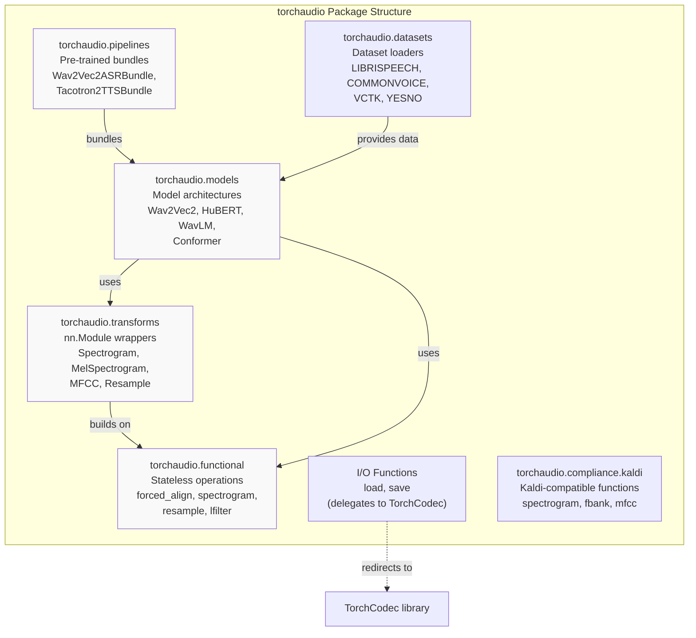
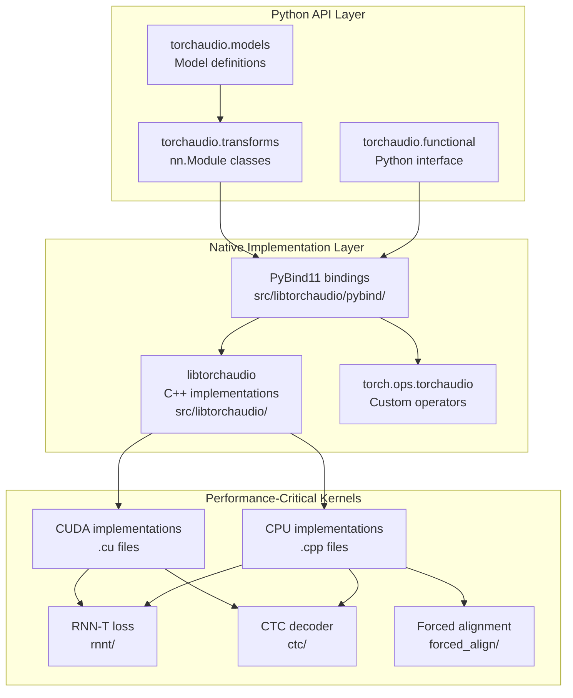
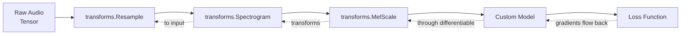
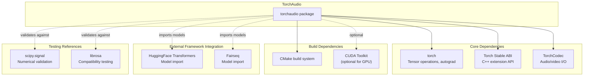
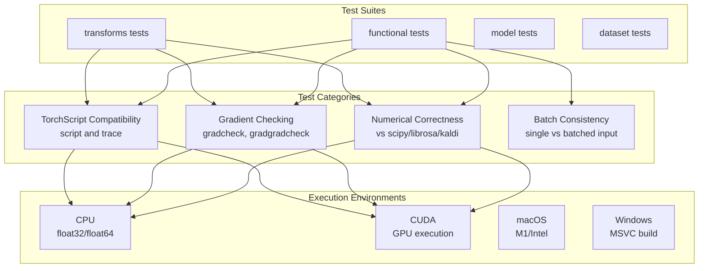

<!-- source: DeepWiki mcp.deepwiki.com · repo pytorch/audio · page 1 Overview · fetched 2026-10-21 -->

# Overview

<details>
<summary>Relevant source files</summary>

The following files were used as context for generating this wiki page:

- [CONTRIBUTING.md](CONTRIBUTING.md)
- [README.md](README.md)
- [docs/source/compliance.kaldi.rst](docs/source/compliance.kaldi.rst)
- [docs/source/index.rst](docs/source/index.rst)
- [docs/source/torchaudio.rst](docs/source/torchaudio.rst)
- [test/torchaudio_unittest/README.md](test/torchaudio_unittest/README.md)

</details>


This document provides a high-level introduction to TorchAudio, covering its purpose, architecture, design philosophy, and core components. For installation instructions, see [Installation and Getting Started](#1.1). For details about the library's transition to maintenance phase, see [Maintenance Phase and TorchCodec Migration](#1.2).

## Purpose and Scope

TorchAudio is a library for audio and signal processing with PyTorch. It applies PyTorch's capabilities—GPU acceleration, automatic differentiation, and TorchScript compatibility—to the audio domain. The library is primarily focused on machine learning applications rather than general-purpose signal processing.

As of version 2.9, TorchAudio has entered a maintenance phase with a more focused scope: processing audio data for ML. Audio/video I/O capabilities have been consolidated into the TorchCodec library, while TorchAudio retains its core audio processing, feature extraction, model, and dataset capabilities.

**Sources:** [README.md:1-29](), [docs/source/index.rst:1-18]()

## Library Architecture

TorchAudio is organized into distinct modules that operate at different abstraction levels, from low-level signal processing to high-level pre-trained pipelines.

### Module Organization



**Core Module Hierarchy:**

| Module | Type | Purpose | Example Components |
|--------|------|---------|-------------------|
| `torchaudio.functional` | Functions | Stateless signal processing operations | `forced_align`, `spectrogram`, `resample`, `lfilter` |
| `torchaudio.transforms` | Classes | Stateful `nn.Module` transforms | `Spectrogram`, `MelSpectrogram`, `MFCC`, `Resample` |
| `torchaudio.models` | Classes | Model architectures and factory functions | `Wav2Vec2`, `HuBERT`, `WavLM`, `Conformer` |
| `torchaudio.pipelines` | Bundles | Pre-trained models with preprocessing | `Wav2Vec2ASRBundle`, `Tacotron2TTSBundle`, `SourceSeparationBundle` |
| `torchaudio.datasets` | Classes | Dataset loaders implementing `torch.utils.data.Dataset` | `LIBRISPEECH`, `COMMONVOICE`, `VCTK` |
| `torchaudio.compliance.kaldi` | Functions | Kaldi-compatible implementations | `spectrogram`, `fbank`, `mfcc` |

**Sources:** [README.md:21-36](), [docs/source/index.rst:59-69](), [docs/source/torchaudio.rst:1-34]()

### Implementation Layers

TorchAudio's implementation spans multiple layers, from Python API to native C++/CUDA code:



Performance-critical operations such as `forced_align`, `rnnt_loss`, and CTC decoding are implemented in C++ and CUDA for efficiency, while maintaining a simple Python interface through PyBind11 bindings. This architecture allows TorchAudio to leverage native code performance while maintaining PyTorch's ease of use.

**Sources:** [README.md:21-28](), System Architecture Diagram 1 from context

## Design Philosophy

TorchAudio follows core PyTorch principles in its design:

### Differentiability and Autograd Integration

All transforms and functional operations are designed to be differentiable, enabling end-to-end training. Operations integrate with PyTorch's autograd system, allowing gradients to flow through audio processing pipelines.



**Sources:** [README.md:22-28](), [test/torchaudio_unittest/README.md:138-142]()

### TorchScript Compatibility

Transforms and models are designed to be compatible with TorchScript for production deployment. This allows audio processing pipelines to be serialized and run independently of Python.

```python
# Example from testing framework
# test/torchaudio_unittest/transforms/torchscript_consistency_impl.py
# Tests verify that transforms can be scripted and produce identical results
```

**Sources:** [test/torchaudio_unittest/README.md:49-52](), [CONTRIBUTING.md:138-139]()

### Tensor-First Design

All operations use PyTorch tensors as input and output, following PyTorch's dimension conventions:
- Batch dimension (optional): first dimension
- Channel dimension: before time dimension
- Time dimension: typically last dimension for waveforms
- Frequency dimension: before time dimension for spectrograms

**Sources:** [CONTRIBUTING.md:154-164]()

## Core Components

### Processing Operations

**Functional API** ([torchaudio.functional](#2.1)): Stateless functions for audio processing operations. These serve as building blocks for transforms and can be used directly for custom processing pipelines.

**Transforms** ([torchaudio.transforms](#2.2)): Stateful `nn.Module` implementations that wrap functional operations. Transforms can be integrated into `nn.Sequential` pipelines and saved with model checkpoints.

The relationship between functional and transforms is systematic: transforms maintain state (e.g., filter coefficients, window functions) while functional operations are pure functions.

**Sources:** [README.md:31-36](), [docs/source/index.rst:59-69]()

### Models and Pipelines

**Models** ([torchaudio.models](#4)): Contains architecture definitions and factory functions for speech and audio models including:
- Self-supervised models: `Wav2Vec2`, `HuBERT`, `WavLM`
- End-to-end ASR models: `Conformer`, RNN-T components
- Decoders: `ctc_decoder`, `cuda_ctc_decoder`

**Pipelines** ([torchaudio.pipelines](#4)): Bundles pre-trained models with their associated preprocessing, enabling end-to-end inference with minimal setup. Examples include `Wav2Vec2ASRBundle`, `Tacotron2TTSBundle`, and `SourceSeparationBundle`.

**Sources:** [README.md:30-36](), [docs/source/index.rst:59-69]()

### Data Loading

**Datasets** ([torchaudio.datasets](#3.2)): Provides loaders for common audio datasets that implement `torch.utils.data.Dataset`. These integrate seamlessly with PyTorch's `DataLoader` for batching and parallel loading.

**I/O Functions** ([torchaudio.load, torchaudio.save](#3.1)): Starting from version 2.9, these functions delegate to TorchCodec for audio and video I/O, maintaining a simple interface while leveraging TorchCodec's robust decoding capabilities.

**Sources:** [README.md:30](), [docs/source/torchaudio.rst:6-34]()

## Typical Data Flow

### From Raw Audio to Model Output

```mermaid
graph LR
    subgraph "Input"
        FILE["Audio File<br/>.wav, .flac, .mp3"]
        DS["torchaudio.datasets<br/>LIBRISPEECH, etc."]
    end
    
    subgraph "Loading"
        LOAD["torchaudio.load<br/>(via TorchCodec)"]
        WAV["Waveform Tensor<br/>shape: (channel, time)"]
    end
    
    subgraph "Preprocessing"
        RESAMPLE["transforms.Resample<br/>Change sample rate"]
        AUG["transforms.SpecAugment<br/>Data augmentation"]
    end
    
    subgraph "Feature Extraction"
        SPEC["transforms.Spectrogram<br/>STFT"]
        MEL["transforms.MelSpectrogram<br/>Mel scale"]
        MFCC["transforms.MFCC<br/>Cepstral features"]
    end
    
    subgraph "Model"
        W2V2["models.Wav2Vec2<br/>Self-supervised"]
        CUSTOM["Custom nn.Module"]
    end
    
    subgraph "Output"
        ASR["Text transcript"]
        CLASS["Classification"]
    end
    
    FILE --> LOAD
    DS --> WAV
    LOAD --> WAV
    WAV --> RESAMPLE
    RESAMPLE --> AUG
    AUG --> SPEC
    SPEC --> MEL
    MEL --> MFCC
    
    WAV --> W2V2
    MFCC --> CUSTOM
    
    W2V2 --> ASR
    CUSTOM --> CLASS
```



This flow demonstrates TorchAudio's modularity: users can enter at any stage (raw audio, preprocessed waveforms, or extracted features) and compose operations to build custom pipelines. Both traditional DSP approaches (waveform → spectrogram → MFCC → model) and modern end-to-end approaches (waveform → Wav2Vec2 → output) are supported.

**Sources:** System Diagram 5 from context, [README.md:30-36]()

## Integration with PyTorch Ecosystem

### Dependencies and Relationships



**Required Dependencies:**
- PyTorch: Core tensor library and autograd system
- TorchCodec: Audio and video I/O (as of version 2.9)

**Build-time Dependencies:**
- CMake: Build system orchestration
- C++ compiler (gcc/clang/MSVC)
- CUDA Toolkit (optional, for GPU support)

**Optional Interoperability:**
- HuggingFace Transformers: Import pre-trained models
- Fairseq: Import sequence-to-sequence models

**Sources:** [README.md:38-42](), [CONTRIBUTING.md:41-63](), System Diagram 6 from context

## Testing and Quality Assurance

TorchAudio maintains comprehensive testing across multiple dimensions:



The testing framework validates that operations:
1. Produce numerically correct results (compared to reference implementations)
2. Support gradient computation for training
3. Are compatible with TorchScript for deployment
4. Handle batched inputs consistently with single-sample inputs
5. Work correctly across different platforms and devices

For details on the testing framework and contributing tests, see [Testing Framework](#6.2).

**Sources:** [test/torchaudio_unittest/README.md:1-142](), [CONTRIBUTING.md:79-142]()

## Maintenance Phase

As of version 2.8, TorchAudio has transitioned to a maintenance phase with reduced scope:

**Removed Features (deprecated in 2.8, removed in 2.9):**
- Multiple I/O backends (SoX, SoundFile, FFmpeg)
- Built-in audio encoding/decoding

**Consolidated Features:**
- Audio/video I/O moved to TorchCodec
- `torchaudio.load` and `torchaudio.save` now delegate to TorchCodec

**Retained Features:**
- Core audio processing (functional and transforms)
- Feature extraction
- Models and pipelines
- Dataset loaders
- Kaldi compliance interface

This transition focuses TorchAudio on its strengths: processing audio data for machine learning applications. For complete details, see [Maintenance Phase and TorchCodec Migration](#1.2).

**Sources:** [README.md:10-19](), [docs/source/index.rst:10-17](), [docs/source/torchaudio.rst:6-17]()

---

