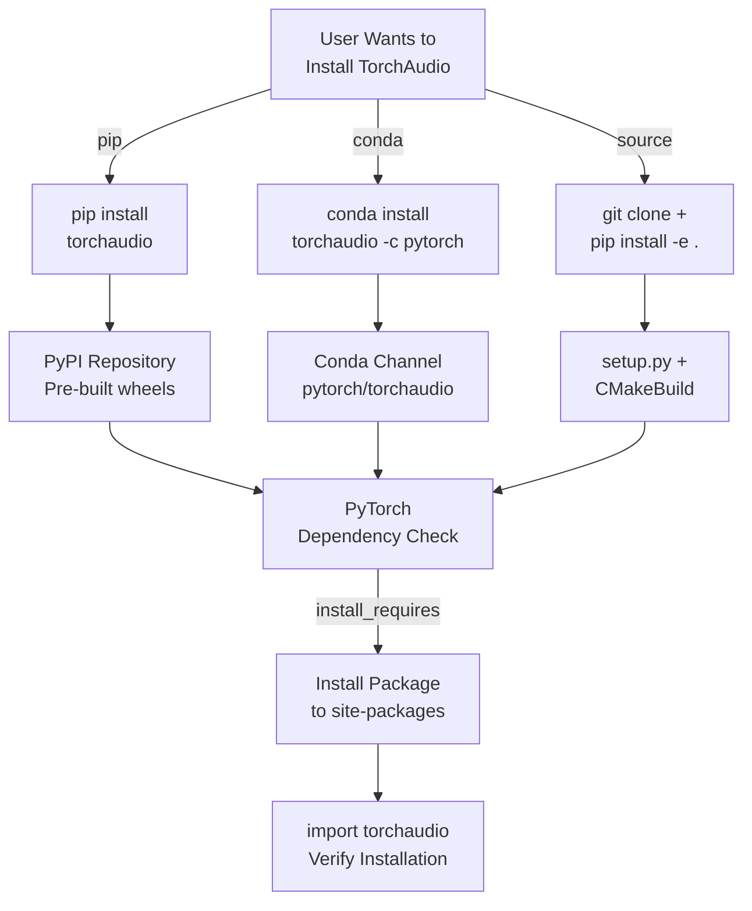
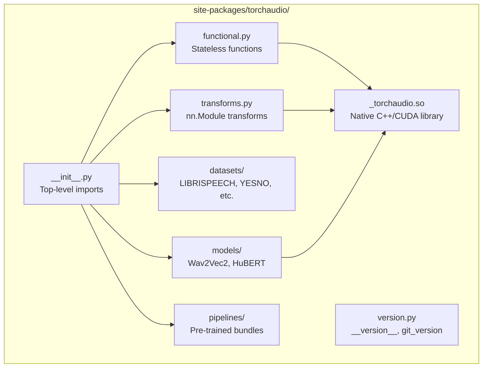
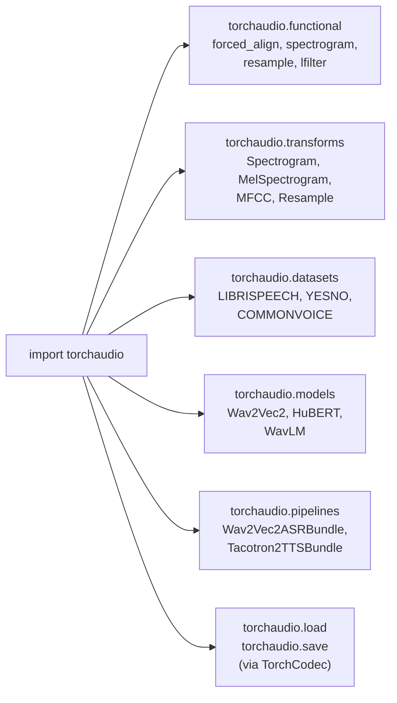

<!-- source: DeepWiki mcp.deepwiki.com · repo pytorch/audio · page 1.1 Installation and Getting Started · fetched 2026-10-21 -->

# Installation and Getting Started

<details>
<summary>Relevant source files</summary>

The following files were used as context for generating this wiki page:

- [CONTRIBUTING.md](CONTRIBUTING.md)
- [README.md](README.md)
- [docs/source/compliance.kaldi.rst](docs/source/compliance.kaldi.rst)
- [docs/source/index.rst](docs/source/index.rst)
- [docs/source/torchaudio.rst](docs/source/torchaudio.rst)
- [packaging/torchaudio/meta.yaml](packaging/torchaudio/meta.yaml)
- [setup.py](setup.py)
- [test/torchaudio_unittest/README.md](test/torchaudio_unittest/README.md)

</details>


## Purpose and Scope

This page guides users through installing TorchAudio and performing basic operations. It covers installation via pip and conda, system requirements, dependency management, and initial usage patterns. For building from source, see [Build Configuration](#5.1) and [CMake Build System](#5.2). For details on the TorchCodec migration and maintenance phase, see [Maintenance Phase and TorchCodec Migration](#1.2).

---

## System Requirements

TorchAudio requires PyTorch as a core dependency. The version matching is handled automatically during installation.

**Supported Platforms:**
- Linux (CPU and CUDA)
- macOS (x86_64 and arm64/M1)
- Windows (CPU and CUDA)

**Python Versions:**
TorchAudio supports Python 3.10, 3.11, 3.12, 3.13, and 3.14, as specified in [setup.py:122-126]().

**PyTorch Dependency:**
The PyTorch version requirement is determined dynamically based on the `PYTORCH_VERSION` environment variable during build, or defaults to the latest compatible version. See [setup.py:41-44]() for the version resolution logic.

Sources: [setup.py:122-126](), [setup.py:41-44](), [packaging/torchaudio/meta.yaml:15-29]()

---

## Installation Options

### Installation via pip

The simplest installation method is via PyPI using pip:

```bash
pip install torchaudio
```

This installs the latest stable release with CPU support. For CUDA-enabled versions, ensure PyTorch with CUDA is installed first:

```bash
# Example: Install PyTorch with CUDA 12.1 support first
pip install torch --index-url https://download.pytorch.org/whl/cu121
pip install torchaudio
```

**Nightly Builds:**
To install nightly builds with the latest features:

```bash
pip install --pre torchaudio --index-url https://download.pytorch.org/whl/nightly/cpu
```

Sources: [README.md:38-41](), [setup.py:99-140]()

### Installation via Conda

TorchAudio is available through the PyTorch conda channel:

```bash
# CPU version
conda install torchaudio -c pytorch

# CUDA version (example: CUDA 12.1)
conda install torchaudio pytorch-cuda=12.1 -c pytorch -c nvidia
```

The conda package includes metadata for platform-specific builds and automatic dependency resolution, as defined in [packaging/torchaudio/meta.yaml:1-70]().

Sources: [packaging/torchaudio/meta.yaml:1-70](), [README.md:38-41]()

### Building from Source

For development or custom builds, TorchAudio can be built from source. This requires CMake and a C++ compiler:

```bash
git clone https://github.com/pytorch/audio.git
cd audio
pip install -e .
```

The build process is orchestrated by [setup.py:82-144]() using a custom `CMakeBuild` command defined in `tools/setup_helpers.py`. For detailed build instructions including platform-specific configurations, see [Build Configuration](#5.1) and [CMake Build System](#5.2).

Sources: [setup.py:82-144](), [CONTRIBUTING.md:41-43](), [setup.py:133-136]()

---

## Installation Flow



**Installation Flow Diagram**

This diagram shows the three primary installation paths and how they converge. The `install_requires` check is defined in [setup.py:138](), which calls `_get_pytorch_version()` from [setup.py:41-44]().

Sources: [setup.py:138](), [setup.py:41-44](), [setup.py:133-136](), [packaging/torchaudio/meta.yaml:24-29]()

---

## Package Structure After Installation



**Installed Package Structure**

After installation, the package is located in the Python `site-packages` directory. The `version.py` file is generated during build by [setup.py:33-38](). The native extension `_torchaudio.so` (or `.pyd` on Windows) contains performance-critical C++ and CUDA implementations, built via the CMake system.

Sources: [setup.py:33-38](), [setup.py:131-132](), [setup.py:133-136]()

---

## Verifying Installation

After installation, verify that TorchAudio is properly installed:

```python
import torchaudio
print(torchaudio.__version__)
```

The version information is stored in the generated `version.py` file, which includes both the package version and git commit hash. See [setup.py:33-38]() for the version file generation logic.

**Checking Available Features:**

```python
import torchaudio
import torch

# Check if CUDA is available
print(f"CUDA available: {torch.cuda.is_available()}")

# Check installed modules
print(f"Functional: {hasattr(torchaudio, 'functional')}")
print(f"Transforms: {hasattr(torchaudio, 'transforms')}")
print(f"Models: {hasattr(torchaudio, 'models')}")
```

Sources: [setup.py:33-38](), [docs/source/torchaudio.rst:1-34]()

---

## Basic Usage Patterns

### Importing TorchAudio Modules



**TorchAudio Module Organization**

This diagram maps the import structure to actual module contents. The `load` and `save` functions are now aliases to TorchCodec functions as of version 2.9. See [Audio I/O and TorchCodec Migration](#3.1) for details.

Sources: [docs/source/index.rst:59-69](), [docs/source/torchaudio.rst:19-34](), [README.md:30-36]()

### Loading Audio Files

**Important:** As of TorchAudio 2.9, audio I/O has been migrated to TorchCodec. The `torchaudio.load` and `torchaudio.save` functions are now aliases to TorchCodec functions. For full details, see [Maintenance Phase and TorchCodec Migration](#1.2) and [Audio I/O and TorchCodec Migration](#3.1).

```python
import torchaudio

# Load audio file (uses TorchCodec internally)
waveform, sample_rate = torchaudio.load("audio.wav")
print(f"Waveform shape: {waveform.shape}")  # (channels, time)
print(f"Sample rate: {sample_rate}")
```

Sources: [docs/source/torchaudio.rst:6-17](), [docs/source/torchaudio.rst:19-34]()

### Applying Transforms

```python
import torchaudio.transforms as T

# Create a mel spectrogram transform
mel_spectrogram = T.MelSpectrogram(
    sample_rate=16000,
    n_fft=1024,
    hop_length=512,
    n_mels=128
)

# Apply to waveform
mel_spec = mel_spectrogram(waveform)
print(f"Mel spectrogram shape: {mel_spec.shape}")  # (channels, n_mels, time)
```

The `torchaudio.transforms` module provides `nn.Module`-based transforms that can be integrated into PyTorch models. See [Transforms](#2.2) for comprehensive documentation.

Sources: [docs/source/transforms.rst](), [README.md:33-34]()

### Using Functional Operations

```python
import torchaudio.functional as F

# Resample audio
resampled = F.resample(waveform, orig_freq=44100, new_freq=16000)

# Compute spectrogram
specgram = F.spectrogram(
    waveform,
    pad=0,
    window=torch.hann_window(400),
    n_fft=512,
    hop_length=256,
    win_length=400,
    power=2.0,
    normalized=False
)
```

The `torchaudio.functional` module provides stateless functions for audio processing. See [Functional API](#2.1) for complete reference.

Sources: [docs/source/functional.rst](), [README.md:31-32]()

### Loading Pre-trained Models

```python
from torchaudio.pipelines import WAV2VEC2_ASR_BASE_960H

# Load pre-trained bundle
bundle = WAV2VEC2_ASR_BASE_960H

# Get the model
model = bundle.get_model()

# Get sample rate expected by the model
print(f"Expected sample rate: {bundle.sample_rate}")
```

The `torchaudio.pipelines` module provides pre-trained model bundles with associated preprocessing. See [ASR Pipelines](#4.2) for details on available bundles.

Sources: [docs/source/pipelines.rst](), [README.md:30-36]()

---

## Dependencies

### Required Dependencies

| Dependency | Purpose | Version Constraint |
|------------|---------|-------------------|
| PyTorch | Core tensor library and autograd | Matched to TorchAudio version |
| Python | Runtime environment | 3.10, 3.11, 3.12, 3.13, 3.14 |

The PyTorch version is specified in [setup.py:138]() via the `_get_pytorch_version()` function. For conda builds, the constraint is specified in [packaging/torchaudio/meta.yaml:20]().

Sources: [setup.py:138](), [setup.py:41-44](), [packaging/torchaudio/meta.yaml:14-22]()

### Optional Dependencies

| Dependency | Purpose | When Needed |
|------------|---------|-------------|
| TorchCodec | Audio/video I/O | Using `torchaudio.load()` or `torchaudio.save()` |
| CUDA Toolkit | GPU acceleration | Using CUDA-based operations |
| scipy | Reference for numerical tests | Development/testing |
| librosa | Compatibility testing | Development/testing |
| soundfile | Alternative audio backend | Legacy I/O (deprecated) |

**Note on TorchCodec:** Starting with version 2.8, TorchAudio deprecated its own I/O backends in favor of TorchCodec. As of version 2.9, `torchaudio.load` and `torchaudio.save` are aliases to TorchCodec functions. See [Maintenance Phase and TorchCodec Migration](#1.2).

Sources: [README.md:10-19](), [docs/source/index.rst:10-17](), [CONTRIBUTING.md:48-62]()

### Development Dependencies

For building from source or contributing, additional dependencies are required:

```bash
# Build dependencies
pip install cmake ninja

# Testing dependencies
pip install pytest scipy numpy parameterized

# Optional testing dependencies
pip install librosa requests soundfile transformers
```

The complete list of testing dependencies is documented in [CONTRIBUTING.md:48-62]().

Sources: [CONTRIBUTING.md:48-62](), [packaging/torchaudio/meta.yaml:14-22]()

---

## Platform-Specific Considerations

### Linux

Linux builds support both CPU and CUDA configurations. CUDA support requires the CUDA Toolkit to be installed and the `CUDA_HOME` environment variable set during build.

**CUDA Version Compatibility:**
The CUDA version must match the PyTorch CUDA version. Use the PyTorch website to find compatible wheel files or build from source with matching CUDA toolkit.

Sources: [packaging/torchaudio/meta.yaml:40-47](), [setup.py:1-144]()

### macOS

macOS builds support both Intel (x86_64) and Apple Silicon (arm64) architectures. Universal wheels are available for seamless installation on both platforms.

**macOS Deployment Target:**
The minimum macOS version is controlled by the `MACOSX_DEPLOYMENT_TARGET` environment variable during build, as referenced in [packaging/torchaudio/meta.yaml:47]().

Sources: [packaging/torchaudio/meta.yaml:47](), [setup.py:113-130]()

### Windows

Windows builds require Visual Studio C++ compiler (MSVC). Both CPU and CUDA variants are available.

**Compiler Requirements:**
The conda build configuration specifies compiler requirements in [packaging/torchaudio/meta.yaml:11-12]().

Sources: [packaging/torchaudio/meta.yaml:11-12](), [setup.py:113-130]()

---

## Troubleshooting Installation

### ImportError: No module named 'torchaudio'

Ensure PyTorch is installed first:
```bash
pip install torch
pip install torchaudio
```

### Version Mismatch Between PyTorch and TorchAudio

TorchAudio versions are designed to match PyTorch versions. Check compatibility:
```python
import torch
import torchaudio
print(f"PyTorch: {torch.__version__}")
print(f"TorchAudio: {torchaudio.__version__}")
```

Install matching versions explicitly if needed:
```bash
pip install torch==2.1.0 torchaudio==2.1.0
```

### Native Extension Loading Errors

If you encounter errors loading `_torchaudio.so` (or `_torchaudio.pyd` on Windows), this indicates a build compatibility issue. Solutions:

1. Reinstall with matching PyTorch ABI
2. Build from source with your current PyTorch installation
3. Check that CUDA versions match between PyTorch and system CUDA toolkit

The native extension is built via the CMake system defined in [setup.py:133-136]().

Sources: [setup.py:133-136](), [setup.py:41-44]()

---

## Next Steps

After installation, explore the following:

- **Audio Processing:** See [Core Audio Processing](#2) for functional operations and transforms
- **Feature Extraction:** See [Feature Extraction](#2.3) for spectrograms, MFCCs, and more
- **Pre-trained Models:** See [Models and Pipelines](#4) for ASR, TTS, and source separation
- **Datasets:** See [Datasets](#3.2) for available dataset loaders
- **Building from Source:** See [Build Configuration](#5.1) for custom builds

For API reference, consult the official documentation at https://pytorch.org/audio/.

Sources: [README.md:44-47](), [docs/source/index.rst:24-70]()

---

