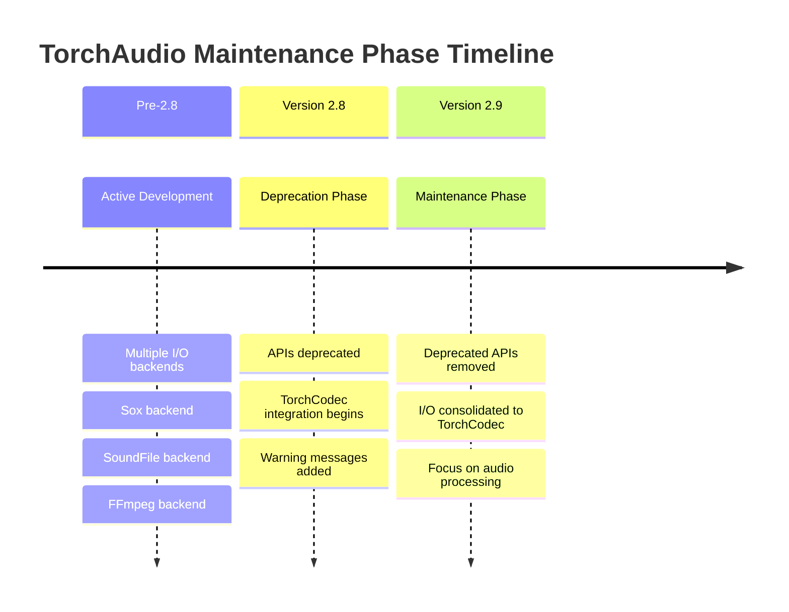
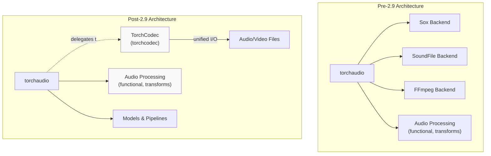
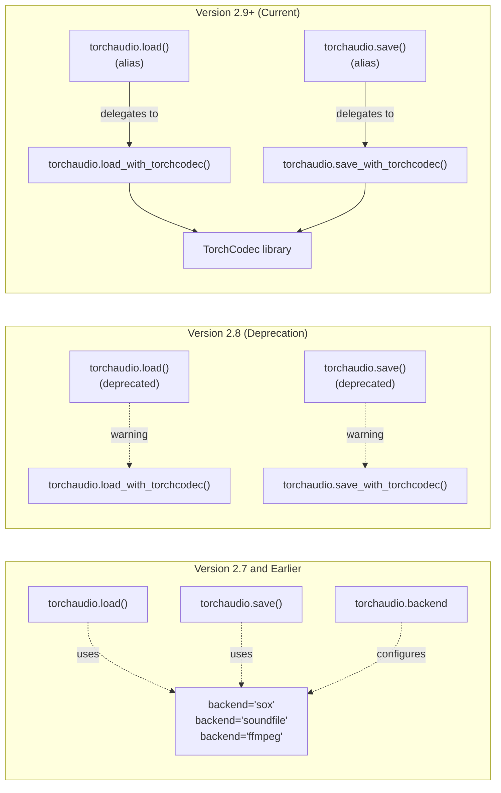
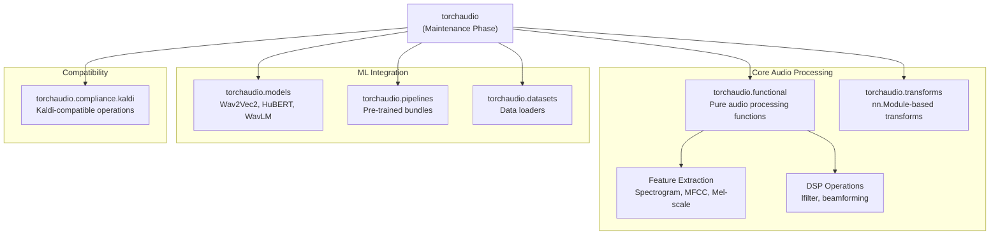
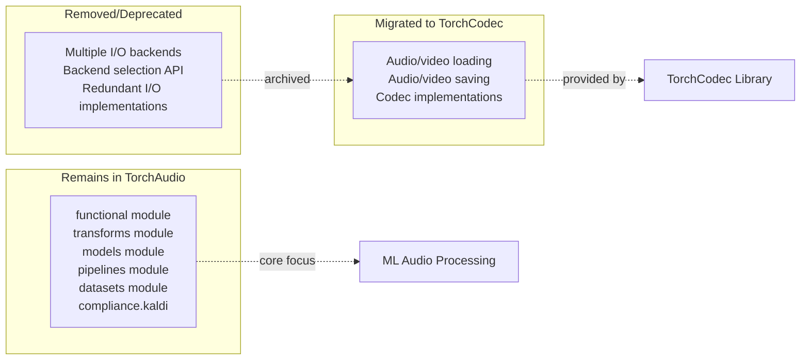

<!-- source: DeepWiki mcp.deepwiki.com · repo pytorch/audio · page 1.2 Maintenance Phase and TorchCodec Migration · fetched 2026-10-21 -->

# Maintenance Phase and TorchCodec Migration

<details>
<summary>Relevant source files</summary>

The following files were used as context for generating this wiki page:

- [CONTRIBUTING.md](CONTRIBUTING.md)
- [README.md](README.md)
- [docs/source/compliance.kaldi.rst](docs/source/compliance.kaldi.rst)
- [docs/source/index.rst](docs/source/index.rst)
- [docs/source/torchaudio.rst](docs/source/torchaudio.rst)
- [test/torchaudio_unittest/README.md](test/torchaudio_unittest/README.md)

</details>


**Purpose and Scope**: This document explains TorchAudio's transition to a maintenance phase starting with version 2.8, the consolidation of I/O functionality into TorchCodec, and the implications for users. It covers what changed, why, and how to migrate existing code. For installation instructions, see [Installation and Getting Started](#1.1). For details on the current I/O APIs, see [Audio I/O and TorchCodec Migration](#3.1).

---

## Overview of the Maintenance Phase

Starting with version 2.8, TorchAudio entered a **maintenance phase** focused on reducing redundancy with the PyTorch ecosystem, simplifying maintenance, and concentrating on its core strength: **audio processing for machine learning**. This transition involved deprecating features in version 2.8 and removing them in version 2.9.

### Timeline and Changes



**Sources**: [README.md:11-19](), [docs/source/index.rst:11-17](), [docs/source/torchaudio.rst:7-17]()

### Goals of the Transition

| Goal | Description | Impact |
|------|-------------|--------|
| **Reduce Redundancy** | Eliminate duplicate functionality across PyTorch ecosystem | I/O moved to specialized TorchCodec library |
| **Easier Maintenance** | Reduce codebase complexity and maintenance burden | Removal of multiple backend implementations |
| **Focused Scope** | Concentrate on audio processing for ML | Clearer library boundaries and responsibilities |

The official announcement and detailed discussion can be found in the community message at https://github.com/pytorch/audio/issues/3902 (referenced in [README.md:18]()).

**Sources**: [README.md:14-16](), [docs/source/index.rst:11-17]()

---

## TorchCodec: The New I/O Backend

**TorchCodec** is a specialized library that consolidates audio and video decoding and encoding capabilities for the PyTorch ecosystem. Prior to this consolidation, TorchAudio maintained multiple I/O backend implementations (Sox, SoundFile, FFmpeg), which created redundancy and maintenance overhead.

### Architecture: TorchAudio and TorchCodec Separation



**Diagram**: Architectural shift from multiple backends to TorchCodec delegation

**Sources**: [README.md:11-19](), [docs/source/index.rst:14-16](), [docs/source/torchaudio.rst:10-14]()

### Responsibility Split

| Library | Responsibility | Key Modules |
|---------|---------------|-------------|
| **TorchCodec** | Audio/video I/O (load, save, decode, encode) | Codec implementations, format handling |
| **TorchAudio** | Audio processing for ML | `functional`, `transforms`, `models`, `pipelines`, `datasets` |

This separation allows each library to focus on its core competency while reducing duplication of effort.

**Sources**: [README.md:16-17](), [docs/source/index.rst:14-15]()

---

## API Changes and Migration

### I/O Function Evolution

The I/O APIs underwent significant changes to integrate with TorchCodec:



**Diagram**: Evolution of I/O APIs across versions

**Sources**: [docs/source/torchaudio.rst:7-17]()

### Current API Structure

In version 2.9 and later, the `torchaudio` top-level module provides these I/O functions (as documented in [docs/source/torchaudio.rst:19-33]()):

| Function | Description | Status |
|----------|-------------|--------|
| `torchaudio.load` | Load audio file | Alias to `load_with_torchcodec` |
| `torchaudio.save` | Save audio file | Alias to `save_with_torchcodec` |
| `torchaudio.load_with_torchcodec` | Direct TorchCodec loading | Primary implementation |
| `torchaudio.save_with_torchcodec` | Direct TorchCodec saving | Primary implementation |

**Sources**: [docs/source/torchaudio.rst:19-33]()

### Migration Guidance

#### Backward Compatibility Aliases

For backward compatibility, `torchaudio.load` and `torchaudio.save` continue to work as aliases:

```python
# This still works in version 2.9+
import torchaudio
waveform, sample_rate = torchaudio.load("audio.wav")
torchaudio.save("output.wav", waveform, sample_rate)
```

The functions delegate to `load_with_torchcodec` and `save_with_torchcodec` internally ([docs/source/torchaudio.rst:12-14]()).

#### Recommended Migration Path

However, the documentation recommends **porting code to native TorchCodec APIs** for long-term maintainability:

```python
# Recommended: Use TorchCodec directly
import torchcodec
# Use torchcodec native APIs
```

This allows users to:
1. Access the full TorchCodec feature set
2. Get updates and improvements directly from TorchCodec
3. Reduce dependency on TorchAudio for I/O operations

**Sources**: [docs/source/torchaudio.rst:15-16]()

#### Removed Backend Selection

The old backend selection mechanism is no longer available:

```python
# NO LONGER SUPPORTED (removed in 2.9):
# torchaudio.set_audio_backend("sox")
# torchaudio.load(file, backend="soundfile")
```

All I/O now goes through TorchCodec's unified implementation.

**Sources**: [docs/source/index.rst:14-15]()

---

## TorchAudio's Focused Scope

With I/O functionality delegated to TorchCodec, TorchAudio now focuses exclusively on its core competency: **processing audio data for machine learning**.

### What Remains in TorchAudio



**Diagram**: TorchAudio's focused scope in maintenance phase

**Sources**: [README.md:21-36]()

### Core Capabilities

As stated in [README.md:21-28](), TorchAudio continues to provide:

1. **Audio Processing for ML**: All computations are PyTorch operations, enabling:
   - Strong GPU acceleration
   - Trainable features through autograd
   - Consistent PyTorch-style tensor operations

2. **Key Features** (from [README.md:30-36]()):
   - Dataloaders for common audio datasets
   - Audio and speech processing functions (e.g., `forced_align`)
   - Common audio transforms (Spectrogram, MelSpectrogram, MFCC, Resample, etc.)
   - Compliance interfaces (Kaldi-compatible operations)

3. **What Sets TorchAudio Apart**: "It is primarily a machine learning library and not a general signal processing library" ([README.md:25-26]()).

**Sources**: [README.md:21-36]()

---

## Summary of Changes



**Diagram**: High-level summary of the maintenance phase changes

### Version-Specific Changes

| Version | Changes | Impact |
|---------|---------|--------|
| **2.8** | APIs deprecated, warnings added | Users receive deprecation warnings |
| **2.9** | Deprecated APIs removed, TorchCodec integration complete | Must use new I/O APIs or TorchCodec directly |
| **Future** | Maintenance only, focused on audio processing for ML | Feature additions unlikely; bug fixes and PyTorch compatibility updates continue |

**Sources**: [README.md:11-19](), [docs/source/index.rst:11-17](), [docs/source/torchaudio.rst:7-17]()

---

## Impact on Development and Testing

The maintenance phase also affects development practices:

### Testing Structure

The test suite (as documented in [test/torchaudio_unittest/README.md]()) continues to validate:
- Numerical compatibility against existing software (scipy, librosa, Kaldi)
- TorchScript consistency
- Batch consistency
- Autograd compatibility

However, I/O-specific tests now focus on TorchCodec integration rather than multiple backend implementations.

### Contribution Focus

As noted in [CONTRIBUTING.md:8-14](), contributions are still welcome for:
- Bug fixes (no discussion needed)
- New features in core audio processing (requires discussion)
- Documentation improvements

However, new I/O functionality should be contributed to TorchCodec instead of TorchAudio.

**Sources**: [test/torchaudio_unittest/README.md:1-142](), [CONTRIBUTING.md:1-195]()

---

