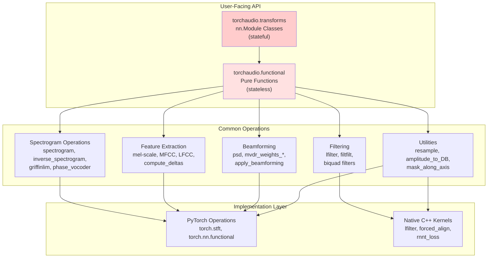
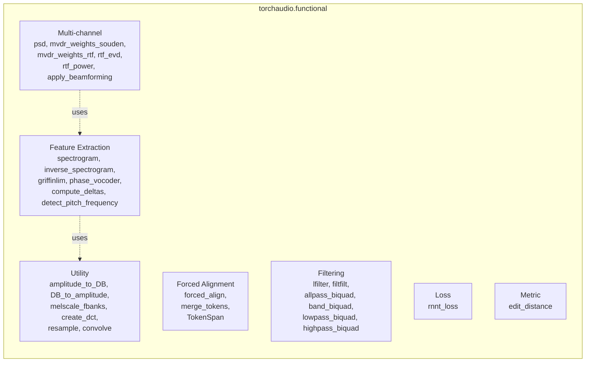
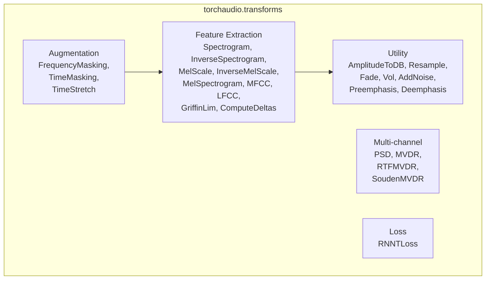
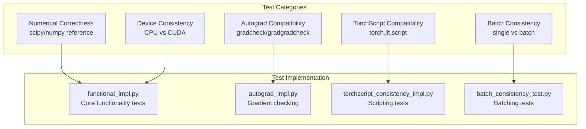
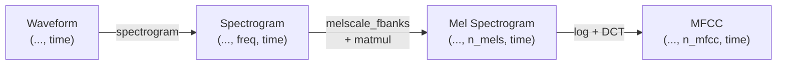
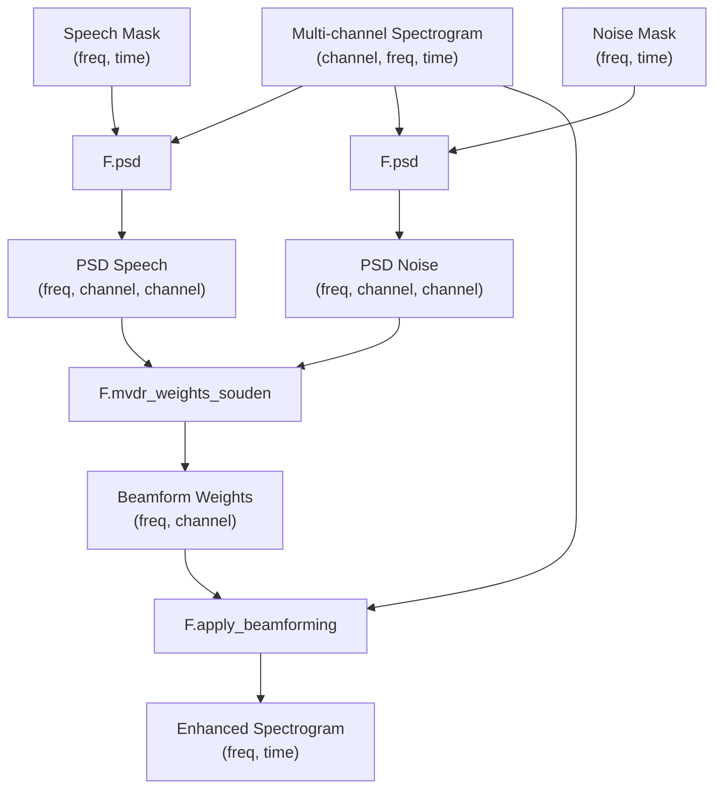

<!-- source: DeepWiki mcp.deepwiki.com · repo pytorch/audio · page 2 Core Audio Processing · fetched 2026-10-21 -->

# Core Audio Processing

<details>
<summary>Relevant source files</summary>

The following files were used as context for generating this wiki page:

- [docs/source/functional.rst](docs/source/functional.rst)
- [docs/source/transforms.rst](docs/source/transforms.rst)
- [test/torchaudio_unittest/common_utils/beamform_utils.py](test/torchaudio_unittest/common_utils/beamform_utils.py)
- [test/torchaudio_unittest/functional/autograd_impl.py](test/torchaudio_unittest/functional/autograd_impl.py)
- [test/torchaudio_unittest/functional/batch_consistency_test.py](test/torchaudio_unittest/functional/batch_consistency_test.py)
- [test/torchaudio_unittest/functional/functional_cpu_test.py](test/torchaudio_unittest/functional/functional_cpu_test.py)
- [test/torchaudio_unittest/functional/functional_cuda_test.py](test/torchaudio_unittest/functional/functional_cuda_test.py)
- [test/torchaudio_unittest/functional/functional_impl.py](test/torchaudio_unittest/functional/functional_impl.py)
- [test/torchaudio_unittest/functional/torchscript_consistency_impl.py](test/torchaudio_unittest/functional/torchscript_consistency_impl.py)
- [test/torchaudio_unittest/transforms/autograd_test_impl.py](test/torchaudio_unittest/transforms/autograd_test_impl.py)
- [test/torchaudio_unittest/transforms/batch_consistency_test.py](test/torchaudio_unittest/transforms/batch_consistency_test.py)
- [test/torchaudio_unittest/transforms/torchscript_consistency_impl.py](test/torchaudio_unittest/transforms/torchscript_consistency_impl.py)
- [test/torchaudio_unittest/transforms/transforms_test.py](test/torchaudio_unittest/transforms/transforms_test.py)
- [test/torchaudio_unittest/transforms/transforms_test_impl.py](test/torchaudio_unittest/transforms/transforms_test_impl.py)

</details>


This page documents TorchAudio's core audio processing capabilities, including the `torchaudio.functional` module (stateless pure functions) and the `torchaudio.transforms` module (stateful `nn.Module` components). These modules provide the fundamental building blocks for audio feature extraction, signal processing, and augmentation.

For information about pre-trained models and pipelines, see [Models and Pipelines](#4). For native C++ and CUDA implementation details, see [Native C++ and CUDA Implementations](#2.5). For I/O operations, see [Audio I/O and TorchCodec Migration](#3.1).

## Design Philosophy

TorchAudio's core processing layer is designed with three key principles:

**Differentiability**: All operations support automatic differentiation via PyTorch's autograd system, enabling end-to-end training of audio processing pipelines. Tests verify gradient correctness using `gradcheck` and `gradgradcheck`.

**TorchScript Compatibility**: Operations are compatible with `torch.jit.script` for deployment and optimization. Tests verify that scripted and eager execution produce identical results.

**Batch Processing**: Operations handle arbitrary batch dimensions consistently. Tests verify that batched processing produces identical results to per-item processing.

Sources: [test/torchaudio_unittest/functional/autograd_impl.py:19-35](), [test/torchaudio_unittest/functional/torchscript_consistency_impl.py:11-31](), [test/torchaudio_unittest/functional/batch_consistency_test.py:26-42]()

## Module Architecture



**Relationship Between Functional and Transforms**

The `torchaudio.transforms` module builds on `torchaudio.functional` by wrapping functions in `nn.Module` classes. This enables:
- Parameter persistence (e.g., filterbank matrices, window functions)
- Integration with `nn.Sequential` and custom modules
- State management for operations like `Resample` that cache kernels

Example: `T.Spectrogram` wraps `F.spectrogram` and stores the window tensor as a buffer, while `T.Resample` caches resampling kernels to avoid recomputation.

Sources: [docs/source/functional.rst:1-125](), [docs/source/transforms.rst:1-154]()

## Functional API Organization



All functional operations are stateless pure functions that accept tensors and return tensors. They are organized into seven categories as shown above and documented in [docs/source/functional.rst]().

**Key Characteristics:**
- **Pure functions**: No internal state, deterministic output for given inputs
- **Device agnostic**: Work on CPU, CUDA, and other devices
- **dtype flexible**: Support `float32`, `float64`, and complex types where applicable
- **Arbitrary batch dimensions**: Leading dimensions are preserved through operations

Sources: [docs/source/functional.rst:1-125]()

## Transforms API Organization



Transform classes inherit from `torch.nn.Module` and can be:
- Composed using `torch.nn.Sequential`
- Moved to specific devices/dtypes with `.to()`
- Saved/loaded with state_dict
- Scripted with `torch.jit.script`

**Example Pipeline Construction:**

```python
class MyPipeline(torch.nn.Module):
    def __init__(self):
        super().__init__()
        self.resample = T.Resample(16000, 8000)
        self.spec = T.Spectrogram(n_fft=400, power=2)
        self.mel = T.MelScale(n_mels=128, sample_rate=8000, n_stft=201)
    
    def forward(self, waveform):
        return self.mel(self.spec(self.resample(waveform)))
```

Sources: [docs/source/transforms.rst:8-73](), [test/torchaudio_unittest/transforms/transforms_test_impl.py:20-136]()

## Testing Framework

TorchAudio employs a comprehensive testing strategy to ensure correctness across multiple dimensions:



### Numerical Correctness

Operations are validated against reference implementations from `scipy.signal`, `numpy`, and `librosa`. Tests verify outputs match within specified tolerances.

Example: `lfilter` is tested against `scipy.signal.sosfilt` for high-order filters:

Sources: [test/torchaudio_unittest/functional/functional_impl.py:125-144]()

### Autograd Compatibility

All differentiable operations must pass `torch.autograd.gradcheck` and `torch.autograd.gradgradcheck` to verify first and second-order gradients are correct.

Example autograd test pattern:
```python
def assert_grad(self, transform, inputs):
    # Convert to float64 for gradcheck precision requirements
    inputs_ = [i.to(dtype=torch.double, device=self.device) for i in inputs]
    assert gradcheck(transform, inputs_)
    assert gradgradcheck(transform, inputs_)
```

Sources: [test/torchaudio_unittest/functional/autograd_impl.py:19-35](), [test/torchaudio_unittest/transforms/autograd_test_impl.py:24-45]()

### TorchScript Compatibility

Tests verify that `torch.jit.script(transform)` produces identical outputs to eager mode execution:

Sources: [test/torchaudio_unittest/functional/torchscript_consistency_impl.py:14-31]()

### Batch Consistency

Tests ensure batched inputs produce identical results to processing items individually:

Sources: [test/torchaudio_unittest/functional/batch_consistency_test.py:26-42]()

## Operation Categories

### Spectrogram and Time-Frequency Operations

The core time-frequency transformation operations:

| Function/Transform | Purpose | Key Parameters |
|-------------------|---------|----------------|
| `F.spectrogram` / `T.Spectrogram` | Compute STFT-based spectrogram | `n_fft`, `hop_length`, `power`, `normalized` |
| `F.inverse_spectrogram` / `T.InverseSpectrogram` | Reconstruct waveform from spectrogram | `n_fft`, `hop_length`, `length` |
| `F.griffinlim` / `T.GriffinLim` | Phase reconstruction algorithm | `n_iter`, `momentum`, `rand_init` |
| `F.phase_vocoder` | Time-stretch in frequency domain | `rate`, `phase_advance` |

**Normalization Options:**
- `normalized=False`: No normalization
- `normalized=True` or `"window"`: Normalize by sum of squared window samples: `sqrt(3 * n_fft / 8)` for Hann window
- `normalized="frame_length"`: Normalize by `sqrt(n_fft)`

Sources: [test/torchaudio_unittest/functional/functional_impl.py:256-318](), [docs/source/functional.rst:76-93]()

### Mel-Scale and Perceptual Features



| Operation | Purpose | Key Parameters |
|-----------|---------|----------------|
| `F.melscale_fbanks` | Create mel-scale filterbank matrix | `n_mels`, `sample_rate`, `f_min`, `f_max`, `norm` |
| `T.MelScale` | Apply mel-scale filterbank to spectrogram | `n_mels`, `sample_rate`, `n_stft` |
| `T.MelSpectrogram` | Combined spectrogram + mel-scale | `sample_rate`, `n_fft`, `n_mels` |
| `T.MFCC` | Mel-frequency cepstral coefficients | `sample_rate`, `n_mfcc`, `log_mels`, `melkwargs` |
| `T.LFCC` | Linear-frequency cepstral coefficients | `sample_rate`, `n_lfcc`, `n_filter`, `speckwargs` |
| `F.create_dct` | Create DCT transformation matrix | `n_mfcc`, `n_mels`, `norm` |

**MFCC/LFCC DCT Normalization:**
- `norm="ortho"`: Orthonormal DCT (first coefficient scaled by `sqrt(n_mels) * 2`, rest by `sqrt(n_mels/2) * 2`)
- `norm=None`: Unnormalized DCT

Sources: [docs/source/functional.rst:17-21](), [test/torchaudio_unittest/transforms/transforms_test.py:132-174]()

### Filtering Operations

TorchAudio provides both general-purpose filters and specialized audio filters:

**General Filters:**
- `F.lfilter`: Apply IIR/FIR filter with `a_coeffs` and `b_coeffs`
- `F.filtfilt`: Zero-phase filtering (forward-backward filter)

**Biquad Filters:**
All biquad filters implement second-order IIR filtering with specific frequency responses:

| Filter | Purpose | Parameters |
|--------|---------|------------|
| `F.lowpass_biquad` | Low-pass filter | `cutoff_freq`, `Q` |
| `F.highpass_biquad` | High-pass filter | `cutoff_freq`, `Q` |
| `F.bandpass_biquad` | Band-pass filter | `central_freq`, `Q`, `const_skirt_gain` |
| `F.bandreject_biquad` | Band-reject (notch) filter | `central_freq`, `Q` |
| `F.allpass_biquad` | All-pass filter (phase shift) | `central_freq`, `Q` |
| `F.equalizer_biquad` | Parametric equalizer | `central_freq`, `gain`, `Q` |
| `F.bass_biquad` | Bass boost/cut | `central_freq`, `gain`, `Q` |
| `F.treble_biquad` | Treble boost/cut | `central_freq`, `gain`, `Q` |

**Filter Stability:**

High-order filters can become numerically unstable. TorchAudio's `lfilter` uses direct-form implementation, which is less stable than cascaded second-order sections used by scipy:

Sources: [test/torchaudio_unittest/functional/functional_impl.py:125-144](), [docs/source/functional.rst:47-75]()

### Beamforming and Multi-Channel Processing

Multi-channel audio processing operations for spatial filtering:



**Power Spectral Density (PSD):**
- `F.psd` / `T.PSD`: Compute PSD matrix from multi-channel spectrogram
- Optional mask weighting for time-frequency bins
- Normalization options for mask

**MVDR Beamforming:**
Two formulations for computing Minimum Variance Distortionless Response beamformer weights:

1. **Souden's Method** (`F.mvdr_weights_souden`): Uses speech and noise PSD matrices directly
2. **RTF-based Method** (`F.mvdr_weights_rtf`): Uses relative transfer function and noise PSD

**RTF Estimation:**
- `F.rtf_evd`: Eigenvalue decomposition method
- `F.rtf_power`: Power iteration method

Sources: [docs/source/functional.rst:94-107](), [test/torchaudio_unittest/functional/functional_impl.py:690-843](), [test/torchaudio_unittest/common_utils/beamform_utils.py:1-85]()

### Data Augmentation

**SpecAugment** operations for training robustness:

| Transform | Purpose | Key Parameters |
|-----------|---------|----------------|
| `T.FrequencyMasking` | Mask contiguous frequency bins | `freq_mask_param`, `iid_masks` |
| `T.TimeMasking` | Mask contiguous time frames | `time_mask_param`, `iid_masks`, `p` |
| `T.TimeStretch` | Time-domain stretching via phase vocoder | `n_freq`, `fixed_rate` |

**Masking Behavior:**
- `iid_masks=False`: Same mask for all items in batch
- `iid_masks=True`: Independent mask per batch item
- `p`: Probability parameter (fraction of dimension to mask)

Sources: [docs/source/transforms.rst:121-133](), [test/torchaudio_unittest/functional/functional_impl.py:400-499]()

### Resampling

Resampling changes the sample rate of waveforms:

**Methods:**
- `resampling_method="sinc_interp_hann"`: Sinc interpolation with Hann window (default)
- `resampling_method="sinc_interp_kaiser"`: Sinc interpolation with Kaiser window

**Parameters:**
- `lowpass_filter_width`: Width of lowpass filter (Kaiser only)
- `rolloff`: Roll-off frequency as fraction of Nyquist (Kaiser only)
- `beta`: Kaiser window beta parameter

**Kernel Caching:**
`T.Resample` caches the resampling kernel to avoid recomputation across forward passes. The kernel dtype can be specified via the `dtype` parameter:

Sources: [test/torchaudio_unittest/transforms/transforms_test_impl.py:62-82](), [test/torchaudio_unittest/functional/functional_impl.py:509-565]()

### Loss Functions

**RNN-Transducer Loss:**

`F.rnnt_loss` and `T.RNNTLoss` implement the RNN-Transducer loss for sequence-to-sequence training:

| Parameter | Type | Description |
|-----------|------|-------------|
| `logits` | Tensor | Predictions of shape `(batch, time, target, classes)` |
| `targets` | Tensor | Target sequences of shape `(batch, target_length)` |
| `logit_lengths` | Tensor | Valid time steps per batch item |
| `target_lengths` | Tensor | Valid target lengths per batch item |
| `blank` | int | Blank label index |
| `reduction` | str | Reduction method: `"mean"`, `"sum"`, or `"none"` |
| `fused_log_softmax` | bool | Apply log_softmax internally (default: `True`) |

**Native Implementation:**
The core computation is implemented in C++ with CUDA acceleration for performance. Tests verify numerical correctness against reference implementations.

Sources: [docs/source/functional.rst:108-116](), [test/torchaudio_unittest/functional/functional_impl.py:634-689]()

## Type Support and Device Handling

### Supported Data Types

Most operations support:
- **Real**: `torch.float32`, `torch.float64`
- **Complex**: `torch.complex64`, `torch.complex128` (for spectrogram, beamforming)

Tests validate numerical behavior across dtypes, with higher precision requirements for `float64` in gradient checking.

### Complex Number Handling

Operations returning complex outputs (e.g., STFT-based spectrograms) support:
- `return_complex=True`: Return native complex tensors
- `return_complex=False`: Return stacked real/imaginary tensors (deprecated)

Power spectrograms (`power=1.0` or `power=2.0`) always return real-valued tensors.

### Device Consistency

All operations are device-agnostic and work on CPU, CUDA, and other PyTorch-supported devices. Tests verify:
- Identical numerical results across devices (within floating-point precision)
- Proper device placement of outputs
- Efficient GPU utilization for supported operations

Sources: [test/torchaudio_unittest/functional/functional_cpu_test.py:1-21](), [test/torchaudio_unittest/functional/functional_cuda_test.py:1-41]()

## Common Usage Patterns

### Basic Feature Extraction Pipeline

```python
import torchaudio.transforms as T

# Create pipeline
pipeline = torch.nn.Sequential(
    T.Resample(orig_freq=16000, new_freq=8000),
    T.MelSpectrogram(sample_rate=8000, n_fft=400, n_mels=128),
    T.AmplitudeToDB()
)

# Move to device
pipeline = pipeline.to(device="cuda", dtype=torch.float32)

# Process waveform
features = pipeline(waveform)  # (batch, n_mels, time)
```

### Stateless Processing with Functional API

```python
import torchaudio.functional as F

# All parameters specified per-call
spec = F.spectrogram(
    waveform, 
    pad=0,
    window=torch.hann_window(400),
    n_fft=400,
    hop_length=160,
    win_length=400,
    power=2.0,
    normalized=True
)

mel = F.melscale_fbanks(
    n_freqs=201,
    f_min=0.0,
    f_max=4000.0,
    n_mels=128,
    sample_rate=8000
) @ spec  # Manual filterbank application
```

### Multi-Channel Beamforming

```python
import torchaudio.functional as F

# Multi-channel spectrogram: (channel, freq, time)
specgram = F.spectrogram(multichannel_waveform, ...)

# Compute PSD matrices with masks
psd_speech = F.psd(specgram, mask=speech_mask)
psd_noise = F.psd(specgram, mask=noise_mask)

# Compute beamformer weights
weights = F.mvdr_weights_souden(
    psd_speech, 
    psd_noise, 
    reference_channel=0
)

# Apply beamforming
enhanced = F.apply_beamforming(weights, specgram)
```

Sources: [docs/source/transforms.rst:14-73]()

## Performance Considerations

### Kernel Caching

Several transforms cache computed parameters to avoid recomputation:
- `T.Resample`: Caches sinc resampling kernels
- `T.MelScale`: Caches mel filterbank matrix
- `T.Spectrogram`: Stores window as buffer

Cache dtype can be controlled via transform constructor parameters.

### Native Implementation Dispatch

Performance-critical operations dispatch to native C++ implementations when available:
- `F.lfilter`: C++ implementation via PyBind11
- `F.rnnt_loss`: CUDA-accelerated loss computation
- `F.forced_align`: Optimized alignment algorithm

For details on native implementations, see [Native C++ and CUDA Implementations](#2.5).

### Batch Processing

Always prefer batch processing over loops:
```python
# Good: Single batched call
features = transform(batched_waveform)  # (batch, ...)

# Avoid: Loop over batch
features = torch.stack([transform(waveform[i]) for i in range(batch)])
```

Batch consistency tests verify this produces identical results while being more efficient.

Sources: [test/torchaudio_unittest/transforms/transforms_test_impl.py:78-82](), [test/torchaudio_unittest/functional/batch_consistency_test.py:1-483]()

---

