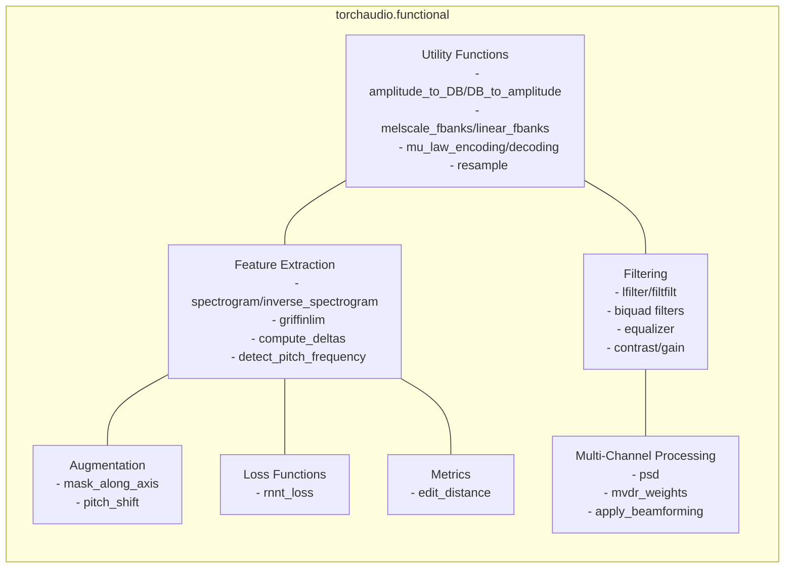
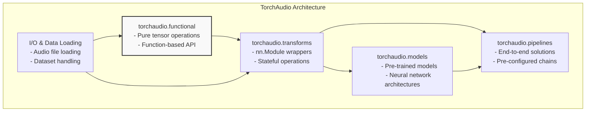
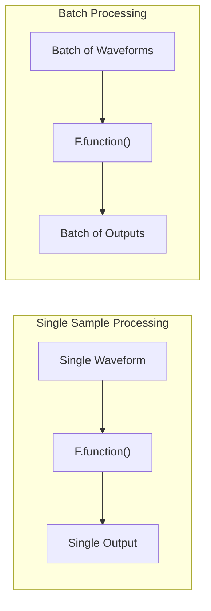
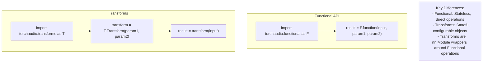

<!-- source: DeepWiki mcp.deepwiki.com · repo pytorch/audio · page 2.1 Functional API · fetched 2026-10-21 -->

# Functional API

<details>
<summary>Relevant source files</summary>

The following files were used as context for generating this wiki page:

- [docs/source/functional.rst](docs/source/functional.rst)
- [test/torchaudio_unittest/common_utils/beamform_utils.py](test/torchaudio_unittest/common_utils/beamform_utils.py)
- [test/torchaudio_unittest/functional/autograd_impl.py](test/torchaudio_unittest/functional/autograd_impl.py)
- [test/torchaudio_unittest/functional/batch_consistency_test.py](test/torchaudio_unittest/functional/batch_consistency_test.py)
- [test/torchaudio_unittest/functional/functional_cpu_test.py](test/torchaudio_unittest/functional/functional_cpu_test.py)
- [test/torchaudio_unittest/functional/functional_cuda_test.py](test/torchaudio_unittest/functional/functional_cuda_test.py)
- [test/torchaudio_unittest/functional/functional_impl.py](test/torchaudio_unittest/functional/functional_impl.py)
- [test/torchaudio_unittest/functional/torchscript_consistency_impl.py](test/torchaudio_unittest/functional/torchscript_consistency_impl.py)

</details>


The `torchaudio.functional` module provides low-level audio processing functions that operate directly on tensors. This API forms the foundation of TorchAudio's audio processing capabilities, offering a comprehensive set of operations for audio manipulation, feature extraction, filtering, and more. For information about the transform-based interface (which wraps these functions as `nn.Module` objects), see [Transforms](#2.2).

## Overview of the Functional API

The Functional API provides direct, efficient tensor operations for audio processing without the overhead of creating module objects. This makes it ideal for custom processing pipelines where flexibility is essential.



Sources: [docs/source/functional.rst:1-126](), [test/torchaudio_unittest/functional/functional_impl.py:6-8]()

## Relationship to Other Components

The Functional API serves as the foundation for higher-level components in TorchAudio. Most notably, the Transforms module wraps these functional operations as `nn.Module` objects for easier integration into neural network pipelines.



Sources: [docs/source/transforms.rst:1-154]()

## Core Function Categories

The Functional API is organized into several categories of audio processing functions:

### Feature Extraction

Functions for extracting features from audio signals, including spectrograms, mel spectrograms, and pitch detection.

| Function | Description |
|----------|-------------|
| `spectrogram` | Computes a spectrogram using the Short-Time Fourier Transform (STFT) |
| `inverse_spectrogram` | Reconstructs a waveform from a spectrogram |
| `griffinlim` | Reconstructs a signal from a magnitude spectrogram using the Griffin-Lim algorithm |
| `compute_deltas` | Computes delta coefficients (used in feature extraction pipelines like MFCC) |
| `detect_pitch_frequency` | Detects the fundamental frequency (pitch) of an audio signal |
| `phase_vocoder` | Modifies the phase of a complex spectrogram for time stretching |
| `spectral_centroid` | Computes the spectral centroid for each audio frame |

Sources: [docs/source/functional.rst:77-94](), [test/torchaudio_unittest/functional/functional_impl.py:229-264](), [test/torchaudio_unittest/functional/functional_impl.py:320-341]()

### Filtering and Signal Processing

Functions for applying various filters and signal processing operations to audio signals.

| Function | Description |
|----------|-------------|
| `lfilter` | Applies IIR/FIR filtering (similar to scipy's lfilter) |
| `filtfilt` | Applies zero-phase filtering (forward-backward) |
| `biquad` | Applies a biquad filter with specified coefficients |
| `highpass_biquad` / `lowpass_biquad` | Applies high/low-pass biquad filtering |
| `bandpass_biquad` / `bandreject_biquad` | Applies band-pass/band-reject biquad filtering |
| `equalizer_biquad` | Applies equalization using a biquad filter |
| `gain` | Applies gain (volume adjustment) to an audio signal |
| `contrast` | Enhances the contrast of an audio signal |
| `dcshift` | Applies DC shift to an audio signal |
| `overdrive` | Applies an overdrive effect to an audio signal |
| `phaser` / `flanger` | Applies phaser/flanger effects to an audio signal |

Sources: [docs/source/functional.rst:48-76](), [test/torchaudio_unittest/functional/functional_impl.py:59-145](), [test/torchaudio_unittest/functional/torchscript_consistency_impl.py:294-547]()

### Utilities and Conversion Functions

Utility functions for converting between different representations and scales, resampling, and other operations.

| Function | Description |
|----------|-------------|
| `amplitude_to_DB` | Converts amplitude or power spectrogram to decibel scale |
| `DB_to_amplitude` | Converts decibel-scale spectrogram to amplitude or power |
| `melscale_fbanks` | Creates Mel filterbanks for feature extraction |
| `linear_fbanks` | Creates linear filterbanks for feature extraction |
| `create_dct` | Creates a DCT (Discrete Cosine Transform) matrix |
| `mu_law_encoding` / `mu_law_decoding` | Applies mu-law encoding/decoding for signal compression |
| `resample` | Resamples an audio signal to a different sample rate |
| `pitch_shift` | Shifts the pitch of an audio signal by a specified number of semitones |
| `speed` | Changes the speed of an audio signal |

Sources: [docs/source/functional.rst:10-36](), [test/torchaudio_unittest/functional/functional_impl.py:344-369](), [test/torchaudio_unittest/functional/functional_impl.py:495-552]()

### Multi-Channel Audio Processing

Functions for processing multi-channel audio signals, particularly for beamforming applications.

| Function | Description |
|----------|-------------|
| `psd` | Computes the Power Spectral Density matrix |
| `mvdr_weights_souden` | Computes MVDR beamforming weights using Souden's formulation |
| `mvdr_weights_rtf` | Computes MVDR beamforming weights using a relative transfer function |
| `rtf_evd` | Estimates the relative transfer function using eigenvalue decomposition |
| `rtf_power` | Estimates the relative transfer function using the power method |
| `apply_beamforming` | Applies beamforming weights to a multi-channel spectrogram |

Sources: [docs/source/functional.rst:95-108](), [test/torchaudio_unittest/functional/functional_impl.py:676-858](), [test/torchaudio_unittest/functional/batch_consistency_test.py:272-295]()

### Audio Augmentation

Functions for audio data augmentation, commonly used in training speech recognition models.

| Function | Description |
|----------|-------------|
| `mask_along_axis` | Applies masking along specified axis (time or frequency) |
| `mask_along_axis_iid` | Applies independent masking across batch dimension |
| `add_noise` | Adds noise to an audio signal with specified SNR |
| `preemphasis` / `deemphasis` | Applies preemphasis/deemphasis filtering |

Sources: [test/torchaudio_unittest/functional/functional_impl.py:401-485](), [test/torchaudio_unittest/functional/autograd_impl.py:360-384]()

### Loss Functions and Metrics

Functions for computing losses and metrics, particularly for speech recognition tasks.

| Function | Description |
|----------|-------------|
| `rnnt_loss` | Computes the RNN Transducer loss for sequence prediction |
| `edit_distance` | Computes the edit distance between two sequences |
| `forced_align` | Aligns a transcript to audio using CTC-based forced alignment |

Sources: [docs/source/functional.rst:109-125](), [test/torchaudio_unittest/functional/functional_impl.py:620-665](), [test/torchaudio_unittest/functional/functional_impl.py:607-609]()

## Usage Patterns

### Basic Usage

The functions in the Functional API operate directly on PyTorch tensors. Most functions accept and return tensors, making them easy to integrate into tensor-based processing pipelines.

```python
import torch
import torchaudio.functional as F

# Load an audio file
waveform, sample_rate = torchaudio.load("audio.wav")

# Apply processing
spectrogram = F.spectrogram(waveform, n_fft=400, hop_length=200)
mel_filterbank = F.melscale_fbanks(n_stft=201, n_mels=40, sample_rate=sample_rate)
mel_spectrogram = torch.matmul(spectrogram, mel_filterbank.T)
```

### Batch Processing

Most functions in the Functional API support batch processing, allowing efficient operations on batches of audio signals.



Sources: [test/torchaudio_unittest/functional/batch_consistency_test.py:1-483]()

### Gradient Support

Functions in the Functional API support automatic differentiation, allowing them to be used in differentiable processing pipelines and neural networks.

Sources: [test/torchaudio_unittest/transforms/autograd_test_impl.py:1-417](), [test/torchaudio_unittest/functional/autograd_impl.py:1-409]()

### TorchScript Compatibility

Most functions in the Functional API are compatible with TorchScript, enabling optimization and deployment in production environments.

Sources: [test/torchaudio_unittest/functional/torchscript_consistency_impl.py:1-741]()

## Functional API vs Transforms

The key difference between the Functional API and the Transforms module is in their usage pattern and state management.



### When to Use Functional API vs Transforms

| Functional API | Transforms |
|----------------|------------|
| For one-off processing operations | For repeated use with the same parameters |
| When building custom processing pipelines | When integrating with PyTorch `nn.Module` pipelines |
| When lower-level control is needed | When you need to compose transformations using `nn.Sequential` |
| When parameters need to change dynamically | When parameters are fixed at initialization time |

Sources: [docs/source/functional.rst:1-126](), [docs/source/transforms.rst:1-154]()

## Conclusion

The Functional API is a powerful foundation for audio processing in TorchAudio, offering a comprehensive set of functions for manipulating and extracting features from audio signals. Whether used directly or through the Transforms module, these functions enable advanced audio processing capabilities with the performance and flexibility of PyTorch tensors.

Sources: [test/torchaudio_unittest/functional/functional_impl.py:1-884]()

---

