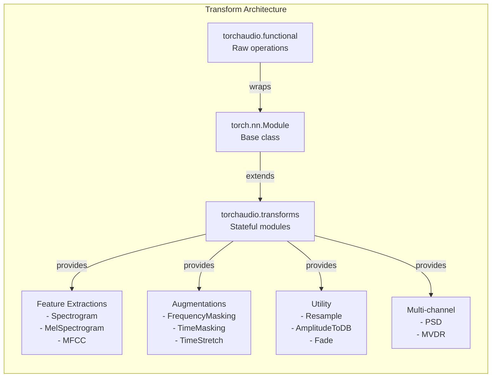
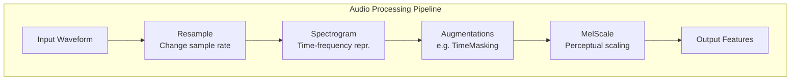
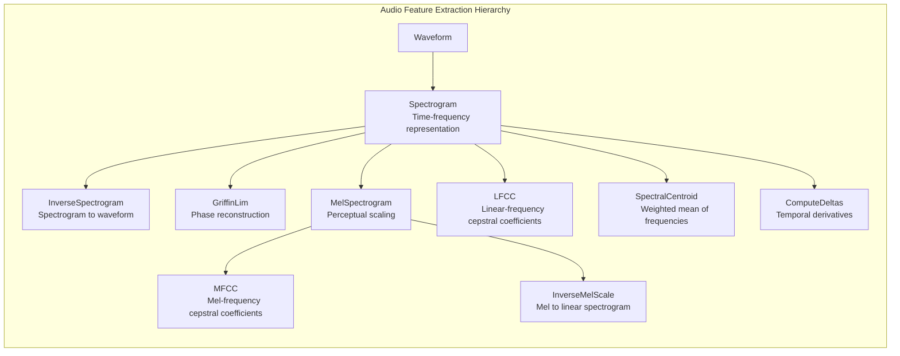
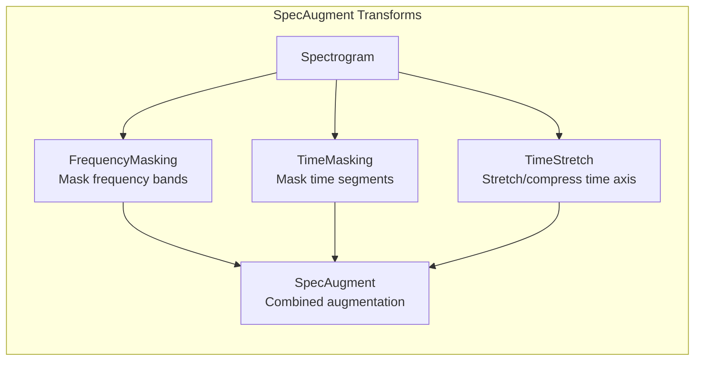
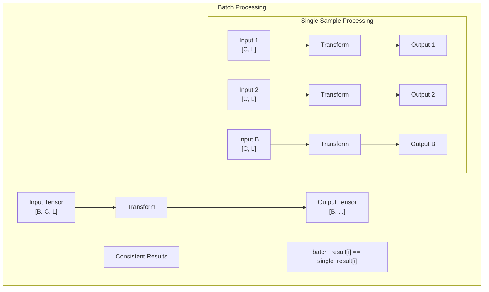
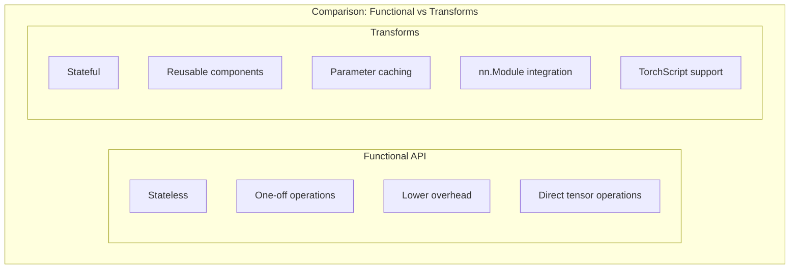

<!-- source: DeepWiki mcp.deepwiki.com · repo pytorch/audio · page 2.2 Transforms · fetched 2026-10-21 -->

# Transforms

<details>
<summary>Relevant source files</summary>

The following files were used as context for generating this wiki page:

- [docs/source/transforms.rst](docs/source/transforms.rst)
- [test/torchaudio_unittest/transforms/autograd_test_impl.py](test/torchaudio_unittest/transforms/autograd_test_impl.py)
- [test/torchaudio_unittest/transforms/batch_consistency_test.py](test/torchaudio_unittest/transforms/batch_consistency_test.py)
- [test/torchaudio_unittest/transforms/torchscript_consistency_impl.py](test/torchaudio_unittest/transforms/torchscript_consistency_impl.py)
- [test/torchaudio_unittest/transforms/transforms_test.py](test/torchaudio_unittest/transforms/transforms_test.py)
- [test/torchaudio_unittest/transforms/transforms_test_impl.py](test/torchaudio_unittest/transforms/transforms_test_impl.py)

</details>


The `torchaudio.transforms` module provides a collection of audio processing operations implemented as `torch.nn.Module` objects. These transforms build on top of the `torchaudio.functional` API (see [Functional API](#2.1)) by providing stateful, composable building blocks that can be used to create complex audio processing pipelines. As they are PyTorch modules, transforms can be easily integrated into neural network architectures, serialized using TorchScript, and support autograd for end-to-end differentiable audio processing.

## Core Concepts

Transforms wrap the functionality provided by the functional API into PyTorch modules. This design offers several advantages:

1. **Statefulness** - Transforms can precompute and cache parameters, improving performance for repeated operations
2. **Composability** - Transforms can be chained together using `torch.nn.Sequential` or custom module definitions
3. **Serialization** - Transforms can be saved and loaded using TorchScript
4. **Device/dtype Flexibility** - Transforms can be moved between devices (CPU/CUDA) and data types



Sources: [docs/source/transforms.rst:6-14](docs/source/transforms.rst:6-14), [docs/source/functional.rst:1-9](docs/source/functional.rst:1-9)

## Pipeline Construction

Transforms are designed to be combined into processing pipelines. Since they inherit from `torch.nn.Module`, they can be used in several ways:

1. Chained together using `torch.nn.Sequential`
2. Composed inside a custom module class
3. Applied individually in sequence



Sources: [docs/source/transforms.rst:16-73](docs/source/transforms.rst:16-73), [examples/tutorials/audio_feature_extractions_tutorial.py:12-73](examples/tutorials/audio_feature_extractions_tutorial.py:12-73)

Here's an example of how to build a custom audio processing pipeline:

```python
# Example: Custom feature extraction pipeline
class MyPipeline(torch.nn.Module):
    def __init__(
        self,
        input_freq=16000,
        resample_freq=8000,
        n_fft=1024,
        n_mel=256,
        stretch_factor=0.8,
    ):
        super().__init__()
        self.resample = Resample(orig_freq=input_freq, new_freq=resample_freq)
        self.spec = Spectrogram(n_fft=n_fft, power=2)
        self.spec_aug = torch.nn.Sequential(
            TimeStretch(stretch_factor, fixed_rate=True),
            FrequencyMasking(freq_mask_param=80),
            TimeMasking(time_mask_param=80),
        )
        self.mel_scale = MelScale(
            n_mels=n_mel, sample_rate=resample_freq, n_stft=n_fft // 2 + 1)

    def forward(self, waveform):
        # Resample the input
        resampled = self.resample(waveform)
        # Convert to power spectrogram
        spec = self.spec(resampled)
        # Apply SpecAugment
        spec = self.spec_aug(spec)
        # Convert to mel-scale
        mel = self.mel_scale(spec)
        return mel
```

Sources: [docs/source/transforms.rst:24-60](docs/source/transforms.rst:24-60)

## Transform Categories

### Feature Extraction

Feature extraction transforms convert audio waveforms into various representations useful for audio analysis and machine learning tasks.



Sources: [docs/source/transforms.rst:103-118](docs/source/transforms.rst:103-118), [examples/tutorials/audio_feature_extractions_tutorial.py:32-39](examples/tutorials/audio_feature_extractions_tutorial.py:32-39)

Key feature extraction transforms include:

- **Spectrogram**: Converts a waveform to a spectrogram, a 2D representation where one axis represents time and the other represents frequency.
- **MelSpectrogram**: Creates a spectrogram with frequency bins scaled according to the Mel scale, which better approximates human perception of frequency.
- **MFCC**: Computes Mel-frequency cepstral coefficients, which are commonly used in speech recognition.
- **InverseSpectrogram**: Converts a spectrogram back to a waveform.
- **GriffinLim**: Performs phase reconstruction to convert a magnitude spectrogram back to a waveform.

### Augmentation

Augmentation transforms are used to artificially increase the diversity of training data by applying various transformations.



Sources: [docs/source/transforms.rst:126-132](docs/source/transforms.rst:126-132), [test/torchaudio_unittest/transforms/transforms_test_impl.py:424-473](test/torchaudio_unittest/transforms/transforms_test_impl.py:424-473)

Key augmentation transforms include:

- **FrequencyMasking**: Masks random frequency bands in a spectrogram.
- **TimeMasking**: Masks random time segments in a spectrogram.
- **TimeStretch**: Stretches or compresses the time axis of a spectrogram.
- **PitchShift**: Shifts the pitch of an audio signal while preserving the duration.
- **AddNoise**: Adds noise to a waveform at a specified signal-to-noise ratio (SNR).

### Utility

Utility transforms provide basic audio processing operations that are commonly used in audio pipelines.

Key utility transforms include:

- **Resample**: Changes the sample rate of an audio signal.
- **AmplitudeToDB**: Converts amplitude values to decibels.
- **MuLawEncoding/MuLawDecoding**: Applies μ-law compression/decompression.
- **Fade**: Applies fade-in and fade-out effects to audio signals.
- **Vol**: Adjusts the volume of an audio signal.
- **Preemphasis/Deemphasis**: Applies pre-emphasis and de-emphasis filters.

Sources: [docs/source/transforms.rst:81-98](docs/source/transforms.rst:81-98)

### Multi-channel

Multi-channel transforms operate on multi-channel audio signals, often used for beamforming and speech enhancement.

Key multi-channel transforms include:

- **PSD**: Computes power spectral density matrices.
- **MVDR**: Implements minimum variance distortionless response beamforming.
- **RTFMVDR**: Implements relative transfer function MVDR.
- **SoudenMVDR**: Implements Souden's formulation of MVDR.

Sources: [docs/source/transforms.rst:146-153](docs/source/transforms.rst:146-153), [examples/tutorials/mvdr_tutorial.py:18-29](examples/tutorials/mvdr_tutorial.py:18-29)

## Batch Processing

Most transforms support batched inputs, allowing for efficient processing of multiple audio samples simultaneously. This is particularly useful for training neural networks. The batch dimension is typically the first dimension of the input tensor.



Sources: [test/torchaudio_unittest/transforms/batch_consistency_test.py:12-27](test/torchaudio_unittest/transforms/batch_consistency_test.py:12-27), [test/torchaudio_unittest/functional/batch_consistency_test.py:28-42](test/torchaudio_unittest/functional/batch_consistency_test.py:28-42)

## TorchScript Support

Most transforms in torchaudio can be serialized using TorchScript, which allows for deployment in production environments without a Python dependency.

Example of using TorchScript with transforms:

```python
# Create a transform
spectrogram = torchaudio.transforms.Spectrogram()

# Convert to TorchScript
scripted_spectrogram = torch.jit.script(spectrogram)

# Save to file
scripted_spectrogram.save("spectrogram.pt")

# Later, load and use
loaded_spectrogram = torch.jit.load("spectrogram.pt")
output = loaded_spectrogram(waveform)
```

Sources: [test/torchaudio_unittest/transforms/torchscript_consistency_impl.py:10-33](test/torchaudio_unittest/transforms/torchscript_consistency_impl.py:10-33)

## Autograd Support

All transforms support automatic differentiation (autograd), making them suitable for end-to-end training of neural networks. This is useful for tasks where the transforms are part of a learnable pipeline.

Exceptions and edge cases:
- Some transforms like `TimeStretch` may have undefined gradients at specific values (e.g., at zero)
- Some operations might require higher numerical precision during gradient computation

Sources: [test/torchaudio_unittest/transforms/autograd_test_impl.py:1-417](test/torchaudio_unittest/transforms/autograd_test_impl.py:1-417), [test/torchaudio_unittest/functional/autograd_impl.py:1-393](test/torchaudio_unittest/functional/autograd_impl.py:1-393)

## Commonly Used Transforms

This table shows the most commonly used transforms and their purposes:

| Transform | Purpose | Input | Output |
|-----------|---------|-------|--------|
| `Spectrogram` | Convert waveform to time-frequency representation | Waveform `[..., time]` | Spectrogram `[..., freq, time]` |
| `MelSpectrogram` | Create mel-scaled spectrogram | Waveform `[..., time]` | Mel Spectrogram `[..., mel_bins, time]` |
| `MFCC` | Extract mel-frequency cepstral coefficients | Waveform `[..., time]` | MFCC `[..., n_mfcc, time]` |
| `Resample` | Change sample rate | Waveform `[..., time]` | Resampled Waveform `[..., new_time]` |
| `AmplitudeToDB` | Convert amplitude to decibels | Spectrogram `[..., freq, time]` | dB Spectrogram `[..., freq, time]` |
| `FrequencyMasking` | Mask frequency bands (augmentation) | Spectrogram `[..., freq, time]` | Masked Spectrogram `[..., freq, time]` |
| `TimeMasking` | Mask time segments (augmentation) | Spectrogram `[..., freq, time]` | Masked Spectrogram `[..., freq, time]` |

Sources: [examples/tutorials/audio_feature_extractions_tutorial.py:98-120](examples/tutorials/audio_feature_extractions_tutorial.py:98-120), [examples/tutorials/audio_feature_augmentation_tutorial.py:23-54](examples/tutorials/audio_feature_augmentation_tutorial.py:23-54)

## Comparison with Functional API

While the functional API (`torchaudio.functional`) provides stateless functions, transforms offer several advantages:

1. **Parameter Caching**: Transforms can precompute and cache parameters, improving performance for repeated operations. For example, `Resample` caches the resampling kernel.
2. **Stateful Configuration**: Transforms store configuration parameters, making it easier to reuse the same configuration multiple times.
3. **Module Integration**: Transforms can be directly integrated into PyTorch `nn.Module` architectures.
4. **Serialization**: Transforms can be serialized using TorchScript.

For simple one-off operations, the functional API may be more appropriate. For complex pipelines or when integration with PyTorch modules is required, transforms are recommended.



Sources: [docs/source/transforms.rst:16-73](docs/source/transforms.rst:16-73), [docs/source/functional.rst:1-9](docs/source/functional.rst:1-9)

## Example Usage

Here's an example of using transforms to extract MFCC features from an audio waveform:

```python
import torch
import torchaudio.transforms as T

# Load audio waveform (example)
# waveform shape: [channels, time]
waveform, sample_rate = torchaudio.load("audio.wav")

# Create a feature extraction pipeline
transform = torch.nn.Sequential(
    T.Resample(orig_freq=sample_rate, new_freq=16000),
    T.MelSpectrogram(
        sample_rate=16000,
        n_fft=400,
        hop_length=160,
        n_mels=80
    ),
    T.AmplitudeToDB()
)

# Move the pipeline to the target device and dtype
transform = transform.to(device="cuda", dtype=torch.float32)

# Apply the transform
features = transform(waveform)

# features shape: [channels, mels, time]
```

Sources: [docs/source/transforms.rst:66-70](docs/source/transforms.rst:66-70), [examples/tutorials/audio_feature_extractions_tutorial.py:156-178](examples/tutorials/audio_feature_extractions_tutorial.py:156-178)

---

