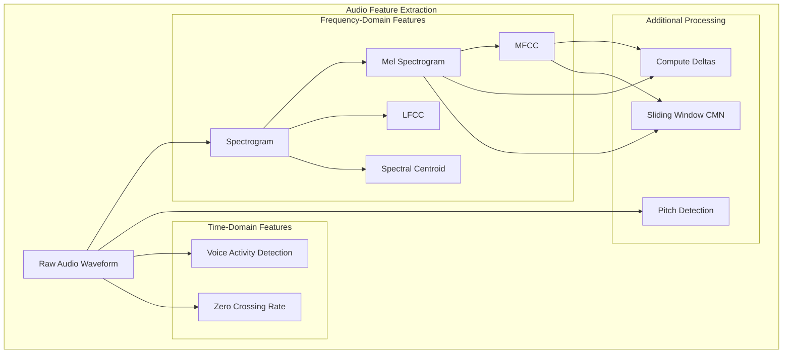
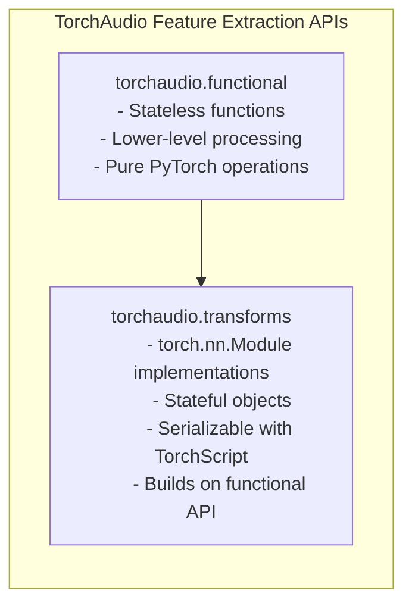
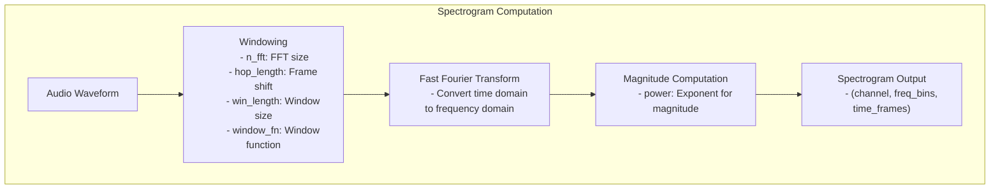
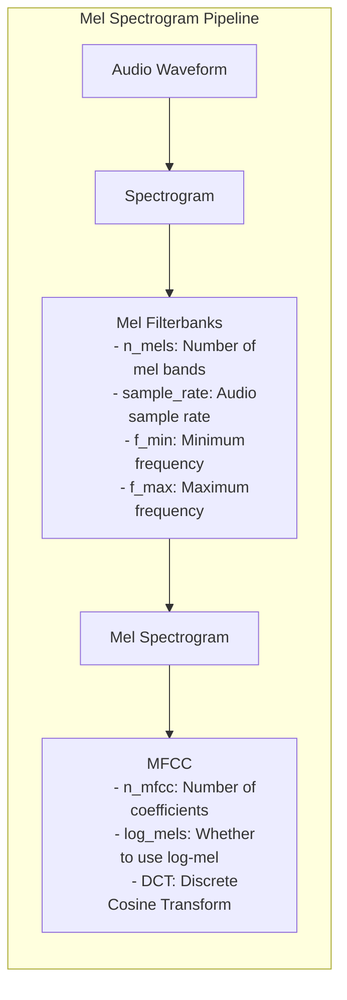
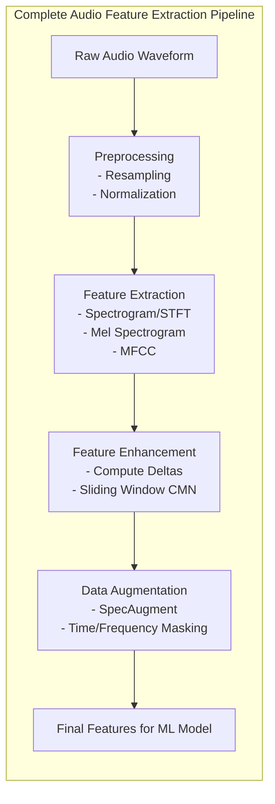

<!-- source: DeepWiki mcp.deepwiki.com · repo pytorch/audio · page 2.3 Feature Extraction · fetched 2026-10-21 -->

# Feature Extraction

<details>
<summary>Relevant source files</summary>

The following files were used as context for generating this wiki page:

- [docs/source/functional.rst](docs/source/functional.rst)
- [docs/source/transforms.rst](docs/source/transforms.rst)
- [test/torchaudio_unittest/common_utils/beamform_utils.py](test/torchaudio_unittest/common_utils/beamform_utils.py)
- [test/torchaudio_unittest/functional/autograd_impl.py](test/torchaudio_unittest/functional/autograd_impl.py)
- [test/torchaudio_unittest/functional/batch_consistency_test.py](test/torchaudio_unittest/functional/batch_consistency_test.py)
- [test/torchaudio_unittest/functional/functional_cpu_test.py](test/torchaudio_unittest/functional/functional_cpu_test.py)
- [test/torchaudio_unittest/functional/functional_cuda_test.py](test/torchaudio_unittest/functional/functional_cuda_test.py)
- [test/torchaudio_unittest/functional/functional_impl.py](test/torchaudio_unittest/functional/functional_impl.py)
- [test/torchaudio_unittest/functional/torchscript_consistency_impl.py](test/torchaudio_unittest/functional/torchscript_consistency_impl.py)
- [test/torchaudio_unittest/transforms/autograd_test_impl.py](test/torchaudio_unittest/transforms/autograd_test_impl.py)
- [test/torchaudio_unittest/transforms/batch_consistency_test.py](test/torchaudio_unittest/transforms/batch_consistency_test.py)
- [test/torchaudio_unittest/transforms/torchscript_consistency_impl.py](test/torchaudio_unittest/transforms/torchscript_consistency_impl.py)
- [test/torchaudio_unittest/transforms/transforms_test.py](test/torchaudio_unittest/transforms/transforms_test.py)
- [test/torchaudio_unittest/transforms/transforms_test_impl.py](test/torchaudio_unittest/transforms/transforms_test_impl.py)

</details>


This document provides comprehensive information about the feature extraction capabilities in the PyTorch Audio library. Feature extraction is a fundamental step in audio processing that transforms raw waveforms into representations useful for analysis and machine learning models. For audio filtering and effects processing, see [Filtering and DSP](#2.4).

## Introduction to Audio Feature Extraction

Audio feature extraction transforms raw audio signals into meaningful representations that capture specific characteristics of the audio signal. TorchAudio provides a rich set of tools for extracting common audio features, available through both functional (stateless functions) and transforms (stateful modules) APIs.



Sources: 
- [docs/source/functional.rst:77-94](docs/source/functional.rst:77-94)
- [docs/source/transforms.rst:100-118](docs/source/transforms.rst:100-118)
- [examples/tutorials/audio_feature_extractions_tutorial.py:32-42](examples/tutorials/audio_feature_extractions_tutorial.py:32-42)

## API Structure

TorchAudio provides two complementary APIs for feature extraction:



Sources:
- [docs/source/transforms.rst:8-14](docs/source/transforms.rst:8-14)
- [examples/tutorials/audio_feature_extractions_tutorial.py:12-17](examples/tutorials/audio_feature_extractions_tutorial.py:12-17)

### Functional API

The functional API provides stateless functions for audio processing in the `torchaudio.functional` module. These functions are pure PyTorch operations that transform input tensors.

Key functional features include:

| Function | Description |
|----------|-------------|
| `F.spectrogram` | Computes the spectrogram of a waveform |
| `F.inverse_spectrogram` | Reconstructs waveform from spectrogram |
| `F.griffinlim` | Computes waveform from magnitude spectrogram |
| `F.compute_deltas` | Computes delta coefficients of a tensor |
| `F.detect_pitch_frequency` | Detects pitch of a waveform |
| `F.spectral_centroid` | Computes spectral centroid of a waveform |
| `F.sliding_window_cmn` | Applies sliding window cepstral mean normalization |
| `F.vad` | Applies voice activity detection |

Sources:
- [docs/source/functional.rst:77-94](docs/source/functional.rst:77-94)
- [test/torchaudio_unittest/functional/functional_impl.py:230-232](test/torchaudio_unittest/functional/functional_impl.py:230-232)
- [test/torchaudio_unittest/functional/functional_impl.py:320-332](test/torchaudio_unittest/functional/functional_impl.py:320-332)
- [test/torchaudio_unittest/functional/functional_impl.py:333-341](test/torchaudio_unittest/functional/functional_impl.py:333-341)

### Transforms API

The transforms API provides `torch.nn.Module` implementations that can be used in PyTorch models. These modules are stateful and can be serialized using TorchScript.

Key transform classes include:

| Transform | Description |
|-----------|-------------|
| `T.Spectrogram` | Creates a spectrogram from a waveform |
| `T.InverseSpectrogram` | Reconstructs waveform from spectrogram |
| `T.MelScale` | Converts spectrogram to mel-scale |
| `T.MelSpectrogram` | Creates a mel-spectrogram from a waveform |
| `T.MFCC` | Creates MFCC features from waveform |
| `T.LFCC` | Creates LFCC features from waveform |
| `T.ComputeDeltas` | Computes delta coefficients |
| `T.SpectralCentroid` | Computes spectral centroid |
| `T.SlidingWindowCmn` | Applies sliding window cepstral mean normalization |
| `T.Vad` | Applies voice activity detection |

Sources:
- [docs/source/transforms.rst:100-118](docs/source/transforms.rst:100-118)
- [examples/tutorials/audio_feature_extractions_tutorial.py:104-112](examples/tutorials/audio_feature_extractions_tutorial.py:104-112)
- [test/torchaudio_unittest/transforms/transforms_test_impl.py:16-61](test/torchaudio_unittest/transforms/transforms_test_impl.py:16-61)

## Core Feature Extraction Methods

### Spectrogram

The spectrogram is the fundamental time-frequency representation of audio signals from which many other features are derived.



**Implementation Notes:**
- `n_fft` parameter determines frequency resolution
- Default values: `hop_length = n_fft // 4` when not specified
- Can use different normalization modes: `False`, `True`, `"window"`, or `"frame_length"`
- Can return complex spectrogram with `power=None, return_complex=True`

Sources:
- [examples/tutorials/audio_feature_extractions_tutorial.py:98-120](examples/tutorials/audio_feature_extractions_tutorial.py:98-120)
- [test/torchaudio_unittest/functional/functional_impl.py:229-257](test/torchaudio_unittest/functional/functional_impl.py:229-257)
- [test/torchaudio_unittest/functional/functional_impl.py:256-318](test/torchaudio_unittest/functional/functional_impl.py:256-318)

### Mel Spectrogram

Mel spectrogram is derived from spectrogram by applying mel filterbanks, which better represent human auditory perception.



**Implementation Notes:**
- Mel filterbanks are generated using `F.melscale_fbanks`
- MFCC uses `F.create_dct` to apply discrete cosine transform

Sources:
- [examples/tutorials/audio_feature_extractions_tutorial.py:393-446](examples/tutorials/audio_feature_extractions_tutorial.py:393-446)
- [test/torchaudio_unittest/transforms/autograd_test_impl.py:83-94](test/torchaudio_unittest/transforms/autograd_test_impl.py:83-94)
- [test/torchaudio_unittest/transforms/autograd_test_impl.py:107-122](test/torchaudio_unittest/transforms/autograd_test_impl.py:107-122)
- [test/torchaudio_unittest/functional/torchscript_consistency_impl.py:134-142](test/torchaudio_unittest/functional/torchscript_consistency_impl.py:134-142)

### Computing Deltas

Deltas (also called differential or velocity features) represent how features change over time and are important for capturing dynamic aspects of audio.

**Implementation Notes:**
- Uses a sliding window approach with configurable window length
- Windows are padded at the edges with replication by default
- Supports multiple frames and channels

Sources:
- [test/torchaudio_unittest/functional/functional_impl.py:320-332](test/torchaudio_unittest/functional/functional_impl.py:320-332)
- [test/torchaudio_unittest/transforms/autograd_test_impl.py:124-127](test/torchaudio_unittest/transforms/autograd_test_impl.py:124-127)
- [test/torchaudio_unittest/functional/torchscript_consistency_impl.py:112-112](test/torchaudio_unittest/functional/torchscript_consistency_impl.py:112-112)

### Pitch Detection

Pitch detection identifies the fundamental frequency of audio, primarily for monophonic signals.

**Implementation Notes:**
- Implemented in `F.detect_pitch_frequency`
- Works accurately for simple tones like sinusoids
- May need preprocessing for reliable detection in complex signals

Sources:
- [test/torchaudio_unittest/functional/functional_impl.py:333-341](test/torchaudio_unittest/functional/functional_impl.py:333-341)
- [test/torchaudio_unittest/functional/batch_consistency_test.py:77-93](test/torchaudio_unittest/functional/batch_consistency_test.py:77-93)
- [test/torchaudio_unittest/functional/torchscript_consistency_impl.py:121-121](test/torchaudio_unittest/functional/torchscript_consistency_impl.py:121-121)

### Spectral Centroid

Spectral centroid is the weighted average frequency in a signal, representing the "center of mass" of the spectrum.

**Implementation Notes:**
- Implemented in `F.spectral_centroid`
- Useful for characterizing the brightness or timbre of sound
- Provided in both functional API and as a transform

Sources:
- [test/torchaudio_unittest/transforms/autograd_test_impl.py:177-181](test/torchaudio_unittest/transforms/autograd_test_impl.py:177-181)
- [test/torchaudio_unittest/transforms/batch_consistency_test.py:150-156](test/torchaudio_unittest/transforms/batch_consistency_test.py:150-156)
- [test/torchaudio_unittest/functional/torchscript_consistency_impl.py:575-586](test/torchaudio_unittest/functional/torchscript_consistency_impl.py:575-586)

### Sliding Window CMN

Sliding Window Cepstral Mean Normalization (CMN) is a technique to normalize features like MFCC or mel spectrograms for improved robustness.

**Implementation Notes:**
- Supports different normalization options: `center` and `norm_vars`
- Configurable window size with `cmn_window` and `min_cmn_window`
- Applied to features reshape as (batch, time, freq)

Sources:
- [test/torchaudio_unittest/transforms/autograd_test_impl.py:215-222](test/torchaudio_unittest/transforms/autograd_test_impl.py:215-222)
- [test/torchaudio_unittest/functional/torchscript_consistency_impl.py:490-504](test/torchaudio_unittest/functional/torchscript_consistency_impl.py:490-504)
- [test/torchaudio_unittest/functional/batch_consistency_test.py:224-232](test/torchaudio_unittest/functional/batch_consistency_test.py:224-232)

## Feature Extraction Pipeline Example

Below is an example of a typical feature extraction pipeline that could be constructed using torchaudio:



Implementing this pipeline using torchaudio's transform classes would look like:

```python
class MyPipeline(torch.nn.Module):
    def __init__(
        self,
        input_freq=16000,
        resample_freq=8000,
        n_fft=1024,
        n_mel=256,
    ):
        super().__init__()
        self.resample = T.Resample(orig_freq=input_freq, new_freq=resample_freq)
        self.mel_spec = T.MelSpectrogram(
            sample_rate=resample_freq, 
            n_fft=n_fft,
            n_mels=n_mel
        )
        self.compute_deltas = T.ComputeDeltas()
        self.cmn = T.SlidingWindowCmn()
        
    def forward(self, waveform):
        # Resample
        resampled = self.resample(waveform)
        
        # Extract mel spectrogram
        mel_spec = self.mel_spec(resampled)
        
        # Compute deltas
        deltas = self.compute_deltas(mel_spec)
        
        # Apply CMN
        mel_spec_normalized = self.cmn(mel_spec.transpose(-1, -2))
        deltas_normalized = self.cmn(deltas.transpose(-1, -2))
        
        # Combine features
        features = torch.cat([
            mel_spec_normalized.transpose(-1, -2),
            deltas_normalized.transpose(-1, -2)
        ], dim=1)
        
        return features
```

Sources:
- [docs/source/transforms.rst:23-60](docs/source/transforms.rst:23-60)
- [examples/tutorials/audio_feature_extractions_tutorial.py:12-17](examples/tutorials/audio_feature_extractions_tutorial.py:12-17)
- [examples/tutorials/audio_feature_extractions_tutorial.py:98-120](examples/tutorials/audio_feature_extractions_tutorial.py:98-120)

## Performance Considerations

When working with audio feature extraction, consider the following performance aspects:

1. **Batching**: Most functions and transforms support batched inputs for parallel processing
   
2. **GPU Acceleration**: All transforms can be moved to CUDA devices with `.to(device)`

3. **TorchScript Compatibility**: All transforms are compatible with TorchScript for deployment

4. **Gradient Computation**: Most transforms support autograd for end-to-end training

5. **Numerical Precision**: Functions work with different precision (float32/float64) with some limitations

Sources:
- [test/torchaudio_unittest/functional/batch_consistency_test.py](test/torchaudio_unittest/functional/batch_consistency_test.py)
- [test/torchaudio_unittest/transforms/torchscript_consistency_impl.py](test/torchaudio_unittest/transforms/torchscript_consistency_impl.py)
- [test/torchaudio_unittest/transforms/autograd_test_impl.py](test/torchaudio_unittest/transforms/autograd_test_impl.py)

## Advanced Feature Types

### Multi-channel Processing

TorchAudio provides specialized features for multi-channel audio processing:

| Function | Description |
|----------|-------------|
| `F.psd` | Computes power spectral density matrix |
| `F.mvdr_weights_souden` | Computes MVDR beamforming weights using Souden's formula |
| `F.mvdr_weights_rtf` | Computes MVDR beamforming weights using relative transfer function |
| `F.rtf_evd` | Estimates relative transfer function using eigenvalue decomposition |
| `F.rtf_power` | Estimates relative transfer function using power method |
| `F.apply_beamforming` | Applies beamforming to multi-channel spectrogram |

Sources:
- [docs/source/functional.rst:95-107](docs/source/functional.rst:95-107)
- [test/torchaudio_unittest/functional/functional_impl.py:676-711](test/torchaudio_unittest/functional/functional_impl.py:676-711)
- [examples/tutorials/mvdr_tutorial.py:15-30](examples/tutorials/mvdr_tutorial.py:15-30)

### Time-domain Features

Voice Activity Detection (VAD) is an important time-domain feature extraction method that identifies segments containing speech:

```python
# Example VAD usage
speech_segments = F.vad(waveform, sample_rate)
```

Sources:
- [docs/source/functional.rst:77-94](docs/source/functional.rst:77-94)
- [test/torchaudio_unittest/transforms/transforms_test_impl.py:482-500](test/torchaudio_unittest/transforms/transforms_test_impl.py:482-500)

## Integration with Audio Augmentation

Feature extraction often works alongside audio augmentation techniques. TorchAudio supports time and frequency domain augmentations that can be applied to extracted features:

| Transform | Description |
|-----------|-------------|
| `T.TimeStretch` | Stretches spectrogram along time axis |
| `T.FrequencyMasking` | Masks blocks of consecutive frequencies |
| `T.TimeMasking` | Masks blocks of consecutive time steps |

Sources:
- [docs/source/transforms.rst:126-132](docs/source/transforms.rst:126-132)
- [test/torchaudio_unittest/transforms/transforms_test_impl.py:368-479](test/torchaudio_unittest/transforms/transforms_test_impl.py:368-479)

## Conclusion

TorchAudio's feature extraction capabilities offer a comprehensive suite of tools for transforming raw audio into useful representations for machine learning models. With both functional and object-oriented APIs, it provides flexibility for different use cases while ensuring computational efficiency and compatibility with the PyTorch ecosystem.

---

