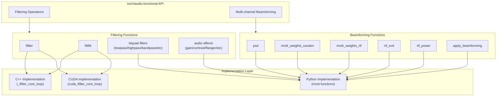
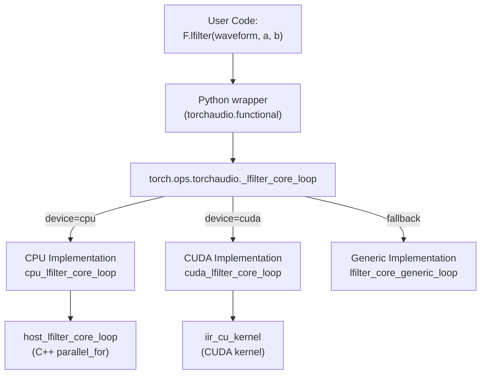
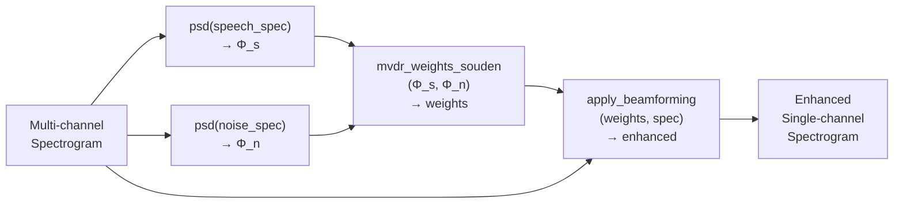
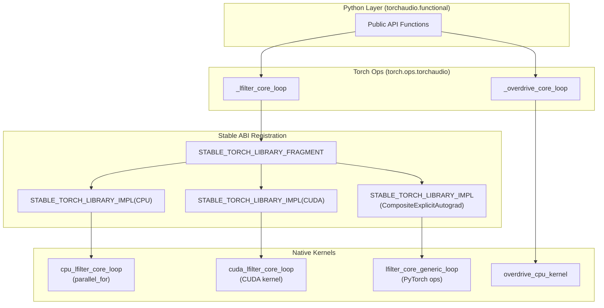

<!-- source: DeepWiki mcp.deepwiki.com · repo pytorch/audio · page 2.4 Filtering and DSP · fetched 2026-10-21 -->

# Filtering and DSP

<details>
<summary>Relevant source files</summary>

The following files were used as context for generating this wiki page:

- [docs/source/functional.rst](docs/source/functional.rst)
- [src/libtorchaudio/cuda_utils.h](src/libtorchaudio/cuda_utils.h)
- [src/libtorchaudio/forced_align/compute.cpp](src/libtorchaudio/forced_align/compute.cpp)
- [src/libtorchaudio/forced_align/compute.h](src/libtorchaudio/forced_align/compute.h)
- [src/libtorchaudio/forced_align/cpu/compute.cpp](src/libtorchaudio/forced_align/cpu/compute.cpp)
- [src/libtorchaudio/forced_align/gpu/compute.cu](src/libtorchaudio/forced_align/gpu/compute.cu)
- [src/libtorchaudio/iir_cuda.cu](src/libtorchaudio/iir_cuda.cu)
- [src/libtorchaudio/iir_cuda.h](src/libtorchaudio/iir_cuda.h)
- [src/libtorchaudio/lfilter.cpp](src/libtorchaudio/lfilter.cpp)
- [src/libtorchaudio/overdrive.cpp](src/libtorchaudio/overdrive.cpp)
- [src/libtorchaudio/rnnt/cpu/compute.cpp](src/libtorchaudio/rnnt/cpu/compute.cpp)
- [src/libtorchaudio/rnnt/gpu/compute.cu](src/libtorchaudio/rnnt/gpu/compute.cu)
- [src/libtorchaudio/utils.h](src/libtorchaudio/utils.h)
- [src/torchaudio/functional/_alignment.py](src/torchaudio/functional/_alignment.py)
- [test/torchaudio_unittest/common_utils/beamform_utils.py](test/torchaudio_unittest/common_utils/beamform_utils.py)
- [test/torchaudio_unittest/functional/autograd_impl.py](test/torchaudio_unittest/functional/autograd_impl.py)
- [test/torchaudio_unittest/functional/batch_consistency_test.py](test/torchaudio_unittest/functional/batch_consistency_test.py)
- [test/torchaudio_unittest/functional/functional_cpu_test.py](test/torchaudio_unittest/functional/functional_cpu_test.py)
- [test/torchaudio_unittest/functional/functional_cuda_test.py](test/torchaudio_unittest/functional/functional_cuda_test.py)
- [test/torchaudio_unittest/functional/functional_impl.py](test/torchaudio_unittest/functional/functional_impl.py)
- [test/torchaudio_unittest/functional/torchscript_consistency_impl.py](test/torchaudio_unittest/functional/torchscript_consistency_impl.py)

</details>


The Filtering and Digital Signal Processing (DSP) system in PyTorch Audio provides a comprehensive set of audio filtering operations and signal processing capabilities. This page documents the available filtering functions, their implementation details, and how they integrate with the broader PyTorch ecosystem.

For information about audio feature extraction, see [Feature Extraction](#2.3). For details about audio I/O systems, refer to [I/O Systems](#3).

## Overview

The Filtering and DSP module provides audio filtering operations and beamforming utilities. Core filtering functions include `lfilter` and `filtfilt` for IIR filtering, various biquad filters for frequency-domain processing, and audio effects. The module also includes multi-channel beamforming functions such as `psd`, `mvdr_weights_souden`, and `mvdr_weights_rtf`. All functions are implemented in `torchaudio.functional`, with performance-critical operations using C++/CUDA backends. Functions support both CPU and CUDA devices and are compatible with PyTorch's autograd system.

**Filtering and DSP System Architecture**



Sources: [docs/source/functional.rst:47-107](), [src/libtorchaudio/lfilter.cpp:118-138](), [src/libtorchaudio/iir_cuda.cu:37-80]()

## Filtering Operations

### IIR Filters

Infinite Impulse Response (IIR) filters provide recursive filtering where output depends on both current/past inputs and past outputs. TorchAudio implements two core IIR functions: `lfilter` and `filtfilt`.

#### lfilter

The `lfilter` function implements digital linear filtering using difference equations. It applies the filter defined by coefficients `a` and `b`:

```
y[n] = (b[0]*x[n] + b[1]*x[n-1] + ... + b[M]*x[n-M]) - (a[1]*y[n-1] + ... + a[N]*y[n-N]) / a[0]
```

The function supports:
- Batched processing across channels
- CPU and CUDA execution
- Gradient computation through autograd
- Optional clamping to prevent overflow

**lfilter Implementation Dispatch**



The native implementations use optimized core loops for performance. The CPU version uses `torch::stable::parallel_for` for multi-threaded execution [src/libtorchaudio/lfilter.cpp:32-47](), while the CUDA version uses custom kernels [src/libtorchaudio/iir_cuda.cu:11-35]().

Sources: [src/libtorchaudio/lfilter.cpp:17-88](), [src/libtorchaudio/iir_cuda.cu:37-80](), [test/torchaudio_unittest/functional/functional_impl.py:59-81]()

#### filtfilt

The `filtfilt` function applies a linear filter twice (forward then backward) to achieve zero-phase filtering. This eliminates phase distortion at the cost of doubling the filter order. The function internally uses `lfilter` and reverses the signal between passes.

**Key characteristics:**
- Zero-phase response (no time delay)
- Sharper frequency response than single-pass filtering
- Requires padding to handle boundary effects
- Supports batched operation and autograd

Sources: [test/torchaudio_unittest/functional/functional_impl.py:146-227](), [test/torchaudio_unittest/functional/autograd_impl.py:76-104]()

### Biquad Filters

Biquad filters are a type of IIR filter implemented with second-order sections, providing various frequency response characteristics. TorchAudio provides multiple specialized biquad filter implementations:

| Filter Type | Function | Purpose |
|-------------|----------|---------|
| Lowpass | `lowpass_biquad` | Allows signals below a cutoff frequency to pass |
| Highpass | `highpass_biquad` | Allows signals above a cutoff frequency to pass |
| Bandpass | `bandpass_biquad` | Allows signals within a frequency band to pass |
| Bandreject | `bandreject_biquad` | Rejects signals within a frequency band |
| Allpass | `allpass_biquad` | Preserves amplitude but changes phase |
| Bass | `bass_biquad` | Boosts or cuts the bass frequency range |
| Treble | `treble_biquad` | Boosts or cuts the treble frequency range |
| Equalizer | `equalizer_biquad` | Boosts or cuts a specific frequency range |
| RIAA | `riaa_biquad` | Applies RIAA vinyl playback equalization |
| De-emphasis | `deemph_biquad` | Applies standard de-emphasis |

Sources: [docs/source/functional.rst:51-75](), [test/torchaudio_unittest/functional/autograd_impl.py:106-242]()

### Audio Effects

The module provides audio effects for signal enhancement and creative processing:

| Effect | Function | Description | Native Implementation |
|--------|----------|-------------|----------------------|
| Gain | `gain` | Adjusts signal amplitude | Python |
| Contrast | `contrast` | Enhances signal contrast | Python |
| DC Shift | `dcshift` | Applies DC offset | Python |
| Overdrive | `overdrive` | Simulates distortion | C++ (_overdrive_core_loop) |
| Flanger | `flanger` | Sweeping comb filter | Python |
| Phaser | `phaser` | Phase-shifted copies | Python |
| Dither | `dither` | Reduces quantization noise | Python |

Most effects are implemented in pure Python for flexibility. The `overdrive` function has a C++ core loop for performance [src/libtorchaudio/overdrive.cpp:11-56]().

Sources: [docs/source/functional.rst:55-74](), [src/libtorchaudio/overdrive.cpp:1-72](), [test/torchaudio_unittest/functional/torchscript_consistency_impl.py:213-573]()

## Beamforming Utilities

Multi-channel beamforming functions enable spatial filtering for microphone arrays. These functions are used in speech enhancement and source separation applications.

### PSD Computation

The `psd` function computes the Power Spectral Density matrix from multi-channel spectrograms. It supports optional masking for time-frequency selective processing.

**Function signature:**
```python
F.psd(specgram: Tensor, mask: Optional[Tensor] = None, normalize: bool = True, eps: float = 1e-10) -> Tensor
```

**Inputs:**
- `specgram`: Complex spectrogram with shape `(..., channel, freq, time)`
- `mask`: Optional time-frequency mask with shape `(..., freq, time)`
- `normalize`: Whether to normalize by mask sum
- `eps`: Small value to prevent division by zero

**Output:** PSD matrix with shape `(..., freq, channel, channel)`

The PSD is computed as:
```
PSD[f] = (1/T) * Σ_t X[f,t] X[f,t]^H
```
where `X[f,t]` is the spectrogram and `^H` denotes conjugate transpose.

Sources: [test/torchaudio_unittest/functional/functional_impl.py:690-725](), [test/torchaudio_unittest/common_utils/beamform_utils.py:4-14]()

### MVDR Beamforming

Minimum Variance Distortionless Response (MVDR) beamforming suppresses noise while preserving the target signal. TorchAudio provides two MVDR implementations:

#### mvdr_weights_souden

Computes MVDR weights using Souden's formula, which requires PSD matrices for both speech and noise:

```python
F.mvdr_weights_souden(
    psd_speech: Tensor,  # shape: (..., freq, channel, channel)
    psd_noise: Tensor,   # shape: (..., freq, channel, channel)
    reference_channel: Union[int, Tensor],
    diagonal_loading: bool = True,
    diag_eps: float = 1e-7,
    eps: float = 1e-8
) -> Tensor  # shape: (..., freq, channel)
```

The beamforming weights are computed as:
```
w = (Φ_n^-1 Φ_s) / trace(Φ_n^-1 Φ_s)
```
where `Φ_s` is speech PSD and `Φ_n` is noise PSD.

Sources: [test/torchaudio_unittest/functional/functional_impl.py:727-776](), [test/torchaudio_unittest/common_utils/beamform_utils.py:17-31]()

#### mvdr_weights_rtf

Computes MVDR weights using the Relative Transfer Function (RTF):

```python
F.mvdr_weights_rtf(
    rtf: Tensor,         # shape: (..., freq, channel)
    psd_noise: Tensor,   # shape: (..., freq, channel, channel)
    reference_channel: Union[int, Tensor],
    diagonal_loading: bool = True,
    diag_eps: float = 1e-7,
    eps: float = 1e-8
) -> Tensor  # shape: (..., freq, channel)
```

The beamforming weights are:
```
w = Φ_n^-1 h / (h^H Φ_n^-1 h)
```
where `h` is the RTF vector.

Sources: [test/torchaudio_unittest/functional/functional_impl.py:778-829](), [test/torchaudio_unittest/common_utils/beamform_utils.py:34-49]()

### RTF Estimation

Two methods are provided for estimating the Relative Transfer Function:

| Function | Method | Input | Use Case |
|----------|--------|-------|----------|
| `rtf_evd` | Eigenvalue decomposition | PSD matrix | Single source scenarios |
| `rtf_power` | Power iteration | Speech and noise PSD | Multi-source scenarios |

The `rtf_power` function supports iterative refinement with configurable iterations:

```python
F.rtf_power(
    psd_speech: Tensor,
    psd_noise: Tensor,
    reference_channel: Union[int, Tensor],
    n_iter: int = 3,
    diagonal_loading: bool = True,
    diag_eps: float = 1e-7
) -> Tensor
```

Sources: [test/torchaudio_unittest/functional/functional_impl.py:831-872](), [test/torchaudio_unittest/common_utils/beamform_utils.py:52-79]()

### Applying Beamforming

The `apply_beamforming` function applies computed beamforming weights to a multi-channel spectrogram:

```python
F.apply_beamforming(
    beamform_weights: Tensor,  # shape: (..., freq, channel)
    specgram: Tensor           # shape: (..., channel, freq, time)
) -> Tensor  # shape: (..., freq, time)
```

The enhanced signal is obtained by:
```
Y[f,t] = w[f]^H X[f,t]
```

**Beamforming Pipeline Example**



Sources: [test/torchaudio_unittest/functional/functional_impl.py:690-701](), [test/torchaudio_unittest/common_utils/beamform_utils.py:82-84]()

## Native Implementation Details

The filtering and DSP module uses a hybrid implementation strategy, with most functions in Python but performance-critical operations in C++/CUDA.

### Implementation Architecture

**Native Backend Organization**



Sources: [src/libtorchaudio/lfilter.cpp:118-138](), [src/libtorchaudio/iir_cuda.cu:37-80](), [src/libtorchaudio/overdrive.cpp:60-71]()

### lfilter C++ Implementation

The `lfilter` core loop is implemented in C++ for CPU with multi-threading support:

**Key components:**
1. **Operator registration** [src/libtorchaudio/lfilter.cpp:118-124](): Defines the `_lfilter_core_loop` operator in the stable ABI
2. **CPU kernel** [src/libtorchaudio/lfilter.cpp:17-48](): Uses `torch::stable::parallel_for` to process channels in parallel
3. **Generic fallback** [src/libtorchaudio/lfilter.cpp:90-114](): Pure PyTorch implementation for devices without specialized kernels
4. **Device dispatch** [src/libtorchaudio/lfilter.cpp:126-138](): Routes to appropriate implementation based on device

The CPU implementation processes each channel independently using parallel loops:

```cpp
torch::stable::parallel_for(0, n_channel * n_batch, 1, [&](int64_t begin, int64_t end) {
    for (auto i = begin; i < end; i++) {
        // Process samples for channel i
        for (int64_t i_sample = 0; i_sample < n_samples_input; i_sample++) {
            // Apply IIR difference equation
        }
    }
});
```

Sources: [src/libtorchaudio/lfilter.cpp:17-88]()

### lfilter CUDA Implementation

The CUDA implementation uses a custom kernel for GPU execution:

**Key components:**
1. **CUDA kernel** [src/libtorchaudio/iir_cuda.cu:11-35](): Processes each channel in parallel on GPU
2. **Device guard** [src/libtorchaudio/iir_cuda.cu:67](): Ensures correct device context
3. **Kernel launch** [src/libtorchaudio/iir_cuda.cu:68-78](): Configures thread blocks and launches kernel

The kernel assigns one thread per channel, with each thread processing all samples for that channel sequentially to maintain IIR dependencies.

Sources: [src/libtorchaudio/iir_cuda.cu:1-81](), [src/libtorchaudio/iir_cuda.h:1-8]()

### Python-Only Functions

Most filtering and all beamforming functions are implemented in pure Python using PyTorch operations. This approach provides:
- Full autograd support without custom gradient implementations
- Device-agnostic code (works on CPU/CUDA/MPS automatically)
- Easier maintenance and extensibility
- TorchScript compatibility through standard PyTorch operations

Examples include biquad filters, beamforming functions (`psd`, `mvdr_weights_souden`, etc.), and most audio effects.

Sources: [test/torchaudio_unittest/functional/batch_consistency_test.py:258-483]()

### Batching Support

All filtering and beamforming functions support batched processing. The test suite verifies batch consistency, ensuring that batched execution produces identical results to processing items individually:

```python
# Batch processing is equivalent to individual processing
batch_result = F.lfilter(batched_waveform, a_coeffs, b_coeffs)
individual_results = [F.lfilter(waveform[i], a_coeffs, b_coeffs) 
                      for i in range(batch_size)]
```

Sources: [test/torchaudio_unittest/functional/batch_consistency_test.py:1-483]()

## Integration with PyTorch

The filtering functions are designed to integrate seamlessly with PyTorch:

### Autograd Support

All filtering functions are compatible with PyTorch's autograd system, allowing gradients to flow through them during network training.

Sources: [test/torchaudio_unittest/functional/autograd_impl.py](), [test/torchaudio_unittest/transforms/autograd_test_impl.py]()

### TorchScript Support

Filter functions can be used with TorchScript, enabling optimization through just-in-time compilation and deployment in production environments.

Sources: [test/torchaudio_unittest/functional/torchscript_consistency_impl.py](), [test/torchaudio_unittest/transforms/torchscript_consistency_impl.py]()

### Transform Modules

In addition to functional operations, TorchAudio provides transforms that wrap these filtering functions as PyTorch `nn.Module` objects:

```python
# Example transform modules for filtering
transforms.Preemphasis  # Applies preemphasis filter
transforms.Deemphasis  # Applies deemphasis filter
transforms.Fade  # Applies fade-in and fade-out
transforms.Vol  # Adjusts volume
```

Sources: [docs/source/transforms.rst:85-98]()

## Usage Examples

### Basic Filtering

Apply a low-pass biquad filter:

```python
import torch
import torchaudio.functional as F

waveform = torch.randn(2, 16000)  # 2 channels, 16000 samples
sample_rate = 16000

# Apply low-pass filter with 1000 Hz cutoff
filtered = F.lowpass_biquad(waveform, sample_rate, cutoff_freq=1000.0)
```

### IIR Filtering with Custom Coefficients

Design and apply a custom IIR filter using scipy, then apply with `lfilter`:

```python
from scipy.signal import butter
import torch
import torchaudio.functional as F

# Design a 5th-order Butterworth lowpass filter
b, a = butter(5, 0.1)  # 0.1 = normalized cutoff frequency

# Convert to tensors
b_coeffs = torch.tensor(b, dtype=torch.float32)
a_coeffs = torch.tensor(a, dtype=torch.float32)

waveform = torch.randn(1, 8000, dtype=torch.float32)

# Apply filter
filtered = F.lfilter(waveform, a_coeffs, b_coeffs)
```

### Zero-Phase Filtering

Use `filtfilt` for zero-phase filtering (no time delay):

```python
# Same coefficients as above
filtered_zero_phase = F.filtfilt(waveform, a_coeffs, b_coeffs)
```

### Multi-Channel Beamforming

Process multi-channel audio with MVDR beamforming:

```python
import torch
import torchaudio.functional as F

# Multi-channel spectrogram (4 channels, 257 freq bins, 100 time frames)
multi_channel_spec = torch.randn(4, 257, 100, dtype=torch.cfloat)

# Compute PSD matrices for speech and noise (using masks)
speech_mask = torch.ones(257, 100)  # Simple example
noise_mask = torch.zeros(257, 100)
noise_mask[:, :20] = 1.0  # First 20 frames are noise

psd_speech = F.psd(multi_channel_spec, mask=speech_mask)
psd_noise = F.psd(multi_channel_spec, mask=noise_mask)

# Compute MVDR beamforming weights (channel 0 as reference)
weights = F.mvdr_weights_souden(psd_speech, psd_noise, reference_channel=0)

# Apply beamforming to get enhanced single-channel output
enhanced_spec = F.apply_beamforming(weights, multi_channel_spec)
```

## Performance Considerations

While the filtering functions are optimized for performance, some considerations are important:

1. **GPU vs CPU**: For large batch processing, using CUDA-enabled functions on GPU can provide significant speedups.
2. **Batching**: Processing audio in batches is more efficient than sequential processing.
3. **Filter Order**: Higher-order filters are more computationally expensive and may introduce numerical instability.
4. **In-place Operations**: Some filters support in-place operations to reduce memory usage.

Sources: [test/torchaudio_unittest/functional/functional_impl.py:125-144](), [src/libtorchaudio/lfilter.cpp:21-39]()

## Advanced Topics

### Signal Chaining

Complex audio processing often requires chaining multiple filters. This can be accomplished by sequential function calls or by using PyTorch's `nn.Sequential` with transform modules.

### Custom Filters

For specialized applications, custom filters can be implemented by directly using the `biquad` or `lfilter` functions with specific coefficients.

### Numerical Stability

Some filters, particularly high-order IIR filters, may have numerical stability issues. The `filtfilt` function and state-space representations are available to help mitigate these issues.

Sources: [test/torchaudio_unittest/functional/functional_impl.py:125-144]()

---

