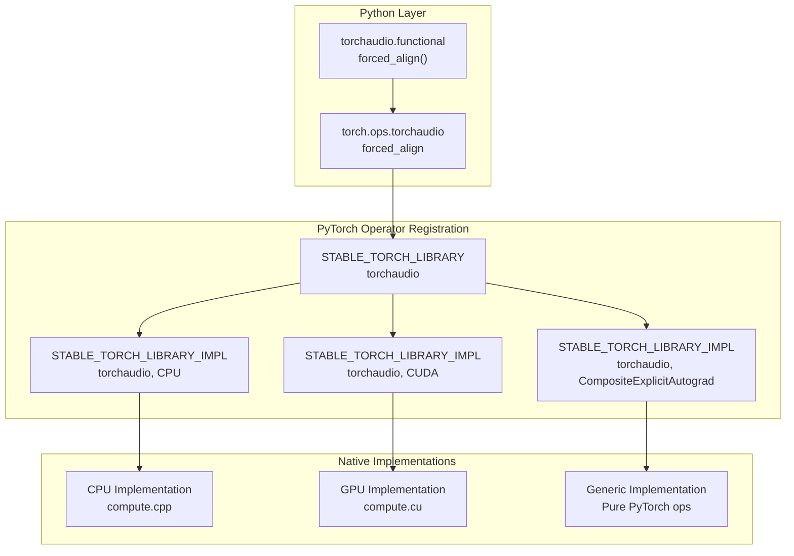
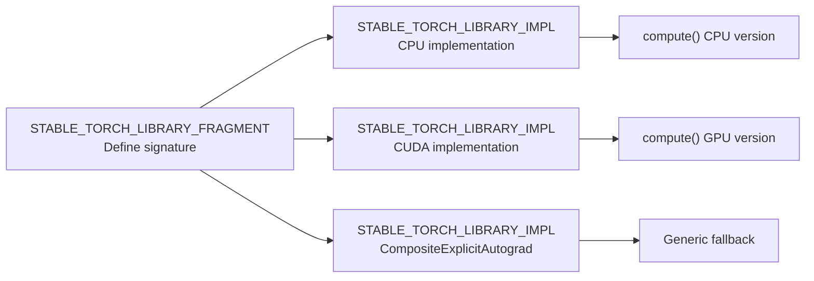
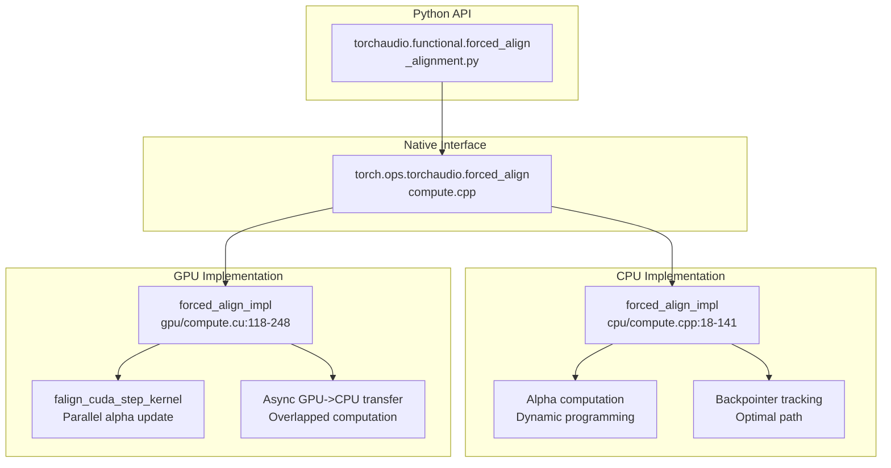
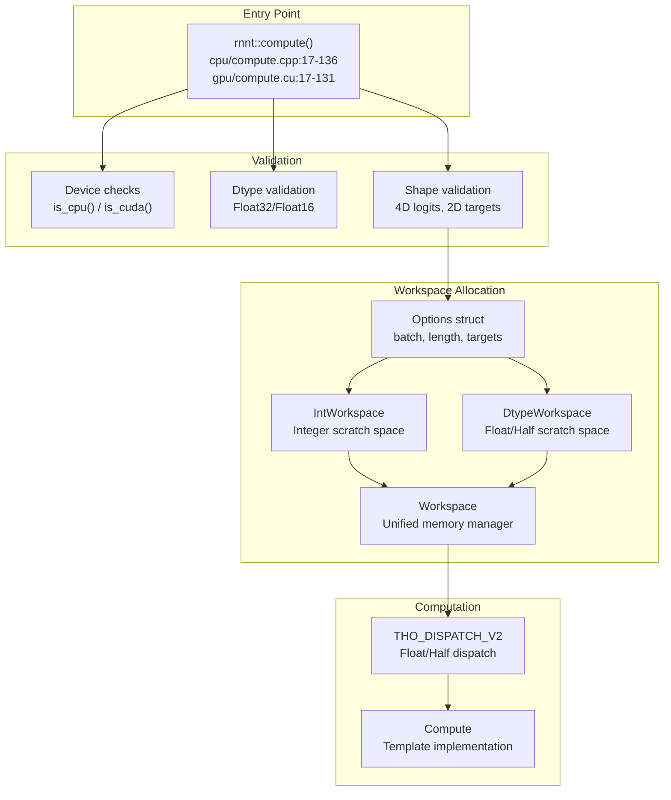
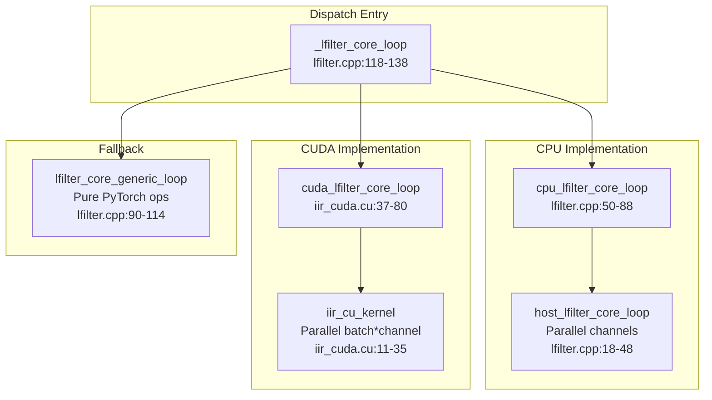
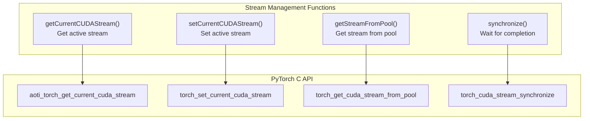
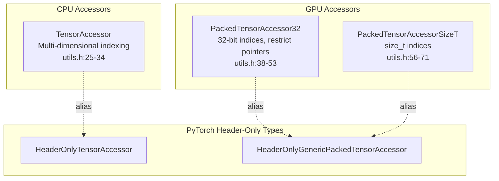
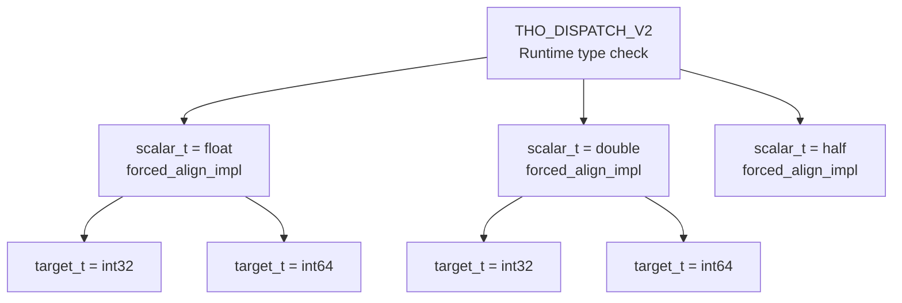

<!-- source: DeepWiki mcp.deepwiki.com · repo pytorch/audio · page 2.5 Native C++ and CUDA Implementations · fetched 2026-10-21 -->

# Native C++ and CUDA Implementations

<details>
<summary>Relevant source files</summary>

The following files were used as context for generating this wiki page:

- [CMakeLists.txt](CMakeLists.txt)
- [cmake/TorchAudioHelper.cmake](cmake/TorchAudioHelper.cmake)
- [src/libtorchaudio/cuda_utils.h](src/libtorchaudio/cuda_utils.h)
- [src/libtorchaudio/forced_align/compute.cpp](src/libtorchaudio/forced_align/compute.cpp)
- [src/libtorchaudio/forced_align/compute.h](src/libtorchaudio/forced_align/compute.h)
- [src/libtorchaudio/forced_align/cpu/compute.cpp](src/libtorchaudio/forced_align/cpu/compute.cpp)
- [src/libtorchaudio/forced_align/gpu/compute.cu](src/libtorchaudio/forced_align/gpu/compute.cu)
- [src/libtorchaudio/iir_cuda.cu](src/libtorchaudio/iir_cuda.cu)
- [src/libtorchaudio/iir_cuda.h](src/libtorchaudio/iir_cuda.h)
- [src/libtorchaudio/lfilter.cpp](src/libtorchaudio/lfilter.cpp)
- [src/libtorchaudio/overdrive.cpp](src/libtorchaudio/overdrive.cpp)
- [src/libtorchaudio/rnnt/cpu/compute.cpp](src/libtorchaudio/rnnt/cpu/compute.cpp)
- [src/libtorchaudio/rnnt/gpu/compute.cu](src/libtorchaudio/rnnt/gpu/compute.cu)
- [src/libtorchaudio/utils.h](src/libtorchaudio/utils.h)
- [src/torchaudio/functional/_alignment.py](src/torchaudio/functional/_alignment.py)
- [tools/setup_helpers/extension.py](tools/setup_helpers/extension.py)

</details>


## Purpose and Scope

This document explains TorchAudio's native C++ and CUDA implementations for performance-critical audio processing operations. These native implementations provide significant performance improvements over pure Python implementations, particularly for computationally intensive algorithms such as forced alignment, RNN-Transducer (RNNT) loss computation, and IIR filtering.

This page covers:
- The architecture of native C++ and CUDA implementations
- Integration with PyTorch's Stable ABI for binary compatibility
- Device dispatch mechanisms for CPU and GPU execution
- Specific implementations: `forced_align`, `rnnt_loss`, and `lfilter`
- Build system configuration and compilation options
- CUDA utilities and stream management

For information about the CMake build system configuration, see [Build Configuration](#5.1). For details on the Python API that exposes these native operations, see [Functional API](#2.1).

---

## Architecture Overview

TorchAudio implements performance-critical operations in C++ and CUDA, exposing them to Python through PyTorch's operator registration system. The architecture follows a three-layer design:



**Diagram: Three-Layer Architecture for Native Operations**

The system uses PyTorch's dispatch mechanism to automatically route operations to the appropriate implementation based on tensor device type. This allows a single Python API to seamlessly execute on CPU or GPU.

**Sources:** [src/libtorchaudio/forced_align/compute.cpp:1-11](), [src/libtorchaudio/forced_align/cpu/compute.cpp:215-217](), [src/libtorchaudio/forced_align/gpu/compute.cu:316-318]()

---

## PyTorch Stable ABI Integration

TorchAudio uses PyTorch's **Stable ABI** (Application Binary Interface) to ensure binary compatibility across PyTorch versions. This allows TorchAudio extensions compiled against one version of PyTorch to work with newer versions without recompilation.

### Stable ABI Headers

All native implementations include stable ABI headers instead of traditional PyTorch headers:

```cpp
#include <torch/csrc/stable/library.h>
#include <torch/csrc/stable/ops.h>
#include <torch/csrc/stable/tensor.h>
#include <torch/headeronly/core/Dispatch_v2.h>
#include <torch/headeronly/core/ScalarType.h>
```

**Key Components:**

| Header | Purpose |
|--------|---------|
| `torch/csrc/stable/library.h` | Operator registration macros (`STABLE_TORCH_LIBRARY`) |
| `torch/csrc/stable/ops.h` | Stable tensor operations (`torch::stable::empty`, `fill_`, etc.) |
| `torch/csrc/stable/tensor.h` | Stable `Tensor` type definition |
| `torch/headeronly/core/Dispatch_v2.h` | Type dispatch macros (`THO_DISPATCH_V2`) |
| `torch/headeronly/core/ScalarType.h` | Scalar type enumeration |

### ABI Target Version

The build system explicitly sets a target ABI version to ensure stability:

[CMakeLists.txt:155-156]():
```cmake
# Ensure that torchaudio is torch ABI stable with torch 2.10 onwards
set(CMAKE_CXX_FLAGS "${CMAKE_CXX_FLAGS} -DTORCH_TARGET_VERSION=0x020a000000000000")
```

This guarantees that TorchAudio binaries compiled with this flag remain compatible with PyTorch 2.10 and later versions.

**Sources:** [src/libtorchaudio/forced_align/cpu/compute.cpp:1-7](), [src/libtorchaudio/rnnt/cpu/compute.cpp:1-7](), [CMakeLists.txt:155-156]()

---

## Device Dispatch Mechanism

TorchAudio uses PyTorch's operator dispatch system to route operations to device-specific implementations automatically. Each operation is registered with multiple dispatch keys.

### Operator Registration Pattern



**Diagram: Operator Dispatch Registration Pattern**

### Example: Forced Alignment

**1. Signature Definition** [src/libtorchaudio/forced_align/compute.cpp:3-10]():
```cpp
STABLE_TORCH_LIBRARY_FRAGMENT(torchaudio, m) {
  m.def(
      "forced_align(Tensor log_probs,"
      "Tensor targets,"
      "Tensor input_lengths,"
      "Tensor target_lengths,"
      "int blank) -> (Tensor, Tensor)");
}
```

**2. CPU Implementation** [src/libtorchaudio/forced_align/cpu/compute.cpp:215-217]():
```cpp
STABLE_TORCH_LIBRARY_IMPL(torchaudio, CPU, m) {
  m.impl("forced_align", TORCH_BOX(&compute));
}
```

**3. CUDA Implementation** [src/libtorchaudio/forced_align/gpu/compute.cu:316-318]():
```cpp
STABLE_TORCH_LIBRARY_IMPL(torchaudio, CUDA, m) {
  m.impl("forced_align", TORCH_BOX(&compute));
}
```

### Dispatch Selection

At runtime, PyTorch automatically selects the correct implementation based on the input tensor's device:

| Tensor Device | Dispatch Key | Implementation Called |
|---------------|--------------|----------------------|
| `cpu` | `CPU` | `torchaudio::alignment::cpu::compute()` |
| `cuda:0` | `CUDA` | `torchaudio::alignment::gpu::compute()` |
| Fallback | `CompositeExplicitAutograd` | Generic PyTorch ops |

**Sources:** [src/libtorchaudio/forced_align/compute.cpp:3-10](), [src/libtorchaudio/forced_align/cpu/compute.cpp:215-217](), [src/libtorchaudio/forced_align/gpu/compute.cu:316-318](), [src/libtorchaudio/lfilter.cpp:118-138]()

---

## Performance-Critical Implementations

### Forced Alignment

Forced alignment computes the optimal CTC (Connectionist Temporal Classification) alignment between a sequence of labels and an emission sequence. It uses dynamic programming to find the most likely path through the CTC lattice.



**Diagram: Forced Alignment Implementation Architecture**

#### CPU Implementation

The CPU implementation [src/libtorchaudio/forced_align/cpu/compute.cpp:18-141]() uses a dynamic programming approach:

**Key Algorithm Steps:**
1. **Initialization** [src/libtorchaudio/forced_align/cpu/compute.cpp:33-41](): Allocate alpha and backpointer arrays
2. **Forward Pass** [src/libtorchaudio/forced_align/cpu/compute.cpp:65-128](): Compute forward probabilities with path tracking
3. **Backtracking** [src/libtorchaudio/forced_align/cpu/compute.cpp:135-140](): Reconstruct optimal alignment path

**Memory Optimization:** Only 2 time steps of alpha values are stored at once (current and previous), reducing memory footprint from `O(T*S)` to `O(S)` where `T` is time steps and `S = 2*L+1` (label length).

#### GPU Implementation

The GPU implementation [src/libtorchaudio/forced_align/gpu/compute.cu:26-116]() parallelizes the computation using CUDA:

**Parallelization Strategy:**
- Each time step processed sequentially (data dependency)
- Within each time step, `S` positions updated in parallel using 1024 threads
- Uses CUB library for efficient block-level reductions

**Asynchronous Transfer:** [src/libtorchaudio/forced_align/gpu/compute.cu:214-232]()
```
Buffer backpointers on GPU (100 steps)
When buffer full:
  1. Clone buffer GPU->GPU (default stream)
  2. Switch to transfer stream
  3. Async copy GPU->CPU
  4. Switch back to default stream
  5. Continue computation (overlapped)
```

This overlapping of computation and data transfer significantly improves performance by hiding memory transfer latency.

**Sources:** [src/libtorchaudio/forced_align/cpu/compute.cpp:18-141](), [src/libtorchaudio/forced_align/gpu/compute.cu:26-314](), [src/torchaudio/functional/_alignment.py:11-73]()

---

### RNNT Loss

RNN-Transducer loss computation is essential for sequence-to-sequence models. TorchAudio provides optimized CPU and GPU implementations.



**Diagram: RNNT Loss Computation Flow**

#### Common Structure

Both CPU and GPU implementations share a similar validation and setup pattern:

**Input Validation** [src/libtorchaudio/rnnt/cpu/compute.cpp:25-85]():
- Device consistency checks
- Dtype validation (`float32` or `float16`)
- Contiguity requirements
- Shape validation (4D logits: `[B, T, U, V]`)

**Options Configuration** [src/libtorchaudio/rnnt/cpu/compute.cpp:88-97]():
```cpp
Options options;
options.batchSize_ = logit_lengths.size(0);
options.nHypos_ = target_lengths.size(0) / logit_lengths.size(0);
options.maxSrcLen_ = logits.size(1);
options.maxTgtLen_ = logits.size(2);
options.numTargets_ = logits.size(3);
options.blank_ = blank;
options.clamp_ = clamp;
options.fusedLogSmax_ = fused_log_softmax;
```

#### Workspace Management

Both implementations use a workspace abstraction for efficient memory allocation:

**CPU Workspace** [src/libtorchaudio/rnnt/cpu/compute.cpp:99-117]():
```cpp
Tensor int_workspace = torch::stable::new_empty(
    logits, {IntWorkspace::ComputeSizeFromOptions(options)}, ScalarType::Int);
Tensor float_workspace = torch::stable::new_empty(
    logits, {DtypeWorkspace<float>::ComputeSizeFromOptions(options)}, 
    ScalarType::Float);

Workspace<float> workspace(
    options, 
    float_workspace.mutable_data_ptr<float>(),
    float_workspace.numel(),
    int_workspace.mutable_data_ptr<int>(),
    int_workspace.numel());
```

**GPU Workspace** [src/libtorchaudio/rnnt/gpu/compute.cu:104-112]():
```cpp
// Set CUDA device and stream
cudaSetDevice(logits.get_device());
options.stream_ = libtorchaudio::cuda::getCurrentCUDAStream(
    logits.get_device_index());
options.device_ = GPU;
```

The workspace pre-allocates all scratch memory needed for computation, avoiding repeated allocations and improving cache locality.

**Sources:** [src/libtorchaudio/rnnt/cpu/compute.cpp:17-140](), [src/libtorchaudio/rnnt/gpu/compute.cu:17-136]()

---

### IIR Filtering (lfilter)

The `lfilter` operation implements Infinite Impulse Response (IIR) filtering, which is computationally intensive due to sequential data dependencies.



**Diagram: lfilter Implementation Variants**

#### CPU Implementation

The CPU implementation [src/libtorchaudio/lfilter.cpp:18-48]() uses parallel processing across channels:

**Parallelization:** [src/libtorchaudio/lfilter.cpp:32-47]()
```cpp
torch::stable::parallel_for(
    0, n_channel * n_batch, 1, [&](int64_t begin, int64_t end) {
      for (auto i = begin; i < end; i++) {
        // Process each channel independently
        for (int64_t i_sample = 0; i_sample < n_samples_input; i_sample++) {
          scalar_t a0 = input_data[offset_input + i_sample];
          for (int64_t i_coeff = 0; i_coeff < n_order; i_coeff++) {
            a0 -= output_data[offset_output + i_sample + i_coeff] *
                a_coeff_flipped_data[i_coeff + i_channel * n_order];
          }
          output_data[offset_output + i_sample + n_order - 1] = a0;
        }
      }
    });
```

Each channel can be processed independently since the IIR filter state is per-channel.

#### CUDA Implementation

The CUDA implementation [src/libtorchaudio/iir_cuda.cu:11-35]() parallelizes across batch and channel dimensions:

**Kernel Configuration:** [src/libtorchaudio/iir_cuda.cu:68-69]()
```cpp
const dim3 threads(256);
const dim3 blocks((N * C + threads.x - 1) / threads.x);
```

**Sequential Processing Within Kernel:** [src/libtorchaudio/iir_cuda.cu:29-34]()
```cpp
for (int64_t i = 0; i < n_samples_input; i++) {
  scalar_t a0 = in[n_pos][c_pos][i];
  for (int64_t j = 0; j < n_order - 1; j++)
    a0 -= a_flipped[c_pos][j] * out[n_pos][c_pos][i + j];
  out[n_pos][c_pos][i + n_order - 1] = a0;
}
```

Each CUDA thread handles one (batch, channel) pair, processing all time steps sequentially due to data dependencies.

#### Generic Fallback

The generic implementation [src/libtorchaudio/lfilter.cpp:90-114]() uses pure PyTorch operations:

```cpp
for (int64_t i_sample = 0; i_sample < n_samples_input; i_sample++) {
  auto windowed_output_signal = torch::stable::transpose(
      torch::stable::narrow(padded_output_waveform, 2, i_sample, n_order), 0, 1);
  auto o0 = torch::stable::subtract(
      torch::stable::select(input_signal_windows, 2, i_sample),
      torch::stable::transpose(
          torch::stable::squeeze(
              torch::stable::matmul(windowed_output_signal, coeff), 2), 0, 1));
  // ... update output
}
```

This fallback ensures the operation works on any device, even if custom kernels aren't available.

**Sources:** [src/libtorchaudio/lfilter.cpp:18-138](), [src/libtorchaudio/iir_cuda.cu:11-80](), [src/libtorchaudio/iir_cuda.h:1-8]()

---

## Build Configuration

The build system uses CMake with configurable options to enable/disable specific native implementations.

### Build Options

[CMakeLists.txt:54-61]():
```cmake
option(BUILD_RNNT "Enable RNN transducer" ON)
option(BUILD_ALIGN "Enable forced alignment" ON)
option(BUILD_CUDA_CTC_DECODER "Build CUCTC decoder" OFF)
option(BUILD_TORCHAUDIO_PYTHON_EXTENSION "Build Python extension" OFF)
option(USE_CUDA "Enable CUDA support" OFF)
option(USE_ROCM "Enable ROCM support" OFF)
option(USE_OPENMP "Enable OpenMP support" OFF)
```

### Build Option Matrix

| Option | Default | Purpose |
|--------|---------|---------|
| `BUILD_RNNT` | `ON` | Build RNNT loss implementation |
| `BUILD_ALIGN` | `ON` | Build forced alignment implementation |
| `BUILD_CUDA_CTC_DECODER` | `OFF` | Build CUDA CTC decoder (requires `USE_CUDA`) |
| `USE_CUDA` | `OFF` | Enable CUDA kernels and GPU support |
| `USE_ROCM` | `OFF` | Enable ROCm for AMD GPUs |
| `USE_OPENMP` | `OFF` | Enable OpenMP parallelization |

### Python Build Integration

The Python build system [tools/setup_helpers/extension.py:22-43]() auto-detects CUDA availability:

```python
_USE_CUDA = _get_build("USE_CUDA", 
    torch.backends.cuda.is_built() and torch.version.hip is None)
_USE_ROCM = _get_build("USE_ROCM", 
    torch.backends.cuda.is_built() and torch.version.hip is not None)
_BUILD_CUDA_CTC_DECODER = _get_build("BUILD_CUDA_CTC_DECODER", _USE_CUDA)
```

### CMake Pass-Through

[tools/setup_helpers/extension.py:95-109]():
```python
cmake_args = [
    f"-DCMAKE_BUILD_TYPE={cfg}",
    f"-DBUILD_RNNT:BOOL={'ON' if _BUILD_RNNT else 'OFF'}",
    f"-DBUILD_ALIGN:BOOL={'ON' if _BUILD_ALIGN else 'OFF'}",
    f"-DBUILD_CUDA_CTC_DECODER:BOOL={'ON' if _BUILD_CUDA_CTC_DECODER else 'OFF'}",
    f"-DUSE_CUDA:BOOL={'ON' if _USE_CUDA else 'OFF'}",
    f"-DUSE_ROCM:BOOL={'ON' if _USE_ROCM else 'OFF'}",
    f"-DUSE_OPENMP:BOOL={'ON' if _USE_OPENMP else 'OFF'}",
]
```

### CUDA Configuration

When `USE_CUDA=ON`, the build system configures CUDA compilation [CMakeLists.txt:78-88]():

```cmake
if(USE_CUDA)
  enable_language(CUDA)
  set(CMAKE_CUDA_FLAGS
    "${CMAKE_CUDA_FLAGS} \
    -DCUDA_HAS_FP16=1 \
    -D__CUDA_NO_HALF_OPERATORS__ \
    -D__CUDA_NO_HALF_CONVERSIONS__ \
    -D__CUDA_NO_HALF2_OPERATORS__"
  )
endif()
```

These flags disable certain CUDA half-precision operators to ensure compatibility.

**Sources:** [CMakeLists.txt:54-88](), [tools/setup_helpers/extension.py:22-109]()

---

## CUDA Utilities and Stream Management

TorchAudio provides CUDA utility functions for stream management and synchronization, essential for achieving optimal GPU performance through asynchronous operations.

### CUDA Stream API

[src/libtorchaudio/cuda_utils.h:9-40]():



**Diagram: CUDA Stream Management API Wrapper**

### Stream Functions

| Function | Purpose | Usage |
|----------|---------|-------|
| `getCurrentCUDAStream()` | Get the current default CUDA stream for a device | Used to launch kernels on default stream |
| `setCurrentCUDAStream()` | Change the active CUDA stream | Switch between computation and transfer streams |
| `getStreamFromPool()` | Allocate a stream from PyTorch's pool | Create secondary streams for overlap |
| `synchronize()` | Block until all operations on a stream complete | Wait for async transfers |

### Usage Example: Forced Alignment

The forced alignment GPU implementation uses multiple streams for computation/transfer overlap [src/libtorchaudio/forced_align/gpu/compute.cu:126-127]():

```cpp
auto defaultStream = libtorchaudio::cuda::getCurrentCUDAStream(device_index);
auto cpuDataTranferStream = libtorchaudio::cuda::getStreamFromPool(
    false, device_index);
```

**Asynchronous Transfer Pattern** [src/libtorchaudio/forced_align/gpu/compute.cu:214-230]():
```cpp
if (backPtrBufferLen == kBackPtrBufferSize || t == T - 1) {
  libtorchaudio::cuda::synchronize(cpuDataTranferStream, device_index);
  // GPU -> GPU copy on default stream
  bufferCopy = torch::stable::clone(backPtrBuffer);
  libtorchaudio::cuda::synchronize(defaultStream, device_index);
  
  // Switch to transfer stream for async GPU -> CPU copy
  libtorchaudio::cuda::setCurrentCUDAStream(cpuDataTranferStream, device_index);
  STD_CUDA_CHECK(cudaMemcpyAsync(
      static_cast<int8_t*>(backPtrCpu.data_ptr()) + offset,
      bufferCopy.data_ptr(),
      backPtrBufferLen * S * sizeof(int8_t),
      cudaMemcpyDeviceToHost,
      cpuDataTranferStream));
  
  // Switch back to default stream
  libtorchaudio::cuda::setCurrentCUDAStream(defaultStream, device_index);
}
```

This pattern allows computation on the default stream to continue while GPU-to-CPU transfers occur on a separate stream, hiding memory transfer latency.

**Sources:** [src/libtorchaudio/cuda_utils.h:1-41](), [src/libtorchaudio/forced_align/gpu/compute.cu:126-234](), [src/libtorchaudio/rnnt/gpu/compute.cu:96-97]()

---

## Tensor Access Patterns

TorchAudio defines custom tensor accessor types for efficient data access in C++ and CUDA kernels.

### Accessor Types

[src/libtorchaudio/utils.h:25-73]():



**Diagram: Tensor Accessor Type Hierarchy**

### Accessor Characteristics

| Accessor Type | Index Type | Pointer Traits | Use Case |
|---------------|------------|----------------|----------|
| `TensorAccessor<T, N>` | `int64_t` | Standard | CPU code with large tensors |
| `PackedTensorAccessor32<T, N>` | `int32_t` | Restrict | CUDA kernels (smaller register usage) |
| `PackedTensorAccessorSizeT<T, N>` | `size_t` | Restrict | CUDA kernels needing 64-bit indices |

### Helper Functions

**CPU Accessor Creation** [src/libtorchaudio/utils.h:31-34]():
```cpp
template <typename T, size_t N>
inline TensorAccessor<T, N> accessor(torch::stable::Tensor t) {
  return TensorAccessor<T, N>(
      reinterpret_cast<T*>(t.data_ptr()), 
      t.sizes().data(), 
      t.strides().data());
}
```

**GPU Packed Accessor Creation** [src/libtorchaudio/utils.h:48-53]():
```cpp
template <typename T, size_t N>
inline PackedTensorAccessor32<T, N> packed_accessor32(torch::stable::Tensor t) {
  return PackedTensorAccessor32<T, N>(
      static_cast<typename PackedTensorAccessor32<T, N>::PtrType>(t.data_ptr()),
      t.sizes().data(),
      t.strides().data());
}
```

### Usage Examples

**CPU Example** [src/libtorchaudio/forced_align/cpu/compute.cpp:42-44]():
```cpp
auto logProbs_a = torchaudio::accessor<scalar_t, 3>(logProbs);
auto targets_a = torchaudio::accessor<target_t, 2>(targets);
auto paths_a = torchaudio::accessor<target_t, 2>(paths);

// Access: logProbs_a[batchIndex][t][labelIdx]
```

**CUDA Example** [src/libtorchaudio/forced_align/gpu/compute.cu:197-211]():
```cpp
falign_cuda_step_kernel<scalar_t, target_t><<<1, kNumThreads, 0, defaultStream>>>(
    torchaudio::packed_accessor32<scalar_t, 3>(logProbs),
    torchaudio::packed_accessor32<target_t, 2>(targets),
    // ...
    torchaudio::packed_accessor32<scalar_t, 2>(alphas),
    torchaudio::packed_accessor32<int8_t, 2>(backPtrBuffer));

// Inside kernel: alphas_a[curIdxOffset][i] = ...
```

**Why Packed Accessors for CUDA:**
- **32-bit indices** reduce register pressure on GPU
- **Restrict pointers** allow compiler optimizations (no aliasing)
- **Bounds checking** can be disabled for performance in release builds

**Sources:** [src/libtorchaudio/utils.h:25-73](), [src/libtorchaudio/forced_align/cpu/compute.cpp:42-44](), [src/libtorchaudio/forced_align/gpu/compute.cu:197-211](), [src/libtorchaudio/iir_cuda.cu:12-14]()

---

## Type Dispatching

All native implementations use PyTorch's type dispatch macros to support multiple data types efficiently.

### THO_DISPATCH_V2 Macro

The `THO_DISPATCH_V2` macro generates specialized code for each supported scalar type [src/libtorchaudio/forced_align/cpu/compute.cpp:200-211]():

```cpp
THO_DISPATCH_V2(
    logProbs.scalar_type(),
    "forced_align_impl",
    AT_WRAP([&] {
      if (targets.scalar_type() == ScalarType::Long) {
        forced_align_long_impl<scalar_t>(logProbs, targets, blank, paths);
      } else {
        forced_align_int_impl<scalar_t>(logProbs, targets, blank, paths);
      }
    }),
    AT_EXPAND(AT_FLOATING_TYPES),  // float32, float64
    ScalarType::Half);              // float16
```

**Dispatch Flow:**



**Diagram: Type Dispatch for forced_align**

### Supported Types by Operation

| Operation | Input Types | Output Types | Notes |
|-----------|-------------|--------------|-------|
| `forced_align` | `float32`, `float64`, `float16` | `int32`, `int64` | Targets can be int32 or int64 |
| `rnnt_loss` | `float32`, `float16` | Same as input | Half precision for memory efficiency |
| `lfilter` | `float32`, `float64` | Same as input | Double precision for numerical stability |

**Sources:** [src/libtorchaudio/forced_align/cpu/compute.cpp:200-212](), [src/libtorchaudio/rnnt/cpu/compute.cpp:119-133](), [src/libtorchaudio/lfilter.cpp:79-86]()

---

