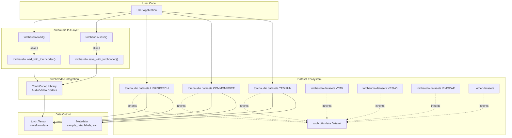
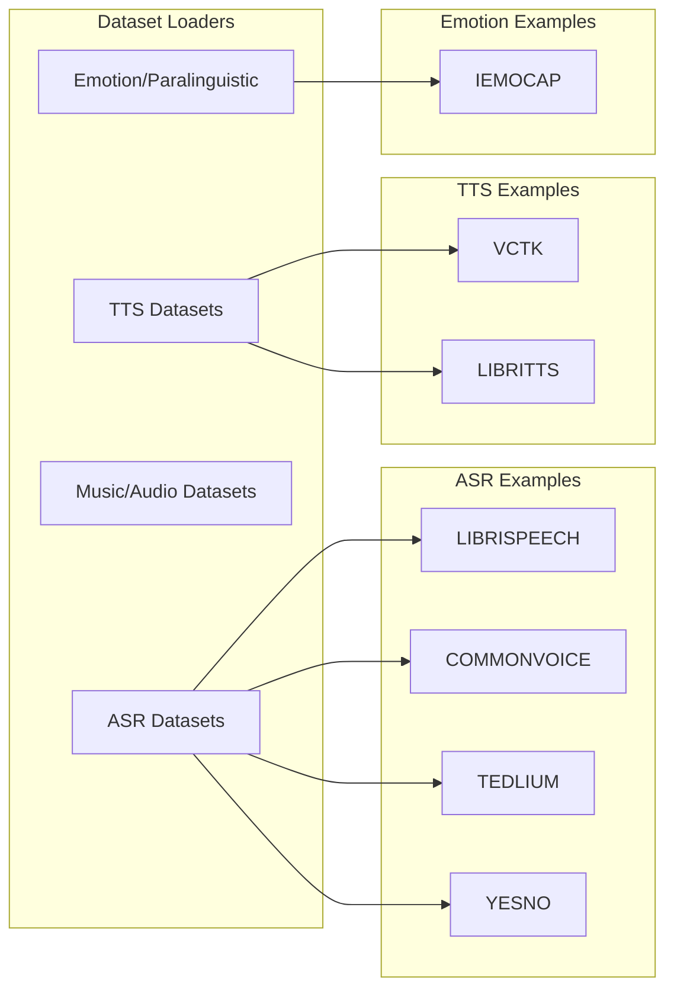
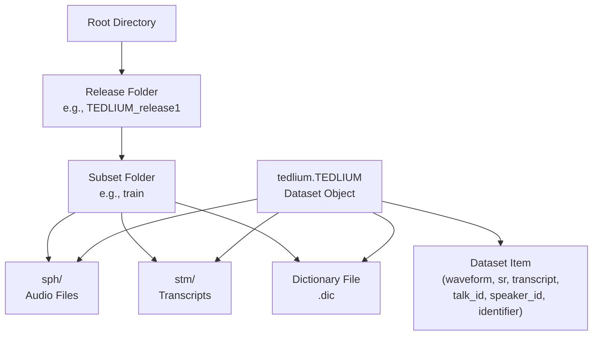
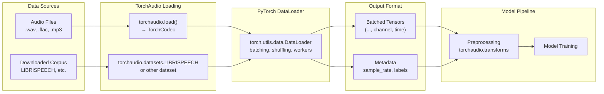
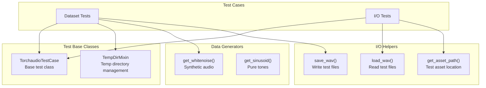

<!-- source: DeepWiki mcp.deepwiki.com · repo pytorch/audio · page 3 I/O and Data · fetched 2026-10-21 -->

# I/O and Data

<details>
<summary>Relevant source files</summary>

The following files were used as context for generating this wiki page:

- [CONTRIBUTING.md](CONTRIBUTING.md)
- [README.md](README.md)
- [docs/source/compliance.kaldi.rst](docs/source/compliance.kaldi.rst)
- [docs/source/index.rst](docs/source/index.rst)
- [docs/source/torchaudio.rst](docs/source/torchaudio.rst)
- [test/torchaudio_unittest/README.md](test/torchaudio_unittest/README.md)
- [test/torchaudio_unittest/datasets/iemocap_test.py](test/torchaudio_unittest/datasets/iemocap_test.py)
- [test/torchaudio_unittest/datasets/tedlium_test.py](test/torchaudio_unittest/datasets/tedlium_test.py)

</details>


## Purpose and Scope

This document provides an overview of TorchAudio's data handling capabilities, including audio file I/O operations and dataset loaders. It covers how TorchAudio loads and saves audio data, and how it provides structured access to common audio datasets for machine learning workflows.

Starting with version 2.8, TorchAudio's I/O functionality has been consolidated into **TorchCodec**, a separate library focused on audio and video codec operations. For detailed information about I/O functions and the TorchCodec migration, see [Audio I/O and TorchCodec Migration](#3.1). For comprehensive documentation of available dataset loaders, see [Datasets](#3.2).

**Sources:** [README.md:10-19](), [docs/source/index.rst:10-17](), [docs/source/torchaudio.rst:6-17]()

---

## System Overview

TorchAudio's data handling infrastructure consists of two primary subsystems:

1. **I/O Operations**: Functions for loading and saving audio files, now delegated to TorchCodec
2. **Dataset Loaders**: PyTorch-style dataset classes for common audio corpora



**Diagram: TorchAudio I/O and Data Architecture**

The diagram shows how user code interacts with TorchAudio's I/O functions (which delegate to TorchCodec) and dataset loaders (which inherit from PyTorch's `Dataset` base class). Both paths produce audio tensors and associated metadata.

**Sources:** [docs/source/torchaudio.rst:19-33](), [README.md:30](), [docs/source/index.rst:64-69]()

---

## I/O Operations: TorchCodec Integration

### Function Mapping

As of TorchAudio 2.9, the primary I/O functions are aliases to TorchCodec:

| TorchAudio Function | Delegates To | Purpose |
|---------------------|--------------|---------|
| `torchaudio.load()` | `torchaudio.load_with_torchcodec()` | Load audio from file to tensor |
| `torchaudio.save()` | `torchaudio.save_with_torchcodec()` | Save tensor to audio file |
| `torchaudio.load_with_torchcodec()` | TorchCodec library | Direct TorchCodec integration |
| `torchaudio.save_with_torchcodec()` | TorchCodec library | Direct TorchCodec integration |

**Sources:** [docs/source/torchaudio.rst:10-14](), [docs/source/torchaudio.rst:25-33]()

### Migration Impact

The consolidation into TorchCodec represents a significant architectural shift:

- **Deprecated in 2.8, Removed in 2.9**: Multiple backend options (SoX, SoundFile, FFmpeg) were removed
- **Single Integration Point**: All I/O now flows through TorchCodec
- **Recommended Practice**: Port code to native `torchcodec` APIs for better long-term support

For detailed migration guidance, see [Audio I/O and TorchCodec Migration](#3.1).

**Sources:** [docs/source/index.rst:11-17](), [docs/source/torchaudio.rst:6-17]()

---

## Dataset Ecosystem

### Dataset Categories

TorchAudio provides dataset loaders organized by application domain:



**Diagram: Dataset Organization by Application Domain**

**Sources:** [README.md:30](), [docs/source/index.rst:65]()

### Common Dataset Interface

All TorchAudio datasets inherit from `torch.utils.data.Dataset` and follow a consistent interface pattern:

| Method/Attribute | Description | Return Type |
|------------------|-------------|-------------|
| `__init__(root, ...)` | Initialize dataset with root directory and options | N/A |
| `__getitem__(n)` | Get nth sample | `Tuple[Tensor, int, ...]` |
| `__len__()` | Get dataset size | `int` |

Each dataset returns a tuple containing:
1. **Waveform tensor**: Audio data as `torch.Tensor` with shape `(..., channel, time)`
2. **Sample rate**: Integer sample rate in Hz
3. **Additional metadata**: Dataset-specific (transcripts, speaker IDs, labels, etc.)

**Sources:** [test/torchaudio_unittest/datasets/tedlium_test.py:96-107](), [test/torchaudio_unittest/datasets/iemocap_test.py:105-111]()

### Dataset Example: TEDLIUM



**Diagram: TEDLIUM Dataset Structure**

The TEDLIUM dataset structure demonstrates the typical organization: audio files in one directory (`sph/`), transcripts in another (`stm/`), and additional metadata files (`.dic` for phoneme dictionary) at the subset level.

**Sources:** [test/torchaudio_unittest/datasets/tedlium_test.py:27-83](), [test/torchaudio_unittest/datasets/tedlium_test.py:96-112]()

### Dataset Example: IEMOCAP

The IEMOCAP dataset illustrates emotion classification structure:

| Component | Path Pattern | Content |
|-----------|--------------|---------|
| Audio Files | `Session{N}/sentences/wav/{subfolder}/{stem}.wav` | Waveform data |
| Labels | `Session{N}/dialog/EmoEvaluation/{subfolder}.txt` | Emotion annotations |
| Output | `(waveform, sample_rate, wav_stem, label, speaker)` | Dataset item tuple |

Available emotion labels: `neu` (neutral), `hap` (happy), `ang` (angry), `sad` (sad), `exc` (excited), `fru` (frustrated), `xxx` (other).

**Sources:** [test/torchaudio_unittest/datasets/iemocap_test.py:7-8](), [test/torchaudio_unittest/datasets/iemocap_test.py:32-76]()

---

## Data Flow Pipeline

The following diagram illustrates how data flows from raw files through TorchAudio's data handling infrastructure to model training:



**Diagram: Data Flow from Files to Model Training**

This pipeline shows two primary paths:
1. **Direct I/O Path**: Individual files loaded via `torchaudio.load()` (delegating to TorchCodec)
2. **Dataset Path**: Structured corpora accessed via `torchaudio.datasets` classes

Both paths integrate with PyTorch's `DataLoader` for efficient batching and parallel loading.

**Sources:** [docs/source/torchaudio.rst:19-33](), [docs/source/index.rst:64-69]()

---

## Integration with PyTorch Ecosystem

### DataLoader Integration

All TorchAudio datasets are fully compatible with `torch.utils.data.DataLoader`:

```python
# Example pattern (not executable code)
dataset = torchaudio.datasets.LIBRISPEECH(root, url="train-clean-100")
dataloader = torch.utils.data.DataLoader(
    dataset,
    batch_size=32,
    shuffle=True,
    num_workers=4,
)

for batch in dataloader:
    waveform, sample_rate, transcript, speaker_id, chapter_id, utterance_id = batch
    # Process batch...
```

**Sources:** [test/torchaudio_unittest/README.md:66]()

### Testing Framework

TorchAudio's testing infrastructure provides utilities for data-related tests:

| Utility | Module | Purpose |
|---------|--------|---------|
| `TempDirMixin` | `common_utils` | Temporary directory management for test files |
| `get_whitenoise()` | `common_utils` | Generate synthetic audio for testing |
| `save_wav()` | `common_utils` | Save test audio files |
| `load_wav()` | `common_utils` | Load test audio files |

**Sources:** [test/torchaudio_unittest/datasets/tedlium_test.py:5](), [test/torchaudio_unittest/datasets/iemocap_test.py:5](), [test/torchaudio_unittest/README.md:80-110]()

---

## Key Architectural Decisions

### 1. TorchCodec Consolidation

**Decision**: Migrate all I/O functionality to TorchCodec library.

**Rationale**: Reduce redundancy in PyTorch ecosystem, simplify maintenance, focus TorchAudio on audio processing rather than codec management.

**Impact**: Deprecated multiple backend options; users should migrate to TorchCodec APIs directly for future compatibility.

**Sources:** [README.md:11-19](), [docs/source/index.rst:11-17]()

### 2. Dataset Inheritance Pattern

**Decision**: All datasets inherit from `torch.utils.data.Dataset`.

**Rationale**: Ensures seamless integration with PyTorch's data loading infrastructure (DataLoader, samplers, transforms).

**Impact**: Datasets are immediately compatible with standard PyTorch training loops and distributed training setups.

**Sources:** [test/torchaudio_unittest/datasets/tedlium_test.py:86-133](), [test/torchaudio_unittest/datasets/iemocap_test.py:92-123]()

### 3. Consistent Return Format

**Decision**: Datasets return tuples with `(waveform, sample_rate, ...)` as first elements.

**Rationale**: Provides predictable interface across all datasets; additional metadata varies by dataset type but core audio data is always first.

**Impact**: Users can write generic data processing code that works across different datasets.

**Sources:** [test/torchaudio_unittest/datasets/tedlium_test.py:72-80](), [test/torchaudio_unittest/datasets/iemocap_test.py:67]()

---

## Data Handling Conventions

### Tensor Shapes

TorchAudio follows consistent tensor dimension ordering:

| Tensor Type | Shape | Description |
|-------------|-------|-------------|
| Waveform | `(..., channel, time)` | Raw audio samples |
| Spectrogram | `(..., channel, freq, time)` | Frequency-domain representation |
| Batch | `(batch, ...)` | Batch dimension always first when present |

The ellipsis `...` represents optional leading dimensions (e.g., batch size).

**Sources:** [CONTRIBUTING.md:154-165]()

### Variable Naming

Standard variable names used throughout the codebase:

| Variable | Type | Description |
|----------|------|-------------|
| `waveform` | `Tensor` | Audio samples, shape `(..., channel, time)` |
| `sample_rate` | `int` | Sampling rate in Hz |
| `specgram` | `Tensor` | Spectrogram, shape `(..., channel, freq, time)` |

**Sources:** [CONTRIBUTING.md:175-182]()

---

## Testing Data Operations

### Test Utilities

TorchAudio provides comprehensive test utilities for data operations:



**Diagram: Testing Infrastructure for Data Operations**

**Sources:** [test/torchaudio_unittest/README.md:76-111](), [test/torchaudio_unittest/datasets/tedlium_test.py:5]()

### Mock Dataset Pattern

Tests use mock datasets to avoid external dependencies:

1. **Create temporary directory structure**: Matches real dataset layout
2. **Generate synthetic audio**: Use `get_whitenoise()` or other generators
3. **Create metadata files**: Transcripts, labels, etc. in expected formats
4. **Instantiate dataset**: Point to mock directory
5. **Verify output**: Compare against expected samples

**Sources:** [test/torchaudio_unittest/datasets/tedlium_test.py:27-83](), [test/torchaudio_unittest/datasets/iemocap_test.py:78-89]()

---

## Maintenance Phase Implications

TorchAudio's transition to maintenance phase affects data handling as follows:

| Aspect | Status | Recommendation |
|--------|--------|----------------|
| I/O Functions | Deprecated backends removed; now aliases to TorchCodec | Migrate to native TorchCodec APIs |
| Dataset Loaders | Maintained; no changes planned | Continue using as-is |
| New Datasets | Limited; focus on ML processing | Consider external dataset libraries |
| Bug Fixes | Supported | Report issues on GitHub |

The library remains focused on providing audio processing capabilities for machine learning, with data I/O delegated to specialized libraries.

**Sources:** [README.md:10-19](), [docs/source/index.rst:11-17]()

---

## Related Documentation

- For detailed I/O function signatures and TorchCodec migration guide: [Audio I/O and TorchCodec Migration](#3.1)
- For comprehensive dataset documentation and usage examples: [Datasets](#3.2)
- For audio preprocessing after loading data: [Transforms](#2.2)
- For feature extraction from loaded audio: [Feature Extraction](#2.3)

---

