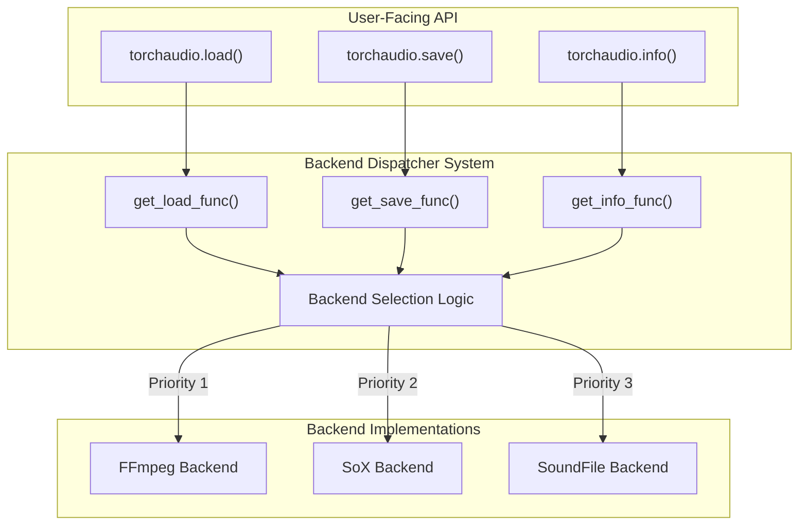
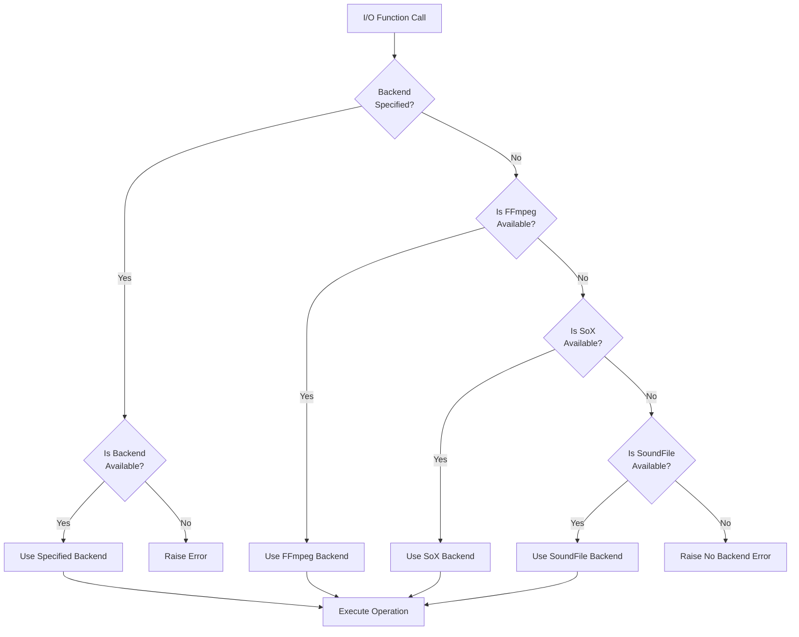
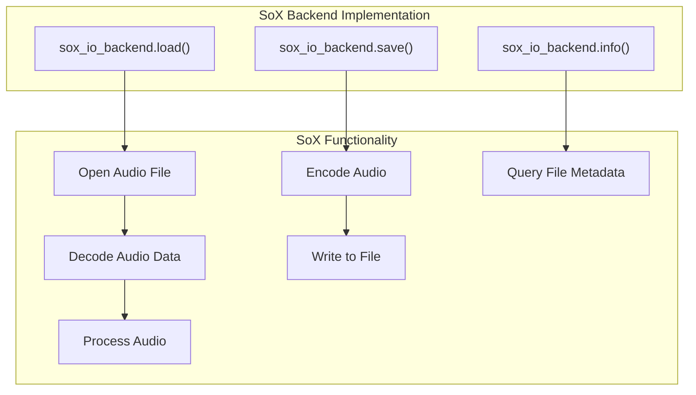
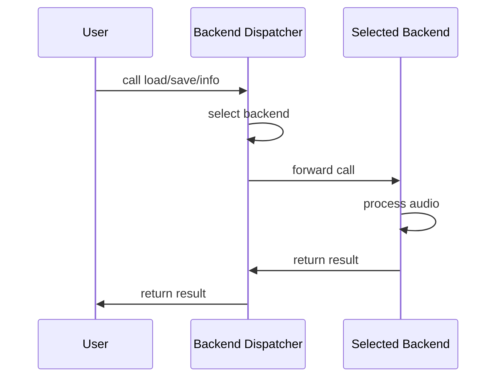

<!-- source: DeepWiki mcp.deepwiki.com · repo pytorch/audio · page 3.1 Audio I/O and TorchCodec Migration · fetched 2026-10-21 -->

# Backend Architecture

<details>
<summary>Relevant source files</summary>

The following files were used as context for generating this wiki page:

- [CONTRIBUTING.md](CONTRIBUTING.md)
- [README.md](README.md)
- [docs/source/compliance.kaldi.rst](docs/source/compliance.kaldi.rst)
- [docs/source/index.rst](docs/source/index.rst)
- [docs/source/torchaudio.rst](docs/source/torchaudio.rst)
- [test/torchaudio_unittest/README.md](test/torchaudio_unittest/README.md)

</details>


This document explains the backend architecture of TorchAudio's I/O system, focusing on how different audio processing backends are managed and dispatched. The architecture allows TorchAudio to support multiple audio processing libraries while providing a unified interface. For information about specific I/O components like StreamReader and StreamWriter, see [StreamReader](#3.2) and [StreamWriter](#3.3). For details on supported audio formats, see [Audio Formats and Backends](#3.5).

## Overview of Backend System

TorchAudio's backend architecture is designed to abstract away the complexities of different audio processing libraries. It provides a set of common functions (`load`, `save`, `info`) that dispatch to specific backend implementations based on availability and user preference.

The key components of the backend system are:
- The backend dispatcher that selects appropriate backends
- Multiple backend implementations (FFmpeg, SoX, SoundFile)
- I/O functions that use the dispatcher to route operations



Sources: 
- [docs/source/torchaudio.rst:22-79]()
- [test/torchaudio_unittest/backend/dispatcher/sox/load_test.py:1-26]()

## Backend Dispatcher

The backend dispatcher is the core component that determines which backend implementation to use for audio I/O operations. It was introduced in TorchAudio v2.0 to provide flexibility in backend selection.

### Dispatcher Mechanism

The dispatcher allows:
1. Explicit backend selection through the `backend` parameter
2. Automatic backend selection based on priority and availability
3. Format-specific routing to appropriate backends



Sources:
- [docs/source/torchaudio.rst:44-79]()
- [test/torchaudio_unittest/backend/dispatcher/sox/load_test.py:25]()

### Backend Selection Order

When no backend is explicitly specified, the dispatcher selects backends in the following order of precedence:

| Priority | Backend    | Supported OS                | Features                                         |
|----------|------------|-----------------------------|-------------------------------------------------|
| 1        | FFmpeg     | Linux, macOS, Windows       | Extensive format support, protocols, file objects |
| 2        | SoX        | Linux, macOS                | Audio processing                                 |
| 3        | SoundFile  | Linux, macOS, Windows       | File-like objects                                |

Sources:
- [docs/source/torchaudio.rst:47-79]()

## Backend Implementations

Each backend implementation provides its own version of the core I/O functions (`load`, `save`, `info`). These functions are accessed through the dispatcher system.

### FFmpeg Backend

The FFmpeg backend is the highest priority backend with the most extensive format support.

Key features:
- Supports numerous audio and video formats
- Handles various protocols (HTTPS, RTSP, etc.)
- Supports file-like objects
- Available on all major platforms

### SoX Backend

The SoX (Sound eXchange) backend provides audio processing capabilities.

Key features:
- Focused on audio processing and manipulation
- Extensive effects processing capability
- Limited to Linux and macOS platforms
- As of v2.1, does not support file-like objects



Sources:
- [test/torchaudio_unittest/backend/sox_io/load_test.py:1-342]()
- [test/torchaudio_unittest/backend/sox_io/info_test.py:1-330]()
- [test/torchaudio_unittest/backend/sox_io/save_test.py:1-377]()
- [test/torchaudio_unittest/backend/sox_io/smoke_test.py:1-90]()
- [docs/source/torchaudio.rst:95-103]()

### SoundFile Backend

The SoundFile backend provides a simpler interface with good cross-platform support.

Key features:
- Cross-platform support
- Supports file-like objects
- Format support depends on installed SoundFile library

Sources:
- [test/torchaudio_unittest/backend/soundfile/info_test.py:1-186]()
- [docs/source/torchaudio.rst:73-78]()

## Core I/O Functions

The backend architecture exposes three main functions for audio I/O operations:

### info()

Retrieves metadata about an audio file without loading its content:
- Sample rate
- Number of frames
- Number of channels
- Bits per sample
- Encoding format

### load()

Loads audio data from a file or file-like object:
- Returns audio tensor and sample rate
- Supports normalization
- Configurable channel ordering (channels_first)
- Supports frame offsets and limits

### save()

Saves audio tensor to a file:
- Configurable format and encoding
- Supports compression options
- Configurable bit depth and channel ordering



Sources:
- [test/torchaudio_unittest/backend/sox_io/load_test.py:23-97]()
- [test/torchaudio_unittest/backend/sox_io/info_test.py:23-47]()
- [test/torchaudio_unittest/backend/sox_io/save_test.py:34-101]()

## Dispatcher Migration

TorchAudio has been transitioning from a global backend setting to the dispatcher model:

| Version | Change |
|---------|--------|
| 2.0     | Introduced backend dispatcher (opt-in via environment variable) |
| 2.1     | Made dispatcher the default mechanism for I/O |
| 2.2     | Removed legacy global backend mechanism |

Sources:
- [docs/source/torchaudio.rst:82-98]()

## Format Support

Different backends support different audio formats and features. The table below summarizes the core formats supported by each backend:

| Format | FFmpeg | SoX    | SoundFile |
|--------|--------|--------|-----------|
| WAV    | ✓      | ✓      | ✓         |
| MP3    | ✓      | ✓      | ❌        |
| FLAC   | ✓      | ✓      | ✓         |
| OGG    | ✓      | ✓ (Vorbis) | ✓ (Vorbis) |
| AAC    | ✓      | ❌     | ❌        |
| OPUS   | ✓      | ✓ (with decoder) | ❌ |
| SPHERE | ✓      | ✓      | ✓ (as NIST) |
| AMB    | ❌      | ✓      | ❌        |

Each backend also supports different encodings and bit depths for various formats.

Sources:
- [test/torchaudio_unittest/backend/sox_io/load_test.py:118-286]()
- [test/torchaudio_unittest/backend/soundfile/info_test.py:31-98]()
- [test/torchaudio_unittest/backend/sox_io/info_test.py:34-246]()

## Using the Backend System

### Explicit Backend Selection

To explicitly select a backend for an operation:

```python
# Using FFmpeg backend
waveform, sample_rate = torchaudio.load("audio.mp3", backend="ffmpeg")

# Using SoX backend
torchaudio.save("audio.wav", waveform, sample_rate, backend="sox")

# Using SoundFile backend
file_info = torchaudio.info("audio.flac", backend="soundfile")
```

### Format Specification for Files Without Extensions

Some backends (like SoX) require format specification when the file doesn't have an extension:

```python
# Specifying format for a file without extension
torchaudio.load("audio_file", format="mp3", backend="sox")
```

Sources:
- [test/torchaudio_unittest/backend/sox_io/load_test.py:319-331]()
- [test/torchaudio_unittest/backend/dispatcher/sox/load_test.py:25]()

## Implementation Details

### Error Handling

The backend system provides informative error messages that include the file paths when operations fail:

```python
# Attempting to load a non-existent file
try:
    torchaudio.load("non_existing_audio.wav")
except RuntimeError as e:
    # Error message will contain the file path
    print(e)  # Will include "non_existing_audio.wav" in the error message
```

Sources:
- [test/torchaudio_unittest/backend/sox_io/load_test.py:334-342]()
- [test/torchaudio_unittest/backend/sox_io/info_test.py:322-330]()
- [test/torchaudio_unittest/backend/sox_io/save_test.py:369-377]()

### File-Like Object Support

Support for file-like objects varies by backend:

| Backend    | File-Like Object Support |
|------------|--------------------------|
| FFmpeg     | ✓                        |
| SoX        | ❌ (removed in v2.1)     |
| SoundFile  | ✓                        |

Sources:
- [docs/source/torchaudio.rst:95-103]()
- [test/torchaudio_unittest/backend/dispatcher/sox/load_test.py:326-358]()
- [test/torchaudio_unittest/backend/soundfile/info_test.py:125-186]()

## Conclusion

TorchAudio's Backend Architecture provides a flexible system for audio I/O operations, allowing users to leverage different audio processing libraries through a unified interface. The dispatcher mechanism enables both automatic and explicit backend selection, while the implementation details handle various audio formats and encoding options.

---

