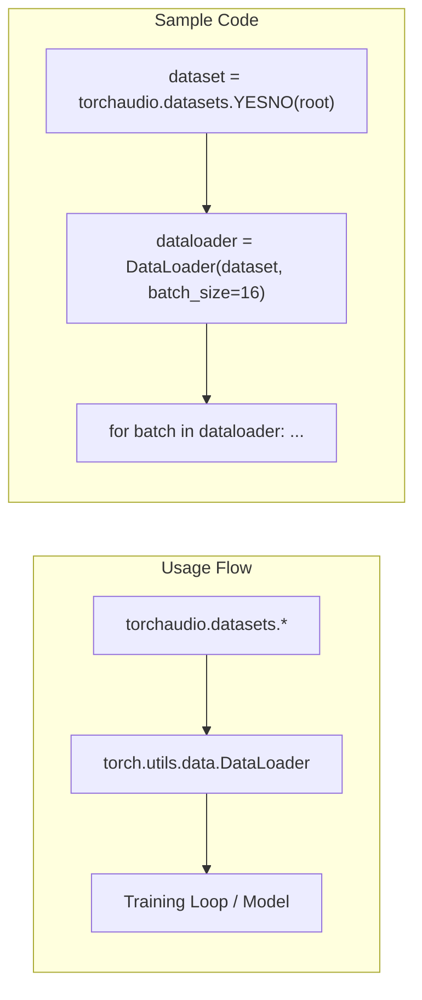
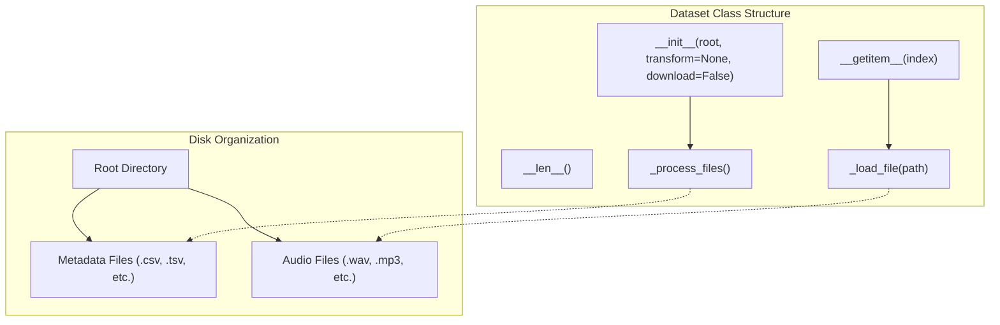
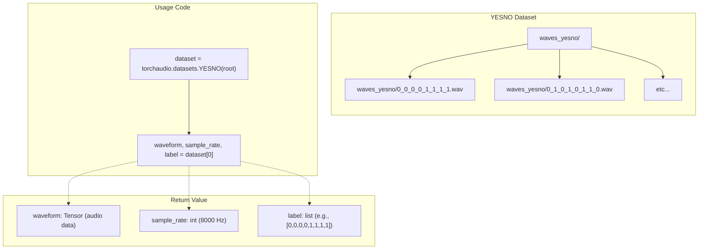
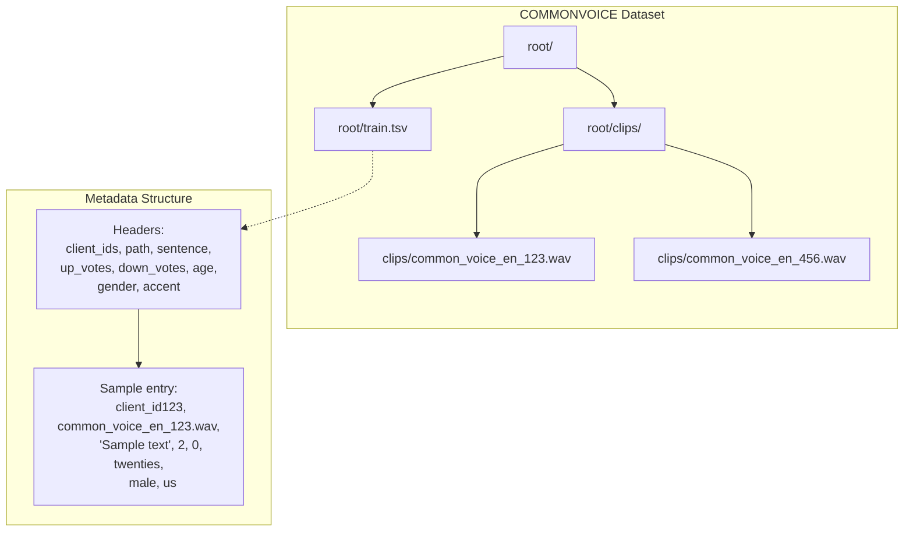

<!-- source: DeepWiki mcp.deepwiki.com · repo pytorch/audio · page 3.2 Datasets · fetched 2026-10-21 -->

# Datasets

<details>
<summary>Relevant source files</summary>

The following files were used as context for generating this wiki page:

- [docs/source/datasets.rst](docs/source/datasets.rst)
- [test/torchaudio_unittest/datasets/commonvoice_test.py](test/torchaudio_unittest/datasets/commonvoice_test.py)
- [test/torchaudio_unittest/datasets/iemocap_test.py](test/torchaudio_unittest/datasets/iemocap_test.py)
- [test/torchaudio_unittest/datasets/tedlium_test.py](test/torchaudio_unittest/datasets/tedlium_test.py)
- [test/torchaudio_unittest/datasets/yesno_test.py](test/torchaudio_unittest/datasets/yesno_test.py)

</details>


## Purpose and Scope

This document covers the `torchaudio.datasets` module, which provides a collection of ready-to-use audio datasets for machine learning tasks. These datasets primarily focus on speech recognition, speech synthesis, music analysis, and other audio-related tasks. All datasets follow PyTorch's dataset convention, making them seamlessly integrable with PyTorch's data loading utilities.

The document describes the common architecture of dataset classes, their integration with PyTorch's ecosystem, and provides an overview of available datasets.

## Dataset Architecture

All datasets in the `torchaudio.datasets` module are subclasses of `torch.utils.data.Dataset` and implement the standard PyTorch dataset interface with `__getitem__` and `__len__` methods. This design allows them to be used with PyTorch's `DataLoader` for efficient batch processing, multiprocessing, and other features.

```mermaid
classDiagram
    direction TB
    class "torch.utils.data.Dataset" {
        <<abstract>>
        +__getitem__(idx)
        +__len__()
    }
    
    class "torchaudio.datasets.AudioDataset" {
        <<interface pattern>>
        +__getitem__(idx): (waveform, sample_rate, metadata)
        +__len__()
        #_load_item(idx)
    }
    
    class "Dataset Implementations" {
        YESNO
        COMMONVOICE
        LIBRISPEECH
        VCTK_092
        etc...
    }
    
    "torch.utils.data.Dataset" <|-- "torchaudio.datasets.AudioDataset"
    "torchaudio.datasets.AudioDataset" <|-- "Dataset Implementations"
```

### Common Return Format

While the exact return values vary between datasets, most follow a common pattern:

```
(waveform, sample_rate, metadata)
```

Where:
- `waveform`: A PyTorch tensor containing the audio data
- `sample_rate`: The sample rate of the audio as an integer
- `metadata`: Dataset-specific metadata, which can be a dictionary, label, or other structure

Sources: [docs/source/datasets.rst:1-50]()

## Integration with PyTorch DataLoader

A primary advantage of torchaudio's datasets is their compatibility with PyTorch's data loading ecosystem. This allows for:
- Automatic batching of samples
- Multi-process data loading
- Custom data sampling strategies
- On-the-fly transformations



Sources: [docs/source/datasets.rst:7-20]()

## Available Datasets

TorchAudio provides numerous datasets across different audio domains:

### Speech Datasets

| Dataset | Description | Return Format |
|---------|-------------|---------------|
| COMMONVOICE | Multi-language speech dataset by Mozilla | (waveform, sample_rate, dictionary) |
| LIBRISPEECH | Read English speech dataset | (waveform, sample_rate, dictionary) |
| VCTK_092 | Speech data from 109 English speakers | (waveform, sample_rate, dictionary) |
| YESNO | Simple dataset with "yes" and "no" utterances | (waveform, sample_rate, label) |
| TEDLIUM | Speech data from TED talks | (waveform, sample_rate, dictionary) |
| IEMOCAP | Emotional speech dataset | (waveform, sample_rate, dictionary) |
| LJSPEECH | Single speaker English speech dataset | (waveform, sample_rate, dictionary) |

### Specialized Datasets

| Dataset | Description | Return Format |
|---------|-------------|---------------|
| SPEECHCOMMANDS | Spoken command words dataset | (waveform, sample_rate, dictionary) |
| FluentSpeechCommands | Spoken commands for voice assistants | (waveform, sample_rate, dictionary) |
| QUESST14 | Query by Example Search on Speech Task | (waveform, sample_rate, name) |
| CMUDict | Pronunciation dictionary | (word, pronunciation) |

### Music and General Audio Datasets

| Dataset | Description | Return Format |
|---------|-------------|---------------|
| GTZAN | Music genre classification dataset | (waveform, sample_rate, dictionary) |
| MUSDB_HQ | Music source separation dataset | (waveform, sample_rate, dictionary) |

Sources: [docs/source/datasets.rst:24-49]()

## Dataset Structure Examples

### Common Dataset Structure

Most datasets follow a similar structure, with differences in how they organize files and metadata:



### Example: YESNO Dataset

The YESNO dataset is one of the simplest datasets in torchaudio:



Sources: [test/torchaudio_unittest/datasets/yesno_test.py:1-60]()

### Example: COMMONVOICE Dataset

The Mozilla Common Voice dataset has a more complex structure:



Sources: [test/torchaudio_unittest/datasets/commonvoice_test.py:1-172]()

## Usage Examples

### Basic Usage

```python
# Load the YESNO dataset
dataset = torchaudio.datasets.YESNO('./data', download=True)

# Access an item
waveform, sample_rate, label = dataset[0]
print(f"Sample rate: {sample_rate}")
print(f"Waveform shape: {waveform.shape}")
print(f"Label: {label}")
```

### Using with DataLoader

```python
from torch.utils.data import DataLoader

# Create a DataLoader for batch processing
dataloader = DataLoader(
    dataset,
    batch_size=16,
    shuffle=True,
    num_workers=4
)

# Iterate through batches
for batch_waveforms, batch_sample_rates, batch_labels in dataloader:
    # Process batch
    # batch_waveforms shape: [batch_size, num_channels, num_samples]
    pass
```

Sources: [docs/source/datasets.rst:10-20]()

## Implementing Custom Datasets

When creating a custom dataset that extends the functionality of torchaudio datasets, you should follow these patterns:

1. Subclass `torch.utils.data.Dataset`
2. Implement `__init__`, `__getitem__`, and `__len__` methods
3. Follow the common return pattern of (waveform, sample_rate, metadata)
4. Consider providing a `download` parameter if your dataset can be downloaded

```python
class MyCustomDataset(torch.utils.data.Dataset):
    def __init__(self, root, download=False):
        self.root = root
        if download:
            # Download logic here
            pass
        
        # Process and index files
        self._walker = self._parse_files()
        
    def _parse_files(self):
        # Logic to find and index all required files
        return file_list
        
    def __getitem__(self, n):
        # Load the nth item
        filepath = self._walker[n]
        waveform, sample_rate = torchaudio.load(filepath)
        # Extract metadata
        # ...
        return waveform, sample_rate, metadata
        
    def __len__(self):
        return len(self._walker)
```

## Conclusion

The `torchaudio.datasets` module provides a comprehensive collection of audio datasets that integrate seamlessly with PyTorch's data loading utilities. By using a consistent interface across datasets, it simplifies working with audio data in machine learning applications.

For more specific information about audio processing operations that can be applied to the data obtained from these datasets, refer to the [Core Audio Processing](#2) documentation.

Sources: [docs/source/datasets.rst:1-50]()

---

