<!-- source: DeepWiki mcp.deepwiki.com · repo pytorch/audio · page 4 Models and Pipelines · fetched 2026-10-21 -->

# Models and Pipelines

<details>
<summary>Relevant source files</summary>

The following files were used as context for generating this wiki page:

- [docs/source/_templates/autosummary/bundle_class.rst](docs/source/_templates/autosummary/bundle_class.rst)
- [docs/source/models.rst](docs/source/models.rst)
- [docs/source/pipelines.rst](docs/source/pipelines.rst)
- [src/torchaudio/pipelines/_wav2vec2/aligner.py](src/torchaudio/pipelines/_wav2vec2/aligner.py)
- [test/integration_tests/__init__.py](test/integration_tests/__init__.py)
- [test/integration_tests/conftest.py](test/integration_tests/conftest.py)
- [test/integration_tests/source_separation_pipeline_test.py](test/integration_tests/source_separation_pipeline_test.py)
- [test/integration_tests/wav2vec2_pipeline_test.py](test/integration_tests/wav2vec2_pipeline_test.py)
- [test/torchaudio_unittest/models/wav2vec2/fairseq_integration_test.py](test/torchaudio_unittest/models/wav2vec2/fairseq_integration_test.py)
- [test/torchaudio_unittest/models/wav2vec2/huggingface_intergration_test.py](test/torchaudio_unittest/models/wav2vec2/huggingface_intergration_test.py)
- [test/torchaudio_unittest/models/wav2vec2/model_test.py](test/torchaudio_unittest/models/wav2vec2/model_test.py)

</details>


This page provides an overview of the audio model architectures and pre-trained pipeline bundles available in TorchAudio. It covers the `torchaudio.models` module, which defines model architectures, and the `torchaudio.pipelines` module, which packages pre-trained models with supporting utilities for specific tasks. For information about core audio processing functionality, see [Core Audio Processing](#2).

## 1. Architecture Overview

The Models and Pipelines system in TorchAudio separates model definitions from pre-trained implementations, enabling flexibility while providing easy-to-use solutions for common audio tasks.

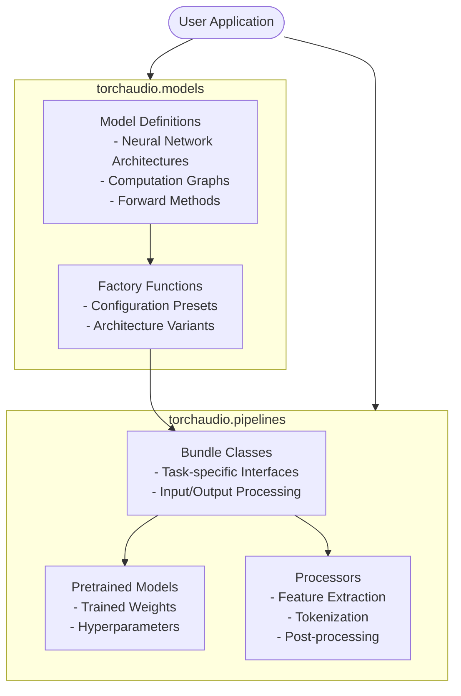

Sources: [docs/source/models.rst:1-37](), [docs/source/pipelines.rst:1-21]()

## 2. Models

The `torchaudio.models` module provides definitions of neural network architectures for common audio tasks. These models define the computation graph structure but don't include pre-trained weights (for pre-trained models, see the Pipelines section).

### 2.1 Available Models

TorchAudio includes the following key model architectures:

| Model Type | Description | Applications |
|------------|-------------|--------------|
| Wav2Vec2 | Self-supervised speech representation model | Speech recognition, audio representation |
| HuBERT | Hidden-Unit BERT speech model | Speech recognition, audio representation |
| WavLM | Large-scale self-supervised pre-training for speech | Speech understanding, representation |
| Conformer | Convolution-augmented transformer for ASR | Speech recognition |
| ConvTasNet | Time-domain audio separation network | Source separation |
| HDemucs | Hybrid Demucs for music source separation | Music source separation |
| Tacotron2 | Neural text-to-speech model | Speech synthesis |
| RNNT | RNN-Transducer for streaming ASR | Speech recognition |
| SQUIM | Speech quality and intelligibility metrics | Audio quality assessment |

Sources: [docs/source/models.rst:18-37]()

### 2.2 Model Implementation Structure

Models in TorchAudio follow a consistent implementation pattern:

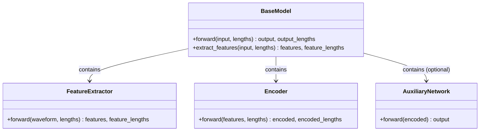

Sources: [test/torchaudio_unittest/models/wav2vec2/model_test.py:65-101]()

## 3. Pipelines

The `torchaudio.pipelines` module packages pre-trained models with support functions and metadata into simple APIs for specific tasks. Pipelines abstract away implementation details, making it easy to use state-of-the-art models without deep knowledge of the underlying architecture.

### 3.1 Bundle Architecture

Pipelines use the concept of "Bundles" - classes that provide a consistent interface for specific tasks while encapsulating different implementations.

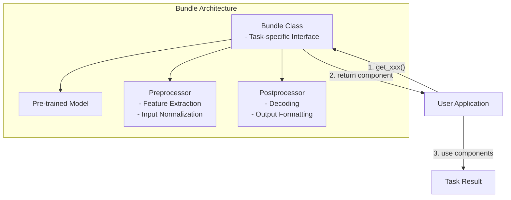

Sources: [docs/source/pipelines.rst:8-21]()

### 3.2 Common Pipeline Types

TorchAudio provides several pipeline types for different audio tasks:

1. **Speech Recognition (ASR)**:
   - RNNTBundle - For streaming/non-streaming ASR
   - Wav2Vec2ASRBundle - For fine-tuned wav2vec2 ASR

2. **Self-Supervised Learning (SSL)**:
   - Wav2Vec2Bundle - For wav2vec2, HuBERT, WavLM models that generate acoustic features

3. **Forced Alignment**:
   - Wav2Vec2FABundle - For aligning text with speech audio

4. **Text-to-Speech (TTS)**:
   - Tacotron2TTSBundle - For text-to-speech synthesis

5. **Source Separation**:
   - SourceSeparationBundle - For separating audio sources

6. **Speech Quality Assessment**:
   - SquimObjectiveBundle - For objective quality metrics
   - SquimSubjectiveBundle - For subjective quality metrics

Sources: [docs/source/pipelines.rst:24-301]()

## 4. Speech Recognition Pipelines

TorchAudio offers several pre-trained automatic speech recognition (ASR) pipelines.

### 4.1 RNN-T Based ASR

The RNNTBundle combines a streaming ASR model based on RNN-Transducer architecture with feature extraction and token processing.

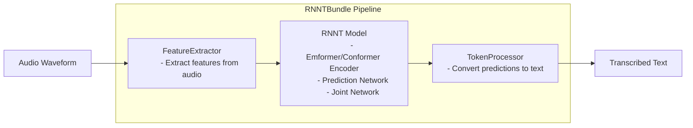

Available pre-trained models:
- EMFORMER_RNNT_BASE_LIBRISPEECH - English ASR model trained on LibriSpeech
- EMFORMER_RNNT_BASE_MUSTC - English ASR model trained on MuST-C
- EMFORMER_RNNT_BASE_TEDLIUM3 - English ASR model trained on TED-LIUM 3

Sources: [docs/source/pipelines.rst:24-57](), [test/integration_tests/rnnt_pipeline_test.py:1-24]()

### 4.2 Wav2Vec2/HuBERT ASR

The Wav2Vec2ASRBundle provides fine-tuned speech recognition models based on wav2vec 2.0 or HuBERT architectures.

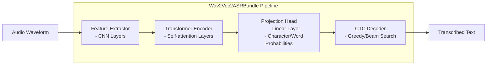

Available model types:
- Base and Large wav2vec 2.0 models
- XLS-R multilingual models
- HuBERT models
- Language-specific models (English, German, Spanish, French, Italian)

Sources: [docs/source/pipelines.rst:99-143](), [test/integration_tests/wav2vec2_pipeline_test.py:1-121]()

## 5. Self-Supervised Learning Pipelines

TorchAudio provides pre-trained self-supervised learning (SSL) models for speech representation.

### 5.1 Wav2Vec2/HuBERT/WavLM

The Wav2Vec2Bundle instantiates models that generate acoustic features for downstream tasks:

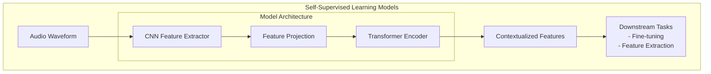

Available pre-trained SSL models:
- WAV2VEC2_BASE, WAV2VEC2_LARGE, WAV2VEC2_LARGE_LV60K
- WAV2VEC2_XLSR53, WAV2VEC2_XLSR_300M, WAV2VEC2_XLSR_1B, WAV2VEC2_XLSR_2B
- HUBERT_BASE, HUBERT_LARGE, HUBERT_XLARGE
- WAVLM_BASE, WAVLM_BASE_PLUS, WAVLM_LARGE

Sources: [docs/source/pipelines.rst:60-98](), [test/torchaudio_unittest/models/wav2vec2/huggingface_intergration_test.py:1-100](), [test/torchaudio_unittest/models/wav2vec2/fairseq_integration_test.py:1-100]()

## 6. Forced Alignment Pipelines

The Wav2Vec2FABundle provides tools for aligning text with speech audio. This is useful for creating word-level timestamps.

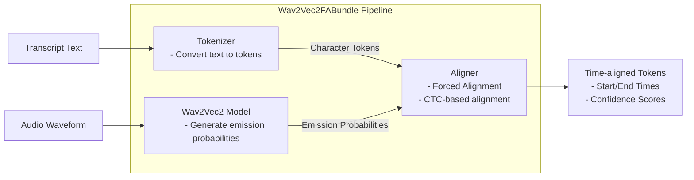

Available pre-trained models:
- MMS_FA - Multilingual Speech (MMS) forced alignment model

Sources: [docs/source/pipelines.rst:145-176](), [src/torchaudio/pipelines/_wav2vec2/aligner.py:1-88]()

## 7. Text-to-Speech Pipelines

The Tacotron2TTSBundle provides text-to-speech capabilities combining text processing, spectrogram generation, and vocoding.

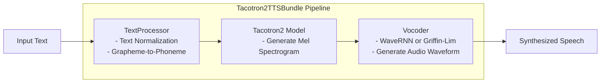

Available pre-trained models:
- TACOTRON2_WAVERNN_PHONE_LJSPEECH - Phoneme-based with WaveRNN vocoder
- TACOTRON2_WAVERNN_CHAR_LJSPEECH - Character-based with WaveRNN vocoder
- TACOTRON2_GRIFFINLIM_PHONE_LJSPEECH - Phoneme-based with Griffin-Lim vocoder
- TACOTRON2_GRIFFINLIM_CHAR_LJSPEECH - Character-based with Griffin-Lim vocoder

Sources: [docs/source/pipelines.rst:180-218]()

## 8. Source Separation Pipelines

The SourceSeparationBundle provides models for separating audio sources from a mixture.

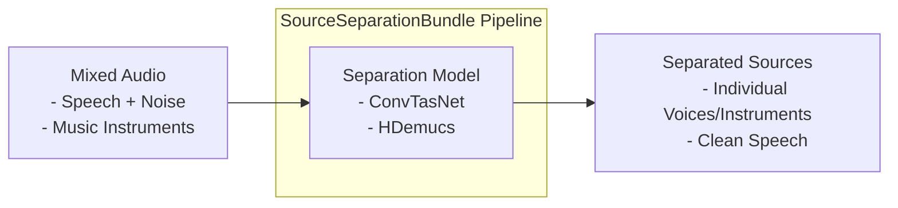

Available pre-trained models:
- CONVTASNET_BASE_LIBRI2MIX - Speech separation model
- HDEMUCS_HIGH_MUSDB_PLUS - High-quality music separation model
- HDEMUCS_HIGH_MUSDB - Music separation model

Sources: [docs/source/pipelines.rst:220-252](), [test/integration_tests/source_separation_pipeline_test.py:1-43]()

## 9. Speech Quality Assessment Pipelines

The SQUIM (Speech Quality and Intelligibility Metrics) bundles provide models for assessing speech quality.

### 9.1 Objective Metrics

The SquimObjectiveBundle predicts objective speech quality metrics from audio.

Available pre-trained models:
- SQUIM_OBJECTIVE - Predicts objective quality scores

### 9.2 Subjective Metrics

The SquimSubjectiveBundle predicts subjective speech quality metrics from audio.

Available pre-trained models:
- SQUIM_SUBJECTIVE - Predicts subjective quality scores

Sources: [docs/source/pipelines.rst:253-301]()

## 10. Using Models and Pipelines

### 10.1 Loading Pre-trained Models

To use a pre-trained pipeline:

1. Import the desired bundle from `torchaudio.pipelines`
2. Get the model and associated components using the bundle's methods
3. Run inference with the model

Example usage pattern:

```
# Import bundle
from torchaudio.pipelines import WAV2VEC2_ASR_BASE_960H

# Get model and components
model = WAV2VEC2_ASR_BASE_960H.get_model()
decoder = WAV2VEC2_ASR_BASE_960H.get_decoder()
labels = WAV2VEC2_ASR_BASE_960H.get_labels()

# Inference
emission, _ = model(waveform)
transcript = decoder(emission[0])
```

### 10.2 Common Design Patterns

Most pipelines follow a similar pattern:

1. Extract features from raw audio
2. Process features through a neural network
3. Decode/post-process the output

Different tasks have specialized components, but the overall flow remains consistent across bundles.

Sources: [test/integration_tests/wav2vec2_pipeline_test.py:80-120](), [test/integration_tests/conftest.py:9-31]()

### 10.3 Model Optimization

TorchAudio models support optimization techniques:

1. **TorchScript** - Models can be compiled for deployment
2. **Quantization** - Models support dynamic quantization for reduced memory footprint
3. **GPU Acceleration** - Models can run on CUDA devices for faster inference

Sources: [test/torchaudio_unittest/models/wav2vec2/model_test.py:184-288](), [test/torchaudio_unittest/models/wav2vec2/model_test.py:348-413]()

## 11. Integration with External Frameworks

TorchAudio provides utilities to import models from external frameworks:

### 11.1 Hugging Face Integration

Models from Hugging Face Transformers can be imported and used with TorchAudio:

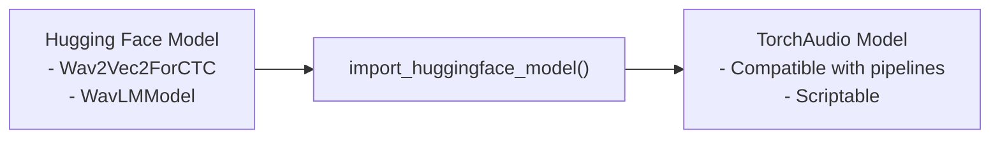

Sources: [test/torchaudio_unittest/models/wav2vec2/huggingface_intergration_test.py:1-356]()

### 11.2 Fairseq Integration

Models from Fairseq can be imported and used with TorchAudio:

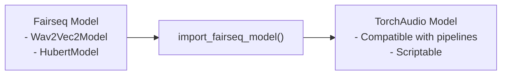

Sources: [test/torchaudio_unittest/models/wav2vec2/fairseq_integration_test.py:1-290]()

## 12. Summary

The Models and Pipelines system in TorchAudio provides:

1. Flexible model architectures for various audio tasks
2. Pre-trained models packaged with necessary processing components
3. Consistent interfaces through the Bundle pattern
4. Integration with external frameworks
5. Support for optimization techniques for deployment

This design enables both easy use of state-of-the-art audio models through pipelines and flexibility for custom implementations using the underlying model architectures.

---

