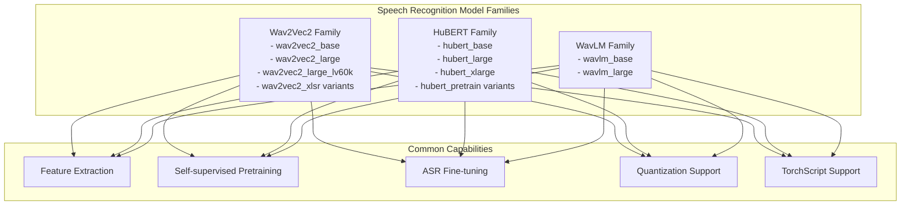
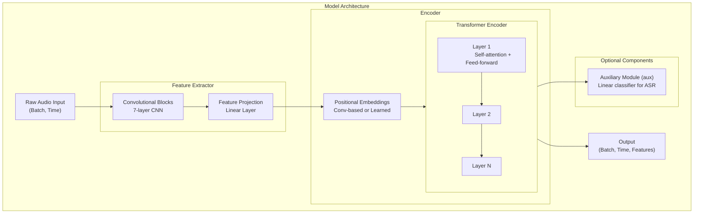
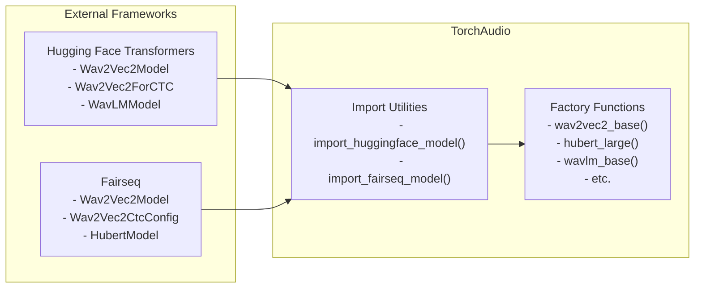

<!-- source: DeepWiki mcp.deepwiki.com · repo pytorch/audio · page 4.1 Speech Recognition Models · fetched 2026-10-21 -->

# Speech Recognition Models

<details>
<summary>Relevant source files</summary>

The following files were used as context for generating this wiki page:

- [docs/source/models.rst](docs/source/models.rst)
- [test/integration_tests/__init__.py](test/integration_tests/__init__.py)
- [test/torchaudio_unittest/models/wav2vec2/fairseq_integration_test.py](test/torchaudio_unittest/models/wav2vec2/fairseq_integration_test.py)
- [test/torchaudio_unittest/models/wav2vec2/huggingface_intergration_test.py](test/torchaudio_unittest/models/wav2vec2/huggingface_intergration_test.py)
- [test/torchaudio_unittest/models/wav2vec2/model_test.py](test/torchaudio_unittest/models/wav2vec2/model_test.py)

</details>


This document provides an overview of the speech recognition model architectures implemented in the `torchaudio.models` module. It covers the key model families—Wav2Vec2, HuBERT, and WavLM—their architectures, and usage patterns. For information about using these models with pre-trained weights, see [ASR Pipelines](#4.2).

## Model Families Overview

TorchAudio implements three primary families of state-of-the-art speech recognition models:



Sources: [test/torchaudio_unittest/models/wav2vec2/model_test.py:7-20](), [test/torchaudio_unittest/models/wav2vec2/huggingface_intergration_test.py:6-15]()

### Wav2Vec2 Models

Wav2Vec2 is a self-supervised learning framework for speech recognition that produces state-of-the-art results with limited labeled data. Available variants include:

- **Base**: Smaller model with ~95M parameters
- **Large**: Larger model with ~317M parameters
- **Large LV60k**: Large model trained on 60k hours of unlabeled data
- **XLS-R variants**: Multilingual variants trained on up to 2 billion parameters (300M, 1B, and 2B versions)

Sources: [test/torchaudio_unittest/models/wav2vec2/huggingface_intergration_test.py:36-45](), [test/torchaudio_unittest/models/wav2vec2/fairseq_integration_test.py:30-39]()

### HuBERT Models

HuBERT (Hidden-Unit BERT) applies masked prediction to automatically discovered units from speech audio. Available variants include:

- **Base**: ~95M parameters
- **Large**: ~317M parameters 
- **XLarge**: ~1B parameters
- **Pretrain variants**: Specialized versions for pretraining tasks

Sources: [test/torchaudio_unittest/models/wav2vec2/model_test.py:9-14]()

### WavLM Models

WavLM extends the masked speech prediction objective with denoising capability and is designed for both speech recognition and understanding tasks. Available variants:

- **Base**: ~95M parameters
- **Large**: ~317M parameters

Sources: [test/torchaudio_unittest/models/wav2vec2/huggingface_intergration_test.py:13-14]()

## Architecture and Components

All these speech recognition model families share a similar high-level architecture:



Sources: [test/torchaudio_unittest/models/wav2vec2/model_test.py:97-103](), [test/torchaudio_unittest/models/wav2vec2/huggingface_intergration_test.py:118-147]()

### Key Components

1. **Feature Extractor**: Converts raw audio waveforms into feature representations using a multi-layer CNN.
   
2. **Feature Projection**: Projects CNN output features into the transformer dimension space.

3. **Positional Embedding**: Adds positional information, typically using convolutional positional embeddings.

4. **Transformer Encoder**: Core component with multiple layers of self-attention blocks.

5. **Auxiliary Module**: Optional classification head used for ASR fine-tuning.

Sources: [test/torchaudio_unittest/models/wav2vec2/huggingface_intergration_test.py:118-147]()

## Model Instantiation

Models can be instantiated using factory functions corresponding to each architecture variant:

```python
# Create base model for feature extraction or representation learning
model = torchaudio.models.wav2vec2_base()  # or wavlm_base(), hubert_base(), etc.

# Create model with an auxiliary classification head for ASR
model = torchaudio.models.wav2vec2_base(aux_num_out=32)  # 32 output classes
```

The model family factory functions are available for different sizes and variants:

| Model Family | Factory Functions |
|--------------|-------------------|
| Wav2Vec2     | `wav2vec2_base()`, `wav2vec2_large()`, `wav2vec2_large_lv60k()`, `wav2vec2_xlsr_300m()`, `wav2vec2_xlsr_1b()`, `wav2vec2_xlsr_2b()` |
| HuBERT       | `hubert_base()`, `hubert_large()`, `hubert_xlarge()`, `hubert_pretrain_base()`, `hubert_pretrain_large()`, `hubert_pretrain_xlarge()` |
| WavLM        | `wavlm_base()`, `wavlm_large()` |

Sources: [test/torchaudio_unittest/models/wav2vec2/model_test.py:34-52](), [docs/source/models.rst:18-37]()

## Model Usage and API

### Basic Forward Pass

Models accept raw audio waveforms and optional length tensors:

```python
# Input: (batch_size, num_frames)
waveforms = torch.randn(3, 1024) 

# Optional: lengths tensor to handle variable-length inputs
lengths = torch.tensor([1024, 800, 600])  

# Forward pass
outputs, output_lengths = model(waveforms, lengths)
```

For models with auxiliary heads (fine-tuned models), outputs are logits for the target classes. For base models, outputs are feature representations.

Sources: [test/torchaudio_unittest/models/wav2vec2/model_test.py:69-81]()

### Feature Extraction

All models provide a feature extraction API to access intermediate layer outputs:

```python
# Extract features from specific layers
features, output_lengths = model.extract_features(waveforms, lengths, num_layers=12)
```

Setting `num_layers=None` returns outputs from all transformer layers.

Sources: [test/torchaudio_unittest/models/wav2vec2/model_test.py:98-128]()

## Integration with External Frameworks

TorchAudio provides utilities to import models from popular external frameworks:



Sources: [test/torchaudio_unittest/models/wav2vec2/huggingface_intergration_test.py:16](), [test/torchaudio_unittest/models/wav2vec2/fairseq_integration_test.py:16]()

### Importing from Hugging Face

Models trained with Hugging Face Transformers can be imported using the utility function:

```python
from torchaudio.models.wav2vec2.utils import import_huggingface_model

# Import the model from Hugging Face
imported_model = import_huggingface_model(hf_model)
```

Sources: [test/torchaudio_unittest/models/wav2vec2/huggingface_intergration_test.py:184-185]()

### Importing from Fairseq

Similarly, models from Fairseq can be imported:

```python
from torchaudio.models.wav2vec2.utils import import_fairseq_model

# Import the model from Fairseq
imported_model = import_fairseq_model(fairseq_model)
```

Sources: [test/torchaudio_unittest/models/wav2vec2/fairseq_integration_test.py:144-145]()

## Optimization and Deployment

### TorchScript Support

All model variants support TorchScript for optimized deployment:

```python
# Script the model for deployment
scripted_model = torch.jit.script(model)
```

Sources: [test/torchaudio_unittest/models/wav2vec2/model_test.py:200]()

### Quantization Support

The models support dynamic quantization for reduced memory footprint and faster inference:

```python
import torch.quantization as tq

# Prepare model for quantization
model.eval()
model.encoder.transformer.pos_conv_embed.__prepare_scriptable__()

# Apply dynamic quantization
quantized_model = tq.quantize_dynamic(
    model, 
    qconfig_spec={torch.nn.Linear}, 
    dtype=torch.qint8
)
```

Sources: [test/torchaudio_unittest/models/wav2vec2/model_test.py:225-231]()

## Model Behavior with Variable-length Inputs

The models handle variable-length inputs by masking, making them suitable for real-world speech processing tasks:

```python
batch_size, max_frames = 5, 5 * 1024
waveforms = torch.randn(batch_size, max_frames)
input_lengths = torch.tensor([3200, 6400, 9600, 12800, 16000])

# Batch process with lengths
batch_outputs, output_lengths = model(waveforms, input_lengths)
```

The output's effective length is indicated by `output_lengths`, while the tensor itself is padded.

Sources: [test/torchaudio_unittest/models/wav2vec2/model_test.py:135-151]()

## Comparison of Model Variants

The following table provides a comparison of key model variants:

| Model | Parameters | Architecture Size | Multilingual | Typical Use Cases |
|-------|------------|-------------------|--------------|-------------------|
| Wav2Vec2 Base | ~95M | 12 transformer layers | No | English ASR, feature extraction |
| Wav2Vec2 Large | ~317M | 24 transformer layers | No | High-accuracy English ASR |
| Wav2Vec2 Large LV60k | ~317M | 24 transformer layers | No | Robust ASR with more training data |
| Wav2Vec2 XLS-R | 300M-2B | 24+ transformer layers | Yes | Multilingual ASR |
| HuBERT Base | ~95M | 12 transformer layers | No | English ASR, masked prediction |
| HuBERT Large | ~317M | 24 transformer layers | No | High-accuracy English ASR |
| HuBERT XLarge | ~1B | 48 transformer layers | No | Highest accuracy English ASR |
| WavLM Base | ~95M | 12 transformer layers | No | ASR, speech understanding |
| WavLM Large | ~317M | 24 transformer layers | No | High-accuracy ASR, robust to noise |

Sources: [test/torchaudio_unittest/models/wav2vec2/fairseq_integration_test.py:30-46](), [test/torchaudio_unittest/models/wav2vec2/huggingface_intergration_test.py:36-52]()

---

