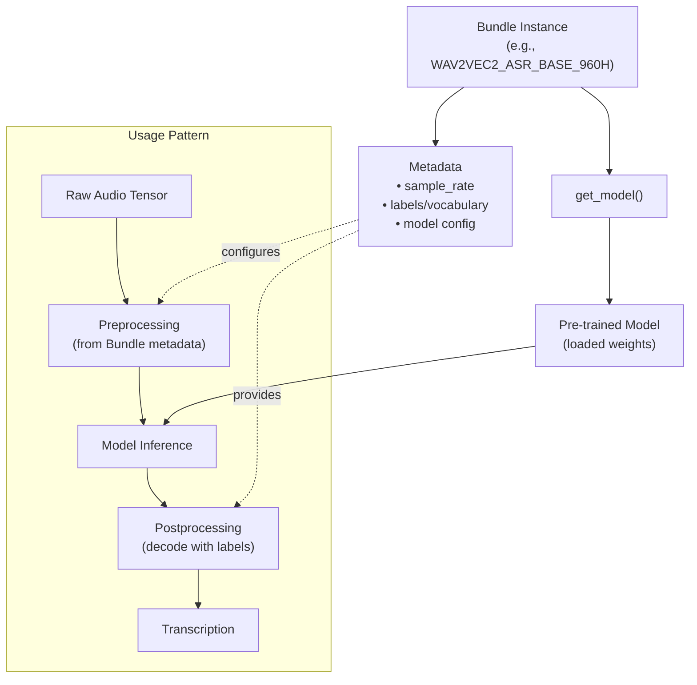
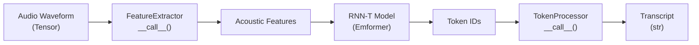
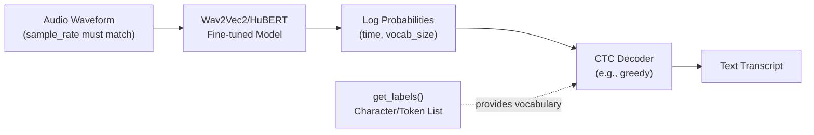
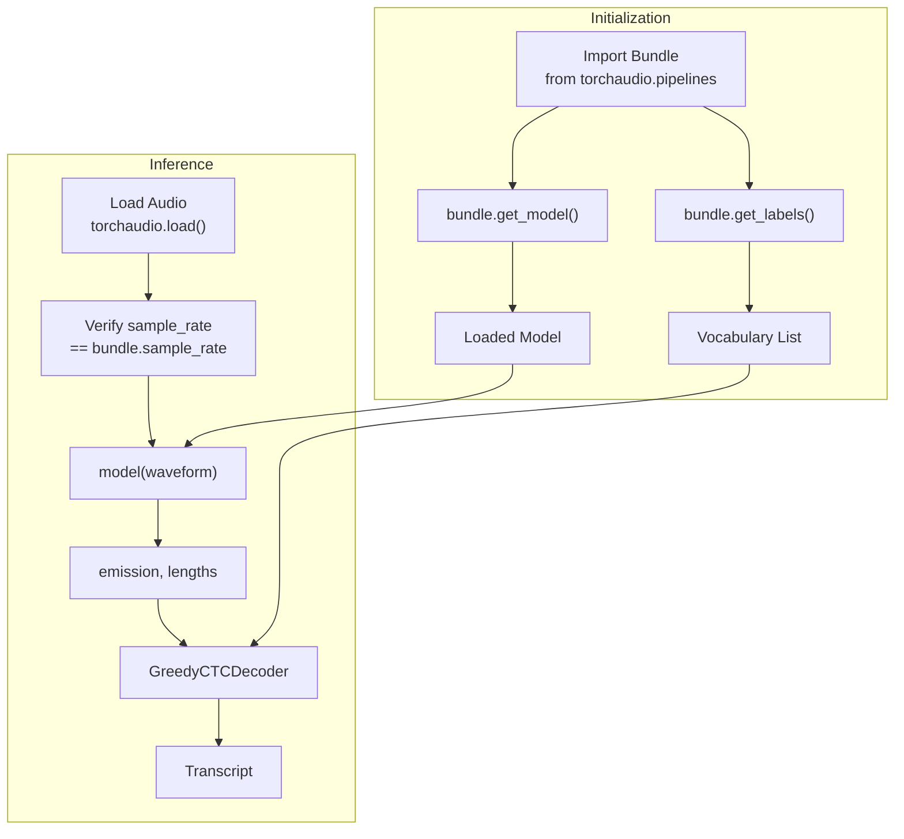
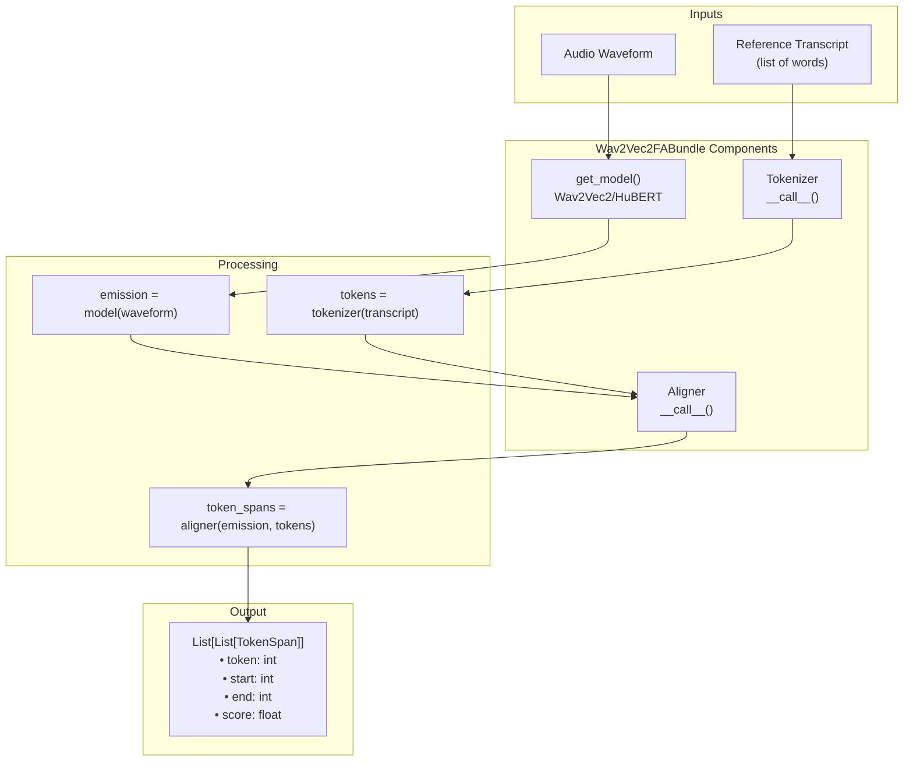

<!-- source: DeepWiki mcp.deepwiki.com · repo pytorch/audio · page 4.2 ASR Pipelines · fetched 2026-10-21 -->

# ASR Pipelines

<details>
<summary>Relevant source files</summary>

The following files were used as context for generating this wiki page:

- [docs/source/_templates/autosummary/bundle_class.rst](docs/source/_templates/autosummary/bundle_class.rst)
- [docs/source/pipelines.rst](docs/source/pipelines.rst)
- [src/torchaudio/pipelines/_wav2vec2/aligner.py](src/torchaudio/pipelines/_wav2vec2/aligner.py)
- [test/integration_tests/conftest.py](test/integration_tests/conftest.py)
- [test/integration_tests/source_separation_pipeline_test.py](test/integration_tests/source_separation_pipeline_test.py)
- [test/integration_tests/wav2vec2_pipeline_test.py](test/integration_tests/wav2vec2_pipeline_test.py)

</details>


This document describes the Automatic Speech Recognition (ASR) pipeline bundles provided by TorchAudio in the `torchaudio.pipelines` module. ASR pipelines package pre-trained models with their associated preprocessing, inference, and postprocessing components into unified APIs for performing speech-to-text transcription.

For information about the underlying ASR model architectures themselves, see [Speech Recognition Models](#4.1). For CTC decoding and forced alignment algorithms, see [CTC Decoder and Forced Alignment](#4.3). For other types of pipelines (TTS, source separation, SQUIM), see [Other Pipelines](#4.4).

**Sources**: [docs/source/pipelines.rst:1-23]()

## Bundle Architecture

The `torchaudio.pipelines` module uses a **Bundle** abstraction to tie together pre-trained models with their training-time configurations. A Bundle is a class that:

1. Stores metadata about how the model was trained (sample rates, transform parameters, vocabulary)
2. Provides factory methods to instantiate the model with pre-trained weights
3. Exposes standardized interfaces for preprocessing and postprocessing
4. Ensures consistency between training and inference pipelines

Different instances of the same Bundle class share the same interface but may use different model architectures or training datasets. This allows users to swap between different pre-trained models without changing their application code.

### Bundle Design Pattern



**Diagram**: Bundle abstraction pattern showing metadata, factory methods, and usage workflow.

**Sources**: [docs/source/pipelines.rst:8-22]()

## RNN-T Streaming/Non-Streaming ASR

### RNNTBundle Overview

`RNNTBundle` provides an interface for ASR using RNN-Transducer models, which support both streaming (online) and non-streaming (offline) speech recognition. The pipeline consists of three stages:

1. **Feature Extraction**: Convert raw waveform to acoustic features
2. **Model Inference**: Generate token probabilities using RNN-T architecture
3. **Token Processing**: Decode token sequences to text



**Diagram**: RNNTBundle pipeline stages from raw audio to text transcription.

### RNNTBundle Interface

The `RNNTBundle` class [docs/source/pipelines.rst:32-42]() provides three main components:

| Component | Type | Purpose |
|-----------|------|---------|
| `get_model()` | Factory method | Instantiates pre-trained RNN-T model |
| `FeatureExtractor` | Callable class | Extracts features from waveform |
| `TokenProcessor` | Callable class | Decodes token IDs to text |

### Available Pre-trained Models

| Bundle Instance | Model Architecture | Training Dataset | Use Case |
|----------------|-------------------|-----------------|----------|
| `EMFORMER_RNNT_BASE_LIBRISPEECH` | Emformer + RNN-T | LibriSpeech | English ASR (streaming/non-streaming) |

**Sources**: [docs/source/pipelines.rst:24-58]()

## Wav2Vec2 Fine-tuned ASR

### Wav2Vec2ASRBundle Overview

`Wav2Vec2ASRBundle` provides ASR using Wav2Vec2 or HuBERT models that have been fine-tuned on labeled speech data. These models output probability distributions over a pre-defined character or phoneme vocabulary, which can be decoded using CTC (Connectionist Temporal Classification).



**Diagram**: Wav2Vec2ASRBundle inference flow showing model output to decoded text.

### Wav2Vec2ASRBundle Interface

The `Wav2Vec2ASRBundle` class [docs/source/pipelines.rst:102-114]() provides:

| Method/Property | Description |
|----------------|-------------|
| `get_model()` | Returns Wav2Vec2/HuBERT model with ASR head |
| `get_labels()` | Returns vocabulary (list of tokens/characters) |
| `sample_rate` | Expected audio sample rate |

### Pre-trained Model Catalog

#### Wav2Vec2 English ASR Models

Trained on LibriSpeech dataset with varying amounts of labeled data:

| Bundle Instance | Base/Large | Pre-training | Labeled Hours | Notes |
|----------------|------------|--------------|---------------|-------|
| `WAV2VEC2_ASR_BASE_10M` | Base | LibriSpeech 960h | 10 minutes | Minimal supervision |
| `WAV2VEC2_ASR_BASE_100H` | Base | LibriSpeech 960h | 100 hours | Mid supervision |
| `WAV2VEC2_ASR_BASE_960H` | Base | LibriSpeech 960h | 960 hours | Full supervision |
| `WAV2VEC2_ASR_LARGE_10M` | Large | LibriSpeech 960h | 10 minutes | Minimal supervision |
| `WAV2VEC2_ASR_LARGE_100H` | Large | LibriSpeech 960h | 100 hours | Mid supervision |
| `WAV2VEC2_ASR_LARGE_960H` | Large | LibriSpeech 960h | 960 hours | Full supervision |
| `WAV2VEC2_ASR_LARGE_LV60K_10M` | Large | Libri-Light 60k h | 10 minutes | Large-scale pre-training |
| `WAV2VEC2_ASR_LARGE_LV60K_100H` | Large | Libri-Light 60k h | 100 hours | Large-scale pre-training |
| `WAV2VEC2_ASR_LARGE_LV60K_960H` | Large | Libri-Light 60k h | 960 hours | Large-scale pre-training |

#### VoxPopuli Multilingual ASR Models

Fine-tuned on VoxPopuli dataset for European languages:

| Bundle Instance | Language | Labeled Hours |
|----------------|----------|---------------|
| `VOXPOPULI_ASR_BASE_10K_DE` | German | 10k hours |
| `VOXPOPULI_ASR_BASE_10K_EN` | English | 10k hours |
| `VOXPOPULI_ASR_BASE_10K_ES` | Spanish | 10k hours |
| `VOXPOPULI_ASR_BASE_10K_FR` | French | 10k hours |
| `VOXPOPULI_ASR_BASE_10K_IT` | Italian | 10k hours |

#### HuBERT ASR Models

| Bundle Instance | Model Size | Training Dataset |
|----------------|-----------|-----------------|
| `HUBERT_ASR_LARGE` | Large | LibriSpeech 960h |
| `HUBERT_ASR_XLARGE` | XLarge | LibriSpeech 960h |

**Sources**: [docs/source/pipelines.rst:99-143](), [test/integration_tests/wav2vec2_pipeline_test.py:70-105]()

### Usage Pattern



**Diagram**: Typical usage flow for Wav2Vec2ASRBundle showing initialization and inference phases.

The test file demonstrates this pattern with a `GreedyCTCDecoder` [test/integration_tests/conftest.py:9-31]():

```python
class GreedyCTCDecoder:
    def __init__(self, labels, blank=0):
        self.blank = blank
        self.labels = labels
    
    def forward(self, logits):
        best_path = torch.argmax(logits, dim=-1)
        best_path = torch.unique_consecutive(best_path, dim=-1)
        hypothesis = []
        for i in best_path:
            if i != self.blank:
                hypothesis.append(self.labels[i])
        return "".join(hypothesis)
```

**Sources**: [test/integration_tests/wav2vec2_pipeline_test.py:107-120](), [test/integration_tests/conftest.py:9-31]()

## Forced Alignment Pipeline

### Wav2Vec2FABundle Overview

`Wav2Vec2FABundle` provides forced alignment capabilities, which compute time-aligned token sequences given both audio and a reference transcript. This is useful for:

- Generating training data for speech recognition
- Creating subtitle timestamps
- Analyzing pronunciation timing
- Audio-text synchronization

Unlike ASR bundles that generate transcripts, forced alignment requires a known transcript and produces token-level timestamps.



**Diagram**: Wav2Vec2FABundle architecture showing dual-input (audio + transcript) forced alignment.

### Wav2Vec2FABundle Interface

The `Wav2Vec2FABundle` class [docs/source/pipelines.rst:146-162]() provides:

| Component | Type | Purpose |
|-----------|------|---------|
| `get_model()` | Factory method | Returns pre-trained Wav2Vec2/HuBERT model |
| `get_dict()` | Method | Returns character-to-index dictionary |
| `Tokenizer` | Callable class | Converts transcript words to token sequences |
| `Aligner` | Callable class | Computes time-aligned token spans |

### Tokenizer and Aligner Implementation

The `Tokenizer` class [src/torchaudio/pipelines/_wav2vec2/aligner.py:27-32]() converts normalized transcripts to token IDs:

```python
class Tokenizer:
    def __init__(self, dictionary: Dict[str, int]):
        self.dictionary = dictionary
    
    def __call__(self, transcript: List[str]) -> List[List[int]]:
        return [[self.dictionary[c] for c in word] for word in transcript]
```

The `Aligner` class [src/torchaudio/pipelines/_wav2vec2/aligner.py:77-87]() performs forced alignment using the `forced_align` functional:

```python
class Aligner:
    def __init__(self, blank):
        self.blank = blank
    
    def __call__(self, emission: Tensor, tokens: List[List[int]]) -> List[List[TokenSpan]]:
        # emission: (time, vocab_size) log probabilities
        # tokens: list of token sequences (one per word)
        aligned_tokens, scores = _align_emission_and_tokens(emission, flatten(tokens), self.blank)
        spans = F.merge_tokens(aligned_tokens, scores)
        return unflatten(spans, [len(ts) for ts in tokens])
```

The core alignment algorithm [src/torchaudio/pipelines/_wav2vec2/aligner.py:35-44]() uses `torchaudio.functional.forced_align`:

```python
def _align_emission_and_tokens(emission: Tensor, tokens: List[int], blank: int = 0):
    emission = emission.unsqueeze(0)
    targets = torch.tensor([tokens], dtype=torch.int32, device=emission.device)
    aligned_tokens, scores = F.forced_align(emission, targets, blank=blank)
    scores = scores.exp()  # convert log-domain to probability
    aligned_tokens, scores = aligned_tokens[0], scores[0]
    return aligned_tokens, scores
```

### Available Pre-trained Models

| Bundle Instance | Description |
|----------------|-------------|
| `MMS_FA` | Massively Multilingual Speech (MMS) model for forced alignment across 1000+ languages |

**Sources**: [docs/source/pipelines.rst:145-177](), [src/torchaudio/pipelines/_wav2vec2/aligner.py:1-88]()

## ASR Pipeline Comparison

```mermaid
graph TB
    subgraph "RNNTBundle<br/>Streaming/Non-Streaming ASR"
        R_Audio["Waveform"]
        R_FE["FeatureExtractor"]
        R_Model["Emformer RNN-T"]
        R_TP["TokenProcessor"]
        R_Text["Transcript"]
        
        R_Audio --> R_FE
        R_FE --> R_Model
        R_Model --> R_TP
        R_TP --> R_Text
    end
    
    subgraph "Wav2Vec2ASRBundle<br/>CTC-based ASR"
        W_Audio["Waveform"]
        W_Model["Wav2Vec2/HuBERT<br/>+ CTC Head"]
        W_Emission["Emission<br/>(log probs)"]
        W_Decode["CTC Decoder"]
        W_Text["Transcript"]
        
        W_Audio --> W_Model
        W_Model --> W_Emission
        W_Emission --> W_Decode
        W_Decode --> W_Text
    end
    
    subgraph "Wav2Vec2FABundle<br/>Forced Alignment"
        F_Audio["Waveform"]
        F_Trans["Transcript<br/>(known)"]
        F_Model["Wav2Vec2/HuBERT"]
        F_Tok["Tokenizer"]
        F_Align["Aligner"]
        F_Spans["TokenSpans<br/>(timestamped)"]
        
        F_Audio --> F_Model
        F_Trans --> F_Tok
        F_Model --> F_Align
        F_Tok --> F_Align
        F_Align --> F_Spans
    end
```



**Diagram**: Comparison of three ASR pipeline types showing their different architectures and outputs.

| Bundle Type | Input | Output | Use Case | Decoding |
|------------|-------|--------|----------|----------|
| `RNNTBundle` | Audio only | Text transcript | Streaming/offline ASR | RNN-T beam search |
| `Wav2Vec2ASRBundle` | Audio only | Text transcript | Offline ASR | CTC (greedy/beam) |
| `Wav2Vec2FABundle` | Audio + transcript | Token timestamps | Alignment, data generation | Forced alignment |

**Sources**: [docs/source/pipelines.rst:24-177]()

## Testing and Integration

### Integration Test Structure

The ASR pipeline integration tests verify end-to-end functionality by:

1. Loading pre-trained model bundles
2. Processing real audio files
3. Validating transcription accuracy
4. Checking sample rate compatibility

Test fixtures [test/integration_tests/conftest.py:38-70]() provide:

| Fixture | Purpose |
|---------|---------|
| `sample_speech` | Audio files in multiple languages (en, de, es, fr, it) |
| `ctc_decoder` | GreedyCTCDecoder factory for CTC decoding |
| `emissions` | Pre-computed emission tensors for alignment tests |

### Wav2Vec2ASRBundle Test Pattern

The integration test [test/integration_tests/wav2vec2_pipeline_test.py:107-120]() validates ASR pipelines:

```python
@pytest.mark.parametrize("bundle,lang,expected", [...])
def test_finetune_asr_model(bundle, lang, expected, sample_speech, ctc_decoder):
    # Load model
    model = bundle.get_model().eval()
    
    # Load audio
    waveform, sample_rate = torchaudio.load(sample_speech)
    
    # Inference
    emission, _ = model(waveform)
    
    # Decode
    decoder = ctc_decoder(bundle.get_labels())
    result = decoder(emission[0])
    
    # Validate
    assert result == expected
```

This pattern ensures:
- Models can be loaded successfully
- Audio preprocessing is compatible
- Emission shapes are correct
- Decoding produces expected transcripts

**Sources**: [test/integration_tests/wav2vec2_pipeline_test.py:1-121](), [test/integration_tests/conftest.py:1-120]()

## Key Design Principles

### Sample Rate Consistency

All ASR bundles expose a `sample_rate` property that specifies the expected audio sample rate. Input audio must be resampled to match this rate before inference:

```python
if waveform_sample_rate != bundle.sample_rate:
    waveform = torchaudio.functional.resample(
        waveform, 
        orig_freq=waveform_sample_rate,
        new_freq=bundle.sample_rate
    )
```

### Model Evaluation Mode

Pre-trained models should be set to evaluation mode before inference to disable training-specific behaviors (dropout, batch normalization):

```python
model = bundle.get_model().eval()
```

### Batch Processing

ASR models typically expect batched input with shape `(batch, time)` or `(batch, channel, time)`. Single audio files should be processed with `batch=1`:

```python
waveform = waveform.unsqueeze(0)  # Add batch dimension
emission, lengths = model(waveform)
```

### Device Management

Models can be moved to GPU for faster inference:

```python
device = torch.device("cuda" if torch.cuda.is_available() else "cpu")
model = bundle.get_model().to(device).eval()
waveform = waveform.to(device)
```

**Sources**: [test/integration_tests/wav2vec2_pipeline_test.py:107-120](), [docs/source/pipelines.rst:8-23]()

---

