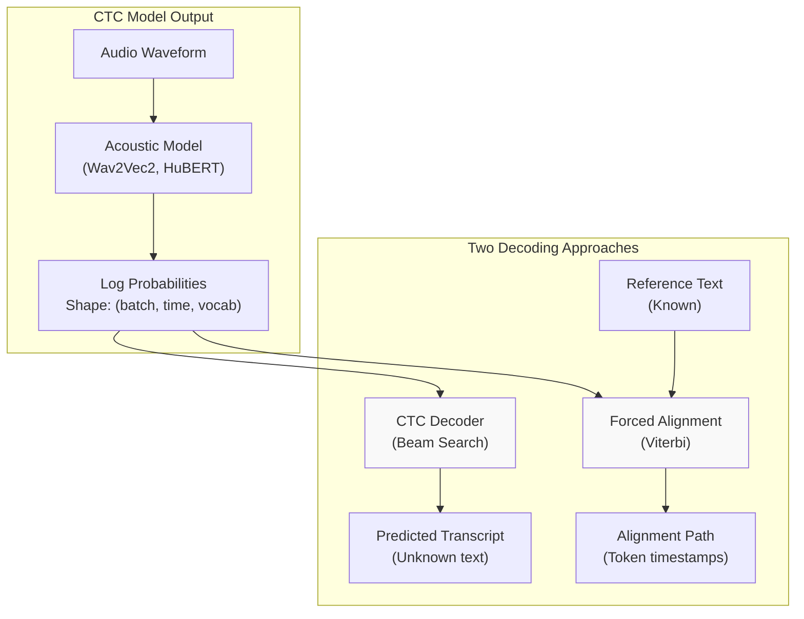
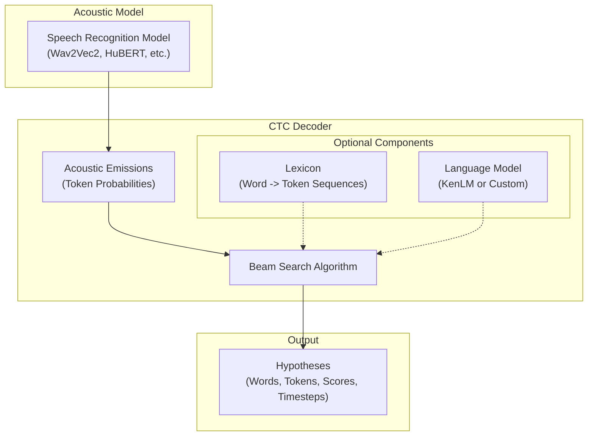
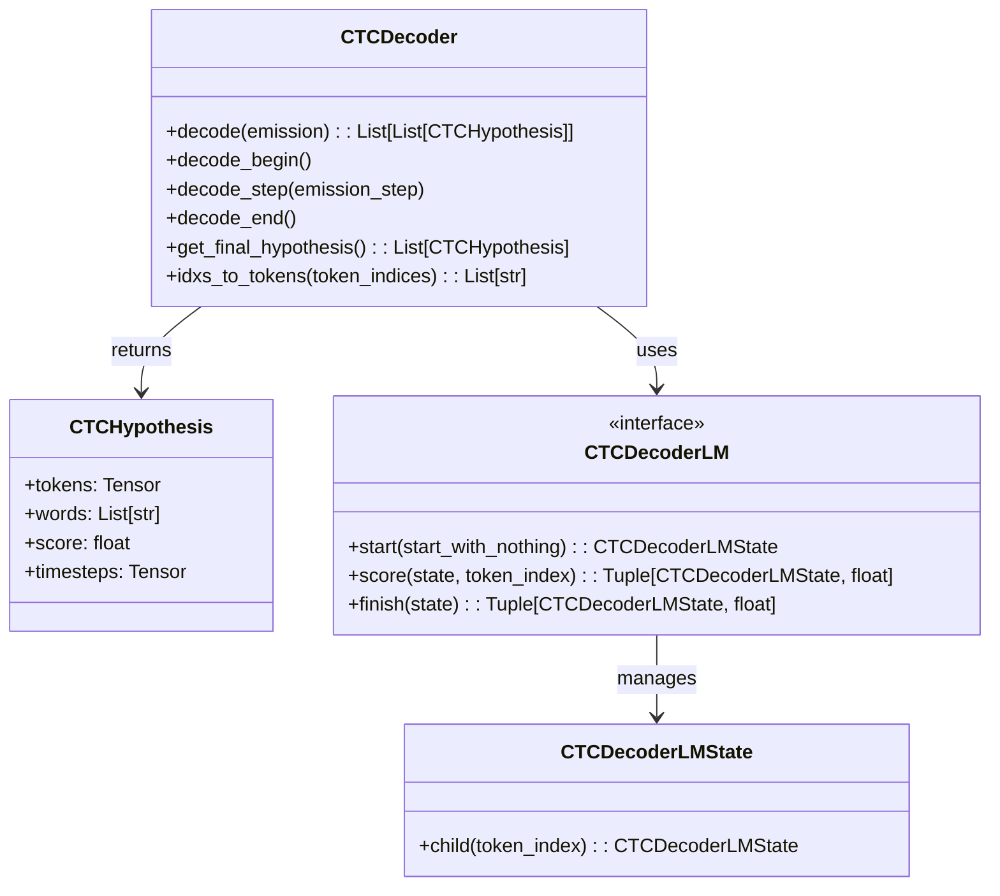
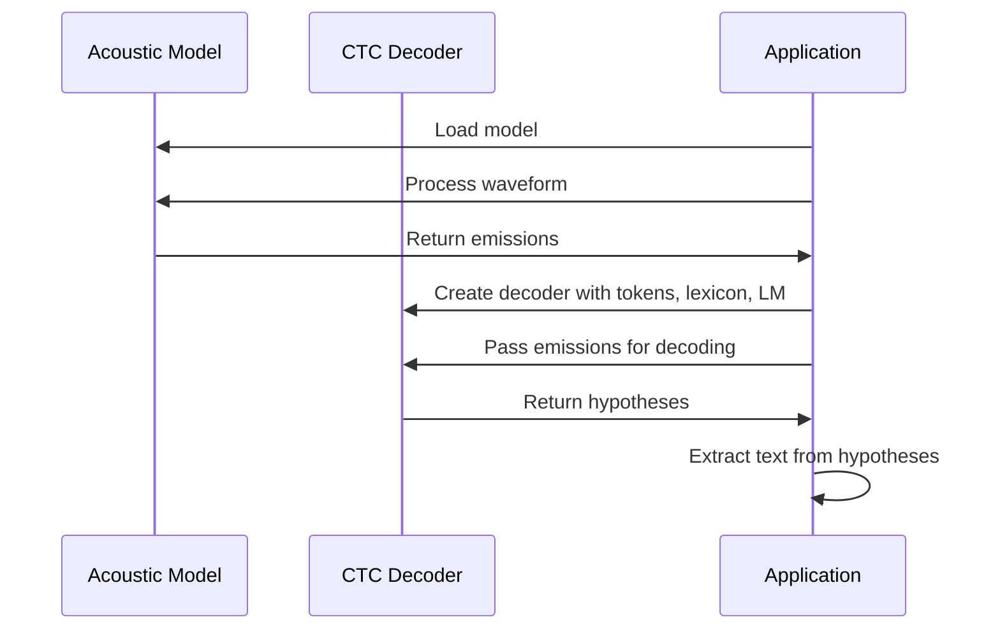
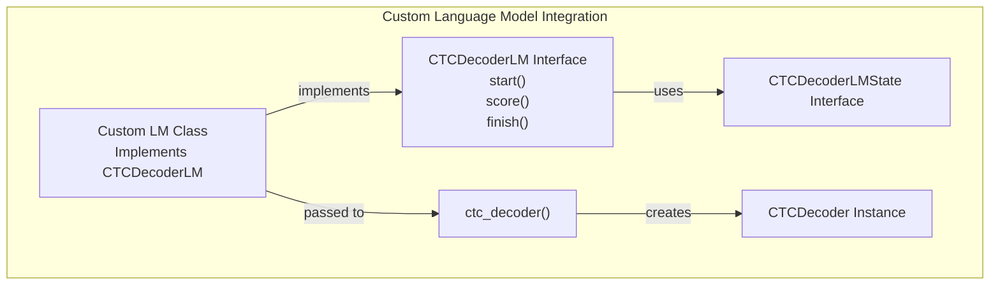
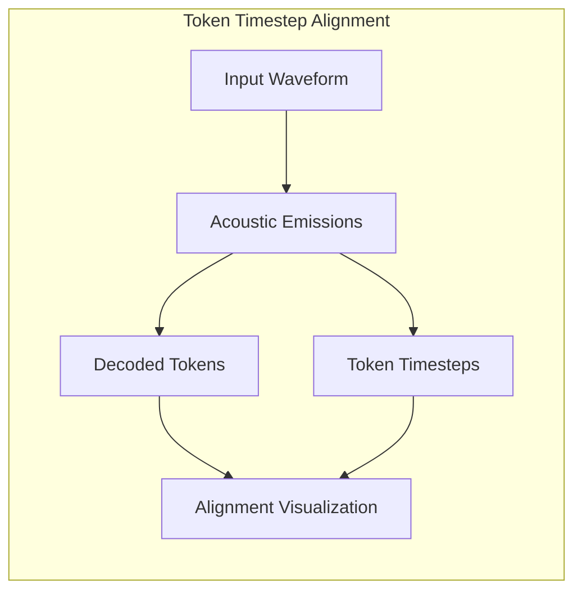

<!-- source: DeepWiki mcp.deepwiki.com · repo pytorch/audio · page 4.3 CTC Decoder and Forced Alignment · fetched 2026-10-21 -->

# CTC Decoder and Forced Alignment

<details>
<summary>Relevant source files</summary>

The following files were used as context for generating this wiki page:

- [docs/source/_templates/autosummary/bundle_class.rst](docs/source/_templates/autosummary/bundle_class.rst)
- [docs/source/pipelines.rst](docs/source/pipelines.rst)
- [src/libtorchaudio/cuda_utils.h](src/libtorchaudio/cuda_utils.h)
- [src/libtorchaudio/forced_align/compute.cpp](src/libtorchaudio/forced_align/compute.cpp)
- [src/libtorchaudio/forced_align/compute.h](src/libtorchaudio/forced_align/compute.h)
- [src/libtorchaudio/forced_align/cpu/compute.cpp](src/libtorchaudio/forced_align/cpu/compute.cpp)
- [src/libtorchaudio/forced_align/gpu/compute.cu](src/libtorchaudio/forced_align/gpu/compute.cu)
- [src/libtorchaudio/iir_cuda.cu](src/libtorchaudio/iir_cuda.cu)
- [src/libtorchaudio/iir_cuda.h](src/libtorchaudio/iir_cuda.h)
- [src/libtorchaudio/lfilter.cpp](src/libtorchaudio/lfilter.cpp)
- [src/libtorchaudio/overdrive.cpp](src/libtorchaudio/overdrive.cpp)
- [src/libtorchaudio/rnnt/cpu/compute.cpp](src/libtorchaudio/rnnt/cpu/compute.cpp)
- [src/libtorchaudio/rnnt/gpu/compute.cu](src/libtorchaudio/rnnt/gpu/compute.cu)
- [src/libtorchaudio/utils.h](src/libtorchaudio/utils.h)
- [src/torchaudio/functional/_alignment.py](src/torchaudio/functional/_alignment.py)
- [src/torchaudio/pipelines/_wav2vec2/aligner.py](src/torchaudio/pipelines/_wav2vec2/aligner.py)
- [test/integration_tests/conftest.py](test/integration_tests/conftest.py)
- [test/integration_tests/source_separation_pipeline_test.py](test/integration_tests/source_separation_pipeline_test.py)
- [test/integration_tests/wav2vec2_pipeline_test.py](test/integration_tests/wav2vec2_pipeline_test.py)

</details>


## Overview

This page documents two related components in TorchAudio for working with Connectionist Temporal Classification (CTC) models in automatic speech recognition (ASR):

1. **CTC Decoder**: A beam search decoder (`torchaudio.models.decoder.ctc_decoder` and `cuda_ctc_decoder`) that converts model outputs to text, with support for lexicon constraints and language models.

2. **Forced Alignment**: Functions and pipelines (`torchaudio.functional.forced_align`, `Wav2Vec2FABundle`) that align reference text to audio by finding the optimal path through CTC emissions.

Both components leverage CTC's ability to handle variable-length sequences and share similar native implementations for performance. The CTC Decoder performs unconstrained decoding to generate transcripts, while forced alignment performs constrained decoding with known target sequences to determine precise timing.

For information about ASR Pipelines that may use these components, see [ASR Pipelines](#4.2).

Sources:
[examples/tutorials/asr_inference_with_ctc_decoder_tutorial.py:1-44]()
[docs/source/models.decoder.rst:8-22]()
[src/torchaudio/functional/_alignment.py:11-74]()
[docs/source/pipelines.rst:145-177]()

## CTC and Forced Alignment: Relationship and Concepts

CTC (Connectionist Temporal Classification) is a loss function and decoding framework for sequence-to-sequence problems where alignment between input and output is unknown. In ASR, CTC models output probability distributions over tokens (including a blank token) at each time step.



**Diagram: CTC Decoding Approaches**

| Aspect | CTC Decoder | Forced Alignment |
|--------|-------------|------------------|
| **Input** | Emissions only | Emissions + target sequence |
| **Goal** | Find most likely text | Find most likely alignment path |
| **Algorithm** | Beam search | Viterbi (dynamic programming) |
| **Output** | Hypotheses with words/tokens | Token-level timestamps |
| **Use Case** | Transcription, ASR inference | Word timing, training data alignment |
| **Constraint** | None (search over all paths) | Must emit target sequence |

Both approaches operate on the same CTC emission outputs but solve different problems:

- **CTC Decoder** explores many possible token sequences to find the best transcript
- **Forced Alignment** finds the best way to align a known transcript to the audio

Sources:
[src/torchaudio/functional/_alignment.py:18-74]()
[src/libtorchaudio/forced_align/cpu/compute.cpp:1-222]()
[examples/tutorials/asr_inference_with_ctc_decoder_tutorial.py:12-41]()

## Architecture and Components

The CTC Decoder in TorchAudio is based on Flashlight's beam search decoder implementation. It processes the probability distributions (emissions) output by acoustic models such as Wav2Vec2 and converts them into text, with optional language model scoring to improve results.



**Diagram: CTC Decoder Architecture**

Sources:
[examples/tutorials/asr_inference_with_ctc_decoder_tutorial.py:12-41]()
[examples/tutorials/asr_inference_with_ctc_decoder_tutorial.py:108-115]()

### Key Components

The CTC Decoder system consists of several key classes and interfaces:



**Diagram: CTC Decoder Class Structure**

Sources:
[docs/source/_templates/autosummary/ctc_decoder_class.rst:17-51]()
[examples/tutorials/asr_inference_with_ctc_decoder_tutorial.py:205-237]()

## Usage

The CTC Decoder can be created using the `ctc_decoder` factory function, which takes various inputs:

1. **Tokens**: The possible symbols that the acoustic model can predict, either as a file path or a list
2. **Lexicon**: A mapping from words to their corresponding token sequences (optional)
3. **Language Model**: An n-gram KenLM language model or a custom language model (optional)
4. **Beam Search Parameters**: Controls the decoding process (beam size, beam threshold, etc.)

### Basic Decoding Example

The following is the basic pattern for using CTC Decoder:

1. Create acoustic model and prepare emission outputs
2. Create decoder with appropriate configuration
3. Run decoding to get hypotheses
4. Extract text results from hypotheses



**Diagram: CTC Decoder Usage Flow**

Sources:
[examples/tutorials/asr_inference_with_ctc_decoder_tutorial.py:80-94]()
[examples/tutorials/asr_inference_with_ctc_decoder_tutorial.py:251-264]()
[examples/tutorials/asr_inference_with_ctc_decoder_tutorial.py:360-367]()

### Decoding Modes

The CTC Decoder supports two main decoding modes:

#### 1. Batch Decoding

Process the entire emission tensor at once:

```
beam_search_result = beam_search_decoder(emission)
```

#### 2. Incremental Decoding

Process emissions one frame at a time, useful for long inputs:

```
beam_search_decoder.decode_begin()
for t in range(emission.size(1)):
    beam_search_decoder.decode_step(emission[0, t:t+1, :])
beam_search_decoder.decode_end()
beam_search_result_inc = beam_search_decoder.get_final_hypothesis()
```

Sources:
[examples/tutorials/asr_inference_with_ctc_decoder_tutorial.py:390-430]()

## Language Model Integration

The CTC Decoder can integrate with different types of language models to improve decoding accuracy:

### 1. No Language Model

Set `lm=None` when creating the decoder to rely only on acoustic model scores.

### 2. KenLM Integration

Use a pre-trained n-gram KenLM model in ARPA or binary format:

```
decoder = ctc_decoder(
    lexicon=files.lexicon,
    tokens=files.tokens,
    lm=files.lm,
    lm_weight=3.23,
    word_score=-0.26
)
```

### 3. Custom Language Model

Implement the `CTCDecoderLM` interface to use custom statistical or neural language models:



**Diagram: Custom Language Model Integration**

Sources:
[examples/tutorials/asr_inference_with_ctc_decoder_tutorial.py:170-237]()
[test/torchaudio_unittest/models/decoder/ctc_decoder_utils.py:6-78]()

## Result Interpretation

The CTC Decoder returns a list of list of `CTCHypothesis` objects. The outer list corresponds to batch elements, and the inner list contains the n-best hypotheses for each batch element.

Each `CTCHypothesis` contains:

1. **tokens**: Tensor of token indices
2. **words**: List of words (if lexicon was provided)
3. **score**: The hypothesis score
4. **timesteps**: Tensor of timesteps corresponding to each token

### Working with Lexicon-Free Decoding

If no lexicon is provided, the `words` field of hypotheses will be empty. To obtain text output:

```
tokens_str = "".join(beam_search_decoder.idxs_to_tokens(hypothesis.tokens))
transcript = " ".join(tokens_str.split("|"))
```

Sources:
[examples/tutorials/asr_inference_with_ctc_decoder_tutorial.py:371-387]()
[examples/tutorials/asr_inference_with_ctc_decoder_tutorial.py:441-444]()

## Token Timestep Alignments

One valuable feature of the CTC Decoder is that it provides token-level timestep information, which can be used for tasks like forced alignment or word-level timestamping in transcriptions.



**Diagram: Token Timestep Alignment Process**

Sources:
[examples/tutorials/asr_inference_with_ctc_decoder_tutorial.py:432-489]()

## Beam Search Parameters

The decoder's performance can be tuned through several parameters:

| Parameter | Description | Impact |
|-----------|-------------|--------|
| `beam_size` | Maximum number of hypotheses to store | Larger values allow more hypotheses exploration but increase computation |
| `beam_size_token` | Number of tokens to consider for expanding each hypothesis | Larger values increase potential hypotheses range |
| `beam_threshold` | Threshold for pruning low-scoring hypotheses | Smaller values prune more aggressively |
| `lm_weight` | Weight for language model scores | Higher values give more influence to the language model |
| `word_score` | Score added when a word finishes | Adjusts preference for longer/shorter words |
| `nbest` | Number of best hypotheses to return | Allows for multiple candidate transcriptions |

Sources:
[examples/tutorials/asr_inference_with_ctc_decoder_tutorial.py:493-653]()
[examples/asr/librispeech_ctc_decoder/inference.py:13-104]()
[examples/asr/librispeech_ctc_decoder/README.md:1-34]()

## Pretrained Models and Files

The TorchAudio package provides a function `download_pretrained_files()` to download pretrained files for various datasets:

```
from torchaudio.models.decoder import download_pretrained_files
files = download_pretrained_files("librispeech-4-gram")
```

Available pretrained model sets include:
- `librispeech`: Standard LibriSpeech decoder files
- `librispeech-3-gram`: LibriSpeech with 3-gram language model
- `librispeech-4-gram`: LibriSpeech with 4-gram language model (recommended)

Sources:
[examples/tutorials/asr_inference_with_ctc_decoder_tutorial.py:251-256]()
[test/integration_tests/ctc_decoder_integration_test.py:1-22]()

## Performance Considerations

The CTC Decoder performance is affected by both accuracy (measured in Word Error Rate - WER) and decoding speed. The configuration parameters should be tuned based on your specific requirements:

1. **Beam Size Trade-off**: Larger beam sizes typically improve accuracy but increase computation time
2. **Language Model Weight**: Needs to be tuned based on the acoustic model and language model quality
3. **Word Score**: Adjusts preference for longer/shorter words, affecting overall transcription quality

For reference, the model and configuration used in the example tutorial achieves significant WER improvements compared to greedy decoding:

| Decoder | WER Example |
|---------|-------------|
| Greedy Decoder | Higher error rate, may produce non-word tokens |
| Beam Search with LM | Lower error rate, produces real words from lexicon |

Sources:
[examples/tutorials/asr_inference_with_ctc_decoder_tutorial.py:548-564]()
[examples/asr/librispeech_ctc_decoder/README.md:20-33]()

## Summary

The CTC Decoder system in TorchAudio provides a robust mechanism for converting acoustic model outputs into text for speech recognition tasks. With support for beam search, language models, and lexicon constraints, it offers flexibility and high accuracy for ASR applications. The system's ability to provide token-level timestep information also makes it valuable for applications requiring precise alignment between audio and text.

---

