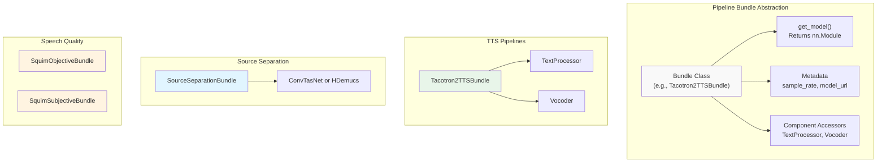
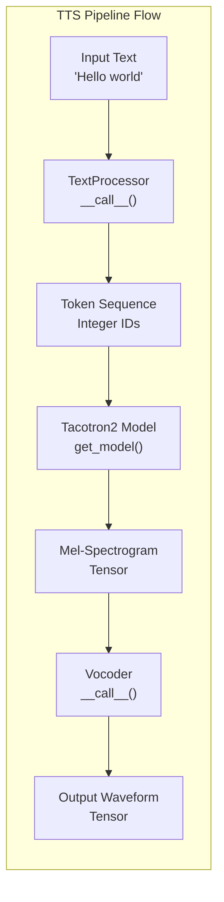
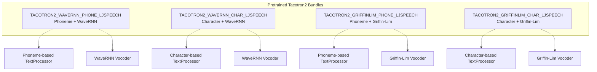
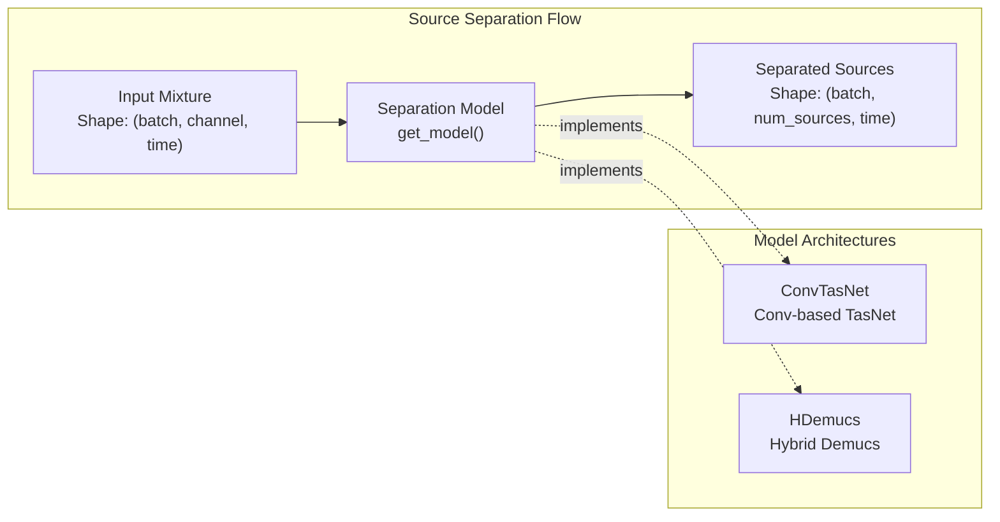
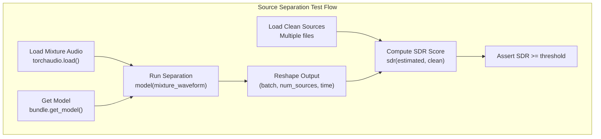
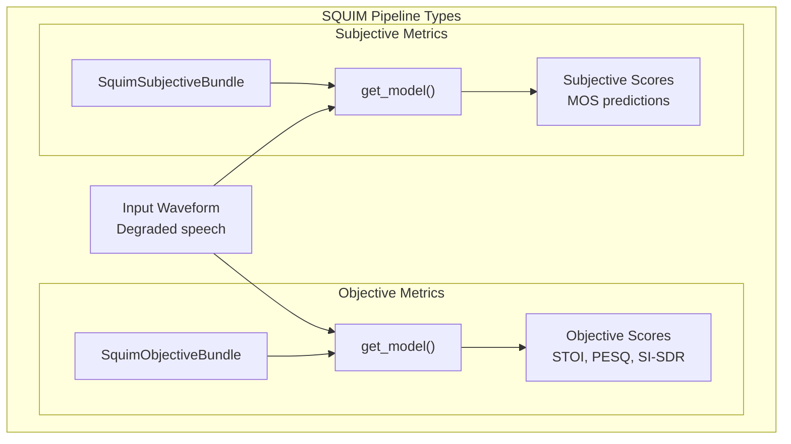
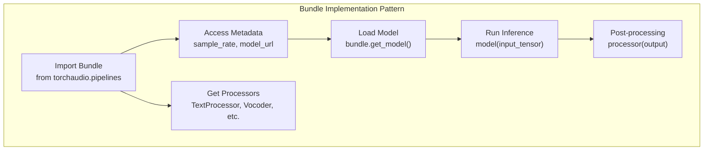

<!-- source: DeepWiki mcp.deepwiki.com · repo pytorch/audio · page 4.4 Other Pipelines · fetched 2026-10-21 -->

# Other Pipelines

Relevant source files

The following files were used as context for generating this wiki page:

- [docs/source/_templates/autosummary/bundle_class.rst](docs/source/_templates/autosummary/bundle_class.rst)
- [docs/source/pipelines.rst](docs/source/pipelines.rst)
- [docs/source/refs.bib](docs/source/refs.bib)
- [src/torchaudio/pipelines/_wav2vec2/aligner.py](src/torchaudio/pipelines/_wav2vec2/aligner.py)
- [test/integration_tests/conftest.py](test/integration_tests/conftest.py)
- [test/integration_tests/source_separation_pipeline_test.py](test/integration_tests/source_separation_pipeline_test.py)
- [test/integration_tests/wav2vec2_pipeline_test.py](test/integration_tests/wav2vec2_pipeline_test.py)

This page documents TorchAudio's non-ASR pipeline bundles, including text-to-speech (TTS), source separation, and speech quality measurement. These pipelines provide end-to-end solutions for specific audio processing tasks beyond automatic speech recognition.

For ASR-related pipelines, see [ASR Pipelines](#4.2) and [CTC Decoder and Forced Alignment](#4.3). For the underlying model architectures, see [Speech Recognition Models](#4.1).

---

## Overview of Pipeline Architecture

TorchAudio's pipeline bundles follow a common design pattern: they encapsulate pre-trained models along with all necessary preprocessing, postprocessing, and metadata required to perform a specific task. Each pipeline bundle is defined as a Python class that provides standardized methods to instantiate components.

**Sources:** [docs/source/pipelines.rst:1-23]()

---

## Text-to-Speech (TTS) Pipelines

### Tacotron2TTSBundle

The `Tacotron2TTSBundle` provides complete text-to-speech pipelines based on the Tacotron2 architecture. The bundle encapsulates three stages: text tokenization, mel-spectrogram generation, and waveform synthesis (vocoding).

**Sources:** [docs/source/pipelines.rst:180-190]()

### TextProcessor Component

The `TextProcessor` converts input text into token sequences suitable for the Tacotron2 model. It can operate in two modes:

| Mode | Description | Implementation |
|------|-------------|----------------|
| **Character-based** | Direct character-to-token mapping | Rule-based tokenization |
| **Phoneme-based** | Grapheme-to-phoneme (G2P) conversion | Neural network G2P model |

The `TextProcessor` provides:
- `tokens` property: vocabulary of supported tokens
- `__call__(text: str)` method: converts text to token sequence

**Sources:** [docs/source/pipelines.rst:187-189](), [docs/source/_templates/autosummary/bundle_class.rst:14-16]()

### Vocoder Component

The `Vocoder` converts mel-spectrograms to audio waveforms. TorchAudio provides both algorithmic and neural network-based vocoders:

| Vocoder Type | Description | Model |
|--------------|-------------|-------|
| **Griffin-Lim** | Iterative phase reconstruction algorithm | No learned parameters |
| **WaveRNN** | Efficient recurrent neural vocoder | Neural network |

The `Vocoder` interface provides:
- `sample_rate` property: output sampling rate
- `__call__(specgram: Tensor)` method: converts spectrogram to waveform

**Sources:** [docs/source/pipelines.rst:189-190](), [docs/source/_templates/autosummary/bundle_class.rst:17-19]()

### Pretrained TTS Models

TorchAudio provides four pretrained Tacotron2 bundles trained on the LJSpeech dataset:

Each bundle is accessed as a module-level constant in `torchaudio.pipelines`:

- `TACOTRON2_WAVERNN_PHONE_LJSPEECH`: Phoneme-based with WaveRNN vocoder
- `TACOTRON2_WAVERNN_CHAR_LJSPEECH`: Character-based with WaveRNN vocoder
- `TACOTRON2_GRIFFINLIM_PHONE_LJSPEECH`: Phoneme-based with Griffin-Lim vocoder
- `TACOTRON2_GRIFFINLIM_CHAR_LJSPEECH`: Character-based with Griffin-Lim vocoder

**Sources:** [docs/source/pipelines.rst:207-218](), [docs/source/refs.bib:238-245]()

---

## Source Separation Pipelines

### SourceSeparationBundle

The `SourceSeparationBundle` provides models for separating mixed audio into individual sources. The bundle interface is designed to handle both speech separation (isolating individual speakers) and music source separation (isolating instruments).

The `SourceSeparationBundle` provides:
- `sample_rate`: expected sampling rate of input audio
- `get_model()`: returns a trained separation model

**Sources:** [docs/source/pipelines.rst:220-228]()

### Architecture Comparison

TorchAudio provides two distinct source separation architectures:

| Bundle | Architecture | Domain | Training Data | Use Case |
|--------|--------------|--------|---------------|----------|
| `CONVTASNET_BASE_LIBRI2MIX` | ConvTasNet | Speech | LibriMix (2 speakers) | Speech separation |
| `HDEMUCS_HIGH_MUSDB` | Hybrid Demucs | Music | MUSDB18 | Music source separation |
| `HDEMUCS_HIGH_MUSDB_PLUS` | Hybrid Demucs | Music | MUSDB18-HQ | High-quality music separation |

**ConvTasNet** (Conv-based Time-domain Audio Separation Network) operates in the time domain with convolutional layers to separate speech sources. It is optimized for separating overlapping speakers.

**HDemucs** (Hybrid Demucs) combines time-domain and frequency-domain processing using a U-Net architecture with skip connections. It separates music into four stems: drums, bass, other instruments, and vocals.

**Sources:** [docs/source/pipelines.rst:241-251](), [docs/source/refs.bib:188-201](), [docs/source/refs.bib:415-420]()

### Integration Test Example

The source separation pipeline integration tests validate model performance using the Signal-to-Distortion Ratio (SDR) metric:

Expected SDR scores (in dB):
- `CONVTASNET_BASE_LIBRI2MIX`: ≥ 8.14 dB
- `HDEMUCS_HIGH_MUSDB_PLUS`: ≥ 8.75 dB
- `HDEMUCS_HIGH_MUSDB`: ≥ 8.07 dB

**Sources:** [test/integration_tests/source_separation_pipeline_test.py:14-42](), [test/integration_tests/conftest.py:46-61]()

---

## Speech Quality and Intelligibility Measurement (SQUIM)

SQUIM (Speech Quality and Intelligibility Measurement) pipelines provide reference-less assessment of speech audio quality. Unlike traditional metrics that require clean reference signals, SQUIM models predict quality scores directly from degraded audio.

### Objective vs Subjective Metrics

TorchAudio provides two SQUIM bundle types:

| Bundle Type | Metrics | Description |
|-------------|---------|-------------|
| **SquimObjectiveBundle** | STOI, PESQ, SI-SDR | Predicts objective speech quality metrics that correlate with signal degradation |
| **SquimSubjectiveBundle** | MOS (Mean Opinion Score) | Predicts subjective quality ratings as would be given by human listeners |

**Sources:** [docs/source/pipelines.rst:253-301](), [docs/source/refs.bib:545-571]()

### SquimObjectiveBundle

The `SquimObjectiveBundle` predicts three objective metrics:

- **STOI** (Short-Time Objective Intelligibility): measures speech intelligibility
- **PESQ** (Perceptual Evaluation of Speech Quality): measures perceived quality
- **SI-SDR** (Scale-Invariant Signal-to-Distortion Ratio): measures signal fidelity

Pretrained model:
- `SQUIM_OBJECTIVE`: trained on diverse speech degradation conditions

**Sources:** [docs/source/pipelines.rst:253-276]()

### SquimSubjectiveBundle

The `SquimSubjectiveBundle` predicts subjective quality scores that correlate with Mean Opinion Score (MOS) ratings from human listeners. This enables automated quality assessment without the need for expensive and time-consuming human evaluation studies.

Pretrained model:
- `SQUIM_SUBJECTIVE`: trained on speech with MOS labels from listening tests

**Sources:** [docs/source/pipelines.rst:278-301]()

### Use Cases

SQUIM pipelines are particularly useful for:

1. **Quality monitoring**: Assess audio quality in real-time systems
2. **Dataset curation**: Filter low-quality samples from training data
3. **Model evaluation**: Measure speech enhancement or synthesis quality
4. **Codec comparison**: Compare compression algorithms without reference signals

**Sources:** [docs/source/refs.bib:545-571]()

---

## Bundle Implementation Pattern

All pipeline bundles follow a consistent implementation pattern for easy usage and interchangeability:

Each bundle class provides:
- **Metadata attributes**: `sample_rate`, `model_url`, etc.
- **Model factory**: `get_model()` method that downloads weights and instantiates the model
- **Component accessors**: Properties or methods to access preprocessing/postprocessing components
- **Standardized interface**: Consistent API across different implementations

This design ensures that switching between different pretrained models requires minimal code changes, as all models within a bundle class share the same interface.

**Sources:** [docs/source/pipelines.rst:8-22]()

---

## References

The pipeline implementations are based on the following research papers:

- **Tacotron2**: Shen et al., "Natural TTS Synthesis by Conditioning WaveNet on Mel Spectrogram Predictions" (ICASSP 2018)
- **WaveRNN**: Kalchbrenner et al., "Efficient Neural Audio Synthesis" (ICML 2018)
- **Conv-TasNet**: Luo & Mesgarani, "Conv-TasNet: Surpassing Ideal Time–Frequency Magnitude Masking for Speech Separation" (IEEE/ACM TASLP 2019)
- **Hybrid Demucs**: Défossez, "Hybrid Spectrogram and Waveform Source Separation" (ISMIR 2021)
- **SQUIM**: Kumar et al., "TorchAudio-Squim: Reference-less Speech Quality and Intelligibility measures in TorchAudio" (arXiv 2023)

**Sources:** [docs/source/refs.bib:238-245](), [docs/source/refs.bib:172-179](), [docs/source/refs.bib:188-201](), [docs/source/refs.bib:415-420](), [docs/source/refs.bib:567-571]()

---

