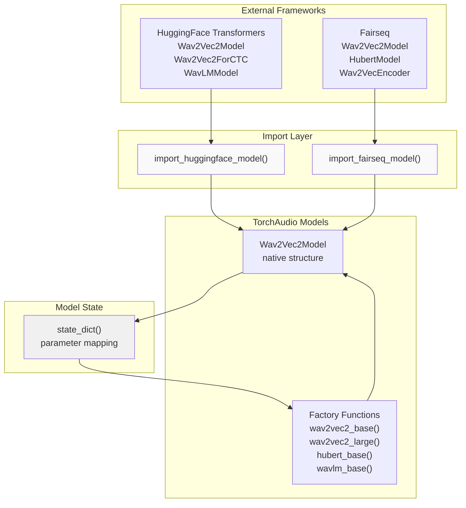
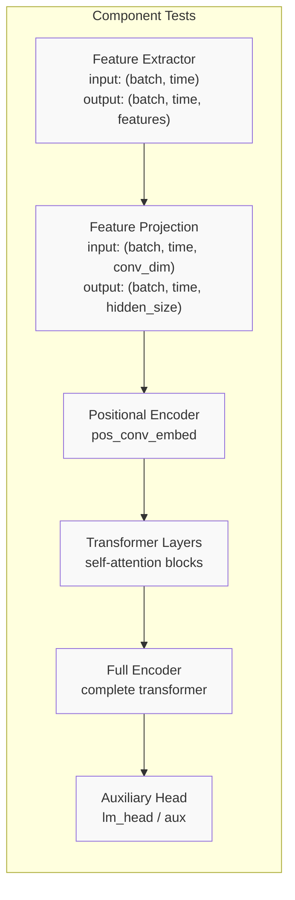
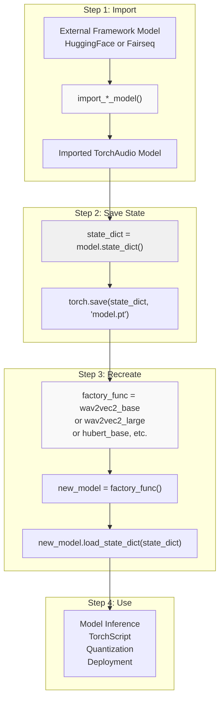
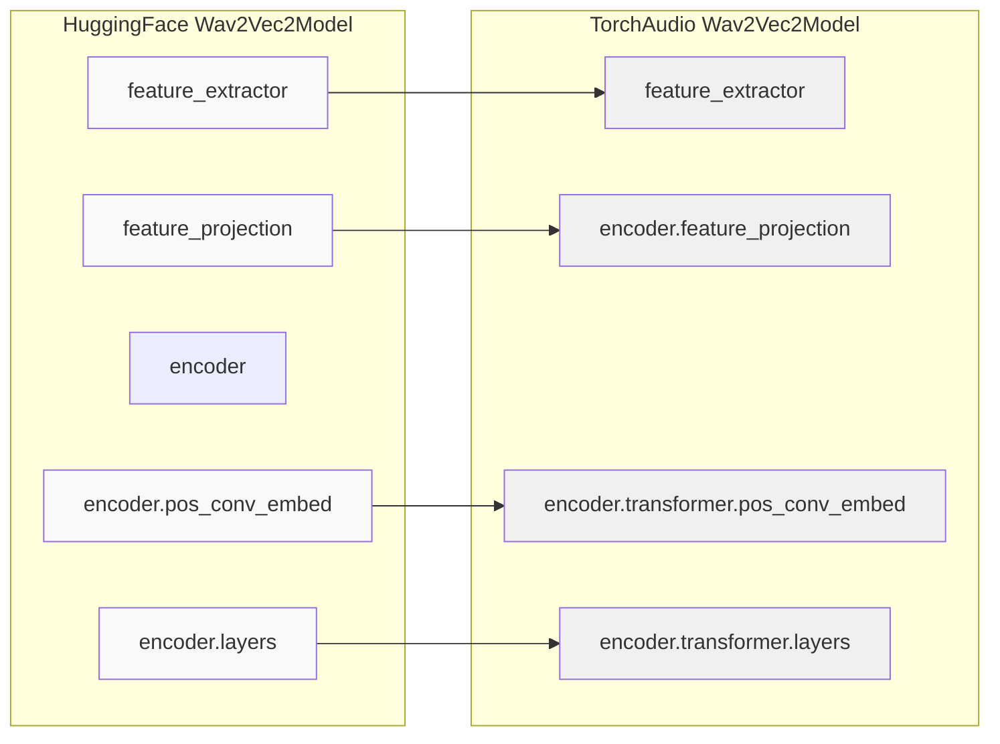

<!-- source: DeepWiki mcp.deepwiki.com · repo pytorch/audio · page 4.5 Model Integration with External Frameworks · fetched 2026-10-21 -->

# Model Integration with External Frameworks

<details>
<summary>Relevant source files</summary>

The following files were used as context for generating this wiki page:

- [docs/source/models.rst](docs/source/models.rst)
- [test/integration_tests/__init__.py](test/integration_tests/__init__.py)
- [test/torchaudio_unittest/models/wav2vec2/fairseq_integration_test.py](test/torchaudio_unittest/models/wav2vec2/fairseq_integration_test.py)
- [test/torchaudio_unittest/models/wav2vec2/huggingface_intergration_test.py](test/torchaudio_unittest/models/wav2vec2/huggingface_intergration_test.py)
- [test/torchaudio_unittest/models/wav2vec2/model_test.py](test/torchaudio_unittest/models/wav2vec2/model_test.py)

</details>


## Purpose and Scope

This document explains how to integrate pre-trained speech models from external frameworks into TorchAudio's native model architecture. It covers the import utilities (`import_huggingface_model`, `import_fairseq_model`), supported model types, and the workflow for converting models to eliminate external dependencies.

For information about the underlying model architectures (Wav2Vec2, HuBERT, WavLM), see [Speech Recognition Models](#4.1). For pre-trained model bundles and end-to-end pipelines, see [ASR Pipelines](#4.2).

---

## Overview

TorchAudio provides conversion utilities to import speech models from two major frameworks:

| Framework | Import Function | Models Supported |
|-----------|----------------|------------------|
| HuggingFace Transformers | `import_huggingface_model()` | Wav2Vec2, WavLM |
| Fairseq | `import_fairseq_model()` | Wav2Vec2, HuBERT |

The import process converts external model weights to TorchAudio's model structure, enabling users to:
1. Leverage pre-trained models from external frameworks
2. Eliminate external framework dependencies after import
3. Use TorchAudio's factory functions for model recreation
4. Maintain compatibility with TorchScript and quantization

**Sources:** [test/torchaudio_unittest/models/wav2vec2/huggingface_intergration_test.py:1-23](), [test/torchaudio_unittest/models/wav2vec2/fairseq_integration_test.py:1-17]()

---

## Integration Architecture



**Sources:** [test/torchaudio_unittest/models/wav2vec2/huggingface_intergration_test.py:94-99](), [test/torchaudio_unittest/models/wav2vec2/fairseq_integration_test.py:101-107]()

---

## HuggingFace Transformers Integration

### Import Process

The `import_huggingface_model()` function converts HuggingFace models to TorchAudio's native structure:

```python
from transformers import Wav2Vec2Model, Wav2Vec2Config
from torchaudio.models.wav2vec2.utils import import_huggingface_model

# Load model from HuggingFace
hf_config = Wav2Vec2Config(...)
hf_model = Wav2Vec2Model(hf_config)

# Import to TorchAudio
torchaudio_model = import_huggingface_model(hf_model)
```

The conversion maps HuggingFace model components to TorchAudio equivalents:

| HuggingFace Component | TorchAudio Component |
|----------------------|----------------------|
| `feature_extractor` | `feature_extractor` |
| `feature_projection` | `encoder.feature_projection` |
| `encoder.pos_conv_embed` | `encoder.transformer.pos_conv_embed` |
| `encoder.layers` | `encoder.transformer.layers` |
| `lm_head` (fine-tuned) | `aux` |

**Sources:** [test/torchaudio_unittest/models/wav2vec2/huggingface_intergration_test.py:118-148](), [test/torchaudio_unittest/models/wav2vec2/huggingface_intergration_test.py:149-161]()

### Supported Models

#### Pre-trained Models

The following pre-trained HuggingFace models are supported:

| Model Configuration | TorchAudio Factory | Config Key |
|--------------------|-------------------|------------|
| wav2vec2-base | `wav2vec2_base()` | HF_BASE |
| wav2vec2-large | `wav2vec2_large()` | HF_LARGE |
| wav2vec2-large-lv60 | `wav2vec2_large_lv60k()` | HF_LARGE_LV60 |
| wav2vec2-large-xlsr-53 | `wav2vec2_large_lv60k()` | HF_LARGE_XLSR_53 |
| wav2vec2-xls-r-300m | `wav2vec2_xlsr_300m()` | HF_XLSR_300M |
| wav2vec2-xls-r-1b | `wav2vec2_xlsr_1b()` | HF_XLSR_1B |
| wav2vec2-xls-r-2b | `wav2vec2_xlsr_2b()` | HF_XLSR_2B |
| wavlm-base | `wavlm_base()` | HF_BASE_WAVLM |
| wavlm-large | `wavlm_large()` | HF_LARGE_WAVLM |

**Sources:** [test/torchaudio_unittest/models/wav2vec2/huggingface_intergration_test.py:36-46](), [test/torchaudio_unittest/models/wav2vec2/huggingface_intergration_test.py:54-88]()

#### Fine-tuned Models

Fine-tuned models with CTC heads are also supported:

| Model Configuration | TorchAudio Factory | Config Key |
|--------------------|-------------------|------------|
| wav2vec2-base-960h | `wav2vec2_base(aux_num_out=...)` | HF_BASE_960H |
| wav2vec2-large-960h | `wav2vec2_large(aux_num_out=...)` | HF_LARGE_960H |
| wav2vec2-large-960h-lv60 | `wav2vec2_large_lv60k(aux_num_out=...)` | HF_LARGE_LV60_960H |
| wav2vec2-large-960h-lv60-self | `wav2vec2_large_lv60k(aux_num_out=...)` | HF_LARGE_LV60_SELF_960H |

**Sources:** [test/torchaudio_unittest/models/wav2vec2/huggingface_intergration_test.py:47-51](), [test/torchaudio_unittest/models/wav2vec2/huggingface_intergration_test.py:72-81]()

### Verification Tests

The integration is verified through component-level tests:



**Sources:** [test/torchaudio_unittest/models/wav2vec2/huggingface_intergration_test.py:118-161]()

---

## Fairseq Integration

### Import Process

The `import_fairseq_model()` function converts Fairseq models to TorchAudio:

```python
from fairseq.models.wav2vec.wav2vec2 import Wav2Vec2Model, Wav2Vec2Config
from torchaudio.models.wav2vec2.utils import import_fairseq_model

# Load model from Fairseq
fairseq_config = Wav2Vec2Config(...)
fairseq_model = Wav2Vec2Model(fairseq_config)

# Import to TorchAudio
torchaudio_model = import_fairseq_model(fairseq_model)
```

The conversion handles both Wav2Vec2 and HuBERT architectures from Fairseq:

| Fairseq Model Type | Config Name | TorchAudio Output |
|-------------------|-------------|-------------------|
| `Wav2Vec2Model` | `wav2vec2` | `Wav2Vec2Model` (pre-train) |
| `Wav2VecEncoder` | `wav2vec_ctc` | `Wav2Vec2Model` (fine-tune) |
| `HubertModel` | `hubert` | `Wav2Vec2Model` (pre-train) |
| `HubertEncoder` | `hubert_ctc` | `Wav2Vec2Model` (fine-tune) |

**Sources:** [test/torchaudio_unittest/models/wav2vec2/fairseq_integration_test.py:109-137]()

### Supported Models

#### Pre-training Models

| Fairseq Model | TorchAudio Factory | Config Key |
|--------------|-------------------|------------|
| wav2vec_small | `wav2vec2_base()` | WAV2VEC2_BASE |
| libri960_big | `wav2vec2_large()` | WAV2VEC2_LARGE |
| wav2vec_vox_new | `wav2vec2_large_lv60k()` | WAV2VEC2_LARGE_LV60K |
| xlsr_53_56k | `wav2vec2_large_lv60k()` | WAV2VEC2_XLSR_53_56K |
| xlsr_300m | `wav2vec2_xlsr_300m()` | WAV2VEC2_XLSR_300M |
| xlsr_1b | `wav2vec2_xlsr_1b()` | WAV2VEC2_XLSR_1B |
| xlsr_2b | `wav2vec2_xlsr_2b()` | WAV2VEC2_XLSR_2B |
| hubert_base_ls960 | `hubert_base()` | HUBERT_BASE |
| hubert_large_ll60k | `hubert_large()` | HUBERT_LARGE_LL60K |
| hubert_xtralarge_ll60k | `hubert_xlarge()` | HUBERT_XLARGE_LL60K |

**Sources:** [test/torchaudio_unittest/models/wav2vec2/fairseq_integration_test.py:30-39](), [test/torchaudio_unittest/models/wav2vec2/fairseq_integration_test.py:50-86]()

#### Fine-tuning Models

| Fairseq Model | TorchAudio Factory | Config Key |
|--------------|-------------------|------------|
| wav2vec_small_960h | `wav2vec2_base(aux_num_out=28)` | WAV2VEC2_BASE_960H |
| wav2vec_large_960h | `wav2vec2_large(aux_num_out=28)` | WAV2VEC2_LARGE_960H |
| wav2vec_large_lv60k_960h | `wav2vec2_large_lv60k(aux_num_out=28)` | WAV2VEC2_LARGE_LV60K_960H |
| wav2vec_large_lv60k_self_960h | `wav2vec2_large_lv60k(aux_num_out=28)` | WAV2VEC2_LARGE_LV60K_SELF_960H |
| hubert_large_ll60k_finetune_ls960 | `hubert_large(aux_num_out=28)` | HUBERT_LARGE |
| hubert_xtralarge_ll60k_finetune_ls960 | `hubert_xlarge(aux_num_out=28)` | HUBERT_XLARGE |

**Sources:** [test/torchaudio_unittest/models/wav2vec2/fairseq_integration_test.py:41-46](), [test/torchaudio_unittest/models/wav2vec2/fairseq_integration_test.py:87-97]()

### Feature Extraction Verification

For pre-training models, the import process verifies that intermediate layer outputs match:

```python
# Extract features from multiple layers
hyp, _ = imported.extract_features(x)
refs = original.extract_features(x, padding_mask=torch.zeros_like(x), layer=-1)

# Verify each transformer layer output
for i, (ref, _) in enumerate(refs["layer_results"]):
    assert hyp[i] == ref.transpose(0, 1)
```

**Sources:** [test/torchaudio_unittest/models/wav2vec2/fairseq_integration_test.py:139-151](), [test/torchaudio_unittest/models/wav2vec2/fairseq_integration_test.py:170-188]()

---

## Model Recreation Workflow

After importing a model from an external framework, it can be recreated using TorchAudio's factory functions without any external dependencies:



**Sources:** [test/torchaudio_unittest/models/wav2vec2/huggingface_intergration_test.py:293-310](), [test/torchaudio_unittest/models/wav2vec2/fairseq_integration_test.py:190-222]()

### Factory Function Mapping

The recreation process requires matching the imported model to the correct factory function:

| Model Type | Imported From | Factory Function | Parameters |
|-----------|---------------|-----------------|------------|
| Wav2Vec2 Base | HF/Fairseq | `wav2vec2_base()` | `aux_num_out=None` for pre-train |
| Wav2Vec2 Large | HF/Fairseq | `wav2vec2_large()` | `aux_num_out=None` for pre-train |
| Wav2Vec2 Large LV60K | HF/Fairseq | `wav2vec2_large_lv60k()` | `aux_num_out=None` for pre-train |
| XLS-R 300M | HF/Fairseq | `wav2vec2_xlsr_300m()` | `aux_num_out=None` for pre-train |
| XLS-R 1B | HF/Fairseq | `wav2vec2_xlsr_1b()` | `aux_num_out=None` for pre-train |
| XLS-R 2B | HF/Fairseq | `wav2vec2_xlsr_2b()` | `aux_num_out=None` for pre-train |
| HuBERT Base | Fairseq | `hubert_base()` | `aux_num_out=None` for pre-train |
| HuBERT Large | Fairseq | `hubert_large()` | `aux_num_out=None` for pre-train |
| HuBERT XLarge | Fairseq | `hubert_xlarge()` | `aux_num_out=None` for pre-train |
| WavLM Base | HF | `wavlm_base()` | `aux_num_out=None` for pre-train |
| WavLM Large | HF | `wavlm_large()` | `aux_num_out=None` for pre-train |

For fine-tuned models, specify `aux_num_out` parameter matching the output vocabulary size.

**Sources:** [test/torchaudio_unittest/models/wav2vec2/huggingface_intergration_test.py:54-88](), [test/torchaudio_unittest/models/wav2vec2/fairseq_integration_test.py:50-97]()

### Complete Example: HuggingFace Model

```python
# Step 1: Import from HuggingFace
from transformers import Wav2Vec2Model, Wav2Vec2Config
from torchaudio.models.wav2vec2.utils import import_huggingface_model
from torchaudio.models.wav2vec2 import wav2vec2_base

hf_config = Wav2Vec2Config.from_pretrained("facebook/wav2vec2-base")
hf_model = Wav2Vec2Model(hf_config)
imported = import_huggingface_model(hf_model)

# Step 2: Save state
state_dict = imported.state_dict()

# Step 3: Recreate without HuggingFace
model = wav2vec2_base()
model.load_state_dict(state_dict)

# Step 4: Use model
model.eval()
waveform = torch.randn(1, 16000)
output, lengths = model(waveform)
```

**Sources:** [test/torchaudio_unittest/models/wav2vec2/huggingface_intergration_test.py:293-300]()

### Complete Example: Fairseq Model

```python
# Step 1: Import from Fairseq
from fairseq.models.wav2vec.wav2vec2 import Wav2Vec2Model, Wav2Vec2Config
from torchaudio.models.wav2vec2.utils import import_fairseq_model
from torchaudio.models.wav2vec2 import wav2vec2_large

fairseq_config = Wav2Vec2Config(...)
fairseq_model = Wav2Vec2Model(fairseq_config)
imported = import_fairseq_model(fairseq_model)

# Step 2: Save state
state_dict = imported.state_dict()

# Step 3: Recreate without Fairseq
model = wav2vec2_large()
model.load_state_dict(state_dict)

# Step 4: Use model
model.eval()
waveform = torch.randn(1, 16000)
output, lengths = model(waveform)
```

**Sources:** [test/torchaudio_unittest/models/wav2vec2/fairseq_integration_test.py:190-218]()

---

## Component Mapping Details

### HuggingFace Component Mapping



**Sources:** [test/torchaudio_unittest/models/wav2vec2/huggingface_intergration_test.py:118-148]()

### Fairseq Component Mapping

For Fairseq models, the mapping depends on the model type:

**Pre-training Models (Wav2Vec2Model, HubertModel):**
- Feature extraction and transformer layers are mapped directly
- The `extract_features` method with `layer=-1` returns all intermediate outputs

**Fine-tuning Models (Wav2VecEncoder, HubertEncoder):**
- The encoder output is mapped to the main model output
- The CTC head becomes the `aux` module in TorchAudio
- Padding masks are converted to length tensors

**Sources:** [test/torchaudio_unittest/models/wav2vec2/fairseq_integration_test.py:139-189](), [test/torchaudio_unittest/models/wav2vec2/fairseq_integration_test.py:229-258]()

---

## Mask Handling Differences

### HuggingFace: Attention Mask

HuggingFace models use attention masks:

```python
# HuggingFace: attention_mask (1 = valid, 0 = invalid)
attention_mask = torch.arange(num_frames).expand(batch_size, num_frames) < lengths[:, None]
hf_output = hf_model(waveform, attention_mask=attention_mask)
```

### TorchAudio: Length Tensors

TorchAudio models use length tensors:

```python
# TorchAudio: lengths tensor
lengths = torch.tensor([length1, length2, length3])
ta_output, output_lengths = ta_model(waveform, lengths)
```

The conversion handles this difference automatically during import.

**Sources:** [test/torchaudio_unittest/models/wav2vec2/huggingface_intergration_test.py:162-179](), [test/torchaudio_unittest/models/wav2vec2/fairseq_integration_test.py:245-257]()

---

## Testing and Verification

The integration utilities are tested through multiple validation levels:

| Test Level | Verification Method | Purpose |
|-----------|-------------------|---------|
| Component | Per-component output comparison | Verify correct weight mapping |
| Feature Extraction | Intermediate layer outputs | Verify transformer layer conversion |
| Full Model | End-to-end inference comparison | Verify complete pipeline |
| Batch Consistency | Single vs batch processing | Verify mask/length handling |
| Recreation | Factory function instantiation | Verify framework independence |

### Test Configuration

Test configurations are loaded from JSON files:

- HuggingFace configs: [test/torchaudio_unittest/models/wav2vec2/huggingface_intergration_test.py:26-28]()
- Fairseq configs: [test/torchaudio_unittest/models/wav2vec2/fairseq_integration_test.py:20-22]()

These configurations define model architecture parameters that guide the conversion process.

**Sources:** [test/torchaudio_unittest/models/wav2vec2/huggingface_intergration_test.py:93-99](), [test/torchaudio_unittest/models/wav2vec2/fairseq_integration_test.py:101-107]()

---

## Limitations and Considerations

### WavLM Position Bias

WavLM models use relative position bias that persists across layers:

```python
position_bias = None
for layer in model.encoder.transformer.layers:
    output, position_bias = layer(x, key_padding_mask=mask, position_bias=position_bias)
```

The position bias is returned from each layer and passed to the next, requiring special handling during conversion.

**Sources:** [test/torchaudio_unittest/models/wav2vec2/huggingface_intergration_test.py:225-246]()

### Mask Format Differences

Different frameworks use different mask conventions:

| Framework | Mask Type | Format | Valid Elements |
|-----------|-----------|--------|---------------|
| HuggingFace | Attention Mask | Binary tensor | 1 = valid, 0 = masked |
| Fairseq | Padding Mask | Binary tensor | True = masked, False = valid |
| TorchAudio | Lengths | Integer tensor | Length values |

The import utilities handle these conversions automatically, but users should be aware when manually processing masks.

**Sources:** [test/torchaudio_unittest/models/wav2vec2/huggingface_intergration_test.py:172-173](), [test/torchaudio_unittest/models/wav2vec2/fairseq_integration_test.py:253-254]()

### Model Version Compatibility

The test suite includes a skip decorator for HuggingFace integration:

> "transformers v4.30 seems to break the weight format" 

This indicates that specific versions of external frameworks may introduce compatibility issues. Users should verify compatibility with their specific framework versions.

**Sources:** [test/torchaudio_unittest/models/wav2vec2/huggingface_intergration_test.py:91-92]()

---

## Import Utility Locations

The import utilities are located in:

```
torchaudio.models.wav2vec2.utils
├── import_huggingface_model()
└── import_fairseq_model()
```

These functions are imported in tests at:
- [test/torchaudio_unittest/models/wav2vec2/huggingface_intergration_test.py:16]()
- [test/torchaudio_unittest/models/wav2vec2/fairseq_integration_test.py:16]()

Factory functions are imported from:
- [test/torchaudio_unittest/models/wav2vec2/huggingface_intergration_test.py:6-15]()
- [test/torchaudio_unittest/models/wav2vec2/fairseq_integration_test.py:5-15]()

**Sources:** [test/torchaudio_unittest/models/wav2vec2/huggingface_intergration_test.py:6-16](), [test/torchaudio_unittest/models/wav2vec2/fairseq_integration_test.py:5-16]()

---

