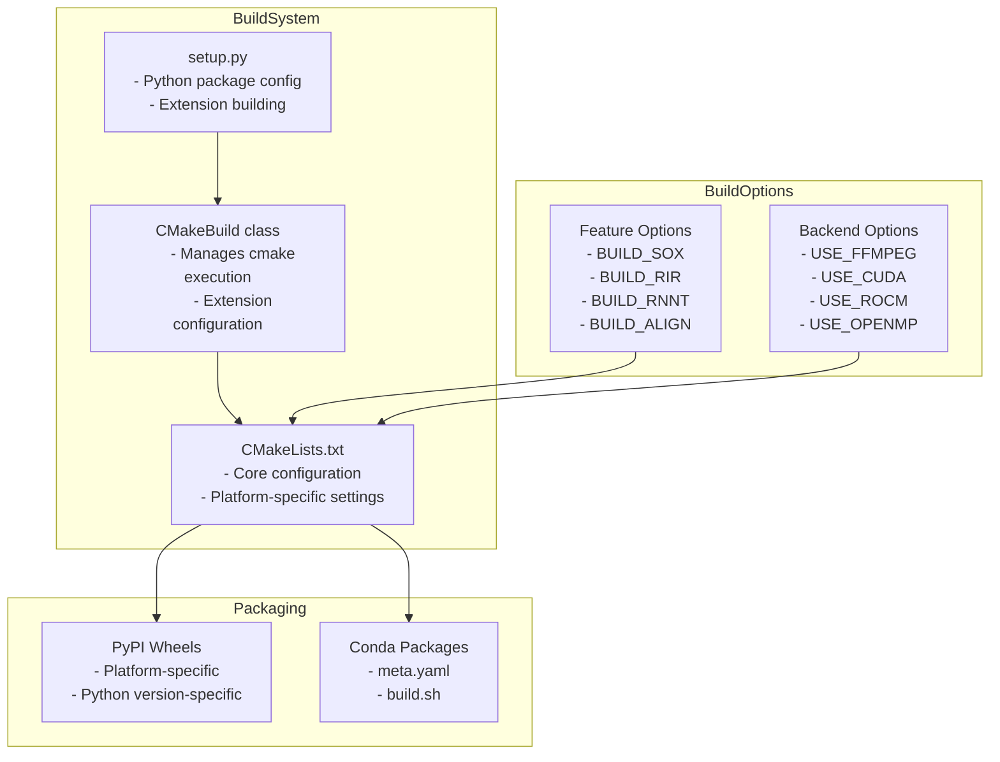
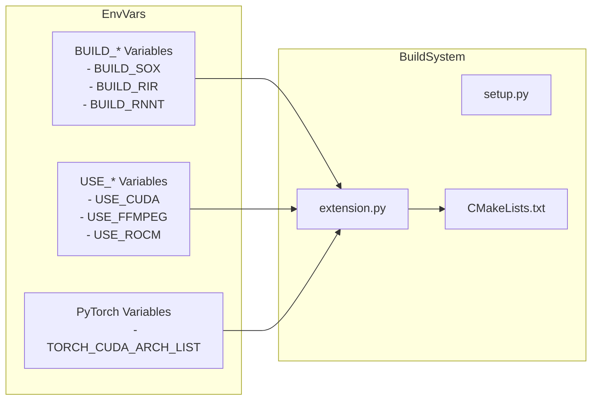
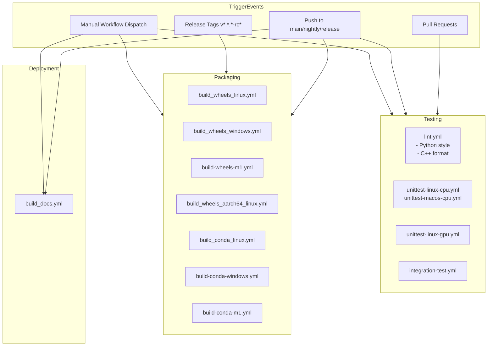
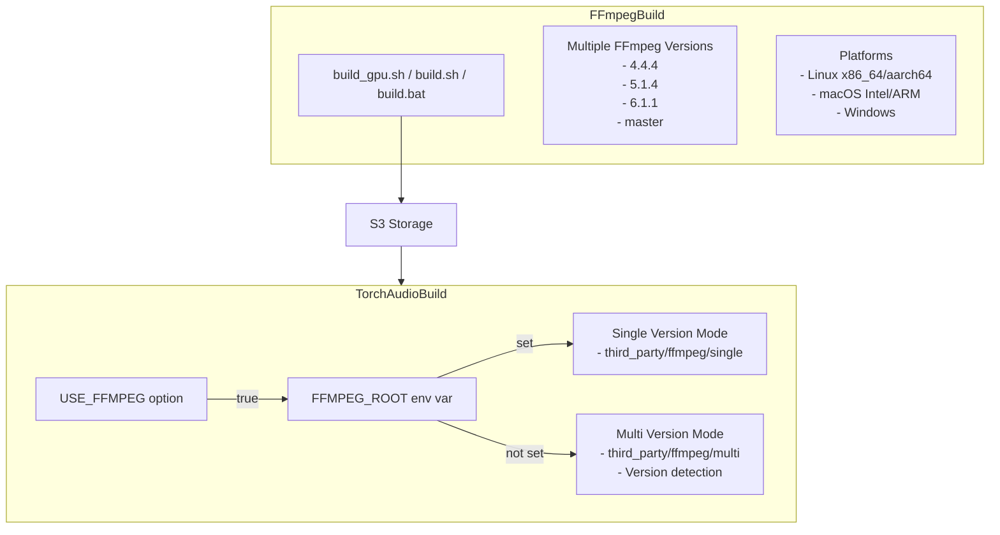
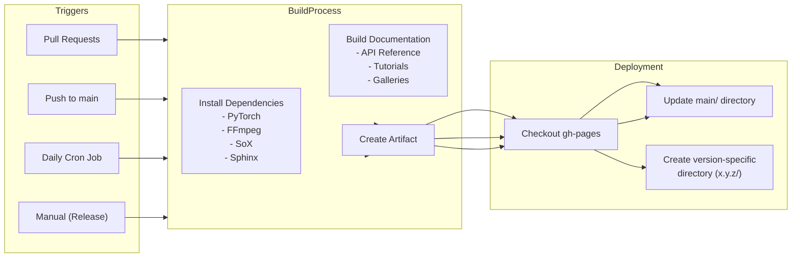

<!-- source: DeepWiki mcp.deepwiki.com · repo pytorch/audio · page 5 Build System and Deployment · fetched 2026-10-21 -->

# Build System and Deployment

Relevant source files

The following files were used as context for generating this wiki page:

- [CMakeLists.txt](CMakeLists.txt)
- [cmake/TorchAudioHelper.cmake](cmake/TorchAudioHelper.cmake)
- [packaging/torchaudio/meta.yaml](packaging/torchaudio/meta.yaml)
- [setup.py](setup.py)
- [tools/setup_helpers/extension.py](tools/setup_helpers/extension.py)

This document provides a comprehensive overview of TorchAudio's build system, continuous integration pipeline, and deployment process. It covers how TorchAudio is built across different platforms, the available configuration options, and how releases are managed.

## Build System Architecture

TorchAudio uses a combination of CMake for C++ components and Python's setuptools for package management. The system supports multiple platforms (Linux, macOS, Windows) and configurations (CPU, CUDA, ROCm).

Sources: [CMakeLists.txt:1-191](), [tools/setup_helpers/extension.py:1-194]()

### CMake Build System

The core of TorchAudio's build system is the CMake configuration that manages C++ compilation, external dependencies, and platform-specific settings.

Key characteristics of the CMake system:
- Minimum CMake version 3.18
- C++17 standard requirement
- Position-independent code (PIC) enabled by default
- Configurable feature flags
- Platform-specific compiler settings

The build system generates multiple libraries:
- `libtorchaudio`: Core C++ implementation
- `libtorchaudio_sox`: SoX integration (optional)
- FFmpeg libraries (optional, version-specific)

Sources: [CMakeLists.txt:1-60](), [CMakeLists.txt:167-191]()

### Python Extension Building

The Python extension building is managed by the `CMakeBuild` class in `extension.py`, which:
1. Detects the build environment
2. Configures CMake with appropriate flags
3. Builds C++ components
4. Installs built libraries to the Python package

The extension system supports both development builds (`pip install -e .`) and production builds for distribution.

Sources: [tools/setup_helpers/extension.py:91-194]()

## Build Configuration Options

TorchAudio provides numerous build options that can be enabled or disabled via environment variables:

| Option | Default | Description |
|--------|---------|-------------|
| `BUILD_SOX` | ON (except Windows) | Build libsox statically |
| `BUILD_RIR` | ON | Enable room impulse response simulation |
| `BUILD_RNNT` | ON | Enable RNN transducer |
| `BUILD_ALIGN` | ON | Enable forced alignment |
| `BUILD_CUDA_CTC_DECODER` | OFF | Build CUDA CTC decoder |
| `USE_FFMPEG` | OFF | Enable FFmpeg-based features |
| `USE_CUDA` | OFF | Enable CUDA support |
| `USE_ROCM` | OFF | Enable ROCm support |
| `USE_OPENMP` | OFF | Enable OpenMP support |

These options are controlled by environment variables and passed to CMake during the build process:

Sources: [tools/setup_helpers/extension.py:22-46](), [CMakeLists.txt:54-64]()

## CI/CD Pipeline

TorchAudio uses GitHub Actions for continuous integration and deployment. The pipeline automates testing, building, and deploying across multiple platforms and configurations.

Sources: [.github/workflows/lint.yml:1-44](), [.github/workflows/unittest-linux-cpu.yml:1-69](), [.github/workflows/unittest-linux-gpu.yml:1-123](), [.github/workflows/build_wheels_linux.yml:1-53]()

### Test Workflows

The CI pipeline includes multiple test workflows:

1. **Linting**: Checks code style and formatting
   - Uses pre-commit hooks for Python and C++ linting
   - Enforces consistent code style

2. **Unit Tests**: Tests core functionality
   - Runs on CPU (Linux, macOS) and GPU (Linux)
   - Tests various Python versions (3.8, 3.9, 3.10)
   - Tests various CUDA versions (when applicable)

3. **Integration Tests**: Tests component integration
   - Verifies compatibility between modules
   - Tests real-world usage scenarios

Sources: [.github/workflows/lint.yml:1-44](), [.github/workflows/unittest-linux-cpu.yml:1-69](), [.github/workflows/unittest-linux-gpu.yml:1-123](), [.github/workflows/integration-test.yml:1-36]()

### Build Workflows

The CI pipeline builds packages for multiple platforms and configurations:

1. **Wheels**: Python binary packages
   - Linux (x86_64, aarch64)
   - macOS (Intel, M1/ARM)
   - Windows
   - CPU and GPU variants

2. **Conda Packages**: Anaconda binary packages
   - Linux (x86_64)
   - macOS (Intel, M1/ARM)
   - Windows
   - CPU and GPU variants

Build workflows are triggered on:
- PRs (for testing)
- Pushes to main/nightly/release branches
- Release tags (v*.*.*)
- Manual workflow dispatch

Sources: [.github/workflows/build_wheels_linux.yml:1-53](), [.github/workflows/build-wheels-m1.yml:1-53](), [.github/workflows/build_wheels_windows.yml:1-52](), [.github/workflows/build_conda_linux.yml:1-53]()

## FFmpeg Integration

TorchAudio optionally integrates with FFmpeg for enhanced audio I/O capabilities. The FFmpeg integration requires specific build configurations.

### FFmpeg Build Process

Sources: [.github/workflows/ffmpeg.yml:1-109](), [.github/scripts/ffmpeg/build_gpu.sh:1-63](), [CMakeLists.txt:173-181]()

The FFmpeg build process:
1. Builds FFmpeg libraries for multiple versions and platforms
2. Stores artifacts for later use in CI
3. Supports both LGPL mode and GPU-accelerated mode

During TorchAudio build:
- If `USE_FFMPEG=1`, FFmpeg support is enabled
- If `FFMPEG_ROOT` is set, single-version mode is used
- Otherwise, multi-version mode is used (supporting FFmpeg 4, 5, and 6)

Sources: [CMakeLists.txt:173-181](), [tools/setup_helpers/extension.py:68-87]()

## Documentation Building

TorchAudio documentation is built using Sphinx and deployed to GitHub Pages automatically via GitHub Actions.

Sources: [.github/workflows/build_docs.yml:1-183]()

The documentation build process:
1. Sets up the build environment with all dependencies
2. Builds documentation using Sphinx
3. Creates an artifact with the built HTML
4. Deploys to GitHub Pages:
   - For main branch: Updates the `main/` directory
   - For releases: Creates a version-specific directory

Sources: [.github/workflows/build_docs.yml:38-96](), [.github/workflows/build_docs.yml:98-137](), [.github/workflows/build_docs.yml:141-182]()

## Platform-Specific Build Considerations

### Linux

- Supports both x86_64 and aarch64 architectures
- Builds for multiple Python versions (3.8, 3.9, 3.10)
- Supports CUDA and ROCm for GPU acceleration
- Uses Docker containers for building

Sources: [.github/workflows/build_wheels_linux.yml:1-53](), [.github/workflows/build_wheels_aarch64_linux.yml:1-57]()

### macOS

- Supports both Intel (x86_64) and Apple Silicon (arm64)
- Special handling for RPATH settings
- No CUDA support on macOS

Sources: [.github/workflows/build-wheels-m1.yml:1-53](), [CMakeLists.txt:40-51]()

### Windows

- Uses MSVC compiler settings
- Special handling for symbol exports
- Requires Windows-specific build configuration
- Uses Visual Studio environment setup

Sources: [.github/workflows/build_wheels_windows.yml:1-52](), [CMakeLists.txt:106-141]()

## Packaging and Distribution

### PyPI Wheels

Wheels are built for:
- Multiple platforms (Linux, macOS, Windows)
- Multiple Python versions (3.8, 3.9, 3.10)
- CPU and GPU (CUDA/ROCm) variants

The wheel building process:
1. Generates a build matrix for all platform/Python/CUDA combinations
2. Builds each wheel configuration
3. Runs smoke tests to verify basic functionality
4. Uploads wheels to PyPI or staging repositories

Sources: [.github/workflows/build_wheels_linux.yml:25-52](), [.github/workflows/build_wheels_windows.yml:21-51]()

### Conda Packages

Conda packages are defined in `packaging/torchaudio/meta.yaml` with:
- Package metadata
- Build requirements
- Runtime dependencies
- Test requirements

The conda build process:
1. Generates a build matrix for all platform/Python/CUDA combinations
2. Builds each conda package configuration
3. Runs tests to verify functionality
4. Uploads packages to Anaconda or staging channels

Sources: [packaging/torchaudio/meta.yaml:1-74](), [packaging/torchaudio/build.sh:1-18](), [.github/workflows/build_conda_linux.yml:1-53]()

## Troubleshooting Build Issues

Common build issues include:

1. **Dependency Conflicts**: Ensure PyTorch version is compatible with TorchAudio
2. **CUDA Version Mismatch**: TorchAudio CUDA version must match PyTorch CUDA version
3. **Missing Build Dependencies**: Install required packages (CMake, Ninja, compilers)
4. **FFmpeg Integration Issues**: Check if FFmpeg is properly installed when using `USE_FFMPEG=1`

The build system provides verbose output for diagnosing issues by passing `-v` to pip install or setting environment variables.

## Summary

TorchAudio's build and deployment system:
- Uses CMake for C++ components and setuptools for Python packaging
- Supports multiple platforms, Python versions, and GPU configurations
- Has an automated CI/CD pipeline for testing, building, and deploying
- Provides configurable build options for various features
- Distributes packages through PyPI and Anaconda

For development guide information, see [Development Guide](#6).

Sources: [CMakeLists.txt:1-191](), [tools/setup_helpers/extension.py:1-194](), [.github/workflows/build_docs.yml:1-183]()

---

