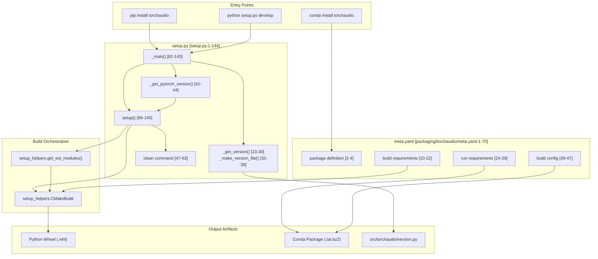
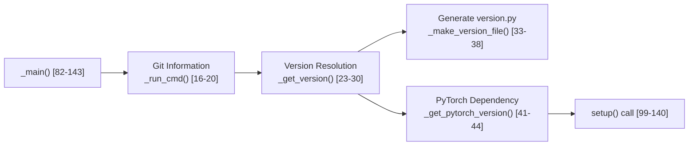
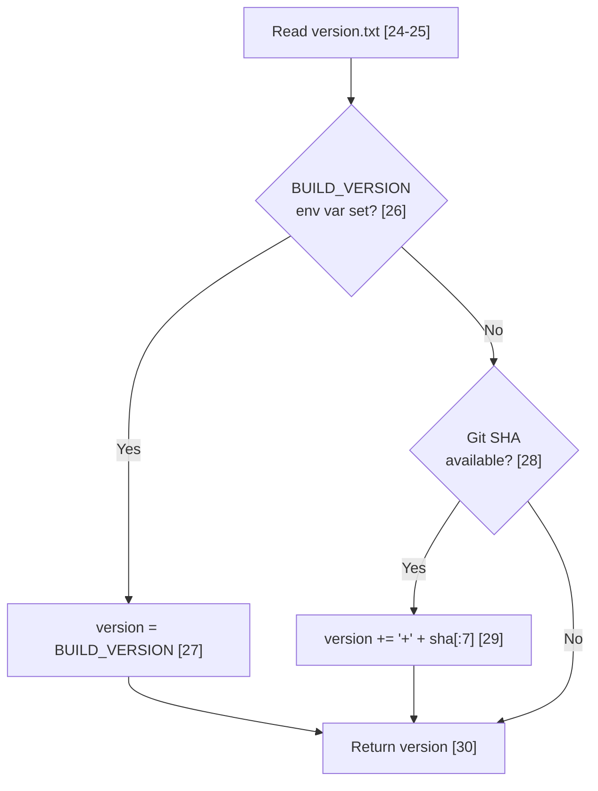
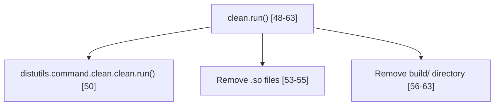
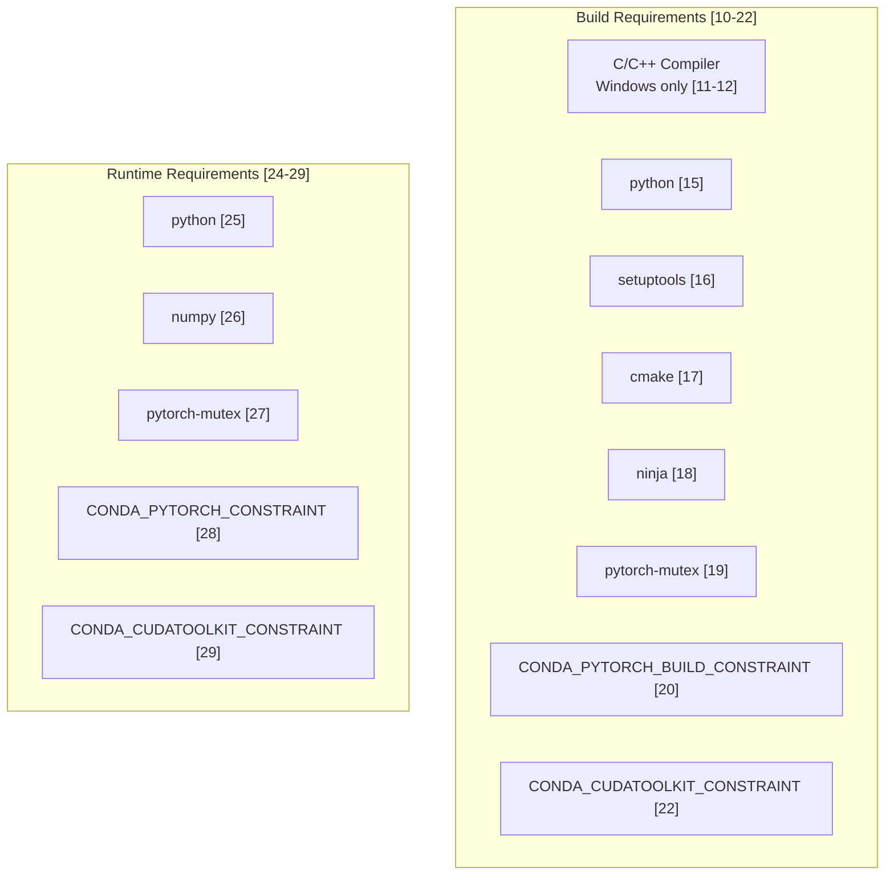
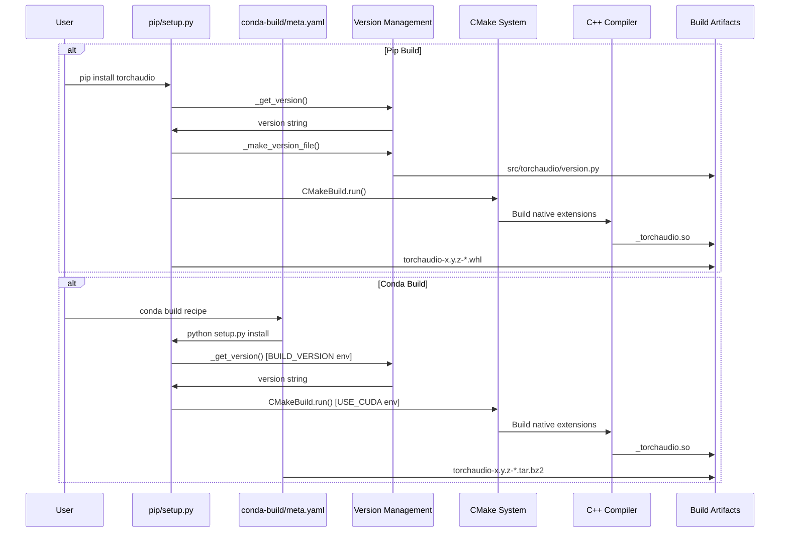

<!-- source: DeepWiki mcp.deepwiki.com · repo pytorch/audio · page 5.1 Build Configuration · fetched 2026-10-21 -->

# Build Configuration

<details>
<summary>Relevant source files</summary>

The following files were used as context for generating this wiki page:

- [packaging/torchaudio/meta.yaml](packaging/torchaudio/meta.yaml)
- [setup.py](setup.py)

</details>


## Purpose and Scope

This document covers TorchAudio's build configuration, focusing on the `setup.py` orchestration layer and conda packaging configuration via `meta.yaml`. It explains version management, dependency resolution (particularly PyTorch version matching), and how setuptools integrates with the CMake-based native compilation system.

For details about the CMake build system itself, see [CMake Build System](#5.2). For CI/CD workflows that execute these build configurations, see [CI/CD Pipeline](#5.3). For the packaging and distribution process, see [Packaging and Distribution](#5.4).

---

## Build Configuration Architecture

TorchAudio uses a two-tier build system: `setup.py` serves as the setuptools entry point that orchestrates high-level concerns (versioning, dependencies, package metadata), while CMake handles the low-level native compilation. For conda packages, `meta.yaml` specifies the conda-specific build and runtime environment.



**Diagram: Build Configuration Architecture**

This diagram maps the build configuration components to their actual code locations. `setup.py` is the primary configuration file for pip-based builds, while `meta.yaml` configures conda builds. Both ultimately invoke CMake for native compilation, but through different mechanisms.

**Sources:** [setup.py:1-144](), [packaging/torchaudio/meta.yaml:1-70]()

---

## setup.py Structure

The `setup.py` file is located at the repository root and serves as the entry point for setuptools-based builds. It handles version management, dependency resolution, and delegates native compilation to CMake via a custom build command.

### Main Execution Flow

The `_main()` function orchestrates the build process:



**Diagram: setup.py Main Execution Flow**

**Sources:** [setup.py:82-143]()

### Version Management

Version management follows a multi-source priority system:

| Priority | Source | Code Location | Description |
|----------|--------|---------------|-------------|
| 1 | `BUILD_VERSION` environment variable | [setup.py:26-27]() | Overrides all other sources; used in CI |
| 2 | `version.txt` + Git SHA | [setup.py:24-29]() | Default for development builds |
| 3 | `version.txt` only | [setup.py:24-25]() | Fallback when Git is unavailable |

The version resolution logic:



**Diagram: Version Resolution Flow**

The generated version is written to `src/torchaudio/version.py` with both the version string and git SHA:

```python
# Generated by _make_version_file() [33-38]
__version__ = '2.0.0+abc1234'
git_version = 'abc1234567890...'
```

**Sources:** [setup.py:23-38]()

### Dependency Resolution

TorchAudio must be built against a specific PyTorch version to ensure ABI compatibility. The `_get_pytorch_version()` function determines the PyTorch dependency:

| Source | Environment Variable | Code Location | Result |
|--------|---------------------|---------------|---------|
| Explicit version | `PYTORCH_VERSION` set | [setup.py:42-43]() | `torch==X.Y.Z` |
| Latest compatible | `PYTORCH_VERSION` not set | [setup.py:44]() | `torch` (any version) |

This dependency is passed to `setup()` as `install_requires`:

```python
# setup.py:138
install_requires=[pytorch_package_dep]
```

**Important:** The PyTorch version must be available at build time because native extensions link against PyTorch's C++ libraries. The build system uses `import torch` at [setup.py:9]() to access PyTorch's build configuration.

**Sources:** [setup.py:9](), [setup.py:41-44](), [setup.py:138]()

### Extension Module Configuration

Native extensions are configured via the `ext_modules` parameter:

```python
# setup.py:133
ext_modules=setup_helpers.get_ext_modules()
```

This delegates to `tools/setup_helpers.py` (not shown in provided files) which generates extension specifications that are built by the custom `CMakeBuild` command:

```python
# setup.py:134-136
cmdclass={
    "build_ext": setup_helpers.CMakeBuild,
    "clean": clean,
}
```

The `CMakeBuild` command class integrates setuptools with CMake, handling the handoff from Python's build system to CMake for native compilation. See [CMake Build System](#5.2) for details on the CMake integration.

**Sources:** [setup.py:133-136]()

### Custom Clean Command

TorchAudio provides a custom `clean` command that extends setuptools' default clean behavior:



**Diagram: Custom Clean Command**

The clean command removes:
1. All `.so` files in `src/**/*.so` (compiled extensions)
2. The `build/` directory

This ensures a clean rebuild when switching between configurations (e.g., CPU to CUDA builds).

**Sources:** [setup.py:47-63]()

### setup() Configuration

The `setup()` call at [setup.py:99-140]() specifies package metadata and configuration:

| Parameter | Value | Description |
|-----------|-------|-------------|
| `name` | `"torchaudio"` | Package name on PyPI |
| `version` | Computed by `_get_version()` | Dynamic versioning |
| `packages` | `find_packages(where="src")` | Auto-discover Python packages |
| `package_dir` | `{"": "src"}` | Python source root |
| `ext_modules` | From `setup_helpers.get_ext_modules()` | Native extensions |
| `cmdclass` | `CMakeBuild`, `clean` | Custom build commands |
| `install_requires` | PyTorch dependency | Runtime dependencies |
| `zip_safe` | `False` | Required for native extensions |

**Python Version Support:** [setup.py:122-126]() declares support for Python 3.10, 3.11, 3.12, 3.13, and 3.14 via classifiers.

**Sources:** [setup.py:99-140]()

---

## Conda Packaging Configuration

For conda distribution, `packaging/torchaudio/meta.yaml` specifies the conda package configuration. This file uses Jinja2 templating to support different build variants (CPU, CUDA).

### Package Definition

```yaml
# meta.yaml:2-7
package:
  name: torchaudio
  version: "{{ environ.get('BUILD_VERSION', '0.0.0') }}"

source:
  path: "{{ environ.get('SOURCE_ROOT_DIR', '../..') }}"
```

The package version comes from the `BUILD_VERSION` environment variable, allowing CI to control versioning consistently across pip and conda builds.

**Sources:** [packaging/torchaudio/meta.yaml:2-7]()

### Build Requirements

Conda build requirements specify tools and libraries needed at build time:



**Diagram: Conda Dependency Structure**

**Build vs. Runtime Dependencies:**

| Build Dependencies | Purpose |
|-------------------|---------|
| Compilers (Windows) | Native code compilation |
| cmake, ninja | Build system tools |
| pytorch-mutex | Ensures CPU/CUDA variant consistency |
| CUDA toolkit | GPU support (when building CUDA variant) |

| Runtime Dependencies | Purpose |
|---------------------|---------|
| python | Python interpreter |
| numpy | Numerical operations |
| pytorch-mutex | Runtime variant enforcement |
| PyTorch | Core dependency |

**Sources:** [packaging/torchaudio/meta.yaml:10-29]()

### Build Variants

The `build_variant` variable controls CPU vs. CUDA builds:

```yaml
# meta.yaml:1

```

This affects:
1. **pytorch-mutex:** Ensures only compatible PyTorch/TorchAudio combinations are installed ([meta.yaml:19](), [meta.yaml:27]())
2. **Run constraints:** CPU builds require `cpuonly` package ([meta.yaml:31-37]())
3. **Build string:** Includes CUDA version in package filename ([meta.yaml:40]())

**Sources:** [packaging/torchaudio/meta.yaml:1](), [packaging/torchaudio/meta.yaml:19-40]()

### Environment Variables

The conda build exposes environment variables to control compilation:

```yaml
# meta.yaml:41-47
script_env:
  - BUILD_VERSION
  - USE_CUDA
  - CUDA_HOME
  - TORCH_CUDA_ARCH_LIST
  - USE_OPENMP
  - MACOSX_DEPLOYMENT_TARGET
```

| Variable | Purpose | Related Build Option |
|----------|---------|---------------------|
| `BUILD_VERSION` | Package version | Used in `_get_version()` |
| `USE_CUDA` | Enable CUDA compilation | CMake `USE_CUDA` option |
| `CUDA_HOME` | CUDA toolkit location | CMake finds CUDA |
| `TORCH_CUDA_ARCH_LIST` | Target GPU architectures | CMake compilation flags |
| `USE_OPENMP` | Enable OpenMP parallelization | CMake finds OpenMP |
| `MACOSX_DEPLOYMENT_TARGET` | macOS SDK version | macOS ABI compatibility |

These variables are consumed by CMake during the build process. See [CMake Build System](#5.2) for how these are used.

**Sources:** [packaging/torchaudio/meta.yaml:41-47]()

### Test Configuration

The conda package includes basic smoke tests:

```yaml
# meta.yaml:49-63
test:
  imports:
    - torchaudio
    - torchaudio.datasets
    - torchaudio.transforms
  
  requires:
    - pytest
    - scipy
```

These import tests verify that the package was built correctly and can be loaded. Full test suites run in CI (see [CI/CD Pipeline](#5.3)).

**Sources:** [packaging/torchaudio/meta.yaml:49-63]()

---

## Build Process Integration

The following diagram shows how the different build configurations integrate during an actual build:



**Diagram: Build Process Integration**

**Key Points:**

1. Both pip and conda builds ultimately call `setup.py`, but conda sets environment variables to control behavior
2. Version management occurs early in the build process and generates `version.py` before native compilation
3. CMake integration happens via the custom `CMakeBuild` command class
4. Native extension compilation produces `.so` (Linux), `.dylib` (macOS), or `.pyd` (Windows) files
5. Final packaging differs: pip creates wheels, conda creates conda packages

**Sources:** [setup.py:82-143](), [packaging/torchaudio/meta.yaml:1-70]()

---

## Configuration Summary

### Key Configuration Files

| File | Purpose | Primary Responsibilities |
|------|---------|------------------------|
| `setup.py` | Setuptools entry point | Version management, dependency resolution, CMake orchestration |
| `packaging/torchaudio/meta.yaml` | Conda recipe | Conda-specific dependencies, build variants, test specification |
| `version.txt` | Base version | Stores the base version string (e.g., "2.0.0") |

### Environment Variables Reference

| Variable | Source | Used By | Purpose |
|----------|--------|---------|---------|
| `BUILD_VERSION` | CI/CD | setup.py, meta.yaml | Override version string |
| `PYTORCH_VERSION` | CI/CD | setup.py | Pin PyTorch dependency |
| `CONDA_BUILD_VARIANT` | conda-build | meta.yaml | Select CPU/CUDA variant |
| `USE_CUDA` | CI/CD | CMake | Enable CUDA compilation |
| `CUDA_HOME` | System/CI | CMake | CUDA toolkit location |
| `TORCH_CUDA_ARCH_LIST` | CI/CD | CMake | Target GPU architectures |

### Build Command Examples

**Development build (pip):**
```bash
python setup.py develop
```

**Wheel build:**
```bash
python setup.py bdist_wheel
```

**Clean build artifacts:**
```bash
python setup.py clean
```

**Conda package build:**
```bash
conda build packaging/torchaudio/
```

**Sources:** [setup.py:1-144](), [packaging/torchaudio/meta.yaml:1-70]()

---

